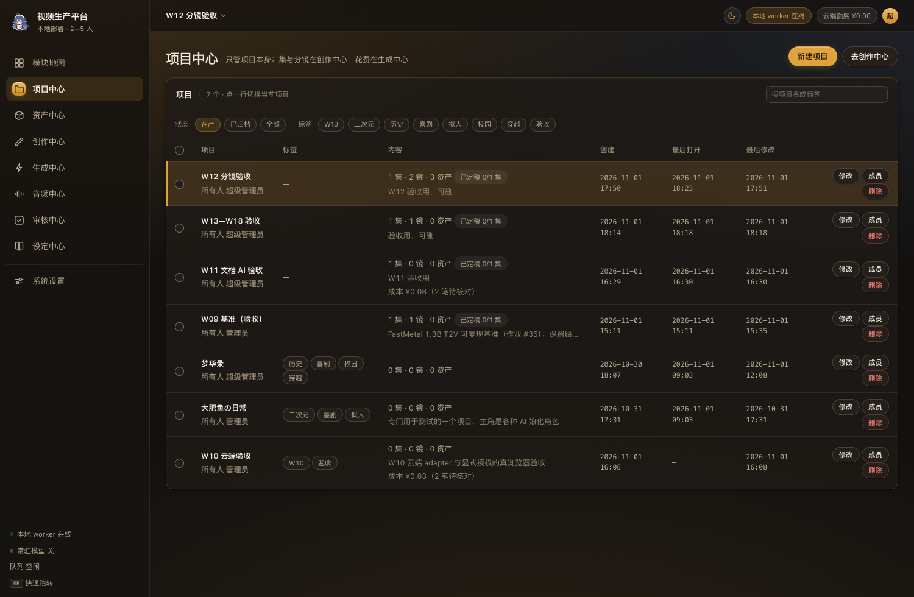
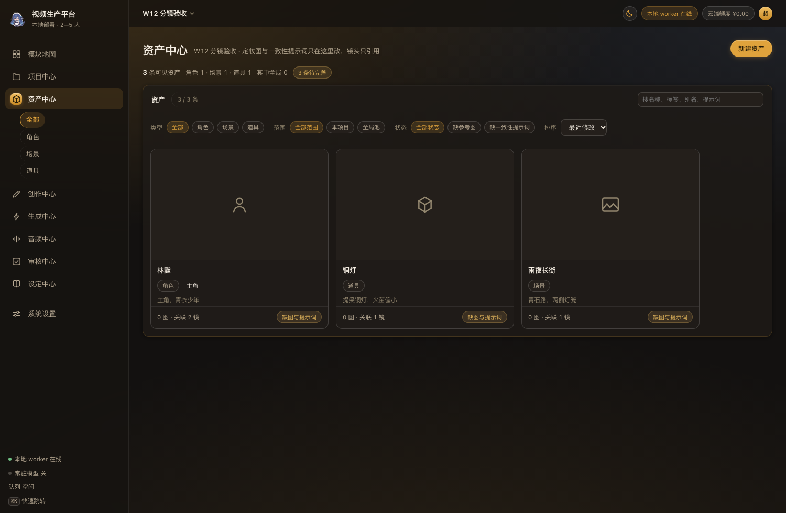

# AI 视频生产平台 数据字典

- 文档类型：物理数据字典（as-built，按 `migrations/0001—0031` 与真实库重写）
- 版本：v1.23（2026-11-03），对应设计稿 v0.96
- 数据库：SQLite 3（WAL）；本机当前 **34 张业务与系统表**
- 口径：表名、列名、类型、默认值、外键、索引均取自迁移文件与 `PRAGMA` 实测；语义解释以当前代码为准
- 对外分发：`文档/导出/数据字典.html`，截图已 base64 内嵌，单文件可直接发送
- 配套文档：[需求概要说明书](需求概要说明书.md)、[系统设计说明书](系统设计说明书.md)、[系统使用说明书](系统使用说明书.md)、[黄金样例与故障演练](黄金样例与故障演练.md)、[发布基线](发布基线.md)

## 修订记录

| 日期 | 版本 | 内容 |
|---|---|---|
| 2026-11-01 | v1.0 | 按 0019 迁移后的真实库重写；补入 `extraction_run`／`extraction_item`、`review_gate`／`review_item`、`audio_clip`；补全 25 张表字段、外键、索引、枚举与删除级联；金额、JSON 与文件路径口径单列 |
| 2026-11-01 | v1.1 | 与需求概要／系统设计说明书同步：补超级用户写操作 **422** 与非超级高层级 **404** 的分界；明确 `status=needs_attention` 与 `billable_status=pending_reconciliation` 是两个字段；审核过期补“签字回 409”；在 Job 与抽取规则里写明 **W10 Wan 仅 mock、W13 真实抽取未付费跑过** |
| 2026-11-01 | v1.2 | 截图改引用 `文档/assets/`，`文档/` 目录可独立预览；避免部分 Markdown 预览器不加载上级目录图片 |
| 2026-11-01 | v1.3 | 新增单文件 HTML 导出：`文档/导出/数据字典.html`，2 处截图 base64 内嵌，可直接拿出去分发 |
| 2026-11-01 | v1.4 | P0（设计稿 v0.75）：新增 `model_validation`（§3.26，0021，只 INSERT，四类出处互不升级）；`job` 补 0020 六列（`actual_cost_micros／reconciled_by／reconciled_at／reconcile_note／attention_reason／superseded_by_job_id`）与两条索引；`attempt` 改为重试 `+1`；`recover_stale` 对云端＋有请求 ID＋租约过期判 `needs_attention`；Job 状态机补 succeeded／failed ↔ needs_attention 双向 |
| 2026-11-02 | v1.5 | 阶段 1（评审 §3.1）：0022 重建 `model_validation`（SQLite CHECK 不可 ALTER），`kind` 增第五档 `artifact_review`；§3.26 生产可用口径改三条件、徽章阶梯补产物验收 |
| 2026-11-02 | v1.6 | 文档体检补两处漏网：§4.2「验证出处 kind」枚举漏第五档 `artifact_review`（与 §3.26 不一致）；§9 规则 8 的 `production_ready` 仍写两条件，改三条件（env_check ∧ real_call ∧ artifact_review） |
| 2026-11-02 | v1.7 | 项目中心 v0.77 为纯呈现层改动：无新表、无新列、无迁移，表结构与 0022 一致；本版仅追设计稿版本 |
| 2026-11-02 | v1.8 | 角色与边界态验收轮：只改前端行为，无表、列、索引与迁移变化；表结构仍与 0022 一致 |
| 2026-11-02 | v1.9 | ⋯ 菜单定位轮：纯前端浮层行为，无表、列、索引与迁移变化；表结构仍与 0022 一致 |
| 2026-11-02 | v1.10 | 「打开」按钮竞态修复轮：纯前端，无表、列、索引与迁移变化；表结构仍与 0022 一致 |
| 2026-11-02 | v1.11 | 转移所有权改口：表结构不变（`project.owner_id`、`project_member` 原样），变的是接口对能交给谁的判定；§3.9 规则里转移时接手人会被移出名单仍然成立 |
| 2026-11-02 | v1.12 | 撤掉行内「打开」按钮：纯前端交互，无表、列、索引与迁移变化；`project.last_opened_at` 的写入时机不变（选中一行仍会 POST `/open`） |
| 2026-11-02 | v1.13 | 成员弹窗排版收口：纯前端标记与样式，无表、列、索引与迁移变化 |
| 2026-11-02 | v1.14 | 十项修正轮：表结构不变；`ProjectOut` 多两个只读计数（`document_count`、`image_count`，SQL 子查询现算，不落库），`ProjectBatchOut` 多一个 `notes` 数组；`project.status` 的写权限从 write 收到 own |
| 2026-11-02 | v1.15 | 安全收口轮：表结构不变；定妆图的读取从静态挂载改为带鉴权的路由（路径规则 `<asset_id>/<uuid>.<ext>` 与 `ref_images` 里存的相对路径完全一致，故无需迁移） |
| 2026-11-02 | v1.16 | 风险与调优轮：表结构不变。§3.6 `session` 补两条口径（读出来的行只带身份列、不含 `password_hash`；过期行在下一次铸会话的同一条事务里删掉）；`job` 成本口径写明看板与成本账共用 `BILLABLE_WHERE` 这一条 WHERE；§5 权限 seed 标出「设定」这一组**未实现**、没有任何接口引用，并说清守卫回归抓不到「权限点没人用」这一面。测试 464→**476** |
| 2026-11-02 | v1.17 | 三件裁定落地：迁移追到 **0001—0024**；§3.11／§3.12 去掉 `shot.status` 与 `asset.status` 两行（0023 摘除，零写入方的列等于第二个真相源）；§4 枚举删掉「资产状态」一行；§5 权限 seed 改写为 18 个点、默认角色 18／13／7，并写清 0024 为什么必须显式删 `role_permission`（迁移期间外键关着，级联不触发）；§10 最新迁移改 0024。表数仍 26 张 |
| 2026-11-02 | v1.18 | 文档校正轮：§3.3 `permission.group_name` 的分组枚举去掉「设定」（0024 已撤）、行数说明改「固定 18 行（0002 建库时 20 行）」；§9 规则 4 重写为「镜头与资产都没有状态列（0023 摘掉两个零写入方的旧字段），执行真相只看 `job.status`，资产完成度现算」——原文还写着「`shot.status` 旧字段不参与界面」，那一列已经不存在了。无代码改动 |
| 2026-11-03 | v1.19 | 自动化漫剧产线 阶段 B（裁定 D1／D3）：迁移追到 **0001—0026**，表数 26→**30**。0025 把 `review_item` 改成多态签字（`doc_id` → `target_kind`＋`target_id`，唯一键换成 `(target_kind, target_id, base_version, anchor)`，删文档时的级联由外键白送改为代码里显式清）；0026 新建 `pipeline_template`／`pipeline_run`／`pipeline_node_run`／`pipeline_event` 四张编排表（§3.27—§3.30）。§4.2 补节点状态与运行状态两组枚举、§6 补五个 JSON 列形态、§8 补级联、§9 补三条产线一致性规则 |
| 2026-11-03 | v1.20 | 阶段 **D 成片**与阶段 **E 整季／资源并发**：迁移追到 **0001—0030**，表数 30→**34**。0027 新建 `composition`（版本唯一、时间线冻结、**不存状态**，§3.31）；0028 重建 `pipeline_node_run`，`node_type` 由 13 种扩到 **16 种**（增 `export_compose／export_validate／export_review`）；0029 新建 `worker_node`（每进程一行心跳与上限，§3.32）；0030 新建 `season_run`／`season_item`（§3.33／§3.34）。§2 关系图、§4.2 枚举、§6 JSON、§8 级联、§9 一致性规则同步 |
| 2026-11-03 | v1.21 | 文档一致性轮（对应设计稿 v0.94，**无表结构变化**）：§2 与 §3.27 把「内置三份」改成**四份**并注明 v1 是历史版本；§3.29 写清成片节点冻的是**哪一条被签过的作业**（`shot_review` 的 `job_id`，退路是生成节点），成片不再回头取「最新成功」。表数仍 34 张、迁移仍 0030。
| 2026-11-03 | v1.22 | 源版本绑定（设计稿 v0.95，**迁移 0031**）：`shot` 加 `revision`／`updated_at`（整体提交一次 +1，老行回填 `created_at`），`job` 加 `source_version`（提交那一刻的分镜四要素＋引用资产指纹；空串＝旧作业或非分镜作业，**不判过期**）；§3.10／§3.17 补这三列，§9 补一条「源是否过期是读时比出来的，不落第二份状态」。表数仍 34 张。
| 2026-11-03 | v1.23 | 预检与占用落地（设计稿 v0.96，**无新表、无新列、无新索引**）：`worker_node.resources_json` 从「预留、恒为 `{}`」变成真读数（`cores`／`load1`／`cpu_pct`／`rss_peak_mb`／`child_rss_peak_mb`／`disk_free_gb`／`disk_total_gb`／`measure`），§3.32 与 §6 同步；分镜列表的 `source_stale` 与预检的 `blocking`／`warnings` 都是**读时算**，不落库——§9 补一条「过期与预检都不建第二份状态」。

---

## 1. 建模总则

1. SQLite 只保存元数据、状态、关系、配置、Job 快照与成本；小说／剧本正文在文件系统 + Git；媒体文件在文件系统。
2. 主键一律 `INTEGER PRIMARY KEY`（自增）；关联表用复合主键；不使用 UUID。
3. 时间一律 `TEXT`，格式 `YYYY-MM-DD HH:MM:SS`，由 SQLite `datetime('now','localtime')` 生成。
4. 金额一律整数 **micros**（1 元 = 1,000,000 micros）；计算用 Decimal 半入；多币种分桶，不跨币种相加。
5. JSON 列以 `TEXT` 存储，写入前 `json.dumps(ensure_ascii=False)`；读取时解析，解析失败按空结构处理并记录错误。
6. 外键默认开启；级联策略逐表写明。文件系统副作用不由外键完成，由 `services.py` 维护。
7. 业务表不记录“谁改的”；只有 `created_by` 一类弱引用。审计要另起设计。
8. 枚举白名单优先写在 Pydantic `Literal` 或服务层；只有稳定且值域窄的字段才在库里加 `CHECK`，避免频繁重建表。

---

## 2. 实体关系概览

```text
app_user ──< user_role >── role ──< role_permission >── permission
   │
   ├──< session
   ├── owns project (owner_id, ON DELETE RESTRICT)
   └──< project_member >── project
                               ├──< project_tag
                               ├──< episode ──< shot
                               ├──< asset ──< asset_tag
                               ├──< document ──< doc_lock
                               │        ├──< review_gate
                               │        └──< extraction_run ──< extraction_item
                               ├──< audio_clip
                               ├──< generation_profile
                               ├──< composition ── job (合成 Job，SET NULL)
                               ├──< season_run ──< season_item >── episode
                               │        └── season_item.pipeline_run_id → pipeline_run (SET NULL)
                               ├──< pipeline_run ──< pipeline_node_run ──< pipeline_event
                               │        └── pipeline_template (template_id / template_version)
                               ├──< review_item (target_kind='document' → document，
                               │                 target_kind='job'      → job；无外键，多态)
                               └──< job ──< audio_clip / extraction_run / composition
                                          ├── job (retry_of_job_id / superseded_by_job_id)
                                          ├──< pipeline_node_run (job_id, 可空, SET NULL)
                                          └──< model_validation (job_id, 可空)

provider_config        独立配置（能力 × 后端）
model_validation       模型验证证据（系统级，只 INSERT，不挂项目）
pipeline_template      流程模板（系统级，内置四份 + 版本冻结）
worker_state           单行心跳（旧接口的镜像）
worker_node            每个 worker 进程一行（0029）
schema_version         迁移版本
```

**注**：`shot` 属于 `episode`，不属于 `document`；分镜没有 Markdown 正文。`document` 只覆盖小说／剧本（以及保留的 `storyboard` 枚举，界面不开放）。

**注 2**：`review_item` 自 0025 起是**多态签字**表，`target_id` 不带外键——一列同时指 `document` 与 `job` 两种对象，外键表达不了"看 `target_kind` 决定指谁"。代价是级联要代码里显式做（删文档时 `repositories/documents.delete()` 先清签字），换来的是产物审核不必再建第二张签字表。

---

## 3. 表定义

### 3.1 app_user 账号

| 列 | 类型 | 约束 | 说明 |
|---|---|---|---|
| id | INTEGER | PK | 账号 ID |
| username | TEXT | NOT NULL, UNIQUE | 登录名；字母数字 `_-` |
| display_name | TEXT | NOT NULL | 显示名 |
| password_hash | TEXT | NOT NULL | scrypt 哈希串；永不回传接口 |
| is_superuser | INTEGER | NOT NULL DEFAULT 0 | 1＝超级用户，绕过权限点 |
| is_active | INTEGER | NOT NULL DEFAULT 1 | 0＝停用，不能登录 |
| must_change_password | INTEGER | NOT NULL DEFAULT 0 | 1＝下次登录强制改密 |
| created_at | TEXT | NOT NULL DEFAULT now | 创建时间 |
| last_login_at | TEXT | 可空 | 最后登录时间 |

索引：`username` 唯一（自动索引）。

规则：

- 超级用户账号对 `/api/users` 只读：不可停用、不可改角色、不可重置口令；改口令走 `/api/auth/password` 或命令行。**对它做任何修改回 422「超级用户账号不可修改」，不是 404。**
- 不能停用自己、不能改自己的角色（服务端 422）。
- 对**非超级用户**的更高层级账号做写操作回 404，不泄露它存在；层级规则与权限点是两套判定。
- 删除账号必须先处理名下项目：`transfer_to` 或 `delete_projects=true`，否则 422。

### 3.2 role 角色

| 列 | 类型 | 约束 | 说明 |
|---|---|---|---|
| id | INTEGER | PK | 角色 ID |
| code | TEXT | NOT NULL, UNIQUE | `admin`／`editor`／`viewer` |
| name | TEXT | NOT NULL | 中文名 |
| description | TEXT | 可空 | 说明 |
| created_at | TEXT | NOT NULL DEFAULT now | 创建时间 |

内置三角色；`admin` 的权限矩阵不可修改（急救通道）。

### 3.3 permission 权限点

| 列 | 类型 | 约束 | 说明 |
|---|---|---|---|
| id | INTEGER | PK | 权限 ID |
| code | TEXT | NOT NULL, UNIQUE | `域:动作` |
| name | TEXT | NOT NULL | 中文名 |
| group_name | TEXT | NOT NULL | 分组（项目／资产／创作／生成／审核／音频／用户／系统；「设定」那一组由 0024 撤掉） |

固定 18 行（0002 建库时 20 行，0024 撤掉没有接口引用的「设定」两条）；超级用户不吃权限点，新增权限点自动生效。

### 3.4 user_role 用户角色

| 列 | 类型 | 约束 | 说明 |
|---|---|---|---|
| user_id | INTEGER | PK, FK → app_user.id CASCADE | 账号 |
| role_id | INTEGER | PK, FK → role.id CASCADE | 角色 |

复合主键 `(user_id, role_id)`；一个用户可挂多个角色，权限取并集。

### 3.5 role_permission 角色权限

| 列 | 类型 | 约束 | 说明 |
|---|---|---|---|
| role_id | INTEGER | PK, FK → role.id CASCADE | 角色 |
| permission_id | INTEGER | PK, FK → permission.id CASCADE | 权限点 |

复合主键；默认 admin 18、editor 13、viewer 7。

### 3.6 session 会话

| 列 | 类型 | 约束 | 说明 |
|---|---|---|---|
| token_hash | TEXT | PK | 会话 Token 的哈希；原文只存在浏览器 Cookie |
| user_id | INTEGER | NOT NULL, FK → app_user.id CASCADE | 所属账号 |
| created_at | TEXT | NOT NULL DEFAULT now | 创建时间 |
| expires_at | TEXT | NOT NULL | 到期时间（默认 12 小时） |
| last_seen_at | TEXT | 可空 | 最近使用时间 |

索引：`idx_session_user(user_id)`。

规则：到期即失效；改密、停用、删号会删除相关会话；退出登录删除当前行。

读会话时只取身份列（`id`／`username`／`display_name`／`is_active`／`is_superuser`／`must_change_password`）加会话的 `expires_at`，**不带 `password_hash`**——这一行就是「当前用户」这个对象的来源，多给一列就等于让它跟着缓存、日志与导出到处走；只有比对旧口令那一条接口自己回库取哈希。过期行在**下一次创建会话时**（也就是有人登录成功时）连同插入用在同一条事务里删掉：这张表没有常驻清理任务，而登录是唯一每次都动它的时刻。

### 3.7 project 项目

| 列 | 类型 | 约束 | 说明 |
|---|---|---|---|
| id | INTEGER | PK | 项目 ID |
| name | TEXT | NOT NULL | 项目名 |
| status | TEXT | NOT NULL DEFAULT `'active'` | `active` 在产／`archived` 已归档 |
| description | TEXT | NOT NULL DEFAULT `''` | 项目介绍，≤500 字 |
| owner_id | INTEGER | NOT NULL, FK → app_user.id RESTRICT | 所有人；不可留悬空 |
| created_at | TEXT | NOT NULL DEFAULT now | 创建时间 |
| updated_at | TEXT | NOT NULL DEFAULT now | 最后修改；归档／打开／转移不推 |
| last_opened_at | TEXT | 可空 | 最后打开；NULL＝从没打开 |

索引：无显式索引；列表按 `last_opened_at` 排序。

规则：

- 删项目硬删；级联清集、镜、资产、文档、作业、音频、审核、抽取、模板、标签、成员。
- 删项目同时清上传文件父目录、工作区正文、作业目录、文档锁。
- 归档只在产项目列表与顶栏菜单中隐藏，不删数据。

### 3.8 project_tag 项目标签

| 列 | 类型 | 约束 | 说明 |
|---|---|---|---|
| project_id | INTEGER | PK, FK → project.id CASCADE | 项目 |
| tag | TEXT | PK | 标签文本，≤20 字 |

复合主键；每个项目最多 10 个标签；整体替换语义。

### 3.9 project_member 协作人

| 列 | 类型 | 约束 | 说明 |
|---|---|---|---|
| project_id | INTEGER | PK, FK → project.id CASCADE | 项目 |
| user_id | INTEGER | PK, FK → app_user.id CASCADE | 协作人 |
| added_by | INTEGER | FK → app_user.id SET NULL | 谁加的 |
| created_at | TEXT | NOT NULL DEFAULT now | 加入时间 |

索引：`idx_project_member_user(user_id)`。

规则：协作人可读可改；不能删项目、不能管成员。所有人不出现在协作人名单里（转移时接手人会被移出名单）。

### 3.10 episode 集

| 列 | 类型 | 约束 | 说明 |
|---|---|---|---|
| id | INTEGER | PK | 集 ID |
| project_id | INTEGER | NOT NULL, FK → project.id CASCADE | 所属项目 |
| seq | INTEGER | NOT NULL | 集号，项目内唯一 |
| title | TEXT | NOT NULL | 集标题 |
| status | TEXT | NOT NULL DEFAULT `'draft'` | `draft`／`active`／`done` |
| created_at | TEXT | NOT NULL DEFAULT now | 创建时间 |

索引：`(project_id, seq)` 唯一（自动索引）。

规则：集号在事务里算；删集级联删镜头与文档的 `episode_id`（文档 `ON DELETE CASCADE`）。

### 3.11 shot 分镜

| 列 | 类型 | 约束 | 说明 |
|---|---|---|---|
| id | INTEGER | PK | 镜 ID |
| episode_id | INTEGER | NOT NULL, FK → episode.id CASCADE | 所属集 |
| seq | INTEGER | NOT NULL | 镜号，集内唯一 |
| summary | TEXT | NOT NULL | 内容摘要／动作与对白 |
| prompt | TEXT | NOT NULL DEFAULT `''` | 生成提示词 |
| duration | REAL | NOT NULL DEFAULT 5 | 时长（秒），1—60 |
| asset_ids | TEXT | NOT NULL DEFAULT `'[]'` | 引用资产 ID 的 JSON 数组 |
| revision | INTEGER | NOT NULL DEFAULT 1 | 源版本号：每次整体提交 +1（0031） |
| updated_at | TEXT | NOT NULL DEFAULT `''` | 最近一次改动时间；老行由 0031 回填 created_at |
| created_at | TEXT | NOT NULL DEFAULT now | 创建时间 |

索引：`idx_shot_episode(episode_id, seq)`；`(episode_id, seq)` 唯一（自动索引）。

规则：

- `asset_ids` 去重保序、最多 40；只允许本项目资产或全局资产。
- 作业的 `shot_id` 是普通外键，允许一镜多作业；改镜不回头改作业。
- `status` 不参与界面显示，避免第二个“完成”真相。

### 3.12 asset 资产

| 列 | 类型 | 约束 | 说明 |
|---|---|---|---|
| id | INTEGER | PK | 资产 ID |
| project_id | INTEGER | 可空, FK → project.id CASCADE | NULL＝全局资产池 |
| kind | TEXT | NOT NULL | `character`／`scene`／`prop` |
| name | TEXT | NOT NULL | 名称 |
| aliases | TEXT | NOT NULL DEFAULT `'[]'` | 别名 JSON 数组 |
| summary | TEXT | NOT NULL DEFAULT `''` | 简介 |
| consistency_prompt | TEXT | NOT NULL DEFAULT `''` | 一致性提示词 |
| ref_images | TEXT | NOT NULL DEFAULT `'[]'` | 参考图相对路径 JSON 数组；第一位＝封面 |
| created_at | TEXT | NOT NULL DEFAULT now | 创建时间 |
| updated_at | TEXT | NOT NULL DEFAULT now | 修改时间 |

索引：

- `uq_asset_name(project_id, kind, name) WHERE project_id IS NOT NULL` 唯一。
- `uq_asset_global_name(kind, name) WHERE project_id IS NULL` 唯一。
- `idx_asset_project(project_id, kind, name)`、`idx_asset_kind(kind, name)`。

规则：

- 全局资产人人可读，写／删只管理员（403）。
- 项目资产可升全局（`project_id` 置 NULL，id 不变）；全局不可收回（409）。
- 被镜头引用不可删（409，列出引用）。
- 删项目不会误删全局资产（外键按 `project_id = ?`，NULL 不匹配）。

### 3.13 asset_tag 资产标签

| 列 | 类型 | 约束 | 说明 |
|---|---|---|---|
| asset_id | INTEGER | PK, FK → asset.id CASCADE | 资产 |
| tag | TEXT | PK | 标签 |

索引：`idx_asset_tag(tag)`。

### 3.14 document 文档元数据

| 列 | 类型 | 约束 | 说明 |
|---|---|---|---|
| id | INTEGER | PK | 文档 ID |
| project_id | INTEGER | NOT NULL, FK → project.id CASCADE | 所属项目 |
| episode_id | INTEGER | 可空, FK → episode.id CASCADE | 挂靠的集；NULL＝全项目共用 |
| kind | TEXT | NOT NULL | `novel`／`script`／`storyboard`（界面只开放前两档） |
| title | TEXT | NOT NULL | 标题 |
| rel_path | TEXT | NOT NULL, UNIQUE | 工作区相对路径，如 `p8/novel/取火.md` |
| status | TEXT | NOT NULL DEFAULT `'draft'` | `draft`／`polishing`／`finalized` |
| git_commit | TEXT | 可空 | 当前正文对应的提交号 |
| created_at | TEXT | NOT NULL DEFAULT now | 创建时间 |
| updated_at | TEXT | NOT NULL DEFAULT now | 内容修改时间 |

索引：`idx_document_project(project_id, kind, title)`、`idx_document_episode(episode_id)`；`rel_path` 唯一（自动索引）。

规则：

- **正文不在库里**；`rel_path` 指向 `FASTVIDEO_WORKSPACE` 内的 Markdown 文件。
- `rel_path` 全局唯一，因为整个工作区共用一个 Git 仓库。
- 路径由服务端生成；前端只传文档 id。
- 删文档走 `git rm` + commit，历史保留。
- 删项目连带删元数据、文件、锁。

### 3.15 doc_lock 文档编辑锁

| 列 | 类型 | 约束 | 说明 |
|---|---|---|---|
| doc_id | INTEGER | PK, FK → document.id CASCADE | 文档 |
| holder_user_id | INTEGER | NOT NULL, FK → app_user.id CASCADE | 持锁人 |
| acquired_at | TEXT | NOT NULL DEFAULT now | 拿锁时间 |
| expires_at | TEXT | NOT NULL | 到期时间（默认 15 分钟） |

索引：`idx_doc_lock_expiry(expires_at)`。

规则：保存与拿锁顺带续期；过期锁不删行，下一次抢锁直接覆盖；别人持锁时保存 423。

### 3.16 provider_config 模型配置

| 列 | 类型 | 约束 | 说明 |
|---|---|---|---|
| id | INTEGER | PK | 配置 ID |
| capability | TEXT | NOT NULL | `text`／`image`／`video`／`tts`／`music` |
| backend | TEXT | NOT NULL | `local`／`cloud` |
| provider | TEXT | NOT NULL DEFAULT `''` | provider 代码，如 `fastmetal`、`deepseek` |
| model | TEXT | NOT NULL DEFAULT `''` | 模型代码 |
| enabled | INTEGER | NOT NULL DEFAULT 0 | 是否启用 |
| is_default | INTEGER | NOT NULL DEFAULT 0 | 是否该类能力默认轨 |
| updated_at | TEXT | NOT NULL DEFAULT now | 更新时间 |
| key_env | TEXT | NOT NULL DEFAULT `''` | 密钥环境变量名（不是值） |
| notes | TEXT | NOT NULL DEFAULT `''` | 备注 |

唯一索引：`(capability, backend)`（自动索引）；固定十行。

规则：每类能力恰一个默认；云端视频不许设默认；没有登记在 adapter 清单里的 provider 不显示参数、不猜运行方式。

### 3.17 job 生成作业（唯一队列）

| 列 | 类型 | 约束 | 说明 |
|---|---|---|---|
| id | INTEGER | PK | 作业 ID |
| project_id | INTEGER | NOT NULL, FK → project.id CASCADE | 所属项目 |
| episode_id | INTEGER | 可空, FK → episode.id SET NULL | 关联集 |
| shot_id | INTEGER | 可空, FK → shot.id SET NULL | 关联镜 |
| capability | TEXT | NOT NULL | `text/image/video/tts/music` |
| kind | TEXT | NOT NULL | `text/image/video_local/video_cloud/tts/music` |
| execution_mode | TEXT | NOT NULL | `local`／`cloud`／`mock`（仅测试） |
| provider_code | TEXT | NOT NULL | provider 代码 |
| model_code | TEXT | NOT NULL | 模型代码 |
| adapter_version | TEXT | NOT NULL DEFAULT `''` | 清单版本／日期 |
| prompt_snapshot | TEXT | NOT NULL DEFAULT `''` | 提交时提示词全文 |
| source_version | TEXT | NOT NULL DEFAULT `''` | 提交时的分镜源内容指纹（0031）；空串＝旧作业或非分镜作业，不判过期 |
| params_json | TEXT | NOT NULL DEFAULT `'{}'` | 提交时参数快照 |
| input_refs_json | TEXT | NOT NULL DEFAULT `'[]'` | 输入引用（文档／抽取 run／音频素材等） |
| status | TEXT | NOT NULL DEFAULT `'queued'` | 八值状态机 |
| priority | INTEGER | NOT NULL DEFAULT 0 | 优先级，高先领 |
| idempotency_key | TEXT | 可空, UNIQUE | 幂等键；全局唯一 |
| retry_of_job_id | INTEGER | 可空, FK → job.id SET NULL | 重试来源 |
| attempt | INTEGER | NOT NULL DEFAULT 1 | 第几次尝试；重试是新行，`attempt=原行+1`（0020 起），历史靠 `retry_of_job_id／superseded_by_job_id` 追 |
| user_confirmed_cloud | INTEGER | NOT NULL DEFAULT 0 | 用户是否确认云端计费 |
| queued_at | TEXT | NOT NULL DEFAULT now | 入队时间 |
| started_at | TEXT | 可空 | 开始执行 |
| finished_at | TEXT | 可空 | 结束 |
| elapsed_ms | INTEGER | 可空 | 墙钟毫秒 |
| progress | REAL | 可空 | 进度（预留） |
| worker_id | TEXT | 可空 | 执行 worker 标识 |
| lease_until | TEXT | 可空 | 租约到期 |
| return_code | INTEGER | 可空 | 子进程退出码 |
| error_code | TEXT | 可空 | 归一化错误码 |
| error_message | TEXT | 可空 | 脱敏后的错误摘要／日志尾部 |
| log_path | TEXT | 可空 | 日志相对路径，如 `33/logs/run.log` |
| result_paths_json | TEXT | NOT NULL DEFAULT `'[]'` | 产物相对路径数组 |
| provider_request_id | TEXT | 可空 | 供应商请求／任务 ID |
| quantity | REAL | 可空 | 计价数量 |
| unit | TEXT | 可空 | 计价单位 `second/million_token/...` |
| unit_price_micros | INTEGER | 可空 | 提交时单价 micros |
| cost_micros | INTEGER | 可空 | 记账金额 micros |
| currency | TEXT | 可空 | 币种 |
| pricing_snapshot_json | TEXT | 可空 | 价格来源、确认人、确认时间、公式 |
| billable_status | TEXT | NOT NULL DEFAULT `'not_billable'` | `not_billable`／`pending_reconciliation`／`known` |
| created_by | INTEGER | 可空, FK → app_user.id SET NULL | 提交人 |
| created_at | TEXT | NOT NULL DEFAULT now | 创建 |
| updated_at | TEXT | NOT NULL DEFAULT now | 更新 |
| resources_json | TEXT | NOT NULL DEFAULT `'{}'` | 本地机时／内存／参数命令或供应商回执 |
| actual_cost_micros | INTEGER | 可空（0020） | 核对后的实际金额 micros；预计 `cost_micros` 是提交快照，核对只写这一列，不改快照 |
| reconciled_by | INTEGER | 可空, FK → app_user.id SET NULL（0020） | 核对人 |
| reconciled_at | TEXT | 可空（0020） | 核对时间 |
| reconcile_note | TEXT | NOT NULL DEFAULT `''`（0020） | 核对备注（判 pending 时只更新它） |
| attention_reason | TEXT | NOT NULL DEFAULT `''`（0020） | 进入 `needs_attention` 的原因，如 `worker_lost` |
| superseded_by_job_id | INTEGER | 可空, FK → job.id SET NULL（0020） | 本行被哪条重试顶掉；与 `retry_of_job_id` 互为反向，重试链靠它从原行往后找 |

索引：

- `idx_job_queue(status, priority DESC, queued_at, id)`：领取顺序。
- `idx_job_project(project_id, queued_at DESC)`。
- `idx_job_shot(shot_id)`、`idx_job_retry(retry_of_job_id)`。
- `idx_job_superseded(superseded_by_job_id)`、`idx_job_reconciled(billable_status, reconciled_at)`（0020）。
- `idempotency_key` 唯一（自动索引）。

规则：

- 领取在 `BEGIN IMMEDIATE` 里查＋改；同一时刻只允许一条本地作业。
- 租约默认 60 秒，执行中每 0.2 秒续租；过期由 `recover_stale` 处置：**云端＋有 `provider_request_id`＋租约过期 → `needs_attention(worker_lost)`**（结果不确定，自动重试会重复计费），其余才收成 `failed(worker_lost)`。
- 取消请求式；重试新行 `attempt+1` 并写 `superseded_by_job_id` 链，原行不动。
- 成本只从本表记；素材、文档、看板不存金额。
- 「什么算进了金额」只有一条 WHERE（`repositories/jobs.BILLABLE_WHERE`）：`cost_micros IS NOT NULL AND currency IS NOT NULL AND billable_status IN ('known','pending_reconciliation')`。成本账与项目看板共用同一条字符串；看板原来少一个 `currency IS NOT NULL`，会把一条有金额没币种的记录聚成一行 NULL 币种的开销。
- **`status` 与 `billable_status` 是两个字段**：`status=needs_attention` 说“这条作业的结果待核对”，`billable_status=pending_reconciliation` 说“这笔钱还没对完账”；界面都显示“待核对”，但判定与汇总各用各的列。核对结清（判 succeeded／failed）把 `billable_status` 置 `known` 并写 `actual_cost_micros／reconciled_by／reconciled_at`。
- **验证状态要分清**：DeepSeek 文本是真调用；Wan 视频目前只由本地 mock HTTP 跑通创建→轮询→下载全链，真实付费调用未发生。字段能存回执，不代表回执已经来。验证凭据另存 `model_validation`（§3.26），不写回本表。
- 删项目级联删 Job 行与目录。

### 3.18 generation_profile 参数模板

| 列 | 类型 | 约束 | 说明 |
|---|---|---|---|
| id | INTEGER | PK | 模板 ID |
| project_id | INTEGER | 可空, FK → project.id CASCADE | NULL＝全局模板 |
| name | TEXT | NOT NULL | 模板名 |
| capability | TEXT | NOT NULL | 适用能力 |
| provider_code | TEXT | NOT NULL DEFAULT `''` | provider |
| model_code | TEXT | NOT NULL DEFAULT `''` | 模型 |
| params_json | TEXT | NOT NULL DEFAULT `'{}'` | 参数 |
| is_default | INTEGER | NOT NULL DEFAULT 0 | 是否默认模板 |
| created_by | INTEGER | 可空, FK → app_user.id SET NULL | 创建人 |
| created_at | TEXT | NOT NULL DEFAULT now | 创建 |
| updated_at | TEXT | NOT NULL DEFAULT now | 更新 |

索引：

- `idx_profile_name(project_id, capability, name)` 唯一。
- `idx_profile_scope(project_id, capability, is_default)`。

规则：模板只预填下一次提交；改模板不影响已落库 Job 的参数快照。全局模板只有管理员能写。

### 3.19 worker_state worker 心跳（单行）

| 列 | 类型 | 约束 | 说明 |
|---|---|---|---|
| id | INTEGER | PK | 固定为 1 |
| worker_id | TEXT | NOT NULL DEFAULT `''` | worker 标识 |
| pid | INTEGER | NOT NULL DEFAULT 0 | 进程号（仅参考） |
| started_at | TEXT | NOT NULL DEFAULT `''` | 启动时间 |
| heartbeat_at | TEXT | NOT NULL DEFAULT `''` | 最近心跳 |
| current_job_id | INTEGER | 可空 | 当前作业 |
| version | TEXT | NOT NULL DEFAULT `''` | 版本 |

在线判定看 `heartbeat_at` 年龄（默认 20 秒），不看 PID（会复用）。

### 3.20 extraction_run 抽取运行

| 列 | 类型 | 约束 | 说明 |
|---|---|---|---|
| id | INTEGER | PK | run ID |
| project_id | INTEGER | NOT NULL, FK → project.id CASCADE | 项目 |
| doc_id | INTEGER | 可空, FK → document.id SET NULL | 来源文档；文档删后 run 保留但无源 |
| job_id | INTEGER | NOT NULL, UNIQUE, FK → job.id CASCADE | 对应作业，一对一 |
| doc_title | TEXT | NOT NULL | 文档标题快照 |
| base_version | TEXT | NOT NULL | 抽取时正文版本（`sha256:...`） |
| content_hash | TEXT | NOT NULL | 正文内容哈希（幂等键之一） |
| model_code | TEXT | NOT NULL | 模型代码 |
| prompt_version | TEXT | NOT NULL | 提示词版本，如 `extract-v1` |
| status | TEXT | NOT NULL DEFAULT `'pending'` | `pending`／`done`／`failed`／`parse_failed` |
| note | TEXT | NOT NULL DEFAULT `''` | 解析说明／丢弃证据原因 |
| materialized_at | TEXT | 可空 | 候选落库时间（预留给批量物化） |
| created_by | INTEGER | 可空, FK → app_user.id SET NULL | 发起人 |
| created_at | TEXT | NOT NULL DEFAULT now | 创建时间 |

索引：

- `idx_extraction_dedupe(doc_id, content_hash, model_code, prompt_version, created_at)`。
- `idx_extraction_project(project_id, created_at DESC)`。
- `job_id` 唯一（自动索引）。

规则：24 小时内同四元组复用旧 run，接口回 `deduped=true`；解析失败落 `parse_failed`，不假装成功。**当前验证状态**：全链由本地假 HTTP 测穿，真实模型抽取尚未付费跑过一次——第一次上线仍要走云端授权与确认流程。

### 3.21 extraction_item 抽取候选

| 列 | 类型 | 约束 | 说明 |
|---|---|---|---|
| id | INTEGER | PK | 候选 ID |
| run_id | INTEGER | NOT NULL, FK → extraction_run.id CASCADE | 所属 run |
| kind | TEXT | NOT NULL | `character`／`scene`／`prop`／`shot` |
| payload | TEXT | NOT NULL DEFAULT `'{}'` | 候选字段 JSON：名称、简介、别名、一致性提示词等 |
| confidence | REAL | 可空 | 模型置信度（只展示，不参与判定） |
| evidence | TEXT | NOT NULL DEFAULT `'{}'` | `{quote,start,end}`；必须逐字出现在正文 |
| status | TEXT | NOT NULL DEFAULT `'pending'` | `pending`／`accepted`／`merged`／`rejected` |
| asset_id | INTEGER | 可空, FK → asset.id SET NULL | 接受／合并后的资产 |
| decided_by | INTEGER | 可空, FK → app_user.id SET NULL | 处理人 |
| decided_at | TEXT | 可空 | 处理时间 |
| created_at | TEXT | NOT NULL DEFAULT now | 创建时间 |

索引：`idx_extraction_item_run(run_id, kind, status)`。

规则：

- 证据对不上就丢弃，不写这一行；丢弃原因写 run.note。
- 同一候选只能处理一次（服务层只允许 `pending` 迁移）。
- 镜头候选没有 `accept` 路径，只导出 Markdown。
- 排序按 `CASE kind`：角色→场景→道具→镜头。

### 3.22 review_gate 校验报告

| 列 | 类型 | 约束 | 说明 |
|---|---|---|---|
| id | INTEGER | PK | gate ID |
| project_id | INTEGER | NOT NULL, FK → project.id CASCADE | 项目 |
| doc_id | INTEGER | NOT NULL, FK → document.id CASCADE | 文档 |
| base_version | TEXT | NOT NULL | 报告对应的正文版本（`sha256:...`） |
| status | TEXT | NOT NULL | `passed`／`failed` |
| findings_json | TEXT | NOT NULL DEFAULT `'[]'` | 每项：anchor／rule／severity／message／start／end／quote |
| summary_json | TEXT | NOT NULL DEFAULT `'{}'` | 句数、错误数、警告数 |
| created_by | INTEGER | 可空, FK → app_user.id SET NULL | 跑 gate 的人 |
| created_at | TEXT | NOT NULL DEFAULT now | 创建时间 |

索引：`idx_review_gate_doc(doc_id, id DESC)`。

规则：一份文档每版可有多份报告；队列只认最新且当前版本的报告；正文版本变化后旧报告过期，**对过期版本签字回 409**。

### 3.23 review_item 审核签字（0025 起多态）

| 列 | 类型 | 约束 | 说明 |
|---|---|---|---|
| id | INTEGER | PK | 签字 ID |
| project_id | INTEGER | NOT NULL, FK → project.id CASCADE | 项目 |
| target_kind | TEXT | NOT NULL DEFAULT `'document'`, CHECK IN (`document`,`job`) | 签的是哪一类对象 |
| target_id | INTEGER | NOT NULL，**无外键** | `document` 时指 `document.id`；`job` 时指 `job.id` |
| gate_id | INTEGER | 可空, FK → review_gate.id SET NULL | 来源报告；产物签字一律为空（产物没有 gate） |
| base_version | TEXT | NOT NULL | 签字对应的版本令牌（见下） |
| anchor | TEXT | NOT NULL | 文档：`c<start>` 或 `document`；产物：`artifact` 或 `artifact:<下标>` |
| decision | TEXT | NOT NULL | `approved`／`rejected`／`returned` |
| note | TEXT | NOT NULL DEFAULT `''` | 备注 |
| signed_by | INTEGER | 可空, FK → app_user.id SET NULL | 签字人 |
| signed_at | TEXT | NOT NULL DEFAULT now | 签字时间 |

唯一索引：`uq_review_item_target(target_kind, target_id, base_version, anchor)`；查询索引：`idx_review_item_project(project_id, target_kind, id DESC)`。

**版本令牌按 `target_kind` 分两种，这是两档签字唯一的实质差别：**

| target_kind | base_version 是什么 | 什么时候失配 |
|---|---|---|
| `document` | 正文的 `sha256:...`（与 `review_gate.base_version` 同源） | 正文改过一次，旧签字就只属于旧版本 |
| `job` | 产物清单摘要＝`sha256([{path, exists, size}…])[:16]` | 产物文件被清理、被新一次生成顶掉，摘要就变 |

规则：同一（对象、版本、锚点）重复签是 **upsert 改判**，不叠第二条历史；`returned`（退回）不是终局，仍可改判；签字需要 `review:sign`；对过期版本签字回 409。`target_id` 没有外键，所以删文档时的清理写在 `repositories/documents.delete()` 里（与删文档同一个连接、同一个事务）；删作业时签字行保留——账要能回答"当时谁签的、签的是哪一版产物"。

### 3.24 audio_clip 音频素材

| 列 | 类型 | 约束 | 说明 |
|---|---|---|---|
| id | INTEGER | PK | 素材 ID |
| project_id | INTEGER | NOT NULL, FK → project.id CASCADE | 项目 |
| episode_id | INTEGER | 可空, FK → episode.id SET NULL | 挂靠集 |
| shot_id | INTEGER | 可空, FK → shot.id SET NULL | 挂靠镜头 |
| kind | TEXT | NOT NULL | `dialogue`／`narration`／`music`／`sfx` |
| speaker | TEXT | NOT NULL DEFAULT `''` | 说话人；旁白／音乐可空 |
| text | TEXT | NOT NULL DEFAULT `''` | 台词或音乐描述 |
| status | TEXT | NOT NULL DEFAULT `'draft'` | `draft`／`queued`／`ready`／`failed` |
| path | TEXT | 可空 | 产物相对路径 |
| duration_ms | INTEGER | 可空 | 时长毫秒 |
| timestamps_json | TEXT | NOT NULL DEFAULT `'[]'` | 字级时间戳 |
| viseme_json | TEXT | NOT NULL DEFAULT `'[]'` | 口型 viseme 段 |
| job_id | INTEGER | 可空, FK → job.id SET NULL | 对应作业 |
| notes | TEXT | NOT NULL DEFAULT `''` | 备注／失败原因 |
| created_by | INTEGER | 可空, FK → app_user.id SET NULL | 创建人 |
| created_at | TEXT | NOT NULL DEFAULT now | 创建 |
| updated_at | TEXT | NOT NULL DEFAULT now | 更新 |

索引：`idx_audio_project(project_id, kind, id DESC)`、`idx_audio_shot(shot_id)`。

规则：

- 没有金额列；成本只看 Job。
- 提交走同一个 `submit_job()`；缺运行时明确失败，不落假作业。
- 成功后 worker 回填路径、时长、时间戳与 viseme。
- `sfx` 实验态：可登记，接口拒绝提交（422）。

### 3.25 schema_version 迁移版本

| 列 | 类型 | 约束 | 说明 |
|---|---|---|---|
| version | INTEGER | PK | 迁移序号 |
| name | TEXT | NOT NULL | 迁移名 |
| applied_at | TEXT | NOT NULL DEFAULT now | 应用时间 |

当前最新 0024。启动时自动补到最新；一个迁移一个事务。

### 3.26 model_validation 模型验证记录（0021 建，0022 重建；只 INSERT）

系统级证据，不跟项目生死，所以单独建表而非塞进 `job`（job 每行都是可执行体，会被 worker 领走、还污染成本汇总）。**只 INSERT，不 UPDATE／DELETE**：改 provider 配置不能洗掉历史，一次真调用的证据留在它当时的快照上。0022 因 SQLite 的 CHECK 约束不可 ALTER，整表重建（建新表 → 逐列搬数据 → 删旧表 → 改名 → 重建三把索引），列序与 0021 完全一致，历史一行不丢。

| 列 | 类型 | 约束 | 说明 |
|---|---|---|---|
| id | INTEGER | PK | 记录 ID |
| capability | TEXT | NOT NULL, CHECK | `text/image/video/tts/music` |
| backend | TEXT | NOT NULL, CHECK | `local`／`cloud` |
| provider | TEXT | NOT NULL DEFAULT `''` | provider 代码 |
| model | TEXT | NOT NULL DEFAULT `''` | 模型代码 |
| adapter_code | TEXT | NOT NULL DEFAULT `''` | 适配器代码 |
| manifest_version | TEXT | NOT NULL DEFAULT `''` | 清单版本 |
| kind | TEXT | NOT NULL, CHECK | 出处：`env_check／mock／real_call／target_machine／artifact_review`，五类互不升级 |
| state | TEXT | NOT NULL, CHECK | `ok／missing／unknown／unconfigured／unregistered／failed` |
| detail | TEXT | NOT NULL DEFAULT `''` | 结论说明 |
| checks_json | TEXT | NOT NULL DEFAULT `'{}'` | 检查明细（env_check 复用 health；真调用记产物字节数与 sha256 是否存在） |
| params_json | TEXT | NOT NULL DEFAULT `'{}'` | 参数快照 |
| job_id | INTEGER | 可空, FK → job.id SET NULL | 凭据作业；env_check／mock 留 NULL |
| provider_request_id | TEXT | 可空 | 供应商请求 ID（真调用才有） |
| http_status | INTEGER | 可空 | 供应商 HTTP 状态 |
| latency_ms | INTEGER | 可空 | 耗时毫秒 |
| artifact_path | TEXT | 可空 | 第一个产物相对路径 |
| artifact_sha256 | TEXT | 可空 | 产物 sha256（真调用必填，不可读则拒记） |
| cost_micros | INTEGER | 可空 | 该作业记账金额 |
| currency | TEXT | 可空 | 币种 |
| paid_confirmed | INTEGER | NOT NULL DEFAULT 0 | 云端是否已确认计费 |
| created_by | INTEGER | 可空, FK → app_user.id SET NULL | 登记人 |
| created_at | TEXT | NOT NULL DEFAULT now | 登记时间 |

索引：`idx_validation_slot(capability, backend, provider, created_at DESC)`、`idx_validation_kind(kind, created_at DESC)`、`idx_validation_state(state, kind)`。

规则：

- **`env_check` 不发请求、不加载权重**，只复用 `adapters.health()`；`job_id／artifact_*／cost_*` 一律 NULL，"有没有花过钱"从数据上直接看得出。
- **`real_call／target_machine／artifact_review` 读一条已成功 Job 盖章**，不自己执行模型；mock 作业拒记 `real_call`／`artifact_review`，云端须先有计费确认，产物不可读拒记。`artifact_review` 是人看过文件后的结论，须显式给 `passed`：通过＝`ok`、不通过＝`failed`，不给结论拒记。
- **`production_ready` 不落库**：由 `summary_for` 现算＝`env_check` ok 且 `real_call` ok 且 `artifact_review` ok；徽章按 `target_machine＞artifact_review＞real_call＞mock＞env_check` 取最高。目标机没跑就是 UNKNOWN，不填推算值。

### 3.27 pipeline_template 流程模板（0026）

| 列 | 类型 | 约束 | 说明 |
|---|---|---|---|
| id | INTEGER | PK | 模板 ID |
| name | TEXT | NOT NULL | 模板名 |
| version | INTEGER | NOT NULL DEFAULT 1 | 版本号；**发布后不改历史版本**，要改就 version+1 再插一行 |
| description | TEXT | NOT NULL DEFAULT `''` | 说明 |
| definition_json | TEXT | NOT NULL DEFAULT `'{}'` | 节点与依赖定义（见 §6） |
| enabled | INTEGER | NOT NULL DEFAULT 1, CHECK IN (0,1) | 停用后不能再拿它发起运行 |
| builtin | INTEGER | NOT NULL DEFAULT 0, CHECK IN (0,1) | 内置＝1，界面只读；改内置流程要走迁移 |
| created_at / updated_at | TEXT | NOT NULL DEFAULT now | 时间 |

唯一索引：`uq_pipeline_template(name, version)`——`ensure_builtin_templates()` 用 `INSERT OR IGNORE`，启动多少次都不会改已发布的那一版。

现役内置**四份**：**标准漫剧单集生产 v1**（13 节点，一镜一条支线，历史版本——成片停在 `export_prepare` 且恒为 skipped）、**同名 v2**（16 节点，在 v1 之后接 `export_compose → export_validate → export_review`，新任务建议选它）、**图片预览生产**（6 节点，只到关键帧验收）、**视频生产**（6 节点，跳过关乎本帧）。v1 不删不改：冻结在 v1 上的历史运行靠它复现。

### 3.28 pipeline_run 生产运行（0026）

| 列 | 类型 | 约束 | 说明 |
|---|---|---|---|
| id | INTEGER | PK | 运行 ID |
| project_id | INTEGER | NOT NULL, FK → project.id CASCADE | 项目 |
| episode_id | INTEGER | NOT NULL, FK → episode.id **CASCADE** | 集。与 `job.episode_id` 的 SET NULL 不同：Job 是账（删一集不该抹账），运行是流程（对象没了流程也就没了） |
| template_id | INTEGER | NOT NULL, FK → pipeline_template.id | 用哪个模板 |
| template_version | INTEGER | NOT NULL | **冻结的版本号**：模板改版不影响已经在跑的运行 |
| paused | INTEGER | NOT NULL DEFAULT 0, CHECK IN (0,1) | 外生意愿位之一 |
| cancelled | INTEGER | NOT NULL DEFAULT 0, CHECK IN (0,1) | 外生意愿位之二 |
| cancel_reason | TEXT | NOT NULL DEFAULT `''` | 取消理由（截 500 字） |
| input_snapshot_json | TEXT | NOT NULL DEFAULT `'{}'` | 建运行那一刻冻结的输入（见 §6）；开始后不再改 |
| idempotency_key | TEXT | 可空, **UNIQUE** | 防同一个请求重放；跨项目撞键回 409 |
| started_at / finished_at | TEXT | 可空 | `finished_at` 非空＝已结束 |
| created_by | INTEGER | 可空, FK → app_user.id SET NULL | 发起人 |
| created_at / updated_at | TEXT | NOT NULL DEFAULT now | 时间 |

索引：`idx_pipeline_run_project(project_id, id DESC)`、`idx_pipeline_run_active(cancelled, paused, id)`（`tick()` 每轮按这两位捞，不扫全表）。

**运行状态一律现算，库里只存 `paused`／`cancelled` 两个外生意愿位。** `running`／`waiting_review`／`attention`／`completed`／`completed_with_errors`／`failed`／`cancelled` 由节点计数与这两位算出来（`pipeline.run_status`）。两套状态各自维护正是 v0.86 那两个真 bug 的形状，这里不重犯。

业务闸：**同一集上只允许一条未结束的运行**（`unfinished_for_episode`），连点两次"开始生产"不会排两套镜头作业；已结束（完成或取消）之后可以再起一条。

### 3.29 pipeline_node_run 节点执行行（0026）

| 列 | 类型 | 约束 | 说明 |
|---|---|---|---|
| id | INTEGER | PK | 节点行 ID |
| run_id | INTEGER | NOT NULL, FK → pipeline_run.id CASCADE | 所属运行 |
| node_key | TEXT | NOT NULL | 模板里的 key；按镜头展开的实例是 `<key>#s<shot_id>` |
| node_type | TEXT | NOT NULL, CHECK IN 16 种 | 见 §4.2「节点类型」；0028 重建 CHECK 补成片三格 |
| status | TEXT | NOT NULL DEFAULT `pending`, CHECK IN 8 种 | 只存真实发生过的事，见 §4.2「节点状态」 |
| depends_on_json | TEXT | NOT NULL DEFAULT `'[]'` | 展开时解析好的依赖 key 清单（运行期不变，所以不建边表） |
| label | TEXT | NOT NULL DEFAULT `''` | 界面显示名（展开时带上镜号，如「关键帧生成 · 镜 02」） |
| input_json | TEXT | NOT NULL DEFAULT `'{}'` | 冻结的输入：shot_id／提示词／时长／参数；审核节点记 `job_id` 或 `doc_id`。合成节点只存 `job_id`，成片版本在 `composition` 行与 `pipeline_event.payload_json` 里 |
| output_json | TEXT | NOT NULL DEFAULT `'{}'` | 输出只放引用与计数：job_id、产物件数、review_item id。**不抄产物路径清单** |
| job_id | INTEGER | 可空, FK → job.id **SET NULL** | 关联的作业。删一条 Job 不该把节点历史一起抹掉，节点还要能说"我关联的作业已经没了" |
| review_id | INTEGER | 可空, FK → review_item.id SET NULL | 人工结论的**引用**；产线不存结论 |
| retry_count | INTEGER | NOT NULL DEFAULT 0 | 这一格重试过几次 |
| error_code / error_message | TEXT | NOT NULL DEFAULT `''` | 失败时给人看的那一句（message 截 1000 字） |
| started_at / finished_at / created_at | TEXT | — | 时间 |

唯一索引：`uq_pipeline_node(run_id, node_key)`——同一节点被重复触发时第二条插不进来；另有 `idx_pipeline_node_run(run_id, id)`、`idx_pipeline_node_job(job_id)`。

**这张表里不出现任何能从 `job` 现读的列**（状态、成本、日志、耗时、产物路径一律不抄），所以产线与 Job 不可能长出两套执行事实。`blocked`／`ready` 也不入库：它们是"`pending` ＋ 依赖满不满足"的读时现算结果。

### 3.30 pipeline_event 产线事件（0026，只追加）

| 列 | 类型 | 约束 | 说明 |
|---|---|---|---|
| id | INTEGER | PK | 事件 ID |
| run_id | INTEGER | NOT NULL, FK → pipeline_run.id CASCADE | 所属运行 |
| node_id | INTEGER | 可空, FK → pipeline_node_run.id SET NULL | 运行级事件为空 |
| event_type | TEXT | NOT NULL, CHECK IN 16 种 | 见 §4.2「产线事件」 |
| payload_json | TEXT | NOT NULL DEFAULT `'{}'` | 事件细节（job_id、reason、计数等） |
| created_at | TEXT | NOT NULL DEFAULT now | 时间 |

索引：`idx_pipeline_event_run(run_id, id)`；读取按 `id DESC` 限 300 条。

规则：**只 INSERT，不 UPDATE、不 DELETE**（除随运行级联）。它是"流程走过哪些步"的线索，不代替 Job 日志，也不代替业务审计——操作审计仍是未实现能力。

### 3.31 composition 成片版本（0027）

| 列 | 类型 | 约束 | 说明 |
|---|---|---|---|
| id | INTEGER | PK | 成片 ID |
| project_id | INTEGER | NOT NULL, FK → project.id CASCADE | 所属项目 |
| episode_id | INTEGER | NOT NULL, FK → episode.id CASCADE | 所属集 |
| pipeline_run_id | INTEGER | 可空, FK → pipeline_run.id SET NULL | 从产线发起时指向那条运行；手工发起为空 |
| version | INTEGER | NOT NULL | 同集版本号，从 1 起 |
| timeline_json | TEXT | NOT NULL | 冻结的时间线：镜头顺序、实际／计划时长、视频作业与路径、宽高、审核引用、音频与字幕 |
| params_json | TEXT | NOT NULL DEFAULT `'{}'` | 合成参数：width／height／fps／video_codec／container |
| job_id | INTEGER | 可空, FK → job.id **SET NULL** | 合成 Job；状态从它现算，作业被删则显示"关联作业已不在" |
| output_path | TEXT | 可空 | 相对 `JOBS_DIR` 的成片路径；不存绝对路径 |
| sha256 / bytes | TEXT / INTEGER | 可空 | 成片摘要与字节数（产物审核的锚点） |
| duration_ms | INTEGER | 可空 | 成片**实际**总时长（ffprobe）；计划总时长由 `timeline_json` 逐镜计划求和，不另存列 |
| width / height | INTEGER | 可空 | 实际输出分辨率 |
| created_by | INTEGER | 可空, FK → app_user.id SET NULL | 发起人 |
| created_at / updated_at | TEXT | NOT NULL DEFAULT now | 时间 |

唯一索引：`uq_composition_version(episode_id, version)`——同集每次合成版本加一，旧版不覆盖；并发撞号整笔回滚并回 409。另有 `idx_composition_project(project_id, id DESC)`、`idx_composition_job(job_id)`。

**没有状态列**：`queued／running／succeeded／failed` 一律从 `job.status` 现算；`params` 与时间线提交后冻结。

### 3.32 worker_node 多进程心跳（0029）

| 列 | 类型 | 约束 | 说明 |
|---|---|---|---|
| id | INTEGER | PK | 行 ID |
| worker_id | TEXT | NOT NULL, **UNIQUE** | 进程稳定标识（启动时生成） |
| pid | INTEGER | NOT NULL DEFAULT 0 | 本机 PID |
| host | TEXT | NOT NULL DEFAULT `''` | 主机名；本机多进程时用来分辨 |
| started_at / heartbeat_at | TEXT | NOT NULL DEFAULT `''` | 启动与最近心跳 |
| current_job_id | INTEGER | 可空, FK → job.id SET NULL | 当前领取的作业；删作业时置空 |
| version | TEXT | NOT NULL DEFAULT `''` | 进程版本号 |
| limits_json | TEXT | NOT NULL DEFAULT `'{}'` | 这个进程启动时声明的并发上限：`{"global":1,"per":{...}}`；是"它凭什么领活"的证据，不是平台当前配置 |
| resources_json | TEXT | NOT NULL DEFAULT `'{}'` | 本进程最近一次心跳采到的机器实况：`cores`、`load1/5/15`、`cpu_pct`（两次心跳之间的均值）、`rss_peak_mb`／`child_rss_peak_mb`（`ru_maxrss` 峰值折 MB）、`disk_free_gb`／`disk_total_gb`（`JOBS_DIR` 所在卷）、`measure`（口径出处）。v0.96 起写真值；老行与没升级的进程仍是 `{}`，界面按缺项显示 |

索引：`idx_worker_node_heartbeat(heartbeat_at DESC)`。在线判定看 `heartbeat_at` 年龄（默认 20 秒），不看 PID；7 天未心跳的行在下次心跳时删除。`worker_state` 仍保留为"最近一次心跳"的单行镜像，旧客户端与备份恢复照旧可用。

### 3.33 season_run 整季批次（0030）

| 列 | 类型 | 约束 | 说明 |
|---|---|---|---|
| id | INTEGER | PK | 批次 ID |
| project_id | INTEGER | NOT NULL, FK → project.id CASCADE | 所属项目 |
| template_id | INTEGER | NOT NULL, FK → pipeline_template.id **RESTRICT** | 用哪份模板；已发起过的模板不能删 |
| name | TEXT | NOT NULL DEFAULT `''` | 批次名（不填由服务端拼） |
| max_active_runs | INTEGER | NOT NULL DEFAULT 1, CHECK ≥ 1 | 同时推进几集；建季时冻结，改上限要新建一季 |
| idempotency_key | TEXT | **UNIQUE** | 防"开始整季"重复点排出两季 |
| paused / cancelled | INTEGER | NOT NULL DEFAULT 0 | 人下的两个意愿位 |
| cancel_reason | TEXT | NOT NULL DEFAULT `''` | 取消原因的人话 |
| started_at / finished_at | TEXT | started 有默认；finished 可空 | 起止时间 |
| created_by | INTEGER | 可空, FK → app_user.id SET NULL | 发起人 |
| created_at / updated_at | TEXT | NOT NULL DEFAULT now | 时间 |

索引：`idx_season_run_project(project_id, id DESC)`、`idx_season_run_active(cancelled, paused, finished_at, id)`。

**不存进行中／已完成／有失败**：这些由 `season_item` 与各集 `pipeline_run` 现算，避免第二套状态真相。

### 3.34 season_item 整季的集清单（0030）

| 列 | 类型 | 约束 | 说明 |
|---|---|---|---|
| id | INTEGER | PK | 行 ID |
| season_id | INTEGER | NOT NULL, FK → season_run.id **CASCADE** | 所属批次 |
| episode_id | INTEGER | NOT NULL, FK → episode.id **CASCADE** | 哪一集 |
| pipeline_run_id | INTEGER | 可空, FK → pipeline_run.id **SET NULL** | 这一集对应的单集运行；空＝还没起或被拦下 |
| position | INTEGER | NOT NULL | 排产顺序 |
| error_message | TEXT | NOT NULL DEFAULT `''` | 启动失败的人话（没有镜头、模板不成立、同一集已有别的运行）；不是运行状态的第二份真相 |
| created_at / updated_at | TEXT | NOT NULL DEFAULT now | 时间 |

唯一键 `(season_id, episode_id)`：一季里同一集只排一次；索引 `idx_season_item_season(season_id, position, id)`、`idx_season_item_run(pipeline_run_id)`。

**每集的执行事实仍在 `pipeline_run` 与 `job` 里**：本表只回答"这一季包含哪几集、对应哪条运行、起不来时为什么"。

---

## 4. 枚举与状态机

### 4.1 Job 状态

| 值 | 含义 | 可迁移到 |
|---|---|---|
| `queued` | 排队 | starting／cancelled |
| `starting` | 已被 worker 领取 | running／failed |
| `running` | 执行中 | succeeded／failed／cancel_requested |
| `cancel_requested` | 已请求取消 | cancelled |
| `cancelled` | 已取消 | —（重试新建一行） |
| `succeeded` | 成功 | needs_attention（标记待核对）；重试新建一行 |
| `failed` | 失败 | needs_attention（标记待核对）；重试新建一行 |
| `needs_attention` | 结果待核对 | succeeded／failed（核对结清）；核对 pending 仍停在本态 |

### 4.2 其他枚举

| 域 | 值 |
|---|---|
| capability | `text`／`image`／`video`／`tts`／`music` |
| kind（Job） | `text`／`image`／`video_local`／`video_cloud`／`tts`／`music` |
| execution_mode | `local`／`cloud`／`mock`（仅测试） |
| billable_status | `not_billable`／`pending_reconciliation`／`known` |
| 项目状态 | `active`／`archived` |
| 集状态 | `draft`／`active`／`done` |
| 文档类型 | `novel`／`script`／`storyboard`（界面只开放前两档） |
| 文档状态 | `draft`／`polishing`／`finalized` |
| 资产类型 | `character`／`scene`／`prop` |
| 抽取候选类型 | `character`／`scene`／`prop`／`shot` |
| 抽取 run 状态 | `pending`／`done`／`failed`／`parse_failed` |
| 候选处理状态 | `pending`／`accepted`／`merged`／`rejected` |
| gate 状态 | `passed`／`failed` |
| 审核结论 | `approved`／`rejected`／`returned` |
| 音频类型 | `dialogue`／`narration`／`music`／`sfx` |
| 音频状态 | `draft`／`queued`／`ready`／`failed` |
| provider 后端 | `local`／`cloud` |
| 验证出处 kind | `env_check`／`mock`／`real_call`／`target_machine`／`artifact_review`（互不升级） |
| 验证结果 state | `ok`／`missing`／`unknown`／`unconfigured`／`unregistered`／`failed` |
| 计费状态 billable_status | `not_billable`／`pending_reconciliation`／`known` |
| 签字对象 target_kind | `document`／`job` |
| 节点类型 node_type | `project_input`／`episode_input`／`document_input`／`shot_validate`／`asset_validate`／`human_gate`／`image_generate`／`image_review`／`video_generate`／`artifact_validate`／`shot_review`／`audio_prepare`／`export_prepare`／`export_compose`／`export_validate`／`export_review`（16 种） |
| 节点状态（入库） | `pending`／`running`／`waiting_review`／`attention`／`completed`／`failed`／`skipped`／`cancelled` |
| 节点状态（只读时现算） | `blocked`（pending 且前置未完成）／`ready`（pending 且前置都完成）——**不入库** |
| 运行状态（全部现算，库里只有 paused／cancelled 两位） | `running`／`waiting_review`／`attention`／`paused`／`cancelled`／`completed`／`completed_with_errors`／`failed` |
| 资源类 | `text`／`image`／`video`／`audio`／`compose`（`tts`／`music` 归 `audio`，`provider=ffmpeg` 归 `compose`） |
| 整季状态（现算，库里只有 paused／cancelled／finished_at） | `running`／`paused`／`cancelled`／`completed`／`completed_with_errors` |
| 整季单集状态（现算） | `pending`（待开始）／`failed`（启动被拒）＋该集运行状态的七值 |
| 产线事件 event_type | `run_created`／`run_started`／`run_paused`／`run_resumed`／`run_cancelled`／`run_completed`／`run_failed`／`node_ready`／`node_started`／`node_completed`／`node_failed`／`node_skipped`／`node_retried`／`node_waiting_review`／`node_attention`／`job_submitted` |

**节点状态机**（终态＝`completed`／`failed`／`skipped`／`cancelled`，进了终态就不再被调度）：

```text
pending ──try_begin()──> running ──> completed          （内部检查通过／作业 succeeded／签字 approved）
   │                        ├──> failed                 （检查没过／作业 failed／签字 rejected／作业没了）
   │                        ├──> waiting_review ──> completed | failed
   │                        └──> attention              （作业 needs_attention，绝不自动重试）
   └──(运行取消时还没开始)──> cancelled
failed ──retry_node()──> pending（内部节点）| running（作业节点，直接跟 jobs.retry() 新建的那条走）
```

转态一律带**期望状态**（`finish_node(..., expect=...)`、`try_begin()` 的 `WHERE status='pending'`）：期望不匹配就不动，绝不覆盖别人的结论。重复调度的正确性靠这两个 `rowcount`，不靠"只有一个 worker 在跑"这个假设。

---

## 5. 权限 seed

| 分组 | 权限点 |
|---|---|
| 项目 | `project:read`、`project:write`、`project:delete` |
| 资产 | `asset:read`、`asset:write` |
| 创作 | `doc:read`、`doc:write` |
| 生成 | `job:read`、`job:submit`、`job:cancel` |
| 审核 | `review:read`、`review:sign` |
| 音频 | `audio:read`、`audio:write` |
| 用户 | `user:read`、`user:write`、`user:assign` |
| 系统 | `system:config` |

这 18 个点由 `0002_auth.sql` 一次性 seed 进 20 个，`0024_drop_setting_perms.sql` 撤掉「设定」两条。
撤的理由：设定中心到今天没有表、没有接口，这两个代码在角色矩阵里就是两个勾了不做事的选项，而 `tests/test_guards.py` 那张表抓不到这种方向——它比的是"端点通不通得了"（少一条就先红，再跟着匿名一律 401 那条，等于新端点漏挂守卫当场被逮），但"权限点 seed 了却没有任何接口引用它"它看不见。所以要么补接口、要么撤，不能一直摆着。
0024 里 `role_permission` 要显式删：迁移期间外键是关着的（重建表时开着会失败），`ON DELETE CASCADE` 不会触发；顺序反了就会留下孤儿授权行，末尾的 `foreign_key_check` 会拒收整个迁移。

默认角色权限：admin 18（子查询取全部，跟着权限点总数走）、editor 13（缺 `project:delete` 与四条用户／系统相关）、viewer 7（项目／资产／文档／作业／审核／音频只读，外加 `user:read` 可看用户）。

**产线中心（0026）一个权限点都没新加**：读模板与读运行＝`job:read`，发起运行／推进／重试节点＝`job:submit`，暂停／恢复／取消＝`job:cancel`；模板这一版**只读**（只有两条 GET），所以连 `system:config` 都没用上。所以角色矩阵与 seed 都没变，表仍是 18 行。副作用要在界面上说清：`job:submit` 意味着 editor 也能起一条整集产线——他今天已经能逐条提交作业，这不是新授权；而云端作业仍被 `submit_job` 逐条拦着要确认单，产线不替人花钱。

---

## 6. JSON 字段形态

| 字段 | 形态 | 示例 |
|---|---|---|
| `asset.aliases` | 字符串数组 | `["阿默","小默"]` |
| `asset.ref_images` | 相对路径数组；首位＝封面 | `["ref_images/ab12.png"]` |
| `shot.asset_ids` | 整数数组，去重保序 | `[1,3,7]` |
| `job.params_json` | 参数对象 | `{"width":640,"height":352,"frames":81}` |
| `job.input_refs_json` | 对象数组 | `[{"type":"doc","doc_id":12}]` |
| `job.result_paths_json` | 相对路径数组 | `["45/outputs/a.mp4"]` |
| `job.pricing_snapshot_json` | 计价快照 | `{"unit":"second","unit_price_micros":600000,"source":"...","confirmed_by":1,"confirmed_at":"..."}` |
| `job.resources_json` | 本地机时／命令／指标，或供应商回执 | `{"wall_ms":28200,"child_max_rss_kb":...,"command":[...]}` |
| `extraction_item.payload` | 候选字段 | `{"name":"林默","summary":"主角","aliases":[]}` |
| `extraction_item.evidence` | 逐字证据 | `{"quote":"林默提灯","start":120,"end":124}` |
| `review_gate.findings_json` | 问题数组 | `[{"anchor":"c0","rule":"placeholder","severity":"error","quote":"TODO"}]` |
| `review_gate.summary_json` | 统计 | `{"sentences":3,"errors":2,"warnings":1}` |
| `audio_clip.timestamps_json` | 字级时间戳 | `[{"text":"你","start_ms":0,"end_ms":120}]` |
| `audio_clip.viseme_json` | 口型段 | `[{"viseme":"A","start_ms":0,"end_ms":80}]` |
| `pipeline_template.definition_json` | 节点数组，每项 key／type／depends_on／fan_out／params | `{"nodes":[{"key":"keyframe","type":"image_generate","depends_on":["confirm"],"fan_out":"shot","params":{"width":640}}]}` |
| `pipeline_run.input_snapshot_json` | 建运行那一刻的输入冻结 | `{"project":{...},"episode":{...},"document":{"id":3,"base_version":"sha256:..."},"shots":[{"id":7,"seq":1,"prompt":"...","duration":5}],"assets":{"usable":[1],"missing":[],"without_ref_image":[1]}}` |
| `pipeline_node_run.depends_on_json` | 展开后的依赖 key 数组 | `["keyframe#s7"]` |
| `pipeline_node_run.input_json` | 这一格的输入引用 | `{"shot_id":7,"prompt":"...","params":{...}}`；审核节点另记 `{"job_id":45}` 或 `{"doc_id":3,"base_version":"sha256:..."}` |
| `pipeline_node_run.output_json` | 只放引用与计数 | `{"job_id":45,"artifacts":1,"provider":"mock","model":"mock-1"}` |
| `pipeline_event.payload_json` | 事件细节 | `{"job_id":45,"reused":true}`、`{"reason":"review_rejected"}` |
| `composition.timeline_json` | 冻结的镜头时间线与计划值 | `{"shots":[{"seq":1,"shot_id":7,"duration_ms":5000,"planned_duration_ms":5000,"video":{"job_id":45,"path":"45/outputs/a.mp4","width":1280,"height":720},"review_id":9}],"total_duration_ms":5000}` |
| `composition.params_json` | 合成参数 | `{"width":1280,"height":720,"fps":24,"video_codec":"h264","container":"mp4"}` |
| `worker_node.limits_json` | 进程启动时声明的上限 | `{"global":2,"per":{"text":1,"image":1,"video":1,"audio":1,"compose":1}}` |
| `worker_node.resources_json` | 进程心跳采到的机器实况 | `{"cores":10,"load1":1.85,"cpu_pct":1.4,"rss_peak_mb":50.5,"disk_free_gb":198.66,"disk_total_gb":460.43,"measure":"getrusage+self+children/getloadavg/disk_usage(JOBS_DIR)"} |
| `season_run` 无 JSON 列 | 批次只存命令位与上限 | — |
| `season_item.error_message` | 人话，不是状态 | `"同一集已有未结束的运行"`、`"这一集还没有分镜"` |

---

## 7. 文件系统与数据库的对应

| 数据 | 位置 | 数据库字段 |
|---|---|---|
| 小说／剧本正文 | `WORKSPACE/<project>/<kind>/<title>.md` | `document.rel_path` |
| 文档版本历史 | `WORKSPACE/.git` | `document.git_commit` |
| 资产参考图 | `FILES/<asset_id>/<uuid>.<ext>` | `asset.ref_images`（相对路径） |
| 作业日志 | `JOBS/<job_id>/logs/run.log` | `job.log_path` |
| 作业产物 | `JOBS/<job_id>/outputs/*` | `job.result_paths_json` |
| Git 失败未应用正文 | `DATA/unapplied/*` | 不落库，错误消息指出位置 |
| 迁移前备份 | `DATA/backups/*` | 不落库 |
| 恢复前安全备份 | `DATA/restore-safety-<stamp>/*` | 不落库 |

**路径纪律**：所有相对路径读取前做一次真实路径边界校验；`startswith(root + os.sep)`，避免 `/data/workspaceevil` 误匹配。

---

## 8. 删除与级联

| 删除对象 | 级联 | 文件副作用 |
|---|---|---|
| 项目 | 集、镜、资产（本项目）、文档、锁、作业、音频、审核、抽取、模板、标签、成员、**产线运行（连同节点与事件）**、**成片版本**、**整季批次（连同集清单）** | 上传文件父目录、工作区正文、作业目录、文档锁、成片文件 |
| 集 | 镜头、文档（`episode_id` CASCADE）、**产线运行（CASCADE）**、**成片版本（CASCADE）**、**整季集清单（CASCADE）** | 成片行随集删，但成片文件属于 Job，Job 行按账保留（`episode_id` SET NULL），文件不随删集清 |
| 资产 | `asset_tag`；被镜头引用时拒绝 | 参考图与空目录 |
| 文档 | `doc_lock`、`review_gate`；**`review_item` 里 `target_kind='document'` 的签字由代码显式删**（0025 起 `target_id` 无外键，级联不再白送）；抽取 run 的 `doc_id` SET NULL | `git rm` + commit，历史保留 |
| 作业 | 音频／抽取的 `job_id` SET NULL；重试链 `retry_of_job_id／superseded_by_job_id` SET NULL；`model_validation.job_id` SET NULL（证据行保留，只丢引用）；**`pipeline_node_run.job_id` SET NULL**（节点行保留，下一轮推进报 `job_missing` 并收成失败，不卡在"执行中"）；**`review_item` 里 `target_kind='job'` 的签字保留**（账要能回答当时谁签的、签的哪一版产物） | 作业目录 |
| 账号 | 会话、角色关联、协作关系；项目 `owner_id` RESTRICT | 无 |
| 角色 | `user_role`、`role_permission` | 无 |
| 产线运行 | 节点行、事件（都 CASCADE）；`composition.pipeline_run_id` SET NULL（成片行保留）；`season_item.pipeline_run_id` SET NULL | 无（产物属于 Job，不随运行删） |
| 流程模板 | 无级联：`pipeline_run.template_id` 与 `season_run.template_id` 都是 RESTRICT 语义的普通外键，**已发起过的模板不删**；停用改 `enabled=0` | 无 |
| 整季批次 | 集清单（CASCADE）；各集运行不删（它们属于集，不属于批次） | 无 |
| worker 进程行 | 不随项目／作业删除；作业被删时 `current_job_id` SET NULL；7 天未心跳由下一次心跳清掉 | 无 |

---

## 9. 数据一致性规则

1. **金额只在 Job**：任何其他表都没有 `cost`／`price` 列；看板按 Job 现算。
2. **正文只在文件**：`document` 没有 `content` 列；保存必须同时成功写文件与 Git。
3. **快照不可回改**：`job.prompt_snapshot`／`params_json`／`episode_id`／`shot_id`／`queued_at` 提交后冻结。
4. **状态不重复**：镜头与资产都没有状态列（0023 摘掉两个零写入方的旧字段）；执行真相只看 `job.status`，资产完成度按参考图与一致性提示词现算。
5. **唯一键**：`idempotency_key`（job 与 pipeline_run 各一条）、`document.rel_path`、`(target_kind,target_id,base_version,anchor)`、`(run_id,node_key)`、`(pipeline_template.name,version)`、两条资产部分唯一索引、`(project_id,seq)`、`(episode_id,seq)`、`(project_id,capability,name)`。
6. **时间语义**：`project.updated_at` 只表示内容动过；归档、打开、转移不推；`document.updated_at` 只在内容实际写成功且变化时推。
7. **版本令牌**：文档 `base_version` 是 `sha256:<hex>`；AI 预览、审核 gate、签字都用它判断“是不是同一版正文”。产物签字的 `base_version` 是产物清单摘要（`sha256[...]` 前 16 位），产物被清理或被顶掉就失配。
8. **验证证据只增不改**：`model_validation` 只 INSERT；`production_ready` 不落库，由服务端按"env_check ok 且 real_call ok 且 artifact_review ok"三条件现算，界面不自己拼。预计成本 `cost_micros` 是提交快照，核对只写 `actual_cost_micros`，两个数都留着对账。
9. **产线不抄 Job 的事实**：`pipeline_node_run` 里没有状态之外的执行细节——成本、日志、耗时、产物路径一律现读 `job` 表；节点只存"关联哪条 Job、流程走到哪一步、失败时给人看的那句话"。所以产线与 Job 不可能长出两套执行事实。
10. **产线不写审核结论**：`review_id` 只是引用；签字唯一的写入口仍是审核中心（`POST /api/documents/{id}/review-sign` 与 `POST /api/jobs/{id}/review-sign`）。产线读签字推动流程，读不到就一直等。
11. **运行状态只存外生意愿**：`paused`／`cancelled` 入库，其余运行状态由节点计数现算；节点的 `blocked`／`ready` 同样只读时算。存两份状态就要互相同步，"忘记同步"正是 v0.86 修掉的两个真 bug 的形状。
12. **一格一条作业**：作业节点重试走 `jobs.retry()` 新建一行、节点直接跟着新作业进 `running`（不回 `pending`），否则调度器会再提交一条，同一格就有两条作业、其中一条谁也不认。
13. **成片不存状态**：`composition` 没有 status 列，`queued／running／succeeded／failed` 从 `job.status` 现算；作业被删（`job_id` SET NULL）时显示"关联作业已不在"，不伪装成草稿或成功。
14. **成片快照不可回改**：`timeline_json` 与 `params_json` 在发起时冻结；改分镜、换素材、删作业都不动已提交的那一版。同集版本由 `(episode_id, version)` UNIQUE 保证递增、不覆盖。
15. **整季不存第二套状态**：`season_run` 只有 `paused／cancelled／finished_at` 三个外生位；"生产中／已完成／有失败"由 `season_item` 与各集 `pipeline_run` 现算。`season_item.pipeline_run_id` 只是引用，每集执行事实仍在运行与 Job 里。
16. **一集一条未完成运行**：单集发起与整季起一集共用同一条业务闸；撞上时回 409 或挂到已有运行，绝不并行两条。
17. **资源类只在一个地方判定**：`jobs.RESOURCE_CLASS_SQL` 的 CASE 是唯一映射（ffmpeg→compose、tts／music→audio、其余按 capability）；领取、队列计数与 worker 面板都读它，别处不许再拼一套分类。
19. **过期与预检都不建第二份状态**：`source_stale` 是拿 `job.source_version` 与当前分镜指纹现场比出来的，预检的 `blocking`／`warnings` 是调用当时算出来的——两处都不落库，所以不存在「改了分镜还要记得去更新某个状态位」这种事。
18. **并发上限是每进程声明、全库裁决**：`worker_node.limits_json` 只记录"这个进程凭什么领活"；真正的在跑计数在领取事务里按资源类与全局现数，两个进程同时领取只有一个拿到。

---

## 10. 迁移与备份

- 最新迁移：`0030_season.sql`（0027 建成片表；0028 重建 `pipeline_node_run` 把节点类型扩到 16 种；0029 建多进程心跳 `worker_node`；0030 建整季 `season_run`／`season_item`）。0025 把 `review_item` 重建为多态签字表——SQLite 不能 ALTER 掉一列，所以走"建新表→按列名搬数据→删旧表→改名→重建索引"；0020—0022 是 P0 与阶段 1；0023 摘掉 `shot.status`／`asset.status` 两个零写入方的列，0024 撤掉 `setting:*` 两个无接口引用的权限点。
- 启动自动迁移；迁移前若库中已有表且有待应用迁移，先做 SQLite `backup()` 快照，保留 5 份。
- 备份目录 `data/backups/`；恢复前安全备份 `data/restore-safety-<stamp>/`。
- `backup.py` 的 manifest 记录：文件 sha256、`PRAGMA integrity_check`、`PRAGMA foreign_key_check`、逐表行数。
- 恢复流程：`verify` → 建安全备份 → 覆盖库与目录 → 再次校验。

---

## 11. 字段与界面映射（示例）

数据字典不是只给后端看的；下面两张图把常用字段落回界面，避免“库里有、界面上找不到”。



*图 11-1 项目中心：`project.name/description/status/owner_id/last_opened_at/updated_at` 六列直接可见；“内容”一格的集／镜／资产计数与“已定稿 N/M 集”是 `episode/shot/asset` 与 `episode.status` 的聚合。*



*图 11-2 资产中心：卡片上的类型、名称、简介来自 `asset.kind/name/summary`；“关联 N 镜”来自 `shot.asset_ids` 反查；参考图来自 `asset.ref_images`，数组第一位就是封面。*

字段与页面不是一一复制关系：页面上的“最后打开”“已定稿”“关联 N 镜”都是聚合或派生值，不落库；落库的只有事实字段。详见 §9 数据一致性规则。
