# AI 视频生产平台 模型中心使用说明书

- 文档类型：面向管理员的模型与引擎配置操作手册（模型登记、默认轨、验证、调用策略、运行监控）
- 版本：v1.23（2026-11-14）；适配器清单 `2026-11-06.2`
- 适用界面：当前 `app/frontend/` 的日／夜双主题。本文 13 张图：11 张白天主题的于 2026-11-07 用 `tools/model_center_shots.py` 重拍（引擎实例卡、策略页的「清单缺能力」徽章、验证历史的翻页条都在这一版图上）；`2-4`／`2-5` 两张是提交框场景候选与预填留痕，为**夜间主题**（2026-11-08 由 `tools/generate_scene_check.py` 同款环境截取）；读图以图注为准
- 配套文档：[系统使用说明书](系统使用说明书.md)（§3 是同一件事的简版）、[系统设计说明书](系统设计说明书.md)、[数据字典](数据字典.md)、[需求概要说明书](需求概要说明书.md)、[黄金样例与故障演练](黄金样例与故障演练.md)、[发布基线](发布基线.md)

## 目录

1. [修订记录](#修订记录)
2. [0. 一页结论](#0-一页结论)
3. [1. 入口与页面骨架](#1-入口与页面骨架)
4. [2. 模型仓库](#2-模型仓库)
5. [3. 引擎管理](#3-引擎管理)
6. [4. 验证：配置就绪不等于生产可用](#4-验证配置就绪不等于生产可用)
7. [5. 调用策略](#5-调用策略)
8. [6. 运行监控](#6-运行监控)
9. [7. 这台机器现在的实况](#7-这台机器现在的实况)
10. [8. 常见问题](#8-常见问题)
11. [9. 权限与接口](#9-权限与接口)
12. [10. 边界与已知限制](#10-边界与已知限制)
13. [附录 A 截图索引](#附录-a-截图索引)
14. [附录 B 名词表](#附录-b-名词表)
15. [附录 C 变更详录](#附录-c-变更详录)

## 修订记录

| 日期 | 版本 | 一句话结论 | 详见 |
|---|---|---|---|
| 2026-11-14 | v1.23 | 界面现代美化（极光/暗金双主题、精密倒角）与引擎检查即时开窗优化：0ms开窗流光骨架屏，出网探测全并发，十轨环境检查后台异步并发留痕 | §3.5、附录 C |
| 2026-11-13 | v1.22 | 补一次真实的云端文本链路验证：10 token 实测通到落盘，并写明它只能证明 `real_call`、不能冒充生产可用 | §4.3.1、附录 C |
| 2026-11-13 | v1.21 | 能力轨改用完整引擎与模型下拉；启动服务后继续等待连接，成功自动刷新为就绪 | §3.1、§3.5、附录 C |
| 2026-11-13 | v1.20 | 清掉四处「ComfyUI 未接入／没有连接按钮」的旧话，与「只接探测」口径统一 | §3.4、§8、§10、附录 C |
| 2026-11-13 | v1.19 | ComfyUI 可以在页面上启动（open -a，首启要等几分钟） | §3.5、附录 C |
| 2026-11-13 | v1.18 | ComfyUI 进引擎表（只接探测、无提交入口）；写清启动之后为什么没有关闭按钮 | §3.4、§3.5、附录 C |
| 2026-11-13 | v1.17 | 密钥口径改正：引擎管理只收变量名，值去系统设置·参数管理以密文存库 | §3.4、§8、附录 C |
| 2026-11-13 | v1.16 | 补连接结果窗的原地启用、启动、重查和详情操作 | §3.5、附录 C |
| 2026-11-09 | v1.15 | 「检查引擎连接」多了一段云端现查（五档结论，只探实测过的路径）；§4.3"不做的"那句限定到环境检查；同轮修掉提交弹窗三个下拉为空的 P0（本册操作口径未变） | §3.5、§4.3、附录 C |
| 2026-11-08 | v1.14 | 单候选场景把那一档**预填**进提交框两个下拉：留痕可撤销、多档不替你挑、云端绝不替你勾计费确认；`resolve_provider()` 一字未动（MC1 没被推翻，反转的是 v1.13 那句"下拉一个字节都不动"） | §2.8、§5.6、附录 C |
| 2026-11-07 | v1.13 | 提交框多一格「任务场景」，选场景就摆出候选与挡路原因；**不改路线**（MC1 没被推翻）。顺带修掉自绘下拉不跟程序化设值的真缺陷 | §2.8、附录 C |
| 2026-11-07 | v1.12 | 同能力第二档终于可选（提交不再要求与槽位那一档相同）；远程自建能留验证痕了；弹窗能用键盘走完 | §2.7、§4.5、附录 C |
| 2026-11-07 | v1.11 | 「换档不背书」扩到能力轨（验证记录按档取，两屏同一把尺子）；「必需能力」可勾选；引擎实例卡写明是「打开页面不连网」的例外面 | §3.6、§4.5、§5.2、附录 C |
| 2026-11-07 | v1.10 | 三个「未登记」改名叫「本机未登记／清单无此档／清单只有名字」；连接方式只给能选的一档；引擎实例多一句「上次探测」；配置保存有冲突闸 | §2.3、§3.4.1、§9.1、附录 C |
| 2026-11-07 | v1.9 | 验证历史能翻页（「共 N 条 · 这一页 M 条」＋「更早的」）；撤登记与撤实例的确认口令不再要求中文 | §6、§9.1、附录 C |
| 2026-11-07 | v1.8 | 引擎实例有了界面（加端点／探测／停启用／撤实例）；新增 §3.6「打开页面不连网」；「结构化输出」有清单来源，清单产不出的必需能力标「清单缺能力」 | §3.4.1、§3.5、§3.6、§5.1、§5.4、§9.1 |
| 2026-11-06 | v1.7 | 计数全部按清单现算重数一遍（15 家／9 家已核验／11 档／19 行），Draw Things 从「未接入」那三处彻底摘掉，补上 Ollama 不进服务型闸门那一族的理由 | §1、§2、§3.4、§7、§8、附录 C |
| 2026-11-06 | v1.6 | 清单加了本地文本腿（ollama），本册那个「一档都没有」的例子从文本×本地换成音乐×云端；计数与迁移尾号追平 | §2、附录 C |
| 2026-11-06 | v1.5 | 运行监控 Worker 表的心跳列改成绝对时刻加一句按天／小时／分钟／秒给的「多久前」 | §6、附录 C |
| 2026-11-06 | v1.4 | W-B：Draw Things 从「未接入」变成清单里的第 14 家引擎，引擎实例落在迁移 0040 的新表；本册计数追平，界面未动 | 附录 |
| 2026-11-06 | v1.3 | 清单升到 `2026-11-05.1`：FastMetal 两档多出 fps／fast_factor／fast_sharpen 三个可调项，出处是本机入口脚本的参数表 | 附录 |
| 2026-11-05 | v1.2 | 文档重排轮（设计稿 v0.118）：加目录并重生成锚点，变更详录改编号为附录 C | 《写作与引用规范》§5、附录 C |
| 2026-11-05 | v1.1 | 登记弹窗的 Provider／模型标识改成严格下拉 | 附录 |
| 2026-11-04 | v1.0 | 按四个工作区逐屏写：入口与权限、顶部四数口径、模型仓库六列与十档状态、登记／编辑／撤登记／详情、引擎管理十行能力轨与保存规则、五类验证出处与生产可用公式、九个任务场景与候选弹窗、运行监控与三项做不到、当前机器实况、常见问题… | 附录 |

---

## 0. 一页结论

模型中心回答四件事：这台机器上登记了哪些模型；五类能力现在默认走哪条轨；九个任务场景建议用谁；队列和 worker 现在怎么样。它不改生成流程，也不开第二套排队。作业、成本和产物的事实仍然只在生成中心那一条链路里。

页面里同时住着四层信息，各有各的东家：

| 层 | 回答什么 | 存在哪 | 这一页能改吗 |
|---|---|---|---|
| 规格 | 这一档允许哪些参数、多少钱、出处哪天核的 | `adapters.py` 适配器清单 | 不能，只能看 |
| 登记 | 这台机器上有没有这一档、叫什么、在哪个路径 | `model_registration` 表 | 能：登记、编辑、撤登记 |
| 选型 | 五类能力 × 本地／云端十行，每行走谁、谁是默认 | `provider_config` 表 | 能：引擎管理的能力轨 |
| 证据 | 这一档凭什么被认为跑得通 | `model_validation` 表 | 能追加，不能修改 |

四条硬边贯穿全页：

1. **规格住代码里。** 参数范围、计价、出处都从清单读；页面没有「新建模型规格」这回事，只有「登记一个实例」。
2. **默认轨只有一个来源。** 就是引擎管理那张表里打勾的那一行。调用策略里的建议轨与备用轨都不改默认。
3. **本地失败不会自动转云端。** 清单里的 `no_auto_fallback` 为真，`resolve_provider()` 不补位、不兜底。云端视频还必须逐镜头显式选择并确认计费。
4. **没有验证就不算「可用」。** 健康只说明条件齐不齐；可用还要求这一档自己有过真实调用或产物验收。

进入这一页需要 `system:config`，当前只有管理员有。制作与只读账号在侧栏看不见「模型中心」；直接打开地址会得到一张「没有权限」的空卡，并提示去生成中心看当前默认轨。权限点仍是 18 个，模型中心没有新增权限。

---

## 1. 入口与页面骨架

### 1.1 从哪进

左侧模块栏最下面一组是「模型中心」，排在「系统设置」之前。点开后展开四个子项，顺序固定：

1. 模型仓库
2. 引擎管理
3. 调用策略
4. 运行监控

原来在「系统设置 · 模型与密钥」的十行能力轨整页搬到了「引擎管理」，功能一条没减；系统设置现在只剩账号与权限，并在 v0.111 拆成「用户管理」与「角色管理」两页。

### 1.2 页头三个按钮

| 按钮 | 做什么 | 不做什么 |
|---|---|---|
| 检查引擎连接 | 先请后端**现查**一次服务型引擎、**并逐家现查已登记的云端供应商**（`POST /api/models/probe?fresh=1`，只读、不建 Job），再对**已填 provider** 的能力轨逐条跑一次环境检查并留痕 | 本机那一枪真的连本机服务（手动档用满 5 秒），云端那一枪真的连供应商网关（五档：路通钥匙被接受／路通钥匙被拒／连不上／没配密钥／无可探端点；没配密钥或未核验的不发请求）；环境检查本身不发请求、不加载权重；十条都没填时只弹一句轻提示，不报错 |
| 查看运行异常 | 切到「运行监控」 | 不替你取消或重试作业；处置仍回生成中心 |
| 登记模型 | 打开登记弹窗 | 不下载权重、不启动推理、不改默认轨 |

### 1.3 顶部四个数

四个数与目录**同一次响应**给出（2026-11-07 起：`GET /api/models` 的 `stats` 键用的就是同一份 items），
口径也随返回值一起给出，界面只念不算。鼠标停在数字上能看到它自己的口径。
`GET /api/models/stats` 仍然在（命令行与验收脚本按它取数），只是这一页不再走它——
那是把整张目录算第二遍，而两处各算各的口径迟早会漂。

| 数字 | 口径 | 容易误读的地方 |
|---|---|---|
| 已登记 | `model_registration` 的行数，下面按能力分列 | 不含「清单里有但本机没登记」的档；一台机器登记一次，不是模型文件数 |
| 可用 | 已登记 ∩ 已启用 ∩ 健康就绪 ∩ **这一档自己**有过真实调用或产物验收 | 环境检查通过不算；健康就绪也不算；换了一档模型，旧验证不替新档说话 |
| 引擎 | 清单里出现过的 adapter code 去重数，当前 **16** | 9 家参数已核验（本地文本腿 ollama 是第 9 家）；第 16 家是 ComfyUI——2026-11-13 起它在清单里，**只接探测、没有提交入口**（§3.5），所以它进这个数、不进「能出图」的那一类 |
| 任务 | `queue_health()` 的 running ＋ queued | 与生成中心同一个口径；这一页不自己数 Job |

卡片末尾那行小字是固定的：**可用＝已登记 ∧ 已启用 ∧ 健康就绪 ∧ 这一档自己有过真实调用或产物验收。引擎在线不代表模型可用，文件在也不代表依赖齐。**

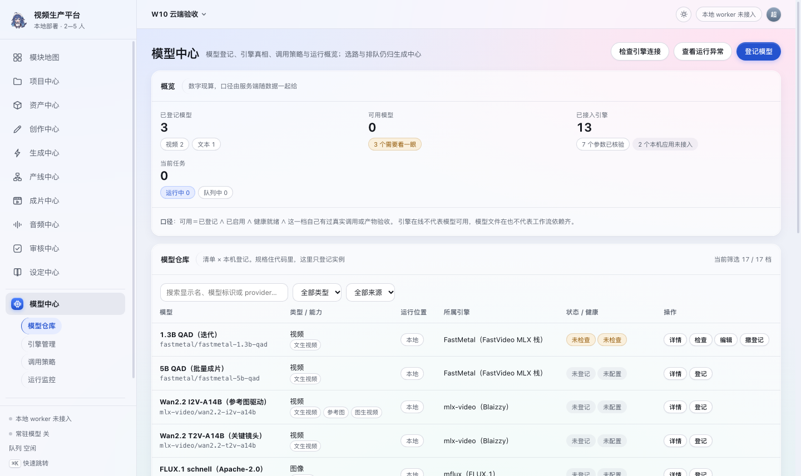

*图 1-1 模型仓库。顶部四数是 2026-11-04 20:03 的实况：已登记 3（视频 2、文本 1）、可用 0、引擎 13（7 个参数已核验、2 个未接入）、任务 0。*

### 1.4 四个工作区的分工

| 工作区 | 主要问题 | 写操作 |
|---|---|---|
| 模型仓库 | 这台机器上有哪些档，各自什么状态 | 登记、编辑、撤登记 |
| 引擎管理 | 五类能力各走哪条轨，谁默认 | 填 provider／模型、启停、设默认、跑环境检查 |
| 调用策略 | 九个任务场景建议用谁，备选是谁 | 改建议轨、偏好、备用轨、启用；只写配置 |
| 运行监控 | 队列、worker、告警、最近验证 | 不写任何东西 |

---

## 2. 模型仓库

### 2.1 这一页列的是谁

页面把三路数据拼成一张表：

1. 清单里有、本机也登记了：正常一行，带健康与验证。
2. 清单里有、本机没登记：标「未登记」，让「装了不等于配了」看得见。
3. 登记了、清单里没有：标「**清单无此档**」，参数与计价一律不猜，提交侧照旧拒。这一档**改配置没用**——得去 `adapters.py` 补规格，或者把这条登记撤掉。

当前清单有 17 个 adapter 对象、11 个模型档、8 个只登记了名字的 adapter（分属 6 家 provider，去重后 15 个 code），所以仓库页是 **19 行**（11＋8）。这 8 个 adapter 没有模型档可列，仍各占一行，状态是「只登记了名字」；火山方舟与 MiniMax 各有文本、配音两条，所以两家占四行。

### 2.2 六列怎么读

| 列 | 内容 |
|---|---|
| 模型 | 显示名；下面一行灰字是 `provider/model_code`。显示名可以随便改，键不能 |
| 类型 / 能力 | 五类能力之一，下面是能力标签。标签分「清单派生」与「人工声明」两种 |
| 运行位置 | 本地／云端／远程自建。这一列取的是登记行的 `source`，不是执行分流 |
| 所属引擎 | 清单里的 adapter code 与中文名；只登记名字的行显示 provider |
| 状态 / 健康 | 登记状态 ＋ 健康徽章。两枚文字撞车时只留一枚，避免「未检查｜未检查」并排 |
| 操作 | 已登记给「详情」；未登记给「登记」。检查、编辑、撤登记都收进详情面板底部 |

搜索按显示名、模型标识、provider 过滤；两个下拉分别按类型与来源筛。筛选条件在切换工作区再回来时保留，不会把你筛的东西重置。右上角写着「当前筛选 N / 17 档」。

### 2.3 十种状态，判序不能跳

状态是服务端算好的一个字段，界面不自己拼。判序是刻意的：先看启没启，再看清单里有没有，再看环境，最后才谈验证。

**三处"缺东西"缺的不是同一侧，所以名字里写清了是哪一侧**（v1.10 改的名）。原来它们叫「未登记」／「清单未登记」／「只登记了名字」——前两个互为前缀、都含"登记"，处置却完全相反：

- **本机未登记**：清单里有、这台机器没登记。**点一下「登记」就解决**（灰徽章）。
- **清单无此档**：本机登记了、清单里没有这一档。**点多少次都没用**，要去 `adapters.py` 补规格，或者把这条登记撤掉（红徽章）。
- **清单只有名字**：清单只知道这一家的名字、没枚举模型档。等规格补齐，眼下先手填模型标识（琥珀徽章）。

颜色也不同（灰／红／琥珀）。混成一个词时，人会对着第二种反复点「登记」——那正是改名前最常见的一类误操作。

| 状态 | 界面文字 | 什么时候出现 | 下一步 |
|---|---|---|---|
| `disabled` | 已禁用 | 登记行 `enabled=0` | 编辑登记，勾回启用 |
| `registration_only` | **清单无此档** | 本机登记了，但清单里没有这一档 | **改配置没用**：去 `adapters.py` 补规格，或撤掉这条登记 |
| `connection_failed` | 连接失败 | 云端健康为 `missing`，通常是密钥变量没值 | 补环境变量并重启 API 与 worker |
| `dependency_missing` | 依赖缺失 | 本地健康为 `missing`，解释器／入口脚本／权重缺一件 | 按健康说明补目录或安装 |
| `not_installed` | 未安装或未下载 | 健康为 `unconfigured`：还没配出可用的密钥变量名或运行时配置 | 先填 provider／模型，再按健康说明补变量 |
| `unchecked` | 未检查 | 健康为 `unknown`，平台检查不了 | 设运行时目录变量后重启，或人工确认 |
| `unverified` | 未验证 | 环境齐了，但这一档没有真实调用或产物验收。**两种情况**：①这一档还没跑过；②这一档不是「引擎管理」能力轨当前选中的那一档——那时状态说明会直说「不是能力轨当前选中的那一档（当前是 X）」，因为验证记录只认当前那一档，跑多少作业都不会变「可用」 | ①跑一条真作业，再按 §4 登记；②去「引擎管理」把这一类能力的轨指到这一档，或撤掉这条登记 |
| `available` | 可用 | 上面全过，且有同一档的真实调用或产物验收 | 可以进候选 |
| `manifest_only` | **本机未登记** | 清单里有这一档，这台机器没登记 | 点「登记」，一步就解决 |
| `name_only` | **清单只有名字** | 这一家只有 adapter 名字，没有模型档 | 登记时手填模型标识，或等清单补齐 |

健康徽章另有五个值：`ok` 就绪、`missing` 缺东西、`unknown` 未检查、`unconfigured` 未配置、`unregistered` **清单无此 provider**（v1.10 起补上主语：缺的是清单里这一家，不是"本机没登记这一档"——两者一个往回改配置、一个往前点登记，方向相反）。健康和验证不是一回事：健康说环境齐不齐，验证说凭什么认为真能产出。

### 2.4 登记一个模型

页头「登记模型」，或从任一未登记行点「登记」（会带出能力、运行位置与 provider）。

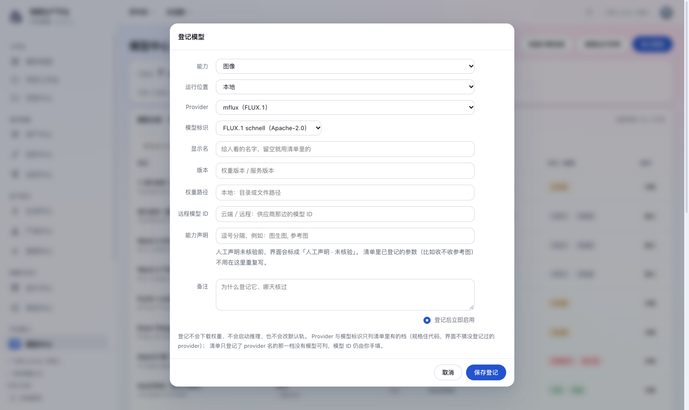

*图 2-1 登记弹窗（v0.117）。字段名在左，控件一列；能力、运行位置、Provider、模型标识四格全是下拉，选项直接取自清单。下面那行灰字写清了这一动作不会下载、不会推理、不会改默认轨。*

| 字段 | 必填 | 说明 |
|---|---|---|
| 能力 | 是 | 文本／图像／视频／配音／音乐，五选一（接口下发的 `capabilities`，界面不另抄一份） |
| 运行位置 | 是 | 本地／云端／远程自建。登记层比选型层多一档「远程自建」；清单只有本地／云端两轴，所以选「远程自建」时 Provider 那格按**本地**那一轴列——与接口里那次折回是同一个口径 |
| Provider | 是 | **下拉**，只列清单里对上「能力 × 运行位置」的 provider。这一格不再是自由文本：登记一档 provider 的前提是平台知道它的参数与运行方式 |
| 模型标识 | 是 | **跟着 Provider 走**。清单枚举了档位就是下拉；清单只登记了 provider 名（可灵／即梦／火山方舟这类未核验档）没有可选项，这一格退回手填并把原因写在下面一行 |
| 显示名 | 否 | ≤80 字符。留空就用清单里的名字 |
| 版本 | 否 | ≤60 字符。权重版本或服务版本 |
| 权重路径 | 否 | ≤300 字符。只留档，平台不因此下载或校验任何东西 |
| 远程模型 ID | 否 | ≤120 字符。云端或远程供应商那边的 ID |
| 能力声明 | 否 | ≤200 字符，逗号分隔。人工声明，未核验会标出来 |
| 备注 | 否 | ≤500 字符。写为什么登记它、哪天核过 |
| 登记后立即启用 | — | 默认勾选。只影响这一行能不能进候选，不影响默认轨 |

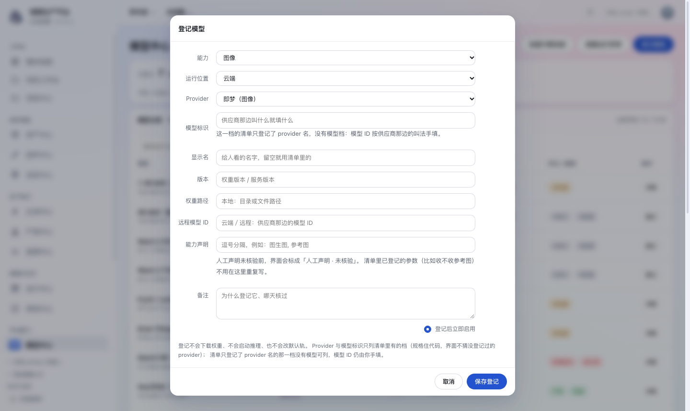

*图 2-2 图像 × 云端：provider 只有名字、没有模型档，所以模型 ID 由人填——那一档的参数与计价同样不会被猜。*

保存时的规则：

- 同一组 `(能力, 运行位置, provider, 模型标识)` 只能有一行。重复会 422，原话里带你已登记那一行的 `#id`。要登记同一档的另一个本地版本，改「版本」那一栏，不要再加一行；两行会让「这一档现在用哪个」变成猜。
- **界面只给清单里有的键**。这一「能力 × 运行位置」在清单里一档都没有时（音乐 × 云端就是这种；文本 × 本地在
0041/A4 之后已经有 ollama 这一档，不再是空档），Provider 那格念「清单里没有这一档」并禁用，点保存会被挡在界面，原话指向 `adapters.py`——加 provider 是改规格，不是填表单。
- 清单外的 provider 仍可以从**接口**登记（`POST /api/models` 照旧收，响应里带一句「参数不猜、提交侧会被拒」的 warning）。这种行走不进界面新建，只能在编辑态看到：下拉里原值照样列着、后面标「清单无此档」、两把键都是灰的。登记只保存事实，不替你猜运行方式。
- 登记不会去下载权重、不会启动推理，也不会把这一档设成默认。

### 2.5 编辑与撤登记

**编辑登记**只改元数据：显示名、版本、权重路径、远程 ID、能力声明、启用、备注。能力、运行位置、provider、模型标识在编辑态都是灰的，因为它们是这一行的键；改键等于换一档模型，应该撤了再登记。后两格在编辑态也是下拉，所以清单外的老值不能被"过滤"掉——界面会把它照样列出来、后面标「清单无此档」；停在空白上会让人以为自己的键被人改丢了。后端是逐字段更新，只动这次传上来的键，不会把别人刚加的另一行写回旧值。新建时若没单独传 `source`，运行位置跟 `backend` 一致；云端登记不会显示成本地。

**撤登记**会先弹确认，正文写明：这一步只删除这条登记，权重文件仍在盘上，历史作业与验证记录一律不动。接口还要求带 `confirm=1`，防止有人把「移除登记」理解成「删掉模型」。撤掉之后：

- 权重文件不动。
- `job` 里的 provider／model 是提交时冻结的快照，旧作业不会变成孤儿。
- `model_validation` 记录保留，但那一档已不在仓库里；重新登记同一档时会重新参与判定。
- 能力轨里如果正指着这一档，不会自动换人；下一次提交会按现在的配置报错。

### 2.6 详情面板

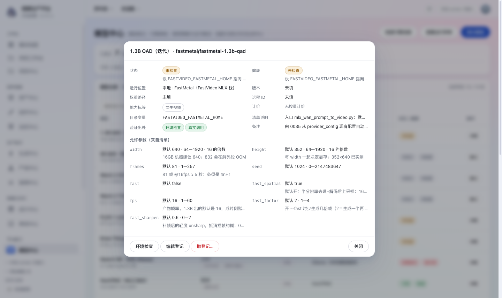

*图 2-3 详情面板。上半是状态、健康、运行位置、版本、路径、远程 ID、能力标签、计价、目录变量、清单说明、验证出处、备注；下半是这一档允许的参数，全部来自清单。*

面板里有三处值得注意：

- **允许参数（来自清单）**：每个参数给出默认值、范围、倍数和一句说明。页面不能改这些值，它们由 `adapters.validate_params()` 在提交时校验。清单里没有这一档时，面板不显示参数，只显示「清单无此档」。
- **目录变量**：本地档显示 `FASTVIDEO_<CODE>_HOME` 这类变量名，云端档不显示目录变量。变量名不是密钥值。
- **底部动作**：已登记的行给环境检查、编辑登记、撤登记三个；未登记的行只有一个「登记这一档」。它们放在详情里而不是行内，因为这里同时看得见状态、健康、验证出处与路径，做「撤登记」这种决定比在一排小按钮里点靠谱。

### 2.7 能力标签：事实与主张

标签有两种来源，界面上分开显示：

- **清单派生**（灰色 chip）：从已登记的参数表与计价里数出来，可复算。比如 `wan2.2-i2v-a14b` 被标「图生视频」，是因为它登记了 `type=="image"` 的参数，不是因为名字里有 `i2v`。
- **人工声明**（琥珀或蓝色 chip）：登记行里手写的标签。在**同一档**有过真实调用或产物验收之前，一直是「人工声明，尚未核验」；之后才升级成「已验证」。

模型名里带 `i2v`／`t2v` 不构成证据。这也是为什么清单里 `mflux/flux1-schnell` 没有「图生图」标签：它没有图片输入参数。

---

### 2.7 同一能力可以登记好几档，提交时能选（v1.12 起）

一个能力（比如「视频 · 本地」）在**能力轨**里只有一格，但**模型仓库**里可以登记好几档。
这两件事管的是不同的东西：

| | 管什么 | 一处只有几行 |
|---|---|---|
| 引擎管理 · 能力轨 | **不说的时候走哪条**（默认轨的唯一来源） | 十行固定（5 类能力 × 本地／云端） |
| 模型仓库 · 登记 | **这台机器上真有哪几档** | 想登记几档就几档 |

v1.12 之前，提交作业时显式指定 provider／模型必须**与能力轨那一格逐字相同**，
所以同能力第二档等于选不到——想让 5B 上场，只能去能力轨把默认轨改成 5B，
跑完再改回 1.3B。而改默认轨是有后果的动作：它是 `resolve_provider()` 的唯一输入，
改的那一瞬间所有「不指定」的作业都跟着换轨。

现在判据换成三件事，各有出处：

1. **已登记**——模型仓库里有这一行（回答"这台机器上真有这一档"）；
2. **已启用**——那一行的「启用」勾着（人可以用它把某一档关掉而不撤登记）；
3. **清单里有适配器**——参数白名单在 `adapters.py`，没有它平台不会拼命令。

**能力轨那一格的作用一点没变**：它仍然只决定"不指定的时候走哪条"。
你在发起弹窗里显式选了哪一档，就走哪一档。

两条底线没松：

- **清单里没有适配器的档不进候选**。登记得进去（登记只存事实），但选不到——
  没有参数白名单就等于让模型名去猜运行时。
- **停用的登记不进候选**。想临时停一档又不想丢掉它的验证历史，用「启用」那个勾。

### 2.8 在提交框里按场景看候选与预填（v1.13 起，v1.14 加预填）

生成中心的「提交作业」弹窗里多了一格**任务场景**（在「项目」下面）。选一个场景，
弹窗里就摆出这个场景的候选与挡路原因——不用再跑去模型中心·调用策略点「看候选」
记下名字，回来再选。

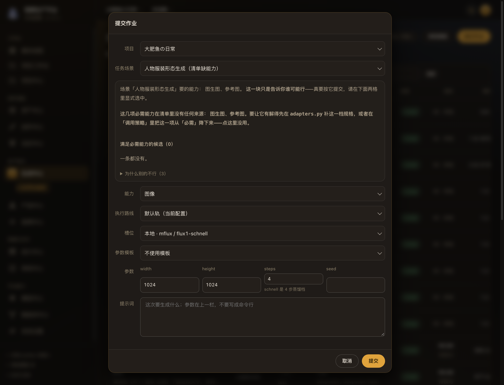

*图 2-4 提交框的「任务场景」与候选面板。这一张是人物服装形态生成：清单里没有任何一档
登记过图片输入参数，所以候选 0 条，面板直接把「图生图／参考图在清单里没有来源」
写出来，并指向 `adapters.py` 或把必需项降下来——而不是含糊地说「待配置」。*

**v1.14 起，恰好一档候选时会把那一档预填进「执行路线／槽位」。** 这一步与裁定 MC1
的关系要说准：MC1 禁的是**平台自己换路**（`resolve_provider()` 不看策略、备用轨不
自动顶上，§5.5），不是禁「人显式点了场景，界面把格子填好」。预填全部发生在
**人自己选了场景**（或从分镜／镜头工作台带着场景进来）之后，四条保证：

| 保证 | 落在哪 |
|---|---|
| 只改这个弹窗里的两个下拉，`provider_config` 默认轨一个字没动 | 预填走的是 `#jm-mode`／`#jm-route` 的界面值，不写库 |
| 每一次预填都**留痕**（谁改的、从哪条改成哪条）并给一键撤销 | 槽位下方那一行「已按场景「×」预填：…〔撤销预填〕」 |
| **绝不替你勾「确认按供应商计费」**：云端候选可以预填路线，计费确认仍必须人自己勾 | `#jm-confirm` 只由人点，`user_confirmed_cloud` 那道闸门原样不动（§5.4） |
| 服务端 `resolve_provider()` 一个字节没改 | 提交路径仍走「显式选中」那一支（§5.5） |

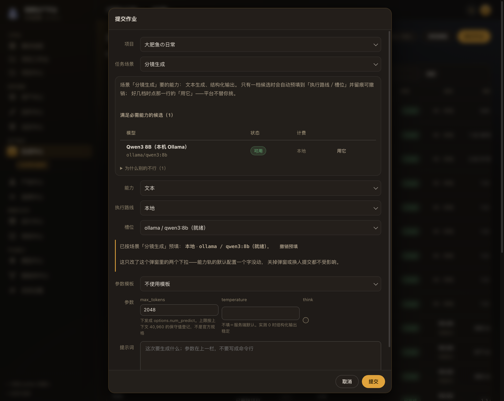

*图 2-5 分镜生成恰好一档候选（Ollama Qwen3 8B）：路线与槽位被预填，槽位下方
写着「已按场景「分镜生成」预填」与撤销按钮，并说明这只改了弹窗里的两个下拉。*

**好几档候选时不替你挑。** 多档时两格保持原样，每一行给一个「用它」按钮——
选哪一档是人的事，点一下才填进格子（同样留痕、同样不碰计费勾选）。
撤销回到的是**打开弹窗时那一格**，不是上一笔预填的结果；人手动改过任一相关
下拉，留痕与撤销按钮一起作废（他接管了，平台不再记这笔账）。
调用方带参数模板进来时模板赢——模板比场景更具体，这时不自动预填。

**面板仍然把判据摆在脸上：**

| 面板给什么 | 谁给的 |
|---|---|
| 这个场景要哪几项能力 | `model_policy.required_json`（场景键定死在 0035 种子里） |
| 谁进了候选 | 已登记 ∧ 已启用 ∧ 没有依赖缺失／连接失败 ∧ 清单标签覆盖全部必需能力 |
| 别的为什么不行 | 逐条点名，带 `model_code`（显示名可以改，只看显示名会认不出） |
| 清单缺能力 | 这几项在整条能力轴上都没有来源——**点界面没用**，要改 `adapters.py` |

三条口径值得知道：

1. **场景下拉按当前能力过滤**。场景有能力的归属（分镜生成＝文本、镜头视频＝视频、
   人物服装形态＝图像），换个能力就会重置成「（不按场景）」。留着上一个能力的场景
   只会得到 0 候选，人还以为是模型没配好。
2. **「未检查」不算挡路**。服务型引擎（Draw Things、Ollama、ComfyUI）在列表里必然是「要连一次
   才知道」（§3.6），把它们写成挡路原因等于让每个用本机引擎的场景永远 0 候选。
   候选里会带「未检查」徽章，人一眼看得出这一条没现查过。
3. **候选数不是写死的**。它取决于本机此刻真正连得上的服务：Ollama 没开着的时候，
   正解就是 0 条候选 + 一条「连不上」的原因，这时预填也无从发生。验收脚本
   （`tools/generate_scene_check.py`）为了把「单候选预填／多候选不替你挑」测准，
   自己起了一个假 Ollama 并把副本库的引擎实例指过去——环境由脚本说了算，
   不跟着本机服务状态漂移；每条新断言都做过反向变异，确认它真能变红。

这一格**只读、登录即可**（`GET /api/model-policies/scenes` 与
`GET /api/model-policies/resolve/{scene_key}` 同一档）。它不下发建议轨、备用轨、
偏好与备注——那些是配置，改了要生效得走 `system:config`。所以普通编辑者看得见
「谁可能行」，但改不了「建议谁」。

## 3. 引擎管理
### 3.1 能力轨：十行是什么

五类能力 × 本地／云端固定十行。这一张表是默认轨的唯一来源，调用策略里的建议轨与备用轨都不能改它。

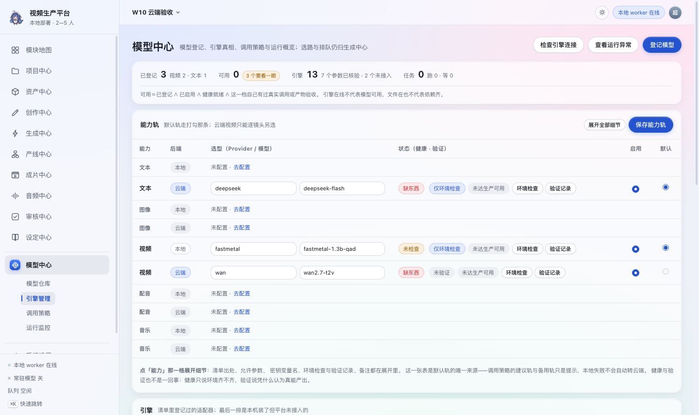

*图 3-1 能力轨。已填 provider 的行展开；没填的行折成一行灰字「未配置 · 去配置」。当前本机填了三行：文本云端、视频本地、视频云端。*

一行六个控件：

| 列 | 说明 |
|---|---|
| 能力 | 文本／图像／视频／配音／音乐。点这一格展开细节 |
| 后端 | 本地或云端 |
| 选型 | 引擎下拉完整列出这一类能力与运行位置的清单候选；切换引擎后，模型下拉联动到新引擎的第一档，不沿用旧模型。清单未提供模型档时可手填；已有清单外配置保留原值，也可选「手动填写其他引擎…」输入 provider（右侧附「切回选择」按钮，可随时切回下拉列表） |
| 状态（健康 · 验证） | 健康徽章与验证徽章；右边两个按钮是环境检查、验证记录 |
| 启用 | 不启用时，即便它是默认，提交也会报「没有启用」 |
| 默认 | 每类能力恰好一个。云端视频这一格的单选是灰的，并写明只能逐镜头显式选择 |

没填 provider 的行默认折成一行灰字，避免十行里七行空输入框把已配置的三行淹没。点「去配置」会展开这一行；页头「展开全部细节」只展开已填 provider 的行，「全部收起」收起所有展开态。

### 3.2 保存能力轨：六条规则

点「保存能力轨」会把**服务端那十行**一起提交，不是只提交屏幕上展开的几行。折叠行原样回读它已保存的 provider、模型、启用与默认；否则一次保存就会把没展开的槽位清空。

保存是一次整批替换，任何一条不合规就整批拒绝，原话直接显示：

1. **id 必须存在。** 传了不认识的配置行 id，422，避免半截写入。
2. **provider 只能写字母、数字、点、横线、下划线。** 空串允许，表示这一行还没配。
3. **密钥变量名只能字母、数字、下划线，且不以数字开头。** 空串允许。
4. **每类能力恰好一个默认。** 一个都没有会报「每类能力都要选一个默认后端：……」，两个会报「每类能力只能有一个默认后端：……」。
5. **云端视频不能设为默认。** 会报「云端视频不能设为默认；只能逐镜头显式选择」。这是规格 01-4.8.2 的硬约束。
6. **默认行可以是空行。** 保存允许把某一类的默认指在一个还没填 provider 的行上；但生成时会报「……的本地档还没填 provider/模型」。默认只是「指了哪一行」，填没填是另一件事。

当前库里图像、配音、音乐三类的默认都指在空的「本地」行上，所以保存能过；这不等于这三类能生成。要看这三类能不能用，看「已登记」里有没有对应档，以及提交时有没有报「还没填 provider/模型」。

### 3.3 展开细节里有什么

点「能力」那一格展开，五行：

- **清单**：适配器中文名与出处。没有这个 provider 时写明「参数与运行方式不会被猜」。
- **允许参数**：清单里这一档的可调参数 chip；参数未核验时写「参数未核验，平台不预填」。
- **密钥**：云端给一个变量名输入框，实际读哪个变量、当前有没有值都写在旁边。**这一格只填变量名**；密钥值本身不在这张卡里填——它要么在启动进程的环境里，要么去「系统设置 · 参数管理 → 供应商密钥」以密文存库（0052，环境变量优先）。值在任何界面都不回显，只显示「有值／没值」与指纹。本地行不给密钥框，只写运行时目录变量。
- **健康说明**：服务端现查的结论原文，比如「解释器、入口脚本与权重目录都在（未加载权重）」或「环境变量 DASHSCOPE_API_KEY 没有值；改完要重启服务」。
- **备注**：为什么选它、计价出处、哪天核过。

改了 provider 或模型但还没保存时，这一行的健康会先显示「待保存 · 保存后按新 provider 重新检查」，避免旧结论看着像新输入没生效。

### 3.4 引擎表：16 家，其中一家只接探测

下半是按 adapter code 分组的引擎表，七列：引擎、位置、能力、模型档、参数核验、连接方式（变量名）、最近检查。

当前 16 家：9 家参数已核验（FastMetal、mlx-video、mflux、Draw Things、Ollama、VoxCPM2、ACE-Step、DeepSeek、阿里云百炼 Wan），1 家**只接探测**（ComfyUI，2026-11-13：有自述端点、没有 workflow 契约，见 §3.5），6 家只有名字、参数未核验（火山方舟、MiniMax、可灵、Seedance、即梦、通义万相）。「模型档」为 0 的行标「只登记了名字」。Draw Things 是 2026-11-06 W-B 加进来的**本机常驻服务型**引擎——它不是子进程运行时，端点住在引擎实例表（迁移 0040）。Ollama（文本 × 本地）同一轮进清单，走的是同一族端点，但它**没有进 `_service_engine_gate` 那一族**：Draw Things 同一时刻只有一个「当前模型」，而 Ollama 的模型名是每次请求里带的，核对一个不存在的概念只会得到假话。

### 3.4.1 引擎实例：这一档引擎在哪台机器、哪个端口

引擎表下面是**引擎实例**那张卡（2026-11-07 补的界面）。后端从 W-B 起就有 `GET/POST/PATCH/DELETE /api/engines` 与 `probe` 五条接口，但界面一直没接——于是 `engines.probe()` 的提示「在「引擎管理 · 引擎实例」里加一条端点」指向一个不存在的界面，换一台机器部署时人只能去改库。

| 列 | 读什么 |
|---|---|
| 实例 | 显示名 + engine_code；非服务型引擎会标「非服务型」 |
| 端点 | `http://主机:端口`，不带路径、不带查询串、不带 `user:pass@` |
| 连接方式（密钥变量） | `local_http` 这类取值 + 密钥变量名与「有值／变量没值」。**值永不显示** |
| 状态 | 现查的健康徽章；停用的实例不探测（写「已停用」） |
| 操作 | 「探测」「启用／停用」「撤实例」 |

三条边界：`engine_code` 必须能在清单里找到（实例不能凭空发明一个 provider，要加引擎得改 `adapters.py`）；健康**不落库**，每次现查；端点连同 engine_code 是这一行的键，**改不了**——要换机器请新建一条再停旧的那条，否则历史作业的「当时打的是哪台」就说不清了。撤实例只删这一行端点登记，应用、权重与历史作业一律不动。

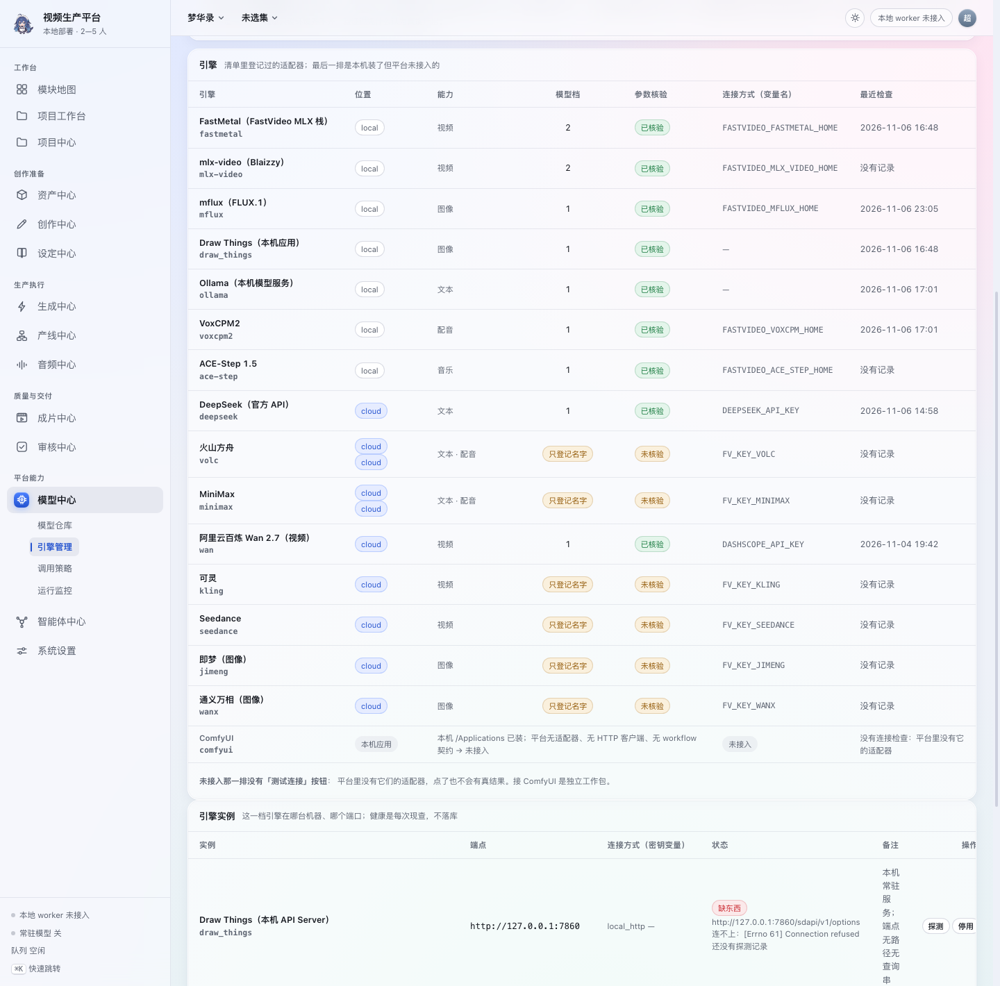

*图 3-2 引擎表下半段与「只接探测」的那一台（ComfyUI，摄于它进清单之前，图注按当时口径写「未接入」）。连接方式一列只写变量名；最近检查取该引擎最近一条验证记录的时间。*

最后一行是 ComfyUI：本机 `/Applications` 已装。2026-11-13 起它在清单里，但**只接探测**——有自述端点（`/system_stats`）、能现查通不通、也能在页面上启动，**没有 workflow 契约所以没有提交入口**（§3.5）。它不再标「未接入」：那个词留给了连探测器都没有的应用，而这张名单在 2026-11-13 之后是空的。

“参数已核验”指适配器清单里有 `params_source`，参数范围与默认值有出处；它不代表模型已经跑过，也不代表权重在盘上。

### 3.5 三种「检查」的分工

| 入口 | 作用对象 | 走哪个接口 | 结果 |
|---|---|---|---|
| 页头「检查引擎连接」 | 先现查服务型引擎、**再逐家现查已登记的云端供应商**（2026-11-09 起，`cloud_probe` 五档），最后对所有已填 provider 的能力轨逐条检查 | `POST /api/models/probe?fresh=1` 一次 ＋ `POST /api/providers/validate` 逐条 | 目录里的引擎健康、结果窗的云端一段、各行的验证记录 |
| 引擎实例行「探测」 | 这一台实例 | `POST /api/engines/{id}/probe` | 连不连得上、引擎当前自述的模型名；手动探测写入历史记录 |
| 能力轨行内「环境检查」 | 这一条槽位 | `POST /api/providers/validate` | 这一行的健康与验证 |
| 详情面板「环境检查」 | 这一条登记 | `POST /api/models/{id}/check` | 这条登记的验证记录 |

后三种都不建 Job、不改配置。**只有 `probe` 会真的连服务**（`/api/models/probe` 与 `/api/engines/{id}/probe`）——本机那一枪连本机服务，云端那一枪连已核验供应商的网关（未核验的如实"无可探端点"、没配密钥的不发请求）——那是显式动作，人可以等；而模型目录读接口不出网；引擎实例卡的现查是例外，见 §3.6。

上述检查本身不建 Job、不改配置、不加载权重；结果窗中的「启用」与「启动服务」是独立操作，不能混成检查的副作用。检查通过只代表「条件齐了」，永远不能把状态推到「可用」。运行位置是「远程自建」的登记不能走详情检查，会 422：「远程自建服务本轮不接验证：0021 的 model_validation 只认 local/cloud」。

点页头「检查引擎连接」后，弹窗于 **0ms 内即刻弹出**，内部先呈现微动效流光骨架屏（Skeleton Shimmer）并显示「正在探测…」状态。前端后台全并发发出两路探测请求（`probeModels(true)` 与 `engines()`），数据就绪后平滑替换为真实探测结果，先显示本地检查汇总，再分列本地与云端结果；异常项在各组内优先显示。十条能力轨的环境检查留痕亦改为全并发在后台异步完成，不阻塞结果窗展示。长地址、当前模型与原始诊断信息收在「查看详情」，按需展开。

- **已停用**：本轮不探测，点「启用」直接启用实例并在当前弹窗更新状态。启用实例不等于启动进程。
- **连接失败且支持内置启动配方**：显示「启动服务」。应用已启动但尚未响应时，按钮显示「等待连接…」，页面继续自动检查最多一分钟；连接成功后自动显示就绪，结果窗原地更新，无需另点「探测」。离开页面或关闭结果窗会停止后续等待；到期仍未连通会提示检查应用的 HTTP API Server。不支持启动的实例不摆假按钮。**三档有配方的引擎**：Draw Things（`open -a`）、Ollama（`ollama serve`）、ComfyUI（`open -a "Comfy Desktop"`，2026-11-13 加）。
- **全部正常且没有可执行操作**：隐藏操作列。
- **重新检查**：在当前弹窗重新检查连接；不会重做页头按钮附带的逐轨验证记录登记。
- **进入引擎管理**：关闭结果窗并进入引擎管理页；「关闭」仅关闭结果窗。

本地「连接成功」只证明端点响应。云端「端点可达 · 鉴权通过」只证明连接与鉴权，不代表实际生成成功或模型生产可用。启用及启动仍受后端权限、可启动配方和本机来源限制；结果窗不能绕过这些限制。

**「启动服务」之后没有「关闭服务」，这是有意的。** 三件事叠起来使它不能草率加：

1. **平台主动放开了它**。启动走 `subprocess.Popen(..., start_new_session=True)`，注释写得很直白："人拉起来的是要长期驻留的服务"——API 进程重启或退出不该顺带掐掉它。既然平台主动把子进程放进了自己的会话，它手上就没有可靠的句柄；`Popen` 对象在 HTTP 请求返回那一刻就丢了。
2. **没有 pid 归属就没法安全地停**。要停只能按进程名去匹配（`open -a` 起的是 LaunchServices 托管的 app，`ollama serve` 起的是脱离的孤儿）。这条路本仓真踩过：`worker_supervisor.stop_one()` 最早就是"拿到 pid 就 `os.kill`"，实测把一个与本平台无关的 Python 进程直接 SIGTERM 掉了，8 秒后还 SIGKILL。worker 那边后来靠"只允许停我们自己登记过的 pid"收口；引擎没有这样一份 pid 账。
3. **配方天然不对称**。`open -a "Draw Things"` 反着关要走 `osascript -e 'quit app …'`，那是又一条需要 review 的命令；`ollama serve` 没有对应的 `ollama stop` 子命令，只能按 pid 或端口反查。

所以今天的答案是：**启动在页面上做，停止手动做**（终端、启动台或活动监视器）。要把它做成按钮，得先多一步"记下我们起的那个进程是谁"——那是新工作，不是补一个按钮。

**ComfyUI 可以在页面上启动（2026-11-13 起）。** 它的启动配方是 `open -a "Comfy Desktop"`——装的是 Electron 外壳，本体跑在壳里，所以入口只有这一种。后端先等待 6 秒，应用已启动但尚未响应时页面再自动等待最多一分钟；首次下载 ComfyUI 本体与模型仍可能超过这个时间。到期后先在 Dock 查看下载和首启配置是否完成，再回来重新检查。

**ComfyUI 只接探测，没有提交入口。** 它出现在引擎表里、能被现查通不通（自述端点 `/system_stats`），但**不会**出现在提交框的候选里。原因是它收的是一整张参数化的 workflow 节点图（`/prompt`），而平台只有两种执行形状——argv 子进程或一次性 HTTP 请求。后一种要求"参数 → 请求体"是一张平坦映射；ComfyUI 要的是把参数注入到图里的具名节点，那是 workflow 契约，不是参数白名单。没有那份契约就写参数表，等于拿一张猜出来的表去承诺"这一档能出图"。接执行是独立工作包（要定模板、注入点与产物取回）。**这一档存在的意义只有一条：在引擎管理里看得见它通不通。**

### 3.6 打开页面不连网（2026-11-07 后的读接口边界）

模型仓库、场景候选、引擎表这些**读接口从这一版起不出网**。为什么：原来每拼一次目录就给每个已登记的服务型引擎发一次 HTTP（超时 5 秒、串行、无缓存），而一页要拼两遍目录，于是一台卡住的服务就能把「打开模型中心」拖到几十秒。读接口现在只读库与清单。

一个例外要挑明：**引擎实例卡不走这条**。`GET /api/engines` 对启用中的实例逐台现查（单台超时 0.8 秒，不落库）——「这台端点现在通不通」只能发一次请求作答，缓存答的只是"上一次通不通"。代价有界：单台 0.8 秒封顶，实例几台就乘几台；不想等就先停用或删掉不用的实例。

那「这一档到底连不连得上」怎么办？三条路，都不影响打开页面：

| 场景 | 界面显示 | 怎么让它变成真的 |
|---|---|---|
| 15 秒内刚探过（同一端点在缓存窗口里） | 真实结论 + 「N 秒前查的」 | 什么都不用做；这就是最近一次现查的结果 |
| 有实例、但没探过或已经过期 | 「要连一次服务才知道状态」，并指出入口 | 点页头「检查引擎连接」（`fresh=1`）或引擎实例那一行的「探测」 |
| 还没有实例 | 「还没登记启用中的引擎实例」 | 在引擎实例卡里加一条端点 |

两种「未检查」不是一件事，别混：`unknown` 是「平台检查不了，需要人确认」；上面那一档是「平台会查，只是这条读路径不替人连网」，界面上写成「要连一次服务才知道」。

---

## 4. 验证：配置就绪不等于生产可用

### 4.1 五类出处

验证记录只追加、不修改。每一类回答的问题不同，不能互相顶替。

| 出处 | 证明什么 | 怎么记 | 能点亮生产可用吗 |
|---|---|---|---|
| 环境检查 `env_check` | 运行时目录、入口脚本、权重或密钥变量在不在 | 按钮现查，或详情面板检查 | 不能，只是三条件之一 |
| 模拟 `mock` | 假适配器链路通 | 从一条 mock 作业登记 | 不能，且永远不能升级成真实调用 |
| 真实调用 `real_call` | 这条链路真的产出过文件 | 从一条已成功的真实作业登记 | 能，三条件之一 |
| 目标机基准 `target_machine` | 跑的就是目标机 | 从已成功作业登记，人要确认机器 | 单独亮「目标机已验证」 |
| 产物验收 `artifact_review` | 人看过文件，判断好不好 | 从已成功作业登记，必须给通过／不通过 | 能，三条件之一 |

徽章按可信度从高到低取第一条命中的：目标机基准 → 产物验收 → 真实调用 → 模拟 → 环境检查 → 未验证。产物验收比真实调用多一道人眼，所以排更高；环境检查永远不能冒充真实调用。

### 4.2 生产可用的唯一公式

服务端只认这一条：

> 生产可用 ＝ 环境检查通过 ∧ 真实调用成功 ∧ 产物验收通过

目标机基准不在公式里，它单独显示「目标机已验证」。产物验收不通过会记一条 `failed`，不点亮生产可用；人修好再验一次通过，最新记录说话。

这也解释了一个常见困惑：健康「就绪」、环境检查也通过，仍然可能「未达生产可用」。差的是真跑过一条作业，并且有人看过产物。

### 4.3 环境检查到底查什么

- **云端**：先确定这一档实际读哪个密钥变量（自定义名 > 清单建议名 > `FV_KEY_<PROVIDER>` 兜底），再看进程环境里有没有值。没有值的原文是「环境变量 X 没有值；改完要重启服务」。
- **本地**：按引擎探运行时。以 FastMetal 为例，依次查 `FASTVIDEO_FASTMETAL_HOME` 指向的仓库、`.venv/bin/python`、入口脚本、权重目录、权重文件；缺哪件说哪件。mlx-video、mflux、VoxCPM2、ACE-Step 各有自己的探法，结论都来自 `runtime.probe()`。
- **不做的**：**环境检查**不发 HTTP 请求，不加载权重，不跑推理。所以它无法证明模型真的能出片。要现查连接只有两个显式入口：页头「检查引擎连接」（本机＋云端都查，见 §3.5）与引擎实例行的「探测」（只查那一台端点）。


### 4.3.1 一次真实的云端文本链路验证（2026-11-13 实测）

上一节说「环境检查不发 HTTP 请求，所以无法证明模型真的能出片」。
这一条把「真的能出话」也验了一遍——**不是看界面上的「可用」徽章，
而是让 `cloud_run.py` 真发一次请求、真把正文落成文件**。

**准备**：`DEEPSEEK_API_KEY` 配在环境变量里（网页的「供应商密钥」卡片没配，
库里的密文表是空的）。API 进程启动时读到它，`ps -E -p <pid>` 能确认存在。

**做法**：绕开界面，直接调执行器，用一份最小请求：

```python
req = {'provider': 'deepseek', 'model': 'deepseek-chat',
       'prompt': '只回复两个字：收到',
       'params': {'max_tokens': 16, 'temperature': 0},
       'key_env': 'DEEPSEEK_API_KEY', 'http_timeout': 60,
       'result': '/tmp/ds_r.json',      # 执行器把结论写这里
       'output': '/tmp/ds_text.txt'}    # 正文写这里
```

**结果**：

| 项 | 值 |
|---|---|
| 退出码 | 0 |
| HTTP | 200（延迟 802 ms） |
| 用量 | prompt 9 + completion 1 = 10 token |
| 正文文件 | 6 字节，内容 `收到` |
| `returned_model` | `deepseek-flash` |

**这条验证能证明什么、不能证明什么**：

- **能**：密钥有效、端点可达、请求体被接受、响应被正确解析、正文落盘。
  即「这条链路真的产出过文件」——正是 `real_call` 那一档要的证据。
- **不能**：不代表「生产可用」。按 §4.2 的公式，还缺**产物验收**
  （有人看过这个产物并判断可用）。一次 10 token 的连通性验证不构成验收。
- **也不等于**跑过真实作业：这里没走 Job 队列、没写 `job` 表、没留验证记录。
  要留下 `real_call` 记录，必须从**一条已成功的真实作业**登记（§4.4）。

**两个容易踩的坑**：

1. **请求里漏 `output` 会报 `cloud_run_error: KeyError: 'output'`**。
   `_deepseek()` 会把正文写到 `request["output"]` 指定的文件，这个字段
   和 `result` 是两个不同的路径，缺一不可。报错信息会把真实原因带出来，
   不会被吞成一句「失败」。
2. **模型名用清单里的 `deepseek-flash`，不要手填 `deepseek-chat`**。
   `adapters.py:473` 写明旧名 `deepseek-chat`／`reasoner` 已下架。
   实测拿 `deepseek-chat` 发，供应商会路由到 flash（`returned_model`
   就显示 `deepseek-flash`）——能通，但界面上的模型名与实际不符，
   对账时会对不上。

**复现的成本**：约 10 token，按输出 8 元/百万 token 折算不到 0.01 分钱。
所以这条验证可以随时重跑，不必担心花钱。

### 4.4 从作业登记

真实调用、目标机基准、产物验收都读一条**已成功**的作业，不能手填「我跑过了」。

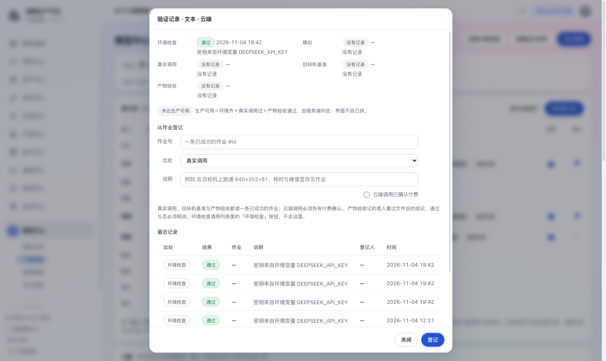

*图 4-1 验证记录弹窗。上半是五档摘要与生产可用结论，中间是从作业登记，下面是这一槽位的最近记录。图为文本·云端槽位：环境检查通过，其余四档没有记录，所以「未达生产可用」。*

登记时服务端逐条核对：

1. 作业存在且状态是 `succeeded`。
2. 真实调用、目标机基准、产物验收都不能是 mock 作业；mock 只能记成「模拟」。
3. 云端作业必须已有计费确认记录（`user_confirmed_cloud`）。
4. 产物文件必须可读，并能算出 sha256；文件被清理或路径失效就拒。
5. 产物验收必须显式给出通过或不通过，服务端不猜。

通过后记录里会留作业号、产物摘要、HTTP 状态、耗时、成本与登记人。记录只增不改；同一档重复登记会追加新行，旧的还在。

### 4.5 换档不背书

验证记录按**槽位 × 档**落：能力 × 后端 × provider × 模型标识。同一 provider 换了一档模型，旧记录不替新档说话——比如 1.3B 验过，不等于 5B 验过。换档后那一行会回到「未验证」，要从真实调用与产物验收重新走。

**这条规则在两屏上都成立，而且是同一个判据**（2026-11-07 起）：模型仓库的「可用」要求记录里的模型就是当前这一档；「引擎管理」能力轨那一列的「生产可用／未达生产可用」也只看**当前这一档自己**的记录——换了档，即使这个 provider 上个月验过，能力轨那格也不会再亮。两屏读的是同一份按档切开的验证史，不会出现一边说「可用」、一边说「未验证」。

### 4.6 验证记录在哪看

三处：

- 能力轨状态列的验证徽章与「生产可用／未达生产可用」。
- 行内「验证记录」弹窗：五档摘要、从作业登记、这一槽位最近记录。
- 运行监控最下面的「最近验证留痕」：全站的验证记录，**一页 50 条**，右上角写「共 N 条 · 这一页 M 条」，有更早就给「更早的」。只读。

---

## 5. 调用策略

### 5.1 九个任务场景

场景名定死在 0035 的种子里，界面不提供自由新增。场景名一旦可以自填，就会长出十个同义词指向同一件事。

| 场景键 | 界面名 | 能力 | 必需能力 | 对应产出 |
|---|---|---|---|---|
| `character_bio` | 人物履历与性格生成 | 文本 | 文本生成、结构化输出 | 人物档案 |
| `scene_prompt` | 场景说明与提示词生成 | 文本 | 文本生成 | 场景描述、镜头提示词 |
| `character_base` | 人物基础形象生成 | 图像 | 文生图 | 定妆基础图 |
| `character_variant` | 人物服装形态生成 | 图像 | 图生图、参考图 | 服装形态图 |
| `scene_concept` | 场景概念图生成 | 图像 | 文生图 | 场景概念图 |
| `prop_concept` | 道具概念图生成 | 图像 | 文生图 | 道具概念图 |
| `text_extraction` | 文本提取与结构化整理 | 文本 | 结构化输出 | 候选与结构化数据 |
| `storyboard` | 分镜生成 | 文本 | 文本生成、结构化输出 | 分镜表 |
| `shot_video` | 镜头视频生成 | 视频 | 文生视频 | 镜头视频 |

> **「结构化输出」现在有来源了**（2026-11-07）：它来自清单的
> `ModelSpec.structured_output`——只有运行时真的会按 schema 约束输出的档才带它
> （本机 Ollama 走 `format`；云端 `cloud_run.py` 至今没有 response_format 分支，所以
> 云端档一律不带）。这条标签以前**没有任何来源**，而它被写进了 4 个场景的必需能力，
> 那 4 个场景于是永远 0 候选——不是人没配，是标签体系少了一档。
>
> 但 `character_variant`（图像轴要「图生图 + 参考图」）**仍然是清单缺口**：image 轴
> 这一版没有任何一档登记过图片输入参数，所以这两项在图像轴上根本产不出来。
> 界面现在会把它标成「清单缺能力」并写明要改 `adapters.py`，不再和「待配置」混为一谈。

### 5.2 每行能配什么

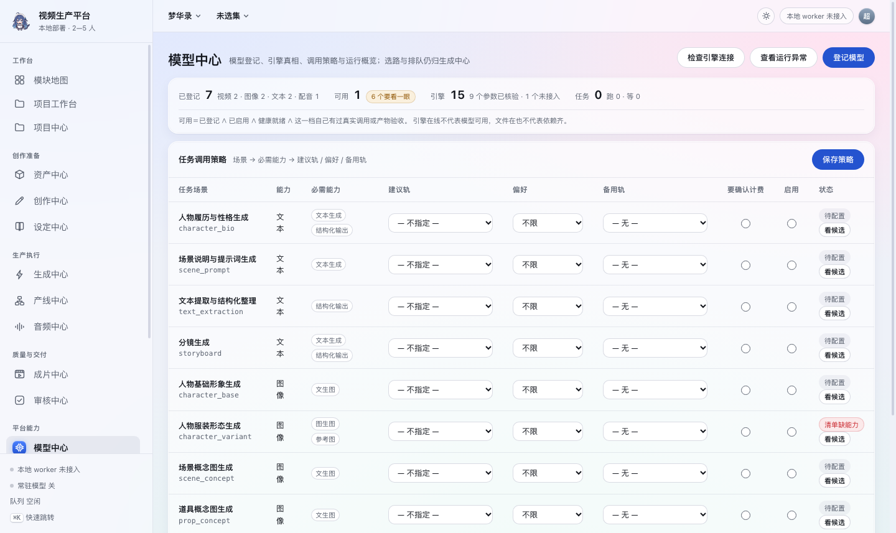

*图 5-1 调用策略。九个场景全部「待配置」，建议轨与备用轨都是「— 不指定 —」。*

| 字段 | 取值 | 说明 |
|---|---|---|
| 必需能力 | **勾选框**，选项来自清单那一轴的标签全集 | 2026-11-07 起可改（原来只读）。清单里没有任何来源的那一项仍列出来但划灰、注明「清单缺来源」——勾了也不会有候选 |
| 建议轨 | 从已登记里选，或「不指定」 | 不是默认轨；只作为人的参照 |
| 偏好 | 优先本地／优先云端／优先远程自建／不限 | 目前是给人看的配置，不参与选路 |
| 备用轨 | 从已登记里选，或「无」 | 默认轨不行时供人工改选；不会自动顶上 |
| 要确认计费 | 勾选 | 候选弹窗会给云端候选标「要逐次确认计费」；真正的闸门仍在提交时的 `user_confirmed_cloud` |
| 启用 | 勾选 | 不启用显示「待配置」；启用却没选建议轨会被拒 |

下拉里只列**已经在模型仓库登记过**的档。没登记的不是可选项，避免选了一个跑不起来的东西。

### 5.3 保存时的七条校验

整批保存是一个事务：要么全写，要么全不写。校验一次说清所有问题，不修一条报一条；错误用「；」拼起来，留在表格下面，不塞进系统弹窗。

1. 场景键必须存在。场景名定死在种子里，界面没有自由输入。
2. 能力必须是五类之一。
3. **必需能力必须在那一轴的标签全集里**（`producible_tags`，与派生标签同源）。手滑拼错或凭空造一个标签，会把这个场景推到「永远 0 候选」还不报错——写入侧拦一次。降成空清单是允许的。
4. 偏好只能是本地／云端／远程自建／不限。
5. 建议轨的 provider（连模型档）必须在清单里，否则平台不会替它猜参数。
6. 备用轨不能和建议轨是同一档，否则等于没有备用。
7. 勾了启用就必须选一条建议轨，不能空着启用。

### 5.4 「看候选」怎么读

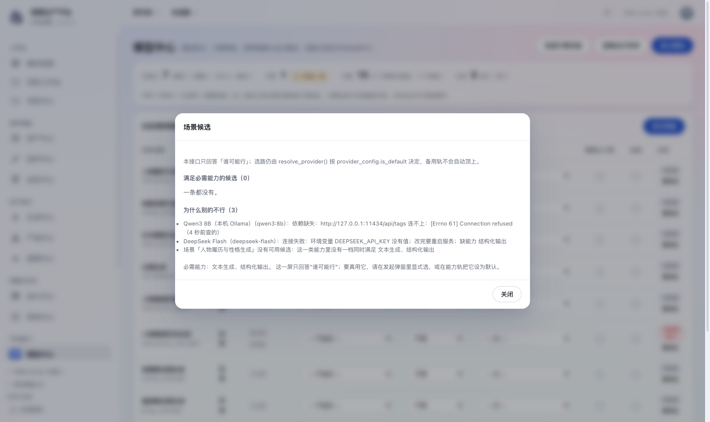

*图 5-2 场景候选。人物履历场景：满足必需能力的候选 0 条；DeepSeek Flash 被点名「连接失败 + 缺能力 结构化输出」，最后一行说明这一类目前没有一档同时满足文本生成与结构化输出。*

候选只从登记里出，且要求：已启用、不是「清单无此档」、没有依赖缺失或连接失败，并且清单派生标签覆盖全部必需能力。`unverified` 允许进候选，但会带着「未验证」徽章——没验过不等于不能用，只是界面不替它担保。

**「未检查」这一档不进挡路原因**（2026-11-07 起）：目录接口本身不出网，服务型引擎（Draw Things、Ollama、ComfyUI）在列表里必然是「要连一次才知道」。把它写成挡路原因，等于让每个用本机引擎的场景永远 0 候选，而真相只是还没人点过一次探测。候选上会带「未检查」徽章，人一眼看得出这一条没有现查过；要现查请点页头「检查引擎连接」或引擎实例那一行的「探测」。

**人工声明不能替代清单事实**：手工给某一档声明「图生图 + 参考图」不会让它进 `character_variant` 的候选——这两项在图像轴上没有任何清单来源，声明了也照样点名「缺能力（清单里没有任何一档能产出它）」。清单能产出、只是这一档没声明的标签仍然算数，那是人的专业判断，不是凭空造能力。

**弹窗最后一行会分开说「配不出来」与「还没配」**：场景要求的某项能力在整条能力轴上都没有来源时，它会明说「这几项必需能力在清单里没有任何来源」，并指出下一步是改 `adapters.py` 或在策略里把这一项从「必需」降下来——而不是让人对着一个永远点不亮的场景反复配置。**「降下来」现在真的点得动**（2026-11-07）：必需能力那一格是勾选框，取消勾选再保存即可；在此之前那句话只能靠调接口做到。

不满足的档**照样点名**，并写清原因：已禁用、「清单无此档」、依赖缺失或连接失败、未安装或未检查、缺哪条能力。名字后面带 `model_code`，因为显示名可以改，只看显示名会认不出是哪一档。

候选表里的「备用轨」只是角色标记，不会获得任何自动生效的通道。弹窗顶部那句 policy_note 每次都会写：这一屏只回答「谁可能行」；选路仍由 `resolve_provider()` 按 `provider_config.is_default` 决定。

### 5.5 两条硬边界

**保存只改配置。** 不启动任务，不改默认轨，不换任何正在跑的作业。默认轨的唯一来源仍是引擎管理那张能力轨表。

**备用轨不自动顶上。** 清单里 `no_auto_fallback` 为真；`resolve_provider()` 不补位、不兜底。备用轨的作用是默认轨不行时，「看候选」能立刻告诉你哪一档能力匹配、可以人工改选。平台不会悄悄换一条路把钱花了。

### 5.6 现状：策略还没有业务消费方

这一点必须说清：截至 2026-11-07，`submit_job()` 与 `resolve_provider()` **都不读** `model_policy`。生成、资产创作、产线提交走的仍是能力轨的默认行，或在发起弹窗里显式选的那一档。调用策略现在是一份给人看的配置清单，不是执行开关。保存它不会改变任何一次生成走哪条路。

**v1.13 起有了第一个"读它"的地方，但它仍然不是消费方。** 生成中心提交框的
「任务场景」那一格会调 `GET /api/model-policies/resolve/{scene_key}`，把候选与
挡路原因摆到人眼前（§2.8）——这是 `model_policy` 第一次出现在**提交路径的界面上**。
但要说准它的性质：读的是**判据**（必需能力、谁能顶），不是**裁决**（走哪条）。
`resolve_provider()` 一个字节没改，`no_auto_fallback` 仍为真。所以准确的说法是：

> 策略第一次进了"人的视野"，还没有进"执行路径"。

**v1.14 的预填没有改变这个结论，但它让这句话需要说得更准。** 单候选时界面会把
那一档填进「执行路线／槽位」两个下拉——触发者是**人显式选了场景**这一步，
不是平台在提交或执行时自己换路；每一次预填留痕可撤销，云端档预填绝不替你勾
计费确认，落库的仍是人在格子里看到的那个选择（显式提交那一支，§5.5）。
判据与裁决的分工没变：**裁决仍由人做出**，界面只是替他省了四下点击。

把建议轨真的当成默认选择（也就是重开裁定 MC1、讨论乙／丙方案）仍然没做，
理由与边界见 §5.5 与 §10 第 5 条。

---

## 6. 运行监控

这一页只读三样现成的东西：`/api/worker/status`、`/api/models/stats`、`/api/providers/validations`。它不开第二条队列，也不复制 Job 的状态。作业的事实永远在生成中心那一条队列里，成本账也在那里。

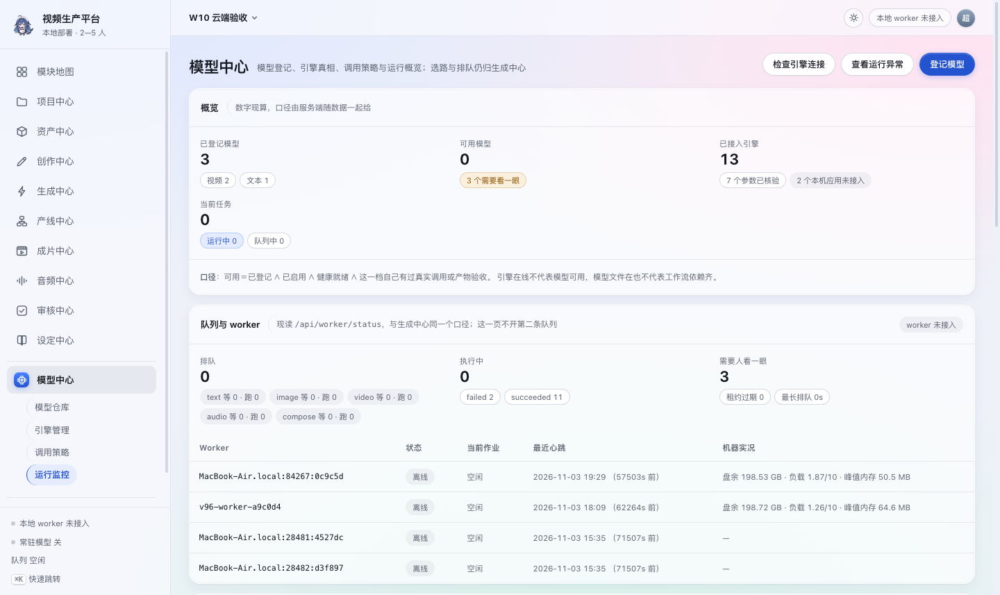

*图 6-1 运行监控上半段：队列与 worker、告警。2026-11-04 20:03 的实况是排队 0、执行中 0、需要人看一眼 3；历史留下五条 worker 记录，只有一条在线，其余四条心跳停在 11 月 3 日。*

### 6.1 队列与 worker

| 区块 | 内容 |
|---|---|
| 排队 | 排队数，下面按资源类分：text／image／video／audio／compose |
| 执行中 | 执行中数，下面按作业状态原码计数 |
| 需要人看一眼 | `needs_attention` 作业与待核对云端账单的合计；旁边给租约过期数与最长排队秒数 |
| Worker 表 | worker id、在线／离线、当前作业、最近心跳（绝对时刻 ＋「多久前」，按 天／小时／分钟／秒 给一级）、机器实况（盘余、负载、峰值内存） |

资源类的分法：成片合成（provider 为 `ffmpeg`）单列 compose，不和视频模型抢显存；配音与音乐都算 audio；其余按能力原样。同一份口径在生成中心与预检里也在用。

### 6.2 告警六码

告警只负责说哪里不对，不做处置。取消与重试仍回生成中心。

| 代码 | 界面文字 | 触发条件（默认阈值） |
|---|---|---|
| `worker_offline` | worker 离线 | 队列有活，但没有任何 worker 在线（心跳超过 20 秒） |
| `queue_stalled` | 队列停滞 | worker 在线，最长一条排队超过 120 秒还没被领取 |
| `lease_expired` | 租约过期 | 执行中的作业租约已过期；worker 下一轮恢复会收掉 |
| `run_timeout` | 运行超时 | 单条作业已跑超过上限 7200 秒 |
| `log_silent` | 日志静默 | 执行中的作业超过 600 秒没有新日志 |
| `needs_attention` | 待核对 | 有云端作业待人工核对账单；核对前不要重试，可能重复计费 |

阈值都能用环境变量改：`FASTVIDEO_WORKER_ONLINE`、`FASTVIDEO_QUEUE_STALL_SECONDS`、`FASTVIDEO_LOG_SILENCE_SECONDS`、`FASTVIDEO_WORKER_MAX_RUNTIME`。界面文案取的是同一份后端码，认不出的码会原样显示，不会变成空白。

### 6.3 模型维度：三项明确做不到

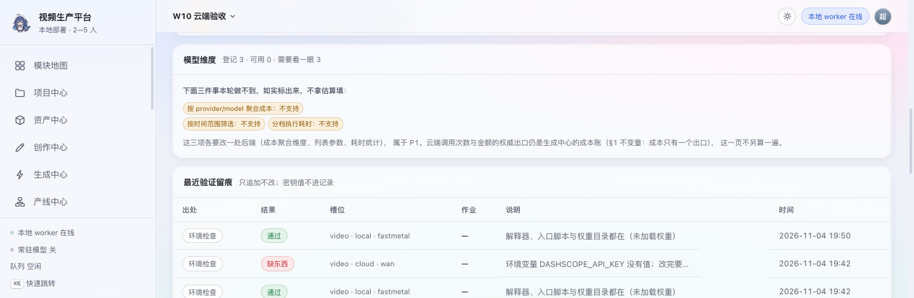

*图 6-2 模型维度与最近验证留痕。三项做不到的直接标「不支持」，不拿估算填。*

| 想做的事 | 现状 | 原因 |
|---|---|---|
| 按 provider／model 聚合成本 | 不支持 | `cost_summary` 只按 currency × capability × 状态聚合 |
| 按时间范围筛选 | 不支持 | 列表接口只有 limit，全仓没有 since／date_from |
| 分档执行耗时 | 不支持 | 只有单条 `job.elapsed_ms`，没有 AVG 或分位 |

这三项各要改一处后端，属于 P1。云端调用次数与金额的权威出口仍是生成中心的成本账；这一页不另算一遍。

### 6.4 最近验证留痕

全站最近的验证记录：出处、结果、槽位、作业号、说明、时间。只追加不改，密钥值不进记录。要看某一槽位的完整历史，回引擎管理打开「验证记录」。

这一张表是**分页**的：卡片右上角写「共 N 条 · 这一页 M 条」，还有更早的记录时给一颗「更早的」按钮。

- **「共 N 条」来自服务端的响应头**，不是这一页的行数。两者在数据少的时候看不出差别，
  数据一多，"拿一页当全部"就成了谎话——v1.9 之前接口只有 `limit` 且被夹在 200，
  第 201 条之后的历史读不到，界面上没有任何提示。
- **「更早的」按上一页最后一条往前切**，不跳号也不重复。用 id 而不是页码，是因为这张表
  一直在追加：翻页期间有人刚验证完一条，按页码翻会让第二页整体挪一格，读到重复或漏行。
- 一页 50 条。更早的记录不是被删了，只是没往这一屏搬。

---

## 7. 这台机器现在的实况

以下是 2026-11-04 20:03 的只读快照，不是永久配置；下一次登记或验证就会变。

| 项 | 值 |
|---|---|
| 已登记 | 3 行：文本·云端 `deepseek/deepseek-flash`、视频·本地 `fastmetal/fastmetal-1.3b-qad`、视频·云端 `wan/wan2.7-t2v` |
| 可用 | 0 |
| 要看一眼 | 3 |
| 引擎 | 16 家，其中 9 家参数已核验、1 家只接探测（ComfyUI） |
| 仓库 | 19 行（11 个模型档＋8 个只登记名字的 adapter） |
| 九个场景 | 全部待配置，无建议轨、无备用轨、未启用 |
| 队列 | 排队 0、执行中 0 |
| 验证记录 | 环境检查：FastMetal 通过、DeepSeek 通过、Wan 缺失；真实调用与产物验收均为空 |

顶部那个「3 个要看一眼」是**登记维度**：三条登记都没到可用。运行监控里的「需要人看一眼 3」是**作业与账单维度**：三条云端作业待人工核对。数字碰巧相同，不是同一件事。

### 7.1 为什么三条都「要看一眼」

- `fastmetal/fastmetal-1.3b-qad` 是「未检查」：运行进程里没有 `FASTVIDEO_FASTMETAL_HOME`，平台查不了解释器与权重，所以健康是 `unknown`。设好变量并重启 API 与 worker 后才会现查。
- `deepseek/deepseek-flash` 是「连接失败」：环境变量 `DEEPSEEK_API_KEY` 没有值。环境检查记录里写的是「密钥来自环境变量 DEEPSEEK_API_KEY」，说明变量名对，只是进程没读到值。
- `wan/wan2.7-t2v` 是「连接失败」：环境变量 `DASHSCOPE_API_KEY` 没有值。
- 三条都没有真实调用与产物验收，所以「可用」是 0。这与健康无关，是证据还空着。

### 7.2 把一档本地视频推到「可用」

以 `fastmetal/fastmetal-1.3b-qad` 为例：

1. 在启动 API 与 worker 的环境里设好 `FASTVIDEO_FASTMETAL_HOME`，指向 FastVideo 仓库；权重目录按 `runtime.py` 的约定放好。改完必须重启两者，健康才读得到新环境。
2. 回模型仓库打开这一档详情，点「环境检查」；健康变成「就绪」，记录多一条通过。
3. 去生成中心用这一档跑一条真作业，等它成功，产物落盘且可读。
4. 回「验证记录」，从这条作业登记「真实调用」；再开一次，出处选「产物验收（人工看片）」，给通过，写清看了什么。两条都通过后，这一行的状态才会变「可用」，顶部「可用」加 1。

### 7.3 把云端文本推到「可用」

1. 在启动 API 与 worker 的环境里给 `DEEPSEEK_API_KEY` 一个值（值只放在进程环境或密钥管理里，不写进页面、文档或仓库）。
2. 重启服务；能力轨「文本 · 云端」的环境检查应从「缺东西」变「就绪」。
3. 跑一条成功的云端文本作业，确认它已勾选计费。云端作业的验证登记要求先有计费确认。
4. 登记「真实调用」与「产物验收」。两步都过，文本这一档才算「可用」。

---

## 8. 常见问题

| 现象 | 原因 | 怎么办 |
|---|---|---|
| 明明登记了，仓库里还显示「本机未登记」 | 你登记的键与清单里那一档对不上（能力／运行位置／provider／模型标识四键之一不对） | 打开详情核对四个键；对不上就撤了按清单里的键重新登记 |
| 仓库里显示「清单无此档」 | 这条登记在本机，但清单里没有这一档 | **改配置没用**：要去 `adapters.py` 补规格，或者把这条登记撤掉 |
| 文件在盘上，却显示「未安装或未下载」 | 进程没有运行时目录变量，或解释器／入口脚本缺失 | 看详情里的健康说明；设变量后重启 API 与 worker |
| 环境检查通过，「可用」还是 0 | 环境检查只是三条件之一 | 跑真作业，登记真实调用与产物验收 |
| 我换了一档模型，怎么又「未验证」了 | 验证记录按槽位落，不按模型档；旧记录不替新档说话 | 对新档重新做真实调用与产物验收 |
| 保存能力轨被拒「每类能力都要选一个默认后端」 | 五类能力里有一类没有默认 | 给缺的那类勾一个默认；折叠行也参与提交，不要以为没展开就不算 |
| 云端视频的默认单选是灰的 | 云端视频只能逐镜头显式选择 | 保持本地视频为默认；云端视频在镜头里单独选并确认计费 |
| 我的模型不在场景候选里 | 可能已禁用、清单无此档、依赖缺失／连接失败，或缺必需能力标签 | 点「看候选」，下面会点名原因；按原因补 |
| 备用轨为什么没有自动顶上 | 设计如此：`no_auto_fallback` 为真，`resolve_provider()` 不补位 | 人工看候选、人工改选；平台不会悄悄花钱 |
| 策略保存了，生成还是走旧路 | `model_policy` 目前没有业务消费方 | 改默认轨要去引擎管理；策略只是配置清单 |
| ComfyUI 为什么没有提交入口 | 它只接探测：能查通不通、也能在页面上启动，但没有 workflow 契约（收的是整张节点图，不是平坦参数表） | 想在提交框里选它，得先定 workflow 模板与参数注入点——独立工作包 |
| 运行监控为什么没有按模型分成本 | `cost_summary` 目前只按 currency × capability × 状态聚合 | 看生成中心的成本账；这一项标「不支持」，不是数据丢了 |
| 撤登记会不会删权重、删历史 | 不会。只删 `model_registration` 这一行 | 权重、作业、验证记录都不动；重新登记即可 |
| 密钥填在哪 | 引擎管理那张卡只收**变量名**；密钥值去「系统设置 · 参数管理 → 供应商密钥」填（密文存库，0052） | 两条来路：进程环境 > 库内密文。界面只显示有没有值与指纹，不回显值；没配 KEK 时那张卡禁用，不回落明文 |
| 远程自建登记后为什么不能验证 | `job.execution_mode` 的 CHECK 只认 local／cloud，`runners.build()` 也没有 remote 分支——它提交不出作业 | 没有作业就没有"真实调用"这条凭据，验证自然留不了。远程自建现在只能留档，等选型层支持第三轨 |
| 远程自建为什么显示「清单无此档」 | 清单按本地／云端两轴登记，没有 remote 轴；**读路径已按 local 折回** | 同一个 provider、同一档模型在清单里有，就照常认领并显示「远程自建」；只有清单里**真没有**这一档时才显示「清单无此档」——那时改配置没用，得补规格 |
| 详情里的参数为什么改不了 | 参数与范围住在适配器清单里 | 改清单是改代码；页面只按清单预填与校验 |
| 登记时为什么提示「这一档已经登记过了」 | 同一组四个键只能一行 | 编辑原行；另一个本地版本改「版本」，不要加行 |
| 编辑时为什么能力与运行位置是灰的 | 它们是登记行的键，改键等于换一档 | 撤登记再按新键登记；只改显示名、版本、路径、备注等元数据 |
| 为什么 `mflux/flux1-schnell` 没有「图生图」标签 | 它没有图片输入参数，标签不按名字猜 | 这是事实；要参考图能力得换有 image 参数的档 |

---

## 9. 权限与接口

### 9.1 接口清单

除 `resolve` 与 `scenes` 两条外，全部要求 `system:config`。

| 方法与路径 | 作用 | 关键行为 |
|---|---|---|
| `GET /api/models` | 清单 × 登记的联表 | 返回 `manifest_version`、`status_labels`、`capabilities`、`backends`、`reg_sources`、`unintegrated_engines`、`items` |
| `GET /api/models/stats` | 顶部四数 | 每个数附带 `caliber` 口径原文；页面已改读 `GET /api/models` 里的 `stats`，这条留给命令行与验收脚本 |
| `POST /api/models/probe` | 现查服务型引擎（只读，不建 Job） | `fresh=1` 绕过 15 秒缓存；回整张目录 + 四数 + 这次探了哪几台 |
| `POST /api/models` | 新增登记 | 201；清单外 provider 返回 `in_manifest:false` 与警告；重复键 422 |
| `PATCH /api/models/{id}` | 逐字段更新 | 只改传上来的键；不认识字段 422 |
| `DELETE /api/models/{id}?confirm=1` | 撤登记 | 不带 confirm 或值不对 422；只删这一行 |
| `POST /api/models/{id}/check` | 对这一条登记跑环境检查 | 远程自建 422；结果写 `model_validation` |
| `GET /api/model-policies` | 九个场景的配置 | 带 `no_auto_fallback` 与 `preference_labels` |
| `PUT /api/model-policies` | 整批保存 | 一个事务；六条校验；错误一次列全 |
| `GET /api/model-policies/scenes` | 九个场景的**只读骨架**（键／名／能力／必需能力／产不产得出） | **登录即可**（v1.13 新增）。生成中心提交框列场景用它——`/model-policies` 要 `system:config`，普通编辑者读不到。**不下发**建议轨、备用轨、偏好 |
| `GET /api/model-policies/resolve/{scene_key}` | 场景候选 | **登录即可**，与 `/providers/available` 同一档；不含密钥变量名、备注与本机路径 |
| `GET /api/engines` | 引擎实例列表 | 每行带**现查**健康（不落库）；停用中的实例不探测
| `POST /api/engines` | 加一条实例 | `engine_code` 不在清单 422；重复（code + 端点）422；建成后顺手探一次，连不上只回警告不回 4xx
| `PATCH /api/engines/{id}` | 改实例 | 端点连同 code 是键，**改不了**；只能改显示名／连接方式／密钥变量名／备注／启停
| `DELETE /api/engines/{id}?confirm=1` | 撤实例 | 不带 confirm 或值不对 422；应用、权重与历史作业都不动
| `POST /api/engines/{id}/probe` | 对着一台现查 | 带它自己的端点、`fresh=True`；只读，不建 Job、不落库

另外三个由这一页调用、但属于旧入口：`GET /api/providers`、`POST /api/providers/validate`、`PUT /api/providers`，以及 `GET /api/providers/manifest`、`GET /api/providers/validations`（分页读：一页 + 响应头 `X-Total-Count`）、`POST /api/providers/validate-job/{job_id}`、`GET /api/worker/status`。

### 9.2 请求形状

登记一个模型：

```json
{
  "capability": "video",
  "backend": "local",
  "provider": "fastmetal",
  "model_code": "fastmetal-1.3b-qad",
  "display_name": "1.3B QAD（迭代）",
  "version": "",
  "artifact_path": "/path/to/weights",
  "capabilities": ["文生视频"],
  "enabled": true,
  "note": "为什么登记它、哪天核过"
}
```

保存九条策略（节选一条；实际要传全九条）：

```json
[
  {
    "scene_key": "shot_video",
    "scene_label": "镜头视频生成",
    "capability": "video",
    "required": ["文生视频"],
    "slot_provider": "fastmetal",
    "slot_model": "fastmetal-1.3b-qad",
    "preference": "local",
    "fallback_provider": "",
    "fallback_model": "",
    "resource_limit": {},
    "cloud_confirm_required": false,
    "enabled": true
  }
]
```

### 9.3 错误约定

- **401**：没登录。
- **403**：登录了但没有 `system:config`；普通编辑者连读都读不到。
- **404**：登记 id 不存在。
- **422**：业务拒绝，`detail` 是给人看的中文原话。最常见的是重复键、provider 不在清单、默认不唯一、云端视频设默认、备用轨与建议轨同档。
- 写操作要么全成，要么整批不写；界面不会留下半截状态。

---

## 10. 边界与已知限制

1. **规格不能在页面改。** 参数范围、计价、出处全在 `adapters.py`；页面只读。改规格等于改代码并重跑验证。
2. **登记不下载、不校验文件。** 权重路径只是留档；文件在不在由健康现查。
3. **远程自建只能留档，但能留验证痕（v1.12 改）。** 选型层只有本地／云端两轨，`job.execution_mode` 的 CHECK 也只认这两档——所以 remote **提交不出作业**（`runners.build()` 没有那条分支）。但「提交不出作业」不等于「验不了」：v1.12 起 `model_validation` 的 CHECK 也认 `remote`，环境检查能跑、真实调用与产物验收也能记。它的健康恒为「未检查」（平台不查别人的文件系统），这一档**不再把健康当门槛**——有真调用或产物验收凭据就显示「可用」。它现在的作用只有一个：把"这一档在别人机器上、端点是什么"留成一份配置，等选型层支持第三轨时才用得上。**读路径已按本地那一轴折回**（2026-11-07），所以同一个 provider／同一档模型在清单里有，就照常认领并显示运行位置「远程自建」；只有清单里真没有这一档时才显示「清单无此档」。
4. **调用策略没有业务消费方。** `submit_job()` 与 `resolve_provider()` 不读 `model_policy`；策略保存只改配置。
5. **没有自动降级。** 本地失败不会自动转云端；备用轨不会自动顶上；云端视频必须逐镜头显式选择并确认计费。v1.13 把候选摆进了提交框（§2.8），v1.14 让单候选时那一档被**预填进弹窗的两个下拉**——两条都是**提示**：触发者是人显式选了场景，预填留痕可撤销，云端档预填绝不替你勾计费确认，`resolve_provider()` 一行未改。
6. **验证按槽位，不按模型档。** 同一 provider 换档后旧记录不背书；「可用」还要求记录里的模型就是当前这一档。
7. **运行监控三项做不到。** 按模型聚合成本、按时间范围筛选、分档执行耗时都标「不支持」，没有拿估算填。
8. **ComfyUI 只接探测、不接执行。** 本机装了应用，2026-11-13 起它在清单里：能现查通不通、能在页面上启动，**但没有 workflow 契约，所以没有提交入口**——它不会出现在生成中心的候选里，这是设计不是缺陷。（Draw Things 自 v0.121 已全接；引擎实例那张卡从 2026-11-07 起有界面，见 §3.4.1。）
9. **五个能力、九个场景是定死的。** 页面不提供新增能力或新增场景；场景名可以改标签，但不能自由造键。
10. **成本只有一个出口。** 云端调用次数与金额的权威口径在生成中心的成本账；模型中心只读队列与验证，不另算一遍。
11. **验证记录只追加。** 登记错了不能改，只能再追加一条正确的；最新一条按出处参与判定。
12. **策略的建议轨只校验 provider 在清单里。** 模型标识不在清单里目前不拦；界面下拉只列已登记档，但直接调接口可以带任意模型标识。这是已知缺口，不是推荐用法。
13. ~~**登记接口对远程自建的清单判断与仓库联表不完全一致**~~ → **2026-11-07 已修**：写路径与读路径现在都走 `mc.find_adapter()`／`adapters.MANIFEST_AXIS`，同一个折回判据只有一份。创建响应说的 `in_manifest` 与仓库联表那一行现在是同一个结论（`test_清单轴上只折一次` 钉着）。

---

## 附录 A 截图索引

| 图号 | 文件 | 主题 | 内容 |
|---|---|---|---|
| 1-1 | `assets/v99-model-repo.png` | 白天 | 模型仓库与顶部四数 |
| 2-1 | `assets/v117-model-register.png` | 白天 | 登记弹窗：能力／运行位置／Provider／模型标识四格全为下拉，选项取自清单 |
| 2-2 | `assets/v117-model-register-hand.png` | 白天 | 同一弹窗的「只登记了名字」档：模型 ID 退回手填，旁边写明为什么 |
| 2-3 | `assets/v99-model-detail.png` | 白天 | 模型详情与允许参数 |
| 3-1 | `assets/v99-model-engines.png` | 白天 | 能力轨十行 |
| 3-2 | `assets/v99-model-engines-table.png` | 白天 | 引擎表与两台未接入应用 |
| 4-1 | `assets/v99-model-validation.png` | 白天 | 验证记录弹窗 |
| 5-1 | `assets/v99-model-policies.png` | 白天 | 九个任务场景 |
| 5-2 | `assets/v99-model-resolve.png` | 白天 | 场景候选与挡路原因 |
| 2-4 | `assets/v130-gen-scene.png` | 夜间 | 提交框的「任务场景」与候选面板（清单缺能力的警示，§2.8） |
| 2-5 | `assets/v130-gen-scene-prefill.png` | 夜间 | 单候选自动预填的留痕与「撤销预填」（§2.8，v1.14） |
| 6-1 | `assets/v99-model-monitor.png` | 白天 | 队列与 worker、告警 |
| 6-2 | `assets/v99-model-monitor-models.png` | 白天 | 模型维度与最近验证（右上角是翻页条：共 N 条 · 这一页 M 条 ＋「更早的」） |

## 附录 B 名词表

| 词 | 意思 |
|---|---|
| 清单 | `adapters.py` 里的适配器规格：能力、后端、参数、计价、出处 |
| 档 | 清单里的一个 `model_code`，例如 `fastmetal-1.3b-qad` |
| 槽位 | 能力 × 后端，共十个；能力轨一行就是一个槽位 |
| 登记 | 这台机器上某一档的实例记录，住 `model_registration` |
| 默认轨 | `provider_config.is_default=1` 的那一行；选路的唯一来源 |
| 建议轨／备用轨 | 调用策略里给人看的配置，不参与选路 |
| 健康 | 环境齐不齐：目录、解释器、脚本、权重或密钥变量 |
| 验证 | 凭什么认为真能产出：五类出处，只追加 |
| 生产可用 | 环境检查通过＋真实调用成功＋产物验收通过 |
| 未达生产可用 | 三条件缺任意一条，或没有同一档的记录 |
| 资源类 | text／image／video／audio／compose，队列按它分桶 |

## 附录 C 变更详录

### v1.23（2026-11-14）

**全平台界面现代美化与「检查引擎连接」即时开窗性能优化。**

1. **界面美化与现代微动效**：CSS 双主题变量重构（极光玻璃 2.0 / 暗金片场 2.0），消除过大胶囊按钮并收敛为 7px 现代倒角，引入呼吸聚焦发光与 `.skeleton-shimmer` 渐变流光骨架屏体系。
2. **「检查引擎连接」即时开窗**：彻底改变此前等待全部出网探测与全页重绘才允许弹窗的阻塞模型。点击瞬间 0 毫秒即刻挂载弹窗并展示骨架流光，出网探测（`probeModels(true)` 与 `engines()`）改为 `Promise.all` 全并发调度，十条能力轨环境检查改由后台异步并发留痕，消除开窗前 3~5 秒盲等卡顿。

### v1.22（2026-11-13）

**补一次真实的云端文本链路验证**（§4.3.1）。在此之前，「可用」这个徽章
只被证明到「探测能连上端点」；而本册 §4.2 反复强调「配置就绪不等于生产
可用」，却一直没有给出「真的跑通过一次」的实测证据。

这次绕开界面直接调 `cloud_run.py`：`DEEPSEEK_API_KEY` 在环境变量里，
最小请求（`max_tokens=16`）走完整个执行器——密钥读取、HTTP 请求、
响应解析、正文落盘。结果退出码 0、HTTP 200、802 ms、10 token，
正文文件 6 字节内容 `收到`。

**同时把边界写死在那一节里**，避免以后被读成「已经生产可用」：

- 它能证明的是 `real_call` 那一档要的证据（这条链路真的产出过文件）；
- 它**不能**冒充生产可用——按 §4.2 的公式还缺产物验收；
- 它也不等于跑过真实作业：没走 Job 队列、没写 `job` 表、没留验证记录。
  要留下 `real_call` 记录必须从一条已成功的真实作业登记（§4.4）。

顺带记两个实测踩到的坑：① 请求里漏 `output` 会报
`cloud_run_error: KeyError: 'output'`——`result` 与 `output` 是两个路径；
② 模型名要用清单里的 `deepseek-flash`，手填 `deepseek-chat` 供应商会
路由到 flash（`returned_model` 就显示 `deepseek-flash`），能通但对不上账。

### v1.21（2026-11-13）

能力轨的引擎与模型改成完整下拉，避免文本建议框被当前的 `mflux` 值过滤后看不到 Draw Things。切换引擎时模型同步切换，清单外配置仍可保留或手填；展开本地轨详情后保存不再读取不存在的密钥输入框。夜间下拉随模型切换一并更新。

实例行与连接结果窗的「启动服务」都会继续等待已启动但尚未连接的应用，取得真实成功响应后自动更新为就绪；不把进程启动当作连接成功。专项门禁 `tools/engine_setup_browser_check.py` 使用模拟 API 验证实际渲染、选择、保存及启动点击流程，包含候选缺失与跳过等待两类临时副本变异。

### v1.20（2026-11-13）

**同一册里四处旧口径，与 2026-11-13 的新状态打架。** ComfyUI 从「未接入」变成「只接探测」（有端点、能探测、能启动）之后，本册还留着四句按旧状态写的：

① §3.4 正文「标「未接入」、**不给连接按钮**」——它现在有按钮，也在清单里；② §3.4 图注「两台未接入应用」——图摄于当时，图注补了时间说明；③ §8 常见问题「为什么没有「测试连接」」——改成「为什么没有提交入口」，原因也不同了（不是没适配器，是没有 workflow 契约）；④ §10 边界第 8 条「ComfyUI 未接入」——改成「只接探测、不接执行」，并把"不会出现在生成中心候选里"写成设计而非缺陷。

改法上守一条：**历史记录里的旧话不动**（附录 C 的 v1.7 那段写着"只剩 ComfyUI"，那是 2026-11-06 的事实）。正文与附录的分工在这里必须分清，否则改历史就等于伪造记录。

### v1.19（2026-11-13）

**ComfyUI 也能在页面上启动了。** 配方是 `open -a "Comfy Desktop"`——它装的是 Electron 外壳、本体跑在壳里，所以入口只有这一种，与 Draw Things 同形状。

一处**必须说清的不对称**：全局复探等待是 6 秒（为另外两档定的），而 ComfyUI 首次启动要下载本体与模型、可能几分钟。所以点了「启动服务」看到「已启动但没答话」是正常的；它的 note 会让人先去 Dock 看界面有没有真的打开，再回来点「探测」。把全局等待抬到几分钟，代价是另外两档每次点按钮都白等——这个取舍是有意的。

### v1.18（2026-11-13）

**两个"为什么没有那个按钮"写进正文，免得下一个人以为是漏做。**

① **ComfyUI 只接探测**：它现在在引擎表里（第 16 家），能现查通不通，**不会**出现在提交框候选里。它收的是一整张 workflow 节点图，而平台只有 argv 与一次性 HTTP 两种执行形状——后一种要求平坦参数映射，做不出可信的参数白名单。所以这一档存在的意义只有一条：在引擎管理里看得见它通不通。接执行是独立工作包。
② **「启动服务」之后没有「关闭服务」**：启动主动把子进程放进自己的会话（`start_new_session=True`，注释写着"人拉起来的是要长期驻留的服务"），句柄在请求返回时就丢了，于是没有可靠身份可以拿去停。按进程名杀会重演 worker 那边误杀无关进程的事故。今天的分工是**启动在页面上做、停止手动做**。
③ 引擎表计数 15→**16**（含"只接探测"那一家，口径分开写）。

### v1.17（2026-11-13）

**密钥口径改正：旧写法在 0052 之后就是假话。** §3.4 与 §8 那两处原本写「这里只填变量名，永远不填密钥值」「页面只收变量名，不收值」——2026-11-11 起供应商密钥可以在「系统设置 · 参数管理」以 AES-256-GCM 密文存库（环境变量优先）。引擎管理这张卡仍然只收变量名（改的是读哪把钥匙），但**值本身有地方填了**，且任何界面都不回显、只给指纹。

### v1.16（2026-11-13）

本轮只同步说明，不改业务代码。连接结果窗按组优先展示异常，技术细节按需展开；启用与启动分开，按钮受服务端限制，无操作时收起操作列。重查连接不等于补记全部能力轨验证。修正手动实例探测会留历史的说明，连接结果不升级为生产可用。

### v1.15（2026-11-09）

**体检轮的文档侧：三处口径追平＋一句 P0 记录，机制与数字的原文在设计稿 v0.132。**

1. **§3.5 的「检查引擎连接」补云端段**：这个按钮自 2026-11-08 起，除本机
   服务型引擎外还会逐家现查已登记的云端供应商（`cloud_probe.py`，五档：
   路通钥匙被接受／路通钥匙被拒／连不上／没配密钥／无可探端点）。
   未核验供应商（可灵／Seedance 等）如实回"无可探端点"，**不编地址**；
   没配密钥**不发请求**。两处文案随之改：入口表那一行、
   "只有 probe 会真的连服务"那句（原"只连本机"）。
2. **§4.3"不做的"那句加限定**：原文"不发 HTTP 请求"笼统罩住整册，
   现在限定为**环境检查**不发请求，并点名两个真会连网的显式入口。
   这是本轮体检抓到的注释/文档漂移里最容易误导人的一种——
   字面都对，合起来读不出"什么时候会连网"。
3. **P0 记录（界面行为恢复，非新口径）**：提交作业弹窗的「场景／路线／槽位」
   三个下拉自某次前端重构起一直是空的（`api.modelScenes()` 这个方法名
   从来没存在过；同步 TypeError 被外层 try 咽进一个只写不读的状态，
   所以页面一声不吭）。§5.6 写的预填行为从本轮起才真正成立。
   守卫（api 方法名静态对撞测试）＋场景门禁 20/20 已钉住这类缺陷。
4. **§3.5 那一行的超时口径顺手改对**：原文"0.8 秒／台"讲的是列表档，
   但按钮这一枪走的是满 5 秒；本轮代码把 5.0 收成 `engines` 的单一出处
   （`PROBE_TIMEOUT_SECONDS`，两处抄写迟早漂一次），文档不再抄秒数。

### v1.14（2026-11-08）

**这一版把「看到候选」往前一步：单候选时界面替你把两个下拉填好——但只填弹窗，不留暗账。**
§2.8 改写，新增图 2-5。

1. **预填的边界（这是对 v1.13 那句"两个下拉一个字节都不动"的显式反转，
   不是推翻 MC1）**。MC1 禁的是平台在**提交与执行时**自己换路；预填发生在
   **人显式选了场景**之后，改的只是这个弹窗里两个下拉的**界面值**——
   `provider_config` 默认轨、`resolve_provider()`、`adapters.POLICY` 全部一字未动，
   提交走的还是既有的显式选中那一支。四条保证写进 §2.8：只改弹窗、留痕可撤销、
   绝不替你勾计费确认、服务端选路不变。
2. **只有恰好一档才自动预填；好几档不替你挑**。多候选时每行一个「用它」按钮，
   点哪档填哪档。调用方带参数模板进来时模板赢（模板比场景更具体）。
3. **留痕与撤销**。槽位下方一行写明「已按场景「×」预填：…」＋「撤销预填」，
   撤销回到**打开弹窗时那一格**（连续几笔预填共享同一笔原始值）；人手动改过
   任一相关下拉即视为接管，留痕与撤销一起作废。云端档的留痕额外用加粗红字
   写明"预填不会替你勾计费确认"。
4. **验收环境改为自足的**：`tools/generate_scene_check.py` 现在自己起一个假
   Ollama（只答 `/api/tags`）并把副本库的引擎实例指过去，云端候选用一把
   假 `DEEPSEEK_API_KEY`（cloud 的健康判据只看 key 在不在，不发网络请求）。
   上一版"候选数跟着本机服务状态漂移"的口径对**展示**断言仍然成立，但对
   **预填**断言不行——预填要求"恰好一档"，环境不确定它就测不准。断言从 12 条
   扩到 **20 条**，每条新断言都做了反向变异验红（脚本头注记录四组变异与各自
   打红的断言）。

**这一版没有改的东西**：`resolve_provider()` 五个闸门逐字未动；
`user_confirmed_cloud` 那道闸门在界面上原样（断言直接读 `#jm-confirm.checked`）；
`adapters.POLICY["no_auto_fallback"]` 仍为 `True`。v1.13 条目里那句"选场景时
两个下拉一个字节都不动"从本版起不再成立——成立的是它的弱化版：
**不动默认轨、不勾计费、每次改动写在脸上可撤销**。

**验收**：全量 `pytest` **1103 passed, 1 skipped**（本版零后端改动，与 step-1
交付时一致）；`tools/generate_scene_check.py` **20/20**；模型中心既有验收重跑
**72/72** 仍全过（63→72 的增量是并行开发加的用例，不是本版改动）。
业务端点与表结构未动（190／45／0045）。

### v1.13（2026-11-07）

**这一版把「看候选」从模型中心搬到了人真正做决定的地方：提交框。**
新增 §2.8。

1. **提交框多一格「任务场景」**。分镜与镜头工作台点「生成」时已经知道这是
   `shot_video`（镜头视频），所以打开弹窗就是那个场景；也可以自己换。
   换场景不是换个下拉——它会把 `GET /api/model-policies/resolve/{scene}`
   的答案摆出来：谁进了候选、别的因为什么不行、这个场景的必需能力在清单里
   产不产得出来。
2. **新增一条只读接口 `GET /api/model-policies/scenes`**。原来"有哪几个场景"
   只有 `GET /api/model-policies` 有，而那条是 `system:config`——普通编辑者站在
   提交框前面**列不出场景**，只能由管理员口头告诉他填哪个键。这一条降到
   `require_user`，与 `resolve` 同档。**刻意不下发** `slot_provider`／
   `fallback_provider`／`preference`：那两个字段一旦到了界面上，很容易被顺手画成
   "已选中"，而裁定 MC1 是只提示不自动切。守卫见
   `test_场景骨架登录即可读且不含建议轨`。
3. **修掉一个全站的显示缺陷：自绘下拉不跟程序化设值**。`pick.js` 原来只挂了
   `MutationObserver`，而 `sel.value = x` 改的是 **property**、不是 attribute——
   MutationObserver 一条都不报。于是夜间主题下所有"程序化设值"的下拉
   （`refreshModeSelect`／`refreshTemplateSelect`／`applyProfile`、模型中心的
   筛选与编辑态预填）**按钮上停在旧文字、程序却按新值在跑**。这个缺陷不是本版
   引入的，是新加的「任务场景」那一格把它顶到了明面上（截图一眼就能看见）。
   修法：劫持该 select 实例的 `value`／`selectedIndex` 访问器，写进去就重画；
   `restorePicks()` 切回白天时把那两个访问器 `delete` 掉。劫持在**实例**上而不是
   `HTMLSelectElement.prototype`——后者会动到全站每一个 select，收益是零。
4. **明确写了策略的准确定位**（§5.6）。这是 `model_policy` 第一次出现在
   提交路径的**界面上**，但读的是判据不是裁决。准确说法是"策略第一次进了人的
   视野，还没有进执行路径"——把建议轨当成默认选择（重开 MC1）仍然没做。

**这一版没有改的东西，比改了的更值得记**：`resolve_provider()` 一行未改；
`adapters.POLICY["no_auto_fallback"]` 仍为 `True`；执行路线与槽位两个下拉的
内容与选中项在选场景时**一个字节都不动**（真浏览器断言
`选场景后执行路线与槽位没有被自动改` 钉着它）。所以 §5.5 那句"平台不会悄悄换
一条路把钱花了"在这个版本里仍然成立。

**验收**：全量 `pytest` **1098 passed**（新增 2 条后端用例 + 守卫表 1 行）；
新增真浏览器验收 `tools/generate_scene_check.py` **12/12**（含"按钮字要跟得上
程序化设值"与"选场景不改路线"两条反证过的断言）；模型中心既有验收重跑
**63/63** 仍全过。业务端点 189→**190**，总 194→**195**；表与迁移未动（仍 45／0045）。

### v1.12（2026-11-07）

**这一版把设计审查遗留的两条打通：同能力第二档终于选得到，远程自建终于留得下痕。**

1. **同能力可以登记好几档、提交时能选（新增 §2.7）**。原来提交时显式指定
   provider／模型必须与能力轨那一格逐字相同，于是同能力第二档等于选不到——
   想让 5B 上场只能去改默认轨再改回来，而改默认轨是有后果的动作。
   判据换成「已登记 ∧ 已启用 ∧ 清单有适配器」，**能力轨那一格仍然只决定
   "不指定的时候走哪条"**。
2. **远程自建能留验证痕（§10.3 改写）**。原来它的「环境检查」直接 422、
   状态永远「未验证」。现在三档走同一套流程；它的健康恒为「未检查」（平台不查
   别人的文件系统），但这**不再当门槛**——有真调用或产物验收凭据就显示「可用」。
3. **弹窗能用键盘走完**。四个弹窗补了对话框语义（读屏软件会念"对话框"），
   打开时焦点自动进来、Tab 在弹窗内循环、关掉后焦点回到你原来点的那个按钮。
   原来只有 Escape 一条键盘路径，Tab 会一路跑到背后表格里。
4. **窄屏（≤640px）单独一档样式**：弹窗里的表单收成单列（380px 上原来字段名与
   控件挤成两列，控件只剩半格宽）、表格横滑时右侧给一条阴影提示还有内容。

### v1.11（2026-11-07）

**这一版把两条"说了但只做了一半"的话补全，另修三处会让人反复点的地方。**

1. **「换档不背书」扩到能力轨（§4.5）**。原来这条规则只在模型仓库那一侧成立：
   仓库页要记录里的模型就是当前这一档才给「可用」，而能力轨那一列的「生产可用」
   是拿**整个槽位**的验证史算的——同一 provider 换档之后，能力轨还亮着旧档的绿灯。
   现在验证记录按档切开（迁移 0043），两屏读同一把尺子。这一条是本册这版最要紧的改动：
   它把一条写在文档里的纪律变成了查询的形状。
2. **「必需能力」从只读放开成勾选（§5.2／§5.3／§5.4）**。§5.4 一直在教人
   "在策略里把这一项从「必需」降下来"，服务端也早在写 `required_json`，
   但那一格是只读 chip——规则齐了、入口没开。现在能点；同时补第 3 条校验
   （必需能力必须在标签全集里），免得手滑拼错把场景推到永远 0 候选还不报错。
3. **引擎实例卡挑明是"打开页面不连网"的例外面（§3.6）**。那一页每开一次就逐台现查
   （单台 0.8 秒封顶）——「这台端点现在通不通」只能发请求作答。不写明的话，
   第一次看到转圈的人会把实现当 bug 报。
4. **非当前轨的档会点名说为什么不会变「可用」**（§2.3 状态说明里那句）。
   同一能力登记了两档、其中一档不是能力轨当前选中的那一档时，它的状态说明现在直说
   「不是能力轨当前选中的那一档（当前是 X）」并指出去哪儿改——原来只说健康结论，
   人对着它反复点「环境检查」，而解法在另一张表上。
5. **概览那枚「N 个要看一眼」可以点了**：点它就跳到模型仓库并筛出这些行。
   另外空机器上不再显示绿色「都齐了」（0 登记时 `needs_attention` 恒为 0，那是空位不是结论）。

### v1.10（2026-11-07）

**这一版把三处"词不达意"改成达意，另加两件小东西。**

1. **三个「缺东西」的状态改名**（§2.3）。旧名「未登记」／「清单未登记」／「只登记了名字」——
   前两个互为前缀、都含"登记"，处置却相反：一个点一下「登记」就解决，另一个得去改代码、
   点多少次都没用。现在叫**本机未登记**（灰，点登记）／**清单无此档**（红，改代码或撤登记）／
   **清单只有名字**（琥珀，手填模型标识或等补齐）。健康那枚「未登记」也改成「清单无此 provider」，
   免得和状态那一栏混。
2. **引擎实例的连接方式只给能选的一档**（§3.4.1）。下拉里原来摆着 `grpc`／`cli`，但探测与执行
   都只写了 HTTP——选进去看不到任何行为。现在只收 `local_http`，拒绝时明说"要先写探测与执行分支"。
3. **引擎实例多一句「上次探测」**（§3.4.1）：手动探测过写「手动探测 · N ms」，只建过实例没再碰过
   写「建实例时顺手探的」，从没探过写「还没有探测记录」。**这一句讲过去**，现在通不通仍看上面那枚徽章。
4. **保存能力轨时会核对"你打开时那一版有没有变"**（§3.5）。这一页是十行一起保存的，
   以前后保存的人会把前一个人改的那一行静默盖回旧值。现在变了就整批不写、点名哪几行，
   并给「重新读一遍」这条出路。

**图重拍了 3 张**：`1-1`（模型仓库，状态徽章改了名）、`3-1`／`3-2`（引擎页，实例卡多了「上次探测」与连接方式说明）。
### v1.9（2026-11-07）

**这一版只动两处界面与一张接口的读法，没有新功能。**

1. **验证历史能翻页了**（§6.4）。这一张表原来只显示最近 20 条，而接口的 `limit` 又被夹在 200——
   于是"更早的记录读不到"这件事在界面上完全不可见，翻到底的人会以为历史只有这么多条。
   现在卡片右上角写「共 N 条 · 这一页 M 条」，还有更早就给一颗「更早的」按钮。
   两件事都来自服务端：「共 N 条」读响应头 `X-Total-Count`（不是数这一页的行数），
   「更早的」拿上一页最后一条的 id 往前切（不跳号也不重复——这张表一直在追加，按页码切会错位）。
2. **撤登记与撤实例的确认口令不再要求中文**（§9.1）。接口以前要 `confirm=撤登记`／`confirm=撤实例`，
   那是把界面文案写进了协议；现在只要 `confirm=1`（或 `true`／`yes`）。**界面上的行为一字没变**：
   两颗按钮仍然先弹确认框、正文仍然写明"权重文件与历史作业都不动"，只是接口那一层不再认中文词。
   从命令行手工调用的人受益最大：不用再算 UTF-8 转义。

**重拍了一张。** `6-2`（`assets/v99-model-monitor-models.png`）确实变了——翻页条就长在那张图的
「最近验证留痕」卡片右上角，不重拍就是图文不符。其余各图与这两处改动无关，仍按下表标注的日期取信。

### v1.8（2026-11-07）

**这一版补的是"界面上根本做不到的那几件事"，不是改文案**。

- **新增 §3.4.1「引擎实例」**：后端从 W-B 起就有 `GET/POST/PATCH/DELETE /api/engines` 与 `probe`，
  但界面没接，于是本册 v1.4 起写的那句"引擎实例……界面还没画，只有接口可管"一直是对的。现在能
  加端点、探测、停启用、撤实例；三条边界写进那一节（code 在清单里／健康不落库／端点不可改）。
- **新增 §3.6「打开页面不连网」**：读接口不出网，现查只有两个显式入口；写清"未检查"的两种含义
  与三种出路（15 秒内缓存／有实例没查过／还没有实例）。
- **§5.1 补「结构化输出」的来源**，§5.4 补两条候选口径（「未检查」不进挡路原因、人工声明不能
  替代清单事实、最后一行会分开说"配不出来"与"还没配"）。
- **§3.5 那张"三种检查"的表补成四种**，并把"只有 probe 会真的连本机服务"写清。
- **§8 常见问题修一条错的**：远程自建显示「清单未登记」那一行，原因是读路径没折回——
  2026-11-07 已修，现在显示的是运行位置「远程自建」。
- **§9.1 接口表补 `POST /api/models/probe`**，并注明页面已改读 `GET /api/models` 里的 `stats`。
### v1.7（2026-11-06）

**计数追平轮（本册一个字没动代码，改的全是"数错了"与"两处说法打架"）**。数是用 `.venv/bin/python` 直接量 `adapters.ADAPTERS` 得到的，不是推算：

| 口径 | 本册原来写 | 现算 |
|---|---|---|
| adapter 对象 | 16 | **17** |
| 去重后的引擎 code（概览"引擎"那个数） | 14 | **15** |
| 参数已核验的家数 | 8 | **9**（本地文本腿 ollama 有 `params_source`） |
| 模型档 | 10 | **11** |
| 只登记了名字的 adapter | 8 | 8（`volc`／`minimax` 各占两条能力，所以对象数比家数多） |
| 仓库页行数 | 18 | **19**＝11 档＋8 个无档 adapter 各占一行 |
| 未接入引擎 | 2（ComfyUI 与 Draw Things） | **1**（只剩 ComfyUI，`model_center.UNINTEGRATED_ENGINES` 实测） |

改的六处：§1 顶部四数那一行、§2 仓库页行数两处、§3.4 标题与正文两处、§7 实况读数两行、§10 边界第 8 条。
**为什么上一轮会漏**：W-B 那一轮已经把 Draw Things 从 `UNINTEGRATED_ENGINES` 里删掉了，
本册 §3.4 的正文同步改了（"Draw Things 是新加的服务型引擎"），但**同一册里还留着两处旧话**
（"最后两行是 ComfyUI 与 Draw Things"与 §9 第 8 条"两家未接入"）——同一册自相矛盾，
读者按后两处会以为点不到按钮是因为没接入。这正是《写作与引用规范》§2 说的第二份定义，
只不过这次长在同一个文档里。现在这三处都只剩 ComfyUI。

新写进去的一条口径（不是修错）：**Ollama 不进 `_service_engine_gate` 那一族**。
Draw Things 同一时刻只有"当前模型"这一个概念，所以平台要现读它、不符就拒绝、不代切；
而 Ollama 的模型名是每次请求里带的，去核对一个不存在的概念只会得到假话——
理由原文写在 `adapters.py` 的 `_OLLAMA` 上方注释里。


### v1.6（2026-11-06）

**本地文本腿进清单，本册那个"空档"的例子跟着换掉**（设计稿 v0.123，迁移 0041）。

`ollama`（文本 × 本地，本机常驻服务型）加进适配器清单，清单版本 `2026-11-06.1`→**`2026-11-06.2`**。
改动本身只有一句：本册 §2 一直拿「文本 × 本地」当"这一组合一档都没有"的活例子，
现在它有了真 provider，例子继续用就是在教人一个已经不成立的行为——换成至今仍然空的**音乐 × 云端**。

顺带记两条实测，因为它们决定了界面能不能"猜"：本机 qwen3:8b 带 `tools` 真回工具调用（16.3 秒），
而带 JSON schema 却不关思考时 `content` 是空的——所以这一档的 `think` 默认值是 false，
不是可选项；结构化输出交给本地模型跑之前，先按这条实测核一次。
本册没有补截图：智能体中心的配置那一页只读模型中心这三张表，界面本身没多出一个可改的地方。

### v1.5（2026-11-06）

**运行监控 Worker 表的心跳列改成绝对时刻加一句按天／小时／分钟／秒给的「多久前」**。病根不是单位而是同一件事有两份定义：`views/models.js` 直接拼 `${age_seconds}s 前`，`views/pipeline.js` 自己有个只到小时的 agoText，于是同一份 `/api/worker/status` 在两个页面念出两种精度、2 天前的行还在念「66 小时前」。现在 `js/util.js` 的 `agoText()` 是唯一出处；守卫见 `app/backend/tests/test_infra.py::test_多久前只有util一处写法`（反证跑过，塞回旧写法当场红）。验收：模型中心真浏览器 **41/41**（新增两条：两个面板都不许出现三位数以上的裸秒）、生产主线 **83/83**、`pytest` 976→**977 passed**。

### v1.4（2026-11-06）

**W-B：Draw Things 进清单，引擎实例起一张新表**（设计稿 v0.121、《系统设计说明书》§8.11.6、《数据字典》§3.41）。清单升到 `2026-11-06.1`，adapter 15→**16**、模型档 9→**10**、仓库页 17→**18 行**、引擎 code 13→**14**、参数已核验 7→**8 家**；`UNINTEGRATED_ENGINES` 里的 Draw Things 那一行**删掉**——同一件事不能清单说"有这一档引擎"、这里还说"未接入"，ComfyUI 仍留在名单里。真机侧已跑通一次真实出图（探测 ok → runner 起子进程 → 响应体 base64 落盘 → `runners.verify` 验真，512×512、`latency_ms=10614`），所以本册这次改的是计数与"哪家引擎从哪一版起存在"，没有新增任何界面动作。

两条要说白的边界：① **实例管理目前只有接口**（`/api/engines` 五条，权限沿用 `system:config`），引擎管理页没有实例表格与表单，所以本册不写"在界面上登记实例"这种话；② **登记弹窗那一族下拉会多出一个 provider**（`draw_things`），但任务级"同一个能力选第二引擎"仍未打通——`provider_config` 十行是一格一个 provider，想让 Draw Things 顶上来用，得把图像×本地那一格从 mflux 换成它，二者现在二选一。迁移尾号 0039→**0040**。

### v1.3（2026-11-06）

**适配器清单升到 `2026-11-05.1`：FastMetal 两档各多三个可调项**（设计稿 v0.120）。登记与发起时都会在下拉里看到的参数多了 `fps`（1.3B 档默认 16、5B 档默认 24，范围 1—60）、`fast_factor`（1—4，默认 2）、`fast_sharpen`（0—2，默认 0.6）。这三项的出处是本机 `examples/inference/basic/` 里那两份入口脚本的 argparse 原文，不是上游文档也不是模型名推断——`fast_factor` 与 `fast_sharpen` 只在勾了 `fast` 时才有意义（`--fast` 就是"少生成 1/factor 的帧再用 RIFE 补满"）。同时说明一件事：成片导出时的帧率不再靠复制帧凑，低帧率素材会在导出前用 RIFE 插帧补到所选值，机制与三种状态（跳过／失败／关闭）见《系统设计说明书》§8.13。本轮**没有**新表、新列、新端点、新权限点；模型档仍是 9 档、引擎数照旧从清单派生。

### v1.2（2026-11-05）

**文档重排轮（设计稿 v0.118）：加目录并重生成锚点，变更详录改编号为附录 C**。本轮只动文档，代码、接口、表、测试数一条没变；逐册改动清单见《写作与引用规范》§1。

原文逐条归档，一条不删、不改。顶部那张表是它的目录：一行一句结论，细节在这里。

### v1.1（2026-11-05）

**登记弹窗的 Provider／模型标识改成严格下拉**（设计稿 v0.117）。起因是使用侧登记图像模型时发现那两格是文本框——本册 v1.0 起就写着「清单里有的会带下拉建议」，而界面 `#mf-prov`／`#mf-model` 连 `datalist` 都没挂，那句话是错的，这次按真行为改正。新口径四条：① 选项只来自 `GET /api/providers/manifest`，按「能力 × 运行位置」筛，provider 一换模型档跟着重填；② 选「远程自建」时按**本地**那一轴列，与接口 `routers/model_center.py` 里那次 fold 同一口径；③ 清单只登记了 provider 名的档（即梦／可灵／火山方舟这些）没有可选项，模型 ID 退回手填并把原因写在下面一行；④ 这一「能力 × 运行位置」清单里一档都没有时（文本 × 本地），下拉念「清单里没有这一档」并禁用，保存被挡在界面、原话指向 `adapters.py`。**接口侧一个字没改**：`POST /api/models` 仍收清单外的键并回 warning，那种行只能在编辑态看到，界面补一条标「清单未登记」的选项把原值显示出来。图 2-1 重拍、新增图 2-2（手填那一档）、原图 2-2 详情顺延为图 2-3，旧 `v99-model-register.png` 留着不再引用。验收：模型中心真浏览器 32→**39/39**（新增 7 条，含"编辑清单外登记时原值在位且两把键是灰的"、"同一能力里换 provider 模型档跟着换"；顺手把「登记后回到仓库页并出现这一行」那条原来只量"列表有行"、把真信号写在 detail 里的断言改成能变红——它当场就红过一次）。后端仍 **920 passed**、表 40、迁移 0039、业务端点 167。

### v1.0（2026-11-04）

首次成册。按四个工作区逐屏写：入口与权限、顶部四数口径、模型仓库六列与十档状态、登记／编辑／撤登记／详情、引擎管理十行能力轨与保存规则、五类验证出处与生产可用公式、九个任务场景与候选弹窗、运行监控与三项做不到、当前机器实况、常见问题、九个接口与已知边界。配 10 张当轮实拍。写书时顺手修了三处界面缺陷并纳入：运行监控告警码改念中文（`needs_attention`→「待核对」）；能力轨整批保存不再把折叠行当成空行提交（此前会吃 422「每类能力都要选一个默认后端：图像、配音、音乐」）；登记弹窗的 `source` 默认跟随 `backend`，云端登记不再显示成本地，编辑态把能力与运行位置锁灰。后端 **779 passed**；模型中心真浏览器验收 **20 项**全过
