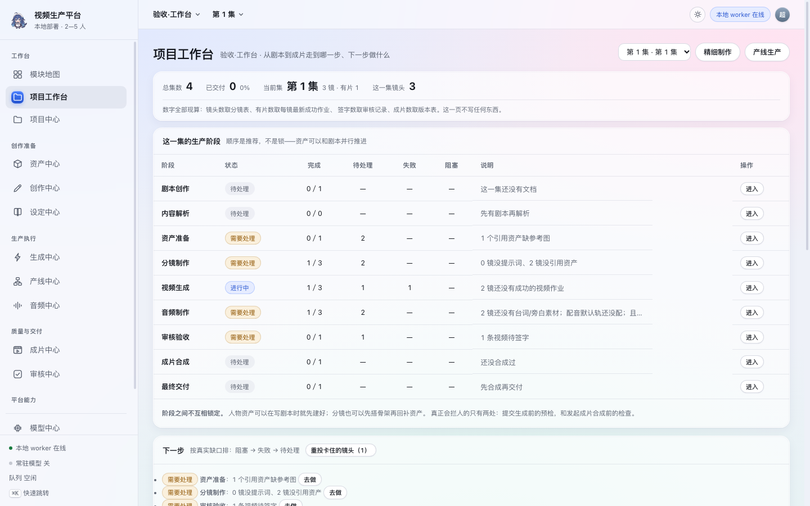
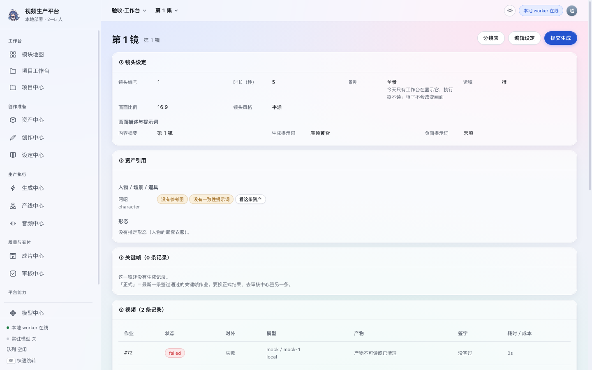
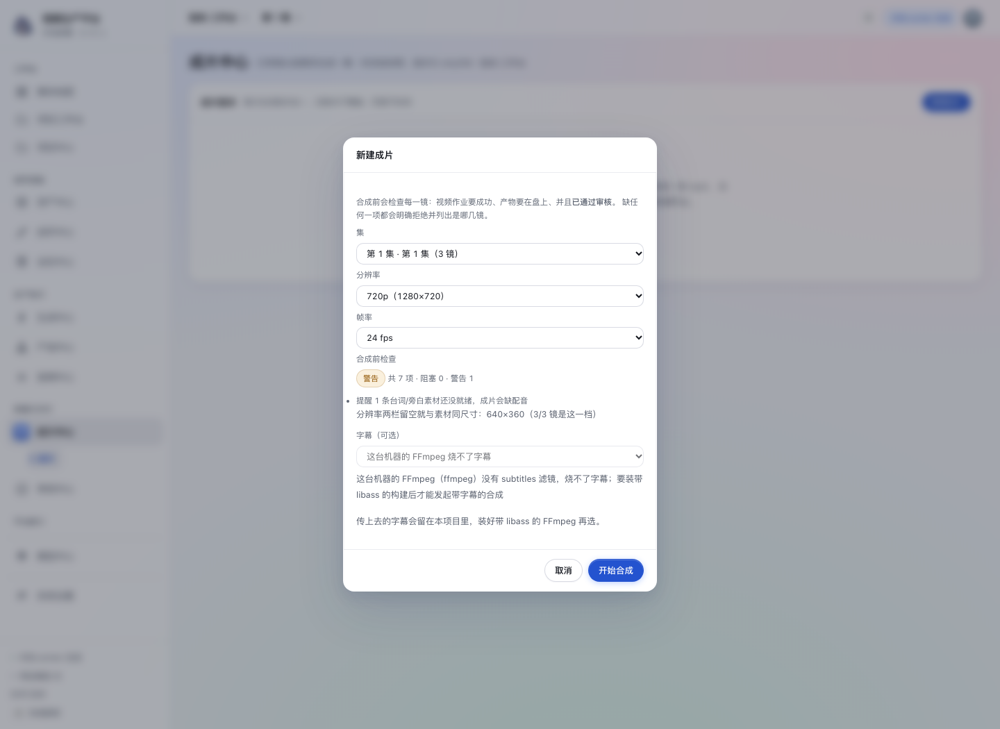
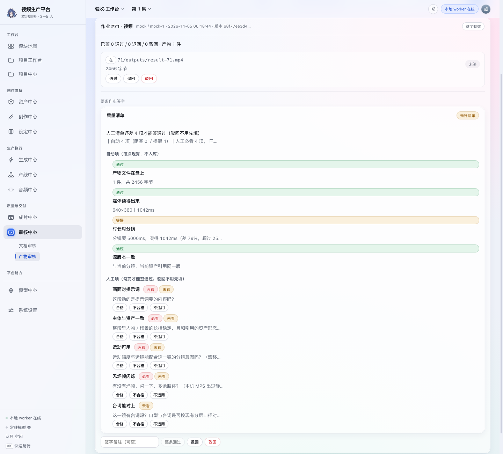
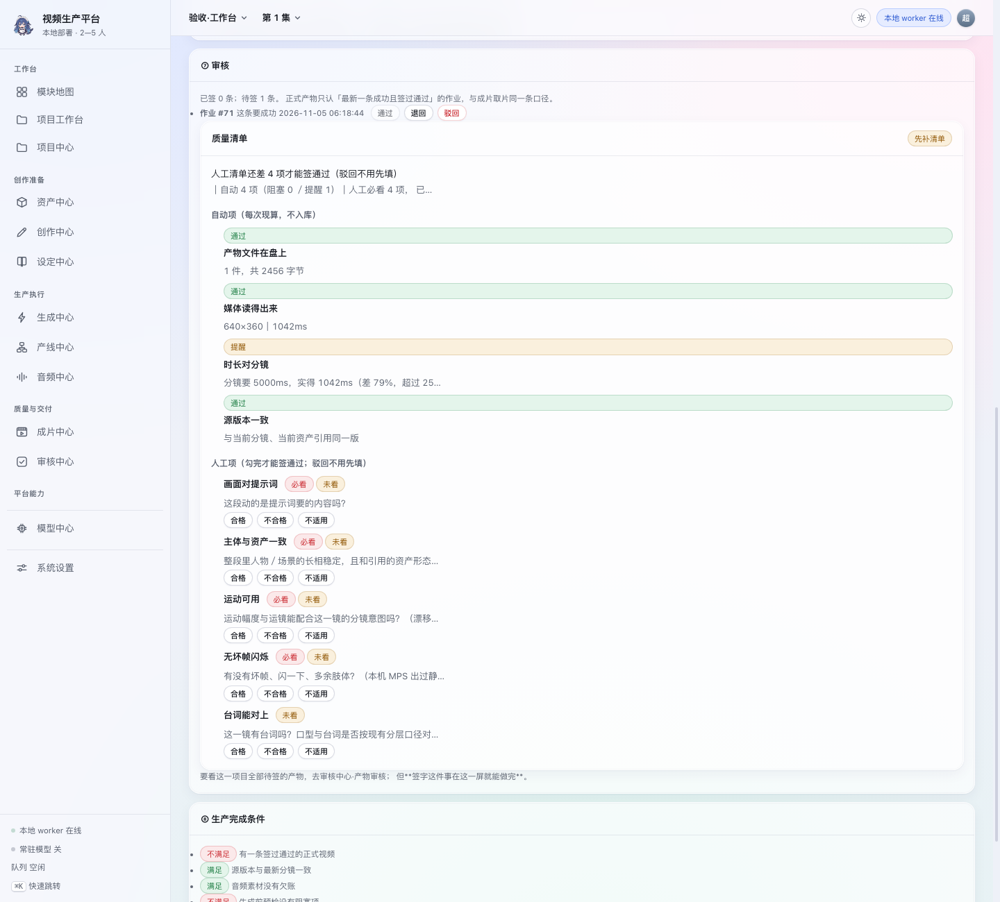
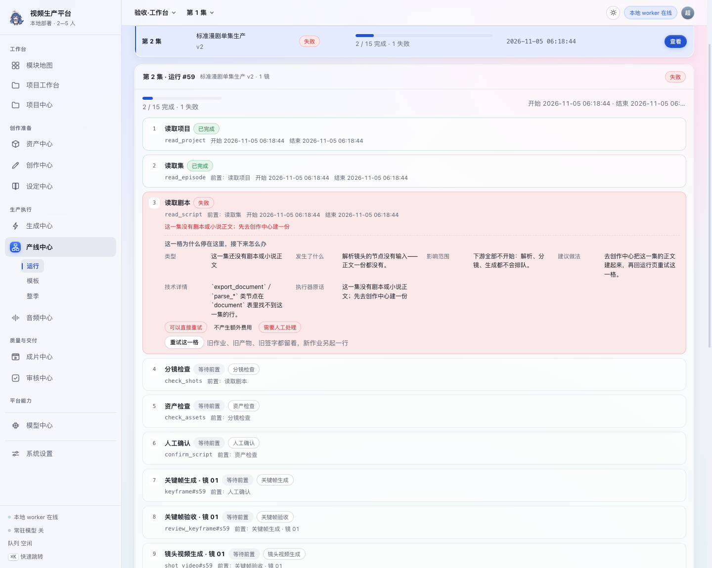
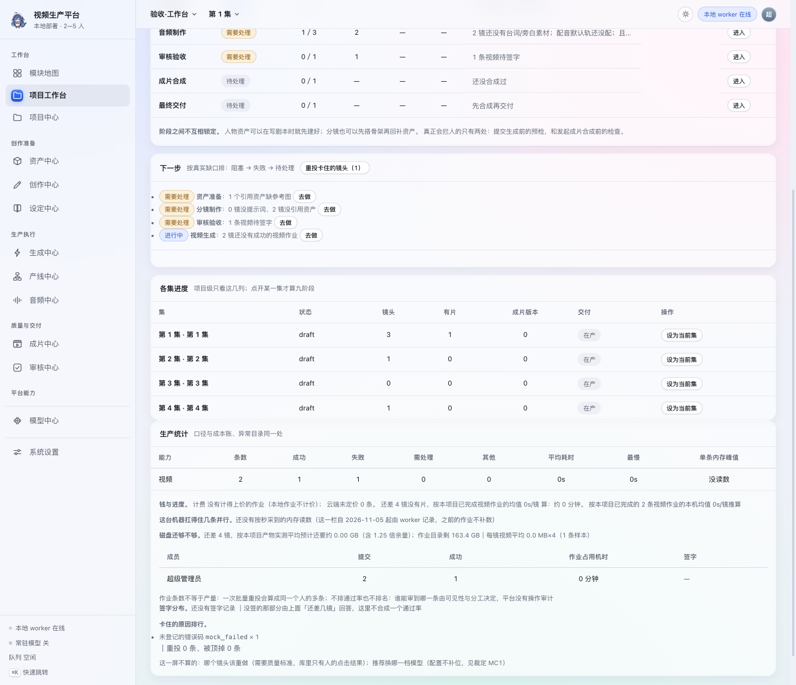
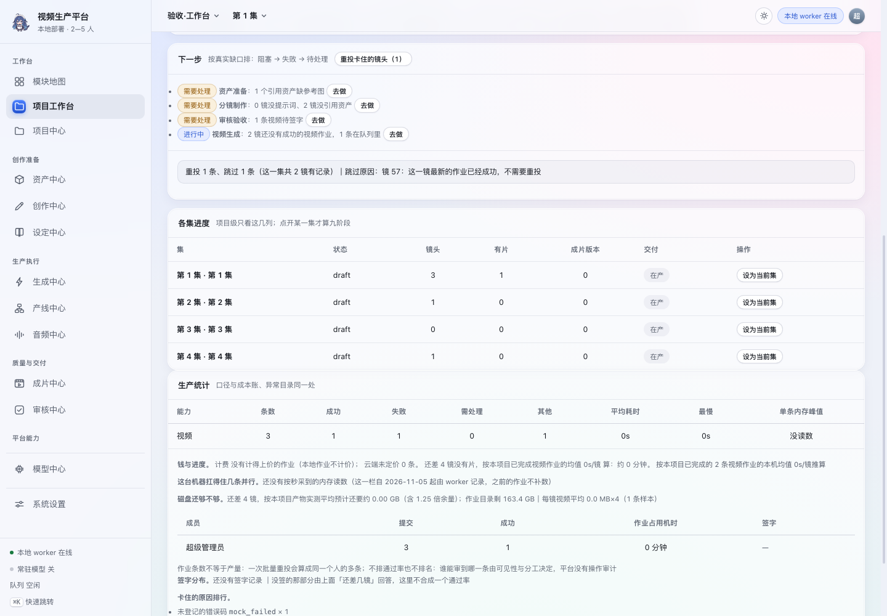

# AI 视频生产平台 · 生产工作台使用说明书

- 文档类型：面向制作与项目管理的操作手册，覆盖《任务书》改造后的三个新入口——**项目生产工作台**、**单镜头生产工作台**、**统一预检（生成前／合成前）**
- 版本：v1.10（2026-11-06），对应迁移 0041、界面 v0.124
- 口径来源：每一句"能点什么、点了会怎样、为什么说不动"都以当前 `app/backend` 与 `app/frontend` 的代码为准；可复算的总数（表数、端点数、测试数、迁移范围）**本册一处都不重述**，只指《发布基线》——同一个数抄到第二处就迟早对不上，这一条见《写作与引用规范》§2
- 配套文档：[系统使用说明书](系统使用说明书.md)（从第一次登录到导出一集）、[模型中心使用说明书](模型中心使用说明书.md)（模型与引擎配置逐屏手册）、[系统设计说明书](系统设计说明书.md)、[数据字典](数据字典.md)、[P0 业务验收记录](开发/生产工作台改造/03-业务验收记录.md)（本册每条能力的实测证据）
- 截图：本册 8 张全部是**真浏览器实拍**——库副本＋独立端口＋临时工作区，数据由 `tools/production_shots.py` 通过真接口建（与真浏览器验收同一批），弹窗靠点按钮打开，不注入 DOM、不摆假数字。图与界面同源：改完界面重跑那条命令，图就追平（`python3 tools/production_shots.py`，任何一步在界面上找不到就直接退出，不会悄悄留一张旧图）

## 目录

1. [修订记录](#修订记录)
2. [1. 先明白一件事：这套系统是"以项目和集为中心"组织的](#1-先明白一件事这套系统是以项目和集为中心组织的)
3. [2. 顶栏的"项目 × 集"上下文](#2-顶栏的项目--集上下文)
4. [3. 导航分成了五组](#3-导航分成了五组)
5. [4. 项目生产工作台（侧栏「项目工作台」）](#4-项目生产工作台侧栏项目工作台)
6. [5. 单镜头生产工作台（分镜列表点「工作台」）](#5-单镜头生产工作台分镜列表点工作台)
7. [6. 生成前预检（七类、三档）](#6-生成前预检七类三档)
8. [7. 合成前预检（成片中心弹窗内）](#7-合成前预检成片中心弹窗内)
9. [8. 状态只有五档给人看](#8-状态只有五档给人看)
10. [8.5 质量清单与批量签字（审核中心·产物审核）](#85-质量清单与批量签字审核中心产物审核)
11. [8.6 看见问题的那一屏就把事情办完](#86-看见问题的那一屏就把事情办完)
12. [8.7 项目工作台下面那张统计表怎么看](#87-项目工作台下面那张统计表怎么看)
13. [8.9 一集里卡住的镜头一次重投](#89-一集里卡住的镜头一次重投)
14. [9. 常见问题与自救](#9-常见问题与自救)
15. [10. 这一版还没有的能力（别当成 bug）](#10-这一版还没有的能力别当成-bug)
16. [11. 截图索引](#11-截图索引)
17. [附录 A 变更详录](#附录-a-变更详录)

## 修订记录

| 日期 | 版本 | 一句话结论 | 详见 |
|---|---|---|---|
| 2026-11-06 | v1.10 | 成片那一格补上 v0.120 的 RIFE 插帧：三档行为、两条新失败与自救，头部口径追到迁移 0041 | §7、§9、附录 A |
| 2026-11-05 | v1.9 | 文档重排轮（设计稿 v0.118）：加目录，修订表拆成速览＋详录，跨册引用补册名 | 《写作与引用规范》§5、附录 A |
| 2026-11-05 | v1.8 | 指针追平到迁移 0039／界面 v0.117，正文一句没改 | §11、附录 A |
| 2026-11-05 | v1.7 | 补 8 张实拍图（截图索引见 §11）：项目工作台整屏、镜头工作台八段、成片弹窗与合成前预检、审核中心质量清单、⑦ 段就地签字、产线失败节点七字段诊断、生产统计与协作读数、批量重投结果条 | §11、§7、附录 A |
| 2026-11-05 | v1.6 | §8.7 补两段：协作那一小表只数提交与签字（两条限制同屏、不排通过率） | §8.7、附录 A |
| 2026-11-05 | v1.5 | §8.7 补「磁盘那一行说什么」：盘余估算按本项目真实产物分三种典型大小算「还要多少」，与两处预检、产线发起检查同一处算式 | §8.7、附录 A |
| 2026-11-05 | v1.4 | 新增 §8.9「一集里卡住的镜头一次重投」：那颗钮什么时候出现、确认里写什么、哪些镜头会被逐条跳过（云端／待核对／还在跑／已有成功产物）、上限 50 条为什么不做静默截断、结果条为什么会「活过一次刷新」 | §8.9、附录 A |
| 2026-11-05 | v1.3 | 新增 §8.7「项目工作台下面那张统计表怎么看」：四个数各自的出处、为什么有的能力写着「没读数」、推算为什么给区间（提示词冷／热差 82 秒与 6.7GB 的实测）、参考并行那条算式怎么复核、以及这一屏明写不算的两件事 | §8.7、附录 A |
| 2026-11-05 | v1.2 | 新增 §8.6「看见问题的那一屏就把事情办完」：跳转的唯一实现、镜头工作台⑦段就地勾清单与签字、产线发起弹窗改读统一预检（按钮禁用只认服务端 can_start）、运行详情里失败那一格的七字段诊断 | §8.6、§9、附录 A |
| 2026-11-05 | v1.1 | 新增 §8.5「质量清单与批量签字」：自动项六类三档、人工项按能力分两套三枚按钮、签通过要求必看项勾完而驳回不要求、批量 50 条上限与逐条落地口径 | §8.5、附录 A |
| 2026-11-05 | v1.0 | 顶栏项目×集上下文、五组导航、项目工作台九阶段与下一步任务、镜头工作台八段、生成前预检六类三档、合成前预检、产线与精细制作共用的边界、常见问题自救 | 附录 A |

---

## 1. 先明白一件事：这套系统是"以项目和集为中心"组织的

改造之前，一级菜单是按模块排的（项目、资产、创作、生成…），人要自己记住"这一步该去哪个模块"。现在的主线是：

```
项目 ──▶ 集 ──▶ 镜头 ──▶ 作业 ──▶ 产物 ──▶ 审核 ──▶ 成片版本
                  ▲
              资产（独立于集与镜头，跨镜跨集复用，靠引用挂上来）
```

三句话记住规矩：

- **镜头是生产的基本单位**。一个镜头能不能进成片，只看它自己那条"签过通过的正式视频"。
- **资产不属于某一集**。它属于项目（也可以是全球池），镜头用 `asset_ids` 与 `variant_ids` 引用它——所以改一套衣服、改一句一致性描述，都是"一次会影响若干镜头"的改动，系统会替你算出来。
- **只有一个队列**。界面上有"精细制作"和"产线生产"两个入口，但它们提交的是同一种作业、由同一个 worker 执行、产物与成本都记在同一张 `job` 表上。不存在第二条生产通道。

## 2. 顶栏的"项目 × 集"上下文

屏幕上方从左到右是：项目切换器 → **当前集** → 模块页。

- 选集：点顶栏的集名 → 弹出这一集的列表 → 点一条。选完顶栏立刻改字，服务端同时记下"你当前在哪一集"。
- 这个记忆是**每人一行、存在服务端的**（`user_context` 表），所以换浏览器、换机器登录同一个账号，回来还在同一集。
- 项目或集被删掉时，这条上下文自动作废（外键是 `SET NULL`），不会把你留在一个已经不存在的地方。
- 项目工作台、镜头工作台、生成中心的提交弹窗、成片中心的合成弹窗，读的都是这一份当前集——四处看到的数字是同一个出处。

窄屏（手机或分屏）下侧栏的二级标签会收起，所以页面内部还会再摆一排切换器，功能不会被藏起来。

## 3. 导航分成了五组

| 组 | 里面有 | 这一组管什么 |
|---|---|---|
| 工作台 | 项目工作台、项目中心 | 看进度、找下一步 |
| 创作准备 | 创作中心（小说／剧本／分镜）、资产中心、设定中心 | 把内容和对齐依据准备齐 |
| 生产执行 | 生成中心、产线中心、音频中心 | 真正发作业、看执行 |
| 质量与交付 | 审核中心、成片中心 | 签字、合成、交付 |
| 平台能力 | 模型中心、系统设置 | 模型与账号，不是业务 |

模型中心仍然是**独立一级入口**，没有并进系统设置；已有页面一个都没为了导航调整而删掉。未开放、没有真实功能的模块不会出现在这里——比如镜头工作台就是一条**隐藏路由**（没有第四项"分镜"子页，也不进侧栏），只能通过分镜列表的「工作台」按钮或深链 `#shot/0/<镜头id>` 进入。

## 4. 项目生产工作台（侧栏「项目工作台」）

这一页回答三个问题：**这一集走到哪了、下一步该做什么、点哪里去做**。

顶部四个数是现算的：总集数、已交付集数与百分比、当前集的镜头数与"有片"数、这一集的镜头总数。



实拍图里从上到下就是这一页的四块：阶段表（每行一个状态 chip 与「进入」）、下一步任务（阻塞→失败→待处理排序，每条带「去做」）、各集进度。项目级只看这几列，点开某一集才算九阶段。

### 4.1 九阶段表

| 阶段 | 完成判据（真实数据口径） | 进入入口 |
|---|---|---|
| 剧本创作 | 这一集挂了剧本正文 | 创作中心·小说 |
| 内容解析 | 抽取候选已确认入库的数量 ÷ 候选总数 | 创作中心·小说 |
| 资产准备 | 被引用资产的参考图齐了算一件 | 资产中心 |
| 分镜制作 | 这一集已有镜头数 | 创作中心·分镜 |
| 视频生成 | 有"成功视频作业"的镜头数 ÷ 镜头总数 | 生成中心 |
| 音频制作 | 台词类素材状态为就绪的数量 | 音频中心 |
| 审核验收 | 视频产物已签字通过的镜头数 | 审核中心·产物审核 |
| 成片合成 | 这一集成片版本数 ≥1 且最新一版成功 | 成片中心 |
| 最终交付 | 最新那条合成作业**签过通过** | 成片中心 |

每行给的是：状态、完成数、总数、待处理、失败、是否存在阻塞，以及一个「进入」按钮。阶段之间**不是强制顺序**——人物资产可以在剧本还没写完时先备，资产与剧本允许并行；表只是把事实摆出来，不拦你。

注意两行容易误读的数字：

- "内容解析 3:4"是真实的：候选里有 4 条，你确认了 3 条，剩下那条（镜头候选）还没处理。
- "音频制作 0:2"也是真实的：这一集登记了 2 条台词素材但还没生成音频。**能不能真出声由服务端现算**，不写死：配音（VoxCPM2）的执行分支已经接线，音乐（ACE-Step）也有分支、但默认轨没配时不能提交——所以这一格可能显示"配音可提交；音乐这一类默认轨还没配"，而不是一律说"没接线"。

### 4.2 下一步任务

这一列不是固定文案，是按库里的事实算出来的，比如：还有 N 个镜头没有成功视频、N 条视频等着签字、N 个资产没有参考图、这一集有 1 个合成阻塞项。每条都带一个跳转按钮，直接落到能解决它的那个页面。

### 4.3 两个生产入口

- **精细制作** → 打开该集第一个待办镜头的单镜头工作台，一镜一镜自己控。
- **产线生产** → 跳到产线中心发起运行：选模板、查依赖、由 worker 按节点推进，关键节点仍然停在人工审核那一格等你签字。

两个入口共用作业、队列、worker、产物、审核记录与成片数据。系统里没有第二套生成任务体系。

## 5. 单镜头生产工作台（分镜列表点「工作台」）

一屏八段，从上到下就是一镜的生产顺序。



八段依次是 ① 镜头设定、② 资产引用、③ 关键帧、④ 视频、⑤ 音频、⑥ 预览与确认、⑦ 审核、⑧ 生产完成条件。⑥ 在没有签过通过的正式视频时是空的——系统不拿"最新一条未签字的产物"冒充正式结果。

| 段 | 内容 | 能做什么 | 边界 |
|---|---|---|---|
| ① 镜头设定 | 编号、标题、画面描述、提示词、时长、景别、运镜、画面比例、风格、负面提示词 | 「编辑设定」弹窗改，改完回到工作台并刷新 | 景别等五栏是给人看的**生产语言**，不进源版本指纹：补填一个景别不会把已签字的产物判成过期 |
| ② 资产引用 | 本镜引用的人物、人物形态、场景、道具，带参考图数量与一致性提示词 | 跳转去资产中心换图/新增；改引用也在这一页 | 引用关系与引用版本都留在库里，形态引用也算源内容 |
| ③ 关键帧 | 本镜全部图像作业记录（状态、供应商、用时、成本、产物） | 提交关键帧生成（先过预检）；挑一条签字认成正式 | 只有"成功且签过通过"的最新一条算正式关键帧 |
| ④ 视频 | 同上，视频作业列表 | 提交生成、选正式视频、看历史版本 | 模型没接的档不会显示成能点 |
| ⑤ 音频 | 本镜台词/配音素材台账 + 配音、音乐两档引擎的接入状态 | 只有跳转去音频中心登记素材 | **这一页不给提交按钮**（提交在音频中心）：接线状态按三处事实现算——清单有没有这个能力的适配器、默认轨解析不解析得出、`runners.has_branch()` 有没有这一条分支 |
| ⑥ 预览与确认 | 正式关键帧、正式视频（可回放）、版本与参数、源版本状态 | 对比版本、认正式 | 没有签过的正式视频时这里明说"预览区是空的"，不拿未签字的产物冒充 |
| ⑦ 审核 | 已签记录与待签清单 | 跳到审核中心签字 | 签字只在审核中心落，这一页显示的是那一份事实 |
| ⑧ 生产完成条件 | 视频是否有效、是否签过、源版本是否一致、音频是否满足、还差什么 | 每条阻塞都给「去处理」 | 只有全部满足才标"可参与合成" |

提交动作在 ③④ 上都会先跑一次**生成前预检**：结论是"阻塞"就不发作业、直接把原因写在旁边；是"警告"就提示后仍然让你提交（比如槽位健康不对，worker 会失败得比界面拦你更好查）。

## 6. 生成前预检（七类、三档）

同一份规则被四个入口读：镜头工作台、生成中心提交弹窗、产线发起弹窗、成片中心合成弹窗。分四处写迟早会出现"弹窗说能提交、点下去吃 422"，所以只有一份。

| 类别 | 检查什么 | 典型结论 |
|---|---|---|
| 内容 | 有没有可交给模型的文字 | 提示词与画面描述都空＝阻塞；只有描述＝警告 |
| 资产 | 引用的资产/形态还在不在、有没有参考图 | 引用了不存在的形态＝阻塞；没参考图＝警告 |
| 模型 | 默认轨解析不解析得出、那一档健康如何、参数合不合法 | 解析不出路线＝阻塞；槽位未就绪＝警告 |
| 环境 | worker 在不在、盘余够不够 | worker 离线＝警告（会排队，不是丢了） |
| 费用 | 云端要确认计费、单价与清单是否一致 | 没勾确认＝阻塞 |
| 资源 | 队列里已排多少条 | 超过 5 条给警告 |
| 旧产物 | 本镜最新正式视频是不是按旧版源内容生的 | 警告（不阻断重做，但说清它已过期） |

三档：**阻塞**＝现在提交一定失败（服务端同一条规则会拒）；**警告**＝能提交但要有心理准备；**通过**＝这项没问题。每条都能点跳到对应的页面。

## 7. 合成前预检（成片中心弹窗内）

打开"新建成片"弹窗时，集下面会实时显示一行「共 N 项 · 阻塞 X · 警告 Y」——这一行是现算的，不是写死的样例。检查内容包括镜头完整性与顺序、每条视频文件是否有效、审核状态、源版本状态、音频、字幕文件、字体依赖、时间线、FFmpeg 与 ffprobe 环境、输出目录与存储空间。



实拍图是"三镜都签过通过"之后的状态：阻塞 0、只剩一条音频提醒，而提醒下面没有按钮（它不拦你）。**为什么图上是 7 项而不是 11 项**：11 类里的第 3／4／5 类（视频文件有效性、审核状态、源版本）由 `timeline.build()` 一次判完——能拼时并成一条「时间线可用」，不能拼时才逐镜点名。条数说的是**这一集此刻会拦住你的那些**，不是类目数。下面那行「分辨率两栏留空就与素材同尺寸：640×360（3/3 镜是这一档）」由服务端算——它读的是时间线素材的众数尺寸，不是界面自己猜的。字幕那一栏写着这台机器的 FFmpeg 烧不了字幕，选择器因此禁用。

三条硬规矩：

- **阻塞时「开始合成」不发**，不是排队后再失败。422 的文案会逐镜点名，例如「第 1 镜没有成功的视频作业；第 2 镜作业 #84 的产物还没有审核签字；第 3 镜的素材是旧版分镜／资产生成的（源内容已变），要重新生成并重新签字」。
- 字幕这一栏同时告诉你"这台机器烧不烧得动"。当前这台机器的 FFmpeg 没有 `subtitles` 滤镜，界面就明写要装带 libass 的构建，并把选择器禁用——而不是让你选完再吃一句 422。
- 合成成功不会覆盖旧成片：每次是一个**新版本**，旧版本记录与旧文件都留着；新版本失败也破坏不了已经存在的正式成片。

- **帧率这一栏不在 11 项检查里，但它是 v0.120 之后最容易踩的一格**。选 24 还是 30 决定的是
  **最终文件**的帧率：本地视频腿的产物是 16fps，导出前有一道 RIFE **补帧**会把帧数补到所选值
  （时长不变、音轨从补帧前那个文件 copy 回来），而不是复制帧凑数。三档行为：
  这台机器没配 `FASTVIDEO_FASTMETAL_HOME` ⇒ 跳过补帧，原因写进作业的 `resources_json`
  （键 `interp_skip`，**界面上那一屏不显示**）；配了但缺权重或缺仓库 ⇒ **整条合成直接失败并点名**，
  不静默退回复制帧；显式设 `FASTVIDEO_COMPOSE_INTERPOLATE=0` ⇒ 才是关（这道默认是开的）。

## 8. 状态只有五档给人看

页面上一律显示这五个词：**待处理／进行中／需要处理／已完成／失败**。数据库与接口里的原有语义一个都没合并掉，点开详情才看到细粒度：排队中、Worker 执行中、模型加载中、等待资源、待审核、待核对、源版本已变化、依赖缺失、引擎异常。

有一条要特别当回事：**需要处理 ≠ 失败**。云端调用结果未知（供应商可能已经建了任务、甚至已经计费）时，作业落"需要处理／待核对"，成本状态 `pending_reconciliation`。这种作业的正确动作是去核对回执，不是按重试。

## 8.5 质量清单与批量签字（审核中心·产物审核）

第 ⑦ 段只给你看签字状态；真正"看没看够"发生在审核中心的产物审核页。自本轮起那里是一张清单：

**自动项**（每次现算，一条都不入库，也不允许手工改）：产物文件在不在盘上、媒体读不读得出来
（用 ffprobe，与成片取片同一个口径）、时长对不对分镜、源版本一致不一致、本镜音频就绪没有、
这条作业是不是"已成功"。级别三档：通过／提醒／**阻塞**。



上方自动项只读，下方人工项逐条「合格／不合格／不适用」。必看项没勾完时底部「整条通过」不给签并把缺哪几项写在上面，而「退回／驳回」随时可用——驳回不要求先填清单。

**人工项**（按能力分两套：图像四项、视频五项）：画面跟不跟提示词、主体与引用资产（含具体形态）
对不对得上、有没有坏帧闪烁、运动可用不可用、有台词的镜头口型对不对得上。每项三枚按钮：
**合格／不合格／不适用**，勾一项就落一行（`review_check`，改判覆盖不叠历史）。

两条硬口径：

- **签「通过」要求必看项全部勾完**——没看够不能盖章。缺几项，界面与接口都会点名缺哪几项。
- **驳回与退回不需要先填清单**——一眼看出不行就该能立刻驳回，不被表单卡住。

**批量签字**：队列每行前有个勾选框，勾几条之后表头上方出现工具条（已选 N 条／批量通过／批量驳回／清空）。
三条要点：一次最多 50 条；整批只能同一个结论（批量通过与批量驳回是两种动作）；
逐条落地、逐条报原因——**不会因为有一条不行就把整批撤回**，也不会把没看完清单的那几条偷偷签掉。
看不见的项目会让整批直接按 403/404 结束：批量不许变成探测别人项目内容的入口。

产物换了版本时，清单与签字一起失配（两者绑同一个版本摘要），不会出现"清单是新的、结论是旧的"。

## 8.6 看见问题的那一屏就把事情办完

这一节讲的是四条改动的**用法**，不是新页面——它们没有增加任何一个菜单。

**跳转只有一处实现**。界面上所有「去这一镜／去处理／去看这条资产／去看这条作业」都走同一个函数，字段与服务端预检的 `locate` 一一对应：`module` 说去哪个模块，`sub` 说落哪个二级页，`shot_id`／`asset_id`／`job_id` 说去了要打开哪一条，`episode_id` 说顶栏该跟着换成哪一集。认不出的 entry **点了就是没反应**——这是有意的：跳错地方比不跳更糟。

**镜头工作台第 ⑦ 段现在能办完审核**。待签作业列在这里，质量清单（自动项只读、人工项三枚按钮）也画在这里，「通过／退回／驳回」三颗钮直接签这一条。清单没看齐时「通过」是灰的并把原因写在悬停里；驳回与退回不要求先填清单。签字仍然只落审核中心那一个写入口，这一屏只是把面板摆过来，不另算一套判据。



同一张清单画在这里：待签作业旁边就是「通过／退回／驳回」，勾完 4 项必看就能在这屏签掉，不必再切去审核中心。

**产线发起弹窗读的是同一份预检**。以前那个弹窗自己数「不能发起／要注意」两串字，现在它打的是统一预检接口，于是：条目与工作台的预检一字不差；每条认得出位置的都带跳转；「开始生产」禁用与否只认服务端的 `can_start`。**只有警告不会拦你**，只有阻塞才拦。

**产线节点失败也讲七件事**。运行详情里失败那一格下面多出一块「这一格为什么停在这里，接下来怎么办」：类型、发生了什么、影响范围、建议做法、技术详情、执行器原话，外加三枚判断章（可直接重试／会不会再产生费用／要不要人工）。它和生成中心那条作业抽屉用的是同一张目录、同一块面板。注意：**「目录说这类失败通常可重试」与「这一格现在能不能点」是两回事**，后者由服务端的重试闸门判——被驳回的审核节点、上游还在跑的运行都会让那颗钮不出现，并把原因写在旁边。



图里是「读取剧本」这一格失败：六段说明（类型／发生了什么／影响范围／建议做法／技术详情／执行器原话）加三枚判断章（可以直接重试／不产生额外费用／需要人工处理），「重试这一格」就在章下面。


## 8.7 项目工作台下面那张统计表怎么看

任务书 §15 的 P2「生产统计」住在**项目工作台原有那一页的下方**，没有新菜单。它回答四个问题，每个数都能说清是从哪几条作业来的。



一张卡从上到下：能力×状态的条数、钱与进度、磁盘那一行、协作小表（谁提交了多少、谁签了几次）、卡住的原因排行，最后写着这一屏刻意不算的两件事和为什么不算。

**跑了多少条。** 按能力×状态如实数（成功／失败／需处理／其他）。这里不合并成"完成率"：一个数字回答不了"卡在哪"。

**钱与时间。** 金额那一栏的口径与成本账完全同一条（只算计得上价的，本地作业不计价，云端未定价的单列）。平均耗时**只按量得出耗时的那些条**算——把还在排队的也算进分母，得到的是一条被排队状态拉低的假数。

**内存那一列。** 写的是 worker 对**这一条作业**按秒采到的子进程树峰值（含孙子进程，模型真正吃内存的那一层）。三种情况要分清：

* 老作业（这一栏改动之前跑的）显示「没读数」——不拿 worker 生命周期里的最大值冒充这一条的占用，那个数会把上一条作业的峰值挂到这一条头上；
* 采样值可能**低于**真实峰值（一秒一次，抓得到持续占用，抓不到一瞬间的尖峰）；
* 「参考并行 N 条」不是结论，是把 `(物理内存 × 0.8) ÷ 单条采样峰值` 这条除法连着数字一起给你，可以复核。

**磁盘那一行说什么。** 「磁盘还够不够」不再只有一句「低于提醒线 5 GB」：它按**本项目自己**已经成功的产物量过一遍，分三种典型大小——每镜视频、每张关键帧、一次成片产物——算出"还差几镜大约还要多少空间"，乘一个写明的 1.25 倍余量，再和当前盘余并排显示。取样时成片那一档被排除在"每镜平均"之外（否则一次 5.6 MB 的成片会把 0.17 MB 的一镜抬到一个离谱的平均值）。**这一句与两处预检、产线发起检查是同一处算式**，所以不会出现"面板说够、点下去被拦"。项目还很新、一个产物都没有时，这行只会说固定提醒线并写明原因，不会拿别的项目的产物凑一个数。

**还差多久。** 推算给两个数：按本项目已完成视频作业的均值是下界；若这一集每条提示词都是新的，加上文本编码的均值为上界。**为什么差这么多**：FastMetal 那一腿把提示词向量缓在磁盘上，同一条提示词第二次几乎不花时间（实测 0.007 秒），一条全新的要多跑约 82 秒文本编码、并把单条内存峰值从 1.99GB 顶到 8.75GB。所以重复提示词的整集快、全新提示词的整集慢，一个数说不了。没有可参照的作业时这里写「不给推算」，不编一个数。

**协作那一小表。** 统计卡下面还有一张成员表：谁提交了几条作业、谁签了几次。它只回答这两件事——**作业条数不等于产量**（一次批量重投会算成同一个人的多条），也**不排通过率、不排名**（谁能审到哪一条由可见性与分工决定，而这个平台没有操作审计）。这两条限制原话写在表下面。

**发起合成时那两个空格。** 宽与高**留空就不再放大**：成片按这一集素材最常见的尺寸出（素材 640×352 时就出 640×352，不再像以前那样固定拼成 1280×720、白多一倍的字节与耗时）。要更大就显式填；填之前弹窗会写明「留空就与素材同尺寸：N×M（k/n 镜是这一档）」。素材尺寸不合规矩（奇数、超出 320—3840）时不硬用，退回配置默认档，并在版本详情里说清按哪一档出的。

**这一屏明写不算的两件事。** 「哪个镜头该重做」需要质量标准，库里目前只有人勾过的结论；「推荐换哪一档模型」与配置不补位的规则冲突（备用轨只提示、不自动切）。这两行原话显示在统计底部，比留白诚实。

## 8.9 一集里卡住的镜头一次重投

**在哪里。** 项目工作台 →「下一步」那张卡片的右上角，写着「重投卡住的镜头（N）」。它只在两种情况下出现：这一集确实有失败或已取消的作业，而且你的账号能提交作业（只读账号看不到它）。

**点下去会怎样。** 先弹一个应用内的确认框，把规则写在里面：只重投**本机**的失败与已取消；云端作业要逐次确认计费、待核对的作业结果未知，这两种**一律逐条拒**并把原因写回来；一次最多 50 条。确认后每条走与单条重试完全相同的那条路——新行复制原行的参数快照、`attempt` 加一、`retry_of_job_id` 指回原行，**原行的状态、错误码、耗时、日志一个字都不动**（重投不是抹历史）。



点完「重投卡住的镜头」，「下一步」那张卡片下面出现一行结果：重投几条、跳过几条、每一条为什么被跳过。这行字活过一次页面刷新——它按「项目×集」记着，换集就不带过去。

**为什么云端不给批量。** 一次点击可能替 N 条作业再扣一次钱，而"这条到底扣没扣"要人去供应商那边核对。平台的硬约束是云端逐次确认，所以批量入口不越过它——这不是功能缺失，是这条按钮该守的边界。

**为什么 50 条以上直接拒而不截断。** 截断会让人以为整集都重投了。拒掉、说清还剩多少，比"看起来成功"诚实。

**结果条上的话。** 形如「重投 1 条、跳过 2 条（这一集共 3 镜有记录）｜跳过原因：镜 …：这一镜最新的作业已经成功，不需要重投」。这句话活过一次页面刷新——以前它直接写进 DOM，被随后的自动刷新擦掉，人只会以为没生效。

**找不到那颗钮时。** 说明这一集没有失败／取消的作业（可能都还在排队，也可能都已经签过通过）。看「下一步」那张卡片的逐条缺口即可，那不是 bug。

## 9. 常见问题与自救

| 现象 | 为什么 | 怎么办 |
|---|---|---|
| 项目工作台全是 0 | 顶栏当前集没落在你要看的那一集，或这一集确实还没有镜头 | 先点顶栏选集；数字都是按当前集现算的 |
| 「进入」按钮把我带到了别的页面 | 阶段与页面是同一个入口表，带 `sub` 下标；分镜是创作中心的第三页 | 正常现象；深链形如 `#writing/2` |
| 提交生成时点了没跳 | 预检判了"阻塞" | 看旁边列出的那几行，逐条按「去处理」走；阻塞项不会把你送去排队 |
| ⑧ 段说"可合成"但成片仍被拒 | 单镜口径与整集口径不同：整集还要看顺序、字幕、环境、盘余 | 打开成片弹窗看合成前检查的逐条结论 |
| 改了资产，成片忽然不认旧素材 | 源版本指纹变了，旧产物按过期处理 | 按提示重新生成并重新签字；旧记录不会消失 |
| 音频那一段没有提交按钮 | 这一页不给提交按钮（提交入口在音频中心），**不是因为没接线** | 配音的 `runners._voxcpm` 与音乐的 `runners._ace_step` 都有分支；真不能提交时（比如音乐默认轨没配）界面会说清是哪一条 |
| 顶栏没有当前集 | 项目被删或集被删，上下文按外键自动作废 | 重新选一个项目与集 |
| 预检那条提醒后面没有按钮 | 服务端认不出这句话该跳哪儿（`locate` 是空的）——界面不摆一个可能跳错的按钮 | 照那句话自己走；这一条不是 bug，它只是不猜 |
| 「重投卡住的镜头」那颗钮不在 | 这一集没有失败／已取消的作业，或当前账号没有提交权限 | 看「下一步」的逐条缺口；要重投云端那条，去生成中心对那一条单独点（要逐次确认计费） |
| 统计里内存那一列是「没读数」 | 那条作业跑在采样改动之前；`child_max_rss_kb` 是 worker 生命周期最大值，不能当这一条的占用用 | 重跑一次这条作业就有了；不想重跑就当没有这个数 |
| 推算那一行两个数差很多 | 下界按已完成作业的均值，上界假设每条提示词都是新的（新提示词要多跑一次文本编码） | 看这一集还有多少条**没用过的**提示词，落在两者之间 |
| 点了「去这一镜」但顶栏集号不对 | 该条定位没带 `episode_id`（旧数据或别的入口自己拼的跳转） | 顶栏手选那一集；统一预检给出的新跳转都会把集号一起带过去 |
| 成片失败，写「合成结果的平均帧率是 30，要求 24；补帧那一道没生效」 | 素材帧率**高于**你选的帧率：补帧只加帧不缩帧，文件留在源帧率，被验收闸门拦下（这一格不在合成前 11 项里，所以预检不会提前挡） | 把帧率选到不低于素材（本地腿是 16fps，选 24 就行）；确实要旧行为就设 `FASTVIDEO_COMPOSE_INTERPOLATE=0`，那时按复制帧编、验收也能过 |
| 成片成功但感觉"没补帧"，作业没报错 | 这台机器没配本地运行时，补帧那一档是 unknown ⇒ 跳过并把原因写进 `resources_json` 的 `interp_skip`，而界面不渲染这一键 | 去生成中心看那条作业的原始字段；要真补帧就在模型中心把 FastMetal 那一族配齐 |
| 图像默认轨没填，关键帧节点一直失败 | 产线节点提交时不带参数与模型档，走的是配置的默认轨 | 模型中心／配置页把图像本地档填上 provider 与模型，再对失败节点点重试（只重建那一格） |

## 10. 这一版还没有的能力（别当成 bug）

- 音乐的**执行**：分支已接，但 mlx-audio 当前的音乐注册表里没有 acestep 这一档，提交会先被挡住并写明缺什么（不是"没做"，是"这台机器的运行时还不支持这一档"）。口型 viseme 挂接；音效轨。
- 配音**已经能真跑出声音**（本地 VoxCPM2 轨）：音频中心里台词／旁白的「送进队列」是真提交，产物是可 ffprobe 的 wav。前提是两件事都齐——装了 mlx-audio 与 VoxCPM2 权重，且该能力的本地默认轨配上。
- 调用策略（9 个任务场景的建议轨／备用轨）还没有业务消费方：只提示，不自动切轨。
- 审核的批量操作与"三类审核清单"、异常恢复的全量映射表属于 P1。
- 真实模型跑通的范围：本机只有 FastMetal 1.3B（视频）与 mflux FLUX.1-schnell Q4（图像）两条真路径，且 `model_validation` 的"生产可用"要三条凭据齐（环境自检 + 真实调用 + 产物审核）才亮。

---

## 11. 截图索引

全部为白天主题、1440 宽视口（长卡拉高拍），由 `tools/production_shots.py` 一次会话拍完，所以各图里的作业号、镜头号是同一批数据。

| 位置 | 文件 | 主题 | 这一张看得见的东西 |
|---|---|---|---|
| §4 | `assets/v110-production-board.png` | 白天 | 九阶段表、下一步任务、各集进度 |
| §5 | `assets/v110-shot-workbench.png` | 白天 | 一镜八段的结构，⑥ 空态的写法 |
| §7 | `assets/v110-compose-modal.png` | 白天 | 合成前预检逐条、留空尺寸的落点、字幕禁用原因 |
| §8.5 | `assets/v110-review-checklist.png` | 白天 | 自动项只读＋人工项三枚按钮＋底部签字条 |
| §8.6 | `assets/v110-shot-workbench-review.png` | 白天 | ⑦ 段就地勾清单与就地签字 |
| §8.6 | `assets/v110-pipeline-node-diagnosis.png` | 白天 | 失败节点的六段说明＋三枚判断章 |
| §8.7 | `assets/v110-production-stats.png` | 白天 | 统计卡四问、协作小表、刻意不算的两件事 |
| §8.9 | `assets/v110-production-retry-batch.png` | 白天 | 批量重投结果条与逐条跳过原因 |

## 附录 A 变更详录

### v1.10（2026-11-06）

**追平轮（本册只补说法，代码与界面一字未动）**。v0.120 给成片导出加了一道 RIFE 补帧，改了 `composition/ffmpeg_runner.py`、新增 `interpolate.py`／`rife_pass.py` 与 `validators.probe_fps`，**但没改合成前预检的 11 项**——所以"这一集能不能合成"的预检照旧绿，作业却可能在建完命令之后失败。本册此前一处都没写这件事（全册零"帧率／插帧"），读者只能从失败回执反推。补两块：

- **§7 加一条硬规矩**：帧率这一栏决定的是最终文件而不是素材文件；三档行为（unknown 跳过／missing 直接失败／显式设 0 才是关，默认是开），并写明"跳过的那个原因落在作业的 `resources_json.interp_skip`，界面那一屏不渲染"——这句话以前四册都写成"写进回执"，读起来像界面上能看到。
- **§9 加两行自救**：① 素材帧率**高于**所选帧率时 `rife_pass.py:81` 的目标帧数取 `max(现有, 换算)`，不缩帧 → 文件留 30fps → `post_check` 判失败并报"补帧那一道没生效"。这是加这道之后**新出现**的失败，且预检不挡；② 成功但没补帧（unknown 跳过）时该去哪一看。

顺带把头部"对应迁移 0039、界面 v0.117"追到 0041／v0.124：本册覆盖的三页（项目工作台／镜头工作台／统一预检）在这四轮里行为没变，变的是成片导出那一条腿，所以只改头部与本册两处。


### v1.9（2026-11-05）

**文档重排轮（设计稿 v0.118）：加目录，修订表拆成速览＋详录，跨册引用补册名**。本轮只动文档，代码、接口、表、测试数一条没变；逐册改动清单见《写作与引用规范》§1。
### v1.8（2026-11-05）

**两处小改，正文一句没动。** ① 头部指针从「迁移 0038、界面 v0.110 之后的工作树」追平到**迁移 0039、界面 v0.117**：逐条核过 v0.111—v0.117 这七轮，落库的只有 0039（删项目不许带走作业与成本账），而它改的是 `job.project_id` 的级联方向，本册讲的三个入口（项目工作台／镜头工作台／统一预检）读的都是集、镜、作业本身，没有一句话因此改变；其余六轮全在界面与视图层。② 头部「口径来源」原来写着「可复算的总数……本册需要时抄同一个数」——这句话本身就是错的：抄一次就漂一次（《系统使用说明书》v2.6 就是被自己抄的「901 passed／0001—0038」坑了一次）。现在改成不重述、只指《发布基线》。

原文逐条归档，一条不删、不改。顶部那张表是它的目录：一行一句结论，细节在这里。

### v1.7（2026-11-05）

补 8 张实拍图（截图索引见 §11）：项目工作台整屏、镜头工作台八段、成片弹窗与合成前预检、审核中心质量清单、⑦ 段就地签字、产线失败节点七字段诊断、生产统计与协作读数、批量重投结果条。§7 那句「共 9 项 · 阻塞 3 · 警告 0」改成「共 N 项 · 阻塞 X · 警告 Y」——它是现算的，不该在文档里写成一条固定样例

### v1.6（2026-11-05）

§8.7 补两段：协作那一小表只数提交与签字（两条限制同屏、不排通过率）；发起合成时宽高留空不再放大，改为与素材同尺寸（弹窗写明按哪一档，素材尺寸不合规矩时退回默认档并说清）

### v1.5（2026-11-05）

§8.7 补「磁盘那一行说什么」：盘余估算按本项目真实产物分三种典型大小算「还要多少」，与两处预检、产线发起检查同一处算式；没有样本时只说固定提醒线并写明原因

### v1.4（2026-11-05）

新增 §8.9「一集里卡住的镜头一次重投」：那颗钮什么时候出现、确认里写什么、哪些镜头会被逐条跳过（云端／待核对／还在跑／已有成功产物）、上限 50 条为什么不做静默截断、结果条为什么会「活过一次刷新」

### v1.3（2026-11-05）

新增 §8.7「项目工作台下面那张统计表怎么看」：四个数各自的出处、为什么有的能力写着「没读数」、推算为什么给区间（提示词冷／热差 82 秒与 6.7GB 的实测）、参考并行那条算式怎么复核、以及这一屏明写不算的两件事

### v1.2（2026-11-05）

新增 §8.6「看见问题的那一屏就把事情办完」：跳转的唯一实现、镜头工作台⑦段就地勾清单与签字、产线发起弹窗改读统一预检（按钮禁用只认服务端 `can_start`）、运行详情里失败那一格的七字段诊断。§9 补两条自救（提醒后面没有按钮／跳过去顶栏集号不对）

### v1.1（2026-11-05）

新增 §8.5「质量清单与批量签字」：自动项六类三档、人工项按能力分两套三枚按钮、签通过要求必看项勾完而驳回不要求、批量 50 条上限与逐条落地口径。第 ⑦ 段的说明同步指向这张清单

### v1.0（2026-11-05）

首版。顶栏项目×集上下文、五组导航、项目工作台九阶段与下一步任务、镜头工作台八段、生成前预检六类三档、合成前预检、产线与精细制作共用的边界、常见问题自救