# AI 视频生产平台 系统使用说明书

- 文档类型：**面向新手的小白手册**。从"第一次登录"到"导出一集成片"，每一步都写到可以照着做；每个名词第一次出现时都用一句大白话解释
- 版本：v2.8（2026-11-06），对应设计稿 v0.120、界面 v0.117
- 适用界面：当前 `app/frontend/` 的日／夜双主题。本册引用的 50 张截图都是真浏览器实拍（`文档/assets/`），夜间 28 张、白天 22 张，图上标了当时的界面版本
- 适用对象：第一次用这套系统的人（制作、审核、项目管理、部署）；不需要懂代码
- 口径来源：所有"能做什么、不能做什么"都以当前代码与《发布基线》为准。可复算的数字（测试数、端点数、表数、迁移范围）**本册一处都不重述**，只指《发布基线》——上一版这里抄着「测试 901 passed、迁移 0001—0038」，代码走到 920／0039 之后它就成了一句假话；同一个数抄第二处就漂一次，这正是《写作与引用规范》§2 要消灭的形状
- 配套文档：[需求概要说明书](需求概要说明书.md)（为什么这样设计）、[系统设计说明书](系统设计说明书.md)（技术上怎么实现）、[数据字典](数据字典.md)（库里存了什么）、[模型中心使用说明书](模型中心使用说明书.md)（模型配置逐屏手册）、[生产工作台使用说明书](生产工作台使用说明书.md)（项目工作台、镜头工作台与两处预检）、[黄金样例与故障演练](黄金样例与故障演练.md)（验收证据）、[发布基线](发布基线.md)（数字的唯一出处）
- 截图位置：Markdown 引用 `文档/assets/`；对外分发用 `文档/导出/系统使用说明书.html`，图片已内嵌，单文件可直接发送

**怎么读这一册**：第一次用就从第 0 章顺着往下读；已经会了、只想查某一步，按目录跳到对应章，每章开头都有「你会学到」三行说明。找不到东西时直接翻第 14 章「常见问题与自救」。

## 目录

1. [修订记录](#修订记录)
2. [0. 先读这一页（五分钟）](#0-先读这一页五分钟)
3. [1. 第一次登录](#1-第一次登录)
4. [2. 项目中心：建第一个项目](#2-项目中心建第一个项目)
5. [3. 创作中心：集、文档、分镜](#3-创作中心集文档分镜)
6. [4. 资产中心：角色、场景、道具](#4-资产中心角色场景道具)
7. [5. 生成中心：提交、等、看结果、算钱](#5-生成中心提交等看结果算钱)
8. [6. 审核中心：跑检查、看证据、签字](#6-审核中心跑检查看证据签字)
9. [7. 音频中心：台词、配音、音乐、口型、音效](#7-音频中心台词配音音乐口型音效)
10. [8. 产线中心：一次发起，按依赖往下走](#8-产线中心一次发起按依赖往下走)
11. [9. 成片中心：把这一集拼出来](#9-成片中心把这一集拼出来)
12. [10. 模型中心：配置在哪儿、别在这儿找操作](#10-模型中心配置在哪儿别在这儿找操作)
13. [11. 用户与角色：谁能进、谁能改](#11-用户与角色谁能进谁能改)
14. [12. 看板与导出：今天的活和这一集的清单](#12-看板与导出今天的活和这一集的清单)
15. [13. 状态对照总表：所有徽章一次认全](#13-状态对照总表所有徽章一次认全)
16. [14. 常见问题与自救（24 条）](#14-常见问题与自救24-条)
17. [15. 一条 24 步的完整串讲：从零到一集成片](#15-一条-24-步的完整串讲从零到一集成片)
18. [附录 A 一页速查：哪个页面管什么](#附录-a-一页速查哪个页面管什么)
19. [附录 B 部署与端口（给管机器的人）](#附录-b-部署与端口给管机器的人)
20. [附录 C 快捷键与通用约定](#附录-c-快捷键与通用约定)
21. [附录 D 名词去哪儿查](#附录-d-名词去哪儿查)
22. [附录 E 变更详录](#附录-e-变更详录)

## 修订记录

| 日期 | 版本 | 一句话结论 | 详见 |
|---|---|---|---|
| 2026-11-06 | v2.8 | §9.3 说清「选了 24fps 就真的出 24fps」：低帧率素材走导出前插帧，跳过与失败两种情况各有一句明话 | §9.3、附录 E |
| 2026-11-05 | v2.7 | 文档重排轮（设计稿 v0.118）：目录锚点重生成，变更详录改编号为附录 E，跨册引用补册名 | 《写作与引用规范》§5、附录 E |
| 2026-11-05 | v2.6 | 本册不再自己抄可算数字；指针追平到 v0.117 | 附录 E |
| 2026-11-05 | v2.5 | worker 表默认只列在线进程（设计稿 v0.112） | §8、§10、附录 |
| 2026-11-05 | v2.4 | 「系统设置 · 用户与角色」拆成两页（设计稿 v0.111）：用户管理与角色管理 | §11.2、§1、附录 |
| 2026-11-05 | v2.3 | 音频中心顶上现在是一张服务端能力表 | 《生产工作台使用说明书》§8.5、附录 |
| 2026-11-05 | v2.2 | 生产主线另成一册：新增《[生产工作台使用说明书](生产工作台使用说明书.md)》，把顶栏「项目×集」上下文、五组导航、项目工作台九阶段与下一步任务、镜头工作台八段、生成前预检七类三档、合成前预检十一项、五档对外状态与自救表逐屏写成手册 | 附录 |
| 2026-11-05 | v2.1 | 逐句对照代码再校一轮 | 附录 |
| 2026-11-04 | v2.0 | 整册重写成小白教程 | 附录 |
| 2026-11-04 | v1.32 | 合并轮：头部「对应设计稿」追到 v0.105 | §3、附录 |
| 2026-11-04 | v1.31 | 模型管理另成一册：新增《[模型中心使用说明书](模型中心使用说明书.md)》，把四个工作区逐屏写成可查的手册（十档状态判序、登记字段、能力轨六条规则、五类验证出处与生产可用公式、九个场景） | §3、附录 |
| 2026-11-04 | v1.30 | 资产中心 §5.7 新增五条 v0.99 之后的界面（候选卡头、形态列表、模型轨与高级参数、详情两张新卡、合并前字段预览），并写明"图像作业成功不会自动进资产，要逐张预览后显式存入" | §5.7、附录 |
| 2026-11-04 | v1.29 | 逐句核代码校正一轮（12 处）：模板 v2 节数 16→15、预检通过档其实不显示依据数字与时间、409 之后没有"清空版本格"这条路、整季并发是页面 1—4 而 8 是服务端上限、音频真实出声还差执行接线、抽取「合并」不比版本… | 附录 |

更早的修订（v1.0—v1.28）按日期保留在 git 历史里：`git log -- 文档/系统使用说明书.md` 能看到每一版改了哪一句。

---

## 0. 先读这一页（五分钟）

### 0.1 这套系统是干什么的

一句话：**把一个动漫项目从"一个想法"做到"一集成片"的全过程，收在一个局域网网页里。** 谁在什么时候做了什么、花了多少钱、产物在哪儿，都在这一个地方留下记录。

它不做什么，也先说清楚，省得你找半天：

- 不做剧本创作以外的灵感管理——小说与剧本就是纯文本文件，版本靠 git，不搞富文本编辑器那一套。
- 不在浏览器里跑模型。所有生成都排队交给后台一个叫 **worker** 的进程；浏览器只负责"下单"和"看结果"。
- 不自动把生成结果塞进资产库。生成中心的产物要你**逐张看过、明确选择**才会进资产（这条是新用户最容易误会的一条，见 §0.6）。

### 0.2 一条主线：东西是怎么一步步变成成片的

把它想成一条流水线，从左到右：

| 步骤 | 你在哪个页面做 | 产出什么 | 下一步谁用 |
|---|---|---|---|
| 1 | 项目中心 | 一个**项目**（一部片子的容器） | 所有页面 |
| 2 | 创作中心 → 建集 | 一**集** | 文档、分镜、音频、成片 |
| 3 | 创作中心 → 小说／剧本 | 正文（**文档**） | 分镜、审核 |
| 4 | 创作中心 → 分镜 | 一镜一行的**镜头**表 | 生成、产线、成片 |
| 5 | 资产中心 | **资产**：角色、场景、道具，带定妆图与形态 | 分镜引用、图像生成 |
| 6 | 生成中心 | **作业**：文字、图像、视频、配音、音乐 | 审核、成片 |
| 7 | 审核中心 | 校验报告＋**签字** | 产线、成片（没签字不能合成） |
| 8 | 产线中心（可选） | 一次按依赖跑完的**运行** | 成片 |
| 9 | 成片中心 | 这一集的**成片版本**（含字幕） | 导出、交付 |

前五步是"准备素材"，第 6 步是"花钱干活"，第 7—9 步是"验货、拼装、交付"。

**新手常走的一条最短路径**（第 15 章有一版带编号的完整串讲）：建项目 → 建一集 → 写一段剧本 → 建两个角色资产、生成定妆图 → 在分镜里加三个镜头、引用这两个角色 → 给一个镜头提交一条视频作业 → 审核中心签字 → 成片中心合成。

### 0.3 三种账号，各能干什么

系统里有三种角色（由管理员在「系统设置 → 角色管理」里看权限点、在「用户管理」里分配给人）：

| 角色 | 大白话 | 能做的事 | 不能做的事 |
|---|---|---|---|
| 管理员 | 管整个平台的人 | 全部功能，包括用户、角色、模型配置 | —— |
| 制作 | 干活的人（编剧、美术、剪辑） | 建项目、写文档、登资产、提交生成、签字、做音频、发起产线 | 建用户、改系统设置、删项目 |
| 只读 | 看的人（客户、领导） | 看项目、看文档、看队列、看审核与成片 | 任何"写"的操作——界面上这些钮干脆不出现 |

两个补充：

- **权限点**是更细的开关，一共 18 个（查看项目、编辑文档、提交作业……）。角色就是一组权限点的集合：管理员 18 个、制作 13 个、只读 7 个（只有各种"查看"）。你不用记，界面会按权限决定显示哪些按钮。
- **项目成员 ≠ 赋权**。把某人加进项目成员名单，只是让他"看得见这个项目"；他能改到什么程度，由他的角色权限点决定。只读账号就算被加进成员，也照样改不了东西。

### 0.4 名词表：每个词用一句大白话解释

第一次看到这些词会懵，先在这儿认一遍，后面章节用到时不再重复解释。

**内容与结构**

| 名词 | 大白话 | 在哪儿见到 |
|---|---|---|
| **项目**（Project） | 一部片子。所有集、资产、作业都归属某个项目 | 顶栏左上角的项目切换器；项目中心 |
| **集**（Episode） | 项目里的一集，比如「第 1 集」 | 创作中心顶部 |
| **文档**（Document） | 一集里的一篇正文。分两种：**小说**（原稿）与**剧本**（给制作看的版本） | 创作中心左侧文档树 |
| **分镜**（Shot） | 一集拆出来的一个个镜头。一行一个镜头，有镜号、内容／提示词、引用资产与时长 | 创作中心 → 分镜 |
| **资产**（Asset） | 会反复出镜的东西：**角色**、**场景**、**道具**。资产里存定妆图与提示词，让后面每次生成长得一样 | 资产中心 |
| **别名**（alias） | 同一个角色的其他叫法。分镜里写"小明"或"阿明"都能对上同一个资产 | 资产编辑弹窗 |
| **定妆图**（参考图） | 这个角色的标准正脸／全身图。生成时当参考，保证不像换人 | 资产详情 |
| **一致性提示词** | 一段固定写法的描述（发色、瞳色、服装），每次生成都带上，防止越画越走样 | 资产创作工作区 |
| **档案**（profile） | 角色的更深设定：性格、口头禅、禁忌。一个资产最多一份 | 资产详情「还缺什么」 |
| **形态**（variant） | 同一个角色的不同打扮：常服、雨夜外套、战损袍。镜头可以指定"用哪一套" | 资产详情 → 形态列表 |
| **全局资产池** | 不归属任何项目的资产，所有项目都能引用；只有管理员能改 | 资产库筛选「全局」 |

**干活与花钱**

| 名词 | 大白话 | 在哪儿见到 |
|---|---|---|
| **作业**（Job） | 一次生成任务。提交一次＝一条作业，有编号、状态、花费 | 生成中心队列 |
| **队列** | 所有作业排的一条队。本地按资源类分槽（文本／图像／视频／音频／合成），默认每类同时 1 条 | 生成中心 |
| **worker** | 后台干活的进程。它去队列里领作业、跑模型、把产物写回磁盘 | 生成中心顶部状态；产线中心 worker 面板 |
| **租约** | worker 领了作业后的一段"占位时间"。worker 崩了，租约一过作业会被收回重跑 | 内部机制，只在告警里见到「租约过期」 |
| **幂等键** | 防重复提交的一把锁：同一个键重复提交只会有一条作业，不会扣两次钱 | 提交时自动带，你看不到 |
| **源版本** | 提交那一刻，这一镜的内容指纹。之后你改了分镜，旧产物会被标成「**源已变**」 | 作业详情、分镜表 |
| **产物**（artifact） | 作业生成出来的文件：一张图、一段视频、一段音频 | 作业详情抽屉 |
| **成本／计费单位** | 花了多少钱。单位是「秒／张／百万 Token」这类，由模型档位决定 | 生成中心成本列、成本账 |
| **待核对**（needs_attention） | 云端作业干到一半断了、账单不明，平台不敢自己下结论，需要人去看一眼 | 生成中心告警、作业详情 |
| **FFmpeg** | 本机拼视频、烧字幕、读媒体信息的免费命令行工具 | 成片合成、字幕与验收 |
| **ffprobe** | FFmpeg 附带的小工具，只读媒体信息：编码、分辨率、时长、有没有音轨 | 成片验收结果 |
| **libass** | FFmpeg 烧字幕要用的组件；没有它，字幕下拉是灰的 | 字幕栏、成片验收 |
| **viseme** | 口型时间点：哪一刻嘴形是什么样。这一版还没有生成它的适配器 | 音频中心 → 口型 |
| **argv** | 命令参数的数组形式，不经过 shell 解释，空格和引号不会被拆错 | 作业详情「实际命令」 |
| **PATH** | 系统找可执行程序的目录清单；FFmpeg 不在 PATH 里，平台就找不到它 | 报错信息、部署 |

**审核与交付**

| 名词 | 大白话 | 在哪儿见到 |
|---|---|---|
| **校验器**（gate） | 三条确定性检查：占位词（如「待补」）、超长句、没有收尾标点；不调模型、不花钱 | 审核中心「跑校验」 |
| **签字** | 人对某份文档或某个产物说"我看过了、可以往下走"。没签字不能合成 | 审核中心 |
| **锚点** | 签字绑定的对象摘要（文件 sha256 或正文版本）；文件一换，旧签字立刻失效 | 产物审核、文档审核 |
| **产线**（pipeline） | 把"关键帧→视频→合成"这些步骤按依赖连起来，一次发起、自动往下走 | 产线中心 |
| **模板** | 产线的配方：有哪些节点、谁依赖谁 | 产线中心 → 模板 |
| **节点** | 产线里的一格活，比如"第 3 镜关键帧" | 运行详情 |
| **整季**（season） | 一次给很多集排队，按上限一集集推进 | 产线中心 → 整季 |
| **成片**（composition） | 把审核过的镜头按顺序拼成一段完整视频，可以带字幕 | 成片中心 |
| **时间线快照** | 合成那一刻记下的镜头顺序与版本。之后改了分镜，这份成片不会变 | 成片详情 |
| **sha256** | 文件的"指纹"，用来证明这个文件没被换过 | 成片、产物审核 |

**模型与配置**

| 名词 | 大白话 | 在哪儿见到 |
|---|---|---|
| **模型档位** | 一个能干活的模型，由「供应商＋模型名」唯一确定，比如本地的 `mock-1`、云端的某个视频模型 | 生成中心提交表单的下拉 |
| **能力**（capability） | 这个模型会干什么：文本／图像／视频／配音／音乐，五选一 | 模型下拉按能力分组 |
| **槽位** | 某一类能力下的某一档"本地还是云端"的位置。配好才有健康状态 | 模型中心 |
| **运行位置** | 本地（这台机器跑）／云端（调 API）／远程自建（另一台自己的机器） | 登记与提交表单 |
| **验证档** | 这个模型被证实到什么程度：未验证 → 仅环境检查 → 仅模拟 → 真实调用 → 产物验收 → 目标机已验证（最高） | 模型中心徽章 |
| **生产可用** | 四条一起齐才算：已登记、已启用、健康就绪、这一档自己有过真实调用或产物验收。只"配好了"不算 | 模型中心 |
| **调用策略** | 给九个任务场景（比如"角色定妆图"）预先指定该用哪个档位 | 模型中心 → 调用策略 |
| **权限点** | 18 个细粒度开关，决定某个角色能不能用某个功能 | 系统设置 → 角色 |
| **归档** | 把不再活跃的项目收进"已归档"，数据还在，列表默认不显示 | 项目中心筛选 |

### 0.5 界面怎么认：四个固定区域

不管在哪个页面，界面都是这四块，认一次够用：

1. **顶栏（最上面一条）**——左边是平台名与**项目切换器**（点开换项目），右边是主题切换（太阳／月亮图标）、命令面板入口和账户菜单。
2. **侧栏（左边一列）**——十个一级菜单：模块地图、项目中心、资产中心、创作中心、生成中心、产线中心、成片中心、音频中心、审核中心、设定中心；最下面是「模型中心」和「系统设置」。带小三角的菜单底下还有二级页（比如创作中心下面有小说／剧本／分镜）。其中「设定中心」目前只是入口：没有表、没有接口，页面写着「未开放」，点进去不用管它，不是坏了。
3. **页头（内容区最上面）**——这一页的名字、一两句说明，右边是这一页的操作按钮。窄屏时侧栏的二级菜单会收起来，页头会出现一排切换 chip（见 §0.5.2）。
4. **内容区**——卡片、表格、表单都在这里。表格窄屏放不下时会在自己的框里横向滚动，不会把整页撑宽。


*图 0-1 首页看板（v0.73）。顶栏、侧栏、页头、内容区四块一眼能对上。*

#### 0.5.1 三个通用操作，值得先记

- **命令面板**：按 `Ctrl+K`（Mac 是 `⌘K`）打开，输入模块名或页名直接跳。找不到某个功能时先用它搜。
- **Esc 关弹窗**：任何弹窗按 Esc 就关；确认危险的弹窗里，「删除」与「取消」长得不一样，别连按回车。
- **日／夜主题**：右上角的太阳／月亮切换，选了会记住。夜间是默认给剪辑用眼舒适的一套暗色，白天给会议投屏用。

#### 0.5.2 窄屏（手机上）会有什么不一样

- 侧栏的二级菜单整块收起，改用页头那排 chip 切换（资产库／资产创作／文本提取，小说／剧本／分镜，运行／模板／整季，配音／音乐／口型／音效，文档审核／产物审核）。
- 表格在卡片里横向滚动；卡片不会把列裁掉。
- 弹窗按屏幕宽度缩，不会撑出屏幕。

### 0.6 三条最容易误会的事（新用户必看）

1. **「作业成功」不等于「资产里有了」**。生成中心的图像作业成功，产物只是在作业目录里。要进资产，得在资产创作页逐张预览、明确选「存进哪儿」。这是故意的：没人看过的图不该自动变成"这个角色长这样"。
2. **「模型配置好了」不等于「能用来生产」**。配好只说明填了参数；要过「真实调用」和「产物验收」两关，徽章才从「未验证／仅环境检查」升到「目标机已验证」。生成出来能不能用，看徽章，不看有没有填东西。
3. **「读不到」不等于「没有」**。接口失败时页面会写明"读不出来：原因"，而不是给你一张空表。看到空表和看到红字，是两件事；空表才代表真的没有。

---

## 1. 第一次登录

### 1.1 你会学到

- 在浏览器里打开系统并登录
- 第一次登录为什么必须先改口令、改完会发生什么
- 认出主界面的四块区域，不再找不到东西
- 换主题、换项目、用命令面板

### 1.2 开始前先知道

你需要三样东西，缺一样都进不去：

1. **地址**：形如 `http://<局域网内那台机器的 IP>:8000`（例如 `http://192.168.1.20:8000`）。这台机器必须开着、服务必须已经启动。地址只在内网有效，外网打不开——这是设计如此，不是故障。
2. **账号与初始口令**：由管理员在「系统设置 → 用户管理」里建好并告诉你。初始口令是一次性的。
3. **一个现代浏览器**：Chrome、Edge、Safari 都可以。不需要装任何插件。

**部署这台机器的人**（其他人可跳过）：服务由两样东西组成——API 与 worker，两个都要启动，只在浏览器里点是不够的。启动命令与自检写在《发布基线》与系统设计 §10；服务没起来时浏览器会直接报"无法访问此网站"，那不是登录问题。

### 1.3 登录页：每个框是什么

打开地址，先看到登录页：


*图 1-1 登录页（v0.73）。右侧主题切换，左上角是平台标识。*

操作只有两步：

1. 在**账号**框里输入用户名（管理员给你的那个，区分大小写）。
2. 在**口令**框里输入初始口令，按回车或点「登录」。

输错了会看到一句「**用户名或密码不对**」。系统故意不告诉你是哪一项错——分开说等于帮别人试探哪些账号存在。按这个顺序排查，别反复试：

- 口令末尾是不是多了一个空格（复制粘贴时最常见）。
- 账号名是不是记错了——账号不是显示名，显示名可以重复，账号不行。
- 大小写：账号与口令都区分大小写。

### 1.4 第一次登录必须改口令（这是规定，不是 bug）

用初始口令登进来后，系统会先把「修改口令」那一步摆在你面前；**不改就干不了别的活**。为什么这么严：初始口令可能已经写在纸上、发在群里，谁先看到谁就能进来。改完那一刻，之前用初始口令开的所有会话会一起失效。

改的时候注意两条：

1. 新口令至少 6 位，不要用"123456"这类一眼能猜到的。
2. 改完记在自己能找回来的地方（密码管理器或只给自己看的文件）。**系统里没有"找回密码"**——忘了只能让管理员重置，重置后你又要走一遍这一步。
3. 改完系统会把所有会话（包括别处开着的标签页）一起作废；你手上这一页会自动用新口令重登一次，不用再手输。别的设备要重新登录。这是故意的：旧口令从这一刻起彻底作废。

### 1.5 主界面：先认四块区域

登录后默认落在「模块地图」页，也就是首页。它上面有一条**待办条**，告诉你今天有什么等着处理：


*图 1-2 首页的待办条（v0.93）。数字都只算"你自己看得见的项目"，不会把别人的活算进来。*

从上到下认一遍：

1. **顶栏左侧**：平台名＋**项目切换器**。点它能看到你有权限的项目，点一个即切换；顶栏那一行显示当前项目名。
2. **侧栏**：十个一级菜单，顺序固定。带小三角的有二级页。
3. **页头**：当前页的名字与说明，右侧是这页的按钮（比如项目中心的「新建项目」）。
4. **内容区**：卡片与表格。

四个数字的口径（首页卡片上的四项），一句话各自解释：

| 格子 | 意思 | 点进去看什么 |
|---|---|---|
| 待你签字 | 等签的文档数＋等签的产物数，下面分行写两个数 | 审核中心（文档审核／产物审核） |
| 失败作业 | 你参与的项目里失败的作业条数 | 生成中心，按「失败」筛 |
| 待核对账单 | 云端作业账单不明、需要人核对的条数 | 生成中心，按「待核对」筛 |
| 进行中的运行 | 还没收尾的产线条数 | 产线中心 → 运行 |

四格全为 0 时整条不显示。每格都是按钮，键盘也能按到。

### 1.6 三个快捷操作

- **换项目**：点顶栏的项目名，列表里选。切换后所有页面的数据立刻换成新项目。**文档编辑器不会自动保存**——有没保存的改动，先点保存再换。
- **换主题**：右上角太阳／月亮。选了会记住，下次打开还是这套。
- **命令面板**：`Ctrl+K`（Mac `⌘K`）。输入"成片""用户""模型"这类词直接跳页，比在侧栏找快。输入框里还能看到每个模块的一句职责说明。

### 1.7 出错怎么办

| 你看到的 | 意思 | 怎么办 |
|---|---|---|
| 浏览器"无法访问此网站" | 服务没起，或地址／端口不对 | 找部署的人确认 API 已启动；确认地址里的端口 |
| 页面里写"未登录"并跳回登录页 | 会话过期（默认 **12 小时**，可由部署的人改 `FASTVIDEO_SESSION_HOURS`） | 重新登录即可；正在填的内容会丢，重要的先复制出来 |
| 右上角显示的不是你的名字 | 拿错账号了 | 账户菜单里退出，换自己的账号 |
| 登录后只看到少数几个菜单 | 你的角色权限少（只读只有看） | 正常现象，不是缺功能；需要写权限找管理员 |

---

## 2. 项目中心：建第一个项目

### 2.1 你会学到

- 看懂项目列表的每一列与每个筛选
- 从零建一个项目，并知道每个字段该填什么
- 把同事加进来一起干（成员与所有权）
- 改名字、归档、永久删除的区别，以及删除会带走什么

### 2.2 先认识这一页

项目中心只管"项目"这一层：建、改、删、归档、管成员。集与分镜、花费都只在这里**显示数字**，编辑要去创作中心或生成中心。

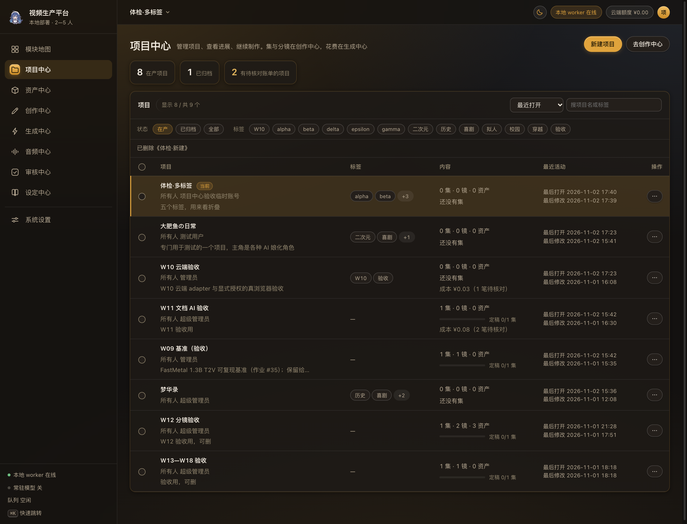

*图 2-1 项目中心（v0.82）。上面是概览与筛选，中间是项目表，「内容」列里是集／镜／资产与成本统计。*

从上到下每个控件是什么：

1. **概览条**：三个数字——在产项目、已归档、有待核对账单的项目。
2. **搜索框**：按项目名或标签搜。输入时只重画下面的表，不会整页刷新。
3. **筛选 chips**：在产／已归档／全部，以及标签筛选。
4. **表格列**：项目（名称、所有人、项目介绍、当前／已归档标记）、标签、内容（几集·几镜·几资产、定稿进度、按币种的成本累计）、最近活动（最后打开、最后修改）、操作。点一行就是选中这个项目。
5. **行尾的 ⋯ 菜单**：这一行的操作都收在这里（图 2-2）。


*图 2-2 行内 ⋯ 菜单（v0.82）。菜单靠近屏幕底部时会自动朝上开；滚动页面或 Esc 会收起。*

### 2.3 建一个项目（逐步）

1. 点页头右边的「**新建项目**」。
2. 弹窗里填四个字段：


*图 2-3 新建项目弹窗（v0.74）。字段名在左，输入框在右，下面一行小字说明这个字段是干什么的。*

| 字段 | 必须吗 | 填什么 | 注意 |
|---|---|---|---|
| 项目名 | 必须 | 片子名字，能认出来就行 | 1—60 字，前后空格会自动去掉；重名可以，但以后不好找 |
| 标签 | 可选 | 逗号分隔，比如「三皇五帝,竖屏」 | 用来检索；最多 10 个、每个 20 字，超出的会截掉 |
| 项目介绍 | 可选 | 一两句话说清做什么、给谁看 | 可留空，最多 500 字 |
| 协作人 | 可选 | 勾几个与你同级或更低的账号 | 建完也能在「成员与所有权」里加减 |

3. 点「**新建**」。成功后弹窗关闭，新项目出现在列表里，并且**自动成为当前项目**。注意默认排序是「最近打开」，刚建、还没打开过的项目会沉到列表下面——别以为没建成，往下翻或把排序切成「项目名称」。
4. 如果它没出现：先看筛选是不是停在「已归档」；再看搜索框里是不是还有旧关键词。

### 2.4 把同事加进来：成员与所有权

先说清两个概念，后面不会混：

- **所有人**：项目的主人。能删项目、能管成员、能归档。
- **协作人**（成员）：被拉进来一起干活的人。能建集、写文档、登资产、提交作业、签字，**但删不了项目、管不了成员、也归档不了**。

操作：

1. 在这一行点「⋯」→「**成员与所有权**」。
2. 弹窗上半部分显示当前所有人；下半部分是成员列表与「添加成员」。


*图 2-4 成员与所有权弹窗（v0.84）。上半部分是所有人，下半部分是成员；字段名在左、控件在右。*

3. 在「添加成员」里选一个账号，点添加。对方**不用重新登录**，刷新页面就能看到这个项目。下拉里只列与你同级或更低的启用账号，接口也按同一条规则拦（422「层级高于你，不能邀请」）——制作拉不进管理员，正如你不能把自己项目交给比自己高的人（§2.4 末「交接项目」）。
4. 想把人移出：在成员那一行点「移除」。他立刻失去这个项目的入口。

**成员不等于赋权**：把只读账号加进来，他只多了一个"看得见"，仍然改不了任何东西。要让他能改，得管理员改他的角色（§11）。

**交接项目**：在这一行「⋯」→「成员与所有权」，用下半部分的「转移给」选一个人，再点「转移所有权」，确认后原所有人降为协作人（对方还没加入也可以，交接会直接把他变成所有人）。

### 2.5 改、归档、永久删除

| 动作 | 怎么做 | 会发生什么 | 谁能做 |
|---|---|---|---|
| 改名字／项目介绍／标签 | 「⋯」→「修改项目」 | 只改这一行，不动任何内容 | 所有人、有 `project:write` 的协作人 |
| 归档 | 「⋯」→「归档（数据保留）」 | 项目从默认列表消失，数据全在；可以随时「恢复到在产」 | **只有所有人／管理员** |
| 永久删除 | 「⋯」→「永久删除…」 | 见下面"删除会带走什么"；不可撤销 | **只有管理员**（`project:delete` 只授给管理员角色）；管理员可以删任何项目，其他人连这颗钮都看不到 |

**删除会带走什么**（弹窗里会写清，这里再说一遍）：

- 这个项目的**集、文档、分镜、资产（本项目内的）、音频素材、产线运行、成片记录**，全部一起删。
- 工作区里这个项目的**正文文件**会被 `git rm` 掉并落一次提交——历史里还找得回，但要懂 git 才捞得出来。
- 作业（Job）与已经落盘的产物**不会**被删：0039 起 `job.project_id` 是 `ON DELETE SET NULL`，作业行改挂成「无主」，日志与产物目录一个字节都不动。这类行只有管理员能在生成中心「全部项目」里查到，项目那一列显示「已删除项目」；别人点开只会得到 404。它不再计入任何项目的成本账——项目已经不在了。

**所以：拿不准就归档，不要删。**归档可以撤销，删除不行。

### 2.6 出错怎么办

| 你看到的 | 意思 | 怎么办 |
|---|---|---|
| 列表里看不到某个项目 | ① 已归档被筛掉了；② 你不是它的成员也不是所有人 | 切到「全部」或「已归档」；还看不到就找所有人把你加进成员 |
| 点「归档（数据保留）」没反应或提示没有权限 | 你不是所有人 | 让所有人去操作，或让管理员做 |
| 「删除」那颗钮根本不出现 | 正常：`project:delete` 只授给管理员 | 需要删就让管理员来 |
| 建完之后表格没变 | 搜索框或筛选还卡着 | 清掉搜索词、切到「进行中」 |

---

## 3. 创作中心：集、文档、分镜

### 3.1 你会学到

- 建一集，并看懂集列表上每个数字
- 写小说／剧本：保存、版本、两个人同时改会怎样
- 用 AI 改写一段话，先看 diff 再决定要不要
- 从正文里抽取角色／场景／道具／镜头候选
- 做分镜：加镜、编辑、引用资产与形态、看懂「源已变」

### 3.2 先建一集

创作中心左边一列是集列表，最下面有一个「新集标题」输入框和「**建一集**」按钮。


*图 3-1 创作中心的集与文档树（v0.71）。左边一列是集，右边是这个集里的文档与分镜入口。*

操作只有两步：

1. 在「新集标题」里填这一集的名字，比如「第一章 结绳记事」，点「建一集」或按回车。
2. 新集出现在左侧。之前还没选集时它会直接成为当前集；已经有了就别担心，当前集不变，点一下新集就切过去。

**集号是自动排的**（第 1 集、第 2 集……），建的时候不填；标题以后可以改。集没有单独的"简介"字段。

**权限提醒**：建一集要 `doc:write`。只读账号连那一行输入框都看不到——不是加载慢，是没有这个权限。

**删一集**：集那一行有「删」。删集是危险操作，弹窗会先列出"会带走什么"：这一集的镜头、稿件、合成记录、产线运行都会删；稿件正文从工作区摘掉，但**在 Git 历史里还找得回**；**作业与产物留在项目里**（钱花了，账要留着）。

### 3.3 写小说或剧本

侧栏「创作中心」下有三个二级页：**小说**、**剧本**、**分镜**。小说与剧本用同一个编辑器，区别只是文件名前缀不同——小说是原稿，剧本是给制作看的版本。

#### 3.3.1 新建一篇文档

1. 选「小说」或「剧本」。
2. 点「新建」。弹窗三格：**标题**、**挂在哪个创作单元下**（默认"全项目共用"，也可以选某一集）、**首版正文**（可以先空着）。
3. 点「建这份文档」。正文会写进工作区的 Markdown 文件，并**立刻提交一次 Git**。
4. 左边文档树出现这一篇，点它就是打开。

#### 3.3.2 编辑器怎么用


*图 3-2 文档编辑器（v0.63）。左边树、中间正文、右边版本与操作。*

三件要知道的事：

1. **保存是显式的**：改完点「保存」（或按 `Ctrl+S`／`⌘S`）。**没有自动保存**，关页面前没点保存就是没保存。
2. **每次保存都会落一次 git 提交**。所以"版本历史"里能看到每一次保存，包括谁改的、改了多少。
3. **两个人同时改会冲突**（见 3.3.4）。编辑器不是实时协同，不要两个人同时改同一篇。

#### 3.3.3 看历史、回到旧版本

点右上角「版本」，列出这篇文档最近 30 次提交：


*图 3-3 版本历史（v0.63）。每条能看差异；这一版没有一键恢复，要回旧版得手动把文字贴回去再保存。*

- 点一条，下面显示那次改了什么（新增行绿、删除行红）。
- **这一版只能在历史里看，没有「恢复」按钮**。想把正文退回去，就对照差异把旧文字复制进编辑器、再点「保存」——这会**新增一次提交**，历史不会消失，只是多一刀。这样设计是故意的：任何一次内容变化都要留下"谁在什么时候做的"，而不是悄悄把指针拨回去。

#### 3.3.4 保存时的两种拦截，必须认识

| 提示 | 意思是 | 怎么处置 |
|---|---|---|
| **409 冲突** | 你打开之后，别人也保存过这一篇，你手上的"版本令牌"已经过期 | 页面会左右并排摆出「我这边的草稿」与「工作区里现在这份」。**二选一**：① 如果你要别人那份，点「用盘上这份，丢掉我的草稿」（会再确认一次）；② 如果你确定要自己这份，点「刷新版本令牌」，然后回编辑器再点一次「保存」——这等于"我对照过了，用我这份覆盖盘上那份"。**没有"强行覆盖"这个按钮**，覆盖必须经过这一屏 |
| **423 锁定** | 有人正在编辑这一篇（编辑器会给人加锁，默认 15 分钟） | 等对方保存或退出；急的话让对方先关掉编辑器，锁到点会自己松开（页面上写着松开时间） |

#### 3.3.5 用 AI 改写一段

选中一段文字 → 点「AI 改写」→ 弹窗：


*图 3-4 AI 改写（v0.71）。上面选操作与范围，下面填要求。*

1. **操作**：六选一——起草（替换整篇）、扩写、续写（追加到文末）、润色、剧本化、提示词。起草与续写只处理整篇；另外四条可以先选中一段。
2. **处理范围**：有选中就只动选中那一段；没选中就处理全文。整篇会慢也贵，先用一段试。
3. **附加要求**（可选，最多 2000 字）：一句具体要求，比如"保留人名，把场景写得更冷"。
4. **看要花多少钱，并勾确认**：文本改写同样是云端调用，弹窗会给出计价；不勾那句「我确认这次按供应商计费」就提交不了。
5. 点「提交并预览」。它会先排一条文本作业，界面每 1.5 秒问一次进度；跑完把结果拿回来给你看 diff：


*图 3-5 AI 改写预览（v0.71）。左边原文，右边建议，下面才有「应用」。*

6. **确认之前正文一个字都不会变**。只有点了「应用并提交」才会写进工作区**并生成一次 Git 提交**——不需要你再手动保存。失败时原文保持不动。
7. 如果你在编辑器里还有没保存的改动，它会先提醒你：直接应用会把那些改动覆盖掉。
8. 结果不满意就点「改一下再试」，换个操作或要求重来；关掉弹窗等于放弃这一次。

### 3.4 从正文抽取角色、场景、道具与镜头

正文写到一定程度，可以让平台帮你把"里面出现了谁、哪些场景、哪些道具、能切几镜"列成候选。

1. 打开一篇**小说或剧本**（抽取入口在文档页，不在分镜页），点「抽取」。它会先查这一份有没有没保存的改动——抽取读的是盘上那一份，没保存的会缺一截。
2. 弹窗给你看这一次的依据：文档与字数、用哪个文本模型、单价、预计用量、健康状态。下面可以写一句「额外要求」（可空，最多 2000 字），再勾「我确认这次按供应商计费；同一份正文 24 小时内重复提交不会再花钱」。健康不是「就绪」时「开始抽取」是灰的。
3. 点「开始抽取」。这是一条文本作业，界面每 2 秒看一次状态；跑完**在原弹窗里**列出候选，按「角色／场景／道具／镜头」四个 chip 分类：


*图 3-6 抽取候选（v0.73）。抽取的结果不会直接改资产或分镜，先变成候选。*

4. 每条候选可以「接受」（建新资产）、「合并」（并进已有资产）或「驳回」。**这一步才写库**；抽取本身不会自动建资产、也不会自动加镜头。
5. 原文在抽取之后被改过，这批候选会标"证据已失配"，只能看不能入库——重新抽一次。
6. 弹窗关掉后，还没处理的候选仍在**资产中心 → 文本提取**里，可以接着处理（见 §4.7）。

### 3.5 做分镜

分镜是一张表，一行一个镜头。


*图 3-7 分镜表（v0.73）。列：镜号、内容／提示词、引用资产、时长、作业、操作。*

每一列的含义：

| 列 | 含义 | 怎么用 |
|---|---|---|
| 镜号 | 这一镜在这一集里的顺序号 | 建镜时按顺序自动排，界面不能改；要换顺序只能删了重建 |
| 内容／提示词 | 画面描述，也是生成图像／视频时发给模型的提示词 | 写得越具体，生成越可控 |
| 引用资产 | 这一镜里出现了哪些角色／场景／道具 | 点 + 从资产库选；选了才能"长得对" |
| 时长 | 这一镜预计几秒 | 成片按它拼时间线 |
| 作业 | 这一镜的全部作业：最新那条的状态 + 一共几条 + 最新作业号 | 鼠标停上去能看到每一条的编号与状态；改状态去生成中心，这一页只读 |
| 操作 | 编辑／生成／删除 | 「生成」就是给这一镜提交作业；删镜头是危险操作，会先问你 |

#### 3.5.1 加一镜、改一镜

1. 点页头的「新建镜头」（没有镜头时是「新建第一镜」），或某一行的「编辑」，弹出镜头表单：


*图 3-8 镜头编辑（v0.74）。上面是内容与时长，下面是引用资产与形态。*

2. 填：**内容**（必填，最多 500 字）、**提示词**（可空，最多 2000 字）、**时长**（1—60 秒）、**引用资产**。
3. **形态**：如果这一镜要用某个角色的"雨夜外套"而不是常服，在资产下面再点形态 chip（见 §4.6）；不选就是默认形态。选中后可以点「把形态描述并进提示词」，把形态那段文字拼进这一镜的提示词——拼进去的是文本，你还能接着改。
4. 点「保存镜头」。

#### 3.5.2 两种"看起来不对"的正常现象

- **「源已变」标记**：这一镜内容改过了，但之前那条作业是按旧内容生成的。标记不是报错，是提醒你"产物可能已经不对了"。要更新就重提一条作业（重试时先看预览，见 §5.6）。
- **引用资产消失**：资产被删了或改名了。删除资产时系统会拦：还有镜头引用它就不让删（全局池资产除外，见 §4.2）。

### 3.6 出错怎么办

| 你看到的 | 意思 | 怎么办 |
|---|---|---|
| 保存报 409 | 别人先保存了 | 见 §3.3.4：二选一，用盘上那份，或刷新令牌后保存自己这份 |
| 保存报 423 | 有人正在编辑 | 等几分钟或让对方先退出 |
| 「建一集」不见了 | 你没有 `doc:write` | 让管理员看你的角色 |
| 抽取跑完看不到候选 | 候选在**资产中心的文本提取**页，不在创作中心 | 去资产中心 → 文本提取 |
| 改完分镜后作业还显示旧时间 | 那条作业是旧的，不会自动重跑 | 重新提交或重试 |

---

## 4. 资产中心：角色、场景、道具

### 4.1 你会学到

- 资产、别名、定妆图、一致性提示词、档案、形态分别是什么
- 登记一个角色并生成它的定妆图（从"空"到"能用"的完整一遍）
- 看懂"作业成功"与"资产里有了"之间的那一步
- 用文本提取把正文里的候选变成真资产

### 4.2 三个工作区

资产中心侧栏有三个二级页（窄屏时是页头一排 chip）：

| 工作区 | 干什么 |
|---|---|
| **资产库** | 看全部资产、筛选、新建、点进详情 |
| **资产创作** | 对着某一个资产干活：写设定、生成图像、存进表单 |
| **文本提取** | 处理从正文抽取来的候选（接受／合并／拒绝） |

筛选有三组 chip：**类型**（角色／场景／道具）、**范围**（全部范围／本项目／全局池）、**状态**（缺参考图／缺一致性提示词），右边是搜索与排序。全局池里的资产不属于任何项目，所有项目都能引用，只有管理员能改。

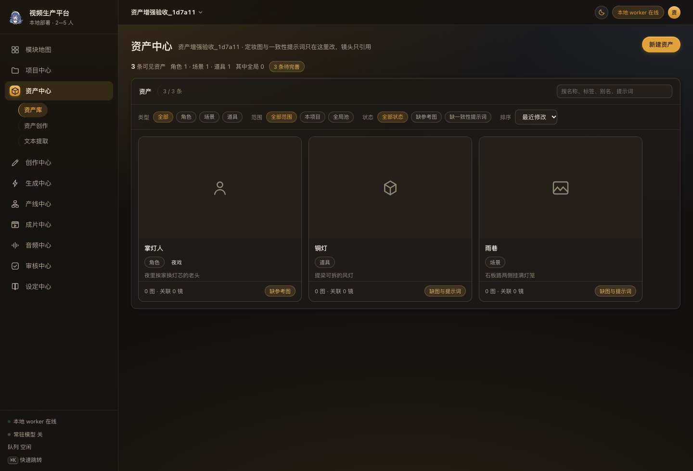

*图 4-1 资产库（v0.98）。上面是类型 chip 与搜索，下面是卡片。卡片角上的数字是被引用次数。*

### 4.3 新建一个资产（逐字段）

1. 资产库页点「新建资产」。
2. 填：

| 字段 | 必须吗 | 填什么 | 说明 |
|---|---|---|---|
| 资产类型 | 必须 | 角色／场景／道具 | 决定后面能生成哪类图、能挂哪种形态 |
| 名称 | 必须 | 正式名字 | 同一范围、同一类型里名称唯一；重名说明该合并，不是新建 |
| 简介 | 可选 | 一句话说清这是谁／什么地方／什么东西 | 列表与选择器里显示 |
| 一致性提示词 | 可选（强烈建议填） | 外形、配色、材质、禁忌这些"跨镜头必须一样"的细节 | 每次生成都会带上，保证不像换人 |
| 标签 | 可选 | 逗号分隔，最多 10 个 | 列表与筛选用 |
| 别名 | 可选 | 其他叫法，逗号分隔 | 抽取合并时靠它对上同一个；分镜里写别名也能对上 |
| 归属 | 默认本项目 | 管理员可以勾「放进全局资产池」 | 全局资产各项目都能引用，只有管理员能建、能改 |

3. 点「**登记**」。资产出现在卡片区。

**定妆图不在这个弹窗里传**。新建只登记"这个人是谁"；图要到资产详情或资产创作里加（上传参考图或生成后存进去，见 §4.5、§4.6）。

### 4.4 资产详情：这个资产现在缺什么

点一张卡片进详情。

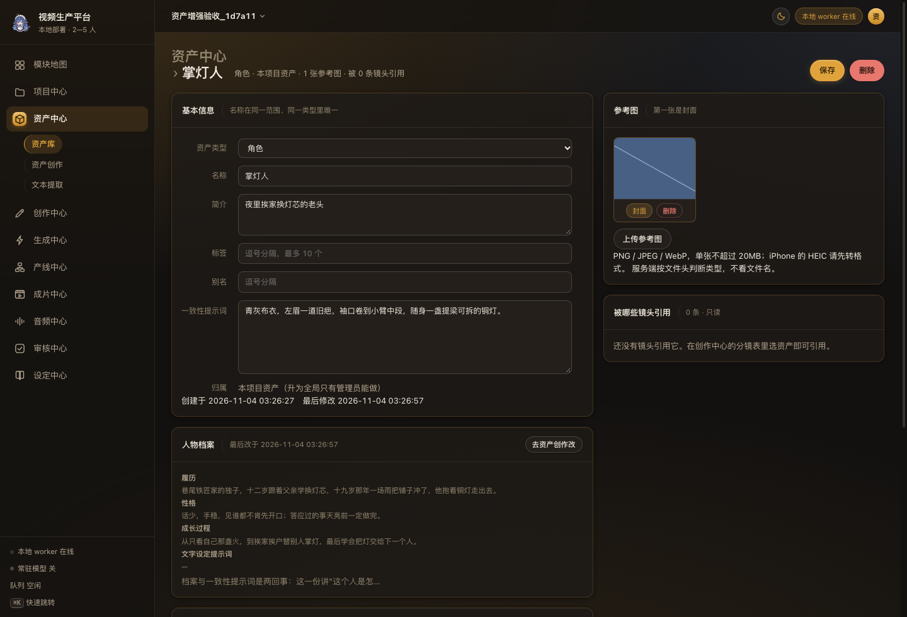

*图 4-2 资产详情（v0.98）。上面是基本信息与定妆图，下面是档案、引用与最近生成记录。*

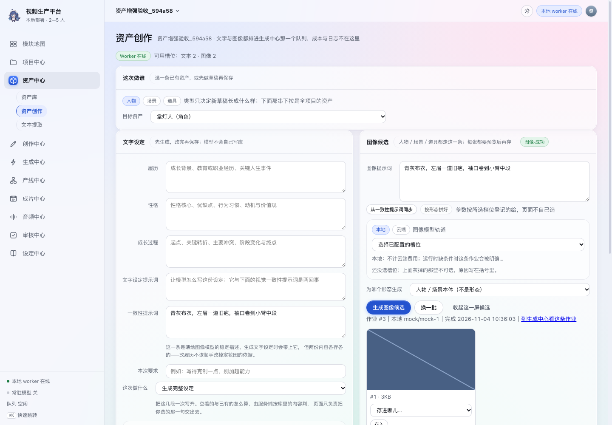

*图 4-3 资产详情里的两张新卡（v0.99）。「还缺什么」按库里实际内容列缺项；「最近生成记录」读作业表——成功的图像作业产物不会自动进资产。*

v0.99 之后有两张新卡，值得先看：

1. **还缺什么**：按库里实际内容列缺项。比如"没有定妆图""没有一致性提示词""没有档案"。它是照实算的，不是提醒模板。
2. **最近生成记录**：这个资产最近的图像作业。**这里的产物不会自动进资产**——要逐张预览、明确选「存进哪儿」（见 §4.6）。

档案（profile）是角色的更深设定：性格、口头禅、禁忌。一个资产最多一份，写在这里比写在分镜里更不容易丢。

### 4.5 资产创作：从空到有一张能用的图

这是资产中心最常用的工作区。进来先选一个资产（左边下拉或从详情跳进来）。

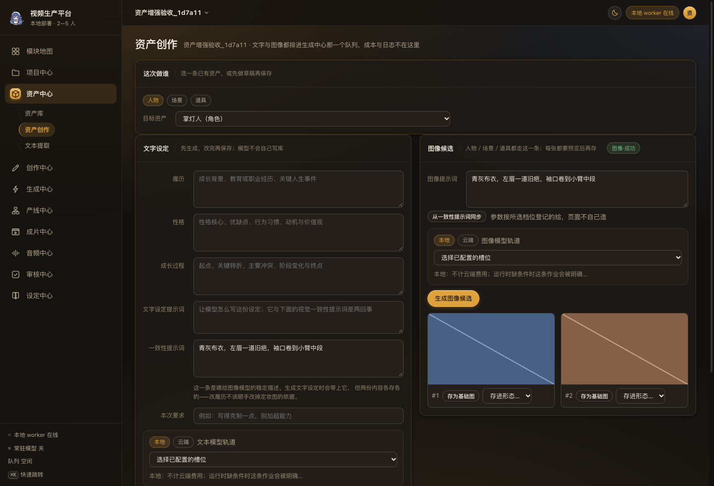

*图 4-4 资产创作（v0.98）。左边是表单与模型轨，右边是生成结果。*

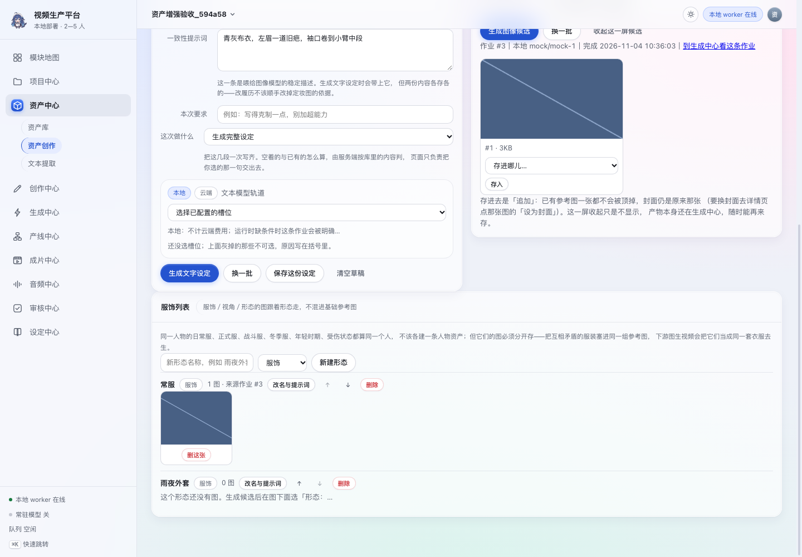

*图 4-5 资产创作的模型轨（v0.99）。一个槽位同屏显示健康与验证两件事；这一档登记的参数收进「高级参数」，默认折叠。*

#### 4.5.1 第一阶段：把文字设定写出来

1. **选资产**。换资产时如果表单里有没保存的改动，会先问你一句；选「取消」就停在原处。
2. **核对表单**：第一次打开时，名称、简介、履历／性格／成长过程（角色）或说明（场景／道具）、一致性提示词会从库里灌进来；之后**只灌这一次**，你再改就是你的草稿（后台轮询不会把你正在敲的字擦掉）。
3. **选「这次做什么」**，五选一：

| 选项 | 意思 |
|---|---|
| 生成完整设定 | 把这几段一次写齐 |
| 只补空着的字段 | 已有内容一个字不动 |
| 优化已有设定 | 只收紧文字，不新增设定 |
| 扩写指定字段 | 只动你挑的那一段 |
| 依据原文片段写设定 | 只照你贴的原文写，不编；模型没有的会标成「建议」，不会变成设定事实 |

4. **写「本次要求」**（可空）：比如"写得克制一点，别加超能力"。
5. **选文字轨**，填这一档的参数（温度、上限之类）。每一档登记了哪些参数，界面就渲染哪些输入框；页面不自己造旋钮。
6. **点「生成文字设定」**。作业进生成中心队列，页头角标开始跑。连点同一颗钮不会排出第二条——同一次意图带同一个幂等键；想真的再要一批，点「换一批」，它带一个新键。
7. **等回稿**。轮询只更新几格（角标、通知条、回稿面板、候选网格），**不会重绘你正在敲的那一格**。
8. 回稿按段解析出来。点「填进表单」才会把结果覆盖进表单；不点就只是看。
9. 改到满意后，点「**保存这份设定**」。**这是唯一写库的一步**——模型不会自己改资产。

#### 4.5.2 第二阶段：生成图像并选一张存进去

1. **选图像轨**与参数（宽高、步数等按这一档登记了什么显示什么）。
2. **写图像提示词**；也可以点「按形态拼好」，把身份锚点、一致性与这个形态的描述拼成一段可改的文字。
3. 如果有参考图，确认这一档吃不吃参考图——界面会按清单说，不会把"选了一张图"说成"已经应用了参考图"。
4. **点「生成图像候选」**。同样地，连点是同一条作业，「换一批」才是新意图。
5. 候选出来后逐张点开看，在「存进哪儿…」下拉里选「人物／场景基础参考图」（资产详情里显示为定妆图）或某个形态，再点「存入」。到这一步资产里才真的有图。存进去是**追加**：已有参考图一张都不会被顶掉，封面仍是原来那张。
6. 保存撞版本（别人刚改过这个资产）时，界面会说"这次没有保存"；重新读一次这条资产，把你的改动补回去再存。

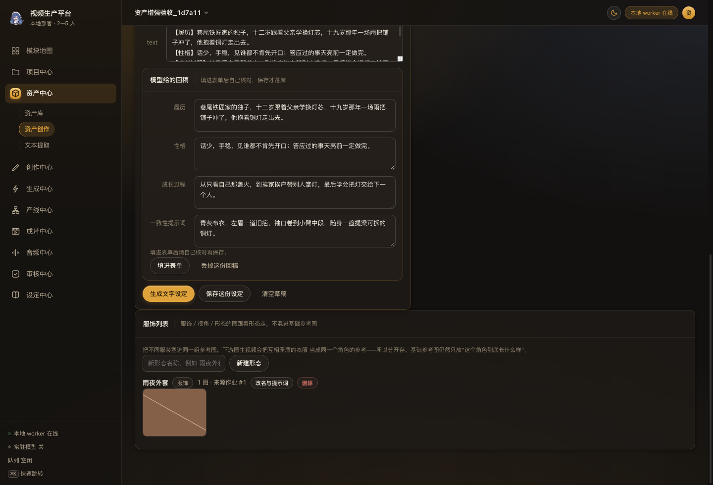

*图 4-6 回稿面板（v0.98）。生成结果按段解析出来，点「填进表单」才会覆盖表单内容。*

#### 4.5.3 槽位没配好时，按钮是灰的，而且会说明原因

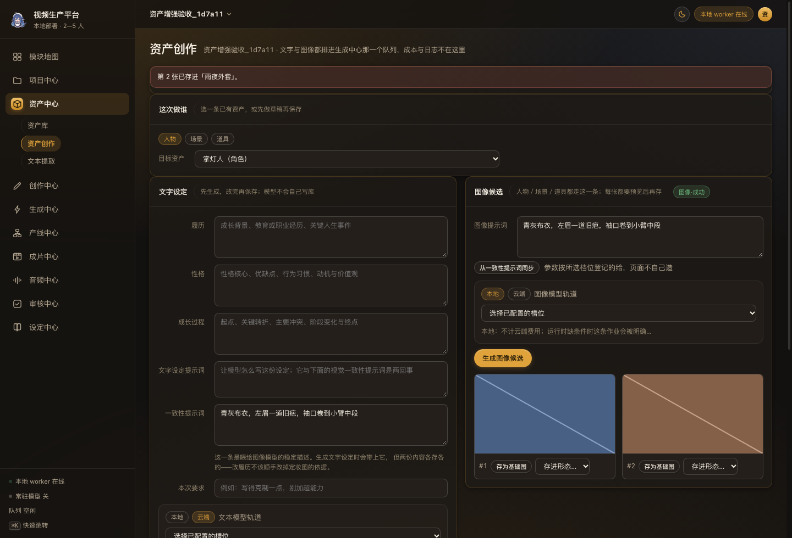

*图 4-7 槽位缺条件（v0.98）。没选到具体档位时，生成按钮是灰的，并写明缺什么。*

这是设计上的承诺：**没选到具体档位就不许提交**。以前那颗钮看起来能点，点下去只会收到一句内部报错（"执行方式、供应商、模型要么都不传，要么三件一起给"），那是给开发看的，不是给你看的。

### 4.6 图像候选与命名形态

#### 4.6.1 候选卡怎么看

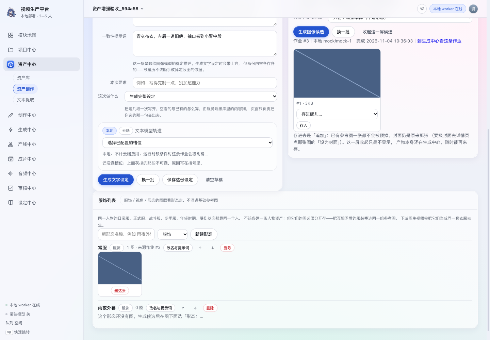

*图 4-8 图像候选（v0.99）。卡头写「作业 #几｜本地／云端 哪一档｜完成时间」。*

- 每张先点开看大图，再在「存进哪儿…」下拉里显式选：人物／场景基础参考图（定妆图），或某个形态；点「存入」。
- 一张一张存；多张存进同一个目标就是追加，**封面不变**。原产物也还在（不会因为你存进资产就删掉作业目录里的原件）。

#### 4.6.2 形态：同一个人，不同打扮

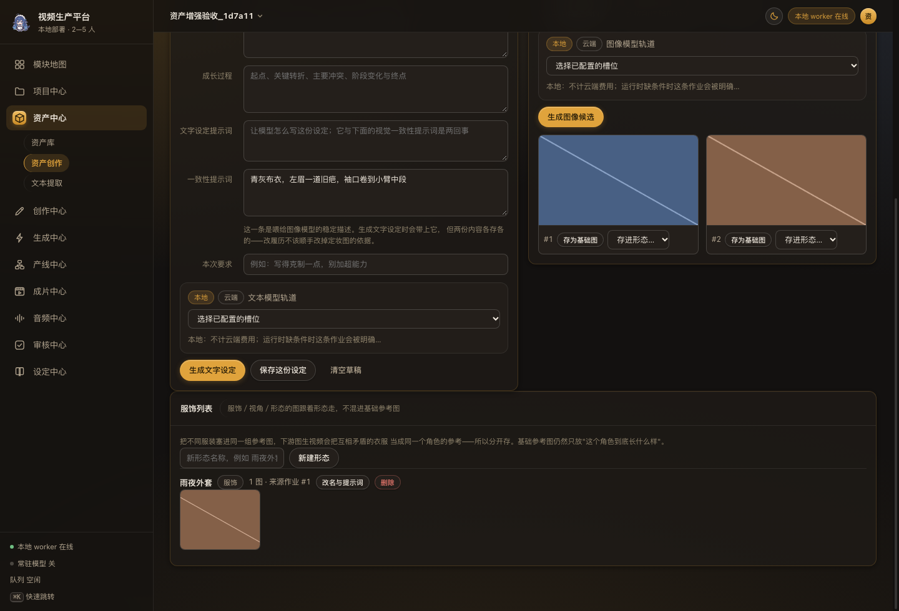

*图 4-9 命名形态（v0.98）。常服、雨夜外套、战损袍都算同一个人。*

- **新建形态**：在形态列表底部填「新形态名称」（比如「雨夜外套」）、选类型，点「新建形态」；再用那一行的「改名与提示词」补这套形态专属的图像提示词。
- **每行能做的**：改名与提示词、上移下移、**删单张图**（「删这张」）、删除整个形态（另一颗按钮，会先确认）。
- 形态的名字在同一资产、同一类型里不能重名——两个"雨夜外套"没法回答"要参考哪一套"。


*图 4-10 形态列表（v0.99）。删除单张图与删除整个形态是两颗不同的钮。*

### 4.7 文本提取：把候选变成真资产

侧栏「资产中心 → 文本提取」。

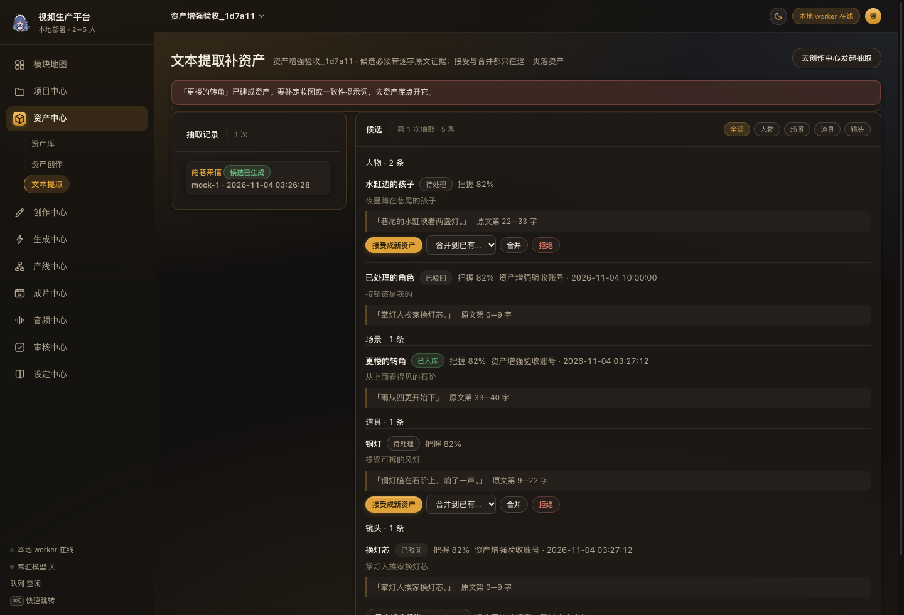

*图 4-11 文本提取（v0.98）。左边是候选，右边是处理。*

每条候选三个选择：

1. **接受**：按候选内容建一个新资产（或新形态）。
2. **合并**：合并进已有资产。点之前会先摆出"会补哪几格／不动哪几格／别名追加什么"：

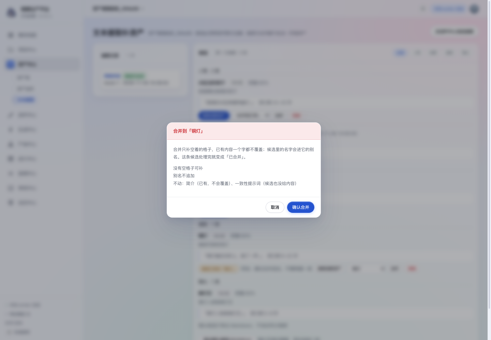

*图 4-12 合并预览（v0.99）。口径与服务端一致：只补空，已有内容一个字不覆盖。*

3. **拒绝**：这条不要了。

**合并不比版本**，接受才比。意思是：合并只往空字段里填、别名追加，不会因为你手上这份旧了就把新内容盖掉。

### 4.8 出错怎么办

| 你看到的 | 意思 | 怎么办 |
|---|---|---|
| 生成按钮是灰的 | 没选到具体档位（本地/云端＋供应商＋模型） | 把两个下拉都选上；灰钮旁会写缺什么 |
| 「未验证」徽章 | 这一档没做过真实验证 | 能用，但别把结果当定稿；要升徽章去模型中心跑验证 |
| 生成成功但资产里没图 | 正常：产物只在作业目录 | 去候选里逐张预览后「存进资产」 |
| 「还缺什么」一直提示没有档案 | 档案是手填的，不自动生成 | 在详情页填一段性格／口头禅，保存 |
| 上传参考图失败 | 文件太大或格式不对 | 换成常见格式（png/jpg），压到合理大小再传 |
| 删资产被拦 | 还有分镜引用它 | 先去掉分镜里的引用，或改成"保留存档" |

---

## 5. 生成中心：提交、等、看结果、算钱

### 5.1 你会学到

- 一次作业从提交到出结果，中间发生了什么
- 每个下拉、每个参数、每个状态是什么意思
- 取消、重试、以及"重试前为什么要先预览"
- 告警六种中文名各代表什么、该谁处理
- 成本怎么算，什么时候会出现"待核对"

### 5.2 先理解三件事

1. **全平台只有一条队列**。你不在这里直接跑模型，只是"下单"；后台 worker 一条条领走执行。
2. **本地按资源类排队**：文本、图像、视频、音频、合成各有一组槽位，默认每类同时 1 条。所以排在前面的没跑完，后面就一直「排队中」——这很正常，不是卡死。实际额度在产线中心 → 整季的 worker 面板上看。
3. **钱在提交那一刻算清**。本地不计费，云端按档位单价 × 用量预估并落一条成本快照；之后改价不会改已提交作业的账。

### 5.3 提交一条作业（以视频为例）

入口有四个，效果一样：分镜那一行的「操作」列「生成」、资产创作页的生成按钮、音频中心的「送进队列」，以及本页右上角的「提交作业」。这里以分镜提交视频为例。

1. 在分镜表某一镜的「操作」列点「生成」。
2. 弹窗从上到下是：项目、能力、执行路线、槽位、参数模板、参数、提示词、预计成本：


*图 5-1 提交作业（v0.74）。上面选能力与档位，下面填参数，右下角是预估价格。*

3. **能力**：这次要生成什么（文本／图像／视频／配音／音乐）。分镜里默认是视频。
4. **槽位**：先选本地或云端，再选供应商与模型。只列出**登记过且已启用**的档位。
5. **参数**：这一档登记了哪些参数就显示哪些。填错类型会被拒（比如该填数字的填了字母）。
6. **云端要确认**：选了云端，右下角会显示预估价格与"会真扣费"，需要你勾一次确认。**不会偷偷走云端**。
7. 点「提交」。列表顶部出现一条新作业，状态「排队中」。

### 5.4 队列与成本账


*图 5-2 生成中心（v0.68）。上面是筛选与统计，下面是作业表；成本账在表格下面单独一张卡。*

表的每一列：

| 列 | 意思 | 备注 |
|---|---|---|
| 作业 | 作业编号，点「详情」打开抽屉 | 编号全局唯一 |
| 项目 | 这条属于哪个项目 | 在「全部项目」视图下才需要看 |
| 能力／种类 | 干什么的（文本／图像／视频／配音／音乐），后面小字是具体种类 | —— |
| 执行 | 本地还是云端，后面是「供应商／模型」 | 云端会标出供应商 |
| 状态 | 排队中／启动中／运行中／成功／失败／取消中／已取消／待核对 | 完整对照见 §13.1 |
| 成本 | 这条花了多少 | 本地显示「¥0 · 本地」；云端是预计值，核对后换成实际值并标出差额 |
| 耗时 | 从开始跑到结束 | 排队时间不算在里面 |
| 入队 | 什么时候进队列 | 排太久能看出是不是 worker 没起 |
| 操作 | 详情／取消／重试／核对账单 | 按状态与你权限显隐 |

上面一排筛选依次是：**项目、状态、能力、执行方式、搜索框（作业号或提示词）**，右边一个「刷新」。表头上方那行数字是：等待几条、运行几条、当前筛选几条、几笔待核对、本地机时合计；有云端作业没记价时，最右边会多一枚琥珀色提示。

**成本账在表格下面单独一张卡，不是页头按钮**。它只按上面的「项目」筛选汇总，**不跟状态、能力、执行方式、搜索词走**——所以你把状态切成「失败」，成本账还是这个项目的全部账。这一点页面上写的是「由 Job 汇总，不可手改」。

### 5.5 作业详情：点开看什么


*图 5-3 作业详情抽屉（v0.68）。参数、日志、产物、成本都在这一条里。*

从上到下：

1. **动作区**：按这条的状态与你的权限出现「取消作业」「重试（新建一行）」「核对账单」「标记待核对」。没有能按的钮时，那里会写一句要哪个权限点，不会留一片空白让你猜。
2. **状态与时间**：状态、项目、挂在哪一集哪一镜、能力、执行路线、入队／开始／结束、耗时与返回码、第几次尝试、重试自哪条、已经被重试几次。
3. **成本**：本地作业写「不计费」，另记机时、worker 与模型子进程两个 CPU、两个峰值内存；云端作业写预计记账、账单状态、单价、数量、币种、定价来源与确认时间。
4. **提示词快照与参数快照**：提交那一刻的原样，之后再改档位也不影响这一条。
5. **模型内部耗时**（有的话）与**实际命令**：命令是一个 argv 数组，没经过 shell，展开才看得到。
6. **日志**：worker 的输出。失败时先看最后 20 行。
7. **产物**：图片能预览，视频能播放，音频能听。产物路径是相对路径，点文件名给你原文件；文件被清理了会写「文件已不在」。


*图 5-4 视频产物（v0.69）。能直接播，也能下载原文件。*

### 5.6 取消与重试

- **取消**：还在飞的作业能取消（排队中／启动中／运行中）。点「取消作业」后状态先变「取消中」，worker 收到指令才会真的停；停下来的变「已取消」，**已花掉的钱不退**；云端若已经发出请求，供应商仍可能计费。
- **重试**：失败／已取消／待核对的作业点「重试（新建一行）」。**待核对的那条先核账再决定**——钱可能已经花了，盲目重试会造成第二次付费调用（见 §5.8）。重试前会先弹一个**预览**，列出这一串重试链的编号、状态、第几次尝试与各自记账，并说清"这会再跑一次、云端可能再计费"：


*图 5-5 重试预览（v0.75）。先看清会发生什么，再决定。*

**重试继承原作业的源版本**，不会自动按现在的分镜重算——否则一次重试就把"这条产物基于旧分镜"这件事洗掉了。

### 5.7 告警：六句话各是什么意思

生成中心顶部会出现横条，说明队列或 worker 有状况。中文名只有一套（生成中心、首页、模型中心说同一句话）：


*图 5-6 队列告警（v0.75）。横条上会写原因与建议动作。*

| 中文名 | 大白话 | 谁该动 |
|---|---|---|
| worker 离线 | 后台干活的进程没在跑 | 部署的人去看 worker 进程 |
| 队列停滞 | 有活排着但很久没人领 | 同上，先看 worker 是否健康 |
| 租约过期 | worker 领了活但没按时回报，作业被收回 | 一般会自动重跑；频繁出现要查机器负载 |
| 运行超时 | 单条作业跑太久了 | 看作业日志，必要时取消重试 |
| 日志静默 | 进程活着但很久没写日志 | 可能卡在外部进程里，查 CPU／内存 |
| 待核对 | 云端作业中途断了、账单不明 | 人工核对账单（下一节） |

### 5.8 云端「待核对」：核对账单

当云端作业在计费确认之前就断了，平台不猜它是成功还是失败，状态停在「待核对」，等你对着供应商后台核一次：


*图 5-7 核对账单（v0.75）。选核对结果、填实际金额与备注，保存后这条作业结清。*

1. 去供应商后台查这一单到底扣了没有、扣了多少。
2. 在弹窗里选**核对结果**：继续待核对（只留备注）／确认可用／确认不可用；确认前两种必须填**实际金额**，否则等于替你断定这次没花钱。再写一句**备注**（供应商用量、请求 ID、为什么是这个金额）。请求 ID 已经显示在弹窗标题行里，是只读的。
3. 点「保存核对」。它只改账单与状态，**不重新提交**、不动提示词与参数快照；结清后成本账按你填的实际金额算。

### 5.9 出错怎么办

| 你看到的 | 意思 | 怎么办 |
|---|---|---|
| 一直「排队中」不动 | worker 没起或正忙 | 看顶部有没有"worker 离线"告警；看产线中心的 worker 面板 |
| 点提交提示"要么都不传，要么三件一起给" | 这是内部契约错误，界面上不该出现 | 通常是没选全档位；按 §4.5.3 选全再提交。还出现就报给开发 |
| 失败但日志只有一句 | 模型进程自己退了 | 看本机终端里 worker 的输出；常见是显存／内存不够 |
| 云端作业失败后没自动改走本地 | 正常：**不自动兜底** | 想换本地就手动再提交一条（会花两份钱） |
| 成本列是「待补价」 | 云端作业没有计价快照，不是 0 元 | 去核对账单或补价；本地作业会显示「¥0 · 本地」 |
| 产物点开是 404 | 文件被清了或路径不对 | 看作业详情里的产物路径；清理策略见系统设计 §10 |

---

## 6. 审核中心：跑检查、看证据、签字

### 6.1 你会学到

- 校验器到底检查什么、报告怎么读
- 文档签字与产物签字的区别
- 为什么没签字就不能合成

### 6.2 两个页签

| 页签 | 签什么 | 谁能签 |
|---|---|---|
| 文档审核 | 小说／剧本的正文 | `review:sign`（制作、管理员） |
| 产物审核 | 某个作业的产物（图／视频） | 同上 |

### 6.3 文档审核：先跑校验，再签字

1. 选左边一份待审文档。没有报告时，详情里给一颗「跑第一遍校验」。
2. 点「跑校验」。校验器**只跑三条确定性规则**——占位词（比如「待补」）、超长句、没有收尾标点；不调模型、不花钱，几秒出报告：


*图 6-1 校验报告（v0.73）。每条规则一行，红的是错误，黄的是警告。*

3. **错误项（红）**：交片前应当处理。报告会一条条列出锚点、原句与说明。
4. **警告项（黄）**：可以签，但你自己知道有这回事。
5. 签字可以**逐条签**（每条问题三个结论：通过／退回／驳回），也可以**整份签**（整份通过／整份退回），还可以写一句备注（可空）：


*图 6-2 签字记录（v0.73）。签的是当时那一版，之后正文再改，签字就失效。*

**一个必须说清的口径**：平台**不会**因为你没处理红项就禁掉签字按钮。签的是"我看过了"，不是"机器判定合格"；报告会原样保留错误记录。真正会拦住你的是**正文在报告之后改过**——这时报告与旧签字失配，必须重跑一遍校验才能签新版本。

### 6.4 产物审核：看片签字

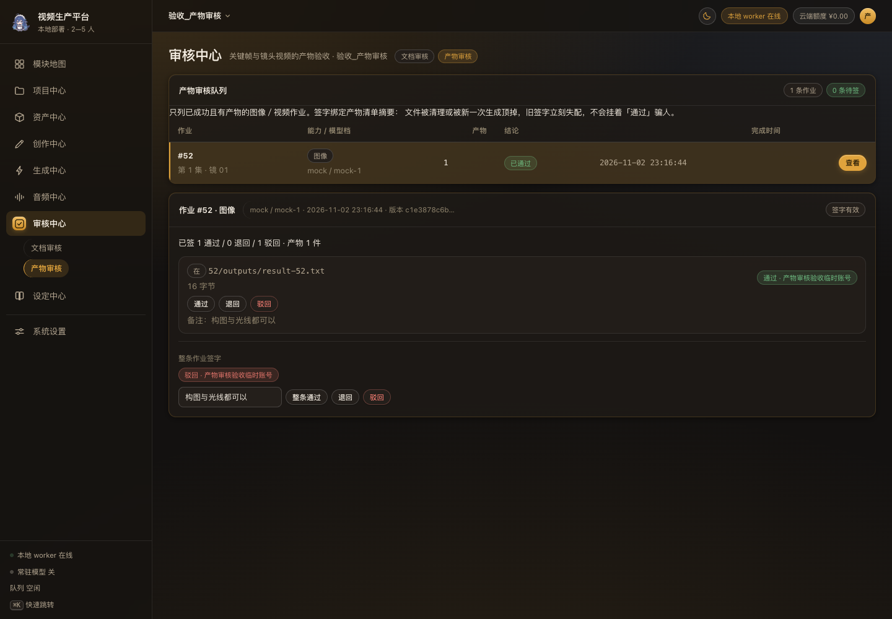

*图 6-3 产物审核（v0.89）。左边是待签产物，右边是预览与签字。*

1. 选一条产物。列表**只列已成功、且有产物的图像／视频作业**；空列表可能是本机没有图像／视频运行时，不是页面坏了。
2. 预览。视频能播；图能放大。一条作业可能有多件产物，可以逐件签，也可以整条作业一起签。
3. 结论三选一：**通过**／**退回**／**驳回**；备注可空。退回与驳回的区别是语义：退回＝改一改再给我，驳回＝这一版不要了。
4. 签字会带上一个**锚点**：这一版产物清单的摘要（相对路径＋文件是否还在＋字节数）。文件被清理或被新一次生成顶掉，旧签字显示"失配"，要重新签。

**签字的用处**：成片中心只合成"已签字通过"的镜头。没签字不是忘了，是拦路。

### 6.5 出错怎么办

| 你看到的 | 意思 | 怎么办 |
|---|---|---|
| 校验一直转 | 校验作业在排队 | 去生成中心看这条作业 |
| 签字按钮不出现 | 你没有 `review:sign`，或正文在报告之后改过（报告失配） | 先重跑校验；权限问题找管理员 |
| 签字显示"失配" | 文件换过了（重新生成或重新导入） | 重新看一遍再签 |
| 产物列表里找不到某条作业 | 它没成功，或没有产物 | 去生成中心看那条作业的状态 |

---

## 7. 音频中心：台词、配音、音乐、口型、音效

### 7.1 你会学到

- 四类音频素材各是什么、各能干什么
- 从登记一条台词到"能播放"，要走哪几步
- 为什么"素材已就绪"还要再看一眼作业那一列
- 口型与音效现在为什么用不了（这不是坏了）

### 7.2 先分清四个页签

音频中心顶部四个页签，各管一类素材：

| 页签 | 管什么 | 能登记的种类 | 能不能送进队列 |
|---|---|---|---|
| **配音** | 每句台词与每段旁白的语音 | 台词、旁白 | 能（走本地 TTS 档位） |
| **音乐** | 一集的配乐 | 音乐 | 能（走本地音乐档位） |
| **口型** | 台词对应的 viseme（口型时间点） | 台词 | 不能：只记录，**没有"生成口型"的可用按钮** |
| **音效** | 环境音、打击声等 | 音效 | 不能：标为实验态，提交会被拒 |

四个页签共用同一张表：一行一条素材，列是「素材」「文本」「状态」「产物／口型」，最后一列是行内按钮（送进队列／删除／生成口型）。切页签只是换筛选，数据还是同一张台账。

**素材不是从分镜自动变的**。分镜里的台词只是画面描述的一部分，音频中心不会自动去读它；你要在音频中心**手动登记**一条，写上这一句的文本。这样做的原因是：台词怎么念（停顿、语气）、要不要改词，是配音环节的决定，不该被分镜改动悄悄带走。

### 7.3 登记一条素材（逐步）


*图 7-1 配音页（v0.74）。每行一句台词，状态与作业列在后面。*

1. 进入你需要的页签（比如「配音」）。
2. 在上方表单里选：**种类**（配音页是台词／旁白，音乐页只有音乐）、**哪一集**、**要不要挂到某一镜**（默认「不挂镜头」，旁白通常就不挂）。
3. 填**说话人**（可空；旁白可以不填）与**文本**（必填，最多 4000 字）。
4. 点「**登记素材**」。这一行状态是「草稿」。
5. 确认文本没问题，点这一行的「**送进队列**」。系统把它变成一条普通作业，进生成中心那条唯一队列。
6. 作业跑完且产物路径抄回来了，状态变「**已就绪**」，产物列出现播放器，可以直接听。
7. 「口型」页签里，同一句会显示有没有 viseme 段——但见 §7.5，这一版还生成不出来。

**登记与提交是两件事**：登记只写台账，不花钱；点「送进队列」才落作业，成本只从作业记。所以你可以先把一集的台词全登记好，再逐条送。


*图 7-2 音乐页（v0.73）。失败时把原因写在行里，不装成"没有"。*

**文本登记后改不了（界面上）**：这一版页面没有"编辑素材"的入口。草稿阶段想换说法，删掉这条重登一次；已经送进队列或已就绪的，另建一条。接口层面只在「草稿」「失败」两档允许改文本，排队中与已就绪一律拒绝（返回 409，原话是「作业进行中或已就绪；要改就新建一条」）。

### 7.4 四种状态与作业那一列

素材的状态只有四档：

| 状态 | 意思 | 你能做什么 |
|---|---|---|
| **草稿** | 只登了记，还没送队列 | 送进队列、删除 |
| **排队中** | 作业已提交，还没跑完 | 等；可删素材（作业不撤） |
| **已就绪** | 作业成功，产物路径也抄回来了 | 播放；不能再送、不能改 |
| **失败** | 作业失败，或作业说成功但产物抄不到 | 重新送进队列（会新建一条作业）、删除 |

**为什么还要看作业那一列**：素材状态没有「待核对」这一档（这是数据库的硬约束）。云端配音出问题时，素材会留在「排队中」，而状态格里的小字会念出作业的真实状态「待核对」。平台不替你把"钱没对清"翻译成"失败"或"就绪"。

**「作业成功但产物抄不到」会落「失败」**：如果作业报成功、结果数组却是空的，素材不会被写成"已就绪但点不开"，而是直接落失败并让你重跑。这是平台的一条红线：没拿到的东西不假装拿到。

### 7.5 口型与音效：现在为什么不能用

- **口型**：页面只保留数据位。已就绪的台词行会有一颗「生成口型」按钮，但它是**灰的**，鼠标停上去写着「Rhubarb 适配器尚未接线」。这一版不会产出任何 viseme 段，口型列永远显示「未生成」。这不是你的操作问题。
- **音效**：可以登记（方便先把清单列出来），但点「送进队列」会被拒，提示这类素材「还没有可核对的自托管适配器，这一版标为实验态」。按钮还在，是为了让台账完整，不是为了骗你点。

### 7.6 一句必须说清的话：真实出声还差执行接线

即便你在模型中心把配音／音乐的本地档位配好、健康检查也显示「就绪」，**送进队列的作业仍然不会出声**。原因是执行层 `runners.build()` 目前只接了视频、图像与云端三条分支；配音与音乐走到这里会直接回一句「还没有执行接线」。

也就是说，音频这一块的**台账、队列、成本、状态**四条腿是真的，**最后一段"真的合成声音"还没接**。判断方法：作业详情里看到这句错误，就是它；不是你的文本写错了。

### 7.7 出错怎么办

| 你看到的 | 意思 | 怎么办 |
|---|---|---|
| 页内横条「送进队列失败：……」 | 缺运行时、档位不可用，或音频只走本地轨 | 读原话；要真实发声先去模型中心配好本地音频档位，并接受 §7.6 的边界 |
| 素材一直「排队中」 | 作业还没跑完，或停在待核对 | 看状态格里的小字；去生成中心找那条作业 |
| 播放没声音 | 可能是模拟结果，或执行层没接线 | 见 §7.6；不要把"没接线"当成"文件坏了" |
| 「这一集的镜头读不出来：原因」 | 镜头候选读取失败，不是这一集没有镜头 | 记下原因报给开发；换一集再切回来可重试 |
| 「生成口型」是灰的 | Rhubarb 未接线 | 正常；这一版不产出 viseme |
| 音效提交被拒 | 音效是实验态 | 只登记，不提交 |
| 提示条切了页签就没了 | 失败提示只属于「当前项目 × 当前页签」 | 它没被"修好"，只是收走了；回到那个页签再试一次才知道 |

---

## 8. 产线中心：一次发起，按依赖往下走

### 8.1 你会学到

- 产线是什么、它和生成中心的分工
- 发起一次运行前，系统会替你检查什么
- 节点列表怎么读，失败后为什么只能重试"那一格"
- 暂停、恢复、取消各会发生什么
- 整季批量怎么排，worker 面板上两组数分别是谁的

### 8.2 先分清三件事

1. **产线不另建队列**。节点要干活时派的是生成中心那条唯一队列里的普通作业；成本、日志、产物仍在生成中心，签字仍去审核中心，成片仍在成片中心。产线这一页只回答："走到哪了、卡在哪、下一步该谁。"
2. **一集同时只允许一条没结束的运行**。想再发起，先取消旧的或等它跑完；下拉里被挡住的集是灰的，并写着被哪条挡着。
3. **它不替人花钱、不替人切云端、不替人签字**。云端作业需要逐条确认费用，所以模板里不放云端节点；带了云端节点的模板，发起时会点名拒绝。

### 8.3 发起一次运行（逐步）

1. 切到「**运行**」页签，点右上「**发起运行**」。
2. 选**哪一集**、**用哪个模板**。模板下拉会带版本与节点数：
   - 「标准漫剧单集生产 v1」：13 个节点，跑到「成片导出准备」为止（那一格恒为「已跳过」，只是占位，不产出成片）。
   - 「标准漫剧单集生产 v2」：15 个节点，在 v1 的音频检查之后接上「成片合成 → 成片验收 → 成片审核」。**要走成片就选 v2**。
   - 「图片预览生产 v1」：6 个节点，只做关键帧与关键帧验收。
   - 「视频生产 v1」：6 个节点，跳过关键帧，直接逐镜出视频并等镜头审核。
3. 选好之后，弹窗中间出现**生产前检查**。它分两档：
   - **不能发起（N）**：这一集没镜头、引用了不存在的资产、镜头数超过单次合成上限、同一集已有未结束的运行、模板不存在。有这一档时「开始生产」是**灰的**。
   - **可以发起，但要注意（N）**：某镜没写提示词（生成时会拿「内容」那栏代替）、资产缺参考图或一致性提示词、某类能力没有默认轨、模板含成片节点但本机找不到 FFmpeg、worker 不在线、作业盘余量偏紧。按钮可点，但这些提醒会作为一条「生产前检查提醒」写进这条运行的时间线。
   - 两档都为空时，只显示一句"检查通过"。
4. 点「**开始生产**」。同一次弹窗连点不会排出两套作业；服务端拒绝的原因会留在弹窗里，不会静默关掉。
5. 发起后回列表。worker 的节拍自己往下走，**不需要一直点「推进」**；「推进」只是手动催一轮。

### 8.4 看运行详情

在列表里点某行「查看」。

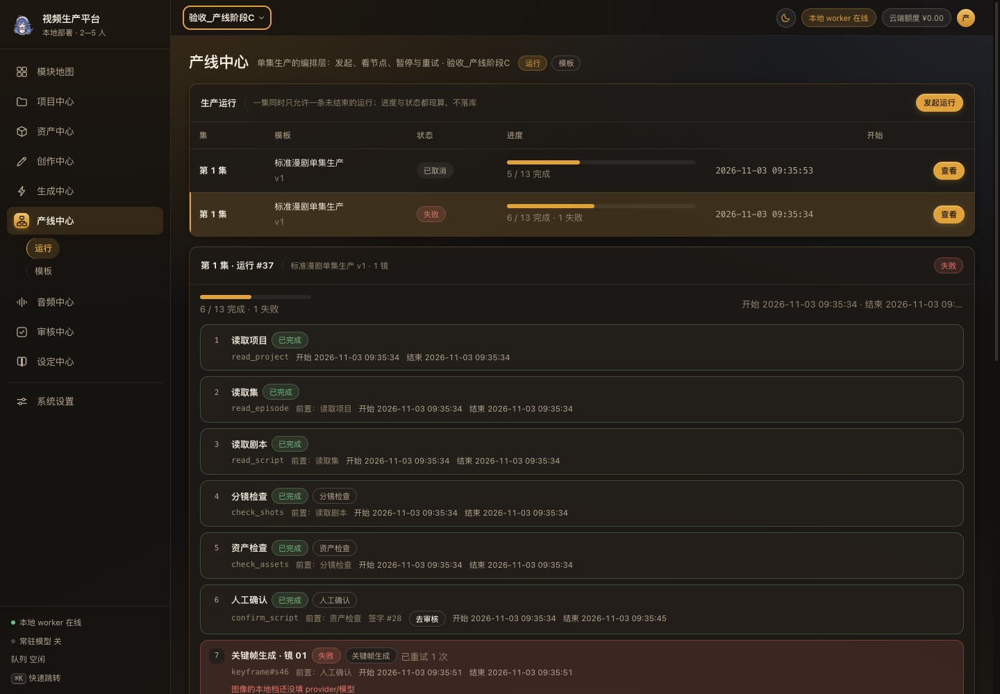

*图 8-1 运行详情（v0.90）。进度条、节点列表、失败节点的重试与事件时间线。*

从上到下：

1. **头部**：这一集、运行号、用的哪版模板、几镜，以及运行状态；未结束时右边有「推进」「暂停／恢复」「取消」。
2. **进度条**：完成几格／共几格，另标失败、待审、待人工核对各有几格。数字来自服务端，页面不自己数。
3. **节点列表**：竖向一格一行，**按镜头展开的节点每镜一行**（关键帧、关键帧验收、镜头视频、产物检查、镜头审核都是逐镜的）。每行写：节点名、状态、类型、前置依赖、关联的作业号或签字号、开始与结束时间、错误原文。
4. **跳转**：有作业的格子给「去生成中心」，有签字的给「去审核」。成本、日志、产物不在这里重复显示——点过去看的是同一份事实。
5. **时间线**：倒序，把发起、提交作业、节点完成／跳过／失败、等待签字、重试、暂停、恢复、取消写成一句句人话。
6. **页面不自动轮询**：worker 推进后，切回列表再打开，或刷新页面，才看到最新。

**节点状态十档**：等待前置、待执行、可执行、执行中、等待审核、待人工核对、已完成、失败、已跳过、已取消（完整对照见 §13.4）。

### 8.5 失败之后：只重试这一格

1. 先读失败节点上的错误原文，把原因除掉——改配置、补参数，或去生成中心处理。
2. 点这一行的「**重试这一格**」，确认。系统只为这一格新建一条作业；旧作业、旧产物、旧签字都留着，运行重新打开继续走。
3. **这一格能不能重试，由服务端判**。被驳回的审核节点即使状态是"失败"，也不会摆一颗点了必吃 409 的钮；格子底下会写"先重试上游生成节点，产出新产物之后这里会重新等签字"。
4. **重试不改变素材的新旧**：新作业沿用原来那份源内容版本。分镜在这之后改过的话，重试出来的那一条照样会被标「源已变」，不会因为重试一次就假装是新内容。
5. 重试也不会替你修原因：参数原样带过去，原因没除掉就还会失败一次。

### 8.6 暂停、恢复、取消

| 动作 | 会发生什么 | 不会发生什么 |
|---|---|---|
| **暂停** | 不再派新节点；已经在跑的模型作业会跑完，结果照实记 | 不会强杀正在跑的子进程 |
| **恢复** | 马上推进一轮，接着往下派 | 不会重跑已经完成的节点 |
| **取消** | 未开始的节点收成「已取消」；能安全取消的作业发取消请求；还在等签字的节点也一并收掉 | 已完成节点与已生成的产物一个都不动 |

三个动作都要 `job:cancel`；只读账号看不到。取消要二次确认，确认词是「取消运行」。

### 8.7 模板页签：只读的配方

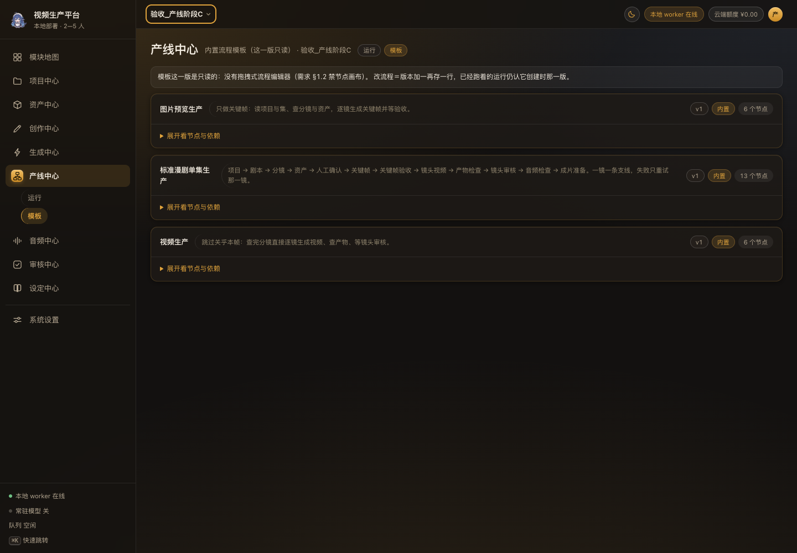

*图 8-2 模板页签（v0.90）。内置模板只读，展开看节点与依赖。*

- 四份内置模板各一张卡，写版本、节点数与「内置／自建」。点「展开看节点与依赖」能看到每一格的名字、类型、是否按镜头展开、前置是哪几格。
- **这一版没有拖拽式流程编辑器，也没有「新建模板」**。改流程是开发侧的事：版本加一、再存一份；已经在跑的运行冻结在创建时那一版。
- 模板里不放云端节点；带云端节点的模板在发起时会被拒，并点名是哪几格。

### 8.8 整季页签：把一季排成批量

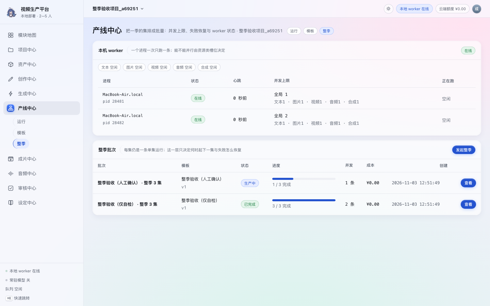

*图 8-3 整季页签（v0.92）。worker 面板、按资源类的队列计数与批次列表。*

**发起一整季**

1. 切到「整季」，点「发起整季」（要 `job:submit`）。
2. 批次名可不填；选**模板**（每集都按这一份跑，要走成片选 v2）；选**同时推进几集**——下拉给的是 1—4，默认 1（串行）。服务端另有上限 8，由部署的人用 `FASTVIDEO_SEASON_MAX_ACTIVE_LIMIT` 调；这是"几集在跑"，不是"几台机器"。
3. 勾要排的集，默认全选；点「全选／全不选」可以一次翻转。
4. 点「开始整季」。worker 按上限逐集起运行；每集仍是一条独立运行，仍受"一集一条未完成运行"约束。

**看批次**

- 列表每行：批次名、模板、状态、进度、并发、成本、创建时间。点「查看」看每集一行：状态、进度、成本、起不来时的原因。
- **暂停排产**：不再起新集，已经在跑的集不受影响。**恢复排产**：立刻排一轮。
- **继续失败集**：只重试失败节点、重排启动被拒的集；**已成功的镜头不会重新生成**。被驳回的审核节点不自动重试——那要人先决定重做哪一镜。
- **取消整季**：未开始的集不再排，已经起来的单集运行收到取消请求；确认词是「取消整季」。已完成节点与已生成产物一个都不动。

**worker 面板**

默认只列**在线**的进程。下面会有一句「另有 N 个进程在 7 天内登记过 · 现已离线（点开看）」，点它才展开历史行。

为什么每次 `./run.sh worker` 都会多出一行：worker 的身份是 `主机名:pid:随机串`，一行代表一个进程——这个进程启动时的并发上限、它现在正跑哪条作业，都记在自己这一行上。两个进程共用一行，崩掉那个的作业就会被算到幸存者头上，所以**不能合并**。但死行也不该天天占着面板：它们不领活、不影响队列，心跳超过 7 天后会被自动清掉。

页面顶部列出每个 worker 进程：worker 标识（主机名或 worker_id）与 pid、在线状态、最近心跳、当前作业，以及「占用与上限」同一列里的两组数：

- **上面一行是机器实况**：负载／核数、这一段心跳的 CPU 百分比、内存峰值、作业目录所在卷的剩余／总量。
- **下面一行是人给的额度**：全局与五类（文本／图片／视频／音频／合成）各几条。

想知道"能不能再多开一个 worker"看上面那行；想调并发看下面那行。它只读：启动或停止进程是部署动作，不在页面里做。只起了一个 worker 时这里只有一行，属正常。

### 8.9 只读账号看到什么

能看运行、模板与整季；看不到「发起运行／发起整季」「推进」「暂停／恢复」「取消」「重试这一格」「继续失败集」。页面会写一句要哪个权限点，而不是摆一颗点了必吃 403 的钮。直接调接口同样会被拒。

### 8.10 出错怎么办

| 你看到的 | 意思 | 怎么办 |
|---|---|---|
| 「开始生产」是灰的 | 生产前检查有阻断项 | 读红字逐条修；修完弹窗会重新检查 |
| 某集在下拉里是灰的 | 它已有一条没结束的运行 | 先取消旧运行或等它结束 |
| 运行一直「生产中」不动 | worker 离线，或正在跑一条很久的作业 | 看整季页的 worker 面板；看那条作业的日志 |
| 节点「等待审核」 | 轮到人签字了 | 点「去审核」到审核中心签字 |
| 失败节点没有「重试这一格」 | 服务端判它不该重试（比如被驳回的审核节点） | 读格子底下的说明，先处理上游那一格 |
| 取消后产物还在 | 正常：取消只收未开始与能安全取消的，已完成产物不动 | 不用管 |
| 整季里某集一直「待开始」 | 并发上限满了，或那集被一条人工运行占着 | 等前面的集跑完，或先把人工运行结束 |
| 页面数字不更新 | 这一页不轮询 | 刷新页面，或切回列表再打开 |

---

## 9. 成片中心：把这一集拼出来

### 9.1 你会学到

- 合成是什么、为什么它不算"又一次生成"
- 发起合成时会检查哪几件事、字幕怎么传
- 版本、时间线与 sha256 各是什么意思
- 合成完为什么要去审核中心签字

### 9.2 先理解三件事

1. **合成是一条普通作业**（FFmpeg），走同一个队列、同一个 worker、同一套取消与日志；金额为 0。
2. **只收"已生成成功、且产物已签字通过"的镜头视频**。没签字的镜头不是忘了，是拦路。
3. **每次合成版本加一，旧版不覆盖**。时间线在发起那一刻冻结；之后改分镜不影响这一版。

### 9.3 发起一次合成（逐步）

1. 在成片中心点「**新建成片**」。
2. 选**集**（下拉里带这一集有几镜）、**分辨率**（720p 或 1080p）、**帧率**（24 或 30）。
   选了帧率，出来的文件就是那个帧率：素材本身帧率低（本地视频腿出的是 16fps）时，
   导出前会用 RIFE **插帧**补上去，而不是复制帧凑数。这台机器没配本地运行时
   （`FASTVIDEO_FASTMETAL_HOME`）时会跳过插帧并在回执里写明原因；配了但东西不齐
   （缺权重、缺仓库）时这条合成作业会**直接失败并点名缺什么**，不会悄悄改成复制帧。
   确实要退回旧做法，就显式设 `FASTVIDEO_COMPOSE_INTERPOLATE=0`。
3. **字幕（可选）**：可以上传 `.srt`／`.vtt`，也可以从本项目已传过的里面挑一份。规则很硬：
   - 只收 `.srt` 与 `.vtt`，别的扩展名直接拒；
   - 空文件、超过 1MB、不是 UTF-8 文本，直接拒；
   - SRT 里一条 `-->` 时间轴都没有、VTT 第一行不是 `WEBVTT`，直接拒；
   - 这台机器的 FFmpeg 没有 `subtitles` 滤镜时，下拉是灰的并写明缺什么——**不会让你排一条注定失败的作业**。
   - 选中后页面会写：「字幕会烧进画面（不是软字幕），并冻结在这一版时间线里。」传错了可以点「删除所选」，只影响本项目。
4. 点「**开始合成**」。前置检查会逐镜核对，**一次把话说完**：哪一镜没有成功的视频、哪一镜没签字、哪一镜的产物文件不在了、哪条已就绪的音频文件不在了，全部列出来；不是修一条报一条。有任何一条就拒绝，不会排空作业。
5. 排上后状态从作业现算：排队中 → 启动中 → 合成中 → 已完成／失败。去生成中心能看同一份日志。

**这一集如果正在走产线**，成片由产线的「成片合成」节点自动发起：它拼的是**产线自己签过的那几条镜头视频**。你后来手抽重跑并签字的版本不会把它顶掉——要换素材，就在产线里对那一镜点重试，让产线重新签。

### 9.4 看版本与验收

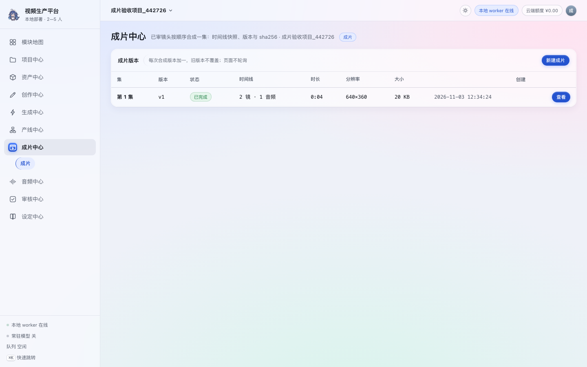

*图 9-1 成片中心（v0.91）。版本列表、冻结时间线与发起合成。*

版本表的列：集、版本（v1、v2……）、状态、时间线（几镜·几条音频）、时长、分辨率、大小、创建时间。状态包括：未发起、排队中、启动中、合成中、已完成、失败、已取消、取消中、待人工核对、关联作业已不在。

点某版「查看」：

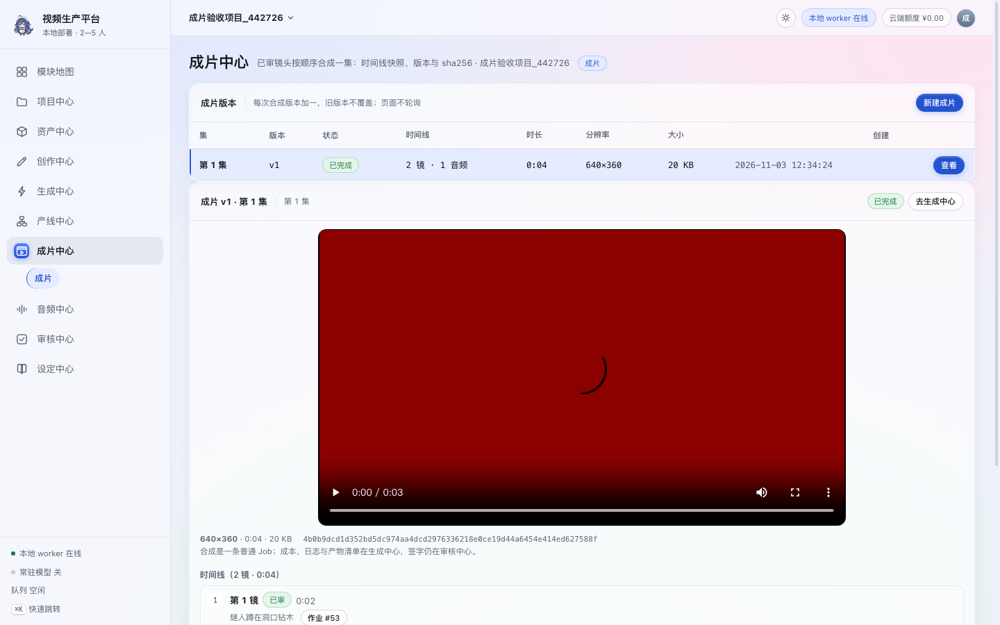

*图 9-2 成片详情（v0.91）。播放器、逐镜实际／计划时长与 ffprobe 验收结果。*

- **播放器**：合成成功才出现；下面是分辨率、时长、大小与 sha256 摘要。
- **时间线**：每镜一行，写镜号、实际时长与来源视频作业号。实际时长与分镜计划时长差超过 0.2 秒时，两个数并排显示——**不拿计划数字冒充成片事实**。
- **音频**：这一版用到的台词／旁白／音乐，以及从第几毫秒开始。
- **字幕**：这一版烧进去的那份文件、大小与「烧进画面」。
- **版本与来源**：第几集、第几版、创建时间、关联作业号、输出分辨率与帧率。

### 9.5 合成之后：送审

合成通过验收后，去**审核中心 → 产物审核**给这条成片签字。签字绑的是成片产物摘要；成片被清理或被新版本顶掉，旧签字立刻失配，需要重签。成片中心的版本列表与审核中心的待签列表读的是同一份事实，不会一边说签过、另一边说没签。

### 9.6 失败时先看哪

- **前置检查拒绝**：按点名的镜号回生成中心补视频，或去审核中心签字；不是合成坏了。
- **作业失败**：去生成中心看这条作业的日志。常见原因是 FFmpeg 不在 PATH、素材路径被清理、磁盘满。平台**不会自动换云端或改用别的编码重试**。
- **验收失败**：看是编码、分辨率、时长还是音轨不符；先确认输入视频本身是否可读，再决定重发一版。

### 9.7 出错怎么办

| 你看到的 | 意思 | 怎么办 |
|---|---|---|
| 「第 N 镜……没有成功的视频作业」 | 那一镜还没出片，或最新成功那条被清掉了 | 去生成中心补一条，成功后回来重发 |
| 「第 N 镜……还没有审核签字」 | 出片了但没人签 | 去审核中心 → 产物审核签字 |
| 「第 N 镜的视频产物不在了」 | 文件被清理了 | 重新生成那一镜并重新签字 |
| 「源内容已变」被拒 | 分镜／提示词／引用资产改过，旧视频过期 | 重生成那一镜，重新签字 |
| 字幕下拉是灰的 | 本机 FFmpeg 没有 `subtitles` 滤镜 | 装带 libass 的 FFmpeg；这次先不带字幕合成 |
| 字幕上传被拒 | 扩展名、大小、编码或格式不合规 | 按弹窗原话改：`.srt`／`.vtt`、UTF-8、≤1MB、有时间轴 |
| 版本一直是「合成中」 | worker 还没跑完 | 刷新页面；这一页不轮询 |
| 成片比预想短 | 模型产出的片长与分镜计划不同，按实际拼接 | 看时间线里两个时长；要改就重生成那一镜 |

---

## 10. 模型中心：配置在哪儿、别在这儿找操作

### 10.1 你会学到

- 模型中心的四个工作区各管什么
- 什么时候才需要来这里（多数日常操作不需要）
- "登记了""健康""可用"三个词不是一回事
- 去哪里看逐字段说明

### 10.2 四个工作区

模型中心在左侧最下面一组，排在「系统设置」之前。点开有四个子项，顺序固定：

| 工作区 | 回答什么 | 你能改什么 |
|---|---|---|
| **模型仓库** | 这台机器上登记了哪些档，各自什么状态 | 登记、编辑、撤登记 |
| **引擎管理** | 五类能力（文本／图像／视频／配音／音乐）的本地与云端各走谁，谁是默认 | 填 provider／模型、启停、设默认、跑环境检查 |
| **调用策略** | 九个任务场景（如「角色定妆图」）建议用谁、备选是谁 | 只写配置，不启动任务 |
| **运行监控** | 队列、worker、告警、最近验证 | 不写任何东西 |

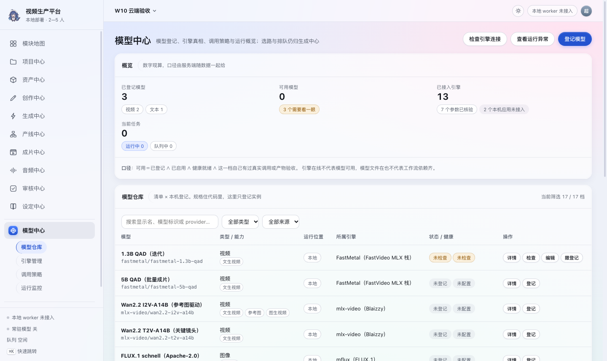

*图 10-1 模型仓库（v0.99）。顶部四个数是现算的：已登记、可用、引擎、任务。*

进入这一页需要 `system:config`，当前只有管理员有。制作与只读账号在侧栏看不见「模型中心」；直接打开地址会得到一张"没有权限"的卡，并提示去生成中心看当前默认轨。

### 10.3 三个词必须分清

- **已登记**：数据库里有这一档的一行。它不是"文件在盘上"，也不是"能跑"。
- **健康就绪**：环境检查说条件齐（路径、依赖、密钥变量名在不在）。它**不是**真实调用过。
- **可用（生产可用）**：已登记 **且** 已启用 **且** 健康就绪 **且** 这一档自己有过真实调用或产物验收。四个条件缺一不可。

顶部「可用」那个数用的就是第四条。换一档模型，旧验证不替新档说话；环境检查通过永远不能冒充真实调用。

### 10.4 引擎管理：十行能力轨

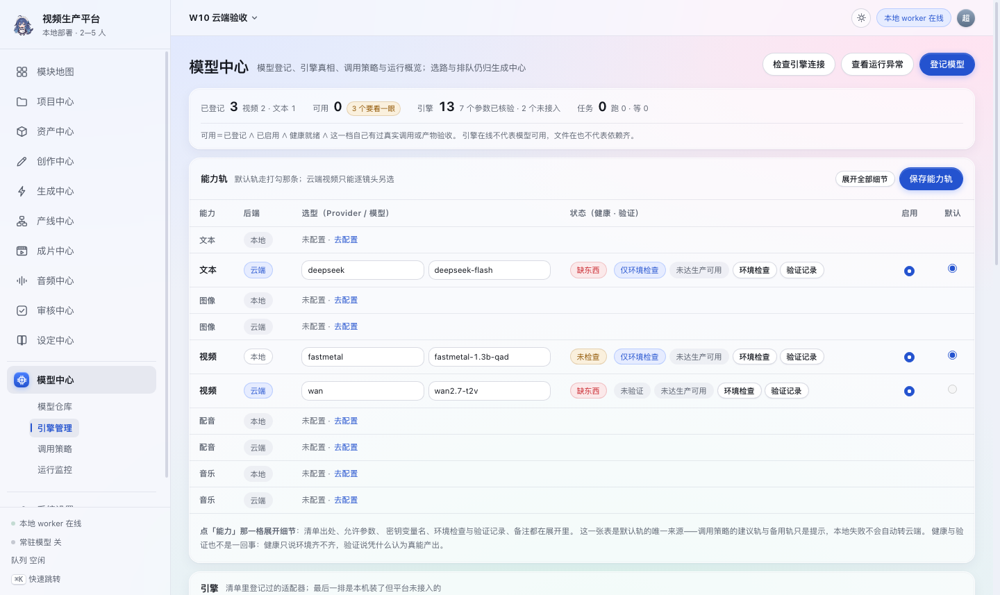

*图 10-2 引擎管理（v0.99）。上半是十行能力轨，下半是按引擎分组的健康卡；最后一排灰卡是"本机装了、平台未接入"的应用。*

- 十行＝五类能力 × 本地／云端。每行选一个 provider／模型，勾一个默认。**默认轨只有这一个来源**；调用策略里的"建议轨""备用轨"都不改默认。
- 保存时六条规则一起校验：每类能力都要有且只有一个默认；默认必须是已登记且启用的档；本地与云端不能填串；同一个 provider 的模型必须在该 provider 的能力里；等等。不满足就整批不保存，并说明是哪一条。
- 页头「检查引擎连接」会对**已填 provider** 的能力轨逐条跑一次环境检查并留痕；不发网络请求、不加载权重。
- 未接入的 ComfyUI 与 Draw Things 显示为灰卡，没有连接按钮——这是事实：装了应用不等于平台接进去了。

### 10.5 验证：配置就绪不等于生产可用


*图 10-3 验证记录弹窗（v0.76）。上半是五档摘要，中间是从作业登记，下面是最近记录。*

验证有五类出处，可信度从高到低：目标机已验证、产物验收通过、真实调用已验证、仅模拟验证、仅环境检查；从没验证过就是「未验证」。

- **从作业登记**：在一条已经成功的作业上登记"真实调用"（云端要勾计费确认）；再人工看片，登记"产物验收"并给出通过／不通过。
- **换档不背书**：换了模型或档位，旧记录仍然列在历史里，但不算在新档头上。
- 只登记其中一条，徽章仍不到生产可用。

### 10.6 调用策略与运行监控

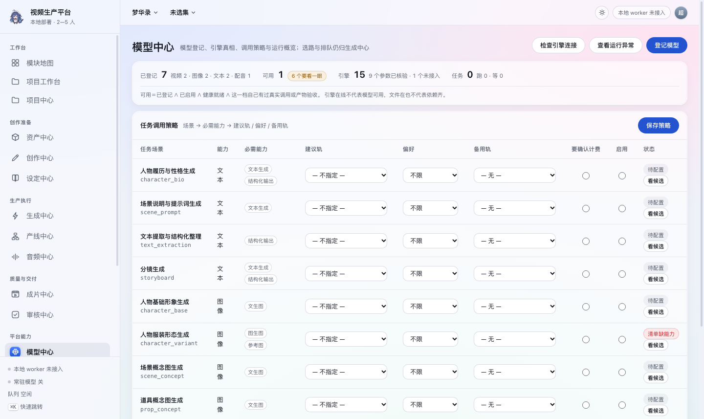

*图 10-4 调用策略（v0.99）。九个任务场景，每行配必需能力、建议轨、偏好、备用轨。*

- **保存只改配置，不启动任务**。
- **备用轨不自动顶上**：主轨失败不会切到备用轨，失败就是失败，由人决定下一步。
- 这一版调用策略**还没有业务消费方**：生成中心仍走引擎管理里的默认轨，策略页配的东西暂时只是"写下来"。

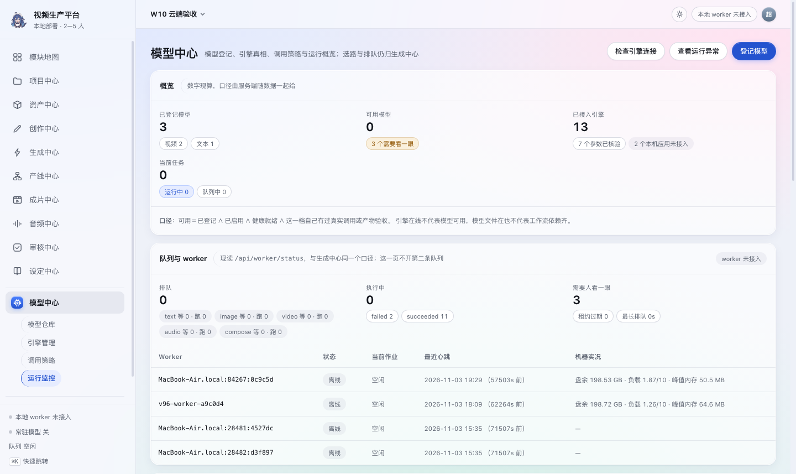

*图 10-5 运行监控（v0.99）。队列分类、worker 心跳与机器实况、告警、最近验证留痕。*

- 告警六种与生成中心同一套中文名（worker 离线／队列停滞／租约过期／运行超时／日志静默／待核对）。
- 模型维度有三项明确标「不支持」，不假装有：**按 provider／模型聚合成本**（成本账只按币种 × 能力 × 状态聚合）、**按时间范围筛选**（接口只有条数上限，没有起止日期）、**分档执行耗时**（只有单条作业耗时，没有平均或分位）。要算这些，回生成中心的成本账与作业列表。

### 10.7 逐字段怎么做，看另一册

这一章只回答"要不要来、四个工作区各管什么、三个词怎么分"。登记表单每个字段填什么、十种状态怎么判序、能力轨保存的六条规则原文、五类验证各自怎么登记、九个场景怎么配、监控六码与三项做不到、常见问题与九个接口——全部写在[《模型中心使用说明书》](模型中心使用说明书.md)里，这里不抄第二遍。

### 10.8 出错怎么办

| 你看到的 | 意思 | 怎么办 |
|---|---|---|
| 侧栏没有「模型中心」 | 你没有 `system:config` | 让管理员配；日常用生成中心即可 |
| 「可用」一直是 0 | 只登记或只做了环境检查 | 按 §10.5 补真实调用与产物验收 |
| 某档显示「未登记」 | 清单里有，本机没登记 | 要在这台机器用，先去模型仓库登记 |
| 某档显示「清单未登记」 | 登记了，但适配器清单里没有它 | 参数与计价一律不猜，提交仍会被拒 |
| 保存能力轨失败 | 六条规则有一条不满足 | 读原话；常见是某类能力没有默认 |
| 调用策略配了但不生效 | 这一版策略还没有消费方 | 去引擎管理改默认轨，那才是生成实际走的路 |

---

## 11. 用户与角色：谁能进、谁能改

### 11.1 你会学到

- 管理员怎么建账号、停用、重置口令、删账号
- 角色与权限点的关系，以及"成员 ≠ 赋权"
- 为什么不能停用自己、不能改自己的角色

### 11.2 入口与页面

只有管理员能进「系统设置」。v0.111 起它分成两页——**用户管理**管人，**角色管理**管权限点：

- **用户管理**（侧栏「系统设置 → 用户管理」）：用户表、新建用户、改角色弹窗、重置口令、停用／启用、删除。
- **角色管理**（「系统设置 → 角色管理」）：角色概览（每个角色几个权限点、挂在哪些账号上、能不能改）＋角色权限矩阵（一列一个角色，勾完按那一列的「保存」）。

为什么拆：加人是偶尔一次的动作，调角色权限是一次长时间对照——原来挤在一页时，往下滚到矩阵就看不见上面的用户表，而"这个角色现在挂在谁身上"正是调权限时最想同时看到的东西。现在角色概览那一表直接把这件事摆在矩阵上面。

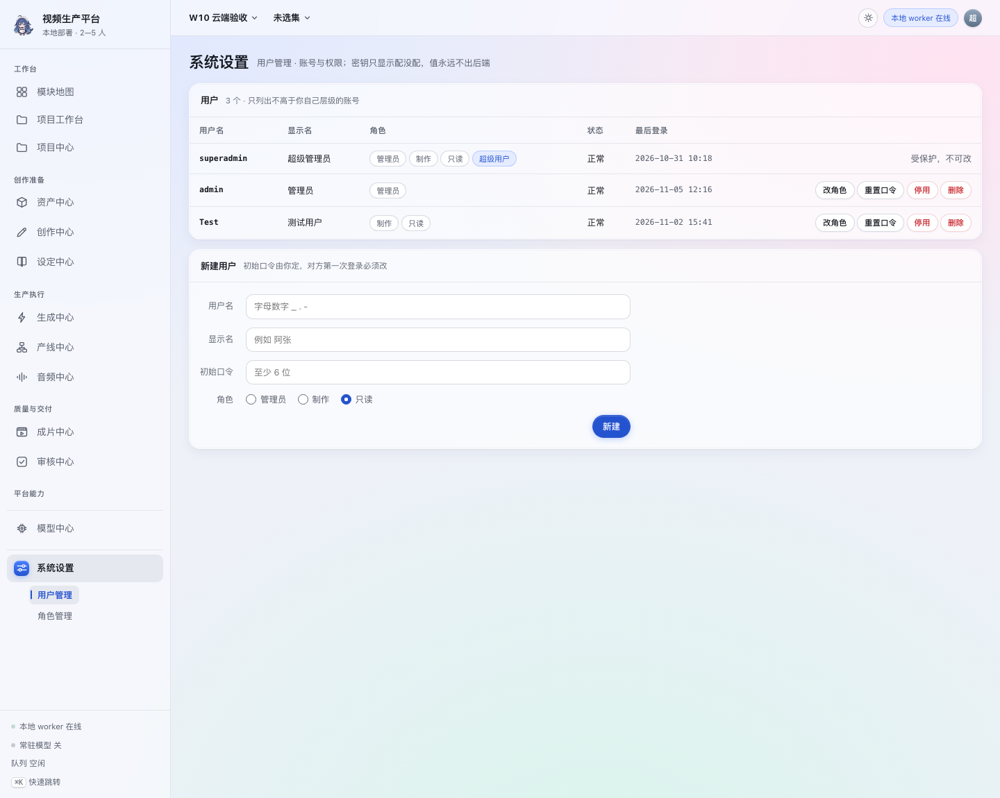

*图 11-1 用户管理（v0.111）。用户表与新建用户；「改角色」弹窗里只选人挂哪些角色，不改角色本身。*

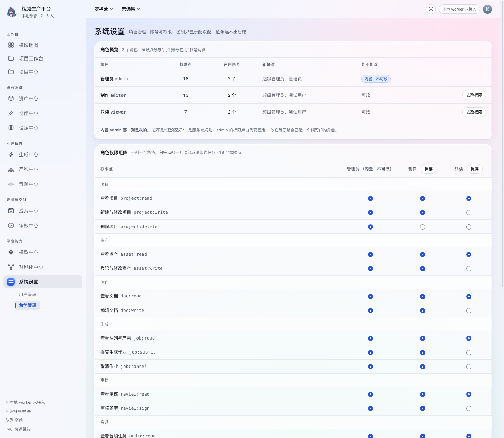

*图 11-2 角色管理（v0.111）。上面是角色概览（权限点数、在用账号、都是谁），下面是 18 个权限点的矩阵；内置 admin 那一列是灰的。*

旧地址 `#system-config` 与 `#system-config/0` 仍然打得开，`#system-config/1` 现在落在角色管理（以前会被钳回第一页）。

用户表的列：

| 列 | 意思 |
|---|---|
| 用户名 | 登录用的账号，区分大小写，不能重复 |
| 显示名 | 给人看的名字，可以重复 |
| 角色 | 这个账号挂了哪些角色（可以多个），超级用户另有蓝色标签 |
| 状态 | 正常／已停用；「待改密」表示还没改初始口令 |
| 最后登录 | 上一次登录时间 |
| 操作 | 改角色／重置口令／停用或启用／删除 |

**只能看到、也只能管不高于自己层级的账号**。层级是三档：超级用户 2 ＞ 管理员 1 ＞ 其余 0。看不见的账号，也改不动。

### 11.3 新建一个账号（逐步）

1. 在「新建用户」里填：**用户名**（字母数字与 `_ . -`）、**显示名**、**初始口令**（至少 6 位）。
2. 勾**角色**，默认勾的是「只读」。
3. 点「新建」。三个输入框里按回车也能提交。
4. 把账号与初始口令交给本人。他第一次登录会被要求**立刻改口令**；改完旧会话全部失效，他当前这一页会自动用新口令重登，别的设备要重新登录。

### 11.4 停用、重置口令、改角色、删账号

| 动作 | 会发生什么 | 限制 |
|---|---|---|
| **停用** | 该账号立刻掉线，重新启用前无法登录 | 不能停用自己；超级用户那行没有这颗钮 |
| **启用** | 恢复登录 | —— |
| **重置口令** | 你设一个新口令；对方下次登录被要求立刻改，现有会话一并作废 | 不能改自己的角色，但可以重置自己的口令 |
| **改角色** | 勾选新的角色组合，保存 | 不能改自己的角色；超级用户受保护 |
| **删除** | 账号与会话立即失效，恢复不了 | 不能删自己；名下有项目时必须表态 |

**删账号时，名下的项目怎么处理**（弹窗里二选一）：

- **转移给**另一个人：换东家和删账号在**同一个事务**里。中途失败会整体回滚，界面回的是「N 个项目的东家都没变、账号也还在，修好原因后可以直接重来」。
- **连同名下项目一起删除**：这一步**做不到回滚**——要动稿件工作区与 Git 历史。所以失败时界面说的是「已删掉 X 个，卡在《某项目》；账号还在」，已经删掉的那些不会回来，剩下的修好后可以再来一次。
- 他作为协作人的关系会自动清掉；作为所有人的项目必须先处理，不能留悬空项目。

### 11.5 角色与权限点

权限点是更细的开关，一共 **18 个**，按模块分组：项目、资产、创作、生成、审核、音频、用户、系统。角色就是一组权限点的集合：

| 角色 | 权限点数 | 大白话 |
|---|---|---|
| 管理员 | 18 | 全部 |
| 制作 | 13 | 内容侧全流程，不含用户与系统设置 |
| 只读 | 7 | 各种"查看" |

权限矩阵一列一个角色：管理员列是灰的、不可编辑（内置，新加权限点自动拥有）；制作与只读两列可以改，勾完点那一列顶部的「保存」。

**成员 ≠ 赋权**：把只读账号加进项目成员，只让他"看得见这个项目"，仍然改不了任何东西。要让他能改，得改他的角色。前端隐藏按钮只是少一次误点；越权请求到服务端仍然会被拒。

### 11.6 出错怎么办

| 你看到的 | 意思 | 怎么办 |
|---|---|---|
| 侧栏没有「系统设置」 | 你不是管理员 | 找管理员 |
| 某个账号在列表里看不到 | 他层级比你高 | 正常：看得见才管得着 |
| 「停用」钮不见了 | 那一行是你自己，或超级用户 | 换一个账号操作 |
| 删账号被拒 | 名下有项目且没选处理方式 | 在弹窗里选「转移」或「连同项目一起删除」 |
| 新建用户失败 | 用户名重复、口令不足 6 位、或没有 `user:write` | 按提示改；权限找管理员 |
| 改了角色但不生效 | 对方需要刷新页面或重新登录才拿到新权限 | 让他退出重登 |

---

## 12. 看板与导出：今天的活和这一集的清单

### 12.1 你会学到

- 首页那块「待办条」四个数字各算什么
- 项目看板六格数字从哪来、哪些不能在这儿改
- 导出镜头清单给谁用、文件里有什么

### 12.2 首页：模块地图与待办条

登录后默认落在「模块地图」，也就是首页。最上面（有待办时才有）是一条**待办条**：

| 格子 | 算什么 | 点进去 |
|---|---|---|
| **待你签字** | 等签的文档数＋等签的产物数，下面分行写两个数 | 审核中心 |
| **失败作业** | 你参与的项目里失败的作业条数 | 生成中心 |
| **待核对账单** | 云端作业账单不明的条数 | 生成中心 |
| **进行中的运行** | 还没收尾的产线条数 | 产线中心 |

- 四个数全为 0 时，整条**不显示**——不拿四张 0 卡占掉第一屏。
- 只算**你自己看得见的在产项目**，别人的活不会算进来。
- 每格是一个真按钮，键盘能 Tab 到、回车能打开。

往下是模块卡（每个模块一句职责）、九实体关系图，以及「本机状态」：在产项目数、已归档数、worker 在线或未接入、队列等待与运行数。

### 12.3 项目看板：只读的六格汇总

选了当前项目后，首页会出现「项目看板」卡：

| 格 | 显示什么 |
|---|---|
| **集** | 集总数，下面按状态分：草稿／在产／定稿 |
| **镜头** | 镜头总数；另标文档数与资产数 |
| **作业** | 作业总数，下面按状态分 |
| **成本** | 按币种分桶的金额与笔数。**只算有币种、且账单状态是"已确认"或"待核对"的作业**；本地作业记 0 元，不计入金额 |
| **审核** | 每个文档最近一次校验的通过与未通过数，以及签字结论（通过／驳回／退回）的笔数 |
| **音频** | 音频素材按四档状态计数 |

六格全部从各自权威表现算，**不存第二份手工状态**，所以这里没有"改数字"的入口。要改就去东家页面：集与文档去创作中心，作业去生成中心，签字去审核中心，音频去音频中心。

### 12.4 导出镜头清单

项目看板卡右上角有两个按钮：**「导出镜头 CSV」**与**「导出 Markdown」**。

1. 点任一按钮，浏览器直接下载一个文件（`shots-<项目号>.csv` 或 `.md`）。
2. **CSV 带 UTF-8 BOM**，Excel 直接打开中文不乱码。
3. 每行一个镜头，列是：集序、集标题、镜号、内容、提示词、时长(秒)、引用资产、最新作业、作业状态、产物路径（多条用「；」连起来）。
4. Markdown 版是同一批数据的表格，适合贴进文档或给剪辑看。

**导出不写任何状态**，也不会自动挑"成功的那条"：它给的是这一镜**最新一条作业**的编号、状态与产物路径。最新那条失败了，导出里就写着失败——这是事实，不是漏导。

### 12.5 出错怎么办

| 你看到的 | 意思 | 怎么办 |
|---|---|---|
| 首页没有待办条 | 四格全是 0 | 正常，不是没加载出来 |
| 待办数字比同事少 | 只算你参与的项目 | 正常；让他把项目成员加上你 |
| 看板某格是「—」 | 这一类还没有数据 | 去对应模块建第一条 |
| 成本显示 0 但有作业 | 本地作业不计费，或云端还没记价 | 看作业详情里的「待补价」与账单状态 |
| 导出的 CSV 里中文正常、Markdown 里表格错位 | 内容里本来有竖线或换行 | Markdown 版会把竖线转义、换行压成空格；要原样数据用 CSV |
| 点导出没反应 | 没有 `project:read`，或项目不在你名下 | 确认权限与当前项目 |

---

## 13. 状态对照总表：所有徽章一次认全

这一章不教操作，只做一件事：看到任何一个状态词，能马上知道它是什么意思、该谁动。界面上的中文名以这里为准（后端与前端共用同一套词）。

### 13.1 作业状态（8 档）

| 中文名 | 内部名 | 意思 | 还会不会变 | 你该做什么 |
|---|---|---|---|---|
| **排队中** | `queued` | 已入队，还没被 worker 领走 | 会 | 等；一直不动看 §5.9 |
| **启动中** | `starting` | worker 领了，正在起子进程 | 会 | 等 |
| **运行中** | `running` | 模型／FFmpeg 正在跑 | 会 | 等；看日志可判断卡在哪 |
| **成功** | `succeeded` | 跑完且产物已登记 | 不会 | 预览产物；要用于成片先去签字 |
| **失败** | `failed` | 跑完但出错，或没拿到产物 | 不会 | 看错误原文；修原因后「重试（新建一行）」 |
| **取消中** | `cancel_requested` | 已发取消请求，worker 还没停 | 会 | 等它变「已取消」 |
| **已取消** | `cancelled` | 停下了；已花的钱不退 | 不会 | 需要就重试 |
| **待核对** | `needs_attention` | 云端作业中途断了、账单不明 | 不会自己变 | 人工核对账单（§5.8） |

**「失败」与「待核对」不要混**：失败是"结果已知是不好的"；待核对是"结果未知"。后者不能默认重试——那可能造成第二次付费调用。

### 13.2 健康状态（5 档）

| 中文名 | 内部名 | 意思 | 常见原因 |
|---|---|---|---|
| **就绪** | `ok` | 环境检查说条件齐 | —— |
| **缺东西** | `missing` | 检查过，缺文件／依赖／可执行程序 | 权重没下、FFmpeg 不在 PATH |
| **未检查** | `unknown` | 平台查不了（不是坏了） | 还没点过「检查引擎连接」 |
| **未配置** | `unconfigured` | 这一档没填 provider／模型 | 去引擎管理配 |
| **未登记** | `unregistered` | 适配器清单里有，本机没登记 | 去模型仓库登记 |

健康只说明"条件齐不齐"，**不等于真实调用过**。

### 13.3 验证徽章（6 档）

| 中文名 | 内部名 | 凭什么拿到 | 能当生产依据吗 |
|---|---|---|---|
| **目标机已验证** | `target_machine` | 在目标机器上跑过并登记 | 能（最高一档） |
| **产物验收通过** | `artifact_review` | 有人看过产物并给出通过 | 能 |
| **真实调用已验证** | `real_call` | 有过一次真实调用记录 | 能 |
| **仅模拟验证** | `mock` | 只跑过模拟，没真调模型 | 不能 |
| **仅环境检查** | `env_check` | 只查过条件，没发过请求 | 不能 |
| **未验证** | `never` | 什么记录都没有 | 不能 |

生产可用＝已登记 ∧ 已启用 ∧ 健康就绪 ∧ 有过真实调用或产物验收。四个条件缺一不可。

### 13.4 产线运行与节点

**运行（8 档）**：生产中、待审核、待人工核对、已暂停、已取消、已完成、完成（有跳过或重试）、失败。

**节点（10 档）**：等待前置、待执行、可执行、执行中、等待审核、待人工核对、已完成、失败、已跳过、已取消。

**整季（5 档）**：生产中、已暂停、已取消、已完成、完成（有跳过或重试）。

**整季里的每一集**：待开始、启动被拒，以及上面那 8 档运行状态。

### 13.5 集、文档、成片、音频

| 对象 | 状态 | 意思 |
|---|---|---|
| **集** | 草稿 | 还没开工 |
| | 在产 | 正在做 |
| | 定稿 | 这一集完成；项目中心的"已定稿 N/M 集"按它算 |
| **文档** | 草稿 | 初始状态 |
| | 润色中 | 正在改 |
| | 定稿 | 状态标记，**不冻结内容**；冻不冻结由审核签字说话 |
| **成片** | 未发起 | 记录建了，还没关联作业 |
| | 排队中／启动中／合成中 | 依次推进 |
| | 已完成 | 合成成功，可播放 |
| | 失败 | 合成失败，原因写在上面 |
| | 取消中／已取消 | 取消请求与终态 |
| | 待人工核对 | 合成作业账单不明 |
| | 关联作业已不在 | 作业行被收掉了；不是"没合成过" |
| **音频素材** | 草稿 | 只登了记 |
| | 排队中 | 作业已提交未完成；作业若是待核对，这一格仍是排队中，旁边小字念真实状态 |
| | 已就绪 | 作业成功且产物路径已抄回 |
| | 失败 | 作业失败，或成功但产物抄不到 |

### 13.6 项目与审核

- **项目**：在产／已归档（归档可恢复，数据不删）。
- **校验**：未校验／通过／未通过（每个文档只看最近一次；正文一改，旧报告失配）。
- **签字结论**：通过／驳回／退回。
- **签字状态**：有效／失配（文件或正文版本变了，旧签字立刻失效，要重签）。

---

## 14. 常见问题与自救（24 条）

每条都按「你看到什么 → 这句话从哪来 → 怎么处置」写。先在这里找，找不到再找开发。

### 14.1 打开地址是"无法访问此网站"

服务没起，或地址／端口不对。先找部署的人确认 API 已启动（默认 `http://127.0.0.1:8000`；对局域网开放要由部署的人设 `FASTVIDEO_HOST=0.0.0.0`）。不是登录问题，也不是账号问题。

### 14.2 页面里写"未登录"并跳回登录页

会话过期了（默认 12 小时，可由部署的人改 `FASTVIDEO_SESSION_HOURS`）。重新登录即可。正在填的内容会丢，重要的先复制出来。反复出现就检查服务器时间。

### 14.3 登录后只看到少数几个菜单

你的角色权限少。只读账号只有各种"查看"，写操作的按钮干脆不出现。这是权限显隐，不是加载失败；需要写权限找管理员改角色。

### 14.4 项目列表里看不到某个项目

三种可能：① 筛选停在「在产」，而它已归档；② 你不是它的所有人也不是协作人；③ 协作人身份被移除了（移除后项目直接不可见）。切到「全部」或「已归档」看看；还看不到就找所有人把你加进成员。

### 14.5 文档保存提示 409

你打开之后别人也保存过这一篇，你手上的版本令牌过期了。页面会并排给出两份正文：要别人那份点「用盘上这份，丢掉我的草稿」；要自己这份点「刷新版本令牌」再保存。不要手工删库里的文档行。

### 14.6 文档保存提示 423

锁在别人手里（默认 15 分钟）。等对方保存或退出；急的话让对方先关掉编辑器，锁到点会自己松开。不要改系统时间。

### 14.7 作业一直「排队中」不动

先看顶栏或产线中心的 worker 是否在线。离线时队列不会自己前进，需要部署的人在另一个终端跑 `./run.sh worker`。在线但一直排队，说明前面有活没跑完，或并发槽位满了——这是正常排队。

### 14.8 本地作业失败，日志只有一句

模型／FFmpeg 子进程自己退了。看作业详情里的日志与返回码；常见原因是运行时目录不对、权重缺、内存／显存不够、FFmpeg 不在 PATH。平台不会自动换一个模型重试。

### 14.9 云端作业失败后会不会偷偷改走本地

不会。重试是新建一行，继承原来的执行方式与计价快照。想换本地就手动再提交一条——那会花两份钱，所以平台不替你做这个决定。

### 14.10 「待核对」到底是什么，为什么不能直接重试

云端作业在计费确认之前断了，平台不知道供应商到底扣没扣、扣了多少，所以停在这一档等人。重试可能造成第二次付费调用，因此默认动作是「核对账单」而不是「重试」。去供应商后台查这一单，回来选核对结果、填实际金额与备注。

### 14.11 成本列是「—」或「待补价」

本地作业不计费，显示「¥0 · 本地」；云端作业没有计价快照时显示「待补价」，这不是 0 元，是"还没记价"。有计价但账单未确认时显示预计金额并标「待核对」。成本账与项目看板只汇总有币种、且账单状态是"已确认／待核对"的作业。

### 14.12 音频提交失败，提示缺运行时候选

当前本机没有可用的本地音频档位，或档位健康不是「就绪」。失败原因留在页面上，素材仍是「草稿」。注意：即便配好了档位，这一版执行层也还没接音频（§7.6），作业会回「还没有执行接线」。

### 14.13 音频素材「已就绪」但播放没声音

先确认是不是模拟结果，再看 §7.6 的执行接线边界。不要把"没接线"当成"文件坏了"；文件在不在可以看产物那一格与作业详情。

### 14.14 口型页的「生成口型」为什么是灰的，音效为什么不能提交

口型依赖 Rhubarb 适配器，尚未接线，按钮灰着并写明原因；音效标为实验态，可以登记但不能提交。两者都是边界，不是你的操作错。

### 14.15 审核签字之后又改了正文，报告还能用吗

不能。正文版本一变，旧报告和旧签字都会过期，队列会重新把这份文档列为待审。这是故意的：一句"我看过了"不能永久生效。

### 14.16 环境检查通过了，为什么还显示「未达生产可用」

生产可用要四条一起齐：已登记、已启用、健康就绪、这一档自己有过真实调用或产物验收。环境检查只查条件齐不齐，不发请求、不加载权重。去验证记录弹窗，从一条已成功的作业登记「真实调用」，再人工看片登记「产物验收」并给出结论——只登记其中一条，徽章仍不到。

### 14.17 分镜上那枚「源已变」是什么意思

这一镜的内容或引用资产改过了，而最新那条成功的视频是按旧内容生成的。触发面包括改梗概、提示词、时长、引用资产，连改资产名字都算（比的是资产最后改动时间）；换模型换参数不算。创作中心不挡你，但成片会拒绝这条素材——要更新就重新生成并重新签字。

### 14.18 被驳回的那一格为什么没有「重试这一格」

`retry_gate` 判过：被驳回的审核节点重试没有意义，必须先重试上游生成节点，产出新产物后这里会重新等签字。页面把服务端的判断原样显示，格子底下会写先处理哪一格。

### 14.19 产物点开是 404 / 「文件已不在」

文件被清理了、路径不对，或作业行被收掉了。看作业详情里的产物路径与「文件已不在」标记；清理策略见《系统设计说明书》§10。不要以为"作业成功"就等于"文件永远在"。

### 14.20 生成成功，为什么资产里没有图

正常：图像作业的产物只在作业目录里。要进资产，得去资产创作页逐张预览，在「存进哪儿…」里明确选「人物／场景基础参考图（追加为最后一张）」或某个形态，再点「存入」。没人看过的图不该自动变成"这个角色长这样"。

### 14.21 成片发起被拒，说第 N 镜没有视频／没有签字／产物不在

按点名的镜号逐条处理：没视频去生成中心补；没签字去审核中心 → 产物审核；产物不在就重新生成再签。前置检查一次把所有问题列全，不是修一条报一条。

### 14.22 字幕下拉是灰的，或上传被拒

灰的＝这台机器的 FFmpeg 没有 `subtitles` 滤镜（烧不了字幕），装带 libass 的构建后才会亮。上传被拒常见五种：不是 `.srt`／`.vtt`、空文件、超过 1MB、不是 UTF-8、SRT 没有时间轴或 VTT 缺 `WEBVTT` 头。按弹窗原话改。

### 14.23 整季里某一集一直是「待开始」

两种原因：并发上限满了（下拉是 1—4，服务端上限 8），或那一集正被一条人工运行占着。等前面的集跑完，或先把人工运行结束。「继续失败集」只重试失败节点，不会重跑已成功的镜头。

### 14.24 成员加进来了，为什么还是不能改；或者「删除」按钮不见了

成员只给"看得见项目"，能不能改由**角色权限点**决定：只读账号即使被加进成员也改不了。删除项目只有管理员能做（`project:delete` 只授给 admin 角色），管理员可以删任何项目；制作与只读账号连删除按钮都看不到。

---

## 15. 一条 24 步的完整串讲：从零到一集成片

这一章把前面所有章节串成一遍。假设你是一个「制作」账号，项目里已有两个同事，本机服务与 worker 都已启动。

| # | 在哪 | 做什么 | 看到什么算成功 |
|---|---|---|---|
| 1 | 部署机器 | 打开终端，`cd 平台设计/app && ./run.sh`；另一个终端 `./run.sh worker` | 终端打印地址；浏览器能打开登录页 |
| 2 | 登录页 | 输入管理员给你的账号与初始口令 | 进入首页 |
| 3 | 改口令浮层 | 设一个至少 6 位的新口令，再输一遍 | 浮层收起，直接进入首页；别的设备上的旧会话失效 |
| 4 | 项目中心 | 「新建项目」，填名字、简介、标签 | 新项目出现在表里并自动成为当前项目 |
| 5 | 项目中心 → 该行 ⋯ →「成员与所有权」 | 加两个同事为协作人 | 成员列表出现他们；他们刷新就能看到 |
| 6 | 创作中心 | 「建一集」，集号 1、写标题 | 左侧出现「第 1 集」并选中 |
| 7 | 创作中心 → 小说 | 「新建」，挂到第 1 集，填标题 | 文档树出现这一篇 |
| 8 | 文档编辑器 | 写三段正文，点「保存」（`⌘S`／`Ctrl+S`） | 顶部提示已保存；版本历史多一条 |
| 9 | 文档编辑器 | 选一段 →「AI 改写」→ 润色 →「提交并预览」→ 看 diff →「应用并提交」 | 正文更新，并多一次 Git 提交 |
| 10 | 文档页 | 点「抽取」，写一句额外要求（可空），勾计费确认，点「开始抽取」 | 生成中心多一条文本作业，弹窗里等候选 |
| 11 | 抽取弹窗或资产中心 → 文本提取 | 找到角色候选，点「接受」 | 资产库多一个角色资产 |
| 12 | 抽取弹窗或资产中心 → 文本提取 | 找到场景候选，点「接受」 | 资产库多一个场景资产 |
| 13 | 资产中心 → 资产创作 | 选角色资产，核对一致性提示词，选文字档位生成设定并「保存这份设定」；再选图像档位生成候选，在「存进哪儿…」里选「人物／场景基础参考图（追加为最后一张）」，点「存入」 | 资产详情里定妆图有了图 |
| 14 | 创作中心 → 分镜 | 连建三个镜头，各填内容／提示词与时长 | 分镜表三行 |
| 15 | 分镜表 → 编辑 | 给镜头 1、2 引用角色与场景；要给某个形态就再选形态 | 引用资产列出现 chip |
| 16 | 分镜表镜头 1 →「生成」 | 选能力（视频）、槽位与参数，本地或云端；云端要勾确认计费；点「提交」 | 生成中心多一条「排队中」 |
| 17 | 生成中心 | 等状态变「成功」，点「详情」看日志与产物 | 视频能播放，产物路径在 |
| 18 | 审核中心 → 产物审核 | 选这条产物，预览，点「签字」，结论选「通过」并写一句依据 | 签字记录出现，锚点是文件 sha256 |
| 19 | 分镜表镜头 2、3 | 重复第 16—18 步 | 三条镜头视频都已签字通过 |
| 20 | 产线中心 → 运行 | （可选）「发起运行」选第 1 集与「标准漫剧单集生产 v2」，确认预检后「开始生产」 | 运行详情出现节点列表 |
| 21 | 产线中心 / 审核中心 | 若走产线：按节点提示去审核中心签关键帧与镜头视频；产线自己会跑到「成片合成 → 成片验收 → 成片审核」 | 节点一个个变「已完成」，签字节点变「等待审核」再变完成 |
| 22 | 成片中心 | 手动路径：选「新建成片」，选集、720p 或 1080p、24 或 30 fps，需要就传 `.srt`／`.vtt` 字幕 | 版本列表出现 v1，「合成中」 |
| 23 | 成片中心 → 查看 | 等「已完成」，播放；去审核中心 → 产物审核给成片签字 | 播放器能放；签字结论为「通过」 |
| 24 | 首页 → 项目看板 | 「导出镜头 CSV」或「导出 Markdown」 | 下载文件，Excel 打开中文不乱码 |

**走产线还是手动？** 只有一集、镜头不多，手动更快、每一步都看得见；整季、镜头多、要按固定流程跑，走产线更省心。两条路的产物与签字是同一份事实，不会各记一套账。

---

## 附录 A 一页速查：哪个页面管什么

| 你要做的事 | 去哪 |
|---|---|
| 建项目、改名字、归档、管成员 | 项目中心 |
| 建集、写小说／剧本、跑 AI 改写、抽取、做分镜 | 创作中心 |
| 登角色／场景／道具、生成定妆图、处理候选 | 资产中心（资产库／资产创作／文本提取） |
| 提交作业、看队列、看成本、取消／重试／核对账单 | 生成中心 |
| 跑校验、给文档或产物签字 | 审核中心 |
| 登记台词／旁白／音乐、送配音队列 | 音频中心 |
| 按依赖跑一集、整季批量、看 worker | 产线中心 |
| 把已签字的镜头拼成片、看版本与验收 | 成片中心 |
| 登记模型、配默认轨、看验证与监控 | 模型中心（管理员） |
| 建账号、改角色 | 系统设置 → 用户管理（管理员） |
| 看／改角色权限点 | 系统设置 → 角色管理（管理员） |

## 附录 B 部署与端口（给管机器的人）

```bash
cd 平台设计/app
./run.sh                 # API + 静态前端，默认 http://127.0.0.1:8000
./run.sh worker          # 另开一个终端：生成队列 worker
./run.sh stop            # 停掉 API 与 worker
```

- 对局域网开放：`FASTVIDEO_HOST=0.0.0.0 ./run.sh`（默认只监听本机）。
- 换端口：`FASTVIDEO_PORT=8080 ./run.sh`。
- 会话时长：`FASTVIDEO_SESSION_HOURS`（默认 12）。
- 编辑锁时长：`FASTVIDEO_LOCK_MINUTES`（默认 15）。
- 整季并发服务端上限：`FASTVIDEO_SEASON_MAX_ACTIVE_LIMIT`（默认 8；页面下拉 1—4）。
- 只启动 API 不启动 worker 时，界面能用，但作业一直排队，顶栏会显示 worker 离线。

## 附录 C 快捷键与通用约定

| 操作 | 按键／做法 |
|---|---|
| 打开命令面板 | `Ctrl+K`（Mac `⌘K`） |
| 保存文档 | `Ctrl+S`（Mac `⌘S`）；没有自动保存 |
| 关闭弹窗 | `Esc`（危险确认弹窗里别连按回车） |
| 在项目行之间移动 | `↑`／`↓`；`Enter`／空格选中 |
| 导出镜头清单 | 首页 → 项目看板 → 两个导出按钮 |

**三条通用约定**：① 读不到数据时页面写"读不出来：原因"，不给你一张空表——空表才代表真的没有；② 前端隐藏按钮只是体验，越权请求服务端仍会拒；③ 危险操作都要二次确认，确认词与按钮上的字一致。

## 附录 D 名词去哪儿查

第 0 章的名词表按「内容与结构／干活与花钱／审核与交付／模型与配置」分了四组，每个词一句大白话。后面章节第一次用到某个词时，会指向它所属的章节；查具体字段与状态，用第 13 章的四张对照表。

---

*本册与代码同步维护。发现哪一句和界面不一致，以界面与《发布基线》为准，并把那一句指出来——说明书的价值在于每个字都能对上。*

## 附录 E 变更详录

### v2.8（2026-11-06）

**§9.3 发起合成那一屏把帧率说清楚**（设计稿 v0.120）。以前界面让你选 24 或 30fps，实现只是在 ffmpeg 末尾挂 `-r 24`，而本地视频腿出的素材是 16fps——你选到的其实是"复制帧凑出来的 24"。现在导出前多一道 RIFE 插帧：素材帧率低就按时间轴补中间帧，音频原样接回，出来的文件真的是你选的那个帧率。两种情况会在界面上说人话：这台机器还没配本地运行时（`FASTVIDEO_FASTMETAL_HOME` 没设）时**跳过插帧**并在回执写明；配了而权重或仓库不齐时这条作业**失败并点名缺什么**，不悄悄退回复制帧——同一条成片不该因为机器不同长成两种样子。要旧做法就显式设 `FASTVIDEO_COMPOSE_INTERPOLATE=0`。本册只写使用者看得见的行为，机制与踩坑在《系统设计说明书》§8.13 与《设计稿》附录 A v0.120。

### v2.7（2026-11-05）

**文档重排轮（设计稿 v0.118）：目录锚点重生成，变更详录改编号为附录 E，跨册引用补册名**。本轮只动文档，代码、接口、表、测试数一条没变；逐册改动清单见《写作与引用规范》§1。

### v2.6（2026-11-05）

**两处：把本册里唯一一份「抄来的数字」删掉，头部指针从 v0.112 追平到 v0.117。** 头部原来写着「测试 901 passed、业务端点 167／172、40 张表、迁移 0001—0038」，而现算是 920 passed、迁移 0001—0039（《发布基线》§1 现算）——这句话本来就是「以《发布基线》为准」的注脚，却把基线的数抄了一遍，抄的那一瞬间就过期了。现在改成只指向基线、不重述数值。指针追平核过 v0.113—v0.117 五轮：来源下拉与价格牌的中文叫法（v0.113）、说明行颜色（v0.114）、侧栏横线（v0.115）、二级菜单动效（v0.116）都是模型中心与侧栏的外观，登记弹窗改两级下拉（v0.117）写在《模型中心使用说明书》里，本册正文没有需要改的句子。⚠️ 一处诚实标注：本册配图是 v0.111／v0.112 那两轮拍的，画里侧栏「平台能力」下面还有那两条横线（v0.115 已删）；图要重拍走 `tools/model_center_shots.py` 与文档截图那条线，本行只声明文字口径已追平。

原文逐条归档，一条不删、不改。顶部那张表是它的目录：一行一句结论，细节在这里。

### v2.5（2026-11-05）

worker 表默认只列在线进程（设计稿 v0.112）。§8 整季页与 §10 运行监控两处都改：下面多一句「另有 N 个进程在 7 天内登记过 · 现已离线（点开看）」，点一下才展开。为什么每次启动会多一行、为什么这些行不能合并，写进了 §8 那一节；离线行不领活、不影响队列，7 天后自动清。

### v2.4（2026-11-05）

「系统设置 · 用户与角色」拆成两页（设计稿 v0.111）：**用户管理**与**角色管理**。§11.2 的入口、页面结构与两张配图随之重写——旧的 `v86-users.png` 拍的是一页装三块的样子，拆完再拿它配图就是图文不符，所以换成 v111 两张实拍并新增图 11-2；§1 与 §14 那两处「系统设置 → 用户与角色」的路径写法一并改。功能一条没增没减：接口、权限点、自我保护规则都没动。

### v2.3（2026-11-05）

两处界面口径按真跑结果改正。① **音频中心顶上现在是一张服务端能力表**：配音／旁白／音乐／音效／口型五行逐条判「能登记／能提交／缺哪一件」，未接线时「送进队列」是灰的并把原因放在悬停里（以前是让人点一次吃一次 422），口型那一档直接写「清单里没有这个能力」而不是藏起来。② **产物审核改成一张质量清单**：自动项每次现算（文件在不在、ffprobe 读不读得出、时长对不对分镜、源版本变没变、音频就绪没有），人工项按能力分两套逐项勾选，**勾完才能签通过、驳回不用先填**；队列每行前面有勾选框，可以批量通过或批量驳回（一次最多 50 条，整批同一个结论，逐条落地逐条报原因）。这两处的逐屏说明在《[生产工作台使用说明书](生产工作台使用说明书.md)》§8.5 与音频中心一章。

### v2.2（2026-11-05）

**生产主线另成一册**：新增《[生产工作台使用说明书](生产工作台使用说明书.md)》，把顶栏「项目×集」上下文、五组导航、项目工作台九阶段与下一步任务、镜头工作台八段、生成前预检七类三档、合成前预检十一项、五档对外状态与自救表逐屏写成手册。两条已经过真跑的口径先挂在这里：① 交付＝那条合成作业签过通过，不是文件出来了就算；② 需要处理 ≠ 失败，云端结果未知的作业不该按重试。

### v2.1（2026-11-05）

**逐句对照代码再校一轮**（二十余处）。要紧的几条：文档版本历史**只能看差异、没有一键恢复**（原稿写成了"恢复"按钮）；新建项目在默认「最近打开」排序里会沉底，不是出现在最上面；项目行菜单与字段名按界面原文改成「修改项目／成员与所有权／归档（数据保留）／永久删除…」「项目介绍」；抽取弹窗没有范围与档位选择，只有额外要求与计费确认；改口令后当前页自动用新口令重登，不是踢回登录页；资产存图的选项原文是「人物／场景基础参考图（追加为最后一张）」；形态入口是「新建形态」；作业详情本地成本记两个 CPU 与两个峰值内存；队列按资源类分槽而不是全平台串行；生产可用是四条与、验证徽章是六档排序；CSV 列名、看板口径与多处按钮原文同步

### v2.0（2026-11-04）

**整册重写成小白教程**。五处结构变化：① 新增第 0 章「先读这一页」——用一张流程图讲清"项目→集→文档→分镜→资产→生成→审核→成片"这条主线，再用一张名词表把全部术语翻成大白话；② 每一章尽量按「你会学到／开始前先知道／一步一步做／出错怎么办」组织，步骤编号到可以照做；③ 新增第 13 章状态对照总表（作业、健康、验证徽章、产线、集／文档／成片／音频各一张表），第 15 章一条从零走到成片的 24 步串讲；④ 常见问题从 19 条扩到 24 条，每条都写"这句话从哪来、为什么、怎么处置"；⑤ 保留全部 50 张实拍图并重新编图号（图 0-1 到图 11-1），按新章节顺序排列。数字与迁移号追平到 781 passed／0001—0036

### v1.32（2026-11-04）

合并轮：头部「对应设计稿」追到 v0.105。本轮没有新增操作步骤——模型中心的逐屏操作已独立成《[模型中心使用说明书](模型中心使用说明书.md)》，§3 仍是简版并指向它，这里不抄第二遍。

### v1.31（2026-11-04）

**模型管理另成一册**：新增《[模型中心使用说明书](模型中心使用说明书.md)》，把四个工作区逐屏写成可查的手册（十档状态判序、登记字段、能力轨六条规则、五类验证出处与生产可用公式、九个场景）；§3 收成本节只保留"什么时候需要来这里"的判断，逐字段解释交给那一册

### v1.30（2026-11-04）

资产中心 §5.7 新增五条 v0.99 之后的界面（候选卡头、形态列表、模型轨与高级参数、详情两张新卡、合并前字段预览），并写明"图像作业成功不会自动进资产，要逐张预览后显式存入"

### v1.29（2026-11-04）

逐句核代码校正一轮（12 处）：模板 v2 节数 16→**15**、预检通过档其实**不显示**依据数字与时间、409 之后没有"清空版本格"这条路、整季并发是页面 1—4 而 8 是服务端上限、音频真实出声还差执行接线、抽取「合并」不比版本、「源已变」触发面补上形态、§16 补六行已裁开口；截图主题口径改成实测（50 张里 28 张夜间、22 张白天）