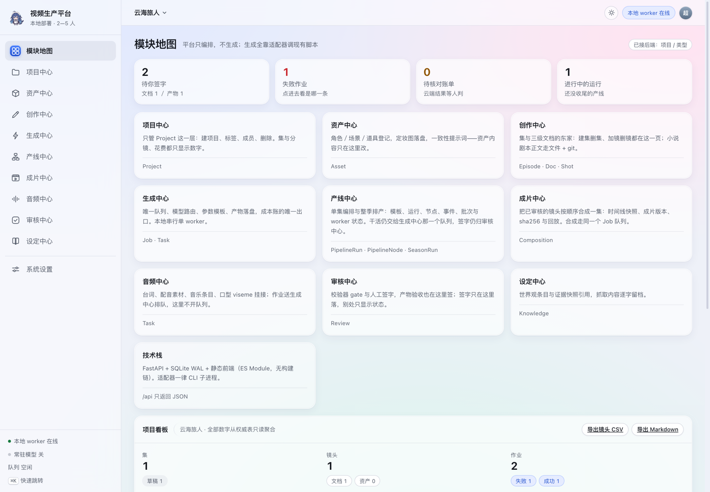
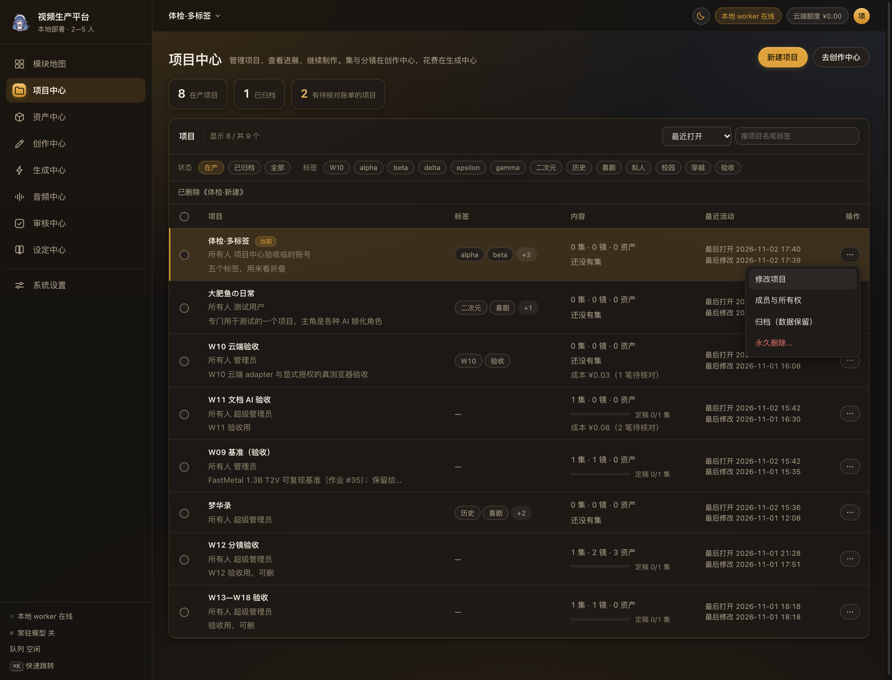
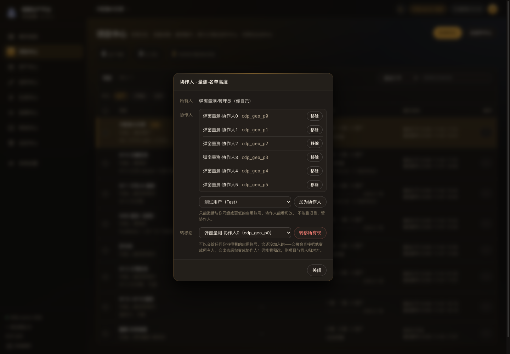

# AI 视频生产平台 系统使用说明书

- 文档类型：面向制作、审核、项目管理员与部署人员的操作手册
- 版本：v1.20（2026-11-03），对应设计稿 v0.94
- 适用界面：当前 `app/frontend/` 的日／夜双主题；截图使用夜间主题，功能与白天主题一致
- 配套文档：[需求概要说明书](需求概要说明书.md)、[系统设计说明书](系统设计说明书.md)、[数据字典](数据字典.md)、[黄金样例与故障演练](黄金样例与故障演练.md)、[发布基线](发布基线.md)

## 修订记录

| 日期 | 版本 | 内容 |
|---|---|---|
| 2026-11-01 | v1.0 | 首次编写。按登录、模型配置、项目、资产、创作、生成、审核、音频、看板、用户管理、故障处理组织步骤；补 13 张当前界面截图 |
| 2026-11-01 | v1.1 | 补 P0 操作：模型验证列与验证记录弹窗（环境检查／从作业登记真实调用与目标机基准）、生成中心待核对告警与核对账单、重试前预览；补 5 张 v75 截图与 3 条常见问题 |
| 2026-11-02 | v1.2 | §3.1 验证补第五档「产物验收」：徽章阶梯、从作业登记时给出通过／不通过结论、生产可用改三条件；配套文档补《黄金样例与故障演练》 |
| 2026-11-02 | v1.3 | 文档体检：图 3-3 换成产物验收上线后的新弹窗图；§12.10 的「未达生产可用」补第三条件（要真实调用**且**产物验收通过，只登记一条仍不亮）；§15 备份补默认落点与演练记录出处；修修订表里一条多余的 `|---|` 断行 |
| 2026-11-02 | v1.4 | §4 按项目中心第一轮升级重写操作步骤：概览条与三种排序、「打开」与 ⋯ 菜单、标签折叠、归档／恢复、批量条按选择给动作、结果提示；图 4-2 换成 v77 实拍并补 ⋯ 菜单图 4-3 |
| 2026-11-02 | v1.5 | §4 补四类账号的可见范围：只读只能打开，协作人能改与归档但不能管人／删项目，永久删除只给管理员；按钮藏起来只是少一次误点，越权仍由服务端 403 |
| 2026-11-02 | v1.6 | §4 补 ⋯ 菜单的实际行为：靠近屏幕底部会自动朝上开，滚动页面或横滚表格会收起（Esc 也能关，焦点回到 ⋯） |
| 2026-11-02 | v1.7 | 修「打开」要点两三下才跳的问题；§4 写清「打开」与「去创作中心」的分工：前者把这一行设为当前并立刻进去，后者只对当前项目生效 |
| 2026-11-02 | v1.8 | §4 补「把项目交给别人」四步：转移那一行现在在没有协作人时也显示，交接对象含还没加入的账号（层级比你高的不列），交完自己降为协作人；补图 4-4 成员与所有权弹窗 |
| 2026-11-02 | v1.9 | 撤掉行内「打开」按钮：点一行（或 Tab 到行上按 Enter／空格）就是选中该项目，去创作用页头「去创作中心」；§4 操作步骤与图 4-2／4-3 同步重拍 |
| 2026-11-02 | v1.10 | 「成员与所有权」弹窗排版收口（字段名在左、两行控件对齐、说明按字段拆），图 4-4 换成夜间主题新截图；本手册全部截图统一夜间主题 |
| 2026-11-02 | v1.11 | §4 跟着十项修正更新：归档与恢复只有所有人／管理员能做；点已归档项目的行会提示先恢复；搜索也覆盖所有人与介绍；同名项目带 #id；排序／筛选／搜索词会记住；键盘可用 ↑↓ 在行之间走；同轮补成员弹窗排版：字段名与值同一条水平线，名单框高度跟着人数走 |
| 2026-11-02 | v1.12 | 两处行为变化写进手册：定妆图链接现在要求登录（把链接发给没账号的人打不开）；新账号第一次登录必须先改初始口令，不改就干不了活 |
| 2026-11-02 | v1.13 | 两处界面行为变化写进手册：① 只读账号不再看到自己点不动的钮——创作中心的「建一集」、队列里的取消／重试／核对，动作区会直接说明这一档要哪个权限点；② 音频中心的送进队列失败提示只在**当前项目 × 当前页签**有效，换页签或换项目就收走，不会把上一个项目的失败带到下一个。所有弹窗（含新建项目、修改项目、新建资产、资产删除确认）现在在焦点没进弹窗时也能用 Esc 关 |
| 2026-11-02 | v1.14 | §11 删账号补两条口径：选「转移」时是一个事务，失败会整体回滚并告诉你「什么都没变、账号还在」；选「连同项目一起删除」做不到回滚（要动稿件工作区与 Git），失败时说的是「已删掉 X 个、卡在哪个」。权限矩阵标注 18 × 3，图 11-1 换成撤掉「设定」之后的新截图 |
| 2026-11-02 | v1.15 | 文档校正轮：内容无改动（§7 队列动作显隐、§9 音频提示范围、§11 删账号两种失败口径都已在 v1.13／v1.14 写进来），只把头部「对应设计稿」从 v0.87 追到 v0.88，免得五份文档头部各说一个版本 |
| 2026-11-03 | v1.16 | 裁定 D1 的操作步骤进手册：§8 拆成 **8.1 文档审核**与 **8.2 产物审核（看片签字）**，补图 8-3（`v89-review-artifacts.png`，夜间；白天版另存）；写清产物审核没有 gate、签字绑产物清单摘要、产物被清理或被顶掉就失配、重签即改判，以及它与「模型与密钥」里产物验收的区别。§14 补六条产线边界：**没有页面**（阶段 C）、生成节点从未跑真实模型、模板里不能放云端节点、不自动转云端也不自动重试待核对、`export_prepare` 恒 skipped、一次只推进一集。头部对应设计稿追到 v0.89 |
| 2026-11-03 | v1.17 | 产线阶段 C 页面的操作进手册：新增 **§10 产线中心**（原来 §10—§15 顺延为 §11—§16，FAQ 12.x 顺延为 13.x），写清两个页签、发起运行、看节点、推进／暂停／恢复／取消／只重试失败那一格、去哪看成本与签字、页面不轮询怎么看最新，并配图 10-1／10-2，白天版 10-3 只作对照。§15（原 §14）删掉「产线中心还没有页面」，改成「页面不自动轮询」，其余产线边界照旧。头部对应设计稿追到 v0.90 |
| 2026-11-03 | v1.18 | 阶段 **D 成片**与阶段 **E 整季**的操作进手册。§10 改成三个页签，补 **10.6 整季页签与 worker 面板**、**10.7 只读账号**；新增 **§11 成片中心**（选集、看时间线、发起合成、看版本与验收、送审），原 §11—§16 顺延为 §12—§17、FAQ 13.x 顺延为 14.x。§16（原 §15）删掉「成片是阶段 D」「整季是阶段 E」两条已解除的边界，补成片证据边界与多进程并发的操作前提。配图 10-1／10-2 换成四份模板版本，新增 11-1／11-2 与整季图 10-4。头部对应设计稿追到 v0.92 |
| 2026-11-03 | v1.19 | 首页**待办条**与**成片字幕**进手册。§2 导览改写：顶栏不再写"云端累计金额"（那枚写死的 ¥0.00 已撤），补「首页待办条怎么读」——四格分别是待签字／失败作业／待核对账单／进行中的运行，只算你参与的项目，全为 0 时整条不显示，点一格直达对应模块。§11.1 发起合成补字幕一步：可选传 `.srt` 或选本项目已有的字幕，会**烧进画面**（不是软字幕）并冻在这一版时间线里；这台机器的 FFmpeg 烧不了字幕时下拉是灰的并写明缺什么。配图 2-2 换成带待办条的首页。头部对应设计稿追到 v0.93 |
| 2026-11-03 | v1.20 | 产线成片说明：§11.1 补一句——这一集如果正在走产线，成片由产线的「成片合成」节点发起，拼的是**产线自己签过的那几条镜头视频**；你后来手抽重跑并签字的版本不会把它顶掉（要换素材，就在产线里重试那一镜）。手动发起合成时仍按每镜最新成功取片。头部对应设计稿追到 v0.94 |

---

## 1. 开始之前

### 1.1 你需要什么

- 一台已经运行平台的电脑，以及浏览器地址，例如 `http://127.0.0.1:8000`。
- 一个由管理员创建的账号。平台没有注册页，不能自己注册。
- 第一次登录要修改初始口令；改完后旧会话会失效，需要重新登录一次。
- 如果要做云端文本改写或抽取，管理员要先把文本默认轨配到可用 provider。

### 1.2 部署人员先启动服务

```bash
cd 平台设计/app
./run.sh            # API 与静态前端
./run.sh worker     # 另开终端：生成队列 worker
```

停止两者：

```bash
cd 平台设计/app
./run.sh stop
```

只启动 API、不启动 worker 时，界面能正常使用，但作业会一直排队；顶栏会显示 worker 离线。

### 1.3 三类人的工作范围

| 角色 | 能做 | 不能做 |
|---|---|---|
| 管理员 | 全部业务、用户、模型配置、全局资产与全局模板 | 不能停用或修改超级用户账号 |
| 制作 | 项目内容、资产、文档、分镜、作业、审核签字、音频台账 | 不能管用户、系统设置、删项目 |
| 只读 | 查看授权范围内的内容 | 不能写任何业务数据 |

项目还有第二道门：所有人、协作人、无关人员。无关人员即使有全局权限，也看不到别人的项目。

---

## 2. 登录与界面导览


*图 2-1 登录页。输入用户名和口令；首次登录会强制改密。*

登录后的界面分四块：

1. **左侧模块栏**：模块地图、项目中心、资产中心、创作中心、生成中心、音频中心、审核中心、产线中心、成片中心、设定中心、系统设置。
2. **顶栏**：当前项目、worker 在线状态、主题切换、用户菜单。
3. **主工作区**：当前模块页面。
4. **底部状态**：worker、常驻模型与队列摘要。

**首页最上面那条是待办**（v0.93 起）：四格分别是「待你签字」（文档＋产物）、「失败作业」、「待核对账单」、「进行中的运行」。它只算**你参与的在产项目**——别人的项目不会混进来，归档的项目也不算。一格就是一个入口，点一下（或用 Tab 移过去按 Enter）直达对应模块；四格都是 0 时整条不显示，接口读不到时也不显示，不会拿四个 0 骗你说"没活"。

常用键盘操作：

| 按键 | 作用 |
|---|---|
| `⌘K` / `Ctrl+K` | 打开快速跳转 |
| `Esc` | 关闭当前弹窗或菜单 |
| `Tab` / 方向键 | 在按钮、输入框和菜单项间移动 |
| `Enter` | 确认当前焦点项 |
| `⌘S` / `Ctrl+S` | 保存文档正文 |



*图 2-2 首页：最上面是待办条（待签字／失败作业／待核对账单／进行中的运行），下面是模块入口与项目看板。*

---

## 3. 管理员首次配置模型

进入「系统设置 · 模型与密钥」。十行分别是文本、图像、视频、配音、音乐五类能力的本地／云端两轨。


*图 3-1 模型与密钥。健康状态是打开页面时现查的，不是保存后永久不变。*

操作步骤：

1. 找到要用的能力行，例如「文本 · 云端」。
2. 填 provider 与 model。文本当前可用 `deepseek` / `deepseek-flash`。
3. 填密钥环境变量名，例如 `DEEPSEEK_API_KEY`。**这里只填变量名，不填密钥值。**
4. 勾选启用，并把该能力设为默认。
5. 点保存，再看健康状态是否变成「就绪」。

当前默认策略：

- 图像、视频、配音、音乐默认本地。
- 文本默认云端。
- 云端视频不能设为默认，只能在具体作业里显式选择。

如果健康显示「缺东西」，按提示补运行时目录或环境变量。平台不会因为本地失败就自动切云端。

### 3.1 验证：配置就绪不等于生产可用

「健康」右边多了一列「验证」。徽章表示这个槽位最高验到哪一档，从高到低是目标机基准、产物验收、真实调用、模拟、环境检查；一档都没做过显示「未验证」。徽章旁边会写「生产可用」或「未达生产可用」。


*图 3-2 验证列。每行两个按钮：环境检查、验证记录。*

生产可用＝环境检查通过＋真实调用过＋产物验收通过，由服务端判定。环境检查只查运行时目录和环境变量在不在，不发请求、不加载权重；它通过只代表「条件齐了」，不代表真能出片。真实调用成功只说明「链路产出过文件」，文件好不好要人看过——产物验收通过才算数。所以健康「就绪」加环境检查通过，仍然可能「未达生产可用」。

两个按钮的分工：

- **环境检查**：现查一次健康，并留一条环境检查记录。
- **验证记录**：打开弹窗，看五档摘要和最近记录表。


*图 3-3 验证记录弹窗。上半是五档摘要，中间是从作业登记（出处选「产物验收」时出现「验收结论」），下面是最近记录。*

真实调用、目标机基准和产物验收都不能手填「我跑过了」，要从一条已成功的作业登记：

1. 在「从作业登记」填作业号，例如一条已经成功的视频作业。
2. 出处选「真实调用」「目标机基准」或「产物验收（人工看片）」。选产物验收时会出现「验收结论」，必须选通过或不通过——这一档记的是人看过文件后的判断，不给结论服务端拒绝登记。
3. 说明里写清在哪台机器、什么参数跑通，耗时与峰值显存见作业；产物验收写看了什么、为什么通过或不通过。
4. 云端调用还要勾「云端调用已确认计费」。
5. 点「登记」。

系统会核对这条作业确实成功、产物文件可读、云端有计费确认，任何一条不满足就拒绝登记。模拟作业不能登记成真实调用或产物验收。产物验收不通过也算一条记录（标红「失败」），不通过不会点亮生产可用；人修好再验一次通过，最新记录说话。记录只增不改，每次登记追加一行，旧记录保留，方便追溯哪天谁用哪条作业验的。

---

## 4. 建项目并邀请协作人

进入「项目中心」。这里只管项目本身；集、分镜、成本不在这里维护。


*图 4-1 新建项目弹窗。项目名必填，标签、介绍和协作人可以一次填完。*

操作步骤：

1. 点右上角「新建项目」。
2. 填项目名（1—60 字，前后空格自动去掉）。
3. 标签用逗号分隔，最多 10 个，每个不超过 20 字；超出的部分会被截掉，成功后提示里会说明。
4. 项目介绍写清题材、目标和协作范围，可留空，最多 500 字。
5. 勾选协作人。只能邀请与你同级或更低的账号。
6. 点「新建」。创建后它会被设为当前项目，可以直接「去创作中心」。

字段说明直接写在每个输入框下面；填错时错误提示留在弹窗底部，已填内容不会被清掉。

项目列表常用操作：

| 位置 | 做什么 | 谁能用 |
|---|---|---|
| 点一行（或 Tab 到行上按 Enter／空格） | 选中这一行＝把它设为当前项目，不跳页 | 能看项目的人 |

| ⋯ → 修改项目 | 改项目名、介绍、标签 | 所有人／管理员 |
| ⋯ → 成员与所有权 | 加协作人、移除协作人、转移所有权 | 所有人／管理员 |
| ⋯ → 归档（数据保留） | 从在产列表和顶栏菜单隐藏，数据不删 | 所有人／管理员 |
| ⋯ → 恢复到在产 | 把已归档项目放回在产列表 | 所有人／管理员 |
| ⋯ → 永久删除 | 硬删项目及其内容 | 所有人／管理员 |

想换项目干活就点那一行（选中），再点页头的「去创作中心」——它只对**当前项目**生效。

页面上方三格是概览：在产项目数、已归档数、有待核对账单的项目数；有账单待核对时第三格会标黄。卡片右上角可切换排序：最近打开（默认）、最近修改、项目名称（中文拼音序）。搜索与标签筛选不会因为切排序而丢失。

账号不同，能看到的操作也不同：只读账号没有「新建」、复选框和 ⋯，只能选中项目；协作人只有「修改项目」——归档、恢复、成员与删除都不出现；所有人看到修改／成员／归档；管理员四项齐全。按钮不显示只是少一次误点，服务端同样拦：协作人删项目、归档别人的项目、只读改状态都会返回 403。

几条省事的规则：搜索也能搜所有人和项目介绍；两个项目同名时名字后面会跟一个 #编号，删除确认里也带编号和创建时间；排序、状态筛选和搜索词会被记住，下次打开还是那一套；键盘用户 Tab 到表里一次，之后用 ↑／↓ 走行、Enter 或空格选中。

把项目交给别人（转移所有权）：

1. 点那一行的 ⋯ →「成员与所有权」。
2. 在「转移给」下拉里挑接手人。名单是**所有你够得着的启用账号**：已经在协作人列表里的和还没加入的都在，层级比你高的不列出来。
3. 点「转移所有权」，看清确认框再点「确认转移」。对方还没加入时，确认框会写明交接会直接把他变成所有人，不需要先加一遍。
4. 交完你自动变成协作人：仍然能看、能改，但删项目和管协作人归对方。要换回来，只能由对方再转给你，或请管理员操作。

批量操作：勾选行首复选框后，表格上方出现批量条。它只给当前选择用得上的动作——选的全是在产项目才有「归档」，全是归档项目才有「恢复在产」。执行完的结果留在表格上方，写明成功几个、跳过几个及原因；归档结果还会提示去哪找回。

⋯ 菜单靠近屏幕底部时会自动朝上展开；一滚动页面、横滚表格或缩放窗口，菜单就收起，焦点回到那枚 ⋯，按 Esc 效果相同。

点一个已归档项目的行不会把它设为当前项目——会提示先在 ⋯ 里「恢复到在产」。

归档或删除单个项目都要先确认：归档的文案写明“只隐藏、不删数据、可恢复”；删除要求原样输入项目名，并先清点下面有多少集、镜头、资产、文档和已上传定妆图。一次删多个要输入固定词「批量删除」。当前项目被归档后，顶栏会自动换到另一个在产项目；只剩归档项目时不自动选。


*图 4-2 项目中心。上方概览与排序，点一行即选中；管理动作都在 ⋯ 里。*



*图 4-3 ⋯ 菜单：修改项目、成员与所有权、归档或恢复、永久删除。*



*图 4-4 「成员与所有权」：加协作人、移除协作人，以及把项目交给别人——交接对象含还没加入的账号。*

---

## 5. 资产中心：角色、场景、道具

进入「资产中心」。资产内容只能在这里改，分镜里只能引用。


*图 5-1 资产中心列表。卡片显示名称、类型、简介、参考图数量与关联镜头数。*

新建资产：

1. 点右上角「新建资产」。
2. 先选类型：角色、场景或道具。
3. 填名称、简介、标签、别名。
4. 填一致性提示词。角色写面部、发型、服装、体型和稳定细节；场景写空间结构与光线；道具写形状、材质、颜色和比例。
5. 保存后进详情页上传参考图。


*图 5-2 资产详情。左边改信息，右边管参考图和查看镜头引用。*

参考图规则：

- 支持 PNG、JPEG、WebP；单张不超过 20MB。
- iPhone HEIC 要先转格式。
- 第一张图就是封面；点「设为封面」会把图片挪到第一位。
- 资产被镜头引用时不能删除，系统会指出是哪条镜头。

全局资产池：

- 管理员可以把项目资产升为全局，ID 不变，镜头引用继续有效。
- 全局资产人人可读，但只有管理员能改和删。
- 全局资产不能收回成项目资产，避免其他项目引用悬空。

---

## 6. 创作中心：集、文档、分镜

创作中心是 Episode、Doc、Shot 的东家。三个二级页：小说、剧本、分镜。

### 6.1 建一集

1. 进入「创作中心」。
2. 左侧创作单元栏输入集标题。
3. 点「建一集」。
4. 删除集要确认；它下面的镜头会一起删除。

只有能写文档的账号（`doc:write`，即制作与管理员）看得到第 2、3 步那个输入框和按钮。只读账号进来是分镜表本身，不再看到一个点了必然被拒的钮——这一句在页面上不给提示，因为读的人本来就不需要操作它。

### 6.2 写小说或剧本


*图 6-1 文档树按集分组。全项目共用文档放在最上面，其余按集归类。*


*图 6-2 编辑器。正文写在工作区 Markdown 文件里，库里只存元数据。*

保存正文：

1. 打开一份小说或剧本。
2. 直接编辑正文。界面显示「未保存」时，改动只在浏览器里。
3. 点「保存」或按 `⌘S` / `Ctrl+S`。
4. 保存成功后，当前提交号与修改时间会更新。

冲突处理：

- 如果别人先保存了，界面会提示版本冲突。
- 你的草稿不会被丢掉；系统会把盘上那份取来左右对照。
- 要用自己这份覆盖，必须再点一次「用我这份覆盖」。

版本历史：


*图 6-3 版本历史。每保存一次就有一条 Git 提交，提交身份是点保存的人。*

### 6.3 用 AI 改写一段

1. 选中要改写的文字；不选中则默认整篇。
2. 点「AI 改写」。
3. 选择操作：起草、扩写、续写、润色、剧本化、提示词。
4. 填写附加要求。
5. 看清模型、单价、预计用量和预计费用。
6. 勾选「确认使用云端并计费」。
7. 点提交。


*图 6-4 AI 改写弹窗。提交前能看到计价和确认框。*

8. 弹窗会原地变成预览，等待作业完成。
9. 预览成功后，先检查 diff。
10. 确认无误再点「应用并提交」。


*图 6-5 diff 预览。只有这里确认后才会写文件并生成 Git 提交。*

注意：

- AI 读的是盘上正文，不是浏览器里未保存的草稿。
- 如果正文在运行期间被别人改过，`can_apply=false`，不能应用。
- 应用失败时原文不动。

### 6.4 抽取角色、场景、道具和镜头候选

1. 在小说或剧本页点「抽取」。
2. 选择要抽取的文档。
3. 看清模型和费用。
4. 勾选确认云端计费。
5. 点开始抽取。


*图 6-6 抽取弹窗。候选必须带原文逐字证据，系统不会让无证据条目入库。*

抽取完成后：

- 角色、场景、道具可以「接受」成新资产，或「合并」到已有资产。
- 镜头候选只能导出 Markdown，不会自动写进分镜表。
- 同一篇正文在 24 小时内重复抽取会复用旧结果，避免重复花钱。

### 6.5 做分镜


*图 6-7 分镜表。一镜一行，引用资产只读，作业状态只读。*

新建或编辑镜头：

1. 点「新建镜头」或行内「编辑」。
2. 填内容。
3. 填生成提示词；留空时生成会用内容栏。
4. 填时长，1—60 秒。
5. 在「引用资产」里搜索并选择角色、场景、道具。
6. 点「保存镜头」。


*图 6-8 镜头弹窗。已选资产在上方显示，点 `×` 取消引用。*

提交生成：

- 点行内「生成」会把项目、集、镜和提示词带到生成中心。
- 分镜页不直接提交作业，也不保存第二条队列。
- 改镜头不会改变已经提交作业的提示词、参数和镜头关联。

---

## 7. 生成中心：提交、取消、重试、看成本

进入「生成中心」。这一页是唯一队列与成本账。


*图 7-1 队列与成本账。筛选、搜索、详情抽屉和提交入口都在这一页。*

提交本地作业：

1. 点「提交作业」。
2. 选择项目与能力。
3. 执行路线选「默认轨」或「本地」。
4. 选择槽位与参数。
5. 填提示词。
6. 点提交。


*图 7-2 提交作业弹窗。参数来自 adapter 清单，界面不会让人手填未知参数。*

提交云端作业：

1. 执行路线选「云端」。
2. 选择 provider 与模型。
3. 填数量、单位、单价、币种、价格来源。
4. 看清预计金额。
5. 勾选确认计费。
6. 点提交。

云端视频必须逐条显式选择；系统不会因为本地失败自动切云端。

查看结果：

1. 在队列点「详情」。
2. 抽屉里看成本、提示词、参数、日志、产物和供应商回执。
3. 视频产物可以内联播放；图片与音频可以预览。


*图 7-3 详情抽屉。失败原因、日志尾部、产物与成本放在一处。*


*图 7-4 产物预览。返回 0 但没有有效文件不会显示成功。*

取消与重试：

- 排队中取消：立即变「已取消」。
- 运行中取消：先请求取消，worker 收到后停止；本地子进程先 `SIGTERM`，5 秒后 `SIGKILL`。
- 重试：先弹预览，确认后才新建一行，继承提示词、参数、执行方式和计价快照；原行记录不动。详见 7.3。

这三个动作各自要一个权限点：取消要 `job:cancel`，重试／核对／标记待核对要 `job:submit`。只读的人（有 `job:read`，能看队列与详情）行内和抽屉里都没有这些钮，抽屉的动作区会写一句「这里没有你能按的钮：取消要 `job:cancel`，重试／核对要 `job:submit`」——不留空白，也不写「已结束，可关闭」那种把人问错的话。

### 7.1 看告警

顶部统计行多了「N 笔待核对」。下面有一条告警横幅，例如「3 条云端作业待人工核对；核对前不要重试，可能重复计费。」


*图 7-5 告警横幅与待核对计数。云端行的成本下面也标「待核对」。*

告警只报事实，不会自己改作业状态。worker 离线、队列卡住、租约过期、运行超时、日志长时间不动、有待核对作业，都会在这里提示。看到告警先处理对应的事，不要指望它自己消失。

### 7.2 云端待核对：核对账单

云端作业跑完但账单没结清时，状态是「待核对」。这表示钱可能花了但还没确认，不能当成已成功入账。

打开详情抽屉，点「核对账单」：

1. 核对结果选「确认可用」或「确认不可用」。
2. 填实际金额（元）。确认可用必须填金额；不给金额就等于替人断定这次没花钱。
3. 备注写清依据，例如后台用量与预计一致。
4. 点确认。


*图 7-6 核对弹窗。抽屉里同时显示待核对原因、预计记账与实际金额。*

核对只改账单与状态，不重新提交、不改提示词与参数快照。核对完状态回到「成功」或「失败」，账单状态变「已确认」，并记下核对人与时间。要重投请用重试，不要用核对。

### 7.3 重试前先预览

点「重试（新建一行）」先弹预览，不直接建作业。预览里写明：本地重试不计费，但会再占一次本机队列；云端重试可能再计费。下面列出这一串重试链和合计金额、其中几笔待核对。确认后才新建一行。


*图 7-7 重试预览。本地失败作业的重试链与「本地重试不计费」提示。*

待核对的作业不要先重试：原行账单没结清，重试可能重复计费。先核对，再决定要不要重投。

---

## 8. 审核中心：跑 gate、看证据、签字

进入「审核中心」。顶部两个页签：**文档审核**与**产物审核**。签字只有这一个写入口，创作中心和生成中心只显示状态。

### 8.1 文档审核

这里审小说／剧本正文。分镜的真相是 `shot` 表，不在这里签。


*图 8-1 审核报告。每条问题带原文证据和签字按钮。*

操作步骤：

1. 在队列选择一份待审文档。
2. 点「跑校验」或打开已有报告。
3. 查看三类问题：占位符、长句、未收尾。
4. 对每条问题点「通过」「驳回」或「退回」。
5. 需要整篇结论时，点文档级签字。


*图 8-2 签字后显示签字人和结论。*

注意：

- 签字需要 `review:sign` 权限。
- 签字绑定正文版本；正文一改，旧报告和旧签字都过期。

### 8.2 产物审核（看片签字）

切到「产物审核」页签。这里审的是**一条已成功的图像／视频作业的产物**——关键帧、镜头视频。


*图 8-3 产物审核队列（夜间主题）。一条作业一行，带集与镜号、能力档、产物件数与结论。白天主题见 `v89-review-artifacts-day.png`。*

操作步骤：

1. 在队列里找到要审的那条作业（行上写着 `#作业号`、集名与镜号）。
2. 点「查看」。详情里逐件列出产物：相对路径、字节数、「在／已不在」，能预览的直接内联播放。
3. 逐件签字用每件下面的「通过／退回／驳回」；整条作业的结论用底部的「整条通过／退回／驳回」，可以先写一句备注（500 字内）。
4. 同一处再签一次就是**改判**，不会攒两行历史。

注意：

- 队列只列**已成功且有产物**的作业。作业没跑成功、或没有登记产物，详情里会写清「不可审」和原因，不是空白。
- 签字绑的是**产物清单摘要**，不是正文版本。产物文件被清理、或被同镜头新一次生成顶掉，摘要就变，页头立刻显示「产物已变，旧签字失配」，队列那一行变成琥珀色。这时旧签字只属于那一版产物；要认现在这一版，重新签一次。
- 产物审核**没有 gate**：占位符、长句这些规则是查正文形状的，对一张图或一段视频没有意义。这里靠人眼看。
- 本机没有图像运行时的时候，这一栏会一直是空的。那是环境没配，不是页面坏了。
- 只有查看权限的账号看得到队列，看不到签字按钮；直接调接口回 403。
- 产物审核与「模型与密钥」里的**产物验收**（第五档验证出处）是两件事：前者签的是这一条作业的产物过不过，后者判的是这个模型档能不能上生产。两边都要人真看过产物，但互不自动写入。

---

## 9. 音频中心：台词、音乐与口型素材

进入「音频中心」。四个二级页：配音、音乐、口型、音效。


*图 9-1 配音页。先登记素材，再送进队列。*

登记台词：

1. 选「台词」或「旁白」。
2. 选择集和镜头。
3. 填说话人与文本。
4. 点「登记素材」。

登记音乐：

1. 切到「音乐」。
2. 选择集。
3. 填音乐描述。
4. 点「登记素材」。

送进队列：

1. 在素材行点「送进队列」。
2. 系统仍走生成中心同一个 Job 队列。
3. 成功后回填产物路径、时长、时间戳与 viseme。


*图 9-2 当前本机没有 VoxCPM2／ACE-Step 运行时，提交会明确失败，状态仍是草稿。*

当前边界：

- 音效 `sfx` 是实验态，可以登记，不能提交。
- 口型页只保留数据位，Rhubarb 适配器尚未接线。
- 真实出声需要安装并配置 VoxCPM2／ACE-Step 运行时。
- 「送进队列失败」那句提示挂在页面上，不是弹窗；它只属于**当前项目 × 当前页签**，切页签或切项目就收走。上一项目报的「缺运行时」不该在下一个项目顶上继续显示，反过来也一样——所以看不到它不等于修好了，要重试一次才知道。

---

## 10. 产线中心：一次发起，按依赖走

侧栏「产线中心」在「生成中心」下面。页内三个页签：**运行**、**模板**与**整季**。

产线不另起一套生成：节点要干活时派的是同一条 Job，成本与日志仍在生成中心；要签字时仍去审核中心；成片的时间线与播放仍在成片中心。这一页只回答三件事：走到哪了、卡在哪、下一步该谁。

### 10.1 发起一次运行

1. 切到「运行」，点右上「发起运行」。
2. 选**集**：已经有一条没跑完的集在下拉里是灰的，并写明被哪条运行挡着——先取消或等它跑完。
3. 选**模板**：下拉里带版本与节点数（标准漫剧单集 v1 有 13 节，v2 有 **16 节**，多出合成／验收／审核三格；图片预览／视频各 6 节）。要走成片就选 v2；选 v1 只会跑到「成片准备」并标为跳过。
4. 点「开始生产」。

同一次弹窗重复点不会排出两套作业；服务端拒绝的原因会留在弹窗里，不会静默关掉。发起之后回列表，worker 的节拍自己往下走，不需要一直点「推进」。

### 10.2 看运行详情

在列表里点某行「查看」。


*图 10-1 运行详情：进度条、节点列表、失败节点的重试与事件时间线（夜间主题）。*

- **头部**：运行状态、哪一集、用的哪版模板；下面是进度条与「完成／待签字／待处理／失败」计数。
- **节点列表**：一格一行，竖向排列。每行有类型、状态、依赖、关联的作业或审核、时间与错误原文。失败的行才出现「重试这一格」。
- **跳转**：生成节点与合成节点给「去生成中心」，人工节点给「去审核」。成本、日志与产物不在这一页重复显示——点过去看的是同一份事实；成片版本与播放去成片中心看。
- **事件时间线**：倒序，把创建、派活、签字、失败、重试、取消写成一句句人话。
- **页面不自动轮询**：worker 推进后，切回列表再打开或刷新页面就能看到最新。这一页不会拿自己算的进度冒充服务端状态。

### 10.3 暂停、恢复、取消

- **暂停**：不再派新节点；已经在跑的模型作业**不会被强杀**，跑完的结果照实记。适合"先停一下，别再花钱往下走"。
- **恢复**：马上推进一轮，接着往下派。
- **取消**：未开始的节点收成已取消；能安全取消的作业发取消请求；**还在等签字的节点也一并收掉**；已生成的产物一个不动。取消要二次确认，确认词是「取消运行」。

三条动作都要 `job:cancel` 权限；只读账号看不到。

### 10.4 失败之后：只重试这一格

1. 先在失败节点上读错误原文（例如「图像的本地档还没填 provider/模型」），把原因除掉——改配置、补参数或去生成中心处理。
2. 点该行的「重试这一格」，确认。
3. 系统只为这一格新建一条作业；旧作业、旧产物、旧签字都留着，运行重新打开继续走。

重试不会替你修原因：参数原样带过去，原因没除掉就还会失败一次。被驳回的审核节点没有重试按钮——先把上游生成节点重跑，再重新送审。

### 10.5 模板页签


*图 10-2 模板页签：内置模板只读，展开看节点与依赖。*

- 四份内置模板各一张卡：标准漫剧单集 v1（13 节）、同名 v2（16 节，接成片）、图片预览（6）、视频（6）。写版本与节点数，展开能看到节点与依赖关系。
- 这一版**只读**：没有拖拽式流程编辑器，也没有「新建模板」按钮。改流程是开发侧的事（版本加一），正在跑的运行冻结在创建时那一版。
- 模板里不能放云端节点；带云端节点的模板在发起运行时会被拒（422），并点名是哪几个节点。

### 10.6 整季页签与 worker 面板


*图 10-4 整季页签：worker 面板、按资源类的队列计数与批次列表。*

**发起一整季**

1. 切到「整季」，点「发起整季」（需要 `job:submit`）。
2. 选**模板**。整季里每集都按这一份模板跑；要走成片就选标准漫剧单集 v2。
3. 选**同时推进几集**（1—8）。这是「几集在跑」，不是「几台机器」。
4. 勾要排的集。默认全选；如果某集正被一条人工运行占着，系统会如实标出来，不会悄悄挂上去。
5. 点「开始整季」。worker 会按上限逐集起运行；每集仍是一条独立运行，受「一集一条未完成运行」约束。

**看批次**

- 列表每行显示批次名、模板、状态、完成／失败／待开始计数与金额。
- 点「查看」看每集一行：状态、运行号、错误原文（起不来时写原因）。
- **暂停排产**：不再起新集，已经在跑的集不受影响。**恢复排产**：立刻排一轮。
- **取消整季**：未开始的集收掉，已经起来的单集运行发取消；确认词是「取消整季」。
- **继续失败集**：只重试失败运行里的失败节点，已成功的镜头、旧产物、旧签字都不动。被驳回的审核节点会跳过——先去上游处理。

**worker 面板**

页面顶部列出每个 worker 进程的编号、在线状态、当前作业、全局／分类上限与最近心跳；下面按 `text／image／video／audio／compose` 分行显示排队与在跑数。它只读：启动或停止进程是部署动作，不在页面里做。若只起了一个 worker，这里就只有一行，属正常。

### 10.7 只读账号看到什么

能看运行、模板与整季，但看不到「发起运行／发起整季」「推进」「暂停／恢复」「取消」「重试这一格」「继续失败集」。页面给一句权限说明，而不是点了必吃 403 的按钮。直接调接口同样回 403。

白天主题下同一页见 `v90-pipeline-day.png`（图 10-3 只作对照，不重复贴）。整季页的暂停态与新建弹窗另存 `v92-season-paused.png`、`v92-season-modal.png`，只作验收证据。

---

## 11. 成片中心：把这一集拼出来

侧栏「成片中心」在「产线中心」下面。它只做一件事：把已经生成、已经签字的分镜视频按顺序拼成 MP4，并给出可检查的验收结果。

合成不是「另一次生成」：它是一条普通的本地作业（FFmpeg），走同一个队列、同一个 worker、同一套取消与日志；金额为 0。

### 11.1 发起一次合成

1. 上方选集。只有这一集的分镜视频都**生成成功且产物审核已签字**，才排得动。
2. 看时间线：每镜一行，显示序号、计划时长、来源视频作业、分辨率。**时间线在这一刻冻结**，之后再改分镜不影响这一版。
3. **字幕（可选）**：弹窗里那一栏可以传一份 `.srt`／`.ass`，或从本项目已经传过的里面挑一份。选中后下面会写「字幕会烧进画面（不是软字幕），并冻结在这一版时间线里」——也就是烧死在像素上，播放器关不掉。这台机器的 FFmpeg 没有 `subtitles` 滤镜时，下拉是灰的并说明缺什么；那种情况下提交会被拒，不会排一条注定失败的作业。传错了可以点旁边的小垃圾桶删掉，只影响本项目。
4. 点「发起合成」。前置检查会逐镜核对，缺片或未审时直接拒绝并点名「第 N 镜……」，不会排一条空作业。
5. Job 排上后，状态从 Job 现算：排队 → 运行 → 成功／失败。去生成中心能看同一份日志。

> 这一集如果正在走产线，成片由产线的「成片合成」节点自动发起：它拼的是**产线自己签过的那几条镜头视频**。你后来手抽重跑并签字的版本不会把它顶掉——要换素材，就在产线里对那一镜点重试，让产线重新签。


*图 11-1 成片中心：版本列表、冻结时间线与发起合成。*

### 11.2 看版本与验收

- 每一版按 `(集, 版本号)` 留档，**旧版不覆盖**；再合成就是 v2、v3，列表里都能回看。
- 点某版「查看」：播放器、逐镜表（实际／计划时长、作业、分辨率）与验收结果（ffprobe 读出的编码、分辨率、时长、音轨、容器）。
- 实际时长与计划时长并列；差得太多，验收会明确失败，不拿计划数字冒充成片事实。


*图 11-2 成片详情：播放器、逐镜实际／计划时长与 ffprobe 验收结果。*

### 11.3 送审

合成通过验收后，去**审核中心 → 产物审核**对这条成片签字。签字绑成片产物摘要；成片被清理或被新版本顶掉，旧签字立刻失配，需要重签。

### 11.4 失败时先看哪

- **前置检查拒绝**：按点名的镜号回生成中心补视频，或去审核中心签字；不是合成坏了。
- **Job 失败**：打开生成中心的详情看日志。常见原因是 FFmpeg 不在 PATH、素材路径被清理、磁盘满。平台不会自动换云端或改用别的编码重试。
- **验收失败**：看是编码、分辨率、时长还是音轨不符；先确认输入视频本身是否可读，再决定重发一版。

---

## 12. 看板与导出

首页看板是只读聚合，不在这里改状态。


*图 12-1 看板。集、镜、资产、文档、作业、成本、审核、音频都从各自权威表现算。*

导出镜头清单：

1. 打开首页看板。
2. 点「导出 CSV」或「导出 Markdown」。
3. CSV 带 UTF-8 BOM，Excel 打开中文不乱码。
4. 导出内容给剪映、达芬奇或人工流程使用。

导出文件包含集序、镜号、摘要、提示词、时长、资产名、最新作业状态与产物相对路径。

---

## 13. 用户与角色管理

管理员进入「系统设置 · 用户与角色」。


*图 13-1 用户表、新建用户与权限矩阵。*

新建用户：

1. 填用户名、显示名、初始口令。
2. 选择角色。
3. 点「新建」。
4. 把初始口令交给本人；第一次登录必须改密。

停用、重置口令、改角色：

- 不能停用自己。
- 不能改自己的角色。
- 超级用户账号不可修改。
- 删除用户前必须选择转移名下项目，或连同项目一起删除。
- 选「转移」时，改东家和删账号是一个事务：中途失败会整体回滚，界面回的是「N 个项目的东家都没变、账号也还在，修好原因后可以直接重来」，不会留下几个项目已经换了主人的半套状态。
- 选「连同项目一起删除」时做不到回滚——那一步要动稿件工作区与 Git 历史。所以失败时界面说的是「已删掉 X 个，卡在《某项目》；账号还在」，已经删掉的那些不会回来，剩下的修好后可以再来一次。

权限矩阵（18 个权限点 × 3 个角色）：

- 管理员列不可编辑。
- 制作与只读列可按列保存。
- 前端隐藏按钮只是体验，服务端仍会拒绝越权请求。

---

### 5.4 定妆图链接能不能直接发给别人？

不能。参考图的地址现在要求登录，并且登录的那个人得看得见这个资产所在的项目；
发给没有账号的人只会得到一个 401。要给别人看，把对方加为协作人，或者截图发过去。

## 14. 常见问题

### 14.1 登录后页面空白或提示未登录

会话默认 12 小时。退出重登即可；如果反复出现，检查服务器时间与会话到期时间。

### 14.2 项目列表看不到项目

- 确认筛选不是「在产」而项目已归档。
- 确认自己是否是项目所有人或协作人。
- 协作人被移除后，项目会直接变成不可见。

### 14.3 文档保存提示 409

盘上正文已经变了。对照两份内容后再选择覆盖或刷新令牌。不要手工删库里的文档行。

### 14.4 文档保存提示 423

锁在别人手里。等对方保存完成、放锁或锁过期。不要改系统时间。

### 14.5 作业一直排队

先看顶栏 worker 是否在线。离线时启动：

```bash
cd 平台设计/app
./run.sh worker
```

### 14.6 本地视频失败

打开作业详情看日志。常见原因是运行时目录、权重或显存／内存不足。平台不会自动转云端。

### 14.7 云端作业失败后会不会偷偷重试到本地

不会。重试新建一行，继承原来的执行方式和计价快照。

### 14.8 音频提交失败

当前本机没有 VoxCPM2／ACE-Step／Rhubarb 运行时。失败原因会显示在页面上，素材状态仍是草稿。

### 14.9 审核签字后改正文，报告还能用吗

不能。正文版本一变，旧报告和旧签字都会过期，队列会重新把该文档列为待审。

### 14.10 环境检查通过了，为什么还显示「未达生产可用」

生产可用要三条一起齐：环境检查通过、有一条真实调用记录、有一条产物验收通过的记录。环境检查只查条件齐不齐，不发请求、不加载权重；真实调用只说明链路产出过文件。去验证记录弹窗，从一条已成功的作业先登记「真实调用」（云端还要勾计费确认），再人工看片登记「产物验收」并给出通过或不通过——只登记其中一条，徽章仍显示未达。

### 14.11 待核对的作业会不会自己消失或自动重试

不会。待核对是等人结清账单，平台不自动重试云端作业，避免重复计费。打开详情点「核对账单」，填实际金额后状态才回到成功或失败。

### 14.12 重试会不会把原来的失败记录覆盖

不会。重试新建一行，原行的日志、耗时、错误都保留；新行记第几次尝试，并链回原行。预览里能看到整串重试链与合计金额。

### 14.13 产线节点一直不动，是不是卡住了

先刷新页面——产线页不轮询，worker 推进后界面不会自己跳。刷新后还是不动，按三种情况看：① 顶栏 worker 是否在线；② 节点是否在「等签字」，那就去审核中心；③ 节点是否已失败，失败行有错误原文与「重试这一格」。同一集已经有未结束的运行时，发起按钮会指着那条运行，先取消或等它跑完。

### 14.14 成片发起不了，提示「第 N 镜」

前置检查要求每一镜都有**最新一次成功**的视频作业，并且那条作业的产物已经审核签字。按提示的镜号回生成中心补生成，或去审核中心签字，再回来发起。缺片时平台不会排一条空作业，也不会拿别的镜头的视频凑数。

### 14.15 整季一直停在「待开始」或某一集不动

- 先看整季页顶部的 worker 面板：在线状态、当前作业与分类上限。worker 不在线时，排产和推进都不会发生。
- 看批次是否被「暂停排产」；暂停只停新集，已起的集继续跑。
- 看「同时推进几集」：已达到上限时，其余集要等前面的集收尾。
- 某一集显示「启动被拒」时，看错误原文（没有分镜、模板不成立、被别的运行占着）。处理后在批次详情里点「继续失败集」只补失败节点。
- 页面不轮询；刷新后才看到最新状态。

---

## 15. 日常操作纪律

1. 写稿前先确认当前项目，不要凭顶栏小字猜。
2. 资产只在资产中心改；分镜只引用。
3. AI 改写先看 diff，再应用。
4. 抽取候选必须看证据；没有原文证据的候选不要接受。
5. 云端作业必须看清金额并自己勾选确认。
6. 审核签字只认当前正文版本。
7. 删除项目、删除资产、批量删除前先看系统列出的连带影响。
8. 备份要整份做，不要只拷数据库文件。
9. 云端作业待核对时先核对再重试，避免重复计费。

---

## 16. 当前版本不能做的事

- 设定中心还没有表、接口和写入路径。
- **产线页面不会自动刷新**。worker 推进后，切回列表再打开或刷新页面才看到最新节点；界面不轮询、也不在浏览器里另算进度。看不到变化先刷新，再判断是不是卡住。
- **产线的生成节点从未跑过真实模型**。阶段 B／C 的全部验证走 mock 适配器和临时库，零付费调用；mock 只能证明代码路径和故障处理逻辑，不能当成真实模型的生产验证证据。
- 产线里不能放云端节点。云端要逐镜头显式选择并勾确认计费，产线不替人做这个决定；带云端节点的模板在发起运行时就会被拒（422），并点名是哪几个节点。
- 产线不做本地失败自动转云端，也不自动重试「待核对」的作业。
- v1 模板的 `export_prepare` 节点一律是 `skipped`；要成片请选标准漫剧单集 v2（16 节）。选 v1 不会自动补出成片。
- **成片只验到本机 FFmpeg 与临时素材**：合成链路、验收、版本与审核都真跑过，但验收输入是临时构造的测试视频，不是真实模型生成的一整集；观感、音画同步质量与编码兼容性要等真实素材再验。FFmpeg 不在 PATH 时合成会明确失败。
- **并发只有本机多进程**：可以起多个 worker 各自声明上限，队列按 `text／image／video／audio／compose` 分类限流；没有跨机调度，也不是「开几台机器」。整季页的并发上限是「同时几集在跑」，不是机器数。
- 整季失败恢复只补失败节点，不重跑已成功镜头；被驳回的审核节点不会自动重试。
- 音频中心不会真的出声。
- 审核 gate 不判断事实、文风和剧情质量；产物审核没有 gate，靠人眼看片。
- 抽取不会自动创建分镜。
- AI 改写没有多轮对话，也不会自动合并版本冲突。
- 看板没有趋势图、工时统计和人员产能。
- 平台不做在线剪辑、节点画布、多租户和对外计费。
- 验证不会自动跑真实调用或目标机基准，要人工从已成功作业登记；没跑过的档位仍是空。

---

## 17. 备份与恢复

在服务器终端执行：

```bash
cd 平台设计/app/backend
.venv/bin/python backup.py create
.venv/bin/python backup.py verify <备份目录>
.venv/bin/python backup.py restore <备份目录> --yes
```

恢复前会自动留一份安全备份。校验不过时不要强行恢复。

`create` 不带参数时落在 `data/backups/<时间>`，要放到别的盘就把目录一起写上。备份、校验、恢复三条命令在临时环境里真跑过一遍，观测记录见《黄金样例与故障演练》§2.3；对着正式库做完整恢复仍是人工步骤，要定维护窗口。
