# AI 视频生产平台 系统使用说明书

- 文档类型：面向制作、审核、项目管理员与部署人员的操作手册
- 版本：v1.3（2026-11-02），对应设计稿 v0.76
- 适用界面：当前 `app/frontend/` 的日／夜双主题；截图使用夜间主题，功能与白天主题一致
- 配套文档：[需求概要说明书](需求概要说明书.md)、[系统设计说明书](系统设计说明书.md)、[数据字典](数据字典.md)、[黄金样例与故障演练](黄金样例与故障演练.md)、[发布基线](发布基线.md)

## 修订记录

| 日期 | 版本 | 内容 |
|---|---|---|
| 2026-11-01 | v1.0 | 首次编写。按登录、模型配置、项目、资产、创作、生成、审核、音频、看板、用户管理、故障处理组织步骤；补 13 张当前界面截图 |
| 2026-11-01 | v1.1 | 补 P0 操作：模型验证列与验证记录弹窗（环境检查／从作业登记真实调用与目标机基准）、生成中心待核对告警与核对账单、重试前预览；补 5 张 v75 截图与 3 条常见问题 |
| 2026-11-02 | v1.2 | §3.1 验证补第五档「产物验收」：徽章阶梯、从作业登记时给出通过／不通过结论、生产可用改三条件；配套文档补《黄金样例与故障演练》 |
| 2026-11-02 | v1.3 | 文档体检：图 3-3 换成产物验收上线后的新弹窗图；§12.10 的「未达生产可用」补第三条件（要真实调用**且**产物验收通过，只登记一条仍不亮）；§15 备份补默认落点与演练记录出处；修修订表里一条多余的 `|---|` 断行 |

---

## 1. 开始之前

### 1.1 你需要什么

- 一台已经运行平台的电脑，以及浏览器地址，例如 `http://127.0.0.1:8000`。
- 一个由管理员创建的账号。平台没有注册页，不能自己注册。
- 第一次登录要修改初始口令；改完后旧会话会失效，需要重新登录一次。
- 如果要做云端文本改写或抽取，管理员要先把文本默认轨配到可用 provider。

### 1.2 部署人员先启动服务

```bash
cd 平台设计/app
./run.sh            # API 与静态前端
./run.sh worker     # 另开终端：生成队列 worker
```

停止两者：

```bash
cd 平台设计/app
./run.sh stop
```

只启动 API、不启动 worker 时，界面能正常使用，但作业会一直排队；顶栏会显示 worker 离线。

### 1.3 三类人的工作范围

| 角色 | 能做 | 不能做 |
|---|---|---|
| 管理员 | 全部业务、用户、模型配置、全局资产与全局模板 | 不能停用或修改超级用户账号 |
| 制作 | 项目内容、资产、文档、分镜、作业、审核签字、音频台账 | 不能管用户、系统设置、删项目 |
| 只读 | 查看授权范围内的内容 | 不能写任何业务数据 |

项目还有第二道门：所有人、协作人、无关人员。无关人员即使有全局权限，也看不到别人的项目。

---

## 2. 登录与界面导览

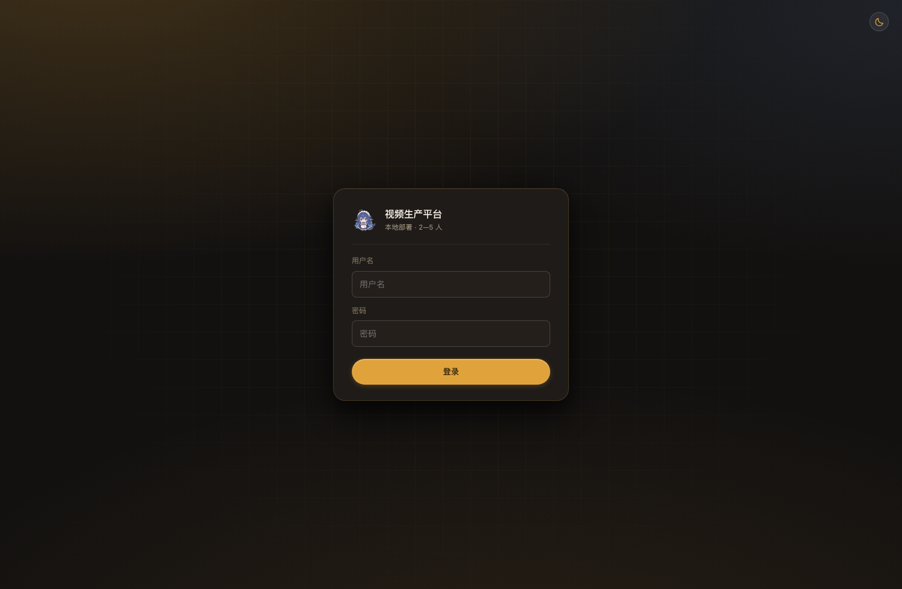

*图 2-1 登录页。输入用户名和口令；首次登录会强制改密。*

登录后的界面分四块：

1. **左侧模块栏**：模块地图、项目中心、资产中心、创作中心、生成中心、音频中心、审核中心、设定中心、系统设置。
2. **顶栏**：当前项目、worker 在线状态、云端累计金额、主题切换、用户菜单。
3. **主工作区**：当前模块页面。
4. **底部状态**：worker、常驻模型与队列摘要。

常用键盘操作：

| 按键 | 作用 |
|---|---|
| `⌘K` / `Ctrl+K` | 打开快速跳转 |
| `Esc` | 关闭当前弹窗或菜单 |
| `Tab` / 方向键 | 在按钮、输入框和菜单项间移动 |
| `Enter` | 确认当前焦点项 |
| `⌘S` / `Ctrl+S` | 保存文档正文 |

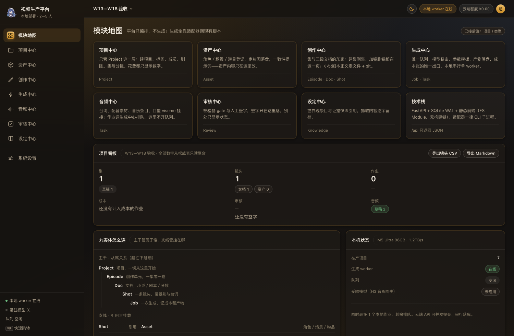

*图 2-2 首页看板。先看项目聚合与导出入口，再决定去哪个模块。*

---

## 3. 管理员首次配置模型

进入「系统设置 · 模型与密钥」。十行分别是文本、图像、视频、配音、音乐五类能力的本地／云端两轨。

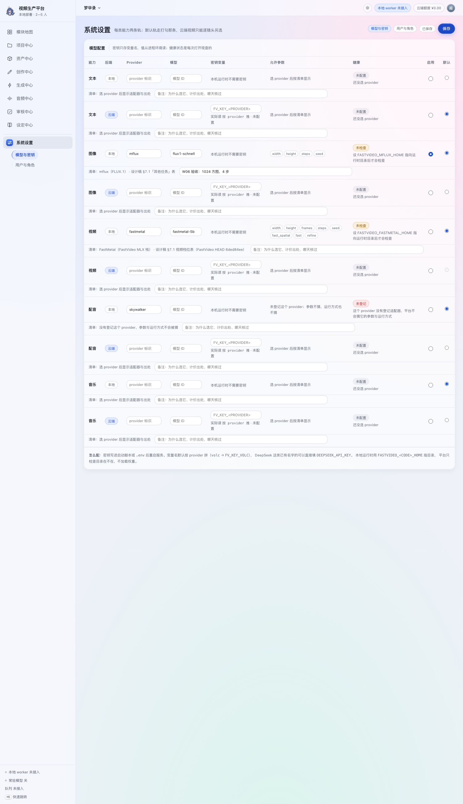

*图 3-1 模型与密钥。健康状态是打开页面时现查的，不是保存后永久不变。*

操作步骤：

1. 找到要用的能力行，例如「文本 · 云端」。
2. 填 provider 与 model。文本当前可用 `deepseek` / `deepseek-flash`。
3. 填密钥环境变量名，例如 `DEEPSEEK_API_KEY`。**这里只填变量名，不填密钥值。**
4. 勾选启用，并把该能力设为默认。
5. 点保存，再看健康状态是否变成「就绪」。

当前默认策略：

- 图像、视频、配音、音乐默认本地。
- 文本默认云端。
- 云端视频不能设为默认，只能在具体作业里显式选择。

如果健康显示「缺东西」，按提示补运行时目录或环境变量。平台不会因为本地失败就自动切云端。

### 3.1 验证：配置就绪不等于生产可用

「健康」右边多了一列「验证」。徽章表示这个槽位最高验到哪一档，从高到低是目标机基准、产物验收、真实调用、模拟、环境检查；一档都没做过显示「未验证」。徽章旁边会写「生产可用」或「未达生产可用」。

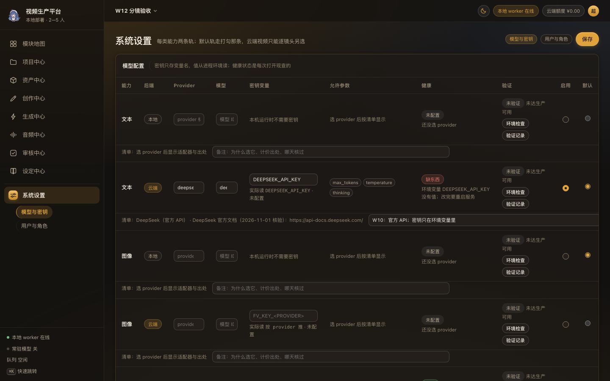

*图 3-2 验证列。每行两个按钮：环境检查、验证记录。*

生产可用＝环境检查通过＋真实调用过＋产物验收通过，由服务端判定。环境检查只查运行时目录和环境变量在不在，不发请求、不加载权重；它通过只代表「条件齐了」，不代表真能出片。真实调用成功只说明「链路产出过文件」，文件好不好要人看过——产物验收通过才算数。所以健康「就绪」加环境检查通过，仍然可能「未达生产可用」。

两个按钮的分工：

- **环境检查**：现查一次健康，并留一条环境检查记录。
- **验证记录**：打开弹窗，看五档摘要和最近记录表。

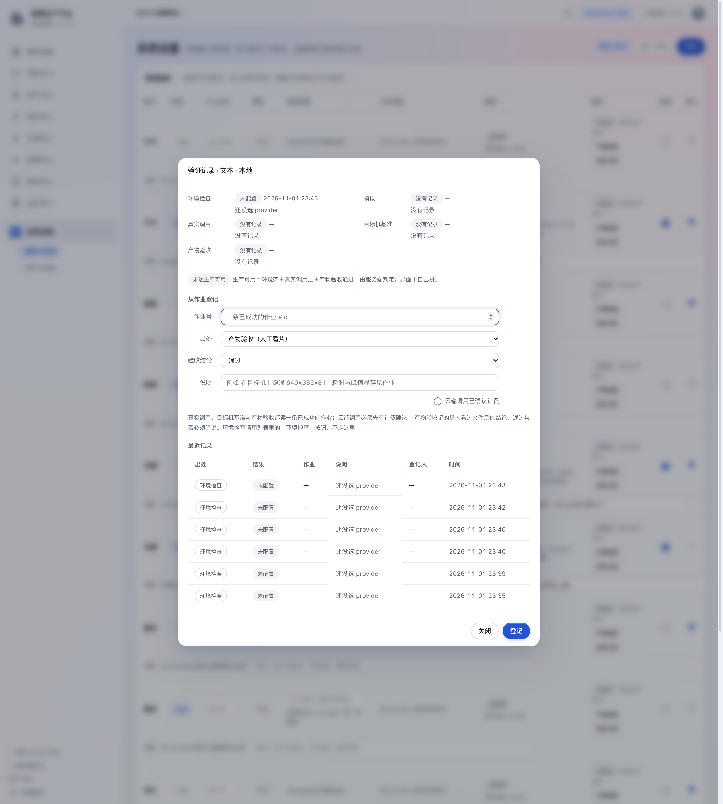

*图 3-3 验证记录弹窗。上半是五档摘要，中间是从作业登记（出处选「产物验收」时出现「验收结论」），下面是最近记录。*

真实调用、目标机基准和产物验收都不能手填「我跑过了」，要从一条已成功的作业登记：

1. 在「从作业登记」填作业号，例如一条已经成功的视频作业。
2. 出处选「真实调用」「目标机基准」或「产物验收（人工看片）」。选产物验收时会出现「验收结论」，必须选通过或不通过——这一档记的是人看过文件后的判断，不给结论服务端拒绝登记。
3. 说明里写清在哪台机器、什么参数跑通，耗时与峰值显存见作业；产物验收写看了什么、为什么通过或不通过。
4. 云端调用还要勾「云端调用已确认计费」。
5. 点「登记」。

系统会核对这条作业确实成功、产物文件可读、云端有计费确认，任何一条不满足就拒绝登记。模拟作业不能登记成真实调用或产物验收。产物验收不通过也算一条记录（标红「失败」），不通过不会点亮生产可用；人修好再验一次通过，最新记录说话。记录只增不改，每次登记追加一行，旧记录保留，方便追溯哪天谁用哪条作业验的。

---

## 4. 建项目并邀请协作人

进入「项目中心」。这里只管项目本身；集、分镜、成本不在这里维护。

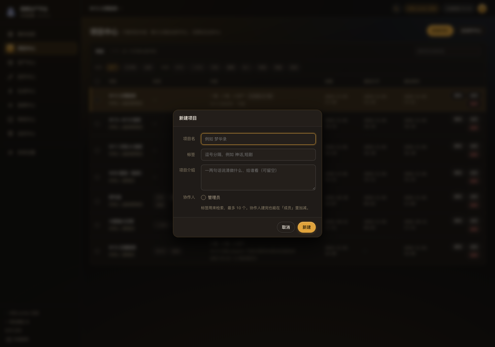

*图 4-1 新建项目弹窗。项目名必填，标签、介绍和协作人可以一次填完。*

操作步骤：

1. 点右上角「新建项目」。
2. 填项目名。
3. 标签用逗号分隔，最多 10 个，每个不超过 20 字。
4. 项目介绍写清题材、目标和协作范围。
5. 勾选协作人。只能邀请层级不高于自己的账号。
6. 点「新建」。

项目列表常用操作：

| 按钮 | 作用 | 谁能看到 |
|---|---|---|
| 修改 | 改项目名、介绍、标签 | 所有人／管理员 |
| 成员 | 加协作人、移除协作人、转移所有权 | 所有人／管理员 |
| 删除 | 硬删项目及其内容 | 所有人／管理员 |

点一行会切换当前项目，并更新「最后打开」。归档项目不会进入顶栏项目菜单，只能在「已归档／全部」筛选里找到。

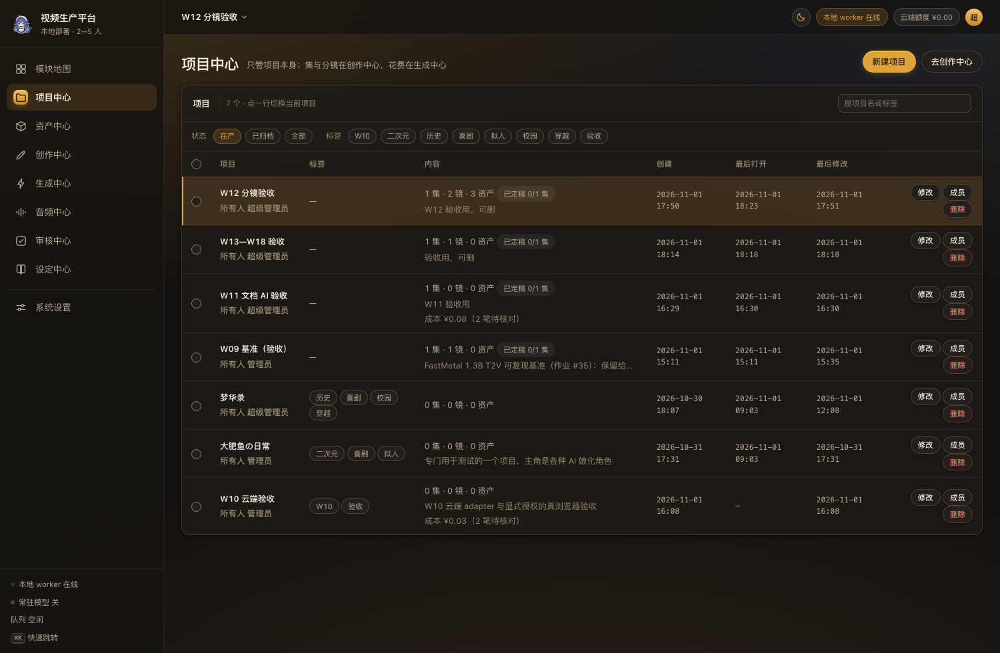

*图 4-2 项目中心。最后打开、内容计数、已定稿集数与成本摘要都在同一张表。*

---

## 5. 资产中心：角色、场景、道具

进入「资产中心」。资产内容只能在这里改，分镜里只能引用。

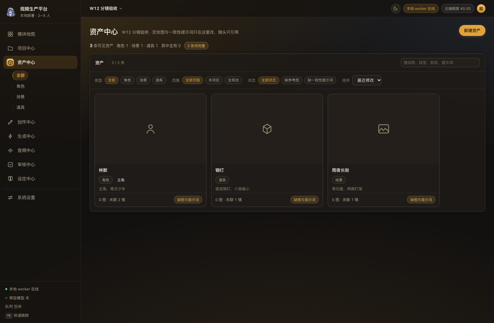

*图 5-1 资产中心列表。卡片显示名称、类型、简介、参考图数量与关联镜头数。*

新建资产：

1. 点右上角「新建资产」。
2. 先选类型：角色、场景或道具。
3. 填名称、简介、标签、别名。
4. 填一致性提示词。角色写面部、发型、服装、体型和稳定细节；场景写空间结构与光线；道具写形状、材质、颜色和比例。
5. 保存后进详情页上传参考图。

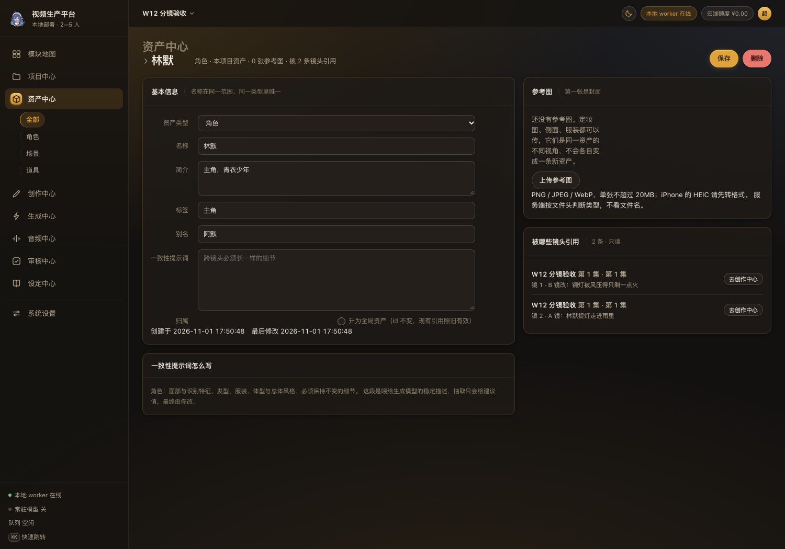

*图 5-2 资产详情。左边改信息，右边管参考图和查看镜头引用。*

参考图规则：

- 支持 PNG、JPEG、WebP；单张不超过 20MB。
- iPhone HEIC 要先转格式。
- 第一张图就是封面；点「设为封面」会把图片挪到第一位。
- 资产被镜头引用时不能删除，系统会指出是哪条镜头。

全局资产池：

- 管理员可以把项目资产升为全局，ID 不变，镜头引用继续有效。
- 全局资产人人可读，但只有管理员能改和删。
- 全局资产不能收回成项目资产，避免其他项目引用悬空。

---

## 6. 创作中心：集、文档、分镜

创作中心是 Episode、Doc、Shot 的东家。三个二级页：小说、剧本、分镜。

### 6.1 建一集

1. 进入「创作中心」。
2. 左侧创作单元栏输入集标题。
3. 点「建一集」。
4. 删除集要确认；它下面的镜头会一起删除。

### 6.2 写小说或剧本

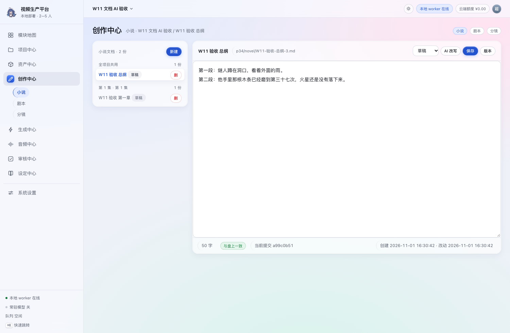

*图 6-1 文档树按集分组。全项目共用文档放在最上面，其余按集归类。*

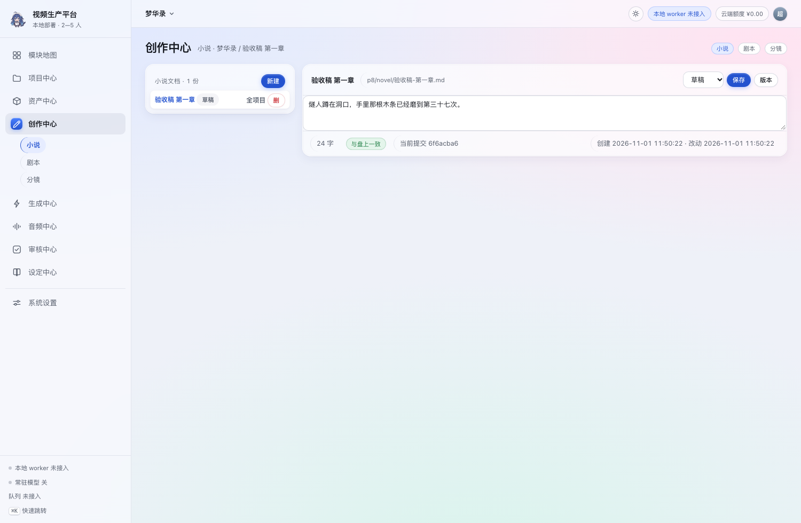

*图 6-2 编辑器。正文写在工作区 Markdown 文件里，库里只存元数据。*

保存正文：

1. 打开一份小说或剧本。
2. 直接编辑正文。界面显示「未保存」时，改动只在浏览器里。
3. 点「保存」或按 `⌘S` / `Ctrl+S`。
4. 保存成功后，当前提交号与修改时间会更新。

冲突处理：

- 如果别人先保存了，界面会提示版本冲突。
- 你的草稿不会被丢掉；系统会把盘上那份取来左右对照。
- 要用自己这份覆盖，必须再点一次「用我这份覆盖」。

版本历史：

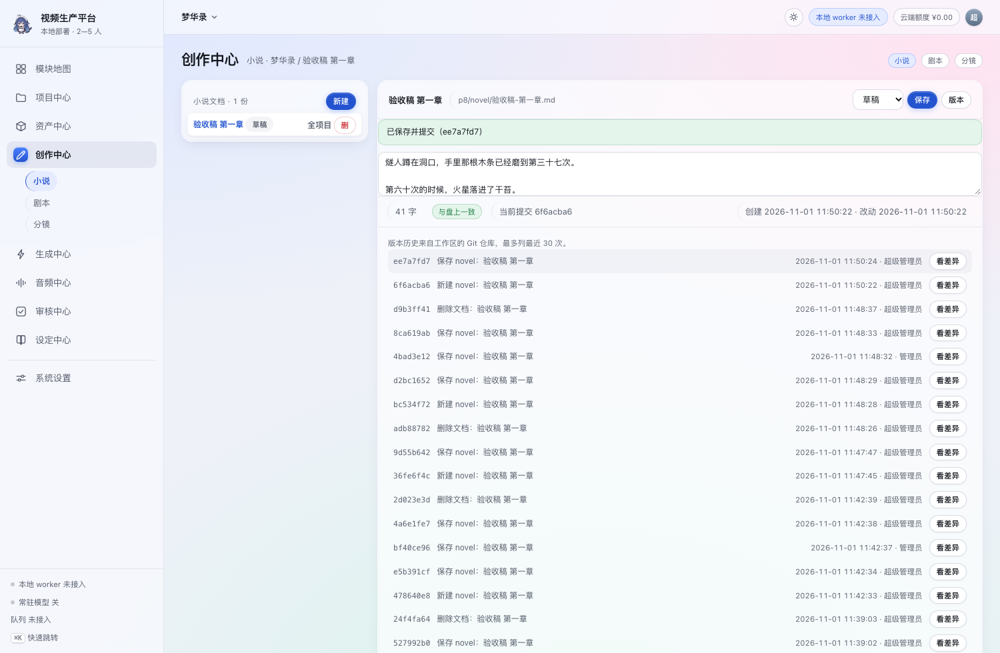

*图 6-3 版本历史。每保存一次就有一条 Git 提交，提交身份是点保存的人。*

### 6.3 用 AI 改写一段

1. 选中要改写的文字；不选中则默认整篇。
2. 点「AI 改写」。
3. 选择操作：起草、扩写、续写、润色、剧本化、提示词。
4. 填写附加要求。
5. 看清模型、单价、预计用量和预计费用。
6. 勾选「确认使用云端并计费」。
7. 点提交。

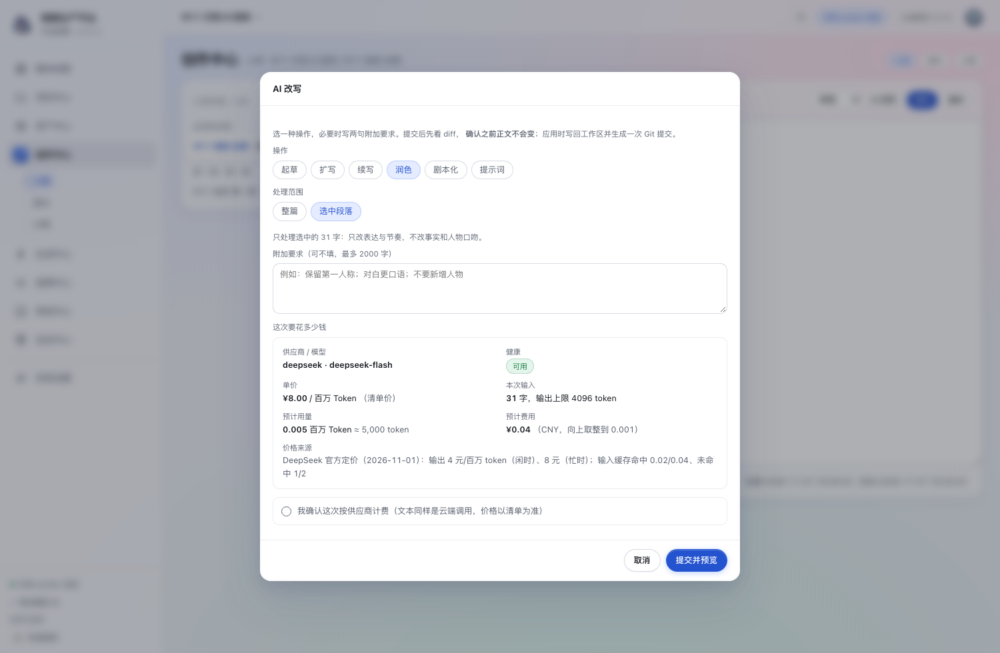

*图 6-4 AI 改写弹窗。提交前能看到计价和确认框。*

8. 弹窗会原地变成预览，等待作业完成。
9. 预览成功后，先检查 diff。
10. 确认无误再点「应用并提交」。

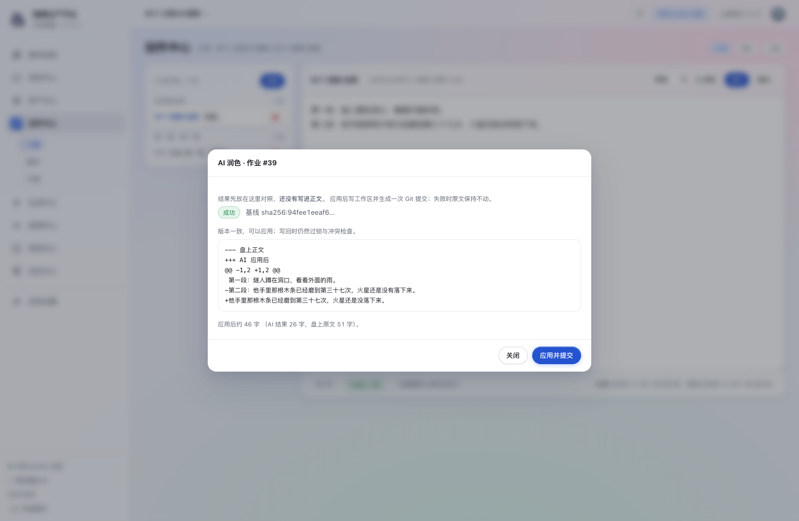

*图 6-5 diff 预览。只有这里确认后才会写文件并生成 Git 提交。*

注意：

- AI 读的是盘上正文，不是浏览器里未保存的草稿。
- 如果正文在运行期间被别人改过，`can_apply=false`，不能应用。
- 应用失败时原文不动。

### 6.4 抽取角色、场景、道具和镜头候选

1. 在小说或剧本页点「抽取」。
2. 选择要抽取的文档。
3. 看清模型和费用。
4. 勾选确认云端计费。
5. 点开始抽取。

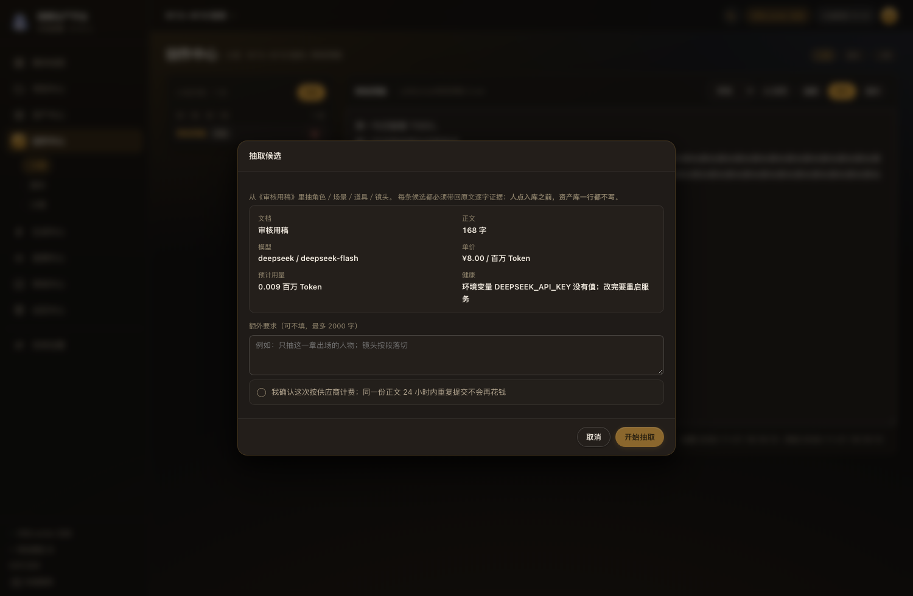

*图 6-6 抽取弹窗。候选必须带原文逐字证据，系统不会让无证据条目入库。*

抽取完成后：

- 角色、场景、道具可以「接受」成新资产，或「合并」到已有资产。
- 镜头候选只能导出 Markdown，不会自动写进分镜表。
- 同一篇正文在 24 小时内重复抽取会复用旧结果，避免重复花钱。

### 6.5 做分镜

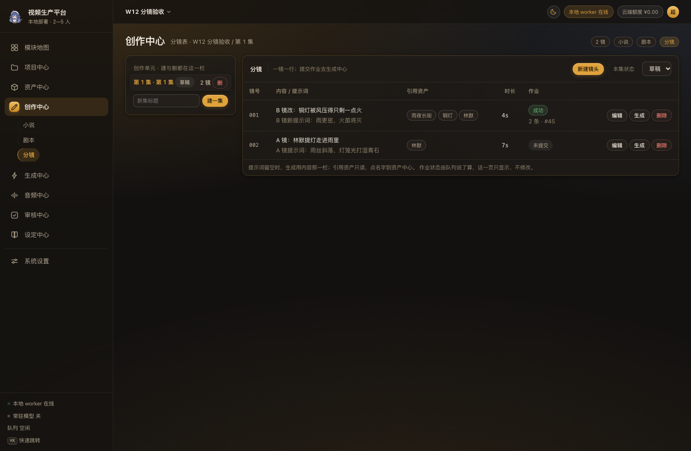

*图 6-7 分镜表。一镜一行，引用资产只读，作业状态只读。*

新建或编辑镜头：

1. 点「新建镜头」或行内「编辑」。
2. 填内容。
3. 填生成提示词；留空时生成会用内容栏。
4. 填时长，1—60 秒。
5. 在「引用资产」里搜索并选择角色、场景、道具。
6. 点「保存镜头」。

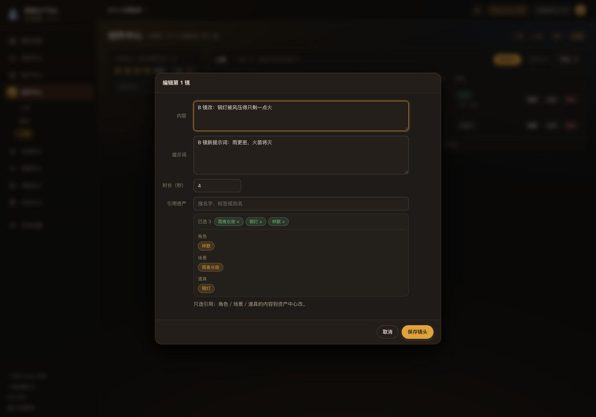

*图 6-8 镜头弹窗。已选资产在上方显示，点 `×` 取消引用。*

提交生成：

- 点行内「生成」会把项目、集、镜和提示词带到生成中心。
- 分镜页不直接提交作业，也不保存第二条队列。
- 改镜头不会改变已经提交作业的提示词、参数和镜头关联。

---

## 7. 生成中心：提交、取消、重试、看成本

进入「生成中心」。这一页是唯一队列与成本账。

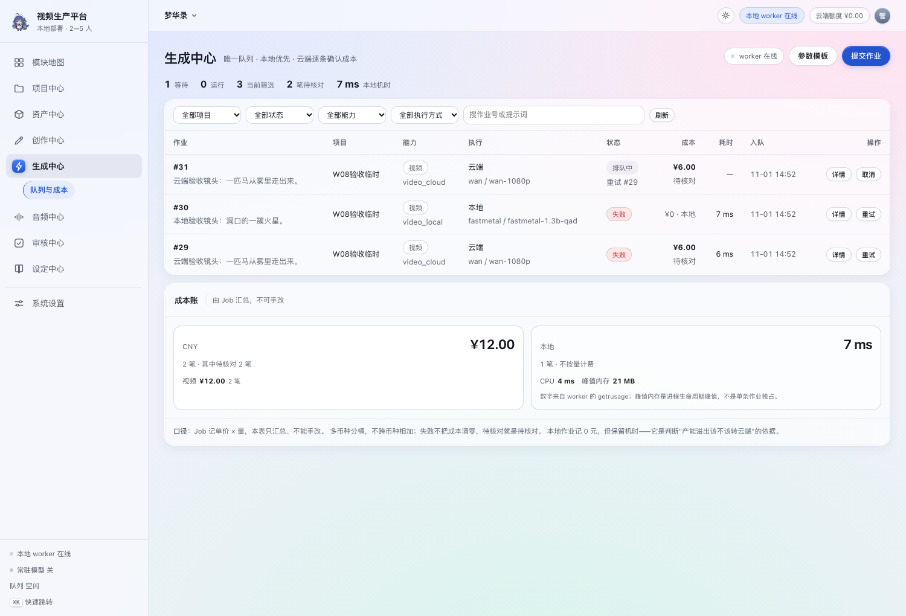

*图 7-1 队列与成本账。筛选、搜索、详情抽屉和提交入口都在这一页。*

提交本地作业：

1. 点「提交作业」。
2. 选择项目与能力。
3. 执行路线选「默认轨」或「本地」。
4. 选择槽位与参数。
5. 填提示词。
6. 点提交。

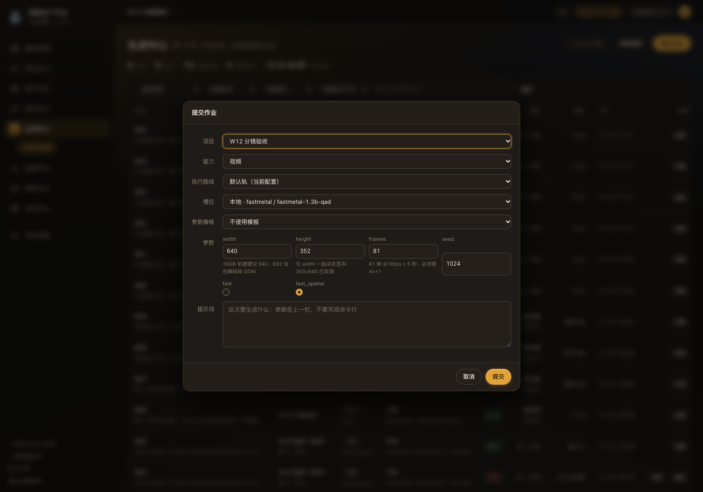

*图 7-2 提交作业弹窗。参数来自 adapter 清单，界面不会让人手填未知参数。*

提交云端作业：

1. 执行路线选「云端」。
2. 选择 provider 与模型。
3. 填数量、单位、单价、币种、价格来源。
4. 看清预计金额。
5. 勾选确认计费。
6. 点提交。

云端视频必须逐条显式选择；系统不会因为本地失败自动切云端。

查看结果：

1. 在队列点「详情」。
2. 抽屉里看成本、提示词、参数、日志、产物和供应商回执。
3. 视频产物可以内联播放；图片与音频可以预览。

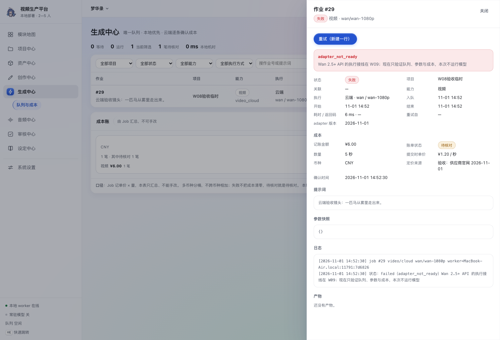

*图 7-3 详情抽屉。失败原因、日志尾部、产物与成本放在一处。*

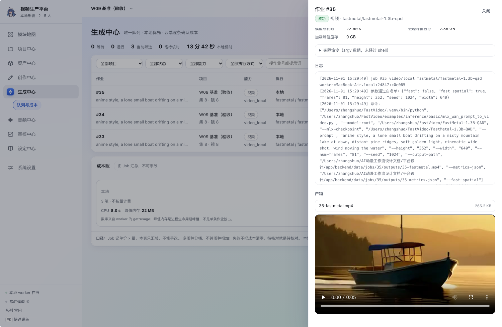

*图 7-4 产物预览。返回 0 但没有有效文件不会显示成功。*

取消与重试：

- 排队中取消：立即变「已取消」。
- 运行中取消：先请求取消，worker 收到后停止；本地子进程先 `SIGTERM`，5 秒后 `SIGKILL`。
- 重试：先弹预览，确认后才新建一行，继承提示词、参数、执行方式和计价快照；原行记录不动。详见 7.3。

### 7.1 看告警

顶部统计行多了「N 笔待核对」。下面有一条告警横幅，例如「3 条云端作业待人工核对；核对前不要重试，可能重复计费。」

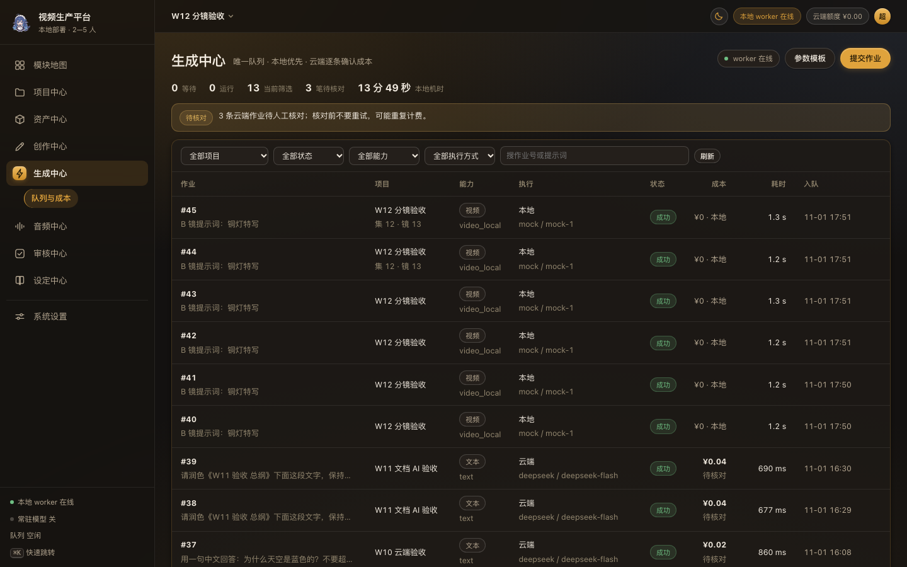

*图 7-5 告警横幅与待核对计数。云端行的成本下面也标「待核对」。*

告警只报事实，不会自己改作业状态。worker 离线、队列卡住、租约过期、运行超时、日志长时间不动、有待核对作业，都会在这里提示。看到告警先处理对应的事，不要指望它自己消失。

### 7.2 云端待核对：核对账单

云端作业跑完但账单没结清时，状态是「待核对」。这表示钱可能花了但还没确认，不能当成已成功入账。

打开详情抽屉，点「核对账单」：

1. 核对结果选「确认可用」或「确认不可用」。
2. 填实际金额（元）。确认可用必须填金额；不给金额就等于替人断定这次没花钱。
3. 备注写清依据，例如后台用量与预计一致。
4. 点确认。

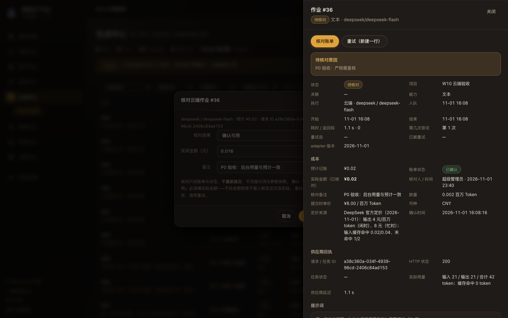

*图 7-6 核对弹窗。抽屉里同时显示待核对原因、预计记账与实际金额。*

核对只改账单与状态，不重新提交、不改提示词与参数快照。核对完状态回到「成功」或「失败」，账单状态变「已确认」，并记下核对人与时间。要重投请用重试，不要用核对。

### 7.3 重试前先预览

点「重试（新建一行）」先弹预览，不直接建作业。预览里写明：本地重试不计费，但会再占一次本机队列；云端重试可能再计费。下面列出这一串重试链和合计金额、其中几笔待核对。确认后才新建一行。

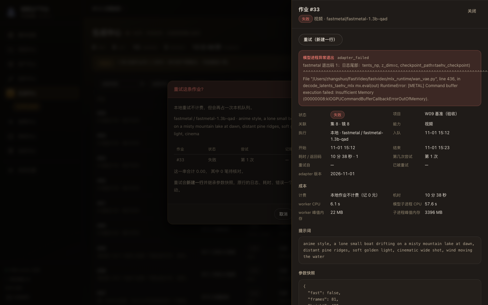

*图 7-7 重试预览。本地失败作业的重试链与「本地重试不计费」提示。*

待核对的作业不要先重试：原行账单没结清，重试可能重复计费。先核对，再决定要不要重投。

---

## 8. 审核中心：跑 gate、看证据、签字

进入「审核中心」。这里只审小说／剧本正文。分镜的真相是 `shot` 表，不在这里签。

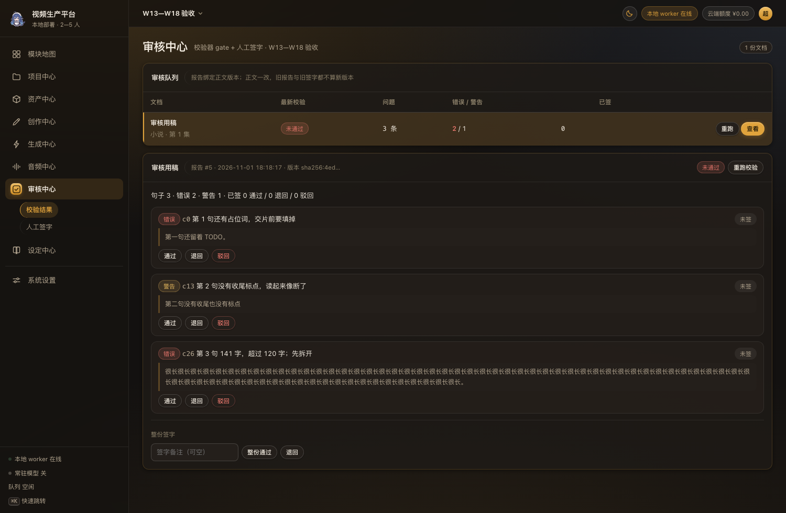

*图 8-1 审核报告。每条问题带原文证据和签字按钮。*

操作步骤：

1. 在队列选择一份待审文档。
2. 点「跑校验」或打开已有报告。
3. 查看三类问题：占位符、长句、未收尾。
4. 对每条问题点「通过」「驳回」或「退回」。
5. 需要整篇结论时，点文档级签字。

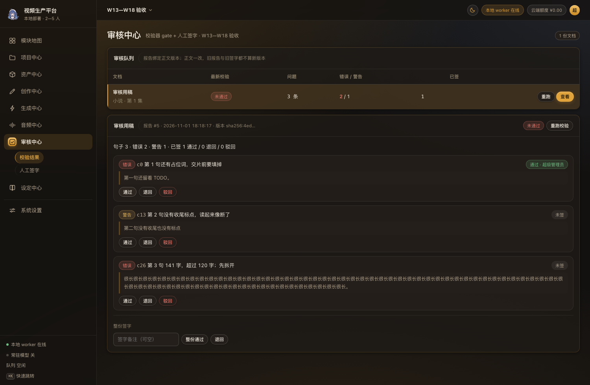

*图 8-2 签字后显示签字人和结论。*

注意：

- 签字需要 `review:sign` 权限。
- 签字绑定正文版本；正文一改，旧报告和旧签字都过期。
- 审核中心是唯一签字写入口；创作中心和生成中心只显示状态。

---

## 9. 音频中心：台词、音乐与口型素材

进入「音频中心」。四个二级页：配音、音乐、口型、音效。

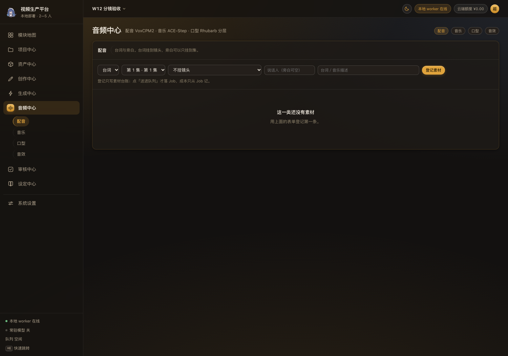

*图 9-1 配音页。先登记素材，再送进队列。*

登记台词：

1. 选「台词」或「旁白」。
2. 选择集和镜头。
3. 填说话人与文本。
4. 点「登记素材」。

登记音乐：

1. 切到「音乐」。
2. 选择集。
3. 填音乐描述。
4. 点「登记素材」。

送进队列：

1. 在素材行点「送进队列」。
2. 系统仍走生成中心同一个 Job 队列。
3. 成功后回填产物路径、时长、时间戳与 viseme。

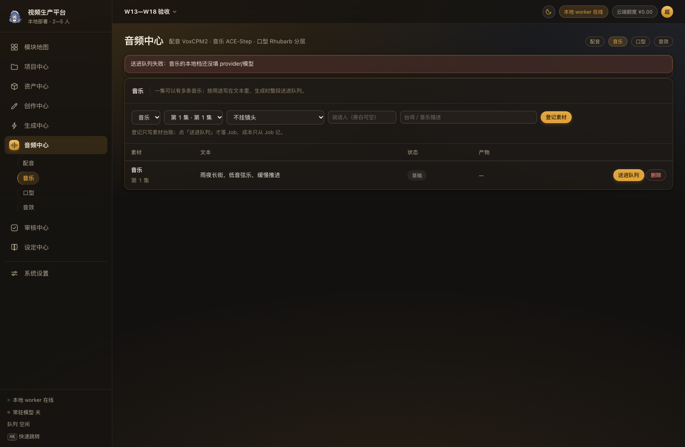

*图 9-2 当前本机没有 VoxCPM2／ACE-Step 运行时，提交会明确失败，状态仍是草稿。*

当前边界：

- 音效 `sfx` 是实验态，可以登记，不能提交。
- 口型页只保留数据位，Rhubarb 适配器尚未接线。
- 真实出声需要安装并配置 VoxCPM2／ACE-Step 运行时。

---

## 10. 看板与导出

首页看板是只读聚合，不在这里改状态。


*图 10-1 看板。集、镜、资产、文档、作业、成本、审核、音频都从各自权威表现算。*

导出镜头清单：

1. 打开首页看板。
2. 点「导出 CSV」或「导出 Markdown」。
3. CSV 带 UTF-8 BOM，Excel 打开中文不乱码。
4. 导出内容给剪映、达芬奇或人工流程使用。

导出文件包含集序、镜号、摘要、提示词、时长、资产名、最新作业状态与产物相对路径。

---

## 11. 用户与角色管理

管理员进入「系统设置 · 用户与角色」。

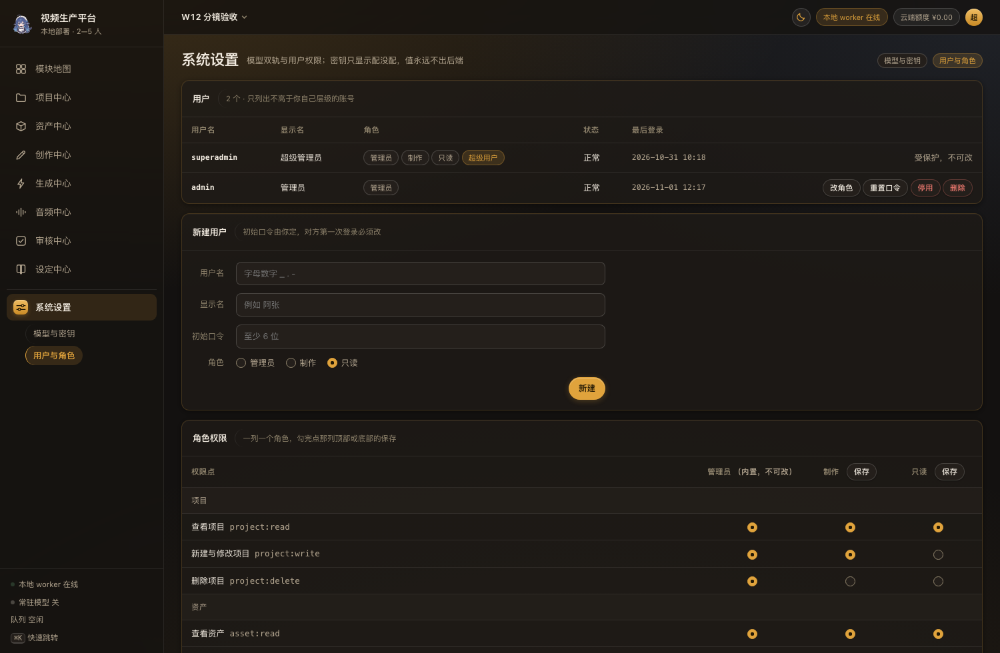

*图 11-1 用户表、新建用户与权限矩阵。*

新建用户：

1. 填用户名、显示名、初始口令。
2. 选择角色。
3. 点「新建」。
4. 把初始口令交给本人；第一次登录必须改密。

停用、重置口令、改角色：

- 不能停用自己。
- 不能改自己的角色。
- 超级用户账号不可修改。
- 删除用户前必须选择转移名下项目，或连同项目一起删除。

权限矩阵：

- 管理员列不可编辑。
- 制作与只读列可按列保存。
- 前端隐藏按钮只是体验，服务端仍会拒绝越权请求。

---

## 12. 常见问题

### 12.1 登录后页面空白或提示未登录

会话默认 12 小时。退出重登即可；如果反复出现，检查服务器时间与会话到期时间。

### 12.2 项目列表看不到项目

- 确认筛选不是「在产」而项目已归档。
- 确认自己是否是项目所有人或协作人。
- 协作人被移除后，项目会直接变成不可见。

### 12.3 文档保存提示 409

盘上正文已经变了。对照两份内容后再选择覆盖或刷新令牌。不要手工删库里的文档行。

### 12.4 文档保存提示 423

锁在别人手里。等对方保存完成、放锁或锁过期。不要改系统时间。

### 12.5 作业一直排队

先看顶栏 worker 是否在线。离线时启动：

```bash
cd 平台设计/app
./run.sh worker
```

### 12.6 本地视频失败

打开作业详情看日志。常见原因是运行时目录、权重或显存／内存不足。平台不会自动转云端。

### 12.7 云端作业失败后会不会偷偷重试到本地

不会。重试新建一行，继承原来的执行方式和计价快照。

### 12.8 音频提交失败

当前本机没有 VoxCPM2／ACE-Step／Rhubarb 运行时。失败原因会显示在页面上，素材状态仍是草稿。

### 12.9 审核签字后改正文，报告还能用吗

不能。正文版本一变，旧报告和旧签字都会过期，队列会重新把该文档列为待审。

### 12.10 环境检查通过了，为什么还显示「未达生产可用」

生产可用要三条一起齐：环境检查通过、有一条真实调用记录、有一条产物验收通过的记录。环境检查只查条件齐不齐，不发请求、不加载权重；真实调用只说明链路产出过文件。去验证记录弹窗，从一条已成功的作业先登记「真实调用」（云端还要勾计费确认），再人工看片登记「产物验收」并给出通过或不通过——只登记其中一条，徽章仍显示未达。

### 12.11 待核对的作业会不会自己消失或自动重试

不会。待核对是等人结清账单，平台不自动重试云端作业，避免重复计费。打开详情点「核对账单」，填实际金额后状态才回到成功或失败。

### 12.12 重试会不会把原来的失败记录覆盖

不会。重试新建一行，原行的日志、耗时、错误都保留；新行记第几次尝试，并链回原行。预览里能看到整串重试链与合计金额。

---

## 13. 日常操作纪律

1. 写稿前先确认当前项目，不要凭顶栏小字猜。
2. 资产只在资产中心改；分镜只引用。
3. AI 改写先看 diff，再应用。
4. 抽取候选必须看证据；没有原文证据的候选不要接受。
5. 云端作业必须看清金额并自己勾选确认。
6. 审核签字只认当前正文版本。
7. 删除项目、删除资产、批量删除前先看系统列出的连带影响。
8. 备份要整份做，不要只拷数据库文件。
9. 云端作业待核对时先核对再重试，避免重复计费。

---

## 14. 当前版本不能做的事

- 设定中心还没有表、接口和写入路径。
- 音频中心不会真的出声。
- 审核 gate 不判断事实、文风和剧情质量。
- 抽取不会自动创建分镜。
- AI 改写没有多轮对话，也不会自动合并版本冲突。
- 看板没有趋势图、工时统计和人员产能。
- 平台不做在线剪辑、节点画布、多租户和对外计费。
- 验证不会自动跑真实调用或目标机基准，要人工从已成功作业登记；没跑过的档位仍是空。

---

## 15. 备份与恢复

在服务器终端执行：

```bash
cd 平台设计/app/backend
.venv/bin/python backup.py create
.venv/bin/python backup.py verify <备份目录>
.venv/bin/python backup.py restore <备份目录> --yes
```

恢复前会自动留一份安全备份。校验不过时不要强行恢复。

`create` 不带参数时落在 `data/backups/<时间>`，要放到别的盘就把目录一起写上。备份、校验、恢复三条命令在临时环境里真跑过一遍，观测记录见《黄金样例与故障演练》§2.3；对着正式库做完整恢复仍是人工步骤，要定维护窗口。
