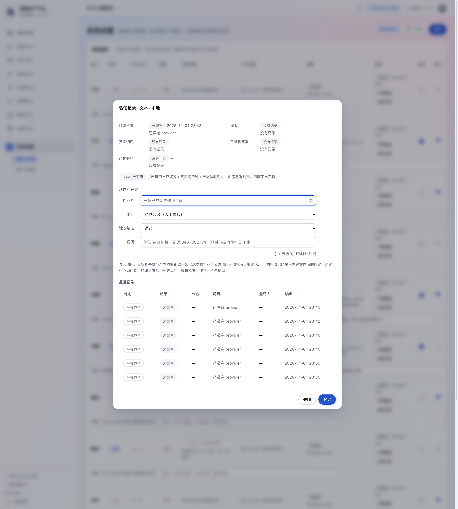
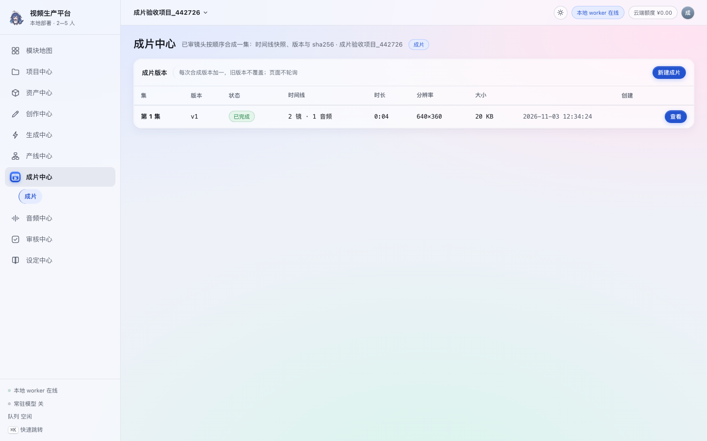
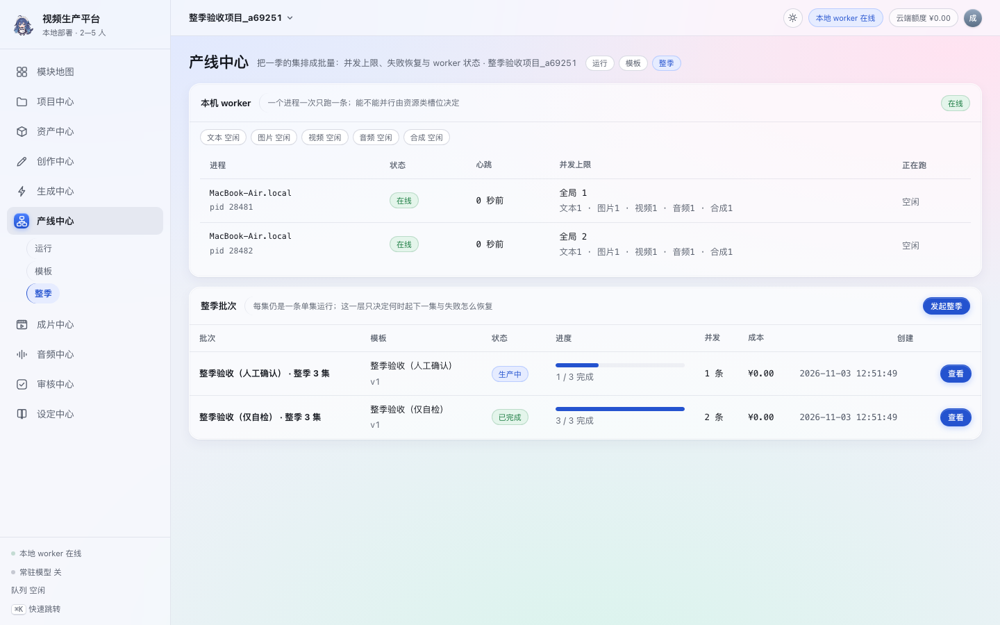
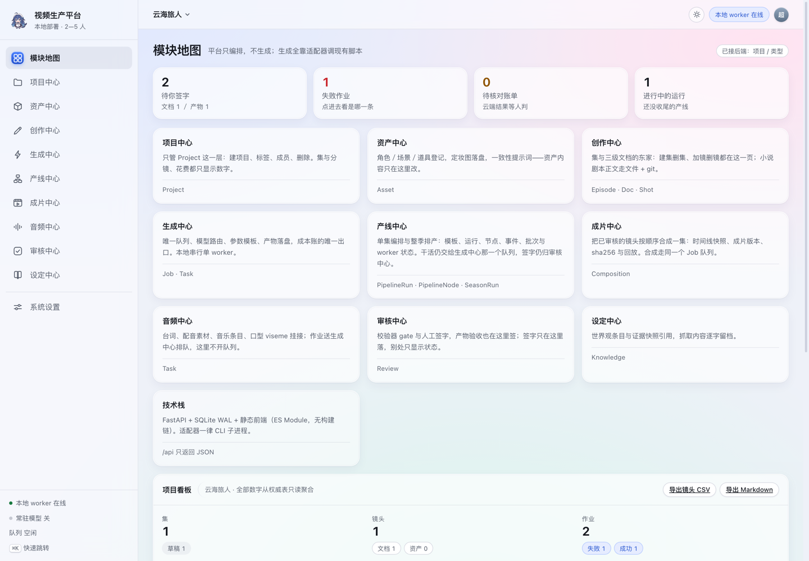
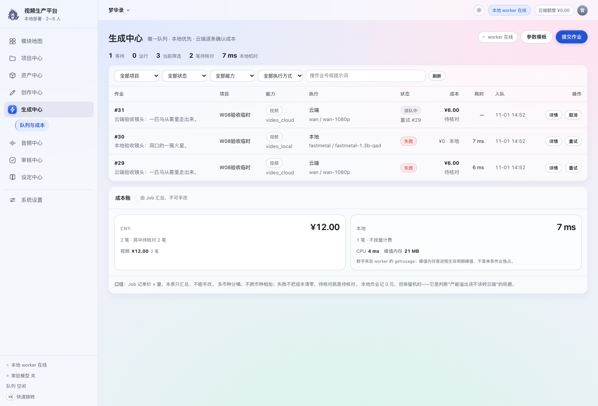
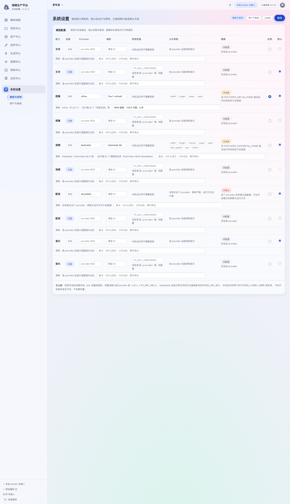
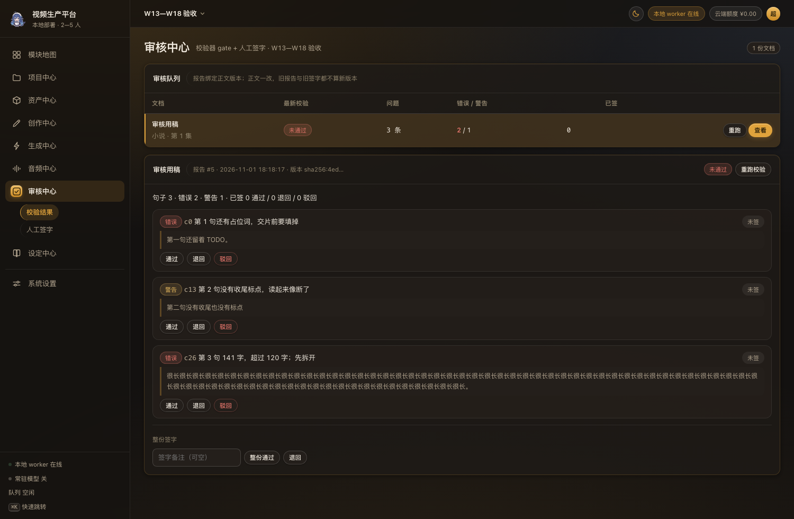

# AI 视频生产平台 系统设计说明书

- 文档类型：系统架构、组件、接口、状态机、运行与测试设计（as-built）
- 版本：v1.57（2026-11-05），对应设计稿 v0.115
- 技术基线：静态前端 + FastAPI JSON API + SQLite WAL + 文件系统／Git + CLI 适配器 + 独立 Worker
- 代码基线：`app/`；测试 **920 passed**；业务端点 167 条，另加 health 与 auth 共 172 条；可复算事实见《发布基线.md》（`tools/make_release_baseline.py` 生成；本地提交前与 CI 都跑它的 `--check`）
- 对外分发：`文档/导出/系统设计说明书.html`，截图已 base64 内嵌，单文件可直接发送
- 配套文档：[需求概要说明书](需求概要说明书.md)、[数据字典](数据字典.md)、[系统使用说明书](系统使用说明书.md)、[模型中心使用说明书](模型中心使用说明书.md)、[生产工作台使用说明书](生产工作台使用说明书.md)、[黄金样例与故障演练](黄金样例与故障演练.md)、[发布基线](发布基线.md)

## 修订记录

| 日期 | 版本 | 内容 |
|---|---|---|
| 2026-11-05 | v1.57 | **样式「只许一处定义」补两条纪律，验收数字追平**。前端没有构建链，CSS 与 JS 都是磁盘上的原文，所以「写对了但没生效」这类错只能靠量计算样式定案，本轮把它钉成规矩＋断言。① **CSS 选择器不许把文本类样式关在容器里**：.modal-body p.modal-meta 让卡片里六处同名类静默失效（p 落回 13px＋继承色＝白），改成全局 p.modal-meta 后弹窗观感逐字节不变（同权重、写在后面，仍压得过 .modal-body p）。② **侧栏分组标签就是那道分隔**：.nav-group.utility 的 border-top 早于 0037 的分组标签，留着它会在标签下面与同组两项之间各画一条线；删线留类名——buildNav 用 m.utility 当分组键的兜底（m.group 缺失时走 __utility），删类名会动到那处逻辑。③ 枚举的中文叫法只许住 enums.js：test_前端枚举表和后端枚举对齐 原来只钉 enums.js 自己跟后端一致，现在再扫一遍 views/*.js 找第二份单位表（锚取 million_token／second 这两个不会撞车的键名，character 在资产那边是「人物」的意思会误报）。验收：production_browser_check 79→**81/81**、model_center_browser_check 29→**32/32**、js_load_check 33 模块 0 失败、make_release_baseline.py --check 一致；测试仍 **920 passed**、业务端点 167（总 172）、表 40、迁移 0039。 |
| 2026-11-05 | v1.56 | **worker 面板的折叠落在视图层，计数落在服务层**。`worker_id = 主机名:pid:随机6位` 是租约归属的要求：`worker_node` 一行记着这个进程的并发上限与"正在跑哪条作业"，两个进程共用一行会让崩掉那个的作业算到幸存者头上，所以**不合并、只折叠**。`services.worker_status()` 新增 `live_count`/`history_count`（由同一份 `workers()` 数出来，界面不再自己 filter），`models.js`（运行监控）与 `pipeline.js`（整季页）两处 worker 表默认只画在线行、下面给一句「另有 N 个进程已离线（点开看）」，展开状态存模块变量以活过轮询重绘。⚠️ 这一笔把 `response_model` 静默丢字段的老坑又踩了一次：两个计数只加在服务层返回里、没写进 `WorkerStatusOut`，直调服务层的用例全绿而界面上那句"另有 N 个"永远不出现；补上字段声明后，把用例改成**必须再走一次 HTTP**——同类事故第二次出现，说明"服务层算了就算交付"这个习惯本身是错的。测试 919→**920**、模型中心真浏览器 27→**29**（两页各验"默认只列在线／点开见离线"与"个数来自服务端"）。 |
| 2026-11-05 | v1.55 | **系统设置拆成两页（设计稿 v0.111），并补一条"切换器只有一个出处"的判据**。§8.10 写清两页分工：`system-users.js` 只剩人，新增 `system-roles.js` 管角色概览与权限矩阵，`system-config.js` 从"整页转发"升成**头部与那一排 chip 的唯一出处**（`SUBS` 与 `modules.js` 的 subs 必须一字不差，router 按下标钳位）。为什么值得钉成测试：`test_infra` 那条"有二级页的模块页内也要有切换器"原来把 system-config.js 排除在名单外（它只剩一页时确实不需要），拆回两页就必须纳回名单——同时反向断言两个面板里**不许**再出现 `subChipRow`，画两遍就是一次点击两遍重渲染。旧深链 `#system-config/1` 的含义随之从"钳回第 0 页"变成"打开角色管理"，真浏览器补三条把它钉住（含"这一页不许显示任何密钥值"）。接口、权限点、自我保护规则、admin 列不可改这些**一条没动**：这是导航层的改动，不是能力层的改动。顺带修一处纪律：v1.54 提交时头部版本号停在 v1.53，本次提到 v1.55 并留痕。测试仍 919、表仍 40 张、迁移仍 0039、业务端点仍 167。 |
| 2026-11-05 | v1.54 | 追平现算数字：另一条线（迁移 0039 把 `job.project_id` 从 `ON DELETE CASCADE` 改 `SET NULL`、`access.py` 补层级闸）已进主树，本树 `pytest` 现测 **919 passed**。v1.53 那句"910→918"是音频那笔在独立树里的实测值，保留。另记一条取证纪律的复发预防：`runtime.probe_mlx_audio("music")` 读 mlx-audio 的模型注册表时，**包目录与 .py 都要算**——只 glob("*.py") 会把 `minimax_music3` 这个包读成空，而"读成空"在健康探测里等于"检查没做却说 ok"，这类假绿比一条失败的作业更贵。 |
| 2026-11-05 | v1.53 | **音频两腿的执行分支落地，并把"运行时说不支持"前移到提交之前**。`runners.build()` 增 `_voxcpm`／`_ace_step`，新增 `has_branch(capability, provider)` 成为**唯一一处**说"这条分支在不在"的地方——`build()` 与 `production._audio_wired()` 都读它；后者原来写死 False，那种写法在接线当天就会变成假话。`RunSpec` 增 `expected_glob`：TTS 的分段文件名（`<prefix>_000.wav`…）只有跑完才知道，而 `RunSpec` 是 frozen dataclass，所以 `verify()` 只把找到的路径带出去、不回头改规格。`_magic_ok` 补 audio 一档（RIFF/WAVE、ID3、fLaC、ISO-BMFF），否则一张 502 的 HTML 错误页也会被当成"音频产物"走进时间线。`runtime.probe_mlx_audio("music")` 读 mlx-audio 自己的模型注册表目录（`.py` 与包目录都算——只 glob("*.py") 会把 minimax_music3 这个**包目录**读成空，而"读成空"在这里等于"检查没做却说 ok"），据此把 ACE-Step 报成 missing，`services.audio_submit` 因此在扣任何资源之前 422。测试 910→**918**（本笔单独一棵树里现测）。 |
| 2026-11-05 | v1.52 | **读路径的规模纪律落到可复核的次数上**。基准扩到 25 项目／1 500 镜／600 资产，两条 N+1 被量出并修掉：`services.workbench()` 原来在循环里逐项目调 `_pending_documents(pid)`／`_pending_artifacts(pid)`（各两趟 SQL）⇒ 随项目数线性长（8 项目 57 次、25 项目 159 次）；现在判据不变、读法改成三处批量，其中 `reviews.job_queue_for_projects()` 用 `ROW_NUMBER() OVER (PARTITION BY project_id ORDER BY id DESC)` 保住"每项目各取最近 200 条"——直接 `LIMIT n×项目数` 会让大项目把份额吃光，那是另一种错。`production.asset_impact()` 同理：循环里逐条读镜头与签字，改成 `shots.get_many()`＋`reviews.signs_by_targets()`（**不按项目筛**，因为全局池资产的引用会跨项目）后 54→30 且不再随规模长。两条单项目旧函数保留成薄封装（调用批量版），判据只有一份。新增用例断言调用次数而非结果，因为两种写法的返回值一模一样。测试 909→**910**。 |
| 2026-11-05 | v1.51 | **调度节拍、签字口径与产物链在全链上一起验过**（无代码改动，改的是证据）。`EPISODE_FULL_CHAIN=1` 用内置「标准漫剧单集生产 v2」跑一集 6 镜：`read_script → check_shots → check_assets → confirm_script(human_gate) → keyframe×6 → review_keyframe×6 → shot_video×6 → check_video×6 → review_shot×6 → check_audio → compose → check_composition → review_composition`，展开 40 格、**40/40 completed**、运行 `completed`；关键帧真 mflux（avg 232.9s）、视频真 FastMetal（avg 41.4s）、成片由运行内 `compose` 节点产出（640×352／30.38s，记录宽高＝ffprobe 实测）。三条设计约束被这一次同时压住：**产线只读签字结论、绝不写结论**（`_sync_review_nodes` 读审核中心，四格人工关卡各靠自己的锚点放行）；**只有一个队列**（关键帧、视频、合成三类作业同一条 `job` 表、同一个 worker 串行跑完）；**验证记录只追加**（本轮没写一条 validation）。另记 §20 三处脚本编排缺陷，其中"文档签字之前必须先跑校验报告"是 `services.review_sign` 的既有硬规则——它拒绝的不是脚本的偷懒，而是把"没看过就签"这条路堵死。 |
| 2026-11-05 | v1.50 | **60 镜整集量级与八屏实拍两条证据落地**（无代码改动，改的是"哪些话现在有实测撑着"）。① `EPISODE_SHOTS=60` 真实模型整集连跑 **14/14**：单镜 avg 41.7s／最慢 47.5s、墙钟 42 分 09 秒、按秒采样 2,410 次峰值 1.99 GB、成片 303.75s 与素材合计分毫不差。热漂移是这次量到的新事实——前六镜 31—33s、第 56 镜 47.5s，**同一台无风扇机器跑到四十分钟后每条慢约三成**，所以排产口径从"33 分钟一集"改成"42 分钟一集、按 42s／镜估"。② 同一次跑量到的成片是 1280×720，查 `composition.params_json` 缺 `size_basis` 键，确认那次服务进程起于尺寸改动之前——**当前代码在同一副本库上重算判据得「与素材同尺寸（60/60 镜是 640×352）」**，旧记录就地标注作废，不重写历史。③ 新增 `tools/production_shots.py`：八屏实拍走的是与真浏览器验收同一个壳、同一批真接口数据，任何一步在界面上找不到就退出，图与界面不会再各说各话。④ 关键帧图像腿整集连跑 **4/4**（六张真 mflux 1024×1024、avg 246.8s、采样峰值 4.13 GB、墙钟 24.7 分钟）——与 60 镜视频腿合起来给出这台机器的排产账：关键帧每张约为视频的六倍成本，所以把关键帧当预览档是对的，但默认整集先跑关键帧不划算。测试 909、业务端点 167、表 40、迁移 0038 均未变；真浏览器 71→**79 项全过**。 |
| 2026-11-01 | v1.0 | 按 W00—W18 完成后的真实代码重写。补入迁移 0017—0019、抽取／审核／音频／看板路由、备份恢复、98 条端点目录、Job 状态机与成本口径、前端路由与主题机制 |
| 2026-11-01 | v1.1 | 与需求概要说明书同步：审核措辞改成“旧报告标过期、签字回 409”（审核没有预览端点）；已知限制补上 **W10 的 Wan 只验到 mock HTTP** 与 **W13 的真实模型抽取未付费跑过** |
| 2026-11-01 | v1.2 | 截图改引用 `文档/assets/`，`文档/` 目录可独立预览；避免部分 Markdown 预览器不加载上级目录图片 |
| 2026-11-01 | v1.3 | 新增单文件 HTML 导出：`文档/导出/系统设计说明书.html`，4 处截图 base64 内嵌，可直接拿出去分发 |
| 2026-11-01 | v1.4 | P0（设计稿 v0.75）：迁移 0020／0021；§8.11 补验证出处分离与 production_ready 服务端判定；§9 状态机补 succeeded／failed ↔ needs_attention、recover_stale 云端判待核对、worker 六码告警、重试预览与 superseded 链、人工核对结清；API 目录 +6（作业 3／模型 3），共 105 条业务端点 |
| 2026-11-02 | v1.5 | 阶段 1（评审 §3.1）：迁移 0022 重建 `model_validation`，出处增第五档 `artifact_review`；§8.11 生产可用改三条件、徽章阶梯更新；§10 补发布基线门禁与故障演练脚本（`tools/fault_drill.py`）；测试追平 **448 passed** |
| 2026-11-02 | v1.6 | 文档体检：§8.11 补图 8-1（验证记录弹窗，五档摘要与产物验收结论），设计稿版本行追到 v0.76 |
| 2026-11-02 | v1.7 | §15 CI 从"只跑 pytest"改成两步：测试＋`make_release_baseline.py --check` 文档门禁（测试数取本次流水线日志，不重复跑；空日志或含 failed 直接拒），并给测试表加「文档门禁」一行 |
| 2026-11-02 | v1.8 | §8.1 补项目中心呈现层口径：概览、排序、行内主次、标签折叠、最近活动均从现有字段现算，无新表／接口；归档当前项目后退回在产第一个。活动时间线、模板、收藏因缺可靠数据源不做 |
| 2026-11-02 | v1.9 | 补角色与边界态验收：§8.1 补“换视图统一走 `goView`、渲染完再同步顶栏”与“取消选择同时清集合和复选框”；四类账号与三种边界实测 35/35。无表结构、接口与权限变化 |
| 2026-11-02 | v1.10 | §8.1 补 ⋯ 浮层的定位与生命周期：按剩余空间决定朝上／朝下、放不下时压进视口内部滚动；视口一动（页面滚动、表格横滚、缩放）即收起并归还焦点，监听触发即摘，不留跨渲染的孤儿监听 |
| 2026-11-02 | v1.11 | §7 前端路由补 `store.open()` 与 `store.select()` 的分工：要跳页的入口只改状态＋上报打开过，不再派发 `app:refresh`，避免两个异步 render 抢同一个挂载点 |
| 2026-11-02 | v1.12 | 转移所有权改口：接手人不再要求先是协作人，改为启用中且层级不高于发起人（`user_rank` 比对，与邀请协作人同一条规则）；§8.1 与 API 目录同步，测试基线 448→**449** |
| 2026-11-02 | v1.13 | 撤掉行内「打开」：换当前项目只剩 `store.select()` 一条路（点行、Enter／空格、顶栏菜单），跳页由页头「去创作中心」单独负责；`store.open()` 随之删除。§8.1 同步 |
| 2026-11-02 | v1.14 | 成员弹窗排版收口（纯样式与标记结构）：复用 `.form-grid` 骨架，转移行的字段名与控件列一起显隐；无接口、表与权限变化 |
| 2026-11-02 | v1.15 | 项目中心十项修正：`ensure` 新增 **own** 一级（归档／恢复／批量归档与恢复），`ProjectBatchOut` 增 `notes`（做成了但没全做到），`ProjectOut` 增 `document_count` 与 `image_count` 两个只读计数（列表带出，批量清点不再逐个打 `/summary`）；前端行改 roving tabindex、选中不重排、搜索扩字段、同名补编号、偏好入 localStorage；成员弹窗的字段值改用 div 以避开 `.modal-body p` 的 1.8 行距，名单框 `max-height:min(34vh,240px)` 随人数伸缩。路由数不变，测试 449→**456** |
| 2026-11-02 | v1.16 | 安全收口：`/files` 从 `StaticFiles` 挂载改成 `routers/files.py` 的带鉴权路由（先判资产可见性、再判文件存在）；`worker_status(user)` 按可见范围裁 `running_jobs` 并去掉 `log_path`；`deps.require_user` 在初始口令未改时只放行改密三条；`access.ensure` 的 `need` 走白名单、未知值 fail-closed。业务端点 104→**105**，测试 456→**464** |
| 2026-11-02 | v1.17 | 风险与调优一轮（设计稿 v0.86）。§4 与 §2 补 `paths.py`：`FILES_DIR`／`JOBS_DIR`／工作区三条边界收成一条规则（拒绝对路径与 `..` 段、解析后比 `root + os.sep`、root 自己不算在里面），四处 bare `startswith(str(root))` 换掉；§5.1 新增「一句错误消息能带什么出门」；§7.1 会话行只带身份列、过期行随下次铸会话被清；§8.9 成本与看板共用 `BILLABLE_WHERE`；§10 I2V 条件图的绝对路径写法也过同一道边界；§12 补写动作显隐口径与「定时器判活要看自己抓到的节点」；§13 安全表加两行、改两行；§15 补 `test_risk_pass.py` 与 `test_hardening.py` 两行。测试 464→**476** |
| 2026-11-02 | v1.18 | 三件裁定落地（设计稿 v0.87）。§6.2 补迁移 0023／0024；§6.3 事务边界加两行（删账号·转移＝一个事务；删账号·连带删＝明确不包事务及为什么）；§7.2 权限点 20 → 18；§8.2／§8.3 写清两张表为什么没有状态列；§8.10 删账号语义；§15 补 `test_decisions.py` 一行并把真浏览器那行改成「真按键＋收集未捕获错误」；§16 第 10 条改为「设定中心未实现，权限点已撤，立项时一起加回」。db.py 新增 `transaction()`（contextvar 让 `get_conn()` 借用同一条连接）。测试 476→**486** |
| 2026-11-02 | v1.19 | 文档校正轮：§6.2 迁移表 0002 那行补「seed 20 权限点（现 18，见 0024）」，免得只读迁移表的人以为今天还有 20 个；§16 已知限制新增第 14 条**没有操作审计**（正文靠 Git、生成靠 Job 反推，其余实体查不到「谁改的」），原 14 条顺延为 15 条。无代码改动 |
| 2026-11-03 | v1.20 | 自动化漫剧产线 阶段 A＋B（设计稿 v0.89，裁定 D1／D2／D3）。新增 §8.12 产线中心（编排不执行、四张表、模板版本冻结、逐镜支线、调度节拍住在 worker、条件图从上游产物接）；§8.7 审核改口径为**两档一个写入口**（文档 gate＋产物清单，签字表多态）；§6.2 补迁移 0025／0026；§6.3 事务边界补三行（产线推进＝一个事务、提交作业与回写关联同事务、抽取建 Job 与建运行同事务）；§9.4 幂等补产线的确定性键；§11 API 目录 105→**118**（审核 4→7、新增产线 10），小节顺延；§15 测试表补两行；§16 已知限制补两条（产线无页面、生成节点未用真模型跑通）并把原「Task 实体不建」那条改成产线四表的判据。顺带修一处**假成功的 DELETE**：删名下没有项目的账号原来回 204 但账号还在。测试 486→**548** |
| 2026-11-03 | v1.21 | 自动化漫剧产线**阶段 C 页面**（设计稿 v0.90）：新增 `js/views/pipeline.js` 与 `modules.js` 的 `pipeline` 项、`ic-pipeline` 图标与 v0.90 样式块；§1 目录树点名该文件。§8.12 增「页面（阶段 C）」：页签、权限显隐、发起运行（未结束运行的集禁用＋幂等键）、动作与跳转、**不轮询**与 `isConnected` 竞态守卫、380px 竖向栈。同时把阶段 C 验收撞出的三条后端收尾缺陷写进设计：① 收尾判据从「全部节点终态」改成「全部终态**或剩余节点不可达**」（否则失败运行永不 `finished_at`，同一集一直 409）；② 重试在事务里 `reopen()` 清空 `finished_at`；③ 取消把还在等签字的无作业人工节点一并收掉（迟到的签字不能再收成完成）。另按审计 R1，`jobs.cancelled()` 补 `worker_id` 归属守卫：别人的 worker 改不动终态。测试 548→**551**（产线 26→28、R1＋1），接口、表、迁移与权限点均无变化。§15 测试表、§16 已知限制同步：删掉「产线没有页面」，补「页面不轮询」 |
| 2026-11-03 | v1.22 | 阶段 **D 成片**与阶段 **E 整季／资源并发**（设计稿 v0.91→v0.92，迁移 0027—0030）。新增 **§8.13 成片中心**（合成是普通 Job、时间线冻结、前置检查、ffprobe 验收、版本留档、三个成片节点）与 **§8.14 整季生产**（`season_run`／`season_item`、上限冻结、失败恢复只补失败格、与单集运行一一对应）。§6.2 补四条迁移；§6.3 补三条事务边界；§9.2 领取改为**按资源类分别限流＋全局上限**，`worker_node` 多进程心跳；§11 API 目录 118→**128**（成片 3、整季 7），小节顺延；§12.1 补 `pipeline.js`／`composition.js`；§15 补四行测试；§16 更新成片与并发的已知边界。测试 551→**593** |
| 2026-11-03 | v1.23 | 边界校正轮（无代码改动）：§8.13 补「硬字幕这一寸」——`subtitle_path` 与 FFmpeg `subtitles` 滤镜在后端是有的，但**没有测试、页面没有入口**，不能算已完成能力；同时点名 `worker_node.resources_json` 仍是空对象，附件 §9.1 要的「资源占用记录」只落到了上限与心跳。《需求概要》§4.12／§8、《发布基线》§3 同步；表、迁移、接口与测试数不变 |
| 2026-11-03 | v1.24 | 首页工作台＋硬字幕落地＋界面三处收口（设计稿 v0.93，无迁移、无新权限点）。**§8.15 新增首页工作台**：`GET /api/workbench` 跨模块聚合，只数看得见的在产项目；文档待签复用 `read_content` 的正文 sha256、产物待签复用 `artifact_version` 的清单摘要（改正文／删产物即回待签），签字批量取（`reviews._signs_for`，不做 N+1），`failed` 与 `needs_attention` 分开数，运行只数未收尾且未取消；产物窗口 200 条并在响应里用 `artifact_window` 明说。**§8.13 硬字幕**从"后端有、无入口无测试"改为**已落地**：三条 `composition-subtitles` 接口（不建表，文件在 `data/jobs/subtitles/<项目id>/`）、时间线冻结路径与字节数、没有 libass 时提交前拒；成片接口 3→6 条。§11 API 目录 128→**132**（看板与导出 3→4、成片 3→6）；§15 守卫回归 128→132／129→133、成片 5→7 项、新增工作台 6 项。测试 593→**613** |
| 2026-11-03 | v1.25 | 产线成片钉作业＋文档一致性（设计稿 v0.94，无迁移）。§8.13 补**产线发起的合成按节点钉片**：`composition.timeline.build(..., shot_jobs=…)` 只认钉住的那几条，`pipeline.compose_shot_jobs()` 从 `shot_review` 节点的 `input_json.job_id`（退路是 `video_generate` 节点的 `job_id`）取；手动路径不传，仍取「每镜最新成功」。§16 第 3 条把「DeepSeek 文本是真调用」改成「跑过真调用但没登记进 `model_validation`」。测试 613→**616**（成片 7→9、产线 30→31）；接口／表／迁移／权限点不变 |
| 2026-11-03 | v1.26 | 源版本绑定与生产前检查（设计稿 v0.95，迁移 0031）。§6.2 补 0031；§8.2 写清 `shot.revision` 与 `job.source_version` 的口径；§8.12 新增 `pipeline.preflight()`（阻断／警告／info 三档，`create_run` 在同一个出处上拦）；§8.13 成片前置检查多一道「源内容已变」。测试 616→**619**（成片 9→11、产线 31→32）；接口、表与权限点不变——**这一轮预检只在服务端算，还没做成接口**。
| 2026-11-03 | v1.27 | 预检与源标记做到看得见＋worker 占用落地（设计稿 v0.96，无新表、无新迁移、无新权限点）。§8.12 补 `GET /projects/{id}/preflight` 与发起弹窗的三档渲染（有阻断项时按钮直接禁用；读不到预检不替人做决定）；§8.2 补 `source_stale` 由服务端现算、分镜行贴「源已变」；§9.2 补 `worker_node.resources_json` 的真读数与口径（CPU% 按两次心跳之间算、目录不存在时往上找父级问卷）。§11 API 目录 132→**133**（产线 10→11 条）；§15 测试 619→**625**。**修一条真缺陷**：`ref_images` 是 JSON 文本、空清单 `"[]"` 非空，预检里 `if not row["ref_images"]` 永不成立，「资产没有参考图」从 v0.95 起没说过话——改成解析后判空并补回归。
| 2026-11-03 | v1.28 | 文档校正轮（**无代码、接口、表、测试改动**）：§11 `POST /projects/{id}/composition-subtitles` 的格式说明按代码改回 `.srt`／`.vtt`（唯一出处是 `composition/subtitles.py` 的 `ALLOWED_SUFFIXES`），原文误写的 `.ass` 已删——本平台不收 `.ass`。同源扫描另两份：《需求概要》§4.12／§8 第 18 条／§16 只写了 `.srt`，补成 `.srt`／`.vtt`；《使用说明书》§11.1 同样误写 `.ass`，并补上传即拒的六种写法。
| 2026-11-03 | v1.29 | 综合优化轮（设计稿 v0.97，**迁移 0032 只加一条索引；接口、表、权限点均不变**）。§6.2 补 0032（`idx_job_episode_status(episode_id, status, shot_id)`，附 `EXPLAIN QUERY PLAN` 前后与"为什么没加第二条"）。§8.2 改两处口径：分镜「源已变」判的是**最新一条成功的视频作业**、与成片同一个出处（`jobs.latest_succeeded_videos_by_shot`），并把这一页的回库次数从逐镜回库收到固定三条查询。§8.12 补两条：重试新行**继承原作业 `source_version`**（否则一次重试就把"产物基于旧分镜"洗掉）、**能不能重试由服务端判**（`retry_gate()` 一处判四道，下发 `retryable`＋`retry_hint`，页面据此决定摆不摆那颗钮）。§8.13 补：镜头与音频的原因收进同一个 `CompositionInvalid.reasons` 一次报完（原来镜头那半先 raise，音频那条根本走不到）。§11 `/pipeline/runs/{id}` 的节点字段同步。§12 新增三条设计：**过期响应不只判 `isConnected`**（路由渲染序号＋五页各自的请求号，并写明反证怎么做的）、**监听挂在视图自己渲染出来的节点上**（`#view-root` 常驻，绑在它上面等于每进一次页就叠一对监听、旧闭包还在抢 Esc）、**读失败不演成空态**。§15 成片 12→**15 项**并加一行「读路径基准」（`tools/bench_queries.py`，只数机制不吹性能）。测试 **625→628**；现测回库次数：分镜列表 123→**9**、运行详情 54→**18**、成片列表 15→**6**、运行列表 12→**9**、预检 34→**28**，首页工作台 **153 未动**（读盘算 sha256 属正确性要求） |

| 2026-11-04 | v1.30 | 资产中心增强包（设计稿 v0.98，**迁移 0033**）。§6.2 补 0033（`asset_character_profile` 主键＝`asset_id`、`asset_variant` 图跟着形态走，`asset` 一列未动）。**§8.3 整节重写**：一个模块三个工作区（资产库／资产创作／文本提取）、人物档案四段、命名形态、文字与图像两条生成轨、产物导入、候选分诊，并写清**提交仍只有一条路**（`services.submit_job`）与**归属写在 `job.input_refs` 里**（不给 job 加 asset_id 列）。§11 API 目录 133→**143**（创作组 17→28 条）；§12.1 前端文件补三个新模块；§12 新增一条设计：**表单只在"第一次读到这条资产"时灌一次**（轮询每三秒刷新整页，每刷一次就从库里重读一遍＝把人刚填的擦掉，v0.98 真浏览器验收当场撞上）。§15 守卫回归 133→143、新增「资产增强包 39 项」一行。§16 补两条边界（本机没有健康的生成轨；`mock` 槽位只在演示开关打开时进清单）。测试 **628→687**、表 34→**36** |
| 2026-11-04 | v1.31 | 资产中心深度优化（设计稿 v0.99）：§8.3 新增 §8.3.1 九段（三处跳转断点、幂等收进 `services.submit_job` 与派生键、弱版本令牌 `seen_version`（为什么不能用 `updated_at` 本身）、五种文字任务模式与 `sec:` 段落记录、`image_inputs` 能力声明与验证徽章、轮询局部重绘与 `bindLive` 绑定纪律、形态生成与单张图删除、`shot.variant_ids`（迁移 0034）与源指纹、三类字段不强行统一、界面文案不留 Markdown 记号）；§6.2 加 0034 行；§11 端点 143→**144**（新增 `DELETE /api/asset-variants/{id}/images`）；§16 加第 22、23 条（矛盾检查的能力评估、形态图无上传口）；§17 加四条取舍；测试 687→**709 passed**。 |
| 2026-11-04 | v1.32 | **模型中心**（用户开发任务书方案 B，**迁移 0035**）。§8.11 整节重写并改名：一级菜单「模型中心」四个工作区（模型仓库／引擎管理／调用策略／运行监控），能力轨十行**从系统设置整页搬来、一行功能没减**，系统设置只剩用户与角色。新增 §8.11.1—§8.11.5 五段：规格与实例分层（为什么清单继续住 `adapters.py`）、能力标签的两条合法来源（清单派生／人工声明，**模型名不构成证据**）、状态三件事分开判（登记／引擎连接／实际可用）、策略不参与选路（裁定 MC1＝备用轨只提示不自动切）、未接入引擎怎么显示（本机装了 ComfyUI 与 Draw Things，平台零适配 ⇒ 只登记不给按钮）。§11.14 端点 8→**17 条**（新增 `/api/models` 一族与 `/api/model-policies` 一族）；§12.1 前端文件补 `views/models.js`，`system-config.js` 退化成转发；§12 新增两条设计：**六列而不是十列**（旧页 Provider／模型输入框压到 80px 显示成 "deepse" "d"）、**长校验错误不进系统弹窗**（一次说清所有问题的原话留在表下面）。§15 守卫回归 144→153、新增「模型中心 24 项」一行。测试 **709→752 passed**、表 36→**38** |
| 2026-11-04 | v1.33 | **整体代码体检轮**（无新表、无新迁移、无新权限点；测试 **752→764 passed**，端点仍 153／总 158）。设计层面的四条落点：① **删除动作的清理职责分层**——级联只保证库里不留孤儿行，**文件与 Git 必须显式清**，因此 `delete_episode_cascade()` 与既有的 `delete_project_cascade()` 同构（先记路径→删行→`git rm`→收空目录），`services.py` 顶部那条"写在 router 里让另一个 router import 是反的"的规矩在这里第二次生效；② **边界检查按信任来源分档**（§10.2 `runners.py`）：相对路径＝界面输入，只认本作业目录；绝对路径＝平台自己产的作业产物，认 `data/jobs/<纯数字作业号>/`。文件头第 3 条硬约束原文写的是"输入图只能来自 Job 自己的目录或显式配置的本地路径"，与产线的注入方式互相矛盾，本轮把约束改写成分档，并在 `test_runners.py` 补两条（放行上游产物／非数字目录仍拒）；③ **worker 主循环的兜底范围**（§10.1）：`seasons.tick()`／`pipeline.tick()` 早有 try，`run_once`／`heartbeat` 没有，而后者才是最容易撞 `database is locked` 的一档（`advance_run` 在 `BEGIN IMMEDIATE` 事务里跑 ffprobe，另一条连接 5 秒就抛）——独立进程没有 supervise，一句锁冲突等于停摆。事务里跑外部进程这件事仍是**开口**，本轮只把后果兜住；④ **枚举的单一出处**：`repositories/ordering.py` 把四处手抄的能力／运行位置排序 `CASE` 由 `models.CAPABILITIES`／`BACKENDS` 的键序现推，`adapters.POLICY` 从 `manifest_payload()` 的函数体里提到模块级，模型中心路由与 `resolve` 响应都改成读它而不是抄字面量；前端新增 `js/enums.js`（能力／运行位置／计费单位）与 `js/validation.js` 里的作业状态表，五条守卫测试负责在有人再抄一遍时报警。 |
| 2026-11-04 | v1.34 | **成员可写回归的修复**（无新表、无新迁移、无新权限点）。§5 调用链那段补上一句真口径：`access.ensure` 的五档里**成员做到 `write` 为止**，`own／delete／manage` 归所有人与管理员。起因是 `need != "read"` 就拒这一句把 `write` 一起关在门外，协作人建不了集、登不了资产，而《使用说明书》§1.3／§4 与 `access.py`、`projects.js` 的注释都还写着"成员能读能改"——四处口径对不上，以代码现场实测为准（临时库里真跑：`POST /episodes` 与 `POST /assets` 都是 403）。改成白名单 `_MEMBER_OK = ("read","write")`，新加一档必须在 `NEEDS` 与「成员能做」或「只归所有人」两处之一表态，否则按拒处理。测试 **764→770 passed**（`test_projects.py` +6：成员三条正面写、三档越权各说一句、只读成员仍被权限点拦、外人仍 404、以及一条"档位有没有漏表白"的元守卫）；真浏览器 **19 项全过**（协作人改名／建集／登资产＋四条越权＋只读成员＋所有人的 ⋯ 菜单缺「永久删除」＋零 JS 错误＋380px）。顺带钉住一条一直没说准的话：**删项目要同时过两道**——`project:delete` 只授给 admin 角色，editor 连自己名下的项目也删不动，所以《使用说明书》§4 那格原来写的「所有人／管理员」是写宽了。 |
| 2026-11-04 | v1.35 | **前端四条真缺陷收口**（设计稿 v0.101；无新表、无新迁移、无新权限点，端点仍 153/158）。§12 的 `bindLive` 那条纪律**补上反面**：没被重画的节点是同一批，每 tick 再绑一次就按次数累加（真浏览器实测跑一条 60 秒作业≈20 个 tick 后，点一次「删这张」连发 20 次 DELETE）。四条都落在这里：形态图的删图钮与图片预览钮补 `dataset.bound` 守卫；409 冲突条的「知道了」从 `mount()` 挪进 `bindLive()`（横条每 tick 被重画，以前作业在飞时关不掉）；资产库空态／错误态的「清除筛选」「重试」改由 `paintGrid()` 末尾统一绑（原来绑在 mount，首屏有结果时 `querySelector` 拿到 null＝从没绑上）；`assets.js` 的工作区切换器补 `refresh()`，同时**资产创作与文本提取两个工作区各自补上页头切换器并绑定**——≤860px 时侧栏二级导航整块隐藏，以前从资产库切进资产创作就再也回不去了。另加两条纪律：`bindLive` 里防重复绑定、**页面上写出来的承诺要有对应判据**（轨道面板一直写着"配好之前提交钮是灰的"，而没选到具体档位时那颗钮照样能点，点下去吃的是服务端那句载荷规则 422——现在 `slotMissing()` 也是 disabled 条件，渲染与轮询两处都判）。测试 **770→774 passed**（`test_infra.py` +4）；真浏览器 **12 项全过**（黄金样例 §2.15）。 |
| 2026-11-04 | v1.36 | v0.102 后端读路径优化与去重：资产列表 SQL 从相关子查询改派生表（600 资产／1500 镜实测 180ms→1.9ms，第一版被逐行比对打回——字符串 id 与数字 id 分成两组会让一行资产匹配两遍）；`recent_generations` 的过滤下推到 SQL（同项目作业一多就看不见刚生成的候选，那是假空态）；引用清单的可见性判定按项目去重（以前每行各开一条连接）；一镜多形态时父资产一次查齐；删资产的图片清单改走既有出处 `_images_of`（脏数据以前会把删除卡成半套）。回归：全量 **777 passed**、v0.99 那 91 项整套重跑 **92/92 全过**（含 380px 零溢出——页头那排工作区 chip 在 380px 撑出 46px，已让 .right 可折行）。 设计层面记三处：① **同一件事的第二个实现是真隐患**——`_images_of` 早就认坏 JSON，路由里那份手写 `json.loads` 不认；② **列表 SQL 背着相关子查询＝所有读写都付平方项**，改派生表必须逐行比对语义（亲和性转换与聚合顺序都会悄悄变）；③ **取数窗口式过滤会制造假空态**，能把条件推到 SQL 就别在 Python 里筛（`jobs.list` 因此开 `refs_prefix` 一个参数，前缀里的 LIKE 通配符转义掉）。测试 774→**777 passed**（+3：语义钉、窗口钉、脏清单钉）。 |
| 2026-11-04 | v1.37 | 新增配套《模型中心使用说明书》，§15 的模型中心真浏览器验收由 18 项补到 **20 项**：新增「不改任何字段也能保存能力轨」一条——保存时以服务端十行为骨架，折叠行原样回读，不再只扫 `tr.slot`（此前只提交 3 行，被「每类能力都要选一个默认」整批拒绝）；运行监控告警码统一走 `alertLabel()`，`needs_attention` 显示「待核对」。新增一条守卫测试钉住告警码中文对齐。另修登记弹窗的一处口径：`ModelRegistrationIn.source` 默认空串、由 backend 兜底，云端登记不再存成「本地」；编辑态把能力与运行位置锁灰，避免「改了却没变」。测试 **777→779 passed**（告警码对齐＋source 跟随各一条）。设计本体未改。 |
| 2026-11-04 | v1.38 | **合并轮数字追平**：模型中心那条线（告警标签单一出处 `js/validation.js` 的 `ALERT_LABEL`／`alertLabel()`；`model_registration.source` 空串＝跟着 backend 走）与本轮后端读路径优化、迁移 0036 并轨，代码基线追到 **781 passed**、迁移 **0001—0036**。§15 表里「真浏览器（模型中心）」那一格的条数从 18 更正到 **20**——旧数残留在正文表里、头部追了正文没追，本轮就是来抓这个的。§12 前端纪律补一条口径：**同一句告警的中文名只许住一处**，英文 code 只用于样式分档。 |
| 2026-11-05 | v1.49 | **协作读数与合成默认档两处**。① `jobs.submission_counts()` 与 `reviews.signer_counts()` 两条只读聚合挂进同一个 `stats.team`：只回答"谁提交了几条、谁签了几次"，两条限制（作业数≠产量、不排通过率）随数字显示，界面与响应都不给 `rate`/`rank`——平台的可查事实只有 `created_by`/`signed_by` 这类弱引用，没有操作审计。② 合成分辨率的默认档从执行器写死的 1280×720 改成**素材的众数尺寸**：`timeline.majority_size()` 算、`composition.service._params(raw, timeline)` 分三档出处（人填的／与素材同尺寸／配置默认档），`create()` 因此改成**先建时间线再定参数**（原来先算参数，默认永远是配置档）；素材尺寸不合规矩（奇数、超出 320—3840）不硬用，退回默认档并把原因写进 `size_basis`，当次档位冻进 `timeline_json.output_size`。本机整集连跑量到写死默认的后果：六条 640×352 素材被拼成 5.6 MB 的 1280×720 成片——画质不多一个像素，字节与耗时翻倍，盘余估算跟着虚高。`test_pipeline.py` 一条用例原断言"成片必须是 1280×720"，那是把放大固化成规格，按新口径改正。测试 **901→909 passed**。 |
| 2026-11-05 | v1.48 | **盘余估算收成一处算式**：新增 `diskplan.py`（`estimate()`／`sentence()`／`disk_readout()`）与仓储取样 `jobs.recent_result_paths()`，`precheck.shot_precheck`、`precheck.composition_precheck`、`pipeline.preflight` 与 `production.project_stats` 四处全部改读它。三条口径：① 样本只取**本项目** `succeeded` 作业的真实产物字节，分成每镜视频／每张关键帧／一次成片三种典型大小，**成片作业排除在每镜平均之外**（`capability` 同为 video，不排除会把平均值抬高一到两个数量级——用例 `test_每镜平均不把成片作业算进去` 钉的就是这件事）；② 需要量 = `Σ(平均×待做数)×1.25`，系数与算式一起进文案，人可以复核；③ 没有样本就不说"预计"，只说固定提醒线并写明原因（`DISK_MIN_FREE_GB` 保留为地板）。`DISK_MIN_FREE_GB=5` 那条"拍的"开口按实测结清：一镜视频 169,347B、一张 1024 关键帧 1,953,074B、六镜 720p 成片 5,622,530B ⇒ 60 镜一集约 0.21 GB，地板约等于 23 集余量；这台 16GB 机器的真实约束是内存（冷提示词单条 8.75GB）。测试 **895→901 passed**、真浏览器 **71/71**（新增"磁盘那一行与预检同句"）。 |
| 2026-11-05 | v1.47 | **批量重投：把「逐条点」收成一次，但判据一条都不放宽**。新端点 `POST /api/jobs/retry-batch`（权限点沿用 `job:submit`）＋服务层 `services.job_retry_batch()`＋读数出口 `jobs.latest_jobs_by_shot()`。三条设计决定：① **能自动的只有本机失败与已取消**——云端逐次确认计费、`needs_attention` 结果未知，这两种在批量入口逐条拒并把原因写回响应；这不是保守，是「批量不该替人按下可能再扣钱的按钮」。② **批量与单条共用同一个 `jobs.retry()`**：新行复制参数、`attempt` 加一、`retry_of_job_id` 指回原行，原行一字不动；批量若另写一套复制逻辑，两条路会走出两种历史。③ **「这一镜最后一条作业」只有一个出处**（按 `shot_id` 分组取 `MAX(id)`），下一步任务、统计与批重投都读它，分两处写就会分裂成「一页说卡住、另一页说没事」。前端两处坑当场修掉并各留一条用例：结果条直接写 DOM 被 `app:refresh` 擦掉（改模块级状态＋按「项目 × 集」失效）、原生 `confirm` 被 `tests/test_infra.py` 的危险确认守卫拦下（改用应用内 `confirmDanger`）。测试 **886→895 passed**、守卫表 167→**168 行**、真浏览器 **65→70 项全过**；业务端点 166→**167**、总 171→**172**，表仍 40 张、迁移仍 0038。 |
| 2026-11-05 | v1.46 | **P2 能算的那半：统计挂在原页、内存改成本条采样**。① 读数出口：`jobs.stats_for_projects`（状态×能力、错误码分布、`json_extract` 取每条能力自己的采样内存峰值）与 `reviews.decision_counts`（档别×结论），金额仍走 `jobs.cost_summary`——**统计里不重抄 `BILLABLE_WHERE`**，否则就是第二本账；`production.project_stats()` 只做派生与措辞，`stats` 挂在既有 `GET /api/projects/{p}/production` 上（不新增端点、不新增表）。② 内存语义分两种并都留在 `resources_json`：`child_max_rss_kb`＝worker 生命周期最大值（`RUSAGE_CHILDREN`，会串台），新增 `child_peak_rss_sampled_kb`＝本条作业运行期间沿 ppid 走完整棵子进程树、按秒采到的峰值（`worker._RssWatch`／`descendant_peak()`）。采样会 fork 一个 `ps`，其 CPU 时间计入 `child_cpu_ms`（量级约 30ms/条），换来的是每条作业自己的内存读数；采样可能低于真实峰值，所以界面措辞写「按秒采到的」。③ 推算给区间：下界按已完成视频作业均值，上界加冷提示词编码均值（本机实测 82.0s vs 0.007s、8.75GB vs 1.99GB），没有样本一律给 None；「参考并行」把 `(总量 × 0.8) ÷ 单条峰值` 的算式与数字一起显示，供人复核。④ 前端把签字结论的中文名与色调收进 `js/validation.js`（`DECISION_LABEL`／`DECISION_TONE`），审核中心改读它——原来那三行住在 `views/review.js` 里，工作台再想要「已通过」就只能再抄一遍。测试 **875→886 passed**（`test_worker_rss.py` 6 项、生产统计 5 项），真浏览器 **59→65 项全过**（含「没读数不冒充」「推算那句跟着样本走」「侧栏 13 个入口里没有新增统计菜单」三条）。 |
| 2026-11-05 | v1.45 | **P1 第 3、6 项：跳转、面板与预检都收成一处**。① 新增 `js/goto.js`：`gotoEntry(entry)` 是全系统唯一一处「跳到哪」，字段口径直接对齐服务端 `precheck._item()` 的 `locate`（`module`／`sub`／`shot_id`／`asset_id`／`job_id`／`episode_id`），跳转后按 `episode_id` 对齐顶栏上下文；各页原来各写一遍，服务端的 `shot_id` 到某页就被丢。② 两块面板从单页抽成共用模块：`views/review-checklist.js`（质量清单，审核中心与镜头工作台同一份渲染）与 `views/diagnosis.js`（七字段诊断，生成中心抽屉与产线节点同一份）——判据都在服务端（`reviewkit.py`／`error_catalog.py`），前端只画。③ **产线与人工共用一份预检**收成事实：`precheck.episode_precheck()` 仍然只调 `pipeline.preflight()`，但把结果翻成三档条目并给 `can_start`；发起弹窗改打这一条接口，按钮禁用只认服务端那个布尔，页面不再自己数条目。新增 `_first_seq()`／`_episode_locate()`：按句子里的具体物认跳转（「第 1／2 镜」这种并列写法也认，「资产 X 没有参考图」落到补图那一页而不是资产列表），**认不出返回空定位**——给一个默认页等于骗人。④ `error_catalog` 接进产线：`_NodeFail` 的 13 个节点码全部入目录（41→54 条），`for_node()` 只翻译不判命，`retryable` 由调用方把 `retry_gate()` 的口试原样叠上；`_node_view` 带出 `diagnosis`。**本轮两条真缺陷**：`PipelineNodeOut` 没有 `diagnosis` 字段，`response_model` 把后端算好的东西丢了——`run_view()` 里在、HTTP 出来没有，所以补了一条必须走 HTTP 的用例；`shot-workbench.js` 一颗按钮的绑定少收一个括号，11 个模块整批加载失败，`tools/js_load_check.py` 从此按 32 个模块算、失败 0 才算过。测试 **867→875 passed**，真浏览器 **51→59 项全过**，六场景 **53/53** 重跑（含真实模型腿）。顺带追平 §15 里残留的旧数：守卫表「153 条／153 行」按现算改成 **166 条／167 行**（《需求》§7.1 同一处残留的「781 passed」也已追到 875）。业务端点仍 166／总 171、表仍 40 张、迁移仍 0038。 |
| 2026-11-05 | v1.44 | **P1 第 8 项：音频能力状态透明化** + 把一件待裁事项落成代码开关。新端点 `GET /api/audio/capabilities` 由 `production.audio_status_view()` 供给，五类逐条判（配音／旁白走 tts、音乐走 music、音效与口型今天连 capability 都没有）；判据只读三处已有事实——清单里有没有这个能力、默认轨解析不解析得出、`runners.build()` 有没有这条分支——**一条都不新造，也不在前端写死**。音频中心顶上多一块「这一页现在能干什么」，未接线时「送进队列」变灰并把原因写进悬停（原来是让人点一次吃一次 422），口型那一档明写不存在而不是藏起来。用例专门有一条**把三处判据拨一下就跟着变红**，防止字段退化成写死的 False。另一件：清单要不要管住**单条**签字接口是产品决定，落成 `reviewkit.ENFORCE_CHECKLIST_ON_SINGLE_SIGN`（默认 False＝现行为：要求住在批量与界面），并有两条用例把「默认签得掉」与「翻起来真的管得住」都钉住——翻开关时要连带改的是产线人工关卡与六场景脚本，所以那两条用例不许删。顺手修掉一处界面脏字：能力表的说明里带了 markdown 星号，被原样渲染进页面。测试 **858→867 passed**（`test_audio_capabilities.py` 5 项＋开关 2 项），业务端点 165→166，真浏览器 **47/47**。 |
| 2026-11-05 | v1.43 | **P1 第 4、5 项：审核质量清单与批量签字**。迁移 0038 新表 `review_check`（一行一项、`state IN (pass/issue/na)`、`UNIQUE(target_kind,target_id,code)` 改判覆盖不叠历史，`target_id` 与 `review_item` 同法不上外键）。新模块 `reviewkit.py` 是清单的唯一出处：按能力分两套人工项（image 四项、video 五项），自动项每次现算且一条都不入库——文件在不在问 `jobfiles`、媒体读不读得出来问 `composition.validators.inspect`（与取片同一个 ffprobe 口径）、源版本变没变问 `services.job_source_stale`。三条新端点：`GET/POST /api/jobs/{id}/review-checklist` 与 `POST /api/jobs/review-batch`。两条产品口径写死并被用例钉住：**签通过要求人工必看项勾完（没看够不能盖章），驳回与退回不要求**（一眼看出不行就该能立刻驳回，不能被表单卡住，这个不对称是有意的）；**批量逐条落地、逐条报原因，但归属判断（403/404）原样抛出**——第一版把 `access.ensure` 的 404 也咽进结果里，接口于是变成 200 加一句「作业不存在」，批量入口就成了探测别人项目内容的尺子；是 `tests/test_guards.py` 的越权用例当场抓出来的。前端：审核中心·产物审核多一列勾选与一条批量工具条，作业详情多一块「质量清单」（自动项只读、人工项三枚按钮，勾完结论从「先补清单」变「可签字」）。`tests/test_review_checklist.py` 新增 8 项（含「勾了不合格也算看完、但结论要人自己下」这类边界），守卫表 +3 行，`tools/production_browser_check.py` 加 7 项真浏览器断言（含「已看 0 → 4」这种靠实测两个数比的断言）并扩到 **43/43**；测试 **844→858 passed**，业务端点 162→165，表 **39→40**、迁移 0038。 |
| 2026-11-05 | v1.42 | **P1 第 2 项：对外状态统一成了界面事实**。任务书 §12.3 要的「前台五档、详情细粒度」过去只在镜头工作台的对外列用了 `publicStatus`，其余界面还在直接念 `status_label`（排队中／启动中／运行中／待核对混在列表里）。本轮把六个界面面——生成中心队列与抽屉副标题、资产详情的生成记录、资产创作的工作条与两处提示、成片中心列表与详情、分镜的作业列与文档 AI 状态、产线节点上挂的那条作业——都改读同一份 `js/validation.js` 的 `publicStatus`：**列表只给五档，细粒度原词留在 chip 的 title 与详情抽屉里**（`statusChip(status, label, fine)` 的第三参数）。为什么这么切：五个词回答的是「这件事要不要我管」，而 queued／starting／running 对人没有区分度；但排障要的原词一个字都不能少，所以它降级进悬停而不是消失。后端状态语义与 `JOB_STATUSES` 未动。`tools/production_browser_check.py` 加两条真浏览器断言（列表里不许出现细粒度词、五档 chip 必须带原词 title），扩到 **34/34 全过**；`pytest` 仍 **844 passed**（本轮纯前端）。 |
| 2026-11-05 | v1.41 | **P1 第 7 项：异常恢复目录**。新增 `error_catalog.py`（40 条目录项，七个字段一栏不缺：可懂说明／技术详情／影响范围／推荐做法／可否重试／是否可能额外收费／是否需要人工），新端点 `GET /api/jobs/{id}/diagnosis`（权限点跟着 `job:read` 走，不给它开第二条更宽的出口），生成中心的作业抽屉多一栏「这一条为什么这样」。三条设计决定：① **只翻译不判命**——判定仍只住 `worker.CLOUD_UNCERTAIN_CODES`、`services` 与 `adapters` 那几处，目录不新增任何事实；② **认不出的码必须承认认不出**（`known=False` 并原样带出执行器的话），免得将来新增码时目录悄悄给出一个误导性建议；③ **`retryable` 是最贵的一栏**，云端结果未知与被驳回的产物一律不给「直接重试」。写接口时当场修掉一处会让界面变狼来了的判命：排队／执行中的作业 `error_code` 本来是空的，空码去查目录会命中「未登记的错误码」，现在这两种状态各有实话条目（`job_in_progress`／`job_failed_generic`）。新增 `tests/test_error_catalog.py` 11 项（§14 十二类按标题找齐、七字段齐、未登记码不谎报、云端未知不可重试、排队中不报异常），守卫表 +1 行。测试 **832→844 passed**，业务端点 161→162。 |
| 2026-11-05 | v1.40 | **P0-5 前端 + P0-6 六个业务场景真跑**。前端：`js/modules.js` 加五组导航分组、新增 `production`（项目工作台）与隐藏路由 `shot`（镜头工作台，不进侧栏、不与分镜子页抢 `sub` 参数）；`js/store.js` 的当前集改成服务端上下文（乐观更新＋失败回滚＋toast）；新增 `views/production.js`、`views/shot-workbench.js`，生成中心提交弹窗与成片中心新建成片弹窗都先读预检，结论为「阻塞」就不发请求；`js/validation.js` 增五档对外状态（待处理／进行中／需要处理／已完成／失败）。验收：新增 `tools/production_scenario_check.py`（任务书 §17 六场景、49 条检查：真 HTTP、真 worker、真产物、真 FastMetal 与真 mflux 模型轨，跑库副本不碰开发库）与 `tools/production_browser_check.py` 28 项。**真跑照出并修掉四个缺陷**：① `production.shot_workbench` 对 `sqlite3.Row` 调 `.get()`，引用了形态的镜头一开工作台就 500；② `review.pending` 把 Row 放进响应，Pydantic 在 `dump_json` 里报「Unable to serialize unknown type」，只有走 HTTP 才量得到，用例因此坚持用 client；③ `runners._fastmetal` 不读清单默认值，产线那种 `params={}` 的作业会丢掉 `--fast-spatial`（W09 实测 16GB 上不开就 OOM），新增 `_spec_default()/_flag()` 回落到清单；④ `worker` 把 `cloud_run.py` 已带前缀的 `provider_unavailable` 又拼一次成 `provider_provider_unavailable`，于是「结果未知」躲过 `CLOUD_UNCERTAIN_CODES` 判成普通失败——账上写着待对账、界面却建议重试，这条最贵。另补预检第⑦项 `artifact.source_stale`（警告级，判据仍走 `services.job_source_stale` 这一份）与假适配器的 `media=mp4/png` 一档（产出真媒体，好让「签字、取片、合成」这条链能真跑；`model_validation` 不因此记真实调用）。测试 **826→832 passed**；新增《生产工作台使用说明书.md》与《开发/生产工作台改造/03-业务验收记录.md》。 |
| 2026-11-05 | v1.39 | **项目生产工作台改造 · P0 后端**。新增三个模块：`production.py`（九阶段与下一步任务的计算层，只读不算命）、`precheck.py`（内容／资产／模型／环境／费用／资源六类规则的唯一出处，三档：通过·警告·阻塞）、`repositories/production.py`（一条集一次聚合读，含 `referencing_shot_rows` 把直接引用与形态引用 UNION 成一条）。路由 `routers/production.py` 挂 8 条端点（上下文、生产总览、三个预检、镜头工作台、资产影响）。四条设计决定：① **上下文住服务端**——前端 `store.currentId` 只活一次会话、集根本没有服务端记录，两处各记迟早"顶栏一个集、工作台另一个集"；② **镜头设定五栏不进 `shot_source_version()`**——今天没有执行器读它们，进指纹等于"补填景别→整集签字失效"，`test_补填景别不让已签产物判过期` 钉住；③ **正式产物只有一个定义**（最新一条"成功且签过通过"的作业），镜头工作台的 `formal_job_id` 与 `composition/timeline.build()` 同源，`test_正式视频只认签过通过的那条` 负责；④ **预检不新造判据**，`episode_precheck` 直接调 `pipeline.preflight()`、`composition_precheck` 直接调 `timeline.build(require_approved=True)`，"预检说阻塞的那条提交也一定失败"有用例反证。聚合读纪律沿用 v0.102：`referencing_shot_rows` 一次查齐，不在 Python 里逐镜回库。测试 **781→826 passed**，业务端点 153→161。 |

---

## 1. 设计目标与核心不变量

系统负责账号与项目权限、业务对象元数据、文件定位、任务排队与状态、模型路由、成本记账、审核与协作界面。模型推理由本机 CLI 或国内供应商 API 执行；最终剪辑交外部工具。

六条不变量，所有代码改动都不得破坏：

1. **一个业务对象只有一个模块作为写入所有者**；其他模块只读、引用或跳转。
2. **一个生成 Job 表、一个持久化队列、一个成本计算口径**。
3. **一个 Review 写入入口**，即审核中心。
4. **一个配置事实来源**：数据库保存配置元数据；密钥只从进程环境来。
5. **一个文档正文事实来源**：文件系统 + Git；数据库不存正文全文。分镜的真相是 `shot` 表，不另存 Markdown。
6. **跨模块调用只传资源 ID／版本引用／参数快照**，不复制一份可独立修改的业务对象。

---

## 2. 总体架构

```text
浏览器（静态前端 · 原生 ES Module · 手写 CSS · 日/夜双主题）
   │  /api JSON + /files 安全静态资源
   ▼
FastAPI 单进程（只出 JSON；静态前端兜底托管）
   ├─ routers/         HTTP 形状、权限依赖、响应
   ├─ services.py      跨模块业务编排（不写 SQL）
   ├─ repositories/    唯一允许出现 SQL 的一层
   ├─ migrations/      版本化 SQLite 迁移，启动自动补到最新
   ├─ access.py        项目级第二道门
   ├─ ranks.py         账号层级（2 超管 > 1 管理员 > 0 其余）
   ├─ adapters.py      adapter 清单与健康检查
   ├─ runtime.py       本地运行时逐项探测
   ├─ runners.py       argv 构造与执行方式分派
   ├─ cloud_run.py     云端一次性子进程
   ├─ docai.py         文档 AI 六操作与选区安全
   ├─ extraction.py    抽取提示词、JSON 解析、证据复核
   ├─ reviewgate.py    确定性校验规则（可命令行跑）
   ├─ pipeline.py      产线编排：模板展开、分层调度、状态对齐
   ├─ seasons.py       整季排产：按上限起单集运行、失败恢复
   ├─ composition/     成片：时间线冻结、前置检查、FFmpeg 执行、ffprobe 验收
   ├─ workspace.py     工作区路径边界与原子写
   ├─ paths.py         上传／作业／工作区共用的路径边界与路径标签
   ├─ gitrepo.py       Git 提交、版本、diff、路径历史
   ├─ backup.py        备份、校验、恢复
   └─ worker.py        独立执行进程
   │
   ├─ SQLite（元数据／状态／成本，WAL）
   ├─ 文件系统（上传文件／文档工作区／作业产物）
   └─ 适配器：FastMetal · mlx-video · mflux · VoxCPM2 · ACE-Step · DeepSeek · Wan
```

---

## 3. 运行拓扑与进程

| 进程 | 作用 | 启动方式 | 关键约束 |
|---|---|---|---|
| API（`uvicorn main:app`） | 提供全部 `/api` 与静态前端 | `./run.sh` | 不执行模型；不阻塞等待生成 |
| Worker（`worker.py`） | 唯一队列消费者；**也是产线与整季的推进节拍**（每轮 `recover_stale()` 之后先 `seasons.tick()`、再 `pipeline.tick()`） | `./run.sh worker`；可另起多个进程并各自声明上限 | 默认全局 1、每类 1；多个进程时按资源类原子领取；每 0.2 秒续租；可被 SIGTERM；`tick()` 出异常只跳过本轮，不拖死队列 |
| 云端子进程（`cloud_run.py`） | 一次云端调用 | worker 拉起 | 请求文件只写 `key_env` 变量名，不写密钥值 |
| 本机模型子进程 | 一次本地生成 | worker 用 `subprocess.Popen(..., shell=False)` 拉起 | argv 数组；提示词是独立元素；输出边跑边写日志 |

停止：`./run.sh stop` 同时收 API 与 worker。只停 API 不会让队列前进，界面看起来像作业卡住。起两个 worker 时，各自的心跳与上限都进 `worker_node`，整季页的 worker 面板能分别看到；**同一条作业仍只会被一个进程领走**。

### 3.1 部署前提

- Python 3.12、Git；模型运行时不是跑平台的前提。
- 默认监听 `127.0.0.1:8000`；局域网用 `FASTVIDEO_HOST=0.0.0.0`。
- 文本没有本地合格路线，生产环境要把文本默认轨指向云端；本机为 `deepseek/deepseek-flash`。
- 云端视频要逐镜头显式选择并勾确认；默认视频轨仍是本地 `fastmetal`。

---

## 4. 仓库结构与分层

```text
app/
  run.sh                   启 API / worker / stop；首次运行建 .venv
  backend/
    main.py                装配：迁移、引导账号、工作区、中间件、路由、静态托管
    config.py              路径、端口、会话、租约、上限全部走环境变量
    db.py                  连接、WAL、busy timeout、事务辅助
    migrate.py             版本化迁移；迁移前备份；一个迁移一个事务
    models.py              Pydantic 输入输出模型与枚举
    deps.py                require_user / require_permission / actor_name
    security.py            scrypt 口令、会话 Token 哈希
    paths.py               相对路径 → 根目录内绝对路径的唯一边界判定；路径标签
    access.py              项目级访问判定
    ranks.py               账号层级
    services.py            跨模块编排（删项目级联、文档保存、作业提交、抽取、审核、音频、看板）
    asset_studio.py        资产中心的服务层：档案与形态、生成提交、回稿分段、产物导入；不依赖 FastAPI
    imagetypes.py          图片文件头的唯一出处（上传与导入两头共用，不再各写一份 MAGIC）
    pipeline.py            产线编排（模板校验、展开、分层调度、状态对齐、视图）；不执行模型
    composition/           成片：时间线冻结、前置检查、FFmpeg 执行、ffprobe 验收
    seasons.py             整季排产（按上限起单集运行、暂停／取消、失败恢复）
    repositories/          唯一 SQL 层（16 个仓储）
    routers/               18 个路由模块
    migrations/            0001—0033
    tests/                 pytest 全量（不跑模型、不需密钥）
    data/                  运行数据（Git 忽略）
  frontend/
    index.html              SVG symbol、登录闸门、主题前置脚本
    css/app.css            日/夜双主题变量与组件样式
    js/app.js              boot、顶栏、主题、全局事件
    js/router.js           hash 路由、二级下标钳位、详情参数
    js/store.js            当前项目、用户、权限判断
    js/api.js              全部 API 封装与统一错误
    js/util.js             弹窗、确认、错误态、转义、格式化
    js/navstate.js         二级标签与一次性草稿
    js/modules.js          侧栏与首页模块清单
    js/views/              每个页面一个模块（含异步 mount）；产线中心在 pipeline.js，成片中心在 composition.js
```

**分层纪律**

- 路由里不写 SQL；仓储里不拼 HTML；服务层不依赖 FastAPI。
- 路由之间不互相 import；跨模块逻辑进 `services.py`。
- 前端不传路径、不传单价（金额由服务端重算）、不判断权限真相。
- 业务表不引用账号做审计“谁改的”，只有 `created_by` 一类弱引用；审计要另起设计。

---

## 5. 请求生命周期与错误语义

```text
浏览器 fetch（带 Cookie）
  → main.no_store_frontend 中间件（静态与 html/js/css 不缓存）
  → 路由依赖 require_permission(code)
      → require_user：解析会话 → 401
      → 权限点判定 → 403
  → access.ensure(user, project_id, level)
      → 不可见 → 404；可见但级别不够 → 403
  → services / repositories
  → Pydantic 响应 → JSON
```

`access.ensure` 的五档各有东家，**成员（协作人）做到 `write` 为止**：`read` 与 `write` 放行，
`own`（归档／恢复）、`delete`（删项目）、`manage`（管协作人）三档只归所有人与管理员，
拦下来时各说一句自己的原因（不是含糊的"没权限"）。这条在 2026-11-04 被改坏过一次：
把"未知级别不许默认放行"写成 `need != "read"` 就拒，`write` 被顺手关在门外，协作人建不了集、
登不了资产——三档语义没变，变的是**成员能做的部分**。现在的判据是白名单
`_MEMBER_OK = ("read", "write")`：新加一档必须同时在 `NEEDS` 与「成员能做」或「只归所有人」
里各表态一次，没表态的按拒处理（宁可少给一个动作，不少一道门）。另有两条容易混：
**成员名单本身不赋权**（只读账号被加进来，写仍被权限点先拦），**删项目要同时过两道**
（`project:delete` 只授给 admin 角色，所以 editor 连自己名下的项目也删不动）。

### 5.1 状态码约定

| 码 | 含义 | 典型场景 |
|---|---|---|
| 200／201／202／204 | 成功／创建／已入队／无正文 | 提交作业回 202；打开项目回 204 |
| 400 | 请求本身不成立 | 删除项目确认词不对 |
| 401 | 未登录或会话过期 | 业务端点无 Cookie；登录失败也是 401 |
| 403 | 已登录、权限点或项目级别不够 | viewer 写操作；协作人删项目 |
| 404 | 目标不存在或不可见 | 看不见的项目；越级账号写操作 |
| 409 | 版本冲突或状态冲突 | 文档 `expected_version` 不符；资产被引用；旧 gate 签字 |
| 413 | 正文超限 | 超过 `FASTVIDEO_DOC_MAX_BYTES` |
| 422 | 输入校验失败 | 空标题、时长越界、跨项目资产、未确认云端 |
| 423 | 资源被锁 | 文档锁在别人手里 |

**404 与 403 的分界**：不可见一律 404，不用 403 泄露“它存在”；可见但级别不足才 403。批量操作逐项判定，被拒项带原因进 `skipped`。

**一句错误消息能带什么出门**（v0.86 定）：说清“哪一步不成、下一步去哪”，但不带三类东西——堆栈、部署机的绝对路径、别人的项目内容。

- 堆栈只进作业日志文件。`job.error_message` 会随**每一条作业列表接口**回传、也进素材导出与成本 CSV，worker 内部异常在这一列只留异常类型与第一行消息；`/api/jobs/{id}/logs` 与作业详情本来就是同一道 `job:read`，少写这一份并没有少给谁信息。
- 绝对路径统一过 `paths.describe()`，把配置里的数据目录换成 `data/…` 这种标签写法（Git 提交失败时“另存在哪儿”那句、以及上面那条消息都走它）。`git` 的 stderr 常把仓库绝对路径写进来，而这句话要原样进 HTTP 500 的 detail。

### 5.2 前端错误处理

- `api.toJson()` 解析后端 `detail` 并把状态码挂到 error 上。
- 401 派 `app:unauthorized`，弹登录闸门并说明“会话已过期”；登录与改密接口的 401 是“口令错误”，排除在外。
- `util.run(label, fn)` 统一“调接口失败弹一句人话”；页面内需要内联提示的（弹窗、音频）保留自己的 catch。
- `util.errorBox()`／`errorLine()` 区分“错误”与“空态”：403 说没权限，404 说不在可见范围，都带重试。

---

## 6. 数据层与迁移

### 6.1 SQLite 约束

- WAL 模式；`busy_timeout=5000`，多人同时提交不立刻抛 `database is locked`。
- 迁移表 `schema_version` 记录版本；启动自动补到最新，重复执行安全。
- **一个迁移一个事务**：`BEGIN IMMEDIATE` 包住整个迁移；`CREATE TABLE` 不会因 Python sqlite3 的自动提交留下半张表。
- 迁移前若“有待应用迁移且库里已有表”，先用 SQLite `backup()` 做快照，保留 5 份；直接拷 `.db` 会漏掉 `-wal` 里已提交的数据。
- 外键默认开启；删项目等操作按 `project_id = ?` 级联，NULL 比不中（全局资产因此天然安全）。

### 6.2 迁移清单

| 版本 | 名称 | 要点 |
|---|---|---|
| 0001 | init | 项目、集、镜、资产、设定等初始表 |
| 0002 | auth | 账号、角色、权限、关联表、会话；seed 20 权限点与三角色（现 18，见 0024） |
| 0003 | providers | 五类能力 × 本地／云端十行配置 |
| 0004 | content | episode／shot／asset 定型 |
| 0005 | project_no_kind | 项目去类型；重建 project |
| 0006 | project_tag | 项目标签 |
| 0007 | project_updated_at | 项目最后修改；重建表加常量默认 |
| 0008 | project_description | 项目介绍 |
| 0009 | superadmin | 超管改名、补挂三角色 |
| 0010 | project_owner | 所有人、协作人、外键 RESTRICT |
| 0011 | project_last_opened | 最后打开时间 |
| 0012 | asset_global_pool | 资产全局池、别名、标签、部分唯一索引 |
| 0013 | document | 文档元数据、Git 提交、编辑锁 |
| 0014 | provider_manifest | 密钥变量名、备注 |
| 0015 | job | 作业表、worker 状态、八值状态机、租约、成本列 |
| 0016 | cost_profile | 作业资源、参数模板 |
| 0017 | extraction | 抽取运行与候选、幂等索引 |
| 0018 | review | 校验报告与签字，唯一键 `(doc,version,anchor)` |
| 0019 | audio | 音频素材台账、时间戳与 viseme |
| 0020 | job_reconcile | job 加核对六列（actual_cost_micros／reconciled_by／reconciled_at／reconcile_note／attention_reason／superseded_by_job_id）与两条索引 |
| 0021 | model_validation | 模型验证证据表，只 INSERT，四类出处互不升级 |
| 0022 | artifact_review | 重建 `model_validation`（SQLite CHECK 不可 ALTER），kind 增第五档 `artifact_review`；列序与索引不变，旧记录逐列搬平 |
| 0023 | drop_dead_status | 摘掉 `shot.status` 与 `asset.status`：两列零写入方，镜头执行真相在 `job`，资产完成度按参考图与一致性提示词现算。两列都不在索引／CHECK／外键里，`DROP COLUMN` 直接生效，不必像 0012 那样整表重建 |
| 0024 | drop_setting_perms | 撤掉 `setting:read`／`setting:write` 两个空权限点。迁移期间外键是关着的，级联不会自己触发，所以先删 `role_permission` 再删 `permission`，末尾 `foreign_key_check` 兜底 |
| 0025 | review_target | 重建 `review_item` 为**多态签字表**：`doc_id` → `target_kind`（`document`／`job`）＋`target_id`（无外键），唯一键换成 `(target_kind,target_id,base_version,anchor)`。SQLite 不能 ALTER 掉一列，所以走"建新表→按列名搬数据→删旧表→改名→重建索引"（与 0022 同一套写法）；旧行一律填 `target_kind='document'` |
| 0026 | pipeline | 产线四表：`pipeline_template`（`(name,version)` 唯一，内置模板 `INSERT OR IGNORE`）、`pipeline_run`（只存 paused／cancelled 两个外生意愿位，模板版本冻结，`idempotency_key` UNIQUE）、`pipeline_node_run`（`(run_id,node_key)` 唯一，`job_id` SET NULL，`review_id` SET NULL）、`pipeline_event`（只追加）。**节点表里没有任何能从 `job` 现读的列** |
| 0027 | composition | 成片表：`composition`（`project_id`／`episode_id`／`job_id`／`template_version`／`timeline_json`／`output_rel`／`duration_ms`／`planned_duration_ms`／`width`／`height`／`created_by`），唯一索引 `(episode_id, version)`；**状态不落库**，一律从合成 Job 现算 |
| 0028 | pipeline_node_types | SQLite 改不了 CHECK，重建 `pipeline_node_run`，`node_type` 白名单加 `export_compose`／`export_validate`／`export_review`；17 列逐列搬平，重建三个索引 |
| 0029 | worker_node | 每个 worker 进程一行的 `worker_node`（`worker_id` UNIQUE、pid、host、started_at、heartbeat_at、current_job_id SET NULL、version、limits_json、resources_json）＋心跳索引；`worker_state` 保留为单行镜像 |
| 0031 | source-version | 分镜改动留痕：`shot.revision`／`shot.updated_at` 与 `job.source_version`（提交时的源内容指纹，改分镜或引用资产后过期）；`pipeline_event` 重建以放行 `preflight_warning` |
| 0030 | season | 整季两表：`season_run`（project／template RESTRICT、name、`max_active_runs`、`idempotency_key` UNIQUE、paused／cancelled、started／finished、created_by）与 `season_item`（season CASCADE、episode CASCADE、pipeline_run SET NULL、position、error_message，`(season_id,episode_id)` 唯一） |
| 0032 | job_episode_index | 只加一条索引 `idx_job_episode_status(episode_id, status, shot_id)`：分镜列表与成片前置检查都在问"这一镜最新一条成功的视频作业"，此前没有一条索引按 `episode_id` 打头，计划是 `SCAN job` 或按 status 全库扫＋临时 B 树分组。列、表、约束都没动；`EXPLAIN QUERY PLAN` 前后对比、写代价与"为什么没顺手加 `(project_id, status)`"记在迁移注释里 |
| 0033 | asset_profile_variants | 资产中心增强包两张新表：`asset_character_profile`（**主键就是 `asset_id`**，一个资产最多一份人物档案；履历／性格／成长过程／文字设定提示词四段）与 `asset_variant`（服饰／视角／形态各一行，`ref_images` 跟着形态走，`source_job_id` SET NULL 只作追溯）。`variant_type` 用 CHECK 收死四值，但**与父资产 `kind` 是否匹配在服务层判**——SQLite 的 CHECK 不能跨表引用，硬做只能养一个触发器。**`asset` 一列都没动**，老资产零回填：读不到档案就是"还没写"，读不到形态就是零个形态 |
| 0034 | shot_variant_refs | 镜头可以引用到**哪一套形态**：`ALTER TABLE shot ADD COLUMN variant_ids TEXT NOT NULL DEFAULT '[]'`，与 `asset_ids` 同构的 JSON 整数数组。不复用 `asset_ids` 塞 `"57:12"` 复合串——删除保护、引用计数、源指纹三处都按 `json_each ... = a.id` 比，塞复合串会让这三处同时看不见那条引用（数据损坏，不是省事）；也不建中间表——同一条需求两个家。归属规则（形态的父资产必须同时在 `asset_ids` 里）在服务层判并**自动补父资产**，不写 CHECK；**老镜头零回填**，读不到就是空清单，已提交作业的 `source_version` 不会被回头改写 |

### 6.3 事务边界

| 操作 | 一个事务里做什么 | 为什么 |
|---|---|---|
| 建项目 | 写 project＋project_tag＋project_member | 不能出现“项目建好、人没加上” |
| 转移所有权 | 换 owner＋原主人入名单＋接手人出名单 | 分两个事务崩一次就是没人能管项目 |
| 保存文档 | 锁检查＋原子写＋git add＋路径级 commit＋更新元数据 | 版本状态不能早于实际写文件成功 |
| 提交作业 | 校验＋写 job＋（可选）更新素材状态 | 不能留“素材说排队了、队列里没有” |
| 删项目 | 删行＋清上传文件＋清工作区正文＋清作业目录＋清锁 | 文件副作用外键不会自动做 |
| 删账号（转移） | N 次换 owner＋删 app_user 行 | 十几个独立事务会留下「几个项目换了东家、账号还在」的半套状态；全程库内写，包得起事务 |
| 删账号（连带删项目） | **不包事务**：逐个走删项目那条 | 中间要动 Git 与磁盘，回滚不回来，「看起来原子」比不原子更危险；改为把已删数量与卡住的那个报出来 |
| 删文档 | 清该文档的签字行＋删 document 行＋touch 项目 | 0025 起 `review_item.target_id` 没有外键，级联不再白送；漏了这一步就会留下指向空气的签字 |
| 抽取提交（D2） | 建 job 行＋建 extraction_run 行 | 原来两步各自提交：中间崩一次就留下**一条已排队的付费作业没有人知道它属于哪次抽取**，25 小时去重也认不出来。合成一个事务后这条孤儿作业不可能存在 |
| 产线推进（D3） | 重读运行→对齐作业节点→对齐审核节点→分层派发→收尾，全程一个 `BEGIN IMMEDIATE` | 两个进程同时推进同一条运行时，后到的等前一个提交，读到的一定是最新状态；"同一个节点被派两次"另由 `try_begin()` 的 rowcount 挡住，不依赖这把锁 |
| 产线派发作业 | 原子转态（pending→running）＋建 job 行＋回写 `node.job_id`＋记事件 | 不能出现"Job 建好了、节点不知道"——那条作业会变成谁也不认的孤儿，而幂等键已经被占掉 |
| 产线重试作业节点 | 走 `jobs.retry()` 新建一行＋节点回写新 job_id 并转 running（**不回 pending**）＋`reopen()` 清 `finished_at` | 回 pending 会让调度器按幂等键再提交一条，同一格就有两条作业、其中一条谁也不认；不清 `finished_at` 则一条已收尾的失败运行重试后仍显示已结束 |
| 产线收尾 | 写 `finished_at`＋记 `run_completed`／`run_failed` 事件 | 判据是「全部节点终态或剩余节点全部不可达」；只认「全部终态」会让前置已失败的下游 pending 节点永远挡住收尾，同一集此后一直 409 |
| 发起合成（D） | 算下一版＋建合成 Job＋建 `composition` 行＋回填 `job.params.composition_id`，全程一个事务 | 不能出现「Job 排上了、成片行没建」的孤儿合成，也不能让两个请求各拿同一个版本号；`(episode_id, version)` UNIQUE 是最后一道闸，撞了整笔回滚并回 409 |
| 合成分派给产线 | 产线 `export_compose` 节点调同一个 `composition.create(..., pipeline_run_id=…)`，再回写 `node.job_id` | 成片 Job 与节点挂在同一次调用里；产线不另建一套合成事实 |
| 整季建批次（E） | 建 `season_run`＋逐条建 `season_item`，一个事务 | 批次行在、集清单半截是种「看得见却排不了」的坏状态 |
| 整季起一集 | `pipeline.create_run()` 自己一个事务；成功后才 `attach_run` 回写 `season_item` | 运行建不起来（同集已有未结束运行、模板不成立）时，集行记 `error_message`，批次照旧推进别的集；已存在的未结束运行就直接挂上，不另起第二条 |
| 整季失败恢复 | 遍历失败节点逐个 `pipeline.retry_node()`（每个自己一个事务），最后 `seasons.reopen()` 清批次收尾 | 一步失败只影响那一格；成功的镜头、旧产物与旧签字一律不动。被驳回的审核节点跳过，等人先处理上游 |

---

## 7. 身份认证与授权

### 7.1 账号与会话

- 口令用 scrypt 哈希；会话 Token 随机生成，库里只存其哈希。
- 会话行只带身份列：`sessions.get()` 选 `id／username／display_name／is_active／is_superuser／must_change_password` 加 `expires_at`，不选 `u.*`。`password_hash` 混在「当前用户」这个对象里，早晚被某处日志或导出顺手带出去；改密要比对旧口令，那条接口自己回库取。
- 过期会话行不是永久垃圾：`sessions.create()` 在同一条事务里先删掉 `expires_at <= now` 的行。这一层没有常驻定时器，而登录是唯一每次都要动 `session` 表的动作。
- Cookie：`HttpOnly`、`SameSite=lax`；默认 12 小时到期，`FASTVIDEO_SESSION_HOURS` 可调。
- 登录失败 401；停用账号不能登录。
- 会话行只带身份列（`id`／`username`／`display_name`／`is_active`／`is_superuser`／`must_change_password` 加会话自己的 `expires_at`）。以前这里写 `SELECT u.*`，`password_hash` 就成了"当前用户"这个对象的一个普通字段——缓存、日志、导出里任何一处顺手一带就出门。要比对新旧口令的接口（`POST /api/auth/password`）自己回库取那一列。
- 过期会话行不靠单独的定时器：`SessionRepository.create()` 在插入的同一条事务里先删掉所有 `expires_at <= now` 的行。会话到期就读不到了，废行却不会自己消失；登录恰好是唯一每次都要动这张表的动作。
- 首次登录 `must_change_password=1` 强制改密；改密后该用户所有会话删除，前端用新口令自动重登。
- 引导：`bootstrap.py` 在库为空时建 `superadmin`；未给 `FASTVIDEO_ADMIN_PASSWORD` 时随机 16 位并只打印一次。

### 7.2 权限点

- 18 个固定权限点，代码 `域:动作`；`permission` 表与角色权限矩阵是配置事实来源。0002 原本 seed 了 20 个，多出的「设定」两条在 v0.87 由 0024 撤掉——设定中心没有表也没有接口，留着就是角色矩阵里两个勾了不做事的选项。
- 每个业务端点显式 `Depends(require_permission("..."))`；`/api/health` 与 auth 四条自判。
- 超级用户绕过权限点判定；新增权限点自动生效。
- 内置 `admin` 角色权限不可改（急救通道）。

### 7.3 项目级第二道门

`access.py`：

- `project_of(kind, id)`：从集／镜／资产／文档／音频绕回项目。
- `ensure(user, project_id, level)`：管理员放行；所有人 own；协作人 mem；其余不可见。
- `ensure_by(kind, id, level)`：按实体绕回项目。
- `ensure_asset(user, asset_id, level)`：全局资产人人可读，写与删只管理员；返回 403 而非 404。

### 7.4 账号层级

`ranks.py`：`2` 超级用户 > `1` 管理员角色 > `0` 其余。

- `GET /api/users` 在服务端过滤，只返回不高于自己的账号。
- 对更高层级账号的写操作回 404；对超级用户账号的任何修改回 422（“超级用户账号不可修改”）。
- 候选协作人同样按层级过滤；拿高层级 id 直接调接口也 422。

---

## 8. 业务模块设计

### 8.1 项目中心

- 表：`project`、`project_tag`、`project_member`。
- 关键字段：`owner_id`（RESTRICT）、`status`（active／archived）、`last_opened_at`、`updated_at`。
- 排序：`last_opened_at` 非空优先、时间倒序、id 倒序。
- 打开项目只写 `last_opened_at`，不推 `updated_at`；归档同样不推。
- 批量归档／恢复／加标签：逐项过 `ensure`，结果分三种——`done`（做成）、`skipped`（没做，带原因）、`notes`（做了但没全做到，例如标签已满 10 个）。只回前两种时，界面会把什么都没变的项目也报成已加标签。
- 归档与恢复是 **own** 级（v0.84）：`ensure(user, id, own)`，只有所有人或管理员。加标签仍是 write 级——打标签是日常协作，把一部剧从别人眼前收走不是。
- 转移所有权（v0.81 改口）：接手人只要启用中且层级不高于发起人，不再要求先是协作人；原主人降为协作人；接手人若在名单里则移出；不推 `updated_at`。层级这条不放宽的理由与邀请协作人相同——制作把项目交给超管后自己降成协作人，就再也拿不回来了。
- 删除项目：硬删；同时清上传文件父目录、工作区正文、作业目录与文档锁。
- 换当前项目只有 `store.select()` 一条路：派发 `app:refresh` 立刻重画，再静默回读一次让"最后打开"落地。行是 `tabindex=0` 的可聚焦控件，Enter／空格与点行同义，当前行带 `aria-current`。v0.80 为「打开」按钮加过一条 `store.open()`（只改状态不重绘，为的是躲开"列表重绘与跳页抢同一个 `#view-root`"的竞态）；v0.82 把按钮撤掉后这条路没有调用者，一并删除，竞态从源头消失。跳页只剩页头「去创作中心」，它只发 `app:go`。
- ⋯ 浮层是 `position: fixed`，摆位由 `placeRowMenu` 现算：下缘放得下就朝下，否则朝上，两头都不够就贴进视口并靠 `max-height` + `overflow:auto` 自己滚；横向按可视区左右各留 8px 夹住。打开时挂 `scroll`（捕获，覆盖表格横滚）与 `resize` 监听收起并 `focus()` 回触发按钮，关闭或触发即摘——视图每次 render 都重建闭包，不摘就会攒孤儿监听。
- 视图渲染可能改变当前项目（进入项目中心会重拉列表，当前项被删或归档就退回在产第一个），所以所有换视图入口统一走 `goView`：`renderView` 完成后再 `syncChrome`，避免列表与顶栏各说各的；批量「取消选择」要同时清 `picked` 与行内复选框。
- 列表的 `ProjectOut` 带 `document_count` 与 `image_count`（与 `/summary` 同一份 SQL 子查询）：批量删除前清点影响范围要用它们，不然勾 20 个就得发 20 个请求。
- 行是 roving tabindex：整张表只有一个 Tab 停靠点，↑／↓／Home／End 在可见行间移焦点，Enter／空格选中；重绘会换掉 DOM，所以选中后按 id 把焦点放回同一行。选中一行时沿用上一次那份行序（`keepOrder`），免得它跳到列表最前、鼠标底下换了内容。
- 排序、状态筛选与搜索词存 `localStorage`（`fv.projects.*`，与主题同一个前缀）；读不到就退回默认，禁用存储只是不记事。
- `renderView` 是在末尾才写 `currentId` 的：视图的 `mount()` 抛错时顶栏会悄悄退回 overview，而页面看着还是原来那页。所以 `app:go`／`app:refresh` 之后要再 `syncChrome()`，别让列表与顶栏各说一套。
- 呈现层（v0.77，不新增表与接口）：概览三格、排序三选、行内「打开／⋯」主次、标签折叠、最近活动列，全部由 `ProjectOut` 现有字段与 `/summary` 现算；活动时间线、模板、收藏没有可靠数据源，不做。归档当前项目后 `store.load()` 把当前项退回在产第一个，避免“面包屑有、顶栏菜单没有”的两套事实。

### 8.2 创作中心：集、分镜、资产

- 集：`episode(project_id, seq, title, status)`；集号在事务里算，避免并号。
- 镜头：`shot(episode_id, seq, summary, prompt, duration, asset_ids)`；`seq` 在集内唯一。镜头没有自己的状态列（0023 摘掉了 0004 留的 `todo|queued|done|failed`）：执行真相是这一镜最新那条 `job` 的状态，再加一列就是两个真相源。
- `PUT /api/shots/{id}` 整体更新四字段；镜号与所属集不可改。
- `asset_ids` 去重保序、上限 40；每一条必须属于本项目或全局池。
- 资产：见 8.3；镜头只读引用，不复制资产内容。
- 作业快照冻结在 `job` 行；改镜头不回头改作业。
- **分镜列表的「源已变」**（v0.96，v0.97 收口两处）：`GET /api/episodes/{id}/shots` 每行多一个只读 `source_stale`，由 `services.shots_view()` 现算——拿这一镜最新一条**成功的视频作业**（`jobs.latest_succeeded_videos_by_shot`，与成片前置检查同一条）的 `source_version` 与当前 `shot_source_version(shot)`（分镜四要素＋引用资产的版本信息）比一次。原来这里比的是"最新一条成功作业"，图像作业也算：补跑过一次图像的那一镜会显示"源没变"，而同一时刻合成报的是"源内容已变"。标记放服务端算有两个理由：前端拿不到资产侧的指纹，让浏览器判断等于复制第二套口径；而 `ShotIn` 仍然只认四个可编辑字段，回写时带上这个标记也会被忽略，它不可能被点成状态。0031 之前没有指纹的旧作业一律不判过期。**这一页的回库次数**：v0.97 起固定三条查询（这一集的成功视频作业一条、分镜一条、被引用到的资产一条），此前是逐镜回库＋逐资产回库（合成数据 24 集／312 镜／936 条作业现测 123 次→**9 次**）。

### 8.3 资产中心（v0.98 增强包 → v0.99 深度优化：一个模块三个工作区）

**模块边界**：`asset`、`asset_tag`、`asset_character_profile`、`asset_variant` 四张表只有资产中心能写（不变量 1）；创作中心的分镜、抽取候选与产线都只引用资产 id 并跳转过来。侧栏二级导航因此按**工作区**分，不再按资产类型分（类型降到资产库页内的 chip，因为"人物／场景／道具"是筛选维度，不是三个页面）：

| 工作区 | 页面 | 干什么 | 不干什么 |
|---|---|---|---|
| 资产库 | `assets.js` | 列表、筛选、新建、上传参考图、进详情 | 不在列表页里做生成 |
| 资产创作 | `asset-studio.js` | 文字设定生成与保存、图像候选与导入、命名形态维护 | 不建第二个队列、不自动写库 |
| 文本提取 | `asset-triage.js` | 读抽取 Run 与候选、接受／合并／拒绝 | **不发起抽取**（提交仍在创作中心的文档页，一条提交路不留两处） |

三个工作区共用一个下标（`asset-workspaces.js` 存 `WORKSPACES` 与读写函数），单独成文件是为了打断 `assets.js ⇄ asset-studio.js` 的循环 import。

**表与兼容**：`asset` 一列没动，`project_id IS NULL` 仍是全局池（人人可读，写与删只管理员，`access.ensure_asset` 回 403 不藏）；两条部分唯一索引照旧（0012 拆成的那两条）。资产没有状态列（0023 摘掉），界面上的「待完善」按参考图与一致性提示词现算。老资产零回填：档案读不到行就回 `exists=false` ＋ 全空，界面写"还没写过"。

**人物档案（`asset_character_profile`）**：履历／性格／成长过程／**文字设定提示词**四段。最后一段与 `asset.consistency_prompt` 是两码事、且必须一直是两码事——前者喂文本模型（"怎么写这份设定"），后者喂图像模型（"画出来必须长什么样"）。合成一列的结果是改履历顺手改掉定妆图的依据，谁都不敢动。只有人物资产有这一层：给场景或道具读写档案回 **422** 并写明"这类资产没有档案这一层"，不回一份空档案让人以为数据丢了。

**命名形态（`asset_variant`）**：人物的服饰、场景的视角、道具的形态，各一行，`ref_images` 跟着形态走。理由很硬——把日常常服、雨夜外套、受伤状态无差别塞进 `asset.ref_images`，下游图生视频会把互相矛盾的服装当成同一组参考图去生，那比没有参考图更糟。基础参考图仍然只放"这个角色到底长什么样"。同一资产同一类型内不许重名（`uq_asset_variant_name`），撞了回 **409** 并说"要改它就在原形态上编辑，不要再建一个"。

**生成：四类操作、一条提交路**。`character_profile`／`scene_setting`／`prop_setting`／`asset_image` 全部经 `services.submit_job()` 落 `job` 表——槽位白名单、云端计费确认、`_cost_of` 的 Decimal 重算、幂等、`source_version` 全在那一条路里判，`asset_studio` 不再 resolve 一次就自己建作业（那是第二条提交路）。归属信息写进 `job.input_refs` 的 `op:／asset:／variant:` 串：**不给 `job` 加 `asset_id` 列**，`job.kind` 有 CHECK 白名单，为一类新目标重建整张表代价远大于收益。所以"这条生成到哪了、花了多少钱"的出处仍然只有生成中心，资产页那个「文字·成功」角标是现读 `job.status` 得来的。

**回稿不自动落库**：模型输出按 `【履历】` 等标记分段（`parse_sections`），**标记必须在一行开头**才算段首——模型偶尔在履历里写"他说【性格】其实很稳"，按全文第一次出现去切会把后面真正的性格段吃掉；留空只是少填一格，吃错段是把话填错人。解析不出任何一段时 `can_fill=false`，把原文带回去让人自己抄，而不是把整坨文字塞进第一个字段冒充成功。界面点「填进表单」只填表单，**点「保存这份设定」才写库**——模型不写库，这一步永远是显式的。

**产物导入只认序号**：`POST /api/assets/{id}/generated-images` 的入参是 `job_id + artifact_index`（＋可选 `variant_id`），**没有任何路径字段**——文件位置由服务端从作业的产物清单里查。这一步是整个接口里最要紧的边界：一旦接受客户端给的路径，"导入一张图"就能变成"删一个服务器文件"。落盘前用文件头反向识别 PNG／JPEG／WebP（`imagetypes.sniff`），不是图片就 **415**；复制而不是移动，因为作业产物是生成中心的事实、也是产物审核签字的对象（`artifact_version` 按"路径＋存在＋字节数"算），搬走它等于偷偷让已签过字的清单变成空目录。

**候选分诊只读不改提交协议**：分诊页读 `extraction_run`／`extraction_item`，每条候选必须带逐字原文证据与偏移；接受与合并都只调抽取那组既有接口（`accept`／`merge`／`reject`），所以"补资产"这件事没有第二条写入路。镜头候选不进分镜表——只导出 Markdown 由人抄（§8.6 同一条口径）。

**这一轮没动、但仍然算数的既有事实**：参考图上传按文件头校验 PNG／JPEG／WebP、20MB 上限，文件落 `data/files/<asset_id>/<uuid>.<ext>`；`GET /files/{rel}` 要登录并按路径第一段推出资产 id 过 `ensure_asset(read)`，**可见性判定排在存在性判定之前**（原来这里是 `app.mount("/files", StaticFiles(...))`，上传接口那层 `ensure_asset` 白做）。文件头校验与魔数识别现在收进 `imagetypes.py` 一个出处（上传与导入两头都用它，不再各写一份 `MAGIC`）。引用反查走 `json_each(shot.asset_ids)`，不用 LIKE（12 不会命中 112）；被镜头引用时删除回 **409** 并列出引用，不提供 force；项目资产可升全局（id 不变），全局资产不可收回成项目资产（409）。

**与外部《资产中心增强模块开发说明》的差异**（按该说明 §0「以代码为准」的要求逐条点名）：① 说明要求"选本地／云端即可提交"，本机现实是文本轨被 `text_ai_route` 强制走云端、云端图像档（即梦／通义万相）没登记 models 与 prices，**所以两条轨在这台机器上都没有健康槽位**，界面按通用规则显示"缺条件"并禁用，不悄悄换轨；② 说明要求展示云端单价，实现只能显示"这一档没登记计价，不能提交云端计费作业"；③ 说明附的 Demo 用 Unicode 字形图标与"字段名在上"的表单，与本仓"SVG 线性图标＋字段名在左＋控件列 620px 封顶"的纪律冲突，按后者实现；④ Demo 的内存数组、示意图片与浏览器端判定没带进生产代码（说明 §0.7），页面状态一律回库里读。

**演示开关**：`mock` 槽位只在 `FASTVIDEO_ALLOW_MOCK=1` 时进 `providers/available` 清单（`routers/settings.py`），标签写死「假适配器（不执行模型）」。它存在的理由只有一个：这台机器上没有健康轨道，否则"提交→领取→回稿→填表→保存"这条链在真浏览器里一步都走不通，只能退回 pytest 用假数据代跑。生产默认关闭，清单里一个 mock 字都没有（`test_演示开关打开时清单给假槽位关掉就没有` 钉住两头）。

#### 8.3.1 v0.99 深度优化：断点、任务模式、幂等与形态引用

v0.98 把包交付完，v0.99 按《资产中心深度优化任务书》先审查后动手，把"能走通"改成"走起来不断"。九处 P0、六处 P1，逐条都有对应的实现位置与用例：

**① 三处跳转断点**。分镜表里那颗资产 chip 还带着 v0.97 的"二级导航＝类型"映射（`{character:1, scene:2, prop:3}`），而 v0.98 起这个下标是**工作区**——点角色跳去资产创作、点道具被钳到文本提取。改成 `setSub('assets', 0)` ＋详情参数。详情页「去资产创作改」原来只切工作区、创作页仍停在上一次的草稿上，现在多一条一次性交棒（`asset-workspaces.js` 的 `setStudioTarget/takeStudioTarget`）：它不进地址栏（`#assets/1/a57` 那个 `a57` 是详情的深链，工作区要的是"选中目标那一格"，混用会让创作页刷新后以为自己在详情页），也不跨项目生效。资产库的搜索框原来每敲一个字发一次 `app:refresh`：整页重绘既白打一次接口，又把焦点从人正在敲的框上摘走，实际效果是一次只能输入一个字——现在只重画网格与计数那两格（`paintGrid`），类型／范围／状态三个 chip 仍然走整页刷新，因为它们是**服务端**过滤条件。

**② 幂等收在提交路上**。`AssetGenIn` 早就有 `idempotency_key` 这一格，但没人传，而 `services.submit_job()` 也不查键——`job.idempotency_key` 上那条 UNIQUE 于是成了陷阱：连点两下是真两条计费作业，老实传同一个键的请求反而撞约束变 500（去重只写在 `routers/jobs.py` 那一条路上）。现在查键收进 `submit_job()` 本体（所有调用方白拿同一条语义），键由 `asset_studio._derived_key()` 按"给谁做／做什么／哪一档／提示词／参数"派生；键撞上但项目不同回 **422**「这个幂等键已被别的作业占用」，不把别人的作业号泄露出去；真撞在并发里由 `sqlite3.IntegrityError` 兜底回读那一条，不再抛 500。同一句话**再跑一批**是人的决定，所以界面另给一颗「换一批」，显式带一个随机后缀的键——两个按钮对应两种意图，不能由页面替人猜。

**③ 弱版本令牌**。§12 要的"用户编辑期间资产被其他请求修改"原来是静默 last-write-wins。`AssetIn`／`AssetProfileIn` 新增可选 `seen_version`，服务端用 `models.asset_version()`／`profile_version()` 现算比对，不一致回 **409** 并写清"这次没有保存、你写的字还在界面上、下一步做什么"。令牌压的是**时间＋会被改的那几列**而不是 `updated_at` 本身：那一列精度只到秒，两人同一秒内先后保存时一模一样，闸就成了摆设（第一版正是这么写，测试里连同一秒的第二次保存都拦不住）。档案令牌**不含资产时间**：创作页一次「保存这份设定」是先 PUT 资产再 PUT 档案，含了就会自己把自己判成冲突。空令牌＝不判，脚本与别的调用方不会因为多这道闸就 409。字段没叫 `base_version`——那个名字在本仓已经是"产物清单摘要"（artifact review 的 sha256），两个含义共用一个字段名是接口最难懂的那种事。

**④ 任务模式**。文字设定原来只有一种"生成完整设定"，每次点击都把已有三段重写成三份新小作文。现在 `TEXT_MODES` 五种（完整／只补空／优化已有／扩写指定字段／依据原文片段），**语义全在服务端**：`sections_for()` 按库里的实际内容决定这次要模型出哪几段，`MODE_INSTRUCTIONS` 决定给它哪句指令，`build_text_prompt()` 只拼不判。请求到的段落记进 `job.input_refs` 的 `sec:` 串，回稿按**当时请求的那几段**切——事后从"现在库里有没有内容"反推不行，人很可能已经把这一轮回稿保存进去了。`from_source` 少了原文就在**扣费之前**拒（422），不是等云端账单回来再说。§5.4 还点了第六种"检查设定矛盾"：本轮**没有实现**，理由是 `OUTPUT_SPEC` 这条口子是"段→表单字段"，矛盾审阅的产物没有可填的字段，硬做只能拿字符串比较冒充语义检查——评估写进 §16.1。

**⑤ 模型能力说得出、也只做清单说得出的事**。槽位选择现在同屏显示 `validation_state`（未验证／仅环境检查／真实调用…，字典住在 `js/validation.js`，与系统设置页共用一份），只报 `health_state` 会把从没跑过的槽位摆成"可以用"。"这一档能不能吃参考图"由 `adapters.ModelSpec.as_dict()` 里新增的 `image_inputs` 给出——它是从已登记的参数表里数出来的 `type=="image"` 项，**不按模型名字猜**：`Wan2.2 I2V` 这个名字不足以证明 mflux 那一档也能收参考图，它不能。清单不支持时界面直说"人物基础图不会被当作条件图喂进去，一致性只能靠这段文字"。高级参数默认折进 `<details>`，关键价与验证状态留在外面。

**⑥ 轮询只改该改的那几格**。`patchStatus()` 只重写通知条、两枚作业角标、回稿槽与候选网格，不再派 `app:refresh`。上一轮靠模块级草稿保住了"值不丢"，但整页重绘仍会把光标与输入焦点从人正在敲的那一格摘走——值不丢是底线，不打断输入才是这一轮要达到的。配套一条硬规矩：**凡是被 patch 重画出来的交互控件，绑定必须住在 `bindLive()` 里**。这一轮真浏览器就是这么抓到缺陷的：回稿由轮询写进 `#as-preview-slot`，而「填进表单」的监听只在 `mount()` 里绑过一次，于是结果落地那一刻冒出来的那颗按钮根本没人听，点它什么也不发生（不报错、也不填表）。

**⑦ 形态这一半真的接通了**。服务层与 `job.input_refs` 从 0033 起就支持 `variant_id`，但界面从来没传过——形态生成等于只有展示没有生产。现在创作页能选"为哪个形态生成"，「按形态拼好」把身份锚点＋一致性提示词＋形态描述拼进**可见可改**的提示词框（服务端不背地里再拼一遍，否则人提交的东西和看到的东西不是同一份）。形态的图原来只能进不能出：`VariantRepository.remove_image` 写好了却没有接口，导错一张只能删整个形态——补 `DELETE /api/asset-variants/{id}/images?path=`，与资产删图同一条边界（路径必须已登记在该形态下，落盘删除再走 `resolve_within(FILES_DIR, …)`），不在清单里回 404 而不是假装删好。形态还能上移／下移排序。

**⑧ 分镜能引用到形态（迁移 0034）**。`shot.variant_ids`（JSON 整数数组，默认 `'[]'`，零回填）。为什么不复用 `asset_ids` 塞 `"57:12"` 这种复合串：删除保护、引用计数、源指纹三处都用 `json_each(shot.asset_ids)` 按 `j.value = a.id` 比，塞复合串会让这三处同时看不见那条引用——那是数据损坏。也不建中间表：`asset_ids`／`aliases`／`ref_images` 全是 JSON 列的既有写法，为一个同构需求单开一张表等于给同一件事两个家。写入口 `_checked_variant_ids()` 判形态可见性（父资产必须是本项目或全局），并且**自动把父资产补进 `asset_ids`**：只勾衣服没勾人是界面上最容易发生的手滑，补上之后两个清单永远一致。`shot_source_version()` 的指纹多叠一层形态（`updated_at`＋`prompt`＋`ref_images`），所以改形态会让这一镜如实标「源已变」，成片前置检查同判；已提交作业的 `source_version` 是提交那一刻冻住的字符串，本列改了也不会回头改写它。

**⑨ 三类的字段不强行统一，也不各建一套**。场景／道具仍用 `asset.summary`＋`consistency_prompt`（另建一列就是给同一字段两个家），人物多四段档案；分诊页新增同名／同别名的**匹配建议**（只按字面相等判，不拿编辑距离冒充语义相似）与合并前的"会补哪几格／不动哪几格"预览——预览的口径抄服务端 `extraction_merge`（只补空、别名去重追加），列出来是为了让人在点之前知道点下去会发生什么，服务端那份仍是唯一真相。

**界面文案里不许留 Markdown 记号**：`**追加**` 这类强调在页面上就是两个星号。用户可见的字符串（含 409 的 `detail`）改用「」或平话。

### 8.4 文档、Git 与锁

**表**：`document`、`doc_lock`。

- `document`：`project_id`、`episode_id`（可空＝全项目共用）、`kind`（novel／script／storyboard）、`title`、`rel_path`（全局唯一）、`status`、`git_commit`。
- `doc_lock`：`doc_id` 主键、`holder_user_id`、`acquired_at`、`expires_at`。单独一张表，避免刷锁推 `document.updated_at`。
- 路径：`p<项目id>/<kind>/<标题>.md`；标题只留中文／字母／数字／`-_`；撞名排号；Git 历史里出现过的路径也算占用。
- 写盘：同目录临时文件 → fsync → `os.replace`；正文补结尾换行（空稿不补）。
- 保存链：令牌比对（sha256）→ 锁检查 → 原子写 → `git add` → `git commit -- <path>` → 更新 `git_commit`／`updated_at` → touch 项目。
- Git 失败：恢复上一版正文，未应用结果另存 `data/unapplied/`，错误消息写清位置。
- 删文档：`git rm` + commit；只要求 `doc:write`，因为可回退。
- 版本：列表读 `git log`；diff 用 `git show`；`-c core.quotePath=false` 让中文路径可读。
- commit 身份每次用 `GIT_AUTHOR_*`／`GIT_COMMITTER_*` 现给，不写全局 gitconfig。

### 8.5 文档 AI

- `docai.py`：六种操作的提示词模板与落点；`apply_mode`：`replace`（起草）、`append`（续写）、`selection`（其余）。
- 选区：前端传 `start`、`end`、`text`；服务端拿盘上正文复核；偏移不符且文字全文唯一才按文字找回；重复、空白、超限 422。
- 提交：`services.submit_doc_ai_job()` 把提示词、`base_version`、选区、`apply_mode` 冻进 Job；计价必须带清单单价与确认；健康不过不建作业。
- 预览：`GET /api/documents/{id}/ai-jobs/{job_id}` 返回状态与统一 diff；作业未成功或当前版本≠`base_version` 时 `can_apply=false`。
- 应用：复用 `save_content()`；提交说明「AI 润色：标题（作业 #N）」；任何失败原文不动。

### 8.6 文本抽取

- 表：`extraction_run`、`extraction_item`。
- Run 与 Job 一对一：`job_id UNIQUE`；`base_version`、`content_hash`、`model_code`、`prompt_version` 冻结。
- 幂等：24 小时内同 `doc_id + content_hash + model_code + prompt_version` 复用旧 run，返回 `deduped=true`。
- 提示词：`extract-v1`，要求严格 JSON；`max_tokens=8192`、`temperature=0.2`、`thinking=false`。
- 解析：剥 Markdown 代码围栏 → 校验字段 → 逐条找证据；`evidence={quote,start,end}` 必须逐字出现在盘上正文。
- 候选：`character/scene/prop/shot`；`accept` 建资产、`merge` 并入已有资产、`reject` 只改状态；镜头候选只 `shots.md` 导出。
- 排序：`CASE kind WHEN character 1 WHEN scene 2 WHEN prop 3 ELSE 4`，不按字母序。

### 8.7 审核 gate 与签字（两档一个写入口）

审核中心从 v0.89 起是**两档**：文档审核（正文）与产物审核（一条已成功作业的产物）。两档共用一张签字表、一套结论语义、一个写入口（都在审核中心；创作中心与生成中心只显示状态，不放签字按钮——同一个动作两个入口迟早分叉）。

**文档那一档**

- `reviewgate.py` 纯函数：`sentences()`、`run(content) -> (status, findings, summary)`。
- 规则：占位符 error；未收尾 warning（≥12 字无标点）；长句 error（>120 字）。只跑确定性规则，不调模型、不花钱。
- 锚点：`c<start>` 字符偏移；`document` 整篇。
- 表：`review_gate`（绑 `base_version`）、`review_item`（`target_kind='document'`）。
- 队列：`GET /api/projects/{pid}/reviews` 只列当前版本还没签的文档。
- 版本变化：旧 gate 与旧签字过期；对过期版本签字回 409。

**产物那一档（裁定 D1，0025）**

- 没有 gate：规则校验器读的是正文，产物没有正文。取而代之的是**产物清单**（相对路径＋是否还在＋字节数）。
- 版本令牌 `base_version = sha256(清单 JSON)[:16]`：产物被清理、被新一次生成顶掉，摘要就变，旧签字立刻失配，不会挂着"通过"骗人。
- 锚点：`artifact`（整条）或 `artifact:<下标>`（某一件）。锚点清单由服务端给，前端不自己编下标；不在清单里的锚点回 422。
- 入队条件：`status='succeeded'` ＋ `capability IN ('image','video')` ＋ 产物清单非空。文本作业不进这一档（它审的是正文，归文档那档）；失败作业没有产物，不摆一条点不动的行。
- 没成功或没产物就签字回 **409**；失配（`stale=true`）不等于不能审——清单还在，人可以重新判一次。
- 签字：三种结论；`review:sign`；同一（对象、版本、锚点）重复签是 **upsert 改判**，不叠第二条历史。`returned`（退回）不是终局。
- 权限顺序：签字接口是 **403 先于 404**（权限点在依赖里先判，项目归属在函数体里后判）；读接口对看不见的项目一律 404，不泄露作业存在。

### 8.8 音频

- 表：`audio_clip`。
- 类型：`dialogue/narration/music/sfx`；状态：`draft/queued/ready/failed`。
- 可挂 `episode_id`、`shot_id`；有 `speaker`、`text`、`path`、`duration_ms`、`timestamps_json`、`viseme_json`、`job_id`、`notes`。
- 提交：`services.audio_submit()` 解析默认轨 → `submit_job()`；缺能力／缺运行时明确失败，状态回 `failed` 并写原因。
- 成功：worker 回填产物相对路径、时长、时间戳与 viseme；`audio_sync()` 校验路径与所属项目。
- 音效 `sfx` 标实验态，接口直接 422，不提交。
- 不存金额；成本只看 Job。

### 8.9 看板与导出

- `repositories/dashboard.py` 现算：集、镜、资产、文档、作业按状态、成本按币种、gate、签字、音频。
- 成本那一段复用 `repositories/jobs.py` 的 `BILLABLE_WHERE` 常量，不再自己写一条 WHERE。两处原来各写一遍，看板少一个 `currency IS NOT NULL`，于是一条"有金额没币种"的记录会被聚成一行看不懂的开销——成本与状态只允许有一个出处（§1 不变量 2）。
- 成本那一格不自己写"什么算钱"：与成本账共用 `repositories/jobs.BILLABLE_WHERE` 这一个字符串。看板原来少了 `currency IS NOT NULL`，于是一条有金额没币种的作业会被聚成一行 NULL 币种的"开销"，成本账里却没有它——两处对不上时，人分不清哪个是假的。
- `shot_export()`：镜头 + 最新作业状态 + 产物相对路径 + 资产名。
- CSV：UTF-8 BOM，`text/csv; charset=utf-8`；Markdown：表格。
- 没有进度表、没有趋势、没有工时。

### 8.10 用户与角色（v0.111 拆成「用户管理」与「角色管理」两页）

- 表：`app_user`、`role`、`permission`、`user_role`、`role_permission`、`session`。
- 新建用户：用户名唯一、初始口令、角色；`must_change_password=1`。
- 操作：停用／启用、重置口令、改角色、删除（`transfer_to` 或 `delete_projects`）。
- 自我保护：不能停用自己、不能改自己角色、超级用户只读、admin 角色权限不可改。
- 权限矩阵保存按列；admin 列前后端都禁。
- 导航分层（v0.111）：`system-config.js` 拥有头部与二级切换器（`SUBS = ['用户管理','角色管理']`，
  与 `modules.js` 的 subs 一字不差），`system-users.js` 只出人的卡片、`system-roles.js` 只出角色
  概览与矩阵。**两个写入口各管一件事**：谁挂哪些角色在用户管理保存，角色有哪些权限点在角色管理保存。
  拆页没加接口、没加权限点、没加一级菜单。

### 8.11 模型中心（一级菜单，0035）

v0.99 起模型这件事只有一个入口。原来它挂在「系统设置 · 模型与密钥」，现在整页搬进独立的
一级菜单「模型中心」，四个工作区：**模型仓库／引擎管理／调用策略／运行监控**。
系统设置只剩账号与权限，`system-config.js` 一度退化成一个转发；v0.111 它又变成两页
（用户管理／角色管理），于是升回"头部与切换器的唯一出处"（旧地址 `#system-config`
照样打得开，菜单调整不该让谁的书签失效）。

侧栏位置与权限：`modules.js` 里排在「系统设置」之前、同属 `utility` 分组；
`perms: ['system:config']`——**不新增权限点**，18 个权限点保持原样。
窄屏时页内切换器与侧栏高亮共用同一个 sub 下标，这条对齐由 `test_infra` 钉住
（两处不一致的后果是最后一个页签永远打不开且不报错，产线中心整季页签就这么哑过）。

**引擎管理里那张能力轨表，是原样搬过来的**：十行（能力 × 后端）、允许参数、
密钥变量名、健康、验证列、环境检查、验证记录弹窗、整批保存，一行功能都没减。
搬动只改归属，不改语义。

#### 8.11.1 规格与实例分层：为什么清单继续住代码里

三层各有各的东家，谁也不复制谁：

| 层 | 存什么 | 住在哪 | 谁能写 |
|---|---|---|---|
| 规格 | 参数范围／倍数／互斥、计价与出处、核验日期 | `adapters.py`（15 个适配器、9 个模型档、`MANIFEST_VERSION`） | 只有代码，页面只读 |
| 选型 | 这一类活儿现在走哪条轨、谁是默认 | `provider_config` 十行 | 引擎管理的能力轨 |
| 实例 | 这台机器上这一档的路径、版本、启停、人工声明 | `model_registration`（0035） | 模型仓库 |
| 证据 | 这一轨凭什么被认为能用过 | `model_validation`（只 INSERT） | 环境检查／从作业登记 |

把规格搬进库表等于把安全边界交给页面输入框：`validate_params()` 与 `health()` 都直接读
清单里的 `Param`/`Price`，而"出处"这种事实是人去官方文档核回来的，填表填不出来。
所以模型仓库的"登记模型"登记的是**实例引用**，`provider/model_code` 只是指向清单的键；
清单里没有这一档也允许登记，但界面标「清单未登记」、提交侧照旧被 `adapters.find()` 拒。

#### 8.11.2 能力标签只有两条合法来源

任务书禁"仅按模型名称推断能力"，这条落到实现上是一句可测的纪律：

1. **清单派生**（可复算）：`参考图` 来自 `ModelSpec.image_inputs`，而 `image_inputs`
   本身是 `as_dict()` 从已登记的参数里数出 `type=="image"` 得来的；
   `文生图／文生视频／文本生成` 来自 `Adapter.capability`。
2. **人工声明**：`model_registration.capabilities_json`，由管理员填。
   在这一档没有 `real_call` 或 `artifact_review` 记录之前，界面上必须带
   「人工声明 · 未核验」；有了才升级。

`wan2.2-i2v-a14b` 拿到"图生视频"是因为它登记了一个图片输入参数，不是因为名字里有 i2v。
反过来 `flux1-schnell` 没有图片输入参数，就拿不到"图生图／参考图"——
资产创作页据此老实说"这一档不接收参考图，一致性靠提示词文字"。

#### 8.11.3 状态：登记、引擎连接、实际可用是三件事

`model_center._status_of()` 收成人能读的十档，判序是刻意的——先看启停，再看环境，最后才谈验证，
任何一档都不许往上跳：

`disabled` → `unregistered`（清单没有）→ `dependency_missing`／`connection_failed`（本地缺文件／云端读不到密钥变量）
→ `not_installed` → `unchecked` → `unverified` → `available`。

`available` 要求：已启用 ∧ `adapters.health()` 为 ok ∧ **这一档自己**有过 `real_call` 或 `artifact_review`。
最后一条要多比一次 `provider_config` 里槽位的 `model`：验证记录只到 provider 粒度，
换档不许拿旧记录背书（1.3B 验过不等于 5B 验过）。

引擎在线不代表模型可用，模型文件在也不代表工作流依赖齐——这句话在概览卡、状态徽章
和《数据字典》§9 第 20—21 条里是同一条。

#### 8.11.4 调用策略不参与选路

`model_policy` 九个场景（人物履历／提示词／基础形象／服装形态／场景概念图／道具概念图／
文本提取／分镜／镜头视频）存必需能力、建议轨、偏好、备用轨。
**裁定 MC1＝备用方案只提示不自动切**，所以：

- `services.resolve_provider()` 一行没改，五个闸门照旧，默认轨的唯一来源仍是
  `provider_config.is_default`；
- `GET /api/model-policies/resolve/{scene}` 只回答"谁可能行、别的为什么不行"，
  返回值里明写 `auto_switch: false`，与 `adapters.manifest_payload().policy.no_auto_fallback`
  同一口径；
- `PUT /api/model-policies` 只写配置。测试用 job 计数钉死"保存不启动任务"。

不合格的行**照样进 blockers 并点名原因**（缺能力／清单未登记／依赖缺失／已禁用），
而不是从候选里悄悄消失——人最不该看到的是"我登记了它，候选里没有，也没人告诉我为什么"。

#### 8.11.5 未接入引擎怎么显示

本机 `/Applications` 里 ComfyUI 与 Draw Things 都装了，但平台代码里 `comfy`／`draw.?things`
零命中，8188 端口也没有实例在跑。所以：

- 它们以 `model_center.UNINTEGRATED_ENGINES` 常量出现，引擎管理页画成灰卡，
  标「本机已装 · 平台未接入」，**不给连接按钮、不画状态点**——
  点了不会有真结果的按钮比没有按钮更坏；
- 它们**不计入**概览的"已接入引擎"数（那个数只数清单里出现过的 adapter code）；
- 接 ComfyUI（服务地址与实例发现、workflow JSON 契约、队列查询、产物回读、
  `~/ComfyUI-Shared/models` 扫描）是独立工作包，裁定 MC2 明确不在本轮。

#### 8.11.6 原有口径不动（P0 那轮的结论仍然成立）

- 表：`provider_config`，十行固定（能力 × 后端）。字段 `capability`、`backend`、`provider`、
  `model`、`enabled`、`is_default`、`key_env`、`notes`。
- 健康：`runtime.py` 逐项探测本地解释器、入口脚本、权重；云端查 `key_env` 有没有值；五档状态。
- 路由：`resolve_provider()` 只认默认轨，不补位不兜底；云端视频要显式选择且确认计费。
- 普通模块读默认走 `GET /api/providers/current`（不带密钥名与备注）；
  管理页才用 `/api/providers` 与 `/manifest`；业务页面的候选走 `/providers/available`
  ——**这两个端点的路径与结构本轮一字未改**，所以生成中心与资产中心零改动。
- **验证出处分离（P0）**：`validations.py` + `model_validation` 表回答"这一档凭什么被认为能用过"，
  与 `adapters.py`（清单，回答"允许什么参数、健康看哪几件"）分开。五类出处
  `env_check／mock／real_call／target_machine／artifact_review` 互不升级：环境检查只复用 `health()`，
  不发请求不加载权重；真实调用读一条已成功 Job 盖章，产物须 sha256 可读，
  mock 作业拒记 `real_call`／`artifact_review`，云端须先有计费确认；
  产物验收是人看过文件后的结论，`passed` 必须明说（通过＝ok、不通过＝failed），服务端不猜。
- **生产可用由服务端判定**：`summary_for` 的 `production_ready`＝env_check ok 且 real_call ok
  且 artifact_review ok；徽章按 `target_machine＞artifact_review＞real_call＞mock＞env_check` 取最高。
  目标机没跑就是 UNKNOWN，不填推算值。记录只 INSERT，改配置不能洗掉历史；
  密钥值不进记录、不进响应。
- **`remote` 这一档本轮不能留验证痕**：`model_validation`（0021）的 CHECK 只认 local/cloud，
  所以远程自建服务的"检查"接口直接回 422 说明原因，不假装验过。



*图 8-1 验证记录弹窗：五档出处摘要、从一条已成功作业登记（选产物验收才出现「验收结论」）、最近记录表。界面只读服务端算好的 `production_ready`，不自己拼条件。这一张是搬迁前在系统设置里拍的，弹窗本身没变。*

### 8.12 产线中心（阶段 B 编排＋阶段 C／E 页面，0026／裁定 D3）

`pipeline.py` ＋ `repositories/pipeline.py` ＋ `routers/pipeline.py`（后端），`js/views/pipeline.js`（前端）。它只做四件事：**展开流程、按依赖调度、把节点状态与真相对齐、给人看清走到哪了**。整季排产另由 `seasons.py` 驱动（§8.14），但每集仍落回这里的一条运行。

**三条贯穿全模块的规矩**

1. **编排不执行**：模型一律通过 `services.submit_job` 交给现有的 `job` 表与那一个 worker（§1 不变量 2）。产线没有第二个队列、没有自己的执行器、没有并发闸。
2. **节点行不抄 Job 的事实**：状态、成本、日志、耗时、产物路径一律现读 `job` 表；节点只存"关联哪条 Job、流程走到哪一步、失败时给人看的那句话"。所以两边不可能长出两套执行事实。
3. **产线不写审核结论**：`review_id` 只是引用；签字唯一写入口仍是审核中心（§8.7）。产线读签字推动流程，读不到就一直等。

**页面（阶段 C，v0.90）**

- **模块与页签**：`modules.js` 里 `pipeline` 挂在 `generate` 之后，`perms: ['job:read']`；视图 `js/views/pipeline.js`，页内三个页签「运行／模板／整季」。路由仍走 `app:go` 的视图 id，不新增 hash 协议。`modules.js` 的 `subs` 数组必须同步有三项，否则 router 会把下标 2 钳回 0，第三页签永远打不开（阶段 E 实撞）。
- **只读与跳转**：列表、详情、模板都只读接口数据；生成节点与合成节点给「去生成中心」、人工节点给「去审核」，用 `app:go` 跳过去。页面不复制 Job 的成本、日志与产物，也不放签字按钮。成片的时间线与版本只在成片中心看（§8.13）。
- **动作按权限显隐**：`store.can('job:submit')` 决定「发起运行／推进／重试」，`store.can('job:cancel')` 决定「暂停／恢复／取消」；只读账号看到一句说明，而不是点了必吃 403 的按钮。取消与重试走统一的 `confirmDanger`，危险词是「取消运行」「重试」。
- **发起运行**：弹窗只列本项目可用的集与模板；已有未结束运行的集在下拉里禁用并写明是哪一条。幂等键在打开弹窗时生成（`crypto.randomUUID?.()`），同一份弹窗重复提交不会排两套作业；服务端拒绝的原话留在弹窗里，不静默关闭。
- **刷新与竞态**：页面**不轮询**——worker 推进后切回列表重开或刷新页面才看到最新。详情请求回来前先看节点是否还挂在 DOM 上（`isConnected`），换页后的迟到响应不许往已卸载的节点写内容；动作成功后派 `app:refresh` 重画，失败用错误条原话。
- **窄屏**：节点列表是 `grid-template-columns:minmax(0,1fr)` 的竖向栈，节点里的时间戳与依赖标签按容器换行；运行表仍坐在 `.table-wrap` 里横向滚动。380px 实测零横向溢出。
- **整季页签（阶段 E）**：顶部是 worker 面板与队列分类计数，下面建批次、看批次列表与详情。动作：暂停排产／恢复排产（`job:cancel`）、取消整季（`job:cancel`，确认）、继续失败集（`job:submit`）。已结束批次不显示暂停／取消；失败集只补失败节点。可用性判断只做显隐，服务端仍逐条判定。
- **worker 面板是只读的**：列出 `worker_node` 的在线状态、当前作业、版本、上限与心跳；进程启停是部署动作，页面不代劳，也不给一个点了没用的按钮。
- **文案与后端枚举的边界**：`TYPE_LABEL` 只是界面译名，节点类型的真相在 CHECK 与 `NODE_TYPE_LABELS`；两边同时加类型时改一处不够，文件里有注释点名。

**模板与版本冻结**

- 内置四份（`标准漫剧单集生产` v1 13 节点／同名 v2 **16 节点**，在 v1 末尾接 `export_compose → export_validate → export_review`／`图片预览生产` 6／`视频生产` 6），定义写在代码里，但运行时事实来源是 `pipeline_template` 表；`ensure_builtin_templates()` 只做 `INSERT OR IGNORE`，启动多少次都不会改已发布的那一版。v1 不删不改，选 v2 才走成片；这样冻结在 v1 上的历史运行不会被"补节点"改写。
- 改流程＝`version+1` 再插一行；`pipeline_run.template_version` 冻结创建时那一版，已经在跑的运行不受影响。
- 模板合法性一次说清所有问题（不修一条报一条）：未知类型、key 重复、依赖不存在、自依赖、成环（Kahn 拓扑排序，报出环上的节点名）、`fan_out` 只支持 `shot` 且只允许五类节点用。
- 这一版模板**只读**：没有拖拽式流程编辑器（需求 §1.2 与本文 §16 第 12 条都禁节点画布）。

**展开与逐镜支线**

- 按镜头展开的节点一镜一个，`node_key = <模板key>#s<镜头id>`；它的依赖也跟着换成同一镜的那一个。
- 汇聚节点（不按镜头展开、却依赖展开节点）依赖**全部**镜头实例——所以"镜头 2 失败"会挡住音频检查，但不会让镜头 1 和镜头 3 重跑。
- 建运行时冻结输入快照：剧本版本、镜头四要素、资产可用性与定妆图是否真的还在盘上。运行开始后不再改这一份，"当时跑的是哪一版剧本"必须回答得出来。

**节点类型（16 种，写在 CHECK 里／0028）**

| 类别 | 类型 | 谁来做 |
|---|---|---|
| 内部检查 | `project_input`／`episode_input`／`document_input`／`shot_validate`／`asset_validate`／`artifact_validate`／`audio_prepare` | 调度器当场做完，不排队、不花钱 |
| 生成 | `image_generate`／`video_generate` | 提交 Job，交给 worker |
| 成片 | `export_compose` | 提交 `provider=ffmpeg` 的合成 Job（§8.13） |
| 成片 | `export_validate` | 调度器读合成 Job 的 ffprobe 验收结果，当场落节点 |
| 成片 | `export_review` | 转成 `waiting_review`，等审核中心的产物签字 |
| 人工 | `human_gate`／`image_review`／`shot_review` | 转成 `waiting_review`，等审核中心的签字 |
| 占位 | `export_prepare` | v1 模板里**一律 `skipped`**；v2 用成片三格替代它的位置 |

`audio_prepare` 只报事实、不判失败：本机没有 TTS／音乐运行时时，"音频还没就绪"是环境状态，不是这一集的流程错误。

**调度节拍住在 worker 进程（裁定 D3 方案 A）**

- `worker.main()` 的循环里，`recover_stale()` 之后加一句 `pipeline.tick()`：先把该派的节点派成 Job，再往下走 `run_once()` 领取（顺序反过来也能工作，只是白等一个轮询周期）。
- 为什么不在 API 进程起后台线程：uvicorn 的进程数不在我们手里，多进程各起一个调度器只能靠锁才正确；worker 已经是常驻循环、已经有恢复节拍，也是唯一会写 Job 状态的进程。
- API 的 `POST /advance` 调的是**同一个** `advance_run()`：人点一下和节拍自己走不会走出两种结果。
- `tick()` 出异常不让 worker 退出：一条产线的定义有问题，不该把队列里其它正常作业一起拖死。

**推进（`advance_run`，唯一的调度入口）**

一个 `BEGIN IMMEDIATE` 事务里五步：重读运行 → 对齐作业节点 → 对齐审核节点 → **分层**派发 → 收尾。

- 对齐作业节点＝重启恢复：不猜、不重投，只按 `job.status` 修节点。`succeeded`→`completed`；`needs_attention`→`attention`（**绝不自动重试**，那可能造成第二次付费调用）；`failed`／`cancelled`→`failed`；作业行没了（外键 SET NULL）→`failed(job_missing)`，否则那一格会永远停在"执行中"。
- 对齐审核节点：按**当前版本**读签字。`approved`→`completed`（记 `review_id`）；`rejected`→`failed(review_rejected)`；`returned` 停在 `waiting_review`（退回是"再改改"，不是终局）。正文改过、产物被清理，旧签字自动失效。
- 派发是**分层**的：一层只放出"前置在本层之前就已经完成"的节点，然后重读一次再来一层，直到这一层没有新东西可放（上限 40 层，防呆）。不分层的话"读项目→读集→查分镜"这种纯检查链要点三次推进才走完一格，界面上看就是卡住。
- 收尾在**全部节点进终态、或剩下的节点都已不可达**时发生：前置失败／取消的 pending 节点（可传递）不会再被推进，把它们当"还在跑"会让 `finished_at` 永远落不下来，同一集此后一直 409。收尾只写 `finished_at`——运行状态本身不落库。

**幂等三层（附件 §6.3 的"不重复提交"）**

| 层 | 机制 | 挡住什么 |
|---|---|---|
| 节点 | `try_begin()` 的 `UPDATE … WHERE status='pending'`，看 `rowcount` | 两个进程同时派发同一格，只有一个赢 |
| 键 | `idempotency_key = pl-<run_id>-<node_key>-a<attempt+1>`，确定性算出来 | 绕过原子转态的重放：`job_repo.by_key()` 命中就认回原作业并记 `reused=true` |
| 库 | `job.idempotency_key` UNIQUE | 前两层都失效时，第二条作业插不进来 |

三层各自兜住，不靠其中任何一层单独成立。

**生成节点的参数从哪来**

- 提示词与参数由模板冻结（`params`），运行期不让人在"开始生产"这一屏改——那样每次都要重新审一遍流程。
- 路线不传：`execution_mode`／`provider_code`／`model_code` 三件都给 `None`，走平台配的默认轨（§8.11）。**绝不替人切云端**：云端要逐条确认费用，`submit_job` 在没有确认单时直接拒掉；模板里出现 `execution_mode: cloud` 的节点，建运行时就 422 拒绝并点名是哪几个节点。
- I2V 这类档位要一张条件图，而模板里写不了路径（路径运行期才知道）：调度器解析当前默认轨的白名单，缺 `image` 类参数时**顺着依赖逐层往上**找最近的 `image_generate` 产物补进去；补不出来就明确失败（`condition_image_missing`），不拿"没有参考图"去跑一条注定失败的作业。
- 参数是按**当前默认轨**的白名单校验的：换轨之后模板里的参数可能不再被认识，节点会以 `submit_rejected` 失败并把白名单那句话原样带出来。

**暂停／恢复／取消／重试**

- 暂停＝不再派新节点；已经在跑的作业按现有规则继续，**不强杀模型进程**。暂停期间推进仍然对齐真相（作业跑完了就照实记），只是不往下派。
- 取消：未开始的节点收成 `cancelled`；能安全取消的作业发取消请求（排队中的当场取消，跑着的记 `cancel_requested`）；**还在等签字、且没有作业的 `human_gate`／审核节点也一并收成 `cancelled`**——否则它一直可签，迟到的签字能把一条已取消的运行收成完成；已完成的节点与已生成的产物一律不动。"跟着运行一起被取消"的作业，节点记 `cancelled(run_cancelled)` 而不是 `failed`——那是人的决定，不是这一格跑坏了。
- 重试只重试这一格：旧 Job、旧产物、旧签字一个都不动。作业节点走 `jobs.retry()`（新行、`attempt+1`、原行记 `superseded_by_job_id`），节点直接跟着新作业进 `running`；内部检查节点回 `pending` 重算。重试在同一个事务里调 `reopen()` 把 `finished_at` 清空——不重新打开的话，一条已收尾的失败运行重试后仍是"已结束"，状态与事实对不上。被驳回的审核节点不给重试（409，要先重试上游生成节点）。**新行的 `source_version` 继承原作业**、不重算当前分镜指纹（v0.97）：重试的语义是"同样这份源内容再来一次"，顺手记成当前版本等于一次重试就把"这条产物基于旧分镜"这件事洗掉（`test_重试不许把旧素材洗成新素材`）。
- **能不能重试由服务端说**（v0.97）：`pipeline.retry_gate()` 一处判四道——运行已取消／这一格不是 `failed`／这一格是被驳回的（`error_code=review_rejected`）／关联作业的状态不在 `failed／cancelled／needs_attention` 里。结论随节点视图下发成 `retryable`＋`retry_hint`（`PipelineNodeOut` 两个新字段），页面据此决定摆不摆那颗钮：被驳回的格子过去摆着一颗注定 409 的钮，现在摆的是一句"先重试上游哪一格（check_assets）"。前端只在响应里没有这两个字段（老服务端）时退回"失败即可重试"的旧判法。
- 重试不替人修原因：参数原样带过去，原因没除掉就还会失败一次。

**运行状态一律现算**

库里只存 `paused`／`cancelled` 两个外生意愿位；`running`／`waiting_review`／`attention`／`completed`／`completed_with_errors`／`failed`／`cancelled` 由节点计数与这两位算出来（`run_status()`）。节点的 `blocked`／`ready` 同样只读时算。存两份状态就要互相同步，而"忘记同步"正是 v0.86 修掉的那两个真 bug 的形状。

**成片节点的执行（阶段 D 起）**

v2 模板末尾三格走专门分支，不经过 `submit_job` 的模型白名单：

- `export_compose`：调 `composition.service.create(..., shot_jobs=…)`，每镜用**产线自己签过的那条作业**（`compose_shot_jobs()` 从 `shot_review` 节点冻的 `job_id` 取，没有审核节点就退到生成节点），前置检查在同一个函数里做（源版本没变＋产物签字＋ffprobe 可读），不过就 `failed(composition_precheck)` 并把人话原因写进节点；过了才建合成 Job，节点转 `running` 并回写 `job_id`。
- `export_validate`：合成 Job 成功后，读成片详情里的验收结论（ffprobe 的编码／分辨率／时长／音轨／容器）；通过转 `completed`，不通过 `failed(composition_invalid)`。这一格**不建 Job**，是内部检查。
- `export_review`：转 `waiting_review`，读审核中心对成片 Job 的`artifact` 档签字；签字通过才 `completed`。
- 合成 Job 仍按普通 Job 走队列、租约、取消与成本口径（金额 0）；产线只引用 `job_id`。

**生产前检查（v0.95 起，v0.96 起进界面）**：`preflight(project_id, episode_id, template_id)` 只做确定性判断——不跑模型、不发请求、不写状态。阻断项：没有镜头、引用的资产不存在、超过单次合成上限、同一集已有未结束的运行；警告项：提示词为空（会拿内容兜底）、资产缺参考图／一致性提示词、某类能力没有默认轨、模板含成片但找不到 ffmpeg、worker 离线、作业目录剩余空间偏紧。`create_run` 在建运行前跑同一份预检：阻断项拼一句话回 422，警告写成 `preflight_warning` 事件进时间线。worker 与 ffmpeg 只算警告——「先排队、后启动 worker」是正常操作，不该被拦。

**预检怎么走到人面前（v0.96）**：`GET /api/projects/{id}/preflight?episode_id=&template_id=`（`job:submit`，只读，不建运行不写状态）把上面那份清单原样交给界面；发起运行弹窗选完集与模板就调它，三档分别渲染成红「不能发起」／琥珀「可以发起，但要注意」／「检查过」。**有阻断项时「开始生产」直接禁用**，但**读不到预检不替人做决定**——按钮照常可点，服务端 `create_run` 还会用同一个函数再挡一次。界面不自己算任何一项：预检的口径只有一处，复制到 JS 里就会长出第二套（与 §8.2 的 `source_stale` 同一个理由）。

**这一版明确不做的**

镜头级真实生成跑通（本机没有图像／视频运行时）、跨机分布式调度、在线精剪。成片与整季见 §8.13／§8.14；页面不轮询、不做画布、不复制 Job 事实。

### 8.13 成片中心（阶段 D，0027／0028）

`composition/timeline.py`（时间线冻结与前置检查）＋`composition/service.py`（建单、视图）＋`composition/ffmpeg_runner.py`（执行）＋`composition/validators.py`（ffprobe）＋`repositories/compositions.py`＋`routers/compositions.py`，前端 `js/views/composition.js`。

**为什么合成也是一条 Job**

合成本质上是「读一批文件、跑一个本地程序、产出一个文件、有耗时与日志」——这正是 Job 的形状。另建一套合成执行器就会长出第二个队列、第二套取消与第二套产物路径。所以：`provider_code='ffmpeg'`、`model_code='ffmpeg-compose-1'`、`capability='video'`、`kind='video_local'`、`billable_status='not_billable'`，资源类由 `provider='ffmpeg'` 映射成 `compose`（§9.2），与视频生成分开限流。

**时间线**

- `build()` 按 `shot.seq` 读该项目这一集的镜头；每镜取**最新一条成功的视频 Job**（`capability='video'`，产物是非空视频）。这一句问话只有 `jobs.latest_succeeded_videos_by_shot(episode_id)` 一个出处，创作中心的分镜列表（`services.shots_view`）与这里用的是**同一条**——以前列表问的是"最新一条成功作业"（可能是图像），成片问的是"最新一条成功视频作业"，于是补跑过图像的那一镜在列表上显示"源没变"、合成却报"源内容已变"，两把尺子（v0.97 收口，`test_分镜的标记与成片用同一条视频作业` 钉住）。
- 每镜做三件事：ffprobe 读实际时长与分辨率；确认该作业的产物审核已签字；确认文件真的可读。任何一件不成立都收集成原因，**一次全部报出**（`第 3 镜没有成功的视频作业`／`第 5 镜的视频还没通过产物审核`），不是修一条报一条。**音频素材的原因也在同一批里**（v0.97）：原来镜头这一半先 raise，"文件不在了"那半根本走不到，人要改完镜头再点一次发起才看见第二条——现在两类原因收进同一个 `CompositionInvalid.reasons`（`test_镜头与音频的问题同一次说完`）。
- 时间线写入 `composition.timeline_json` 时**冻结**：镜头号、`duration_ms`（实际）、`planned_duration_ms`（分镜计划）、视频作业 id、相对路径、宽高。之后改分镜、删作业、换模型都不动这一版。
- 参数只收 `width/height/fps/video_codec/container`，校验范围后冻结进 `params_json`。
- **产线发起的合成按节点钉片**（v0.94 起）：`build(..., shot_jobs=…)` 传了映射就只认那几条作业——产线的「镜头审核」签的是某一条，而默认口径是「每镜最新成功」，手抽重生成一镜就能把它顶掉。钉住的作业不存在、不属于这一镜、没成功或没签，都进 `reasons` 点名拒绝，**不退回「最新」**（那正是要防的静默替换）。手动成片不传这个参数，保持原口径。

**合成与验收**

- 合成 Job 的 `input_refs` 是全部镜头视频路径；worker 的 ffmpeg 分支读时间线、逐镜拼接、按 `start_ms` 混入已备音频，输出 `data/jobs/<job>/composition.mp4`。
- 合成完成后**一定**跑 ffprobe：容器 mp4、视频 h264、分辨率等于请求值、时长与 `sum(duration_ms)` 容差 `max(2000ms, 8%)`、有音轨则校验编码。任何一项不过，Job 明确失败并带原因，不产出一个"看起来成功"的空壳。
- `composition.duration_ms` 记**实际**总时长；计划总时长 `total_duration_ms` 由时间线逐镜的 `planned_duration_ms` 求和后随视图返回。逐镜两个数都留在 `timeline_json` 里：界面同时显示，差太多时人一眼能看见，而不是拿计划时长冒充实际时长。

**版本与删除**

- 版本号在事务里 `MAX(version)+1`，`(episode_id, version)` UNIQUE 兜底；并发撞号整笔回滚并回 409，提示刷新后再点。旧版本、旧 Job、旧产物一律保留。
- 删集时 `composition` 行随集级联；但成片文件属于合成 Job，Job 行按账保留（`episode_id` SET NULL），文件不随删集清。删项目时作业目录整目录摘掉，成片文件随之清理。签字表 `target_kind='job'` 的旧签字随 Job 清理而失配。

**接口（6 条）**

| 方法 | 路径 | 权限 | 说明 |
|---|---|---|---|
| GET | `/projects/{id}/compositions` | job:read | 这一集的成片版本列表（含 Job 现算状态） |
| POST | `/projects/{id}/compositions` | job:submit | 建一版并排合成 Job；幂等键重放返回原版本；前置检查不过 422 并点名 |
| GET | `/compositions/{id}` | job:read | 详情：时间线、逐镜实际／计划时长、ffprobe 验收、Job 引用 |
| GET | `/projects/{id}/composition-subtitles` | job:read | 本项目已上传的字幕清单 ＋ 这台机器的 FFmpeg 能不能烧字幕（`subtitle_supported`／`ffmpeg_hint`） |
| POST | `/projects/{id}/composition-subtitles` | job:submit | 上传一份 `.srt`／`.vtt`（只认这两个扩展名，再按内容校验，`MAX_SUBTITLE_BYTES` 上限），落 `data/jobs/subtitles/<项目id>/<uuid>.<ext>`，返回新的清单 |
| DELETE | `/projects/{id}/composition-subtitles?path=…` | job:submit | 删一份；路径必须解析回本项目的字幕目录（跳出去 404），文件不在也 404 |

**硬字幕（v0.93 起可用）**：`CompositionIn.subtitle_path` 把字幕文件解析成产物（只认 `subtitles/` 开头，走 `jobfiles.resolve_subtitle` 限回本项目），路径与字节数**冻结进时间线**，`ffmpeg_runner` 再挂 `subtitles` 滤镜（按 FFmpeg 的转义规则处理反斜杠／冒号／单引号）。三条接口**不建表**：字幕是喂给一次合成的输入文件，台账语义在时间线快照里；删项目时 `services` 连带清掉 `subtitles/<项目id>/`（否则备份越背越重、盘上还留着一堆没人看得见的文件）。本机 FFmpeg 没有 `subtitles` 滤镜时，`timeline.build` 在**提交前**就拒（不排 Job、不白占一格并发），成片弹窗把下拉禁用并说明缺的是 libass。测试两档都钉住：有滤镜时用 PSNR 证明画面真的变了（带字幕与不带字幕各合一次对照），没有滤镜时验"被拒且队列没多一条"。



*图 8-2 成片中心：版本列表、冻结时间线与发起合成。*

### 8.14 整季生产（阶段 E，0029／0030）

`seasons.py`（建批次、节拍、失败恢复）＋`repositories/seasons.py`＋`routers/seasons.py`，前端仍住 `js/views/pipeline.js` 的第三个页签。

**数据形状**

- `season_run` 是**批次记录**，不是执行表：项目、模板、批次名、`max_active_runs`（创建时冻结，1—8）、幂等键、暂停／取消两个意愿位、起止时间。
- `season_item` 是「这一集属于这一批」：`(season_id, episode_id)` 唯一，`pipeline_run_id` 可空（还没起），失败原因写 `error_message`。每集的执行事实仍在那条 `pipeline_run` 与它的 Job 里。
- 批次与每集的状态**现算**：完成的集数、失败的集数、是否全部收口，全从 item 与 run 算，不存第二份。

**调度**

- `create()` 校验模板（含云端节点拒绝）、集归属、数量上限后，建批次与 item，立刻 `_schedule()` 排第一集。
- worker 每轮先 `seasons.tick()` 再 `pipeline.tick()`：对每个未结束、未暂停、未取消的批次，按 `max_active_runs` 减去当前未结束运行数，补起下一集。
- 起一集就是 `pipeline.create_run(..., idempotency_key=f"season-<id>-ep<eid>")`；撞上「同一集已有未完成运行」时，把 item 挂到那条已有运行上（`attach_run`），不另起第二条，也不把批次卡死。
- 建运行失败（模板不成立、集没有分镜等）只把原因记到那一集，批次继续推进别的集。

**暂停／恢复／取消／失败恢复**

- 暂停：`season_run.paused=1`，不再起新集；已经在跑的单集运行不受影响（它们是独立的运行）。
- 恢复：清暂停并立刻排一轮。
- 取消：未开始的 item 标取消；已经起来的单集运行走 `pipeline.cancel_run()`，把下游节点一并收掉；批次写 `finished_at`。
- 继续失败集：遍历失败 item 对应运行里的 failed 节点逐个 `pipeline.retry_node()`，跳过 `review_rejected`（要先处理上游），最后 `seasons.reopen()` 清批次收尾。**已成功镜头、旧产物、旧签字一个不动**——这是"恢复"与"重跑"的分界线。

**接口（7 条）**

| 方法 | 路径 | 权限 | 说明 |
|---|---|---|---|
| GET | `/projects/{id}/seasons` | job:read | 批次列表（含进度、问题数、金额汇总） |
| POST | `/projects/{id}/seasons` | job:submit | 建批次并排第一集；幂等键重放返回同一批 |
| GET | `/seasons/{id}` | job:read | 批次详情：每集状态、运行号、错误原文 |
| POST | `/seasons/{id}/pause` | job:cancel | 暂停排产（不杀正在跑的集） |
| POST | `/seasons/{id}/resume` | job:cancel | 恢复排产并立刻排一轮 |
| POST | `/seasons/{id}/cancel` | job:cancel | 取消整季：未开始的收掉、已起的单集运行发取消 |
| POST | `/seasons/{id}/retry-failed` | job:submit | 只重试失败节点；被驳回的审核节点跳过 |

**权限点一个新都没加**：读＝`job:read`，建／继续失败集＝`job:submit`，暂停／恢复／取消＝`job:cancel`。项目级第二道门照旧，看不见的项目 404。



*图 8-3 整季页签：worker 面板、按资源类的队列计数与批次列表。*

### 8.15 首页工作台（v0.93）

`routers/workbench.py`（一条 `GET /api/workbench`，`project:read` 守卫）＋`services.workbench()`（口径与加总）＋`repositories/workbench.py`（两条分组 SQL），前端 `js/views/overview.js` 的待办条与 `api.workbench()`。

**为什么加总在服务端**

待办天然跨模块：审核中心知道哪几份没签、生成中心知道哪几条失败、产线知道哪几条还在跑。让浏览器分别去问，要么拼出「N 个项目 × 3 个模块」的请求，要么在前端自己定义一遍"什么算待签"。所以口径和加总都放在服务端，且**复用各模块已有的定义**，不另写一套。

**五个计数的唯一定义**

| 字段 | 口径 | 定义处 |
|---|---|---|
| `review_documents` | 当前正文版本上还没有整篇签字（anchor＝`document`）的文档 | `services._pending_documents`，版本取 `read_content` 的正文 sha256 |
| `review_artifacts` | 最近 200 条可审作业（已成功、图像／视频、有产物）里，当前产物清单摘要上还没有整条签字（anchor＝`artifact`）的条数 | `services._pending_artifacts`，摘要取 `services.artifact_version` |
| `jobs_failed` | `job.status='failed'` | `repositories/workbench.job_status_counts` |
| `needs_attention` | `job.status='needs_attention'`（账单侧，与上一个**分开数**，不合并） | 同上 |
| `runs_active` | `pipeline_run.finished_at IS NULL AND cancelled=0` | `repositories/workbench.active_run_counts` |

**几条刻意的取舍**

- **版本对不上就不算签过**：文档比正文 sha256、产物比清单摘要；改过正文、删过产物文件，数字自己回到待签。不在库里另存一份哈希——否则"文件被手改过、库没跟上"就是两套事实。
- **签字批量取**：`reviews._signs_for()` 一次查一批（文档与产物两档共用），不做 N+1；产物摘要按行现算（stat＋哈希小 JSON），不扫全库。
- **产物窗口 200 条**：与审核中心产物队列同一上限，响应里用 `artifact_window` 明说，免得把"最近 200 条里的欠账"读成"全库欠账"。
- **只数看得见的在产项目**：可见性走 `project_repo.list_visible`，归档项目不进待办（归档的意思是先不挡在眼前）；外人拿到的是 200＋自己的那几行，不是 404。
- **不装实时**：首页每次打开现算，没有缓存也没有轮询；读不到正文的文档直接不计——宁可少报一条，也不拿一个点进去就 404 的数字催人。
- **权限点一个新都没加**：`project:read` 就够，它数的本来就是"我本来就看得到的东西"。

**接口（1 条）**

| 方法 | 路径 | 权限 | 说明 |
|---|---|---|---|
| GET | `/workbench` | project:read | `counts` 五个合计 ＋ `projects` 分项目明细 ＋ `artifact_window`；只读，不写任何状态 |



*图 8-4 首页待办条：四格待办（待你签字／失败作业／待核对账单／进行中的运行），全 0 时整条不显示。*

---

## 9. Job、队列与成本

### 9.1 状态机

```text
queued ──领取──> starting ──执行──> running ──成功──> succeeded
   │                 │                 │                 │
   │                 │                 ├──失败──> failed  │
   │                 │                 └──取消──> cancel_requested ──> cancelled
   ├──取消──────────> cancelled                            │
   └──云端未回执──────────────────────────────────> needs_attention（待核对）
                                                    ▲          │
                          succeeded / failed ──标记待核对──┘          └──核对结清──> succeeded / failed
```

八值：`queued / starting / running / succeeded / failed / cancel_requested / cancelled / needs_attention`。`needs_attention` 有两个来源：worker 失联且云端结果不确定（`recover_stale` 判 `worker_lost`），或人对一条已成功／已失败的云端作业手动「标记待核对」。核对结清把它判回 succeeded／failed；判 pending 则仍停在本态，只更新备注。

### 9.2 领取与租约

- **资源类**：`text／image／video／audio／compose`。映射写在 `jobs.RESOURCE_CLASS_SQL` 一条 CASE 里：`provider='ffmpeg'`→`compose`；`capability IN ('tts','music','audio')`→`audio`；其余按 `capability`。生成、抽取、文档 AI、整季都走这一条映射，没有第二处分类。
- 领取在 `BEGIN IMMEDIATE` 里“查＋改”。先数**每类**未结束的 `starting/running`，再数全局；全局满直接返回空，否则按 `priority DESC, queued_at, id` 找第一条所在类未满的作业。
- 每个 worker 进程可声明自己的 `global` 与 `per` 上限（CLI `--max-global`、`--max-text/--max-image/--max-video/--max-audio/--max-compose`）；不传就取 `config.WORKER_MAX_GLOBAL`／`WORKER_MAX_PER_RESOURCE`。上限是**每进程**的，数据库在领取那一刻按全库在跑数判断——两个进程同时伸手，只有一个拿到。
- 默认全局 1：还是"一次只跑一条"，只是这条规则现在有名字、能按类放宽；把 `--max-global 2` 与各类均 1 打开，就能看到视频与合成各跑一条而互不抢。
- 执行中每 0.2 秒续租；租约默认 60 秒。
- worker 被 kill -9 后，启动或周期 `recover_stale()` 收过期租约：**云端＋有 `provider_request_id`＋租约过期 → `needs_attention(worker_lost)`**（结果不确定，自动重试会重复计费），其余才收成 `failed(worker_lost)`。`claim_next` 故意不看租约过期，先由 `recover_stale` 收拢，避免领取与恢复抢同一行。
- **心跳分两层**：`worker_node` 每个进程一行（`worker_id` UNIQUE、pid、host、started_at、heartbeat_at、current_job_id、version、`limits_json`、`resources_json`），`worker_state` 保留为单行镜像给旧接口读。
  `resources_json` 从 v0.96 起是真读数而不是空对象：`cores`、`load1/5/15`、`cpu_pct`（**两次心跳之间**的均值，不是进程生命周期均值——不然刚跑完一条大作业后会拖着一个旧高值骗人）、`rss_peak_mb`／`child_rss_peak_mb`（`ru_maxrss` 峰值，macOS 的字节数已归一成 KB 再折成 MB）、`disk_free_gb`／`disk_total_gb`（`JOBS_DIR` 所在卷；目录还没建时往上找第一个存在的父级再问）。只用标准库，不引 psutil。在线判定看 `heartbeat_at` 年龄（默认 20 秒），不看 PID；7 天没心跳的行在下次心跳时清掉。`worker_status` 返回 `workers` 数组与 `queue.by_resource`，旧客户端拿 `worker_state` 仍能工作。
- **告警只报事实（P0）**：`worker_status.alerts` 六码 `worker_offline／queue_stalled／lease_expired／run_timeout／log_silent／needs_attention`，由心跳年龄、队列停滞时长、租约、运行时长（`WORKER_MAX_RUNTIME_SECONDS` 默认 7200）、日志静默时长与待核对计数现算；**不改 Job 状态**，处置仍走 `recover_stale`。生成中心、首页与产线整季页各摆一份。

### 9.3 取消与重试

- 取消：`queued` 立即 `cancelled`；运行中置 `cancel_requested`，执行循环看到就停；本地子进程先 SIGTERM、5 秒后 SIGKILL。
- 重试：新建一行 `attempt=原行+1`，复制提示词／参数／执行方式／计价快照，关联 `retry_of_job_id`，并把原行的 `superseded_by_job_id` 指向新行；原行日志、耗时、成本、错误不动。重试链从原行往后找得到"被哪一行顶掉"，一串重试在界面是一条链而不是 N 条互不相干的待核对。
- **重试前先预览（P0）**：`GET /api/jobs/{id}/retry-preview` 只读，给出链上合计金额、待核对笔数与 `may_charge_again`（本地 false／云端 true）；界面据此弹确认（本地"不计费但再占一次队列"，云端"可能再计费"），取消不新建作业。

### 9.4 幂等

- `idempotency_key` 全局唯一。
- 同键第二次提交返回 200 与原行，不重跑；跨项目同键 409，不泄露另一项目的作业。
- 键的来源有三种，都是**确定性**的（不用 uuid，否则重放认不回来）：人工提交时前端给一个；抽取运行给 `extract-<doc>-<version>-…`；产线给 `pl-<run_id>-<node_key>-a<attempt+1>`（§8.12）。`jobs.retry()` 是唯一用随机键的地方（`retry-<uuid>`）——重试是"人明确要再来一次"，本来就不该被幂等挡住。
- 产线运行自己也有一把幂等键（`pipeline_run.idempotency_key` UNIQUE）：防的是"同一个请求重放"；"同一集只允许一条未结束的运行"是另一道业务闸，防的是"连点两次开始生产排出两套镜头作业"。

### 9.5 成本

- 金额整数 micros；服务端 Decimal 半入。
- 云端提交必须带 `estimate`：数量、单位、单价 micros、币种、价格来源，并勾 `user_confirmed_cloud`。
- 本地作业带成本直接 422；本地账单状态 `not_billable`。
- 云端作业的账单状态（`billable_status`）起点 `pending_reconciliation`；作业状态（`status`）起点仍是 `queued`，未回执时可落 `needs_attention`。回执后用量进 `resources_json.provider`，成本仍以确认单为准。
- 失败不归零；排队中取消不进金额汇总但详情保留预计；重试继承快照并回到待核对。
- **人工核对结清（P0）**：`POST /api/jobs/{id}/reconcile` 只对 `needs_attention` 生效。判 succeeded／failed 须填实际金额，写 `actual_cost_micros`＋`billable_status=known`＋`reconciled_by／reconciled_at`；判 pending 只更新 `reconcile_note`，仍待核对。预计 `cost_micros` 是提交快照，核对不改它——两个数都留着才能跟供应商后台对账。本地作业不能标记待核对（不计费，没有要对的账）。
- 多币种分桶，绝不跨币种相加。



*图 9-1 队列与成本账同页。*

---

## 10. 适配器设计

### 10.1 本地 adapter

- `runtime.py` 按 adapter 逐项探测解释器、入口脚本、权重（tokenizer／text_encoder／vae／mlx_dit）与 CLI。
- `runners.py` 为 FastMetal 1.3B/5B、mlx-video I2V、mflux 生成 **argv 数组**。
- worker 用 `subprocess.Popen(..., shell=False)`；提示词独立元素，带引号、分号、`$()` 不会被 shell 解释。
- 产物固定 `data/jobs/<job_id>/outputs/`；I2V 条件图只允许在作业目录内。
- 子进程 stdout 边跑边写日志；每 0.2 秒续租并看取消。
- **返回 0 不算成功**：mp4 过 `ftyp`、图片过 PNG/JPEG 魔数、文件非空，才登记相对路径；退出码非 0 是 `adapter_failed`，没产物是 `empty_output`。
- `resources_json` 分开记 worker 与模型子进程 CPU／峰值内存，并摘取模型 `metrics.json` 的编码／去噪／解码耗时。

### 10.2 云端 adapter

- worker 把 provider／模型／提示词／参数／`key_env` 变量名写进请求 JSON，起一次性 `cloud_run.py`。
- 请求文件里**没有密钥值**；子进程只按变量名从环境读。
- DeepSeek：OpenAI 兼容 `/chat/completions`。
- Wan：DashScope 异步任务（创建→轮询→下载 mp4）；base URL 必须由 `ALIYUN_WAN_BASE_URL` 给，平台不猜地址。
- 回执 `request_id` 落 `job.provider_request_id`；实际 token／时长与 HTTP 状态进 `resources_json.provider`。
- 错误按 401/402/429/5xx 归一成 `provider_auth`／`provider_rate_limit` 等；消息先脱敏再落日志。

### 10.3 不兜底

`runners.build` 只按 Job 行冻结的 `execution_mode` 分派。本地失败没有转到云端的入口；重试只复制执行方式与计价快照，不换轨。

---

## 11. API 目录（153 条业务端点）

所有端点前缀 `/api`。下表“权限”是路由依赖声明的全局权限点；项目级还要过 `access.ensure`。

### 11.1 认证（4 条，自判）

| 方法 | 路径 | 说明 |
|---|---|---|
| POST | `/auth/login` | 登录；成功写会话 Cookie |
| POST | `/auth/logout` | 删除当前会话 |
| GET | `/auth/me` | 当前用户与有效权限 |
| POST | `/auth/password` | 修改自己的口令；作废该用户全部会话 |

### 11.2 项目（16 条）

| 方法 | 路径 | 权限 | 说明 |
|---|---|---|---|
| GET | `/projects` | project:read | 可见项目列表；`status=active/archived/all` |
| POST | `/projects` | project:write | 新建；可带标签、介绍、协作人 |
| GET | `/projects/{id}/summary` | project:read | 集／镜／资产计数 |
| PUT | `/projects/{id}` | project:write | 名称／介绍／标签整体更新 |
| DELETE | `/projects/{id}` | project:delete | 硬删；确认词是项目名 |
| POST | `/projects/{id}/open` | project:read | 记录最后打开；不推 updated_at |
| PATCH | `/projects/{id}/status` | project:write | 归档／恢复 |
| PUT | `/projects/{id}/tags` | project:write | 整组替换标签 |
| GET | `/tags` | project:read | 可见标签统计 |
| POST | `/projects/batch` | project:write | 批量归档／恢复／加标签；归档与恢复要 own 级，返回 done／skipped／notes |
| POST | `/projects/batch-delete` | project:delete | 批量删除；确认词「批量删除」 |
| GET | `/projects/{id}/members` | project:write | 协作人名单 |
| POST | `/projects/{id}/members` | project:write | 加协作人；越级 422 |
| DELETE | `/projects/{id}/members/{uid}` | project:write | 移除协作人 |
| POST | `/projects/{id}/transfer` | project:write | 转移所有权；接手人须启用且层级不高于发起人（v0.81 起不必先是协作人） |
| GET | `/member-candidates` | project:write | 可邀请账号；按层级过滤 |

### 11.3 创作：集、分镜、资产（28 条）

| 方法 | 路径 | 权限 | 说明 |
|---|---|---|---|
| GET | `/projects/{id}/episodes` | doc:read | 集列表 |
| POST | `/projects/{id}/episodes` | doc:write | 建集；集号事务内算 |
| PATCH | `/episodes/{id}/status` | doc:write | 集状态三档 |
| DELETE | `/episodes/{id}` | doc:write | 删集；镜头级联 |
| GET | `/episodes/{id}/shots` | doc:read | 按集列镜 |
| POST | `/episodes/{id}/shots` | doc:write | 建镜；镜号事务内算 |
| PUT | `/shots/{id}` | doc:write | 内容／提示词／时长／asset_ids 整体更新 |
| DELETE | `/shots/{id}` | doc:write | 删镜 |
| GET | `/projects/{id}/assets` | asset:read | 资产列表；`scope` 三档 |
| POST | `/projects/{id}/assets` | asset:write | 登记资产 |
| GET | `/assets/{id}` | asset:read | 资产详情 |
| PUT | `/assets/{id}` | asset:write | 基本信息整体更新 |
| PUT | `/assets/{id}/cover` | asset:write | 把某张图挪到首位（封面） |
| GET | `/assets/{id}/shots` | asset:read | 被哪些镜头引用 |
| DELETE | `/assets/{id}` | asset:write | 删除；被引用 409 |
| POST | `/assets/{id}/images` | asset:write | 上传参考图 |
| DELETE | `/assets/{id}/images` | asset:write | 删单张参考图 |
| GET | `/assets/{id}/character-profile` | asset:read | 人物档案四段；非人物资产 **422**（"这类资产没有档案这一层"）；没写过回 `exists=false` ＋ 全空，不回 404 |
| PUT | `/assets/{id}/character-profile` | asset:write | 整体保存档案（四段一次改完，不留"只改性格"的半截接口）；带 `seen_version` 时先比弱版本令牌，不一致 **409** 且不写库；回执带新的 `version` |
| GET | `/assets/{id}/variants` | asset:read | 形态清单（含每个形态的图与 `image_count`） |
| POST | `/assets/{id}/variants` | asset:write | 建形态；同资产同类型重名 **409**；类型与资产不匹配 **422** |
| PUT | `/asset-variants/{id}` | asset:write | 改名与提示词；**入参不接受 `asset_id`**，形态不能改爹 |
| DELETE | `/asset-variants/{id}` | asset:write | 删形态，**204**；事务提交后清它的图文件 |
| DELETE | `/asset-variants/{id}/images?path=` | asset:write | v0.99：从形态名下摘掉**一张**图并清文件。路径必须已登记在该形态下，否则 **404**（不假装删好）；可见性沿用父资产那道门。0033 只有"删整个形态"这一个出口，导错一张就得全删 |
| POST | `/projects/{id}/asset-generations` | job:submit | 提交一次资产生成（四类操作 × 五种文字任务模式）；**202**；空提示词／目标错配／`from_source` 没给原文／未知模式或段名／云端没确认／单价与清单不符 **422**；界面不传键时服务端按内容派生幂等键，重放同键回**同一条作业**（`reused=true`） |
| GET | `/projects/{id}/asset-generations` | job:read | 最近的资产生成作业（可按 `target_asset_id` 收窄）；页面刷新后靠它把"我刚生成的那批"读回来 |
| GET | `/projects/{id}/asset-generations/{job_id}` | job:read | 作业状态＋分段回稿；没成功或没标记时 `can_fill=false` 并带原文；**图像作业走同一端点但不分段**（回一句"在候选网格里逐张预览"） |
| POST | `/assets/{id}/generated-images` | asset:write | 从成功图像作业导入一张产物：入参只有 `job_id + artifact_index (+variant_id)`；非图像或非成功 **409**、序号越界或文件已清 **422**、产物不是图片 **415** |

全局资产的写与删仍走上面同一组端点，由 `access.ensure_asset` 在服务层判定：人人可读，写与删只管理员。**形态与档案的可见性从父资产继承**——读形态前先校验父资产可读，所以全局形态不会被项目成员越权看到；反过来，只校验"形态 id 查得到"等于任何人都能读别人的形态。

### 11.4 文档、AI、锁（16 条）

| 方法 | 路径 | 权限 | 说明 |
|---|---|---|---|
| GET | `/projects/{id}/documents` | doc:read | 文档列表（不回正文） |
| POST | `/projects/{id}/documents` | doc:write | 新建文档并落盘＋首次提交 |
| GET | `/documents/{id}` | doc:read | 元数据 |
| PUT | `/documents/{id}` | doc:write | 改标题／状态等元数据 |
| PATCH | `/documents/{id}/status` | doc:write | 状态三档 |
| DELETE | `/documents/{id}` | doc:write | git rm 并提交 |
| GET | `/documents/{id}/content` | doc:read | 读正文与版本令牌 |
| PUT | `/documents/{id}/content` | doc:write | 保存；必带 expected_version |
| POST | `/documents/{id}/lock` | doc:write | 拿锁／续期 |
| DELETE | `/documents/{id}/lock` | doc:write | 放锁；仅持锁人 |
| GET | `/documents/{id}/versions` | doc:read | Git 版本列表 |
| GET | `/documents/{id}/versions/{commit}/diff` | doc:read | 某一版差异 |
| GET | `/documents/{id}/ai-options` | doc:read | 六操作、模型与计价 |
| POST | `/documents/{id}/ai-jobs` | doc:write | 提交 AI 改写作业 |
| GET | `/documents/{id}/ai-jobs/{job}` | doc:read | 状态与 diff 预览 |
| POST | `/documents/{id}/ai-jobs/{job}/apply` | doc:write | 应用并提交 Git |

### 11.5 文本抽取（9 条）

| 方法 | 路径 | 权限 | 说明 |
|---|---|---|---|
| GET | `/projects/{id}/extract/options` | doc:read | 可抽文档、模型与计价 |
| POST | `/projects/{id}/extract/runs` | doc:write | 提交抽取；202 |
| GET | `/projects/{id}/extract/runs` | doc:read | 抽取历史 |
| GET | `/extract/runs/{id}` | doc:read | run 详情（含 deduped） |
| GET | `/extract/runs/{id}/items` | doc:read | 候选列表 |
| POST | `/extract/items/{id}/accept` | asset:write | 接受并建资产 |
| POST | `/extract/items/{id}/merge` | asset:write | 并入已有资产 |
| POST | `/extract/items/{id}/reject` | doc:write | 拒绝候选 |
| GET | `/extract/runs/{id}/shots.md` | doc:read | 镜头候选导出 |

### 11.6 审核（7 条）

| 方法 | 路径 | 权限 | 说明 |
|---|---|---|---|
| GET | `/projects/{id}/reviews` | review:read | 待审队列（文档） |
| GET | `/documents/{id}/review-gate` | review:read | 当前版本报告与签字 |
| POST | `/documents/{id}/review-gate` | review:sign | 跑 gate 并落报告 |
| POST | `/documents/{id}/review-sign` | review:sign | 签字／驳回／退回 |
| GET | `/projects/{id}/job-reviews` | review:read | 产物审核队列（只收已成功且有产物的图像／视频作业） |
| GET | `/jobs/{id}/review` | review:read | 一条作业的产物审核面：清单、版本令牌、签字、`can_sign` |
| POST | `/jobs/{id}/review-sign` | review:sign | 给产物签字；锚点 `artifact`（整条）或 `artifact:<下标>`（某一件） |

### 11.7 音频（5 条）

| 方法 | 路径 | 权限 | 说明 |
|---|---|---|---|
| GET | `/projects/{id}/audio-clips` | audio:read | 素材台账 |
| POST | `/projects/{id}/audio-clips` | audio:write | 登记素材 |
| PATCH | `/audio-clips/{id}` | audio:write | 改文本／说话人／挂靠 |
| POST | `/audio-clips/{id}/submit` | audio:write | 送进同一队列 |
| DELETE | `/audio-clips/{id}` | audio:write | 删除素材 |

### 11.8 看板、工作台与导出（4 条）

| 方法 | 路径 | 权限 | 说明 |
|---|---|---|---|
| GET | `/projects/{id}/dashboard` | project:read | 只读聚合 |
| GET | `/projects/{id}/export/shots.csv` | project:read | UTF-8 BOM CSV |
| GET | `/projects/{id}/export/shots.md` | project:read | Markdown 表 |
| GET | `/workbench` | project:read | 首页工作台：跨可见在产项目的待办计数与分项目明细；看不到的项目既不出现在列表里，也不计入任何数字 |

### 11.9 作业与队列（13 条）

| 方法 | 路径 | 权限 | 说明 |
|---|---|---|---|
| POST | `/jobs` | job:submit | 提交；202 返回 Job ID |
| GET | `/jobs` | job:read | 列表与筛选 |
| GET | `/jobs/costs` | job:read | 按币种汇总 |
| GET | `/jobs/{id}` | job:read | 详情 |
| POST | `/jobs/{id}/cancel` | job:cancel | 取消 |
| POST | `/jobs/{id}/retry` | job:submit | 重试（新行 attempt+1，写 superseded 链） |
| GET | `/jobs/{id}/retry-preview` | job:submit | 重试前只读预览（链合计／待核对笔数／may_charge_again） |
| POST | `/jobs/{id}/attention` | job:submit | 云端成功／失败作业标记待核对 |
| POST | `/jobs/{id}/reconcile` | job:submit | 核对结清（succeeded／failed 须填实际金额；pending 只留备注） |
| GET | `/jobs/{id}/logs` | job:read | 日志尾部 |
| GET | `/jobs/{id}/artifacts` | job:read | 产物清单 |
| GET | `/jobs/{id}/artifacts/{i}` | job:read | 下载第 i 个产物 |
| GET | `/worker/status` | 登录即可 | 在线与队列长度 |

### 11.10 产线（11 条）

| 方法 | 路径 | 权限 | 说明 |
|---|---|---|---|
| GET | `/pipeline/templates` | job:read | 内置模板清单（这一版只读，没有拖拽式流程编辑器） |
| GET | `/projects/{id}/preflight` | job:submit | 发起前的生产前检查（只读，不建运行、不写状态）：`blocking`／`warnings`／`info` 三档，界面在发起弹窗里直接摊开 |
| GET | `/pipeline/templates/{id}` | job:read | 模板详情与节点定义 |
| POST | `/projects/{id}/pipeline/runs` | job:submit | 发起一次单集生产；201。带幂等键时重放拿回同一条，同一集上有未结束的运行回 409 |
| GET | `/projects/{id}/pipeline/runs` | job:read | 运行记录（不带节点与事件） |
| GET | `/pipeline/runs/{id}` | job:read | 运行详情：状态、进度、节点、事件。每个节点带 `retryable`＋`retry_hint`（v0.97）——这一格能不能重试、不能重试是因为什么，由服务端一处判完，页面只据此决定摆不摆那颗钮 |
| POST | `/pipeline/runs/{id}/advance` | job:submit | 手动推进一步；与 worker 循环里的 `pipeline.tick()` 共用同一个函数 |
| POST | `/pipeline/runs/{id}/pause` | job:cancel | 暂停＝不再派新节点；已经在跑的作业不强杀 |
| POST | `/pipeline/runs/{id}/resume` | job:cancel | 恢复并立刻推进一轮 |
| POST | `/pipeline/runs/{id}/cancel` | job:cancel | 取消：未开始的节点收成已取消，能安全取消的作业发取消请求，已完成的节点与已生成的产物一律不动 |
| POST | `/pipeline/nodes/{id}/retry` | job:submit | 只重试这一格；被驳回的审核节点不给重试（409，要先重试上游生成节点） |

**权限点一个新都没加**（§7.2 的 18 个点原样）。状态码：运行／模板／节点不存在或不可见 404，当前状态不允许这个动作 409，模板或请求本身不成立 422。

### 11.11 成片与字幕（6 条）

| 方法 | 路径 | 权限 | 说明 |
|---|---|---|---|
| GET | `/projects/{id}/compositions` | job:read | 成片版本列表；状态从合成 Job 现算 |
| POST | `/projects/{id}/compositions` | job:submit | 建一版并排合成 Job；带幂等键时重放拿回原版；前置检查不过 422 并点名第几镜 |
| GET | `/compositions/{id}` | job:read | 详情：时间线、逐镜实际／计划时长、ffprobe 验收结果 |
| GET | `/projects/{id}/composition-subtitles` | job:read | 本项目字幕清单 ＋ 本机 FFmpeg 能否烧字幕 |
| POST | `/projects/{id}/composition-subtitles` | job:submit | 上传一份字幕；按扩展名与内容校验，落 `data/jobs/subtitles/<项目id>/` |
| DELETE | `/projects/{id}/composition-subtitles` | job:submit | 删一份；路径解析不出本项目就 404 |

### 11.12 整季（7 条）

| 方法 | 路径 | 权限 | 说明 |
|---|---|---|---|
| GET | `/projects/{id}/seasons` | job:read | 整季批次列表（进度、问题数、金额汇总） |
| POST | `/projects/{id}/seasons` | job:submit | 建批次并按上限排第一集；幂等键重放返回同一批 |
| GET | `/seasons/{id}` | job:read | 批次详情：每集状态、运行号、错误原文 |
| POST | `/seasons/{id}/pause` | job:cancel | 暂停排产；不杀正在跑的集 |
| POST | `/seasons/{id}/resume` | job:cancel | 恢复排产并立刻排一轮 |
| POST | `/seasons/{id}/cancel` | job:cancel | 取消整季：未开始的收掉，已起的单集运行发取消 |
| POST | `/seasons/{id}/retry-failed` | job:submit | 只重试失败节点；被驳回的审核节点跳过 |

状态码：项目／批次／集不可见 404；状态不允许（已暂停再暂停、已取消再排）409；模板不成立、集不属于项目、一次排太多 422。

### 11.13 参数模板（4 条）

| 方法 | 路径 | 权限 | 说明 |
|---|---|---|---|
| GET | `/generation-profiles` | job:read | 可见模板 |
| POST | `/generation-profiles` | job:submit | 新建 |
| PUT | `/generation-profiles/{id}` | job:submit | 修改 |
| DELETE | `/generation-profiles/{id}` | job:submit | 删除 |
| GET | `/files/{rel}` | 登录 + 看得见该资产 | 定妆图读取（唯一不在 `/api` 前缀下的业务路由，替代原来的静态挂载） |

### 11.14 模型中心与模型配置（17 条）

| 方法 | 路径 | 权限 | 说明 |
|---|---|---|---|
| GET | `/providers` | system:config | 十行配置＋健康＋验证摘要 |
| PUT | `/providers` | system:config | 整批保存（默认轨唯一写入口） |
| GET | `/providers/manifest` | system:config | adapter 清单 |
| GET | `/providers/available` | 登录即可 | 提交弹窗用的槽位（不带密钥名） |
| GET | `/providers/current` | 登录即可 | 五类默认与健康（不带密钥名） |
| GET | `/providers/validations` | system:config | 验证历史（只读，含出处与产物 sha256） |
| POST | `/providers/validate` | system:config | 环境检查并留痕（只收 env_check） |
| POST | `/providers/validate-job/{id}` | system:config | 从已成功作业登记 mock／real_call／target_machine |
| GET | `/models` | system:config | 模型仓库：清单 × 登记的联表（含未登记档与未接入引擎） |
| GET | `/models/stats` | system:config | 顶部四数，口径随 `caliber` 字段一起给 |
| POST | `/models` | system:config | 新增登记；清单里没有也允许登记，但回 `in_manifest: false` 与警告 |
| PATCH | `/models/{id}` | system:config | 逐字段更新（键 provider/model_code 不可改，要换档请撤了再登记） |
| DELETE | `/models/{id}` | system:config | **撤登记**，必须带 `confirm=撤登记`；不删权重文件、不动 job 与验证历史 |
| POST | `/models/{id}/check` | system:config | 对这一档跑环境检查并留痕；`remote` 直接 422（0021 只认 local/cloud） |
| GET | `/model-policies` | system:config | 九个任务场景的策略 |
| PUT | `/model-policies` | system:config | 整批保存；一次说清所有校验问题；**不启动任何任务** |
| GET | `/model-policies/resolve/{scene}` | 登录即可 | 场景候选与挡路原因；返回 `auto_switch: false` |

### 11.15 用户与角色（9 条）

| 方法 | 路径 | 权限 | 说明 |
|---|---|---|---|
| GET | `/users` | user:read | 层级过滤后的用户表 |
| POST | `/users` | user:write | 新建；可带角色 |
| PATCH | `/users/{id}` | user:write | 显示名／启停 |
| PUT | `/users/{id}/roles` | user:assign | 改角色 |
| POST | `/users/{id}/password` | user:write | 重置口令 |
| DELETE | `/users/{id}` | user:write | 删；必须转移或连带删项目 |
| GET | `/roles` | user:read | 角色列表 |
| GET | `/permissions` | user:read | 权限点 |
| PUT | `/roles/{id}/permissions` | user:write | 改角色权限；admin 列禁止 |

### 11.16 健康

`GET /api/health` 不挂权限，返回 `{ok, project_count}`；仅用于存活探测，不返回 worker 或内存假数据。

---

## 12. 前端架构

**v0.99 加进前端的两条纪律**（都是真浏览器抓出来的，不是设计偏好）：

1. **凡是被局部重绘（patch）画出来的交互控件，绑定必须住在 `bindLive()` 里**，不能只在 `mount()` 绑一次。回稿面板由作业轮询写进 `#as-preview-slot`，而「填进表单」的监听原来只在 `mount()` 里绑过一次——结果就是"结果落地那一刻冒出来的那颗按钮根本没人听"：点它既不填表也不报错，界面安静地什么都不发生。
2. **异步状态更新只改该改的那几格**（`asset-studio.js` 的 `patchStatus()`：通知条、两枚作业角标、回稿槽、候选网格、按钮忙态）。整页重绘会把人正在敲的那一格连光标与焦点一起换掉；值靠模块级草稿是保得住，输入节奏保不住。搜索框同理：`assets.js` 的搜索只重画网格与计数，不重发列表请求。

`validation_state` 的中文标签从系统设置页抽到 `js/validation.js`（`VAL_BADGE`／`validationText`／`submittable`），配置页与创作页读同一份——两处各写一份字典，迟早对同一个徽章说出两句话。

- **无构建链**：`index.html` 直接用 `<script type="module">`；浏览器原生加载。
- **路由**：hash 路由；`#module/sub/<detail>`；二级下标越界在渲染前钳回；模块无二级页时清掉残留下标。
- **状态**：`store.js` 保存当前项目、用户、有效权限；`can()` 只用于界面显隐，服务端才是判定处。
- **视图**：每个页面一个模块，`render()` 返回 HTML，`mount(root)` 绑事件；支持 `async render()`。
- **导航草稿**：`navstate.takeDraft()` 一次性传递“从分镜去生成中心”的预填，刷新不再弹。
- **主题**：`index.html` 前置脚本在样式表生效前定 `data-theme`；日／夜两套令牌；尊重 `prefers-reduced-motion`。
- **弹窗**：`util.confirmDanger()` 自绘确认；`bindModalDismiss` 在 document 级监听 Escape，按当前可见最后一个 `.modal` 关闭。v0.86 把最后四处元素级 `keydown` 收进来（新建项目、修改项目、新建资产、资产删除确认）——绑在弹窗元素上只有"焦点已经进弹窗"才收得到 keydown，而这四个打开后都不送焦点。同一个弹窗不留两套关法：输入框上的 `keydown` 现在只管 Enter，因为"焦点在哪个控件"这个信息只有 Enter 需要。
- **写动作的显隐口径**：界面按**这条接口声明要哪个权限点**显隐，不按"看起来像不像只读页"。取消作业要 `job:cancel`，重试／核对／标记待核对要 `job:submit`，建一集要 `doc:write`（v0.86 补齐）。动作区空着时还要说清是哪种空：这条作业结束了，还是这一档只让你看——后者不写出来，人只会对着空白反复点。
- **视图自带的定时器**：判活要问**自己抓到的那个节点还在不在页面上**（`node.isConnected`），不能问 `document.body.contains(root)`——`root` 就是共用的 `#view-root`，换页时它一直待在 body 里，只是里面的内容被整个换掉了。生成中心那份 3 秒节拍原来就是这么判的，于是切走之后它继续跑，每 3 秒往一个已经不存在的节点上写 `innerHTML`，控制台每轮一条未捕获 TypeError。
- **过期响应不只判"在不在页面上"**（v0.97）：`isConnected` 只说明节点还活着，**不说明这份响应是不是最后一次动作要的**。所以 `router.renderView` 带一个自增渲染序号——进入时取号，`await` 回来发现号不是最新就整个丢掉（切得比接口快时，旧视图不再把新视图盖掉）；五个页面各带一个自己的请求号：项目中心的成员弹窗、创作中心的抽取预览、审核中心的校验报告、产线中心的生产前检查、音频中心的镜头候选。这条做了反证：把 `audio.js` 临时换回改动前那份，浏览器里连切两集，候选立刻从"最后一集 1 条"变回"前一集 2 条"（两条 FAIL），换回来 19 项全过——检查不是空跑。
- **监听挂在视图自己渲染出来的节点上**：`#view-root` 从开机活到关机，路由只换它的 `innerHTML`。把 `click`／`keydown` 绑在它上面＝每进一次页面就往上叠一对监听，而旧闭包抓着的菜单节点早已离开文档、`hidden` 却还是 false——切到别的页之后，上一次留下的监听还在抢 Esc 与方向键。项目中心的 ⋯ 菜单与成员弹窗都改绑本视图自己的 `<section>`，换页时连同 `innerHTML` 一起消失，不需要谁记得去摘。
- **读失败不演成空态**：音频中心换集时读镜头候选，原来 `.catch(() => [])`，接口 500 显示成"这一集没有镜头"，人以为数据没了；现在页内写明"这一集的镜头读不出来：原因"，并与提交失败共用同一条提示的收走时机（换页签或换项目）。资产详情与资产创作同一口径：档案／形态／引用清单读不到就写明原因，不给一张空卡。
- **表单只在"第一次读到这条资产"时灌一次**（v0.98）：创作页的草稿是模块级对象，轮询每三秒刷新一次整页。如果每次渲染都从库里重读一遍档案与一致性提示词往表单里盖，**人刚点「填进表单」或正在敲的那一格会被后台刷新擦掉**——上一轮真浏览器验收当场撞上这一条（回稿四段解析全对，履历框却是空的）。现在按 `loadedAsset` 判：同一条资产只灌第一次，之后草稿归人改，保存才回库；形态清单是服务端事实，仍每次跟新。
- **参数只从清单来，两条轨各存各的**（v0.98）：文字与图像都按所选档位登记的参数渲染输入控件（`data-param="text|temperature"`／`"image|width"`），页面不自己造旋钮，混在一个对象里就成了"改图像的宽度顺手改了文字"。数字档在离开输入框时转成 number 再发——清单的类型检查认的是 float/int，把 `"640"` 当字符串发过去会被判成"类型应为 int"，人看到的是参数报错而不是自己填错了。
- **`bindLive()` 里对"不会被重画的节点"必须防重复绑定**（v0.101）。上一条纪律只说了正面：
  patch 画出来的控件要在这里绑。反面同样会咬人——`bindLive()` 每个轮询 tick 都跑一遍，
  而**没被重画的那几格是同一批节点**，`addEventListener` 不按次数记账。真浏览器实测：
  跑一条 60 秒的图像作业≈20 个 tick，之后点一次「删这张」会连发 20 次 DELETE
  （后十几次 404 变成一串报错）。所以 `bindLive` 内每一处绑定都要过
  `if (el.dataset.bound) return; el.dataset.bound = '1';` 这一道，
  新节点没这个标记、照绑不误。`test_infra.py` 里有一条静态守卫盯着这个函数体。
- **页面上写出来的承诺必须有对应判据**（v0.101）：轨道面板一直写着
  "配好之前提交钮是灰的"，而那颗钮原来只在"作业在飞／正在提交"时才灰——
  没选到具体档位时照样能点，点下去吃的是服务端那句
  "执行方式、供应商、模型要么都不传，要么三件一起给"。那句话是内部载荷规则，
  不是人能照着做的下一步。现在"选到档"也是 disabled 的条件之一（`slotMissing()`），
  渲染与轮询两处都判，改一处忘另一处就会红。
- **错误**：见 §5.2。

### 12.1 页面与文件

| 模块 | 文件 | 关键交互 |
|---|---|---|
| 模块地图／看板 | `overview.js` | 模块入口、只读看板、导出 |
| 项目中心 | `projects.js` | 筛选、批量、成员、转移 |
| 资产中心 | `assets.js` / `asset-detail.js` / `asset-studio.js` / `asset-triage.js` / `asset-workspaces.js` | 三个工作区（库／创作／提取）、卡片网格、详情深链、画廊、生成与候选、形态、候选分诊 |
| 创作中心 | `writing.js` | 集树、编辑器、版本、AI、抽取、分镜表 |
| 生成中心 | `generate.js` | 队列、抽屉、提交、模板、成本 |
| 产线中心 | `pipeline.js` | 三个页签：运行、模板、整季；节点、事件、worker 面板 |
| 成片中心 | `composition.js` | 版本列表、时间线、发起合成、播放器与验收 |
| 音频中心 | `audio.js` | 四标签、台账、提交、失败提示 |
| 审核中心 | `review.js` | 队列、gate、证据、签字 |
| 设定中心 | `knowledge.js` | 空态（未实现） |
| 模型中心 | `models.js` | 四个工作区：模型仓库（清单 × 登记、搜索筛选、登记／编辑／撤登记／检查、详情）、引擎管理（能力轨十行＋按引擎分组的健康＋未接入灰卡）、调用策略（九场景＋看候选）、运行监控（队列／worker／告警／验证留痕） |
| 项目工作台 | `production.js` | 九阶段进度、下一步任务清单、各集表与「进入某阶段」跳转 |
| 镜头工作台 | `shot-workbench.js` | 八段一屏、就地勾质量清单与签字、能不能进合成（读同一份预检） |
| 共用前端模块 | `js/goto.js` / `js/validation.js` / `js/enums.js` / `views/review-checklist.js` / `views/diagnosis.js` | 跳转的唯一实现（`gotoEntry`）、对外五档、各类标签与签字结论（`DECISION_LABEL`／`DECISION_TONE`）的单一出处、能力／位置／单位枚举、质量清单面板、七字段诊断面板——**面板只画服务端算好的结论**，第二份渲染代码就是第二份真相 |
| 系统设置 | `system-config.js` / `system-users.js` | 前者只剩转发，后者是用户表、新建与 18×3 权限矩阵 |

### 12.2 界面与后端的对应


*图 12-1 队列表来自 `job` 表；状态、金额、耗时与入队时间都是库里现成字段，前端不自己算价。*



*图 12-2 十行配置来自 `provider_config`；参数来自 `adapters.py` 清单，健康状态是打开页面时现查的。*



*图 12-3 gate 报告来自 `review_gate.findings_json`；锚点与原文证据都由服务端给出，前端只负责显示与发签字请求。*

---

## 13. 安全设计

| 面 | 措施 |
|---|---|
| 口令 | scrypt 哈希；不存明文；不写文档、不进日志 |
| 会话 | 随机 Token；库里只存哈希；HttpOnly + SameSite=lax；到期即失效；读出来的行只带身份列、不含 `password_hash`；过期行在下一次登录时被删掉 |
| 权限 | 每个业务端点显式声明；项目级第二道门；404／403 分界 |
| 密钥 | 库只存变量名；值只从进程环境读；接口／日志／错误消息不含值；回给前端的是布尔 |
| 上传 | 按文件头校验类型；20MB 上限；文件名 UUID；读取走带鉴权的路由（`GET /files/{rel}`），不再是静态挂载 |
| 路径 | 文档路径由服务端生成；`FILES_DIR`／`JOBS_DIR`／工作区三条边界共用 `paths.py` 那一条规则（拒绝对路径与 `..` 段、解析后再比 `root + os.sep`、root 自己不算在里面）；比较必须带分隔符，否则 `data/files` 会把自己匹配给 `data/files-evil` |
| 本地输入文件 | I2V 的条件图只认作业目录里的文件；相对与绝对两种写法过同一道边界（软链接解析之后再判）——worker 拿的是这台机器的权限，不收紧就等于任何能提交作业的人都能借它读全盘 |
| 错误消息 | 堆栈只进日志文件；`job.error_message` 只留异常类型与一行消息；绝对路径出门前换成 `data/…` 标签 |
| 进程 | 本地子进程 `shell=False`、argv 数组；云端请求文件不含密钥值 |
| Git | 提交身份环境变量现给；不写全局配置；commit 号先校验 `[0-9a-f]{7,40}` |
| 备份 | 恢复必须 `--yes`；先验 sha256、`integrity_check` 与行数；恢复前留安全备份 |

---

## 14. 部署、数据目录与运维

### 14.1 环境变量

| 变量 | 默认 | 说明 |
|---|---|---|
| `FASTVIDEO_DB` | `app/backend/data/platform.db` | SQLite 库 |
| `FASTVIDEO_FILES` | `app/backend/data/files` | 上传文件 |
| `FASTVIDEO_WORKSPACE` | `app/backend/data/workspace` | 文档 Git 工作区 |
| `FASTVIDEO_JOBS` | `app/backend/data/jobs` | 作业日志与产物 |
| `FASTVIDEO_HOST` / `FASTVIDEO_PORT` | `127.0.0.1` / `8000` | 监听 |
| `FASTVIDEO_ADMIN_PASSWORD` | 空（随机生成） | 首次建超管初始口令 |
| `FASTVIDEO_LOCK_MINUTES` | `15` | 文档锁时长 |
| `FASTVIDEO_DOC_MAX_BYTES` | `1048576` | 单份正文上限 |
| `FASTVIDEO_SESSION_HOURS` | `12` | 会话有效期 |
| `FASTVIDEO_WORKER_POLL` | `1.0` | worker 轮询秒 |
| `FASTVIDEO_WORKER_LEASE` | `60` | 作业租约秒 |
| `FASTVIDEO_WORKER_ONLINE` | `20` | 心跳在线阈值秒 |
| `FASTVIDEO_ALLOW_MOCK` | 关 | 测试假适配器 |
| `FASTVIDEO_CORS` | 空 | 前端换 nginx 时的来源 |
| `FASTVIDEO_FASTMETAL_HOME` 等 | 空 | 本地运行时目录 |
| `DEEPSEEK_API_KEY` | 空 | DeepSeek（只写变量名） |
| `ALIYUN_WAN_BASE_URL` | 空 | Wan 的 Workspace 前缀，平台不猜地址 |
| `DASHSCOPE_API_KEY` | 空 | Wan 密钥（只写变量名） |

### 14.2 数据目录

```text
app/backend/data/                 Git 忽略
  platform.db                     SQLite（用户、项目、Job、审核…）
  files/<asset_id>/<uuid>.<ext>   上传的参考图
  workspace/                      文档 Git 仓库（Markdown 正文）
  jobs/<job_id>/logs/run.log      作业日志
  jobs/<job_id>/outputs/          作业产物
  unapplied/                      Git 失败时另存的未应用正文
  backups/                        迁移前自动备份
  restore-safety-<stamp>/         恢复前自动安全备份
```

### 14.3 备份与恢复

```bash
cd app/backend
.venv/bin/python backup.py create
.venv/bin/python backup.py verify <备份目录>
.venv/bin/python backup.py restore <备份目录> --yes
```

- `create` 用 SQLite `backup()`，把库、上传文件、工作区、作业产物打成一个目录。
- manifest 记每个文件 sha256、`integrity_check`、`foreign_key_check` 与逐表行数。
- `verify` 任何一项不符即失败；`restore` 先 verify，再留安全备份，再覆盖。
- 恢复后检查：外键干净、文件数、Git 历史、Job 状态与产物可读。

### 14.4 迁移与故障恢复

- 启动自动迁移；迁移前自动备份（保留 5 份）。
- 迁移失败：事务回滚，库留在上一版；用备份恢复。
- worker 崩溃：重启后 `recover_stale()` 收过期租约；正在跑的不会被误杀。
- 队列不前进：先看 `/api/worker/status` 是否在线，再看日志尾部；不要只重启 API。
- 文档工作区坏了：不拦启动，只影响文档功能；修好 Git 或工作区后重启。

---

## 15. 测试策略

| 层 | 内容 | 位置 |
|---|---|---|
| 单元 | 纯函数：抽取解析与证据、审核规则、成本 Decimal、路径与命令构造 | `tests/test_doc_ai.py`、`test_extraction.py`、`test_review.py`、`test_cost.py`、`test_runners.py` |
| 集成 | ASGI 进程内调用；临时库、临时文件、临时工作区；会话直接铸 Token | `tests/conftest.py` 及各模块测试 |
| 守卫回归 | **167 条**业务端点逐条声明权限、表驱动：匿名 401；editor 打别人项目 404；账号与系统 403；路由表条数对齐（守卫表现算 **168 行**，`POST /api/generation-profiles` 一条路由两个档各一行） | `test_guards.py` |
| 安全收口 | 6 项：定妆图要登录且看得见资产、路径不能上跳、全局池图登录者可读、初始口令未改只放行改密三条、未知权限级别不放行、顶栏状态不摊别人作业 | `test_hardening.py` |
| 三件裁定落地 | 10 项：`db.transaction()` 与 `get_conn` 共用连接、回滚不留半套写、删账号中途失败整体回滚、连带删项目报出已删数量、两张表不再有 status 列且接口不再返回、18 个权限点与 18／13／7 授权、代码与前端不再引用 setting 代码 | `test_decisions.py` |
| 风险与调优轮 | 12 项：路径边界不被同名前缀／软链接／Windows 写法绕过（含"库里的脏路径不能变成删除目标"）、条件图绝对路径与作业目录外的软链接被拒、会话行不含口令哈希、过期会话随下次铸会话被清、错误消息与 500 detail 不带堆栈与绝对路径、看板与成本账对"什么算钱"给同一个数 | `test_risk_pass.py`、`test_runners.py`、`test_documents.py` |
| 真进程 | worker 领取、租约、kill -9 恢复、取消、重试、产物 | `test_jobs.py` |
| 验证与核对 | 五类出处互不升级、mock 拒记 real_call／artifact_review、产物 sha256、production_ready 三条件、无验收结论拒记、密钥不外泄；核对结清、recover_stale 云端判待核对、重试预览与链、worker 告警 | `test_validation.py`、`test_attention.py` |
| 模型中心 | 24 项：0035 建两张表并给九场景立骨架、清单里有但没登记的档必须出现在目录、同键重复登记被拒而不是静默覆盖、清单里没有的 provider 允许登记但明说"参数不猜"、**撤登记必须带 confirm 且不碰权重文件与历史作业**、禁用只改状态、逐字段更新不碰其他键、**标签只从参数表数出来不从模型名猜**（i2v 有参考图／图生视频，t2v 与 flux1-schnell 没有）、人工声明未核验不算已验证、真调用＋产物验收之后才升级、**换档之后旧验证记录不背书**、本地健康按文件说话（抽掉 `mlx_dit.safetensors` 就点名是哪一件）、远程自建不许留验证痕、**保存策略不启动任何任务**（job 计数前后相等）、校验一次说清所有问题、备用轨与建议轨同档被拒、场景候选只收能力齐的且点名为什么不行、候选接口明写 `auto_switch: false`、顶部四数与目录同一口径、未接入引擎不计入引擎数也不出现在目录里、响应里不出现密钥值 | `test_model_center.py` |
| 真浏览器（模型中心） | 20 项：一级菜单进仓库、概览第一个数与 `/api/models/stats` 一致、搜索能筛空、登记弹窗提交后回列表、人工声明带未核验、能力轨十行、未接入卡没有可点按钮、环境检查与验证记录两枚按钮在、验证弹窗可开、九场景在表、非法策略的原话落在表下面、三项"不支持"如实标出、worker 口径与 `/api/worker/status` 一致、旧地址 `#system-config` 仍打开用户与角色、生成中心仍能读候选、**不改任何字段也能保存能力轨（折叠行不当空行提交）**、**引擎收成一张表而不是 13 张卡**、整轮无 JS 异常 | `tools/model_center_browser_check.py`（stdlib CDP，库副本＋独立端口＋临时工作区，不碰现役库） |
| 故障演练 | 七条 Job 演练（租约恢复、云端待核对、核对三规矩、产物验真、重试链、幂等、告警）＋十条产线演练（附件 §12.3）＋备份恢复演练，脚本可重放 | `tools/fault_drill.py`、`tools/pipeline_fault_drill.py`、`backup create/verify/restore` |
| 产物审核 | 8 项：入队条件（只收已成功且有产物的图像／视频）、签字与改判、锚点必须在清单里、没成功或没产物回 409、产物被清理后旧签字失配、权限与归属（签字 403 先于 404）、删文档连带清签字、文档档与作业档不串号 | `test_job_review.py` |
| 产线编排 | 34 项：模板合法性与成环、内置模板重复启动不改历史、版本冻结、节点展开与逐镜依赖、没有镜头不建运行、同一集一条未结束运行、幂等键复用与跨项目撞键、云端节点不代发、签字后一路跑到成片准备、重复推进不重复派活、一镜失败只重试那一镜（运行重新打开）、驳回不给重试、退回不改状态、正文改了旧签字失效、产物清理后失配、暂停／恢复／取消、取消给作业发请求、**取消收掉还在等签字的节点**、待核对不自动重试、作业消失报 job_missing、分镜缺提示词、成片准备只 skipped、条件图从上游接、没有关键帧明确失败、tick 只推未结束的运行、**失败收尾后同一集能再起一条**、接口权限与归属、异常收成 404／409／422；阶段 D 加 **v2 从合成到验收到审核**与**前置检查失败点名停格**；**产线成片按节点钉作业** | `test_pipeline.py` |
| 成片 | 15 项：两镜真实 FFmpeg 合成出可播放文件、未审核镜头被拒、版本加一且旧版不覆盖、缺片一次说清、音频按镜头起点混入；字幕两档——有 libass 时用 PSNR 证明画面真的变了（带字幕／不带字幕各合一次），没有 libass 时提交前拒且队列没多一条；产线钉片两档（钉住的作业优先于最新成功、钉错镜或没签都点名拒）；v0.97 加三项——**分镜标记与成片用同一条视频作业**（补一条更新的图像作业后仍贴标记、成片点名"源内容已变"）、**重试不许把旧素材洗成新素材**（新作业继承 `source_version`，判过期不变）、**镜头与音频的问题同一次说完** | `test_composition.py` |
| 成片接口 | 7 项：创建／列表／详情与权限、同一幂等键重放不建第二版、前置检查不过回 422 并点名；字幕三条（上传／列表／删除，列表同时带回这台机器烧不烧得动的能力位）、坏字幕六种写法一律 422、跨项目与越权 404／403 且拿别人的字幕路径删不动、删项目连字幕目录一起清掉（这一行的数字本轮从 3 项更正为 7 项——`test_composition_api.py` 实收 7 条，v0.93 补字幕三条时只改了《需求概要说明书》那张表） | `test_composition_api.py` |
| 首页工作台 | 6 项：只聚合自己看得见的项目（外人合计＝他自己那几行之和）、文档待签绑正文版本、产物待签绑清单摘要、`failed` 与 `needs_attention` 分开、归档不进待办、运行只数未收尾未取消 | `test_workbench.py` |
| 资源并发 | 8 项：资源类映射、默认全局 1、抬上限后分类并行、视频类封顶、**成片不与视频抢**、两个 worker 同时领只有一条拿到、多 worker 心跳 | `test_concurrency.py` |
| 整季 | 5 项：按上限逐集推进、上限两集并行、继续失败集只重试失败镜头、取消整季收掉单集运行、权限与归属 | `test_seasons.py` |
| 作业归属守卫（R1） | 1 项：别人的 `worker_id` 调 `cancelled()` 改不动一条已领取作业的终态，自己的才行 | `test_jobs.py` |
| 资产增强包 | 39 项：老资产升级后照常打开且档案是"还没写"不是缺数据、档案整体读写、非人物资产回 422、形态增改删与排序、同类型重名 409、类型与父资产不匹配 422、**形态可见性继承父资产**（只校验形态 id 等于任何人都能读别人的）、全局形态写删要管理员、四类操作排进**同一个队列**（不建第二条路）、空提示词不建作业、目标资产与形态错配拒、还没保存的草稿也能先生成、云端没勾确认不建作业、**云端单价与清单不一致就拒 / 对得上就按清单重建那张单子**、没登记计价档不提交计费作业、回稿按标记分段与缺段提示、**段中间的标记不算段首**、没成功不给填、失败带 error_code、非资产作业与跨项目拒、导入正例且**原产物还在**、存进形态、非图像或非成功 409、序号越界与文件已清 422、**产物不是图片 415**、多传一个 `path` 字段不改变行为、形态不属于该资产 409、两次导入不互相覆盖、**删项目连形态图一起清**、迁移可重跑、外键真拦、未知操作拒、**图像作业的状态端点不装成文字分段**（v0.98 撞过的 500）、**演示开关打开才给假槽位** | `test_asset_studio.py` |
| 真浏览器 | 无头 Chrome + stdlib WebSocket + 真鼠标与真按键事件（Escape 走 `Input.dispatchKeyEvent`）；逐包验收并截图，页内 `window.onerror` 收集未捕获错误 | 各包验收脚本与 `app/截图/` |
| 备份 | 沙箱路径；创建／校验／恢复；无 `--yes` 拒绝；篡改拒绝 | `test_backup.py` |
| 读路径基准 | 机制计数，不是性能声明：合成 24 集／312 镜／936 条成功视频作业，数每条读路径的**回库次数、子进程次数、读行数**（`sqlite3.connect(factory=…)` 覆盖 `execute`、包装 `subprocess.run`），同一脚本可在改动前后两棵树上跑；毫秒只作参考，**没有实测不写"提速 X%"**（v0.97） | `tools/bench_queries.py` |
| 真实模型整集连跑（**人工跑，不进 CI**：CI 没有权重与运行时） | 一集 N 镜（默认 6）由产线派发真实 FastMetal 作业逐条排队跑完、逐条签字，再让成片中心按时间线拼成一个真文件；每条尺寸与时长用 ffprobe 现量，成片时长与素材合计对不上就该变红；同时按秒采 worker 子进程树的峰值 RSS。实测数字记在《开发/生产工作台改造/03-业务验收记录.md》 | `tools/episode_real_run_check.py`（库副本＋独立端口，开发库不动；`EPISODE_SHOTS` 可控镜数） |
| 文档门禁 | 四份说明书声明的测试数／路由数／表数／迁移号必须等于现算；数字不符逐条列出 | `tools/make_release_baseline.py --check` |

**测试不跑模型、不需密钥**；假适配器只在 `FASTVIDEO_ALLOW_MOCK=1` 时可用。

CI（`.github/workflows/tests.yml`，ubuntu＋Python 3.12，只读权限）两步：先 `python -m pytest -q`（输出同时落一份日志），再 `make_release_baseline.py --check --pytest-log <那份日志>`。第二道门管的是"代码改了文档没改"：测试数、路由数、表数、迁移号任一与文档不符就红。测试数取自本次流水线那一次运行，不重复跑；日志里没有 `passed` 汇总或含 failed 时门禁直接拒绝，不给人拿空日志蒙过去的口子。

---

## 16. 已知限制与后续

1. **W15 真实出声未接**：VoxCPM2／ACE-Step／Rhubarb 运行时不在本机；数据、权限与队列链已成立。
2. **W17 目标机基准未跑**：只有 M4 Air 16GB 的 FastMetal 1.3B 一组；M5 Ultra 与 5B 仍空。
3. **W10 的 Wan 只验到 mock**：DeepSeek 文本是真调用；Wan 视频走本地 mock HTTP 全链，本机没有 `DASHSCOPE_API_KEY` 与 Workspace，未发生真实付费视频调用。
4. **W13 的真实模型抽取未付费跑过**：提示词、解析、证据复核、幂等、候选处理与导出都由假 HTTP 测穿；第一次真实抽取仍要按云端授权流程逐次确认。
5. **审核 gate 不是 LLM 评审**：只查占位符、长句、未收尾。
6. **抽取不自动拆分镜**：镜头候选只导出 Markdown。
7. **没有多轮 AI 对话与自动合并**：一次一条作业；冲突只拒绝。
8. **看板没有趋势与工时**：只有当前快照。
9. **备份是整目录、非增量、非异地**：保留与异地由运维定。
10. **设定中心未实现**：只有入口与文案；连权限点也在 v0.87 撤掉了（0024），立项时要连同 `setting:*` 一起加回来，别让矩阵里出现勾了不做事的选项。
11. **不建第二个队列**：执行只由 Job 驱动，产线四表（0026）是**编排记录**——谁发起了哪一集的生产、用的哪一版流程、每格关联哪条 Job、卡在哪一步、失败原因是什么。判据只有一条：`pipeline_node_run` 里不出现任何能从 `job` 现读的列（状态、成本、日志、耗时、产物路径一律不抄），所以它不可能与 Job 打架。原来这一条写的是「Task 实体不建」，指的是"不要建第二张队列表"，不是"不许记流程"。
12. **没有节点画布、在线剪辑、多租户与对外计费**。产线详情将来也是**竖向节点列表**，不是画布（需求 §1.2 与本文 §16 第 12 条同一条口径）。
13. **P0 真付费调用未跑**：`real_call` 的云端分支要有计费确认才肯记；本轮验收用本地 mock 与一条遗留云端成功作业做核对闭环，没有新发起付费调用。
14. **没有操作审计**：业务表只有 `created_by` 一类弱引用；正文靠 Git 历史、生成靠 Job 行反推，其余实体的「谁改的」查不到。要做是独立一轮（新表 ＋ 每个写接口一次 INSERT），v0.87 明确不做。
15. **待核对要靠人结清**：`needs_attention` 不自动消失也不自动重试；目标机基准（`target_machine`）与产物验收（`artifact_review`）一条记录都没有时，`production_ready` 不会因环境检查通过就亮起——三条件缺一不可。
16. **产线页面不自动轮询**：v0.90 起侧栏有「产线中心」，v0.92 起三个页签（运行／模板／整季），但 worker 推进后界面不会自己跳；切回列表重开或刷新页面才看到最新。不做假实时，也不在浏览器里另算一份进度。
17. **产线的生成节点还没用真模型跑通过**：本机没有图像／视频运行时，阶段 B／C 的全部验证走假适配器（`test_pipeline.py` 30 项、`pipeline_fault_drill.py` 十条、真浏览器阶段 C [0]—[10]）。假适配器只证明代码路径与故障处理逻辑，**不是真实模型的生产验证证据**；第一次真跑要按 §8.11 的验证流程逐档盖章。另两条已知边界：模板参数按**当前默认轨**的白名单校验（换轨可能要改模板）；v1 模板的 `export_prepare` 仍恒 `skipped`，要走成片请选 v2 模板。
18. **成片只验到本机 FFmpeg＋临时素材**：合成链路、ffprobe 验收、版本与审核都真跑过，但输入是本机临时构造的测试视频，不是真实模型生成的分镜；没有验证过一整集真片的观感、音画同步质量与编码兼容性。FFmpeg 缺失时合成会明确失败，不落假产物。
19. **并发只有本机多进程**：`worker_node` 让多个进程各报心跳与上限，领取仍靠 SQLite 的原子事务；没有跨机调度、没有任务分片、没有水平扩展。整季的并发上限是「同时几条单集运行」，不是「几台机器」。
20. **整季不拆镜头、不重跑已成功格**：失败恢复只补失败节点；要整集重来就重试那一格的上游或另发起一条运行。被驳回的审核节点不会被自动重试。
21. **资产创作的"提交一次生成"在本机没有健康轨道**：文本轨被 `text_ai_route` 强制走云端（本机没有合格的本地文本运行时），云端图像档（即梦／通义万相）没登记 models 与 prices，所以两条轨在这台机器上都会**明确拒绝提交**，而不是换个模型悄悄跑。界面因此显示"缺条件／没登记计价"并禁用；真浏览器验收走的是 `FASTVIDEO_ALLOW_MOCK=1` 那条标明身份的假槽位——**它只证明代码路径与故障处理，不作为真实模型的生产验证证据**（本轮 `model_validation` 一条没新增）。
22. **设定矛盾检查这一种任务模式没做**（v0.99，按任务书 §5.4 要求先给能力评估）：现有 `OUTPUT_SPEC` 这条口子是"标记段 → 表单字段"，而矛盾审阅的产物是**一组带出处的判断**（哪两段互斥、依据是哪句、建议改哪一段），它没有可填的字段。硬塞进现有形状只有两种结果：要么把审阅文字整段灌进某一格（污染设定），要么拿字符串相等／关键词重合冒充"检查矛盾"（任务书明令禁止）。要做就先给审阅结果建模（新表或 `job` 的结构化回执 ＋ 一个只读审阅面板 ＋ 逐条"采纳／忽略"），那是独立一轮，本轮不占位、也不摆一个点了没反应的按钮。
23. **形态的图片只能从作业产物导入，没有直接上传口**（v0.99 明确保留的边界）：`POST /api/assets/{id}/images` 与 `DELETE /api/asset-variants/{id}/images` 已经打通"进与出"，但往形态**上传本地文件**这条路没有开——参考图上传的落盘、类型校验与配额都按"资产目录"设计，形态复用同一目录即可，但界面要再一张表单与一套错误话术。本轮的判据是"形态图的主要来源是生成候选"（任务书 §6.2），上传是次要需求，不做成半吊子入口。

22. **资产生成作业没有 `asset_id` 列**：归属住在 `job.input_refs` 的 `op:／asset:／variant:` 串里，所以"这条资产生成过几次"要扫本项目最近若干条作业再按 refs 筛（`recent_generations` 取 `limit×4` 条再筛，`limit` 是给界面看的条数、不是扫描上限）。真要在库里按资产查，得先给 `job` 加一列并重建索引——本轮不为一个界面视图动队列表。

---

## 17. 关键设计取舍（为什么这么做）

| 取舍 | 选择 | 原因 |
|---|---|---|
| 正文存哪 | 文件 + Git | grep、版本、人工改稿都照旧；数据库不背全文 |
| 分镜存哪 | `shot` 表 | 一镜一行可查可改；再存 Markdown 会成第二个事实来源 |
| 版本令牌 | 正文 sha256，不是 commit 号 | 编辑器外手工改不前进 commit，用 commit 比对检不出覆盖 |
| 幂等查键放哪 | `services.submit_job()` 里，不在每个 router 各查一遍 | `POST /api/jobs` 查过键，但资产中心、文档 AI 这些经 `submit_job` 建单的路径没查——于是双击是真两条计费作业，而老实传同一个键的请求撞 `job.idempotency_key` 的 UNIQUE 变 500。收在一层，所有调用方白拿同一条语义 |
| 弱版本令牌用什么算 | 「时间＋会被改的那几列」的 sha1，不用 `updated_at` 本身 | `updated_at` 精度只到秒，两人同一秒内先后保存时一模一样，闸就成了摆设（第一版正是这么写，测试里拦不住）。档案令牌还不含资产时间：创作页一次保存是"先 PUT 资产再 PUT 档案"，含了就会自己判自己冲突 |
| 形态引用存哪 | `shot.variant_ids` 一列 JSON 整数数组，与 `asset_ids` 同构 | 往 `asset_ids` 塞 `"57:12"` 复合串会让删除保护、引用计数、源指纹三处同时看不见这条引用（数据损坏）；建中间表则给同一件事两个家。父资产由写入口自动补进 `asset_ids`，两个清单永远一致 |
| 「同一句话再跑一批」 | 由界面「换一批」显式带一个新幂等键 | 派生键保证手滑双击只有一条作业，但同参数换种子再抽一批是合理需求。让页面替人决定"这次不算新的"或者"永远只许一条"，两个方向都会骗人 |
| 锁放哪 | 单独 `doc_lock` | 刷锁不能推 `document.updated_at` |
| 队列 | 单表 + 单 worker + 租约 | 2–5 人量级足够；两个 worker 会抢模型内存 |
| 取消 | 请求式 | 强制杀进程会留半截产物；先 SIGTERM 再 SIGKILL |
| 重试 | 新建一行 | 原行日志／成本／错误是事实，不能覆盖 |
| 成本 | 整数 micros + Decimal | 浮点会把 0.1+0.2 算歪；多币种分桶 |
| 云端授权 | 显式勾选 + 服务端重算 | 不让前端决定花多少钱 |
| 失败 | 不自动转云端 | 成本与可解释性；重试仍复制原执行方式 |
| 产线调度器住哪 | worker 进程的循环里，不在 API 起后台线程 | uvicorn 的进程数不在我们手里，多进程各起一个调度器只能靠锁才正确；worker 已经是常驻循环、已经有恢复节拍，也是唯一会写 Job 状态的进程 |
| 产线状态存几套 | 只存 `paused`／`cancelled` 两位，其余运行状态与节点的 `blocked`／`ready` 全部现算 | 存两份就要互相同步，"忘记同步"正是 v0.86 修掉的两个真 bug 的形状 |
| 产物审核怎么落表 | 复用 `review_item`，加 `target_kind` 多态（0025），不建第二张签字表 | 两档的结论语义、权限点、改判规则完全一样，只有版本令牌不同；建两张表就要维护两套签字逻辑，迟早分叉 |
| 崩溃后怎么续 | 不做 outbox／回调／事件总线，靠"事务 ＋ 确定性幂等键 ＋ 原子转态 ＋ 读时对齐" | `submit_job` 是纯库内写，包得进事务；恢复时按 `job.status` 现算，不猜、不重投 |
| 抽取候选 | 证据逐字复核 | 模型输出不能当事实；没有证据就不入库 |
| 审核签字 | 绑正文版本 | 旧报告签新正文等于给没看过的稿子背书 |
| 看板 | 现算聚合 | 不存第二份手工状态，数字不会漂 |
| 备份 | SQLite backup() | WAL 下拷文件会漏已提交数据 |
