# AI 视频生产平台 需求概要说明书

- 文档类型：产品需求与交互规范（as-built，按当前代码与真实界面重写）
- 版本：v2.57（2026-11-06），对应设计稿 v0.124
- 适用对象：产品、设计、前后端开发、测试、部署与验收人员
- 当前实现基线：`pytest` **1036 passed**；业务端点 **186 条**；另加 `/api/health` 与四条 auth 共 **191 条**；真浏览器 CDP 验收逐包全过（成员可写复检 19 项、前端四条真缺陷 12 项、P0 12 项、产线阶段 C [0]—[10]、成片 15 项、整季 13 项、预检与源标记 18 项、综合优化轮 19 项、资产中心增强包 46 项、资产中心深度优化 91 项、模型中心 **39 项全过**、整体路由冒烟 15 个页面零运行时异常、项目工作台、镜头工作台、异常目录、对外五档、审核清单与音频能力表、页面内联跳转与产线节点诊断、生产统计与内存读数、批量重投卡住镜头、盘余估算与留空尺寸落点、说明行计算样式、侧栏线数与二级菜单动效真浏览器 **83 项全过**、模型中心 **42 项全过**、智能体中心 **39 项全过**、任务书 §17 六个业务场景 **53 项全过**（含真实模型腿：FastMetal 1.3B 与 mflux FLUX.1-schnell Q4）。可复算事实（含槽位验证矩阵）见《发布基线.md》，由 `tools/make_release_baseline.py` 生成；本地提交前与 CI 都跑它的 `--check` 当门禁
- 截图位置：Markdown 引用 `文档/assets/`；对外分发用 `文档/导出/需求概要说明书.html`，截图已 base64 内嵌，单文件可直接发送
- 配套文档：[系统设计说明书](系统设计说明书.md)、[数据字典](数据字典.md)、[系统使用说明书](系统使用说明书.md)、[模型中心使用说明书](模型中心使用说明书.md)、[黄金样例与故障演练](黄金样例与故障演练.md)、[发布基线](发布基线.md)

## 目录

1. [修订记录](#修订记录)
2. [1. 产品定位与范围](#1-产品定位与范围)
3. [2. 用户、角色与权限](#2-用户角色与权限)
4. [3. 端到端业务流程](#3-端到端业务流程)
5. [4. 功能需求与界面](#4-功能需求与界面)
6. [5. 跨模块规则](#5-跨模块规则)
7. [6. 非功能需求](#6-非功能需求)
8. [7. 验收与当前证据](#7-验收与当前证据)
9. [8. 明确边界](#8-明确边界)
10. [9. 术语](#9-术语)
11. [附录 A 变更详录](#附录-a-变更详录)

## 修订记录

| 日期 | 版本 | 一句话结论 | 详见 |
|---|---|---|---|
| 2026-11-06 | v2.57 | §4.21 三处说过头的话收回来（参数不可改、批准回执不在页面、paid 步在云端默认轨上必被拒），权限补两道归属闸，§4.13.3 未接入只剩一台，§7.1 补三轮验收账 | §4.13.3、§4.21、§7.1、附录 A |
| 2026-11-06 | v2.56 | 新增 §4.21 智能体中心（统一入口、任务路由、运行记录、写操作审批；签字仍只在审核中心）；§4.13 那个空组合的例子换到音乐×云端 | §4.21、附录 A |
| 2026-11-06 | v2.55 | worker 心跳改按天／小时／分钟／秒读，并补一条「多久前只许一处定义」的守卫 | 《系统设计说明书》§12、附录 A |
| 2026-11-06 | v2.54 | W-B 交付：本机常驻服务型引擎接入（CR-001／CR-002／CR-005 的甲闸门），Draw Things 真出图；CR-004 与实例界面仍未做 | §4.13、附录 A |
| 2026-11-06 | v2.53 | 成片必须按所选帧率**真的**是那个帧率：16fps 素材凑 24fps 的复制帧算不合格，改为导出前插帧 | §5、附录 A |
| 2026-11-05 | v2.52 | 文档重排轮（设计稿 v0.118）：本册修订表拆成速览＋详录、加目录、裸 § 补册名，六张留档图进 §7.2 历史表 | 《写作与引用规范》 §5、§7.2、附录 A |
| 2026-11-05 | v2.51 | 登记模型那两格从自由文本改成严格下拉：加 provider 是改规格，不是填表单 | §4.13.2、附录 A |
| 2026-11-05 | v2.50 | 侧栏二级菜单有了展开／缩回动效，验收数字追平到 83 | 附录 A |
| 2026-11-05 | v2.49 | 界面样式三轮的验收数字追平＋一条口径写进规范 | 附录 A |
| 2026-11-05 | v2.48 | worker 表默认只列在线进程，历史收起来 | 附录 A |
| 2026-11-05 | v2.47 | 系统设置拆成两页（设计稿 v0.111） | §4.10、《系统使用说明书》§11、附录 A |
| 2026-11-05 | v2.46 | 追平另一条线落地后的现算数字 | 附录 A |
| 2026-11-05 | v2.45 | 配音这一腿从"没接线"变成"真跑出声音" | 附录 A |
| 2026-11-05 | v2.44 | 量级这一格从"没测过"变成"测过并修过"（§9 那条 600 资产／1 500 镜头的开口结清） | §9、附录 A |
| 2026-11-05 | v2.43 | 一集从剧本正文到成片，在内置标准模板的全链上跑通了 | 附录 A |
| 2026-11-05 | v2.42 | 关键帧每张约为视频的六倍成本 | 《生产工作台使用说明书》§11、《发布基线》§3、附录 A |
| 2026-11-05 | v2.41 | 协作读数（§4.18 第 8 条）与合成默认档改为「与素材同尺寸」（新增 §4.20） | §4.18、§4.20、附录 A |
| 2026-11-05 | v2.40 | 盘余从"拍出来的 5 GB"变成一条能复核的算式（§4.18 第 5.1 条） | §4.18、§3、附录 A |
| 2026-11-05 | v2.39 | §4.19 批量重投卡住的镜头（P2「批量制作」里安全的那半） | §4.19、附录 A |
| 2026-11-05 | v2.38 | P2 里能算的那半落地（§4.18 新增）＋真实模型整集与占用实测结清（外部《任务书》§12—§13） | §4.18、附录 A |
| 2026-11-05 | v2.37 | P1 第 3、6 项与异常目录逐处接入（需求本体新增 §4.17） | §4.17、§7.1、附录 A |
| 2026-11-05 | v2.36 | §6.1 第五阶段「每项能力必须按实际接入情况显示可用状态」落地（P1 第 8 项） | §6.1、附录 A |
| 2026-11-05 | v2.35 | 签通过要求必看项勾完，驳回不用 | 附录 A |
| 2026-11-05 | v2.34 | 对外状态五档从「有一处」变成「全站一致」（P1 第 2 项） | 附录 A |
| 2026-11-05 | v2.33 | 云端结果未知不给「直接重试」 | 附录 A |
| 2026-11-05 | v2.32 | 生产主线成一条（P0 全部落地） | §4、§6、附录 A |
| 2026-11-05 | v2.31 | 项目生产工作台改造 · P0 后端落地（需求本体一字未改，新增的是"看得见进度"的能力） | 附录 A |
| 2026-11-04 | v2.30 | 合并轮：两条线并到同一个提交上的数字追平（需求本体一字未改） | 附录 A |
| 2026-11-04 | v2.29 | 新增配套《模型中心使用说明书》，并在配套文档一栏登记 | 附录 A |
| 2026-11-04 | v2.28 | §7.1 追平到 777 passed | §7.1、附录 A |
| 2026-11-04 | v2.27 | §7.1 读数追平，并补两行真浏览器验收 | §7.1、《系统设计说明书》§12、附录 A |
| 2026-11-04 | v2.26 | 本轮需求内容一字未改 | §4.3、附录 A |
| 2026-11-04 | v2.25 | 整体代码体检轮：不加功能，只收出处 | §4.10、§6.2、附录 A |
| 2026-11-04 | v2.24 | 迁移 0035、新增 9 条业务端点 | §4.13、§4.10.1、附录 A |
| 2026-11-04 | v2.23 | 迁移 0034、新增 1 条业务端点 | §4.4、§7.1、附录 A |
| 2026-11-04 | v2.22 | 迁移 0033、新增 10 条业务端点 | §4.4、§7.1、附录 A |
| 2026-11-03 | v2.21 | 无新接口、无新表、无新权限点；迁移 0032 只加一条索引 | §4.5、§4.11、附录 A |
| 2026-11-03 | v2.20 | 无代码、接口、表、测试改动 | §4.12、§8、附录 A |
| 2026-11-03 | v2.19 | 预检进界面与 worker 占用读数落地 | §4.5.1、§4.11、附录 A |
| 2026-11-03 | v2.18 | 源版本绑定与生产前检查（设计稿 v0.95，迁移 0031） | §7.1、附录 A |
| 2026-11-03 | v2.17 | 产线成片钉住自己签过的作业（设计稿 v0.94，无迁移）：原来成片按「每镜最新成功」取片，产线签的可能是另一条——手抽重生成一镜就能把它顶掉 | §4.12、§7.1、附录 A |
| 2026-11-03 | v2.16 | 首页待办条与硬字幕落地（设计稿 v0.92→v0.93，无迁移、无新权限点） | §4.2、§4.12、附录 A |
| 2026-11-03 | v2.15 | 边界校正轮（无代码改动）：读代码发现硬字幕后端已存在（CompositionIn.subtitle_path → 时间线 → FFmpeg subtitles 滤镜），但零测试、页面无入口 | §4.12、§8、附录 A |
| 2026-11-03 | v2.14 | 阶段 D 成片中心与阶段 E 整季生产／资源并发 | §4.12、§4.11、附录 A |
| 2026-11-03 | v2.13 | 没有新增接口、表、迁移或权限点 | §1.4、§3、附录 A |
| 2026-11-03 | v2.12 | 自动化漫剧产线阶段 A＋B（设计稿 v0.89，裁定 D1／D2／D3） | §1.4、§4.7、附录 A |
| 2026-11-02 | v2.11 | 文档校正轮（无代码改动）：扫全部同源文档正文，把上一轮没跟上的口径一次改平 | §7.2、§9、附录 A |
| 2026-11-02 | v2.10 | 三件裁定落地（设计稿 v0.87） | §2.2、§2.3、附录 A |
| 2026-11-02 | v2.9 | 这条接口声明要哪个权限点 | §5、§6.5、附录 A |
| 2026-11-02 | v2.8 | 安全收口一轮（设计稿 v0.85）：定妆图不再静态挂载，改走带登录与资产归属判定的 GET /files/{rel}（业务端点 104→105） | 附录 A |
| 2026-11-02 | v2.7 | 归档与恢复从 write 收到 own（只有所有人或管理员） | 附录 A |
| 2026-11-02 | v2.6 | 「成员与所有权」弹窗排版收口：三行统一成字段名在左、控件列在右的骨架，两个下拉同宽、按钮同一列 | §4.3、附录 A |
| 2026-11-02 | v2.5 | 撤掉行内「打开」按钮（含行首名称那颗）：选中即打开——点一行或 Tab 到行上按 Enter／空格就是切当前项目，去干活用页头「去创作中心」 | §4.3、§7.1、附录 A |
| 2026-11-02 | v2.4 | 转移所有权改口（设计稿 v0.81）：不再要求接手人先是协作人，「成员与所有权」里的转移一行常驻显示（v0.62 起它在没有协作人时整行隐藏，被当成没有这个功能） | §4.3、附录 A |
| 2026-11-02 | v2.3 | 修「打开」按钮的点击竞态：原来一次点击会同时触发"重画项目列表"和"跳创作中心"，两个异步渲染抢同一个挂载点，表现为点一下只切项目、再点没反应、第三下才跳 | §4.3、§7.1、附录 A |
| 2026-11-02 | v2.2 | ⋯ 菜单定位收口：下方放不下时朝上开、两头都放不下时贴进视口并内部滚动，横向按可视区夹住 | §4.3、§7.1、附录 A |
| 2026-11-02 | v2.1 | 补角色与边界态真浏览器验收（35/35）：§4.3 验收补四类账号显隐与接口 403、空列表／只剩归档／当前被删三种边界 | §4.3、附录 A |
| 2026-11-02 | v2.0 | 项目中心第一轮升级（设计稿 v0.77）：§4.3 补概览条、三种排序、行内「打开／⋯」主次、标签折叠、最近活动列、批量动作按选择给、结果活过重绘、归档与删除的确认文案 | §4.3、附录 A |
| 2026-11-02 | v1.9 | 口径同步：发布基线的 --check 除本地提交前，也已接进 CI（.github/workflows/tests.yml 第二步），文档头部那句门禁措辞照实改 | 附录 A |
| 2026-11-02 | v1.8 | 文档体检：§4.6 补三张 P0 界面图（队列告警区、核对弹窗、重试预览），§4.10.1 补验证列与五档验证记录弹窗两张，图号顺延至 4-25 | §4.6、§4.10.1、附录 A |
| 2026-11-02 | v1.7 | 产物验收（artifact_review） | §4.10.1、§7.1、附录 A |
| 2026-11-02 | v1.6 | 校正：§7.1 测试基线追平 444 passed／104 业务端点（原表残留 403／98） | §7.1、附录 A |
| 2026-11-01 | v1.5 | P0（设计稿 v0.75）：§4.6 生成中心补人工核对结清、重试预览与重试链、队列告警 | §4.6、§4.10.1、附录 A |
| 2026-11-01 | v1.4 | 新增单文件 HTML 导出：文档/导出/需求概要说明书.html，21 处截图 base64 内嵌，可直接拿出去分发 | 附录 A |
| 2026-11-01 | v1.3 | 截图改引用 文档/assets/，文档/ 目录可独立预览 | 附录 A |
| 2026-11-01 | v1.2 | 三处措辞收口：真浏览器验收不再引用 /tmp 临时脚本路径 | 附录 A |
| 2026-11-01 | v1.1 | W10 的 Wan 只跑过本地 mock HTTP | 附录 A |
| 2026-11-01 | v1.0 | 按 W00—W18 完成后的真实实现重写 | 附录 A |

---

## 1. 产品定位与范围
### 1.1 一句话定位

面向 2–5 人小团队的**局域网自部署 AI 动漫／视频生产平台**：把项目、设定、小说／剧本、分镜、生成作业、成本、审核与音频素材收在一套可追溯的系统里；平台负责编排与记账，模型由本机 CLI 或国内云端 API 执行。

### 1.2 它是什么、不是什么

| 是 | 不是 |
|---|---|
| 生产流程编排与资料管理系统 | 自研推理引擎 |
| 一个 Job 表、一个持久队列、一个成本口径 | 第二套任务队列或第二个成本账 |
| 文件 + Git 管正文，SQLite 管元数据 | 把小说／剧本正文整体搬进数据库 |
| 表格优先的密集工作流界面 | 节点画布（ComfyUI 式） |
| 导出清单给剪映／达芬奇 | 在线时间线剪辑器 |
| 局域网内多人协作 | 多租户 SaaS 或对外计费服务 |

### 1.3 已确认的产品基线

1. 本地 Web，局域网自部署；目标运行设备 Mac Studio M5 Ultra 96GB，平台服务与本地生成同机。
2. 前端静态 HTML/CSS/原生 ES Module，无构建链、不依赖 node；后端 FastAPI 只提供 `/api` JSON，不在路由里拼 HTML。
3. 数据库 SQLite WAL；版本化迁移；SQL 只出现在 `repositories/`，路由层不写 SQL。
4. 小说／剧本正文保存在工作区 Markdown 文件并由 Git 管理；SQLite 只保存元数据、状态、关系、作业与成本。
5. 一个业务对象只有一个“东家模块”能写；别处只读、引用或跳转。
6. 生成中心是唯一队列、Job 状态与成本账写入口；音频中心不建第二条队列，**产线中心也不建**——它只把节点派成 Job，调度节拍住在同一个 worker 进程里。
7. 审核中心是校验结果与人工签字的唯一写入口（文档与产物两档都在这一个模块里落）；创作／生成／产线只显示状态或存签字的引用。
8. 默认本地优先；云端只使用国内厂商；云端必须由人在具体作业上显式选择并确认计费，**系统不因本地失败或慢而自动切云**。
9. 账号口令登录，无自助注册；超级用户由本机初始化，口令不写入文档与仓库；会话默认 12 小时，首次登录强制改密。
10. 内容只在国内发布、不出海；这条同时是 H3 可用前提与云端选型边界。

### 1.4 当前交付状态（诚实口径）

| 范围 | 状态 | 说明 |
|---|---|---|
| W00—W14 | 已交付（**两处例外见下**） | 盘点、测试地基、项目／资产／文档／分镜、队列与成本、本地与云端 adapter、文档 AI、抽取、审核。两处例外：**W10 的 Wan 只跑过本地 mock HTTP**，没有真实付费视频调用；**W13 的真实模型抽取未付费跑过**，代码与假 HTTP 全链已验 |
| W15 音频 | **部分完成** | 台账、权限、同队列提交、失败回写与产物字段都真；VoxCPM2／ACE-Step／Rhubarb 运行时不在本机，**不会真的出声** |
| W16 看板与导出 | 已交付 | 只读聚合与 CSV／Markdown 镜头清单 |
| W17 许可与基准 | **部分完成** | 许可／价格／实测矩阵已建，未核到的一律 UNKNOWN；目标机 M5 Ultra 基准仍空 |
| W18 稳定性与发布 | 已交付 | 备份／校验／恢复脚本、迁移与故障恢复说明、发布清单 |
| P0 真实性与稳定性 | 已交付（**真付费与目标机仍空**） | 模型验证出处分离、产物校验、worker 告警、云端待核对人工结清、重试预览与链。真付费调用未新发起，目标机基准一条没跑，`production_ready` 不因此亮起 |
| 阶段 0＋1（v0.76） | 已交付 | 发布基线脚本＋基线文档做提交门禁；验证出处升五档（增产物验收），生产可用改三条件；黄金样例八步手册与七条 Job 故障演练、备份恢复演练全部实测。付费调用与目标机仍是要人做的事，见《黄金样例与故障演练.md》§2.5 |
| 产物审核（裁定 D1，v0.89／迁移 0025） | 已交付 | 审核中心多一个**产物审核**页签：审的是一条已成功图像／视频作业的产物清单，签字绑产物摘要，文件被清理或被新一次生成顶掉立刻失配。签字仍只有审核中心一个写入口，没有新增权限点 |
| 产线阶段 A＋B（裁定 D2＋D3，v0.89／迁移 0026） | 已交付（**生成节拍与真模型仍空**） | 四张产线表、13 种节点、10 条接口、调度节拍住在 worker（`pipeline.tick()`）；不新起第二条队列，产线只是把节点派成 `job`。28 项 pytest＋10 条故障演练全过；阶段 C 的页面已接上（见下一行）。**两件事仍是空白**：① 生成类节点**从未跑过真实模型**，全程 mock 适配器，按实施文档口径「Mock 只能证明代码路径和故障处理逻辑，不得作为真实模型生产验证证据」；② 云端节点建 run 时就被拒（422），因为云端要逐镜头确认计费 |
| 产线阶段 C（v0.90） | 已交付 | 侧栏「产线中心」当时两个页签（**现为三个：运行／模板／整季**，第三个由阶段 E 加）：运行列表＋发起运行＋节点详情（推进／暂停／恢复／取消／单格重试／事件时间线），模板只读。页面只读与跳转 Job／审核，**没有新增接口、表、迁移或权限点**。真浏览器 [0]—[10] 全过，含 380px 无横向溢出与只读账号显隐 |
| 成片阶段 D（v0.91／迁移 0027—0028） | 已交付（**只验到本机 FFmpeg＋临时素材**） | 新侧栏页「成片中心」：选一集、看时间线、发起合成、看版本与验收结果。合成是普通 Job（`provider=ffmpeg`），**不是第二条队列**；前置检查要求每镜都有最新成功视频且产物审核已签字，缺哪镜就点名哪镜。时间线在提交时冻结，成片按版本留档、不覆盖。产线补 `export_compose／export_validate／export_review` 三节点。**未验证**：真实模型生成的分镜视频整集串起来——本机没有图像／视频运行时，验收素材是临时构造的 |
| 整季与并发阶段 E（v0.92／迁移 0029—0030） | 已交付（**并发是本机多进程，不是集群**） | 产线中心第三页签「整季」：选模板与集、设并发上限、一次排产；每集仍是一条独立 `pipeline_run`，可暂停／恢复／取消，失败恢复只重试失败节点。worker 面板显示多个 worker 进程的心跳、当前作业与各自上限；队列按 `text／image／video／audio／compose` 五类资源分别限流，全局上限另算。双 worker 进程实测并行领取，整季页真浏览器 13 项全过 |
| 预检与源标记（v0.96） | 已交付 | 生产前检查从"服务端算得出"做到"发起前看得见"：弹窗里三档摊开、有阻断项直接禁用按钮；分镜列表贴「源已变」；worker 面板补上占用读数（负载／CPU／内存峰值／盘余）。**没有新表、新迁移或新权限点**，只多一条只读接口 `GET /api/projects/{id}/preflight`。真浏览器 18 项全过，并当场抓到一条让「资产没有参考图」这条警告从未生效的判空缺陷 |
| 综合优化轮（v0.97） | 已交付 | 三件事从"各说各话"收成"一个出处"：分镜「源已变」与成片前置检查用**同一条成功的视频作业**、重试不再把旧素材洗成新素材（新作业继承 `source_version`）、镜头缺片与音频文件不在**一次说完**。「这一格能不能重试」由服务端下发（节点带 `retryable`＋`retry_hint`），被驳回的格子不再摆一颗注定 409 的钮，改成写明先重试上游哪一格。读路径批量化（分镜列表 123→9 次回库）＋一条索引（迁移 0032）；前端五个页面的过期响应与跨页监听收口。**没有新接口、新表、新权限点**：测试 625→**628**，真浏览器 **19 项全过**并做过反证（换回改动前的 `audio.js`，两条竞态检查当场 FAIL） |
| 资产中心增强包（v0.98／迁移 0033） | 已交付（**真实模型一条没跑**） | 三个工作区（资产库／资产创作／文本提取）、人物档案四段、命名形态、文字＋图像两条生成轨、回稿分段填表、产物按序号导入、候选分诊。10 条新端点、2 张新表、39 项 pytest、真浏览器 46 项全过。**四件事要说清**：① 本机两条轨都没有健康槽位（文本被强制走云端、云端图像档没登记计价），提交会被明确拒绝而不是换模型跑；② 真浏览器走的是 `FASTVIDEO_ALLOW_MOCK=1` 那条标明「假适配器（不执行模型）」的槽位，**只证明代码路径，不作为真实模型生产验证证据**，本轮 `model_validation` 一条没新增；③ 资产生成作业的归属住在 `job.input_refs`，`job` 表没有 `asset_id` 列；④ 外部《资产中心增强模块开发说明》附的 Demo 用 Unicode 字形图标与"字段名在上"的表单，与本仓界面纪律冲突，按本仓纪律实现 |
| 资产中心深度优化（v0.99／迁移 0034） | 已交付（**真实模型一条没跑**） | 九处 P0 断点与假状态收口（跳转两处、搜索焦点、幂等、验证徽章、轮询打断输入、形态图出口、版本冲突、Worker 离线提示），六处 P1 完善（五种文字任务模式、按形态生成与拼提示词、候选导入文案与元信息、详情两卡、分诊匹配建议与合并预览、分镜引用形态并纳入源版本）。1 条新端点、1 列新字段、24 项新 pytest、真浏览器 91 项全过。**三件事要说清**：① 「检查设定矛盾」这一种模式没做，也不摆假按钮（评估见系统设计 《系统设计说明书》§16 第 22 条）；② 幂等去重现在收在 `services.submit_job()` 里，所有调用方共用一条语义，而"同一句话再跑一批"由界面「换一批」显式带新键；③ 真浏览器仍走标明身份的 mock 槽位，`model_validation` 一条没新增 |
| 生产主线改造 P0（任务书 §4—§10，迁移 0037） | 已交付（**音频执行与目标机基准仍空**） | 顶栏「项目×集」上下文（服务端每人一行）、五组导航、项目工作台九阶段与下一步任务、单镜头工作台八段、统一预检（七类三档，四个入口同一份）、合成前检查十一项、五档对外状态。**任务书 §17 六个业务场景真跑全过（`tools/production_scenario_check.py`，53 项）**，其中两条是真实模型作业：产线节点派发 FastMetal 1.3B 跑出真 mp4（30.2s／640×352），修好图像默认轨后 mflux FLUX.1-schnell Q4 跑出真 png（174.1s／1024×1024）——这是本平台第一次有真实模型作业跑通到产物。两条真调用凭据只在验收用的库副本里产生，开发库与《发布基线》的标定表都未因此改动（见《开发/生产工作台改造/03-业务验收记录.md》） |
| 生产主线改造 P1 前六项（任务书 §12—§14，无新迁移） | **已完成并经过真实测试**（音频执行、目标机基准仍空，与 P0 同一开口） | 五档对外状态铺到七个界面（`js/validation.js` 一份表）、异常恢复目录（`error_catalog.py` **54 条**、七字段齐、未登记码承认认不出）并接进生成中心抽屉与**产线节点**、审核质量清单（迁移 0038 新表 `review_check`＋`reviewkit.py`；签通过要求必看项勾完、驳回不要求）、批量审核（≤50 条、逐条落地逐条报原因、归属 403／404 原样抛出）、页面内联操作（`js/goto.js` 一处跳转＋镜头工作台⑦段就地签字＋审核与合成弹窗「去这一镜」）、产线与人工同一份预检（发起弹窗改读 `episode_precheck`，按钮禁用只认服务端 `can_start`）、音频能力状态透明化（`GET /api/audio/capabilities`）。证据：`pytest` **875 passed**、真浏览器 **59/59**、六场景真跑 **53/53**（含真实模型腿两条）。未做过的事没写在这一行里 |
| 生产统计、内存读数与批量重投（任务书 §15 的 P2「生产统计」「质量分析」「批量制作」里能算与能安全自动的那部分） | **已完成并经过真实测试** | 统计住在项目工作台原有那一页下方，读同一条 `GET /api/projects/{p}/production` 新增的 `stats`——**没有新增菜单、没有新增端点、没有新增表**。金额取 `jobs.cost_summary`（与成本账同一条 `BILLABLE_WHERE`）；条数按状态×能力如实数；平均只按量得出耗时的条数算；原因分布的中文名取自异常目录；推算给区间并写明依据（冷提示词多花约 82 秒／多占约 6.7GB，本机实测）；内存改用 worker 每条作业自己按秒采的 `child_peak_rss_sampled_kb`（此前的 `child_max_rss_kb` 是 worker 生命周期最大值，会把上一条的峰值挂到这一条头上）。屏上占一行明写不算的两件事：该重做哪一镜（缺质量标准）、推荐换哪一档（配置不补位） |
| 设定中心 | **未实现** | 页面有入口与空态文案，没有表、接口与写路径；不在 W00—W18 范围内 |

---

## 2. 用户、角色与权限

### 2.1 账号模型

- 账号由超级用户在「系统设置 · 用户管理」创建；**没有注册页**。
- 初始口令由创建人给定，第一次登录强制修改；改密后该账号所有旧会话失效。
- 超级用户账号 `superadmin` 是唯一兜底：**不可停用、不可改角色**，`/api/users` 对它只读；被锁在门外只能用命令行 `backend/reset_password.py`。
- 账号按层级可见：超级用户（2）> 管理员角色（1）> 其余（0）。列表在服务端过滤，低层级看不到高层级账号；对更高层级的写操作回 404，不泄露它存在。**唯一特例是超级用户账号**：它本来就对 `/api/users` 只读，对它做停用／改角色／重置口令一律回 **422「超级用户账号不可修改」**，不是 404。

### 2.2 角色与默认权限

| 角色 | 定位 | 默认权限点数 |
|---|---|---|
| `admin` 管理员 | 全部权限；内置急救角色，权限不可改 | 18 |
| `editor` 制作 | 内容侧全流程，不含用户与系统设置 | 13 |
| `viewer` 只读 | 只能看，不能改 | 7 |
| 超级用户 | 不吃角色，权限判定直接放行；新版权限点自动生效 | 不受限 |

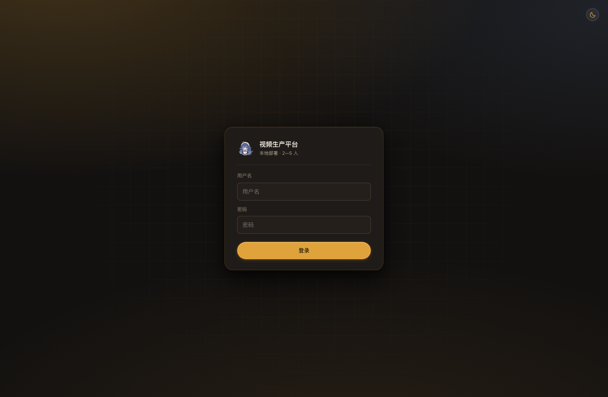

*图 2-1 登录闸门。会话过期与首次登录都回到这一屏；右上角可切日／夜主题。*

### 2.3 18 个权限点

| 分组 | 权限点 | 含义 |
|---|---|---|
| 项目 | `project:read` | 查看项目、集、镜、资产、文档、看板与导出 |
| 项目 | `project:write` | 新建与修改项目、标签、成员、归档、转移 |
| 项目 | `project:delete` | 删除项目与批量删除 |
| 资产 | `asset:read` | 查看资产与定妆图 |
| 资产 | `asset:write` | 登记、修改、删除资产，上传参考图，接受抽取候选 |
| 创作 | `doc:read` | 查看集、文档、分镜、物料与抽取结果 |
| 创作 | `doc:write` | 建集删集、建镜改镜、编辑正文、申请文档锁、提交抽取与拒绝候选 |
| 生成 | `job:read` | 查看队列、作业详情、日志、产物与成本 |
| 生成 | `job:submit` | 提交作业、重试作业、管理参数模板 |
| 生成 | `job:cancel` | 取消作业 |
| 审核 | `review:read` | 查看审核队列与 gate 报告 |
| 审核 | `review:sign` | 跑 gate、通过／驳回／退回并签字 |
| 音频 | `audio:read` | 查看音频素材 |
| 音频 | `audio:write` | 登记、修改、删除、提交音频素材 |
| 用户 | `user:read` | 查看用户与角色 |
| 用户 | `user:write` | 新建、停用／启用、重置口令、删除用户 |
| 用户 | `user:assign` | 给用户分配角色、修改角色权限矩阵 |
| 系统 | `system:config` | 模型与密钥配置 |

「设定」这一组（`setting:read`／`setting:write`）原本由 0002 一起 seed 进来，但设定中心到今天没有表、没有接口，这两个代码在角色矩阵里就是两个勾了不做事的选项。v0.87 由迁移 0024 把它们撤掉——留着要付出的是误信成本：管理员会以为「给只读账号勾上设定＝他能看设定」。设定中心立项时再随接口一起加回来，那时权限点、接口、界面同时出现。

### 2.4 项目级第二道门

全局权限点回答“能做什么”，项目归属回答“能碰哪个项目”：

| 关系 | 能做什么 |
|---|---|
| 所有人 | 读、改、管成员、转移所有权、删除 |
| 协作人 | 读、改；不能删项目、不能管成员 |
| 其他持 `project:read` 的人 | 列表与详情都看不见 |
| 管理员／超级用户 | 全部项目 |

判定顺序固定：**看不见 → 404；看得见但级别不够 → 403**。批量操作逐项判定，不把 404 降级成 403，也不因一条失败让整批失败。

---

## 3. 端到端业务流程

```text
首次部署
  └─ 启动 API → 自动迁移 → 建 superadmin → 登录 → 强制改密
       └─ 模型中心：登记模型、选 provider、配环境变量名、看健康与验证
            └─ 项目中心：建项目、标签、介绍、协作人
                 ├─ 资产中心：资产库（登记角色／场景／道具、定妆图、一致性提示词）
                 │     ├─ 资产创作：文字设定与图像候选生成 → 回稿填表 → 保存 → 命名形态
                 │     └─ 文本提取：抽取候选分诊（接受／合并／拒绝，不发起抽取）
                 ├─ 设定中心：世界观与证据快照（尚未实现）
                 ├─ 创作中心：建集 → 写小说／剧本（Git 版本）→ 拆分镜
                 │     ├─ AI 改写：润色／扩写／续写／剧本化／起草／提示词
                 │     └─ 文本抽取：候选 → 人接受／合并 → 资产
                 ├─ 生成中心：按镜头提交 → 本地或云端 → 产物／成本
                 ├─ 音频中心：台词／音乐素材 → 同一队列 → 产物回填
                 ├─ 审核中心：文档审核（跑 gate → 看证据 → 逐条／整篇签字）
                 │            产物审核（看片 → 逐件／整条签字，绑产物清单摘要）
                 ├─ 产线中心：模板 → 一次发起 → 按依赖自己走（运行／模板／整季三个页签）
                 ├─ 成片中心：选一集 → 冻结时间线 → FFmpeg 合成 → 验收 → 送审
                 └─ 首页看板：聚合 → 导出 CSV／Markdown
```

一条主线的真实操作顺序：

1. 登录后先在「模型中心 · 引擎管理」确认文本默认轨可用；文本没有本地合格路线，必须指到云端（本机为 `deepseek/deepseek-flash`）。
2. 在项目中心建项目；填名称、标签、介绍与协作人。当前项目由点行或顶栏菜单切换。
3. 在资产库登记角色／场景／道具；参考图与一致性提示词只在这里改。要给人物补履历／性格／成长过程，或给某套衣服单独存图，去**资产创作**那个工作区（详情页只读展示，改完点「去资产创作」跳过去）：选目标资产或先做草稿 → 选轨道与槽位 → 生成文字设定 → 核对回稿 → 填进表单 → 保存；再生成图像候选，逐张预览后存为基础图或某个命名形态。两条轨都没有健康槽位时，页面禁用并写明原因，不会悄悄换一条能用的模型跑。
4. 在创作中心建集；写小说或剧本，每保存一次产生一条 Git 提交。
5. 在小说／剧本编辑器里用「AI 改写」改一段，先看 diff 再应用；应用会走锁、冲突与 Git。
6. 用「抽取」把正文里的角色／场景／道具／镜头候选提出来（**发起在创作中心的文档页**）；处理候选去资产中心的**文本提取**工作区——前三类人确认后入资产，镜头候选只导出 Markdown，不自动写分镜表。
7. 在分镜页建镜、填内容／提示词／时长、引用资产；每行「生成」把上下文交给生成中心。
8. 生成中心提交作业；本地走 FastMetal／mlx-video／mflux，云端按显式选择走 DeepSeek／Wan；成本只从 Job 记。
9. 审核中心对文档跑 gate，逐条看证据并签字；正文版本一变，旧报告和旧签字自动过期。
10. 关键帧或镜头视频跑成功后，在审核中心的**产物审核**页签看片签字；签字绑产物清单摘要，文件被清理或被新一次生成顶掉就失配。
11. 音频中心登记台词与音乐，送进同一个队列；成功回填路径、时长、时间戳与 viseme。
12. 首页看板看聚合与导出镜头清单，交给剪映／达芬奇或人工流程。
13. 在产线中心选一集与模板发起运行，worker 的节拍按依赖推进；生成节点派成 Job、审核节点等签字。需要整季时在「整季」页签选模板、集与并发上限，一次排产。
14. 分镜视频都签字后，在成片中心选这一集发起合成；前置检查逐镜核对，FFmpeg 合成完做 ffprobe 验收，产物送审核中心签字。同集再合成会得到新版本，旧版不回改。
15. 首页看板看聚合与导出镜头清单，交给剪映／达芬奇或人工流程。

---

## 4. 功能需求与界面

### 4.1 全局框架与登录

**需求**

- 未登录访问任何业务页都应被登录闸门挡住；`/api/health` 除外。
- 登录成功后在同一份 DOM 里继续 boot，不整页跳转。
- 首次登录必须改密；改密后旧会话全部作废，前端自动用新口令重登一次。
- 运行中会话过期（默认 12 小时）要弹回登录闸门并说明原因，不是弹一句“失败：未登录”。
- 顶栏常驻：当前项目切换、worker 在线状态、主题切换、用户菜单。**不摆没有数据源的数字**——原来那一枚写死的「云端额度 ¥0.00」已撤掉（v0.93）：一个永远不变、还带货币符号的值，比没有更让人不敢相信。

**验收**

- 未登录 `/api/projects` 回 401，`/api/health` 回 200。
- 把库里会话到期时间改到过去，再点任意业务动作，出现带说明的登录闸门。
- 顶栏项目菜单可用鼠标与键盘（上下键、Enter、Esc 回焦）；归档项目不出现在菜单里。


*图 4-1 登录页。夜间主题；白天主题为浅色极光玻璃。*

### 4.2 首页 · 模块地图与项目看板

**需求**

- 首页顶部是**待办条**（v0.93）：四格——待你签字（文档＋产物）、失败作业、待核对账单、进行中的运行。数字来自跨模块聚合接口 `GET /api/workbench`，一次拿全，不让首页挨个模块去问。
- 待办只数**我看得见的在产项目**：别人的项目、已归档的项目都不出现，也不计入合计；一条待办都没有时整条不显示，不摆四张 0。
- 待签的口径与审核中心**同一处定义**：文档按当前正文 sha256、产物按当前产物清单摘要比对，版本对不上就不算签过（改过正文、删过产物文件，数字会自己回到待签）。产物只看最近 200 条可审作业，响应里用 `artifact_window` 明说这个窗口。
- 待办条每一格都可点、可 Tab 到达、Enter 直达对应页面（审核中心／生成中心／产线中心）；接口失败时整条不显示，不拿 0 冒充"没有待办"。
- 首页展示各业务模块的入口与职责一句话，不在这里放写操作。
- 当前项目存在时，展示只读看板：集、镜、资产、文档、作业（按状态分桶）、成本（按币种）、审核（gate 与签字）、音频。
- 看板数字必须从各权威表现算，**不落第二份“手工进度”**。
- 提供镜头清单导出：CSV（带 UTF-8 BOM，Excel 中文不乱码）与 Markdown；列含集序、镜号、摘要、提示词、时长、资产名、最新作业状态与产物相对路径。
- worker 状态与队列长度从 `/api/worker/status` 读；离线时明确说离线，不显示假在线。

**验收**

- 看板包含集、镜头、作业、成本、审核、音频六类数字。
- 导出链接可下载；CSV 首行是表头，带 BOM。
- 作业状态变化后回到首页，聚合跟着变。
- 待办条四格的数字与服务端 `/api/workbench` 一致；别人项目的文档／作业不出现在我的待办里，也不进合计。
- 给一份文档签字后该格减一；改正文或删掉某条作业的产物文件后，数字回到待签。
- 四格都是 0 时整条不出现；Tab 能停在每一格上，Enter 能跳到对应模块。

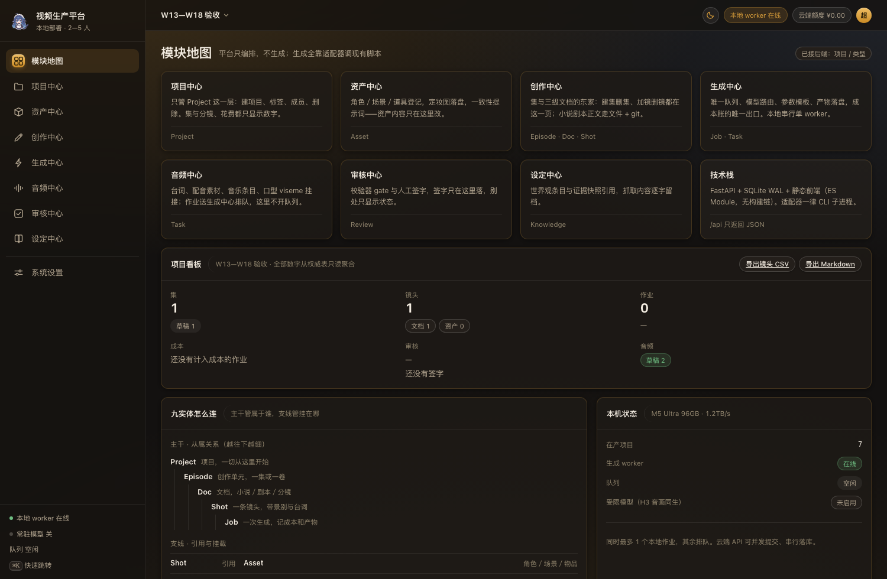

*图 4-2 首页看板与导出入口。*

### 4.3 项目中心

**需求**

- 搜索覆盖名称、标签、**所有人与介绍**：这一行摆出来的字段都该搜得到。
- 一页到底：页头「新建项目」、一行概览（在产项目／已归档／有待核对账单的项目）、状态筛选（在产／已归档／全部，默认在产）、标签筛选、搜索、排序（最近打开／最近修改／项目名称）、项目表。
- 新建收进弹窗：项目名、标签、介绍、协作人一次填完；字段名在左、控件列封顶 620px，每个字段下面一句说明（字数上限、截断规则、能邀请谁）。
- 新建失败不关弹窗、不清已填内容：错误写在弹窗底部；标签在前端按与服务端相同的口径归一（每个 20 字、最多 10 个），有截断就在成功提示里说明。
- 表格列：项目（名称、当前／已归档标记、所有人、介绍）、标签、内容（集／镜／资产、定稿进度条）、最近活动（最后打开＋最后修改，悬停看创建时间）、操作。
- 行内只有一个动作：⋯ 菜单放修改项目、成员与所有权、归档（数据保留）或恢复到在产、永久删除。
- **选中即打开**：点一行（或 Tab 到行上按 Enter／空格）就是把它设为当前项目；去干活用页头「去创作中心」。原来那颗「打开」把"切当前"和"跳页"捆在一起，与选中重复，已撤。
- 标签一格只摊两个，其余折成 `+N`，悬停看全量，避免标签把“内容”列挤成两行。
- 点整行或按 Enter／空格只切换当前项目、不跳页；点复选框、⋯ 或其它按钮不触发切项目；焦点在行内控件上时，按键不被行抢走。
- 行可以 Tab 到（`tabindex=0`），当前行带 `aria-current`；Enter 与空格都等于选中。
- 默认按“最近打开”排序，从没打开过的沉底；另两种排序在本地重排，不动筛选状态。切换后静默回读一次列表，让「最后打开」立即更新。
- 行首复选框支持批量归档／恢复／加标签／删除；批量条只给当前选择用得上的动作（全是在产才给“归档”，全是归档才给“恢复”）。
- 批量结果写在表格上方并活过一次重绘：报成功数与被跳过数、原因；归档结果附一句“切到「已归档」可以找回”。
- 归档前确认，文案写明“从在产列表和顶栏菜单隐藏、数据一条不删、可恢复”；删除单个项目要输入项目名，清点文案含集／镜／资产／文档／已上传定妆图；批量删除要输入固定词「批量删除」并先汇总影响范围。
- 「成员」弹窗管协作人；三行（所有人／协作人／转移给）共用字段名在左、控件列在右的骨架，两个下拉同宽，说明写在各自字段下面。
- 「成员」弹窗里所有人与管理员可加人、移人、转移所有权。交接对象是**所有你够得着的启用账号**（协作人和还没加入的都在列，层级高于发起人的不列），交给没加入的人时不必先加一遍；交完原所有人降为协作人。
- 归档项目不进顶栏菜单，只在「已归档／全部」里出现；当前项目被归档时自动换到在产的第一个。删除是硬删。
- 归档与恢复是**所有人或管理员**才能做的事（v0.84 起从 write 收到 own）：它改变别人眼前看到的是哪部剧。协作人的菜单里不出现这两项，服务端也拦 403。
- 点已归档项目的行不改变当前项目，但要说一句「先在 ⋯ 里恢复到在产」——不能是死点击。
- 只读角色看不到复选框与写操作按钮；服务端的权限拦截不因界面精简而减少。

**验收**

- 筛选 chip 是真按钮，Tab 停得住、Enter 按得动。
- 点 chip 不重建表格，搜索词不丢；“选中的”永远等于“看得见的”；表头显示“显示 X / 共 Y 个”。
- 排序切到“项目名称”按中文拼音序，切回“最近打开”恢复服务端顺序。
- ⋯ 菜单用方向键上下移动、Esc 关闭并回到触发按钮；菜单不会把行点成当前项目。
- ⋯ 菜单在下方放不下时朝上开；两头都放不下时贴进视口并自己滚动，不溢出屏幕；横向同样夹在可视区内。
- 菜单打开期间页面滚动、表格横滚或窗口缩放即收起，焦点回到那枚 ⋯。
- 批量操作逐项过权限，被拒项进 `skipped` 并说明原因；做成了但没全做到的进 `notes`；批量结果重渲染后仍在页面上。
- 转移后 `updated_at` 不推；原所有人仍能看能改，删项目与管成员归接手人。
- 「成员与所有权」在**零协作人**时也要看得见转移那一行；没有可交接账号时禁用并说明原因，不整行藏掉。
- 交给还没加入的账号一步完成，确认框说明对方会直接成为所有人；把项目交给层级高于自己的账号回 422。
- 当前项目被删、没选过或刚被归档时，只回退到在产的第一个；只剩归档就宁可不选。
- 四类账号显隐正确：所有人（editor）见修改／成员／归档但无删除，协作人见修改／归档，管理员四项齐全，只读只能打开；越权接口一律 403。
- 空列表给“还没有项目”与建档入口；只剩归档时当前退回“未选择”并提示去「已归档」找；当前项目被别处删掉后退回仍在产的一个，顶栏与列表同一事实。
- 批量「取消选择」同时清掉行内复选框，不出现“没选中却还勾着”。
- 380px 宽度下表格横向滚动，页面本身不横向溢出。
- 整张表只占一个 Tab 停靠点：↑／↓／Home／End 在可见行之间移焦点，Enter／空格选中；焦点在行内按钮上时按键不被行抢走。
- 选中一行后它留在原位，不当场跳到列表最前；改排序、筛选或搜索时才按新口径重排。
- 排序、状态筛选与搜索词记住（localStorage）；同名项目在名字后补 #id，删除确认里也带上编号与创建时间。
- 批量加标签没全加上时，结果条要说明哪几个项目标签已满、未追加的是哪些标签——不能只报「已加标签 N 个项目」。

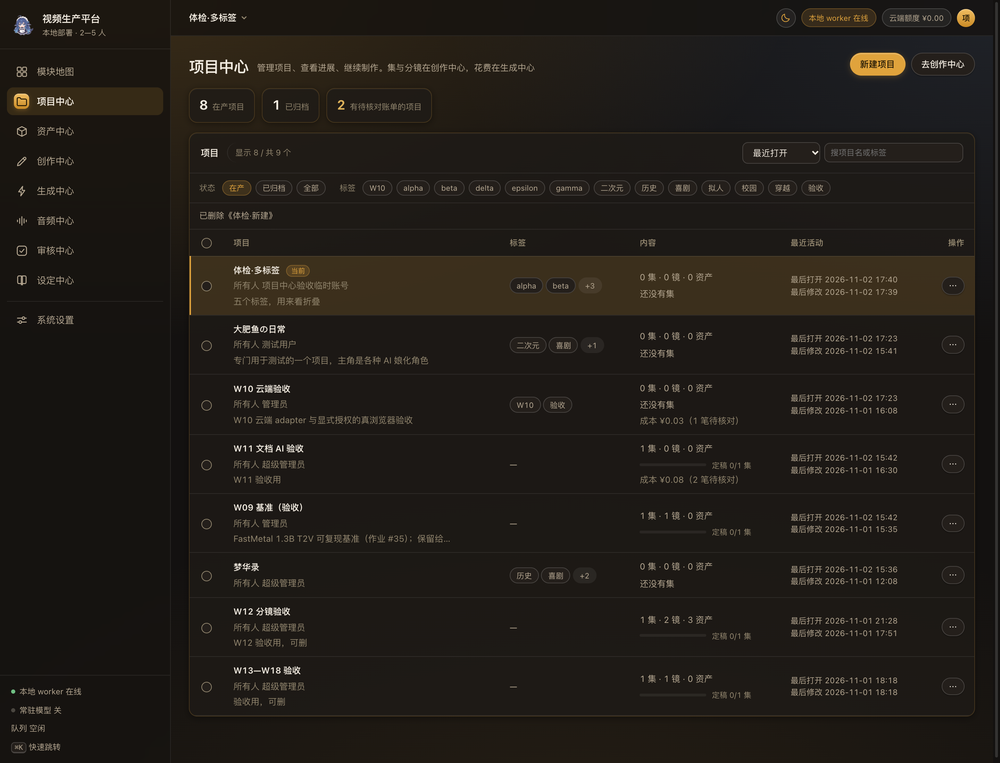

*图 4-3 项目中心。概览、排序、定稿进度；行内只有 ⋯，选中一行就是打开它。*

### 4.4 资产中心

**一个模块，三个工作区**（v0.98）。侧栏二级导航从"按资产类型分"改成"按工作区分"——人物／场景／道具是筛选维度，不是三个页面；类型降到资产库页内的 chip。

| 工作区 | 该做的 | 不该做的 |
|---|---|---|
| 资产库 | 列表、四组筛选、新建、上传参考图、进详情 | 不在列表页里做生成 |
| 资产创作 | 给一条资产（或一份草稿）生成文字设定与图像候选、存图、维护命名形态 | 不建第二个队列；模型不写库 |
| 文本提取 | 读抽取候选、逐条接受／合并／拒绝 | **不发起抽取**（提交仍在创作中心的文档页，一条提交路不留两处） |

**需求**

- 角色／场景／道具三类资产；列表为图片卡片网格，一行 3–4 张，列宽 232–340。
- 顶部统计：可见总数、三类各几、全局几条、待完善几条。
- 筛选四组：类型、范围（本项目／全局池／全部）、完善状态（缺参考图／缺一致性提示词）、排序（最近修改／名称）；搜索覆盖名称、标签、别名、提示词。
- 切筛选不清搜索词；筛空说“没有符合筛选条件”并给清除；真没有数据才说“还没有资产”。
- 新建走弹窗，先选类型再出字段。
- 详情两栏：左为基本信息（类型、名称、简介、标签、别名、一致性提示词），一次 PUT 整体提交；右为参考图画廊与被哪些镜头引用。
- **人物文字档案**（v0.98）：履历／性格／成长过程／文字设定提示词四段，详情页只读展示并给「去资产创作改」；只有人物有这一层，给场景或道具读写档案回 **422** 并写明"这类资产没有档案这一层"，**不回一份空档案让人以为数据丢了**；没写过回 `exists=false` ＋ 全空。
- **命名形态**（v0.98）：人物的服饰、场景的视角、道具的形态各一行，**图跟着形态走**——把常服、雨夜外套、受伤状态混进同一组参考图，下游图生视频会把互相矛盾的衣服当成同一个角色的参考。同一资产同一类型内重名回 **409** 并说"要改它就在原形态上编辑"；详情页只读展示画廊，改在资产创作。
- **生成**（v0.98）：三类资产都能"文字＋图像"各生成一次。选目标资产或先做草稿；选本地／云端轨道与槽位（清单里没有健康槽位时**禁用并写明原因**，不悄悄换成另一轨）；云端要单独勾一次计费确认并展示清单登记的单价。
- **模型不写库**（v0.98）：回稿按 `【履历】` 等标记分段，点「填进表单」只填表单，点「保存这份设定」才落库；解析不出分段就把原文带回去让人自己抄，**不把整坨文字塞进第一个字段冒充成功**。
- **产物导入**（v0.98）：候选网格逐张预览后「存为基础图」或「存进形态」；入参只有作业号与产物序号，**没有任何路径字段**。不是 PNG／JPEG／WebP 的产物回 **415**；作业没成功或不是图像作业回 **409**；序号越界或文件已被清理回 **422**。原产物仍留在生成中心（复制不是移动）。
- **刷新后状态不丢**（v0.98）：页面刷新或切走再回来，"我刚生成的那批"从作业表读回来，不在浏览器内存里攒副本。
- **文字任务分五种模式**（v0.99）：生成完整设定／只补空着的字段／优化已有设定／扩写指定字段／依据原文片段写设定。**"这次要模型出哪几段"由服务端按库里的实际内容算**，界面只负责把人选的交出去；`from_source` 没给原文就在**扣费之前**拒（422），不是等账单回来再说。「检查设定矛盾」这一种本轮没做，也不摆一个点了没反应的按钮（评估见系统设计 《系统设计说明书》§16 第 22 条）。
- **重复点击不排两条作业**（v0.99）：界面不带幂等键时服务端按"给谁做／做什么／哪一档／提示词／参数"派生一个键，连点三下只有一条作业、回执 `reused=true` 并说明原因；同一句话**再跑一批**是人的决定，由「换一批」显式带一个新键。
- **模型可不可用要说全**（v0.99）：槽位同屏显示健康与验证两件事（`health_state` ＋ `validation_state`，未验证／仅环境检查／真实调用已验证…），只报"环境齐"不算可用；这一档能不能吃参考图按清单登记的输入参数说（`image_inputs`），**不按模型名字猜**，不支持时就直说"基础图不会被当作条件图喂进去，一致性只能靠这段文字"。高级参数默认折叠。
- **形态真的能用于生产**（v0.99）：创作页能选"为哪个形态生成"，作业记住归属；「按形态拼好」把身份锚点＋一致性提示词＋形态描述拼进**可见可改**的提示词框（服务端不背地里再拼一遍）。形态的图能单独摘掉（`DELETE /api/asset-variants/{id}/images`），也能上移下移排序。分镜可引用到具体形态（`shot.variant_ids`，迁移 0034），**只勾衣服没勾人时服务端自动补上父资产**；改形态会让这一镜如实标「源已变」。
- **编辑冲突不再静默**（v0.99）：资产与人物档案各带一枚弱版本令牌（`version`／`seen_version`），带回来不一致就回 **409** 并写清"这次没有保存、你写的字还在界面上、下一步做什么"；不带令牌照旧放行，脚本不会因为多这道闸就 409。
- **输入不被异步刷新打断**（v0.99）：作业轮询只更新状态角标、通知条、回稿槽与候选网格，不整页重绘；正在敲的那一格连光标一起保住。带着未保存修改换目标会先问一句，取消就停在原处。
- **搜索就地过滤**（v0.99）：资产库搜索框打字只重画网格与计数，不重发列表请求、不摘焦点（原来每敲一个字整页重绘，实际一次只能打一个字）。
- **候选导入说清后果**（v0.99）：导入目标必须显式选（基础参考图／某个形态），文案写明是**追加**、封面不变、原产物还在；「收起这一屏候选」只收起，不删任何东西。
- **分诊给匹配建议与合并预览**（v0.99）：同名或别名命中已有资产时提示"像是已有的「X」"并预选合并目标；点合并前先把"会补哪几格／不动哪几格／别名追加什么"列出来（口径与服务端 `extraction_merge` 一致：只补空、不覆盖）。
- 参考图支持上传、看大图、设为封面、删单张；只收 PNG／JPEG／WebP，按文件头校验，单张 20MB 上限。
- 参考图的读取走 `GET /files/<资产id>/<文件名>`：要登录，且调用者得看得见这个资产（全局池的图人人可读）；看不见的项目一律 404，路径上跳也 404。归属判定排在文件存在性之前，否则「这个路径在不在」本身就成了给外人用的探测口。
- 全局资产池：`project_id IS NULL` 的同一张表；人人可读，写与删只有管理员；项目资产可升全局，全局不收回成项目资产。**形态与档案的可见性从父资产继承**，所以全局形态不会被项目成员越权看到。
- 被镜头引用的资产不给删，回 409 并指出哪一条引用；不提供 force 旁路。

**验收**

- 全局同名资产 409；不同范围可同名。
- 全局资产别人能看不能改（403，不是 404）。
- 删项目不动全局资产；删资产只清登记过的图，**删项目连形态图一起清**（只数基础参考图会把形态图落成孤儿文件）。
- 详情深链 `#assets/<sub>/a<id>` 刷新后仍能落到同一条；点侧栏任意项回列表。
- 生成四类操作排进**同一个队列**（成本与状态在生成中心看，资产页那个角标是现读 `job.status`）；空提示词不建作业；云端没勾确认不建作业；单价与清单不一致就拒。
- 切工作区时旧响应不覆盖新页面；380px 三个工作区与详情页零横向溢出；日／夜两套主题一致。
- v0.99 补测（真浏览器 91 项全过）：分镜 chip 跳详情不再跳错工作区；详情「去资产创作」定位到本条资产；搜索连打三字焦点不丢且不发列表请求；连点三下只排一条作业、换一批才两条、改提示词是新意图；五种模式各自的段落请求与输入校验；轮询回稿落地后正在敲的字与光标原位都还在；带旧令牌保存回 409 且库里不动；候选带作业号／档位／完成时间与"追加、封面不变"的说明；导入进指定形态而基础参考图不变；形态可排序、单张图可摘、形态本身还在；非 PNG 产物仍被 415 挡下；分镜表显示「掌灯人 · 雨夜外套」，改形态后标「源已变」，已提交作业的指纹不被回头改写；只读账号看得见全局资产但 PUT 回 403；被引用资产删除仍 409；Worker 离线时页顶明说离线且作业只排队；两套主题与 380px 零溢出；全程零未捕获 JS 错误。

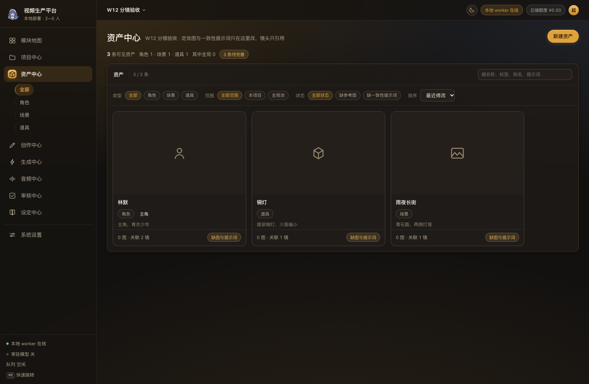

*图 4-4 资产库（v0.98 起是资产中心的第一个工作区）：统计、四组筛选与卡片网格；类型 chip 就在这一页。*

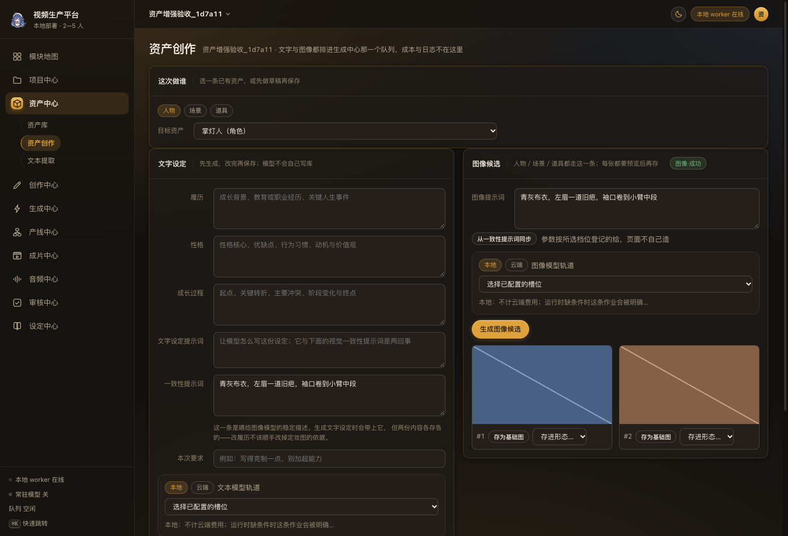

*图 4-5 资产创作（v0.98）：左边「这次做谁」选目标或先做草稿，中间文字设定四段＋一致性提示词，右边图像候选。两条轨的槽位、单价与参数都来自清单；每张候选都要预览后再决定存进基础图还是某个形态。*

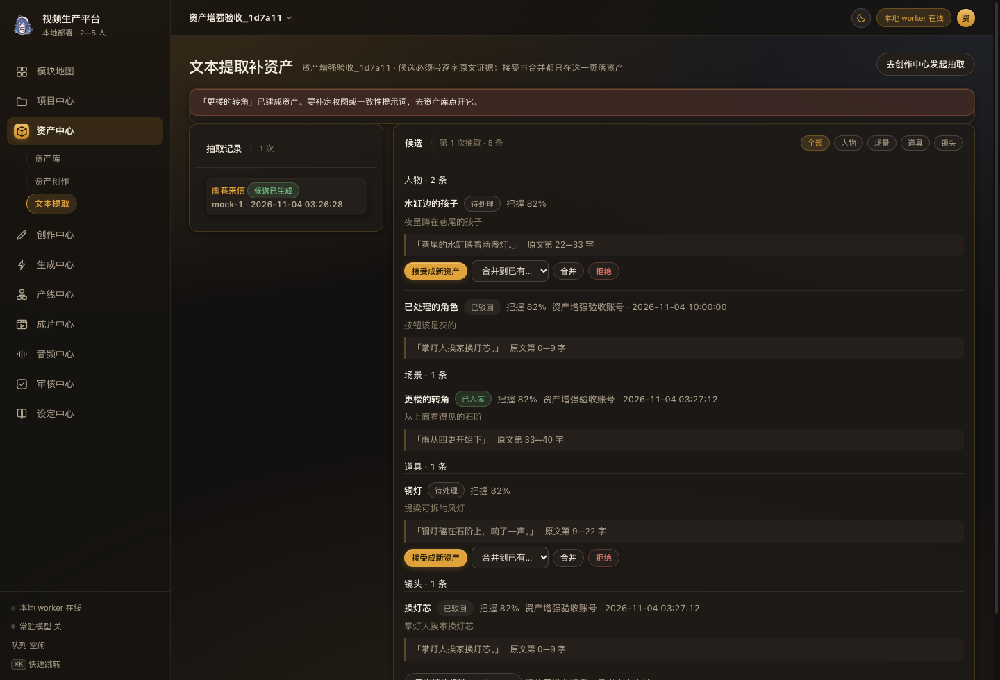

*图 4-6 文本提取（v0.98）：候选按人物→场景→道具→镜头排，每条带逐字原文与偏移；镜头候选只导出 Markdown，不自动写分镜表。这一页只分诊，发起抽取仍在创作中心。*

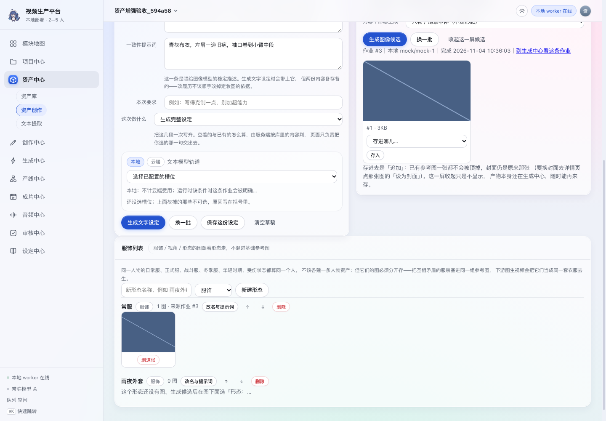

*图 4-7 图像候选（v0.99）：卡头带作业号、档位与完成时间；每张先预览再显式选「存进哪儿」——基础参考图或某个形态；下面写清"存进去是追加、封面不变、原产物还在"。*

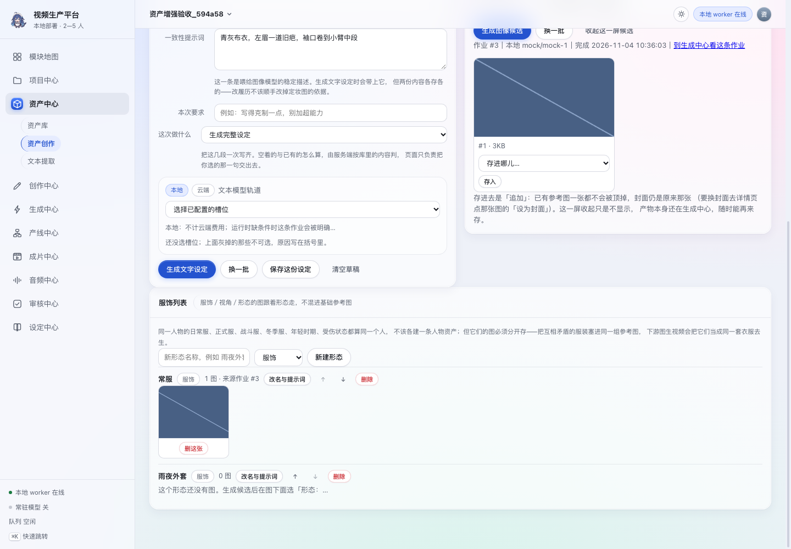

*图 4-8 服饰形态（v0.99）：同一人物的常服／雨夜外套／战损袍都算同一个人，图跟着形态走；每行能改名与提示词、上移下移、删单张图（「删这张」），也能删整个形态。*

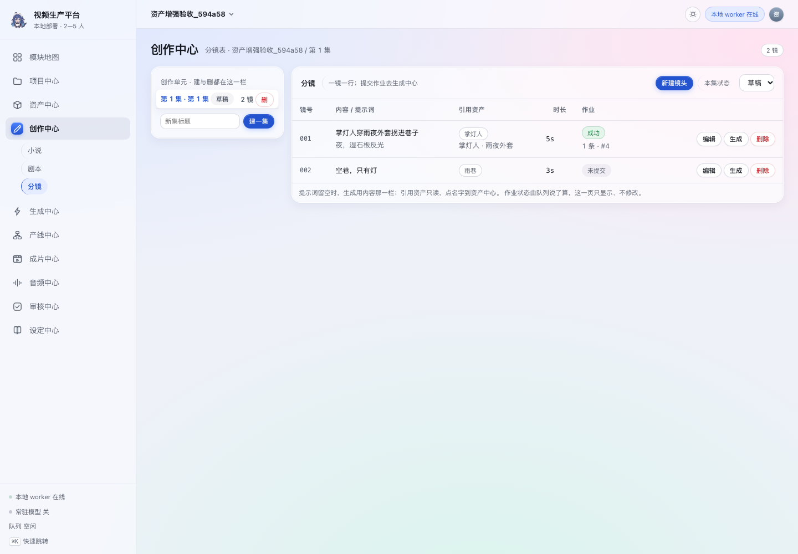

*图 4-9 分镜表（v0.99）：001 那一镜的引用栏写出「掌灯人 · 雨夜外套」——形态引用落在 `shot.variant_ids`，改形态会让这一镜标「源已变」。*

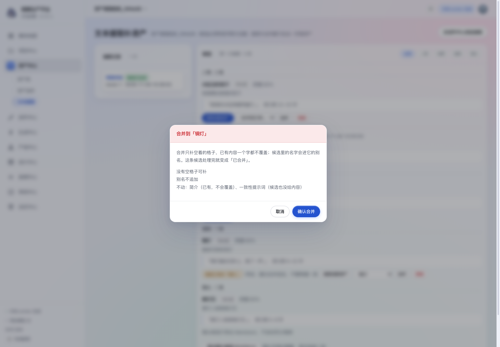

*图 4-10 候选合并确认（v0.99）：点合并之前先把"会补哪几格／不动哪几格／别名追加什么"摆出来，口径与服务端一致——只补空，已有内容一个字不覆盖。*


### 4.5 创作中心

#### 4.5.1 集与分镜

**需求**

- 集在这里建、在这里删；删集前提示“下面 N 条镜头一起没”。
- 集状态三档（草稿／在产／定稿），项目中心的“已定稿 N/M 集”从这里取数。
- 分镜一镜一行：镜号、内容／提示词、引用资产、时长、作业、操作。
- 新建与编辑共用一张弹窗；内容、提示词、时长、`asset_ids` 一次整体提交；镜号与所属集不可改。
- 空内容、时长不在 1–60 秒回 422；资产最多 40 条，只认本项目资产或全局资产。
- 引用资产是只读 chip，点了跳资产详情；分镜页不开资产编辑入口。
- 作业列只说“这一镜几条、最新状态”，悬停列出每条 `#id 状态`；取消／重试仍在生成中心。
- **源内容改过要当场看得见**：这一镜**最新一条成功的视频作业**的源指纹与当前分镜（含引用资产）不一致时，作业列贴一枚琥珀「源已变」，悬停写「分镜或引用资产改过，这条产物已过期；要重新生成并重新签字」。判的是哪一条作业**与成片前置检查同一个出处**（v0.97）：以前列表问"最新一条成功作业"、合成问"最新一条成功视频作业"，补跑过一次图像的那一镜会在列表上显示"没变"、合成却报"源内容已变"——两把尺子。标记由服务端算——前端拿不到分镜源指纹，让浏览器自己判断等于复制第二套口径。0031 之前没有指纹的旧作业**不贴**这一枚。
- 每行「生成」把项目／集／镜／提示词经 navstate 一次性草稿交给生成中心，刷新页面不再弹。
- 作业快照在提交时冻结；改镜头只写 `shot` 行，绝不回头改作业。

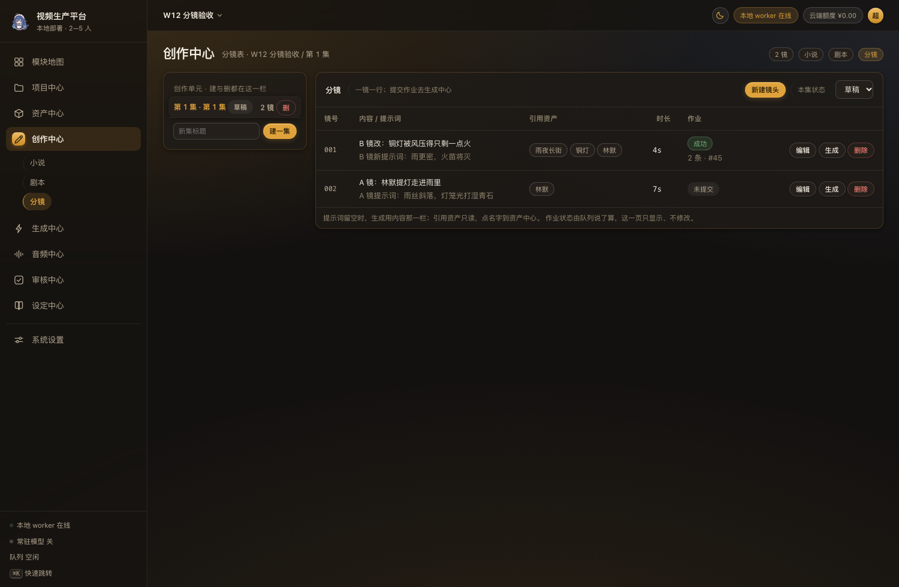

*图 4-11 分镜表：一镜一行，资产只读，作业只读。*

#### 4.5.2 小说／剧本与 Git

**需求**

- 左侧按集分组的文档树（全项目共用／第 N 集），右侧编辑器，下面是版本历史。
- `kind` 只开放 novel／script；分镜不存 Markdown，真相是 `shot` 表。
- 正文落在 `FASTVIDEO_WORKSPACE`，路径 `p<项目id>/<kind>/<标题>.md`；前端永远不传路径，只传文档 id。
- 保存必带 `expected_version`（正文 sha256）；不匹配回 409，界面保留草稿并把盘上那份取来对照；“仍要用我这份覆盖”必须再点第二下。
- 编辑锁有持有人与到期时间（默认 15 分钟）；别人持锁时保存回 423。
- 每保存一次提交一次 Git，提交身份是点保存的人；改名不挪文件。
- 删文档走 `git rm` 并提交，历史保留；删项目把登记过的正文一并摘掉。
- 文件名由标题生成，撞名排号；删掉再同名重建也排号，避免新旧历史串在一起。
- 有未保存改动时先问“丢掉并继续”；本轮新增 AI 改写后这条更重要，因为 AI 读的是盘上那一份。

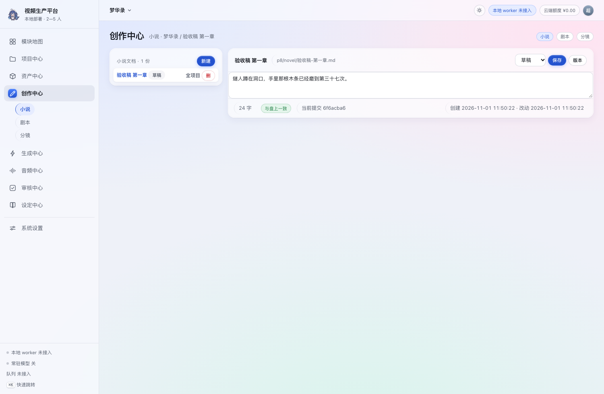

*图 4-12 小说／剧本编辑器：左树、正文、状态与版本入口。*

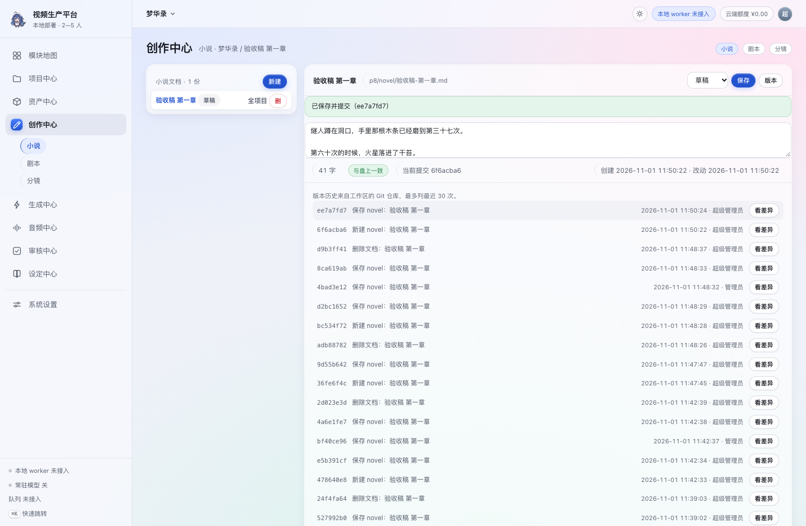

*图 4-13 版本历史与差异。中文路径可读，diff 头不是八进制串。*

#### 4.5.3 文档 AI 操作

**需求**

- 六种操作：起草、扩写、续写、润色、剧本化、提示词。
- 起草替换整篇；续写追加文末；其余默认只处理选中段落，没选中则整篇。
- 提交前显示操作、范围、模型、清单单价、预计用量与预计费用；必须勾确认云端计费。
- 提交后原地换成预览，轮询作业状态；成功才给「应用并提交」。
- 预览返回“盘上正文 → 应用后正文”的统一 diff；作业没成功或正文版本变了，`can_apply=false`。
- 应用复用 `save_content()`：锁、冲突、原子写与 Git 提交一条都不绕；提交说明「AI 润色：标题（作业 #N）」。
- 任何一步失败，原文一个字节都不动。
- 单次输入上限 30,000 字；选区偏移由服务端拿盘上正文复核。

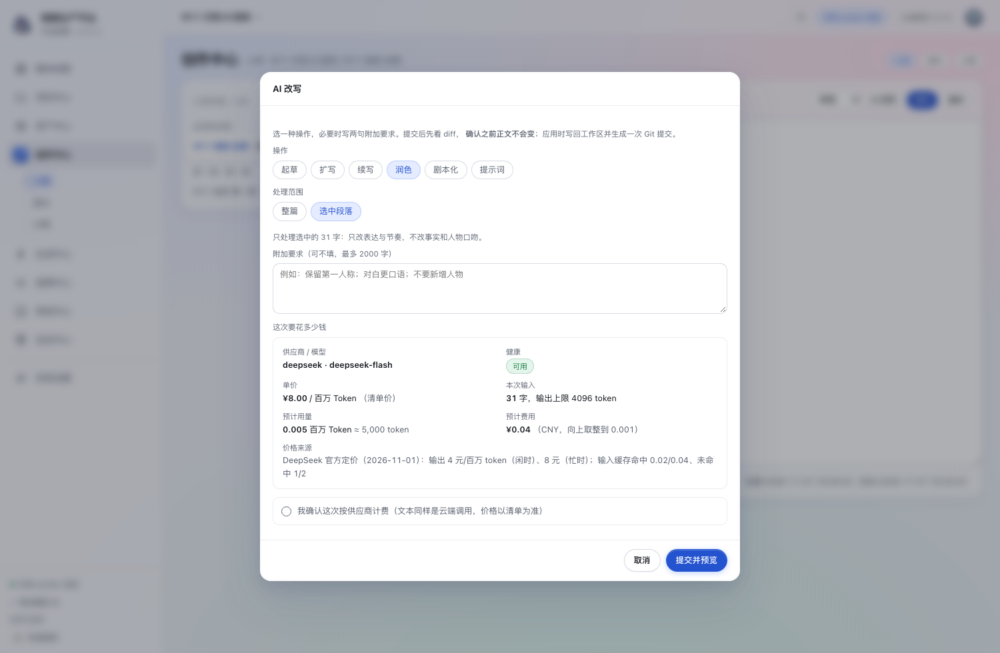

*图 4-14 AI 改写弹窗：选操作与范围、写要求、看费用、勾确认。*

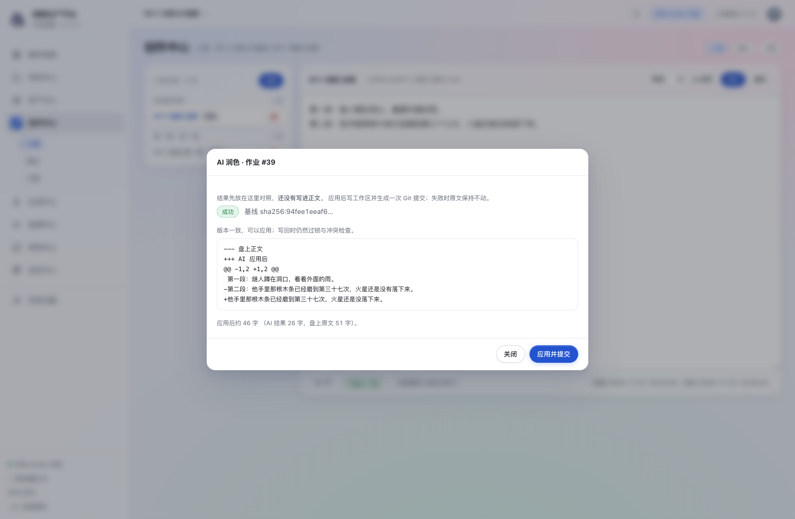

*图 4-15 应用前 diff。第一段原样，第二段被改写。*

#### 4.5.4 文本抽取候选

**需求**

- 入口在小说／剧本编辑器「抽取」；按文档 id 抽取，不传任意文本。
- 一次抽取＝一条 `kind=text` 作业；提示词、正文 `base_version`、`content_hash`、模型与提示词版本冻在 run 行。
- 24 小时内同文档同哈希同模型同提示词版本复用旧 run 并标 `deduped`，不重复花钱。
- 候选四类：角色／场景／道具／镜头；每条必须带逐字证据（quote + 起止偏移），服务端拿盘上正文复核，对不上就丢并写 `note`。
- 角色／场景／道具可接受（建资产）或合并（并入已有资产，只补空字段、别名去重）；镜头候选**只导出 Markdown**。
- 候选列表按角色→场景→道具→镜头固定顺序；同一候选只能处理一次。

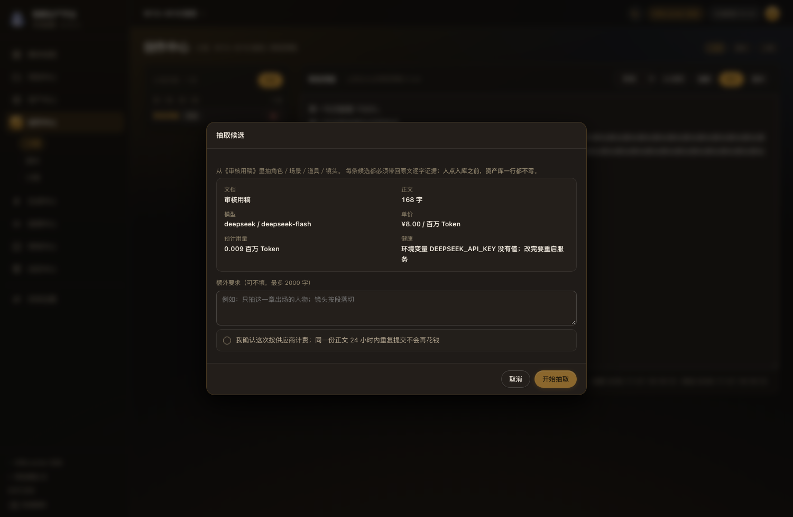

*图 4-16 抽取弹窗：模型、计价、预计用量与确认框。*

### 4.6 生成中心

**需求**

- 唯一队列：一行一条作业，显示提示词摘要、项目与集镜、能力、执行方式、provider／模型、状态、金额、耗时、入队时间。
- 筛选：项目、状态、能力、执行方式＋搜索；每 3 秒刷新，刷新不抢详情抽屉的滚动；切到别的页面时这份刷新自己停（判活看的是这一页抓到的节点还在不在，不是那个共用的视图容器在不在文档里）。
- 行内与抽屉里的动作按接口声明要哪个权限点显隐：取消要 `job:cancel`，重试／核对／标记待核对要 `job:submit`。只读的人看得到队列与详情，看不到自己点不动的钮；动作区空着时要说清是"这条结束了"还是"这一档只让你看"。
- 详情抽屉是排查唯一入口：成本（记账金额、账单状态、数量×提交时单价、币种、价格来源、确认时间，或本地机时／CPU／峰值内存）、失败原因与归一化错误码、提示词与参数快照、日志尾部、产物下载／预览、供应商回执。
- 提交弹窗分默认轨／本地／云端；参数按 adapter 清单渲染；模板可一键预填。
- 云端必须填数量、单位、单价、币种、价格来源并勾确认；前端实时显示预计金额，金额仍由服务端重算。
- 取消是请求式；排队中立即取消，运行中置 `cancel_requested`，执行循环看到就停。
- 重试新建一行 `attempt+1`，复制参数／提示词快照并关联 `retry_of_job_id`，原行写 `superseded_by_job_id` 指向新行；原行的日志、耗时、成本与错误不动。**重试前先弹只读预览**：链上合计金额、待核对笔数、本地"不计费但再占一次队列"／云端"可能再计费"，取消不新建作业。
- 成本口径：整数 micros、Decimal 半入；**账单状态 `billable_status`** 取 `pending_reconciliation`（待核对）／`known`（已确认）／`not_billable`（不计费）——云端未回执就是待核对，本地是不计费；**作业状态 `status=needs_attention`** 是队列侧的“待核对”，两者不是一回事，界面分开显示。失败不归零；排队中取消不进账但详情保留预计；多币种分桶。
- **人工核对结清（P0）**：云端成功／失败的作业可「标记待核对」，`needs_attention` 的作业在抽屉里核对——判成功／失败须填实际金额（写 `actual_cost_micros`，预计快照不改），判待定只留备注。worker 失联且云端结果不确定时也落 `needs_attention`，不自动重试（会重复计费）。
- **队列告警（P0）**：页顶告警区报 worker 离线、队列停滞、租约过期、运行超时、日志静默、待核对计数；只提示事实，不改作业状态。首页也摆一份。
- 参数模板只预填下一次提交；项目模板按项目归属读写，全局模板只有管理员能写。
- 本地失败不自动转云端；云端视频仍要逐镜头显式选择并确认。

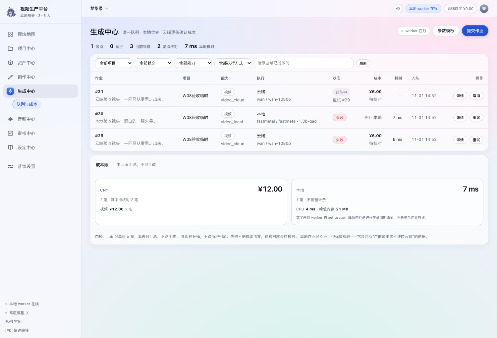

*图 4-17 生成中心队列与成本账。*

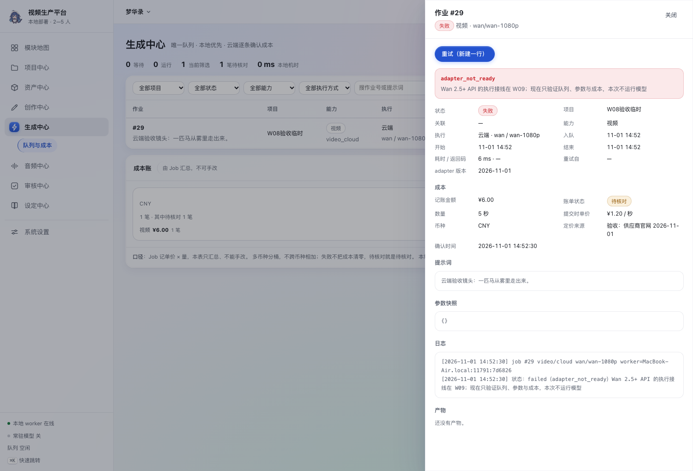

*图 4-18 作业详情抽屉：成本、快照、日志与产物。*

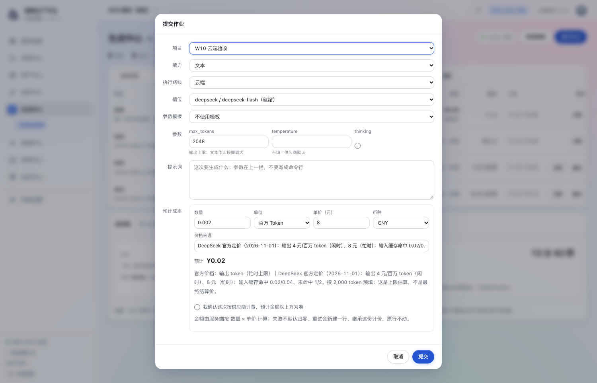

*图 4-19 云端档位预填计价，确认框默认不勾。*

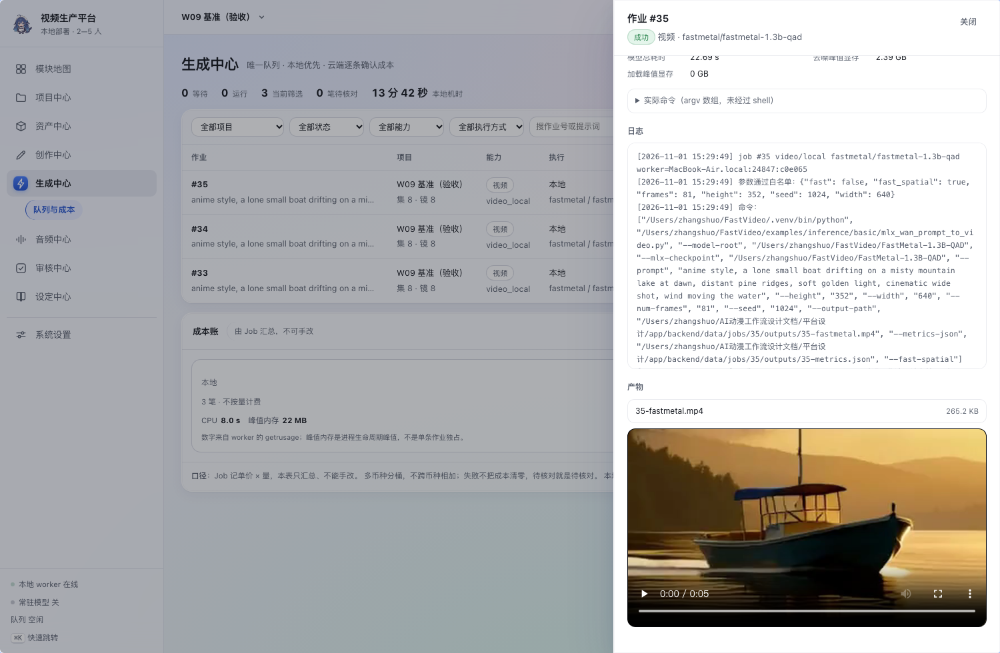

*图 4-20 详情抽屉内联播放 mp4。*

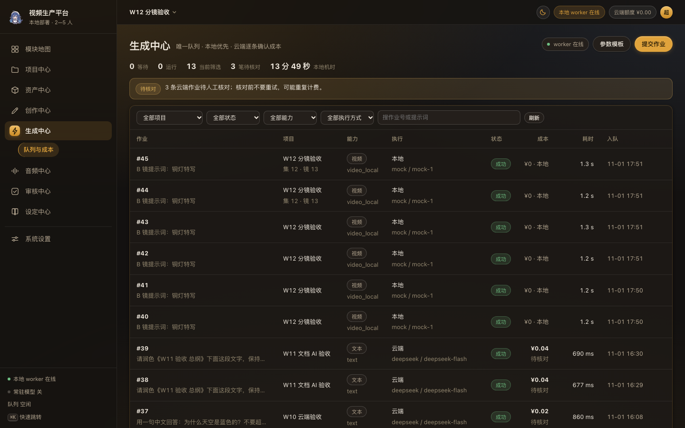

*图 4-21 队列页顶告警区：worker 离线、队列停滞、待核对计数只报事实，不改作业状态。*

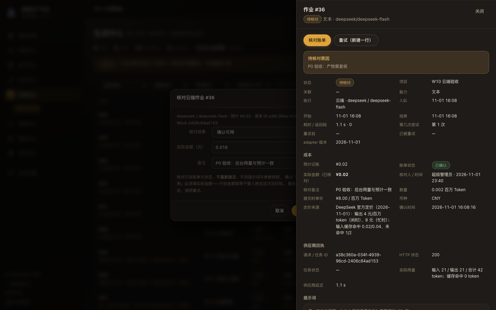

*图 4-22 核对弹窗：判成功／失败必须填实际金额，预计记账不被改写。*

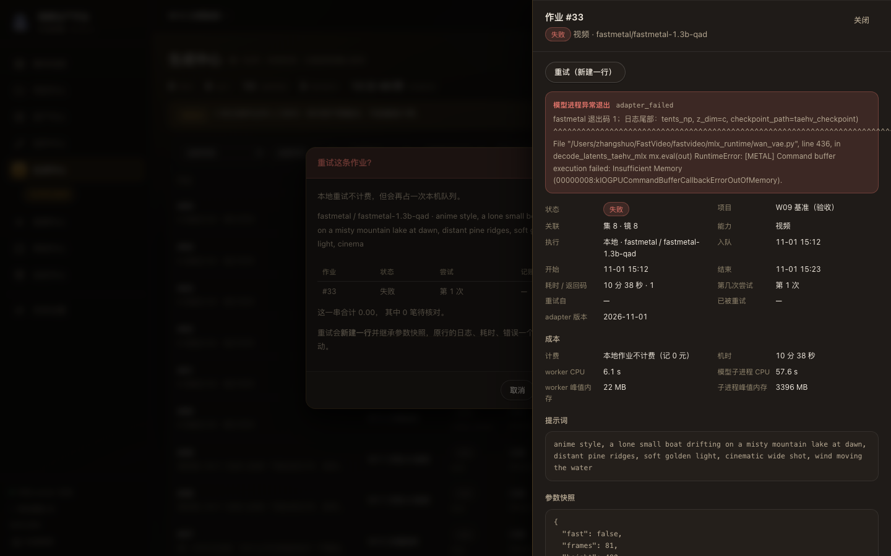

*图 4-23 重试预览：链上合计金额与待核对笔数，云端那一档明写「可能再计费」。*

### 4.7 审核中心

两个二级页签：**文档审核**与**产物审核**。签字只有这一个写入口，创作中心与生成中心只显示状态、不放按钮。

#### 4.7.1 文档审核

**需求**

- 左列审核队列：只列“当前正文版本还没签”的文档；点开加载 gate 报告。
- 跑 gate 得到确定性报告：占位符（TODO／TBD／待补）、长句（>120 字）、未收尾（≥12 字且无标点）。
- 每条 finding 带锚点与原文证据；整篇级另有一个 `document` 锚点。
- 三种结论：通过、驳回、退回修改；签字需要 `review:sign`，记录签字人与时间。
- 同一锚点重复签是 upsert，不攒两行。
- gate 绑正文版本：正文一变，旧报告与旧签字算过期；对过期版本签字回 409，队列只列当前版本。

**验收**

- 没有 `review:sign` 不能签字（viewer 实测被挡）。
- 改正文后旧审核不能显示为新版本已通过。
- 同一句签字后重跑 gate，锚点不漂移、签字仍在。

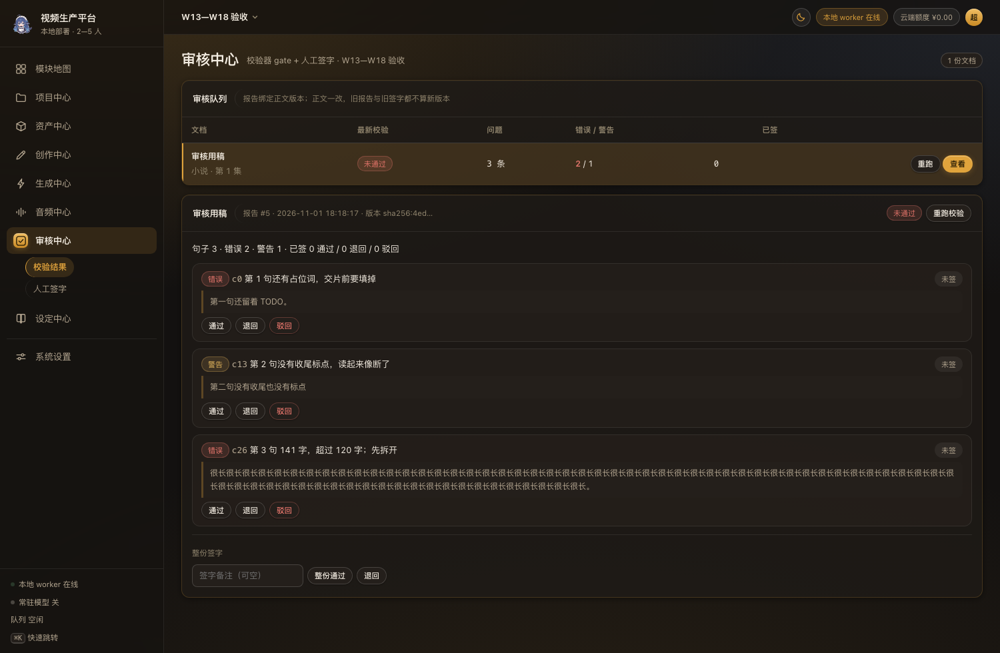

*图 4-24 审核报告：每条问题带原文证据与签字按钮。*

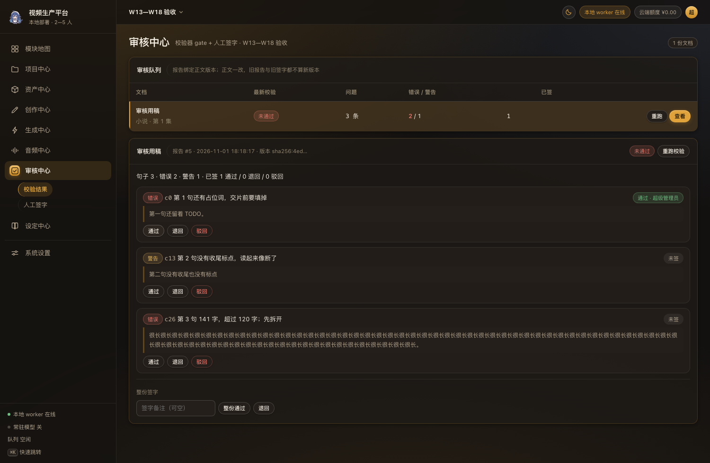

*图 4-25 签字后显示签字人与结论。*

#### 4.7.2 产物审核（裁定 D1，迁移 0025）

**需求**

- 队列只列**已成功且有产物**的图像／视频作业，一条作业一行；带集与镜号、能力档、`供应商 / 模型档`、产物件数、结论与完成时间。
- 产物审核**没有 gate**：占位符、长句这些规则是查正文形状的，对一张图或一段视频没有意义。这里给人看的是产物本身——逐件列出相对路径、字节数与「在／已不在」，能预览的直接内联播放。
- 签字锚点两种：`artifact:<序号>` 逐件签，`artifact` 整条作业签。结论与文档审核同一套三档，同一锚点重复签也是 upsert 改判。
- 版本令牌不是正文 sha256，而是**产物清单摘要** `sha256(manifest)[:16]`（逐件的相对路径＋是否还在＋字节数）。文件被清理、被新一次生成顶掉，摘要就变，页头立刻写「产物已变，旧签字失配」，队列那一行也换成琥珀色的「签字失配」，不会挂着「通过」骗人。
- 失配之后**重签就是签在新摘要上**（同一锚点 upsert 改判），不叠历史。409 只发生在「这条作业没成功，或没有产物」这一档，接口把原因原话带回来。
- 作业没成功、没有产物、或调用者看不见这条作业，界面显示「不可审」加一句原因，不是空列表。
- 与模型验证矩阵的关系要说清：矩阵第五档出处 `artifact_review`（产物验收）登记在「模型与密钥」页，要人工给结论并带产物摘要，判的是**这个模型档能不能上生产**；产物审核签的是**这一条作业的产物过不过**。两者都要求"人真看过产物"，但互不自动写入——签字不会变成验证记录，验证记录也不会替谁签字。
- 权限点一个新都没加：读队列与详情要 `review:read`＋项目可见，签字仍是 `review:sign`；改判与整条签字走同一档权限。

**验收**

- viewer 看得到队列，看不到签字按钮；直接调签字接口回 403。
- 逐件签与整条签互不覆盖（锚点不同，各存一行）。
- 删掉产物文件后队列立刻标失配，旧签字不再算到当前这版头上。
- 对没成功或没产物的作业签字回 409，原因写得能看懂。
- 文档改正文不影响产物签字，反之亦然（两档版本令牌各算各的）。

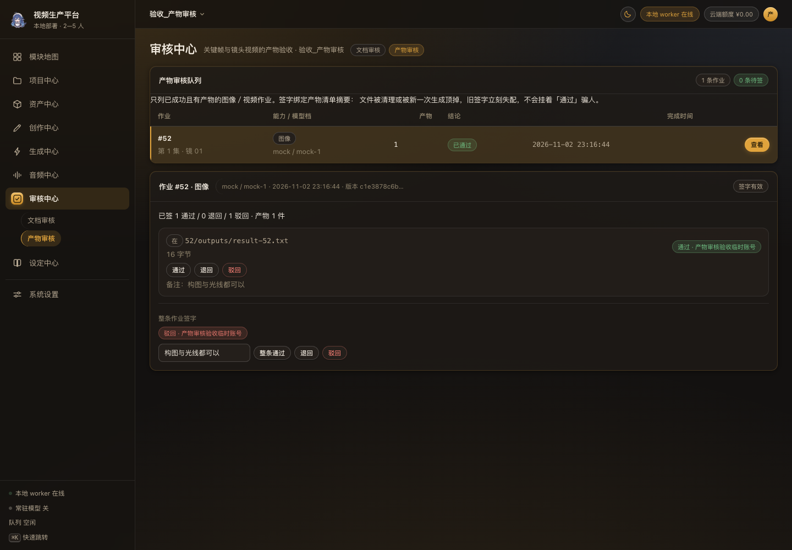

*图 4-26 产物审核页签：一条作业一行，签字绑产物清单摘要。本机没有图像运行时，这一栏如实为空。*

### 4.8 音频中心

**需求**

- 四个二级标签：配音、音乐、口型、音效。
- 素材类型：`dialogue` 台词、`narration` 旁白、`music` 音乐、`sfx` 音效。
- 每条素材可挂集与镜头；有说话人、文本、状态、产物路径、时长、时间戳、viseme、关联 Job。
- 登记只写台账；「送进队列」才落 Job，与生成中心同一张表、同一个 worker。
- 提交前按能力解析默认轨；缺运行时明确说缺什么，不落假作业。
- 成功后把产物相对路径、时长、时间戳、viseme 同步回素材行。
- 口型只留数据位，不假装生成；音效标实验态，只登记不提交。
- 提交失败用页内提示条说明原因，不弹原生 alert；这条提示属于**当前项目 × 当前页签**，换页签或换项目就收走，不把上一个项目的失败带到下一个。

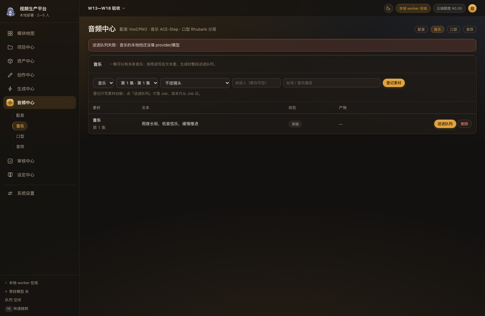

*图 4-27 音频中心音乐页；缺运行时时给出页内原因，状态仍是草稿。*

### 4.9 设定中心（尚未实现）

**需求（规划）**

- 世界观条目 + 证据链（史料快照引用），项目内与全局两级。
- 引句逐字取自抓取文件，不改写、不补主语；校验器做逐字 diff。

**现状**

- 页面与空态文案存在，页头标「未开放」；「新建条目」是**禁用态**并在悬停里说明"还没有表与接口"，不再是一个点了没反应的按钮（v0.93 改）。没有表、接口与写入路径，当前版本不把它当成可用功能。

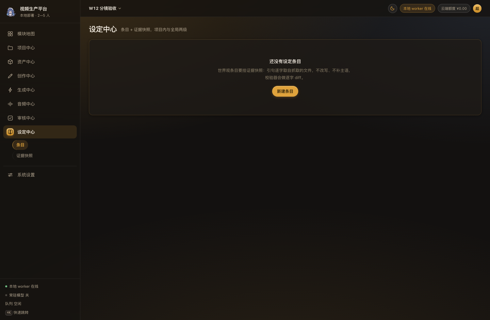

*图 4-28 设定中心空态。功能未实现，只保留入口与边界文案。*

### 4.10 系统设置

#### 4.10.1 模型与密钥（v0.99 起已搬到「模型中心」）

**这一节不再定义需求，只留一条跳转。** 原来这一页的十行能力轨、允许参数、密钥变量名、
健康、验证列、环境检查、验证记录弹窗、整批保存，全部整页搬进独立一级菜单
「模型中心 · 引擎管理」，**一行功能都没减、一条口径都没改**；
完整需求见本文 §4.13。

为什么搬：模型这件事原来同时属于"系统设置"和（任务书要新建的）"模型中心"两个东家。
一个实体只能有一个能写它的模块，所以入口收成一个。系统设置只剩「用户与角色」。

旧地址 `#system-config`、`#system-config/0` 仍然打得开——菜单调整不该让谁的书签失效。

#### 4.10.2 用户管理 与 角色管理（v0.111 拆成两页）

原来这一页同时摆着用户表、新建用户表单与角色权限矩阵。v0.111 按动作拆开：

| 二级页 | 管什么 | 写入口 |
|---|---|---|
| 用户管理 | 建人、停用／启用、改角色（人挂哪些角色）、重置口令、删除（含名下项目处置） | `POST/PUT/DELETE /api/users*` |
| 角色管理 | 角色概览（权限点数、在用账号、都是谁、能不能改）＋ 18 个权限点矩阵（按列保存） | `PUT /api/roles/{id}/permissions` |

三条口径：

- **拆页不加权限点、不加接口、不加一级菜单**：`user:read` 看两页，`user:write` 才能改，
  `user:assign` 才能改谁挂哪个角色；18 个权限点保持原样。
- **两个写入口各管一件事**：改"人挂哪些角色"在用户管理，改"角色有哪些权限点"在角色管理，
  不出现同一份状态两处可编辑。
- **内置 admin 那一列前后端都禁**：它的权限点由代码固定，改它等于给自己造一个锁死门的角色；
  界面上这一列是灰的并把原因写在同一张卡下面。

`#system-config/1` 从"被钳回第 0 页"变成真落到角色管理——旧深链不失效，但含义按新结构对齐。

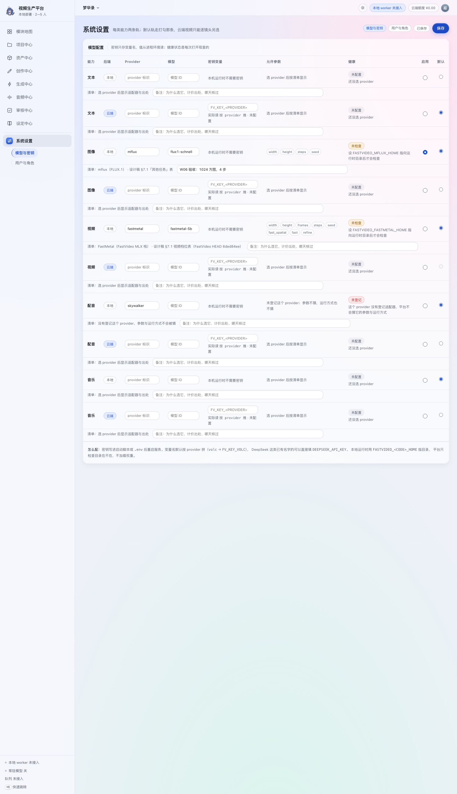

*图 4-29 搬迁前在系统设置里拍的十行能力轨。界面内容现在归「模型中心 · 引擎管理」，列数从十收到六（详见 §4.13.2）。*

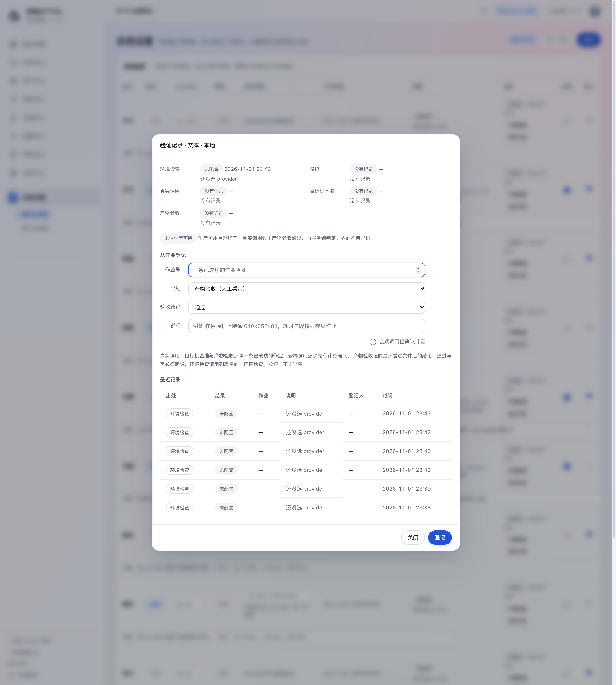

*图 4-30 验证记录弹窗：上半是五档出处摘要，中间从一条已成功作业登记（选产物验收要给人工结论），下面是最近记录。这一张弹窗本轮原样搬过去，没改。*

#### 4.10.2 用户与角色

**需求**

- 用户表：用户名、显示名、角色、状态、最后登录；只列不高于自己层级的账号。
- 新建用户：用户名、显示名、初始口令、角色；初始口令一次性，首次登录强制改。
- 操作：停用／启用、重置口令、改角色、删除（必须转移项目或连带删）。
- 角色权限矩阵：18 权限点 × 3 角色；admin 列禁用；保存按列。
- 四条铁律在服务端：不能停用自己、不能改自己角色、超级用户账号只读、列表按层级过滤。

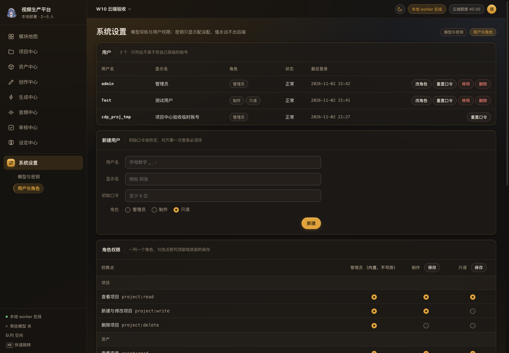

*图 4-31 用户与角色：用户表、新建表单与 18×3 权限矩阵。*

### 4.11 产线中心（阶段 C＋E：页面、整季与并发）

裁定 D3 的编排层，阶段 C 补上界面，阶段 E 补上整季排产与多 worker。这一节前半写页面怎么用、后半写它背后的硬规则；接口细节仍在《系统设计说明书》§8.12。

**它解决什么**

一集片子要走的路是固定的：读项目 → 查分镜与资产 → 出关键帧 → 出镜头视频 → 人看片签字 → 备音频 → 合成 → 验收 → 签字。以前每一步都得人在三个页面之间来回点，点漏一步就断在那里。产线把这条路写成**模板**，一次发起，剩下的按依赖自己走；一季十几集也不必一集一集点，**整季**页签按并发上限自动排队。页面只负责让人看清走到哪、卡在哪、下一步该谁。

**页面结构**

- **入口**：侧栏「产线中心」，位置紧跟「生成中心」。页内三个页签：**运行**、**模板**与**整季**。没有画布，也没有拖拽编辑器。
- **运行列表**：本项目的运行一张表——集、模板、状态、进度、开始时间、查看。空态说清「选一集、选一份模板就能开始」，不放一个没上下文的空表格。
- **发起运行**：有 `job:submit` 才出现按钮。弹窗里选集、选模板（带版本与节点数）；**已有未结束运行的集在下拉里禁用**，并写明是哪一条运行挡着——不让用户点了才吃 409。提交失败时错误原话留在弹窗里，不静默关闭。
- **发起前就把预检摊开**：选完集与模板，弹窗中间直接出现一格生产前检查，分三档——红「不能发起（N）」（缺镜头、引用资产不存在、超合成上限、同集已有未结束运行）、琥珀「可以发起，但要注意（N）」（空提示词、资产缺参考图或一致性提示词、某类能力没有默认轨、找不到 ffmpeg、worker 离线、磁盘偏紧）、两档都空时一句「生产前检查通过」。**有阻断项时「开始生产」直接禁用**，不用点了才知道。读不到预检（网络或权限）时**不替人做决定**：照常允许点，服务端发起时还会再挡一次。数据来自 `GET /api/projects/{id}/preflight`（只读，不建运行、不写状态）。
- **运行详情**：头部是状态 chips、集与模板、进度条与「完成／待签字／待处理／失败」计数；下面是竖向节点列表。动作按权限和状态显隐：推进（`job:submit`，手动催一下；worker 的节拍本来也会推进）、暂停／恢复（`job:cancel`）、取消（`job:cancel`，要确认）、失败节点上的「重试这一格」（`job:submit`，要确认）。已收尾的运行不显示推进与暂停／取消。
- **节点行**：序号、节点类型、状态、依赖、作业引用或审核引用、时间与错误原文。生成节点与合成节点的作业只给「去生成中心」，审核节点只给「去审核」——状态、成本、日志与产物都不在这一页复制。只有失败节点才出重试；等签字被驳回的节点不给重试（要先重试上游生成节点）。
- **整季页签**：选批次名（可不填）、模板、同时推进几集（1—8）与要排的集，一次建一整季。下面是批次列表与详情：进度计数（完成／失败／待开始）、金额、每集一行（状态、运行号、错误原文）；未结束的批次给「暂停排产／取消整季」，有失败集时给「继续失败集」。已结束的批次只留查看。**同一集仍受「一集一条未完成运行」约束**：正被人工运行占着的集会被如实标成「已在别的运行中」，不会悄悄挂上去再让人猜。
- **worker 面板**：整季页顶部列出每个 worker 进程的编号、在线状态、当前作业、最近心跳，以及**「占用与上限」同一列里的两组数**。**默认只列在线的进程**，下面一句「另有 N 个进程在 7 天内登记过 · 现已离线（点开看）」——一行＝一个进程，`./run.sh worker` 每起一次就多登记一行（身份是 `主机名:pid:随机串`，租约与上限必须按进程归属，不能合并），但历史行不该天天占着面板让人分辨哪条是活的——占用是机器实况（负载／核数、这一段心跳的 CPU%、进程与子进程峰值内存、作业目录所在卷剩余空间），上限是人给的额度（全局与五类）。为什么两件事放一列：出问题时人只会去调上限，而"该不该再开一个 worker"要看的是机器还剩多少。它只读，不启动或停止进程；进程怎么起写在部署文档里。队列按 `text／image／video／audio／compose` 五类分别显示排队与在跑数，一眼看出是「全局满了」还是「这一类满了」。
- **事件时间线**：倒序、人话，把创建、派活、签字、失败、重试、取消写成一句句可读的记录。
- **模板页签**：四份内置模板（`标准漫剧单集生产` v1 13 节点／同名 v2 **16 节点**，多出合成、验收、审核三格／`图片预览生产` 6／`视频生产` 6）各一张卡，写版本与节点数，可展开看节点与依赖。卡片上明确「只读」，并说明没有流程编辑器。
- **不假装实时**：页面不轮询。worker 推进之后，切回列表再打开或刷新页面就能看到最新；界面不会拿一个自己算出来的进度冒充服务端状态。

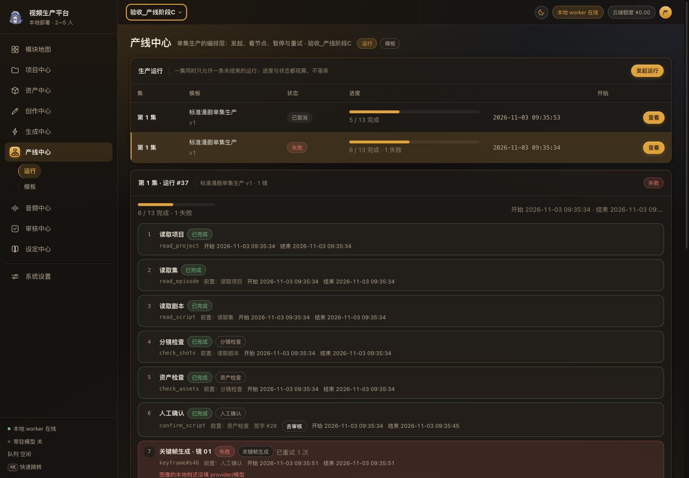

*图 4-32 产线中心·运行详情：节点列表、进度条、失败节点的重试与事件时间线。*

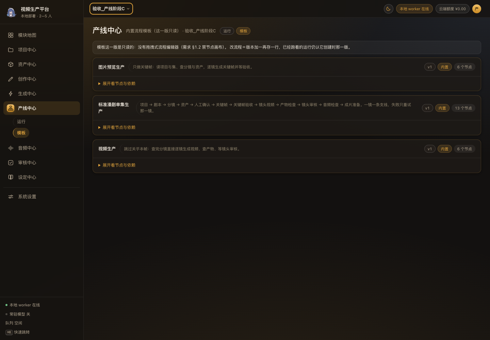

*图 4-33 产线中心·模板页签：四份内置模板只读，展开看节点与依赖。*

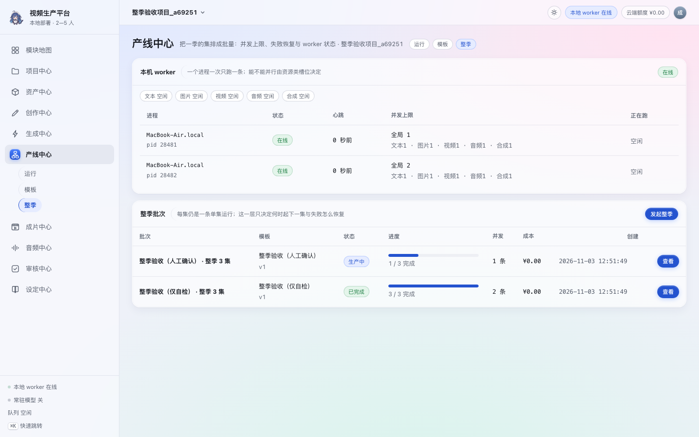

*图 4-34 产线中心·整季页签：worker 面板、资源队列与批次列表。*

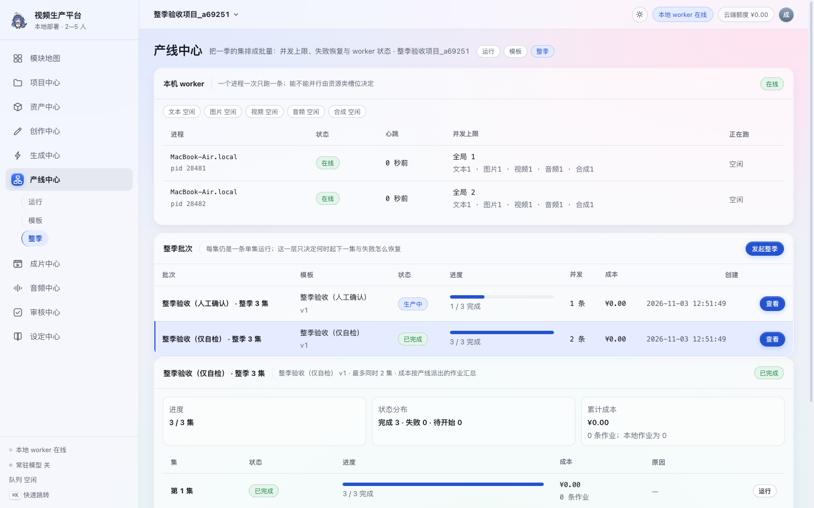

*图 4-35 整季详情：并发上限、每集状态与错误原文、暂停／取消／继续失败集。*

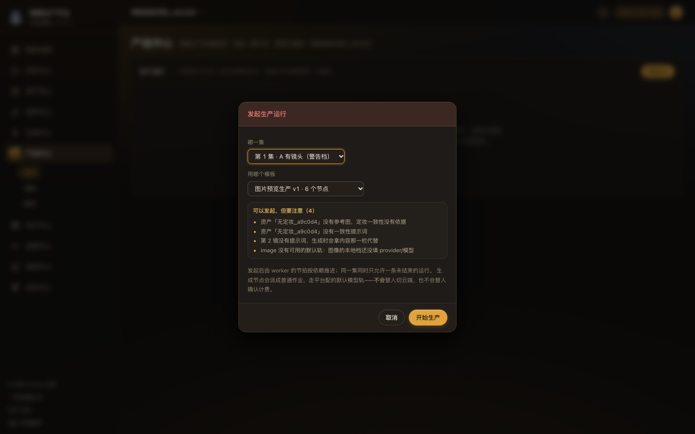

*图 4-36 发起运行弹窗：选完集与模板就摊开生产前检查，这一档是「可以发起，但要注意（4）」。*

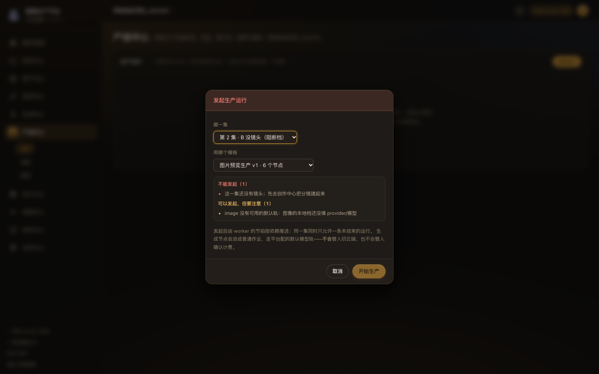

*图 4-37 阻断档：这一集还没有镜头，红字点名的同时「开始生产」已经禁用。*

**背后的硬规则**

- **流程模板只读**：改流程＝版本加一再存一行，**正在跑的运行冻结在创建时那一版**，改模板不影响它。
- **16 种节点分五类**：内部检查（`project_input`／`episode_input`／`document_input`／`shot_validate`／`asset_validate`／`artifact_validate`／`audio_prepare`，调度器当场做完，不排队不花钱）、生成（`image_generate`／`video_generate`，派成 Job 交给 worker）、**成片（`export_compose` 派成 `provider=ffmpeg` 的合成 Job；`export_validate` 由调度器读 ffprobe 结果做内部验收；`export_review` 转成产物审核）、人工（`human_gate`／`image_review`／`shot_review`，转成等签字）、占位（`export_prepare`，在 v1 模板里**一律 skipped**；要用成片就选 v2 模板，它的终点是 `export_review` 而不是这一格）。
- **逐镜支线**：按镜头展开的节点一镜一个（`node_key` 带 `#s<镜头id>`），依赖也跟着换成同一镜那一个；汇聚节点依赖**全部**镜头——镜头 2 失败会挡住后面的音频检查，但不会让镜头 1 和镜头 3 重跑。
- **不新起队列**：产线要干活就派一条 `job`，节点行只存 `job_id` 引用，状态、成本、日志、产物一律现读 Job 表；两边不可能长出两套执行事实。
- **不写审核结论**：审核节点只存 `review_item.id`。"这一镜过没过"仍然只有审核中心一个地方能改。
- **推进节拍住在 worker**：worker 每轮 `recover_stale()` 之后调一次 `pipeline.tick()`；`tick()` 出异常只跳过本轮，不把队列里其它正常作业一起拖死。页面的「推进」调的是同一个函数——人点一下和节拍自己走不会走出两种结果。
- **一集一条未完成运行**：再发起回 409 并点名是哪条挡着；取消或跑完才放行。
- **暂停／恢复／取消／重试**：暂停＝不派新活，**不强杀**正在跑的模型进程，跑完的结果照实记；取消＝未开始的收成 cancelled，能安全取消的作业发取消请求，**还在等签字的节点也一并收掉**（否则迟到的签字能把一条已取消的运行收成完成），已生成的产物一个不动；重试**只重试这一格**，旧 Job、旧产物、旧签字都不动，并把运行重新打开——失败运行不会因为下游节点永远不可达而锁死这一集。**这一格能不能重试由服务端说**（v0.97）：节点随详情下发 `retryable`＋`retry_hint`，四道判据是运行已取消／这一格不是失败／这一格是被驳回的／关联作业的状态不可重试；被驳回的格子**不再摆一颗注定 409 的钮**，改为写明"先重试上游哪一格"，重做上游产物后这里会重新等签字。重试新建的那条作业**继承原作业的源版本**（v0.97）：重试的意思是"同样这份源内容再来一次"，顺手记成当前版本等于一次重试就把"这条产物基于旧分镜"洗掉了。
- **发起前先做生产前检查**：缺镜头、引用资产不存在、超过合成上限、同一集已有未结束运行属于**阻断**（不建运行）；提示词为空、资产缺参考图或一致性提示词、某类能力没有默认轨、找不到 ffmpeg、worker 离线属于**警告**——运行照建，但以「生产前检查提醒」写进事件时间线，让人知道哪一步会停。
- **绝不替人切云端**：模板里出现云端节点，建运行时就 422 拒绝并点名是哪几个；生成节点一律走平台配的默认轨。
- **`needs_attention` 永不自动重试**：那是等人结清账单的档位，机器不该替人再打一次可能造成第二次付费的作业。
- **权限一个新点都没加**：读模板／读运行要 `job:read`，发起／推进／重试要 `job:submit`，暂停／恢复／取消要 `job:cancel`；模板这一版只读，所以连 `system:config` 都用不上。项目级第二道门照旧，看不见的项目一律 404。

**验收**

- 产线 pytest 现为 31 项（`tests/test_pipeline.py`，含阶段 D 的成片两格与前置检查、产线成片按节点钉作业）＋并发 7 项（`tests/test_concurrency.py`）＋整季 5 项（`tests/test_seasons.py`）＋10 条故障演练，见 §7.1。
- 阶段 C 真浏览器 [0]—[10] 全过（0 项失败）：侧栏位置、模板展开 13 节、发起运行、worker 自己推到等签字、暂停／恢复、在审核中心整份签字后节点自己收掉、关键帧失败与单格重试、同一集 409 → 取消放行、只读账号看不到五个动作、夜间／白天截图、380px 无横向溢出、临时项目与账号跑完当时留在开发库（2026-11-03 收口时已级联删除，删前把开发库备份到仓库外）、全程无未捕获 JS 错误。
- 阶段 E 真浏览器 13 项全过：worker 面板、建一批整季、按上限逐集起运行、暂停／恢复／取消、失败集「继续失败集」只补失败那格、只读账号只看到查看、380px 竖向堆叠。双 worker 进程同时在线时，同一时刻各自领走一条不同资源类的作业；合成 Job 不会和视频生成抢同一个名额到把队列堵死。
- 全程零付费调用；现场没有图像／视频运行时，生成节点在提交阶段就明确失败——页面如实显示失败与重试，不假装成功。成片验收用的是本机 FFmpeg 与临时构造的镜头视频，**不是**真实模型生成的一整集。

**这一版明确不做**

镜头级真实模型跑通（本机没有图像／视频运行时）、跨机分布式 worker（只有本机多进程）、自动重跑已成功的镜头（失败恢复刻意只补失败格）、成片在线精剪（时间线只读、合成参数由模板冻结）。

### 4.12 成片中心（阶段 D：本机 FFmpeg）

**它解决什么**

镜头视频一条条生成、审核完，还差最后一步：按分镜顺序拼起来、对齐每镜时长、把已备好的台词／音乐混进去、压成一个能拿去剪映或直接看的 MP4。这一层不替人做剪辑决定，只做**确定性合成**——同样的时间线、同样的输入，产出同一份成片，并留下可复算的验收记录。

**页面结构**

- **入口**：侧栏「成片中心」，位置紧跟「产线中心」。上方选集，下方是这一集的成片版本列表与时间线。
- **时间线**：按 `shot.seq` 排列，每镜显示序号、计划时长、来源视频作业、分辨率与是否已审核。**时间线在发起合成时冻结**，之后再改分镜不影响已提交的版本；要改就再发一版。
- **发起合成**：有 `job:submit` 才出现。前置检查逐镜点名：没有成功视频、产物未签字、视频读不出来，都会在提交前拒绝并说清是第几镜缺什么，**不排 Job、不产生空版本**。弹窗里可**可选地挂一份字幕**：传新的 `.srt`／`.vtt` 或选本项目已上传的；选中后下面写明"会烧进画面（不是软字幕），并冻结在这一版时间线里"。这台机器的 FFmpeg 烧不了字幕时，控件直接禁用并说缺的是 `subtitles` 滤镜。
- **版本**：每集按 `(episode_id, version)` 递增留档，旧版本不覆盖。列表显示版本、状态（从 Job 现算）、实际时长与分镜计划时长、分辨率、发起人、时间与操作。
- **详情**：播放器、逐镜表（实际／计划时长、作业、分辨率）、验收结果（ffprobe 读出的编码、分辨率、时长、音轨与容器）。实际时长与计划时长并列，差异超过 `max(2000ms, 8%)` 就判验收失败——不拿分镜表上的数字冒充成片事实。
- **审核**：合成通过验收后，时间线进入审核中心的**产物审核**，签字绑成片产物的摘要；成片被清理或被新版本顶掉，旧签字立刻失配。

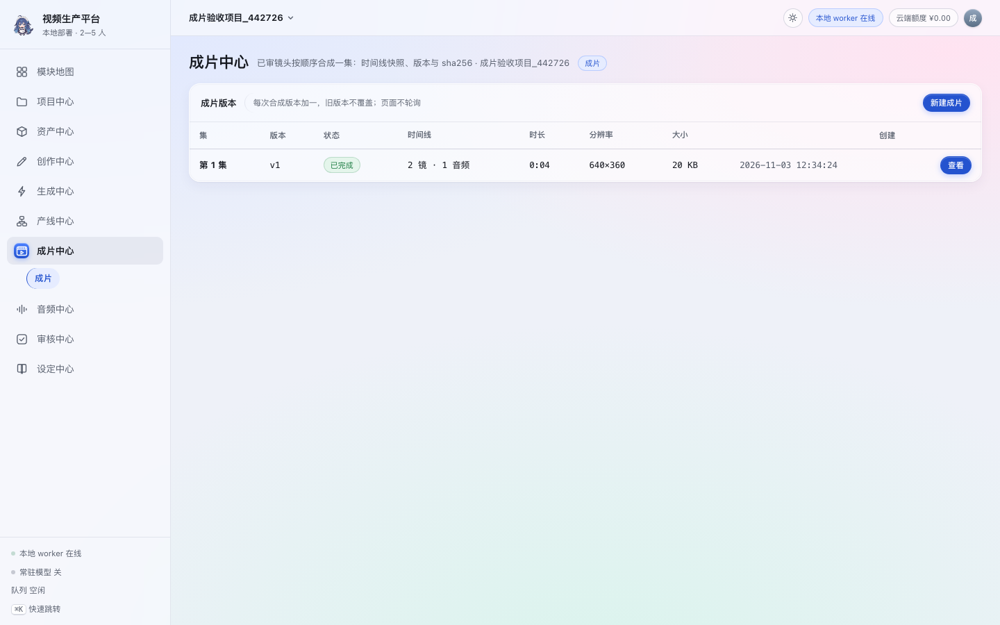

*图 4-38 成片中心：版本列表、时间线与发起合成。*

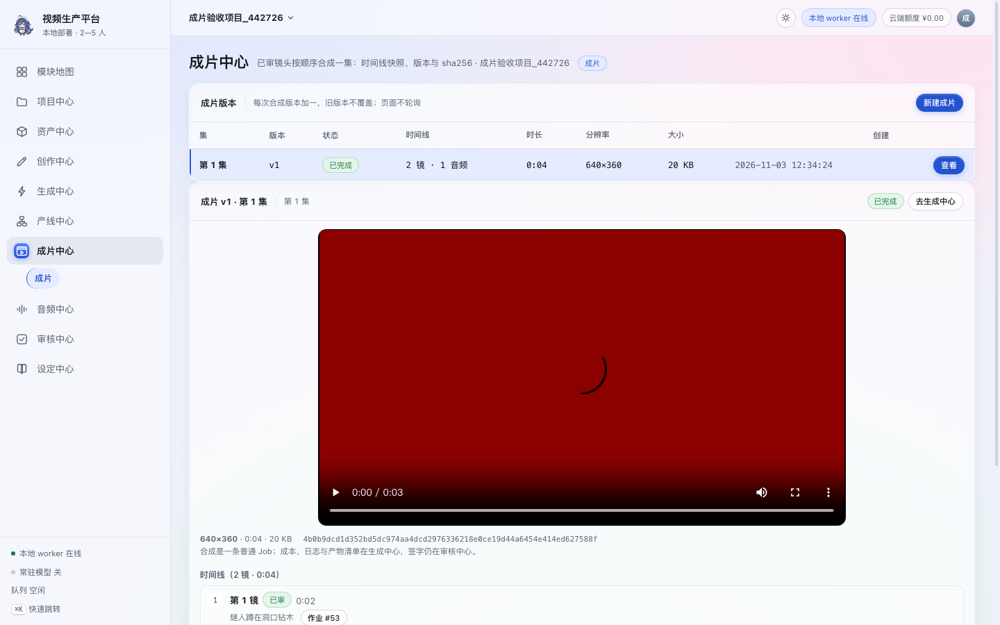

*图 4-39 成片详情：播放器、逐镜实际／计划时长与 ffprobe 验收结果。*

**背后的硬规则**

- **合成也是普通 Job**：`provider=ffmpeg`、`capability=video`、资源类 `compose`。它走同一个 `job` 表、同一个 worker、同一套租约与取消；不新起队列，也不在 API 进程里跑长任务。
- **产线成片钉住自己签过的作业**：产线发起的合成按「镜头审核」节点冻住的那条作业逐镜取片，不按「最新成功」——手抽重生成一镜并签字，不会把产线签过的素材顶掉。钉的作业没签、不存在、不属于这一镜都点名拒绝；手动成片仍取每镜最新成功。
- **源内容变了就不许拼**：每镜作业记着提交时的分镜／资产指纹；改过剧本、提示词或引用资产之后，旧视频即使还成功、签字也还对得上产物清单，成片仍会点名「源内容已变」，要求重新生成并重新签字。没有指纹的旧作业不判过期（不追溯）。
- **前置检查是硬门槛**：每镜都要有**最新一条成功**的视频作业（与分镜列表「源已变」同一条作业、同一个出处），且该作业的产物审核已签字。缺片或未审就停在 `composition_precheck` 并点名，不靠人工记忆。**镜头缺片与音频文件不在要在同一次里说完**（v0.97）：原来镜头这一半先报错，"这条音频的文件不在了"要走第二步才看得见，改一轮才知道还有第二件事。
- **时间线冻结**：提交那一刻的分镜号、时长、视频作业与路径全部写进时间线快照；之后再改分镜、删作业、换默认模型都不改这一版。
- **验收看文件本身**：ffprobe 读编码、分辨率、时长、音轨与容器；实际时长与计划并列记录，容差写死，不靠“应该差不多”。
- **版本不覆盖**：同一集再合成就是 v2、v3；旧版本留在列表里可回看。删项目时作业目录整目录摘掉，成片文件随之清理；只删一集时成片行随集级联消失，但作业与文件按账保留。
- **权限一个新点都没加**：看＝`job:read`，发起＝`job:submit`，取消＝`job:cancel`；审核仍在审核中心。

**验收**

- 后端 `tests/test_composition.py` 5 项（真实 FFmpeg 合成、音频偏移混音、版本唯一、前置检查、ffprobe 验收）＋`tests/test_composition_api.py` 5 项（创建／列表／详情／权限、幂等重放、422 点名、404）。
- 真浏览器 15 项全过：选集、时间线、发起合成、Job 从排队到完成、播放器可播、逐镜表、验收结果、版本 v2、窄屏无溢出、全程无未捕获 JS 错误。证据 `v91-*`。
- **证据边界**：素材是本机 FFmpeg 临时构造的测试视频，不是真实模型生成的分镜；这证明合成链路、验收与版本，不证明模型出片质量。

**这一版明确不做**

在线精剪、转场、色彩管理、云端转码；也没有"合成失败自动换一条更贵的路"。**硬字幕可以做**（v0.93）：在「发起合成」弹窗里传一份 `.srt`／`.vtt` 或选一份本项目已有的字幕，提交时路径与字节数冻结进时间线，worker 用 FFmpeg 的 `subtitles` 滤镜烧进画面；本机 FFmpeg 没有 libass 时**在提交前就拒**并说明原因，不排 Job。字幕是输入文件不是表：三条接口（列表／上传／删除）只管 `data/jobs/subtitles/<项目id>/`，删项目连带清理。

---

### 4.13 模型中心（v0.99，0035）

独立一级菜单，模型资源与调度配置的统一入口。四个工作区：**模型仓库／引擎管理／调用策略／运行监控**。
它是配置与技术管理入口，**不是第二个生成中心**——业务操作仍在资产中心、创作中心、生成中心。

侧栏紧跟「设定中心」之后、与「系统设置」同属底部分隔区；只有 `system:config` 能进（不新增权限点，仍是 18 个）。
旧「系统设置 · 模型与密钥」整页搬进「引擎管理」，功能一条没减（§4.10.1 只留跳转）。

**四条贯穿全模块的边界**

1. **规格不入库**。参数范围、倍数、互斥、计价、出处、核验日期一律来自适配器清单
   （`adapters.py`），页面只读。登记模型登记的是**实例引用**，不是新建规格——
   页面上能加出来的"模型"不代表跑得起来。
2. **策略不选路**。默认轨的唯一来源仍是能力轨那一列打勾。调用策略里的建议轨与备用轨
   只是提示，**备用方案不自动顶上**（裁定 MC1）；`resolve_provider()` 不补位、不兜底这条硬
   不变量一行未改。
3. **状态不自己拼**。健康、验证、生产可用、队列计数全部读服务端算好的字段；
   这一页算的只有"筛选后的行数"这种纯视图数字。
4. **监控不建第二套事实**。运行监控只读 Job、worker 心跳与成本账现成的出口（worker 表默认只列在线进程，离线行收进「另有 N 个」里，个数由服务端 `live_count`/`history_count` 给出——界面不自己数），
   不新建任务表、不复制任务状态。

#### 4.13.1 顶部概览

四个数全部现算，口径由后端随数据一起给（`/api/models/stats` 的 `caliber` 字段），界面只念不算：

- 已登记模型（按能力分布）；
- 可用模型 ＋ 需要看一眼的数量；
- 已接入引擎 ＋ 其中参数已核验的个数 ＋ 本机装了但平台未接入的应用数；
- 当前任务（运行中 ＋ 队列中）。

**可用**＝已登记 ∧ 已启用 ∧ 健康就绪 ∧ 这一档自己有过真实调用或产物验收。
引擎在线不代表模型可用，模型文件在也不代表工作流依赖齐。

三个入口：**登记模型**、**检查引擎连接**（对已填 provider 的槽位逐条跑环境检查并留痕）、
**查看运行异常**（跳运行监控）。

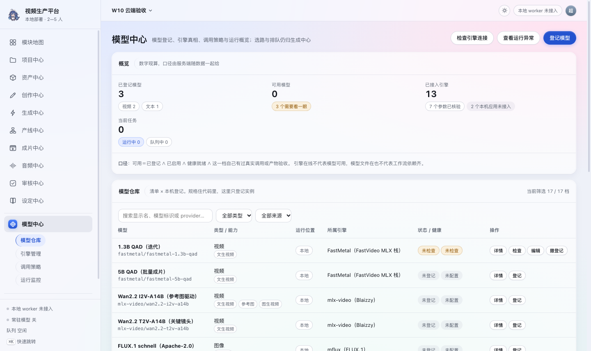

*图 4-40 模型仓库：清单 × 本机登记的联表，含"清单里有但没登记"的档。*

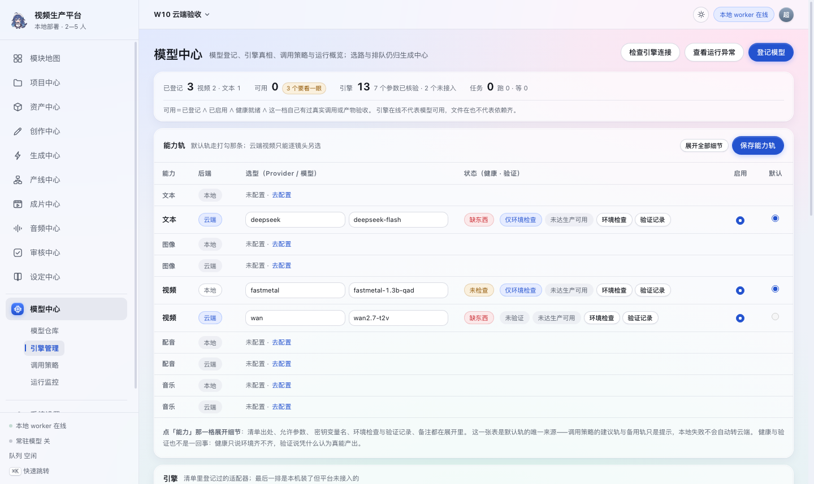

*图 4-41 引擎管理：能力轨十行（六列）＋ 按引擎分组的健康 ＋ 未接入灰卡。*

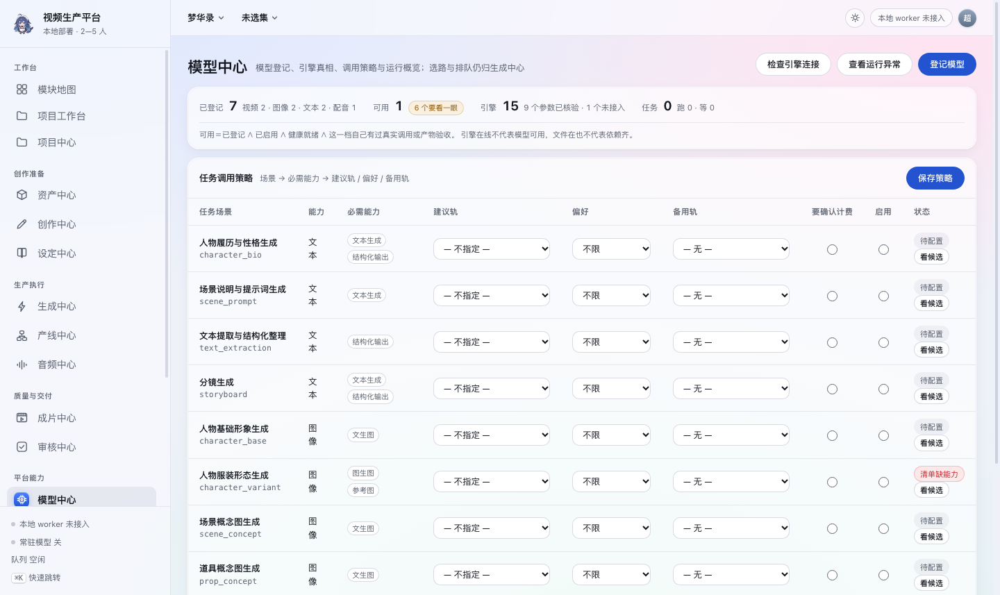

*图 4-42 调用策略：九个任务场景的必需能力、建议轨、偏好、备用轨。*

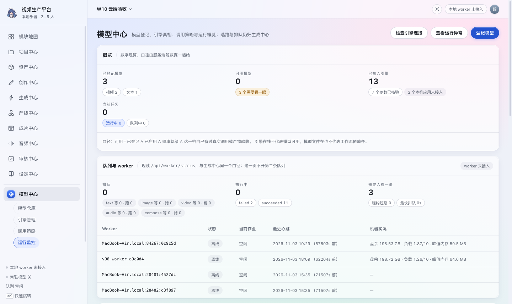

*图 4-43 运行监控：队列分类、worker 心跳与机器实况、告警、验证留痕。*

#### 4.13.2 模型仓库

**列**：模型（显示名 ＋ `provider/model_code`）、类型与能力标签、运行位置、所属引擎、
状态与健康、操作。搜索按显示名／模型标识／provider 过滤，类型与来源两个下拉。

**状态十档，三件事分开判**（登记状态／引擎连接状态／实际可用状态）：
未登记、清单未登记、已禁用、未安装或未下载、依赖缺失、连接失败、未检查、未验证、可用。
未验证与可用之间隔着"这一档自己有没有真产出过东西"，不许跳。

**能力标签只有两条合法来源**：

- **清单派生**（可复算）：`参考图` 来自清单里登记的图片输入参数；
  `文生图／文生视频／文本生成` 来自适配器声明的能力轴。
- **人工声明**：管理员在登记时填，**在这一档没有真实调用或产物验收记录之前，
  界面上必须带「人工声明 · 未核验」**。

**模型名不构成证据**：`wan2.2-i2v-a14b` 被标成"图生视频"是因为它确实登记了一个
图片输入参数，不是因为名字里有 i2v；反过来 `flux1-schnell` 没有图片输入参数，
就拿不到"图生图／参考图"，资产创作页据此明说"这一档不接收参考图，一致性靠提示词文字"。

**操作**：详情（参数、计价、出处、版本、路径、验证出处、备注）、检查（环境检查并留痕）、
编辑（显示名／版本／路径／能力声明／备注／启停）、撤登记。
**撤登记必须二次确认，且只删这一行登记**——权重文件仍在盘上，历史作业与验证记录一律不动；
确认框里必须把这句话说明白，否则下次找权重就找不着了。
要登记同一档的另一个本地版本，改「版本」那一栏，不许再加一行（两行会让
"这一档现在用哪个"变成猜）。

**登记弹窗的 Provider 与模型标识只列清单里有的档**（v0.117 起是两级下拉，选项由
`GET /api/providers/manifest` 现筛）：这一「能力 × 运行位置」清单里一档都没有时，
界面念「清单里没有这一档」并把保存挡下，原话指向 `adapters.py`（0041/A4 之后 文本 × 本地
已经有 ollama 这一档，至今仍一档没有的是 音乐 × 云端）。清单只登记了 provider 名、
没枚举模型的那些档（可灵／即梦／火山方舟这些）没有可选项，模型 ID 退回手填并把原因写在下面。
**接口侧仍然允许登记清单外的 provider**，响应带一句 warning，那种行标「清单未登记」、
参数与计价一律不显示、提交侧照旧被拒——"先登记、下周再往清单里补规格"这条真实工作流
因此改走接口，不再由界面替人造一个没有规格的键。

#### 4.13.3 引擎管理

**能力轨十行**（五类能力 × 本地／云端）从系统设置整页搬来，字段与语义不变：
provider、模型、密钥变量名、允许参数、健康、验证、启用、默认、备注。
整批保存仍在一个事务里校验"每类能力恰好一个默认、云端视频不许当默认"。

本轮把主表从十列收到**六列**（能力／后端／选型／状态／启用／默认）：
旧页 Provider 与模型两个输入框被压到 80px，实际显示成 "deepse" "d"，
人看不清自己填了什么；验证列里"未达生产可用"还会自己折成两行。
健康与验证并成一列"状态"（两件事都是"这一轨现在算什么状态"），
允许参数与清单出处、备注、密钥变量名挪到横跨整表的备注带。

**引擎卡**按清单里的适配器分组，一张卡给：位置、连接方式（本地是运行时目录变量、
云端是密钥变量名——**只显示变量名，永远不显示值**）、相关模型档数、参数是否已核验、
最近检查时间、出处。

**未接入引擎如实显示**：这一条从 v0.121 起**只剩 ComfyUI 一台**——Draw Things 已经接入
（`adapters.py` 有档、`engines.probe()` 打它的端点、`engine_http_run.py` 走真调用，512×512 出过真图），
所以页面上只有 ComfyUI 画成灰卡、标「本机已装 · 平台未接入」、
**不给测试连接按钮、不画状态点**。点了不会有真结果的按钮比没有按钮更坏。
它也不计入概览的"已接入引擎"数。接 ComfyUI（服务地址与实例发现、workflow 契约、
队列查询、产物回读）是独立工作包（CR-004，挂在 W-C）。

#### 4.13.4 调用策略

九个任务场景，键定死在迁移种子里（人物履历与性格／场景说明与提示词／人物基础形象／
人物服装形态／场景概念图／道具概念图／文本提取与结构化整理／分镜／镜头视频），
**界面不提供自由输入**——场景名一旦可自填，就会长出十个同义词指向同一件事。

每行可配：必需能力、建议轨、偏好（优先本地／优先云端／优先远程自建／不限）、
备用轨、要不要逐次确认计费、启用。

**校验一次说清所有问题**，不修一条报一条：场景不认识、能力不认识、偏好不认识、
建议轨不在清单、备用轨与建议轨同一档、要启用却没选建议轨。
原话留在表格下面显示而不是塞进系统弹窗——四五条错误拼成一句长文本塞进 `alert()`，
人既读不完也复制不走。

**「看候选」** 按必需能力筛：满足的进候选并标角色（建议轨／备用轨）与状态，
不满足的**照样点名并说清原因**（缺哪条能力、清单未登记、依赖缺失、已禁用）。
人最不该看到的是"我登记了它，候选里没有，也没人告诉我为什么"。
这一屏明写**备用轨不会自动顶上**；要真用某条轨，去能力轨设为默认，或在发起弹窗里显式选。

保存只改配置，**不启动任何任务**，也不改默认轨。

#### 4.13.5 运行监控

现读三个已有出口：`/api/worker/status`、`/api/models/stats`、`/api/providers/validations`。
与生成中心同一个口径，这一页不开第二条队列、不复制任务状态。

给出：排队与执行中（按 text／image／video／audio／compose 五类分）、按状态计数、
待人工核对与租约过期数、每个 worker 进程的心跳与机器实况（盘余、负载、峰值内存）、
告警列表、最近验证留痕。

**本轮明确做不到的三项如实标「不支持」，不拿估算填**：
按 provider/model 聚合成本（现口径只到 capability）、按时间范围筛选
（列表接口只有 limit）、分档执行耗时（只有单条 `elapsed_ms`，没有 AVG/分位）。
三项各要改一处后端，属 P1。云端调用次数与金额的权威出口仍是生成中心的成本账。

#### 4.13.6 与业务页面的衔接

链路不变：业务页面提交任务需求 → 能力匹配 → 选模型与引擎 → 资源与权限检查 →
统一任务提交（`services.submit_job()`）→ worker 执行 → 返回结果 → 业务页面确认并保存。

模型中心只站在"配置与技术管理"这一侧：不建人物档案、不建场景档案、不管资产形态、
不收候选图片。生成中心与资产中心的模型选择继续走 `/api/providers/available`
与 `/current`，**这两个端点的路径与返回结构本轮一字未改**，所以业务侧零改动。

---

### 4.14 项目生产工作台（P0，0037）

**要解决的问题**：改造前一级菜单按模块排，"这一步该去哪个模块"要人自己记；进度散在各页，没人能在 30 秒内说出"这一集卡在哪"。

需求：

1. 顶栏有**当前项目 × 当前集**两个选择器，这个组合存在服务端（`user_context`，每人一行），换浏览器与换机器登录同一账号回到同一集；项目或集被删时上下文按外键自动作废。
2. 侧栏按**五组**排（工作台／创作准备／生产执行／质量与交付／平台能力）。模型中心保持独立一级入口，不并进系统设置；不为导航调整删掉任何已有页面；没有真实功能的模块不进侧栏。
3. 一屏给全：四个总数（总集数、已交付数与百分比、当前集镜头与有片数、本集镜头总数）、**九阶段表**（剧本创作／内容解析／资产准备／分镜制作／视频生成／音频制作／审核验收／成片合成／最终交付），每行给状态、完成数、总数、待处理、失败、是否阻塞与进入入口，另加「下一步任务」一列。
4. 阶段**不设固定顺序锁**：资产可以在剧本写完之前先备，剧本与资产允许并行。
5. 「下一步任务」必须来自库里的事实（缺片、待签、缺参考图、合成阻塞、缺台词素材），每条带一个能落到解决位置的跳转；**禁止固定假数据**。
6. 提供两个生产入口——精细制作（单镜头工作台）与产线生产（产线中心），二者共用作业、队列、worker、产物、审核与成片；**严禁两套生成任务体系**。

验收口径：九阶段行数与后端 `production.STAGES` 一致；四个数与 `GET /api/projects/{p}/production` 同一次读取同值；阶段「进入」按钮跳到的模块与 `sub` 下标就是设计里那一页。实测见《开发/生产工作台改造/03-业务验收记录.md》场景一（1.12、1.13）。

### 4.15 单镜头生产工作台（P0，0037）

**要解决的问题**：一镜的生产过去散在四个模块里，人要来回切；"这一镜能不能进成片"没有一处能说清。

需求：一屏八段，顺序即生产顺序——① 镜头设定（含景别、运镜、画面比例、风格、负面提示词五栏新字段）② 资产引用（人物／形态／场景／道具，带参考图与一致性提示词）③ 关键帧 ④ 视频 ⑤ 音频 ⑥ 预览与确认 ⑦ 审核 ⑧ 生产完成条件。

四条硬规则：

1. **正式产物只有一个定义**：最新一条"成功且签过通过"的作业。被驳回的签字不算，未签字的成功作业也不算；这条与成片取片同一个出处，界面不许另挑一条"看起来更新"的显示。
2. **模型不支持或不接线的东西不得显示为可执行**：配音与音乐今天没有执行接线，所以⑤段只报状态与原因、只给跳转，不给提交按钮。
3. **提交前先预检**：结论为阻塞就不发请求，并把原因写在旁边；警告允许提交但要说清。
4. 五栏镜头设定**不进源版本指纹**（今天没有执行器读它们），补填景别不得把已签字的产物判成过期——这条有专门用例钉住。

验收口径：`GET /api/shots/{s}/workbench` 一次返回八段（`setting/refs/keyframes/videos/audio/preview/review/compose_ready`）；全程只用这一屏加提交与签字两类接口就能把一镜做到"可参与合成"。实测见记录场景二（2.1—2.8）。

### 4.16 统一预检（生成前与合成前，P0）

**要解决的问题**：同一个问题在四个入口各判一次，迟早出现"弹窗说能提交、点下去吃 422"——那是界面在骗人。

需求：

1. 规则只有一份（`precheck.py`），生成中心提交弹窗、镜头工作台、产线发起弹窗、成片中心合成弹窗读的是同一个结果。
2. 三档明确：**阻塞**＝现在提交一定失败（服务端同一条规则会拒）；**警告**＝能提交但要有心理准备；**通过**＝这项没问题。要展示总检查数、通过数、警告数、阻塞数。
3. 每个问题都要能**点过去**：定位到具体镜头、产物、素材或配置（`locate` 给模块与二级页下标）。
4. 生成前检查七类：内容／资产（含形态）／模型（默认轨、健康、参数白名单）／环境（worker、盘余）／费用（云端必须确认）／资源（队列）／**旧产物的源版本**。
5. 合成前检查至少覆盖十一项：镜头完整性、顺序、视频文件有效性、审核状态、源版本状态、音频、字幕文件、字体依赖、时间线、FFmpeg 与 ffprobe 环境、输出目录与存储空间。
6. 结论为阻塞时**不许发起**：不是排队后再失败。
7. 不新造判据：模型走 `adapters.health()` 与 `services.resolve_provider()`，参数走 `adapters.validate_params()`，成片走 `composition.timeline.build(require_approved=True)`，产线走 `pipeline.preflight()`。

验收口径：「预检说阻塞的那条提交一定失败」有对拍用例；实测见记录场景五（5.1—5.8）与场景一（1.9—1.10）。


### 4.17 页面内联操作与产线／人工同一份预检（P1）

一句话职责：**人看见问题的那一屏就该能处理它**；要跳就跳到「那一个」对象，而不是丢回列表页让人自己找（任务书 §12.1）。

四条口径：

1. **跳转只有一个实现**。`js/goto.js` 的 `gotoEntry({module, sub, shot_id, asset_id, job_id, episode_id})` 是全系统唯一一处「跳到哪」。以前生成中心、项目工作台、镜头工作台各写一遍，于是服务端在 `locate` 里带了 `shot_id`，到某页就被丢掉。带着集号跳转时顶栏上下文跟着对齐——页面装着第 4 集、顶栏写着第 1 集这种自相矛盾，是「跳过去看」最容易出的错。
2. **就地能办的事不再要求换页**。镜头工作台第 ⑦ 段直接列待签作业、勾质量清单、签通过／退回／驳回；审核中心·产物审核的每行有「去这一镜」；成片中心的合成前检查阻塞项带同样的跳转。清单与签字仍走审核中心那一个写入口，工作台只是把面板摆过来。
3. **产线发起弹窗读的是统一预检**。它打的是 `GET /api/projects/{p}/precheck`（内部就是 `pipeline.preflight()`，翻成三档条目并带跳转），于是发起弹窗与工作台看到的是同一份结论；「开始生产」禁用只认服务端的 `can_start`，页面不自己数条目。
4. **异常目录接进产线节点**。`_NodeFail` 的 13 个节点码全部进了 `error_catalog.py`（目录 41 → 54 条），运行详情里失败那一格给的是与生成中心作业抽屉同一块七字段面板。节点「能不能重试」仍只有 `pipeline.retry_gate()` 说了算，目录只在这道口试非空时把「可以直接重试」压掉。

验收口径：三档条目里凡服务端认得出的都带跳转、认不出的是空定位（界面就不摆按钮）；产线节点视图的 `diagnosis` 必须经 HTTP 层量一次（`response_model` 会丢掉模型外的字段，后端算好不等于界面拿得到）。

### 4.18 生产统计与内存读数（P2 里能算的那半）

一句话职责：把「这一部作品跑到哪、花了多少、还要多久、这一条作业占了多少内存」四个问题，用**库里已有的事实**答出来，且每个数都能说清是从哪几条作业来的（任务书 §15 的 P2「生产统计」「质量分析」）。

这一节**不新增菜单**：统计住在项目工作台原有那一页的下方，读的还是同一条接口 `GET /api/projects/{p}/production` 里新添的 `stats` 字段。

六条口径：

1. **金额只有一个出处。** 统计里的钱直接取 `jobs.cost_summary`（与成本账、项目看板共用同一条 `BILLABLE_WHERE`），界面不再 SUM 一次——两处各 SUM 迟早对不上。
2. **条数按状态如实数。** 状态×能力的分布来自 `jobs.stats_for_projects`，`publicStatus` 那五档仍在悬停与详情里给细粒度原词。
3. **耗时与内存的平均只按量得出的那些条算。** 平均值把还在排队的条也算进分母，得到的不是「平均要跑多久」，是一条被排队状态拉低的假数。
4. **内存分两种语义，都留在库里。** `child_max_rss_kb` 是 worker 生命周期最大值（本机实测会串台：一条 8.75GB 的视频作业之后，一条实际 3.13GB 的图像作业也被记成 8.75GB）；`child_peak_rss_sampled_kb` 是 worker 每条作业自己按秒采到的本条峰值。统计面板用后者，并在没有读数的能力那一行写「没读数」——老作业不补数。
5. **推算值给区间并把算法写出来。** 「还要多久」按本项目已完成视频作业的均值算下界；若每条提示词都是新的，加上文本编码的均值为上界（本机实测冷提示词多花约 82 秒、多占约 6.7GB）。没有可参照的作业就不给数。「参考并行」是把 `(物理内存 × 0.8) ÷ 单条采样峰值` 这条除法连同数字一起显示，人可以自己复核。
6. **算不出来的要占一行，而不是缺省不显示。** 「哪个镜头该重做」需要质量标准（库里只有人勾过的结论），「推荐换哪一档模型」与配置不补位的硬约束冲突（裁定 MC1）。这两条以「这一屏不算的」原话显示在统计底部。

7. **盘余不再只有一句阈值。** 生成前预检、合成前预检、产线发起检查与统计面板读的是同一个 `diskplan.disk_readout()`：按**本项目自己**成功作业的真实产物字节数，分「每镜视频／每张关键帧／一次成片」三种典型大小算出"这一集还要多少"，乘一个写明的 1.25 倍余量，与盘余并排显示；一个样本都没有时退回固定提醒线那句话，并说明为什么只能这样。取样时成片作业被排除在每镜平均之外（它的 `capability` 也是 `video`，混进来会把平均抬高一到两个数量级）。
8. **协作读数只数两件事。** 同一张统计卡下面有一张成员表：谁提交了多少条作业（`job.created_by`）、谁签了几次及各结论（`review_item.signed_by`）。两条限制与数字同屏显示——**作业条数不等于产量**（一次批量重投会算成同一个人的多条），**不排通过率也不排名**（谁能审到哪一条由可见性与分工决定，而这个平台没有操作审计）。响应里也不给 `rate`／`rank` 这类合成字段，用例把这条边界钉住，防止以后有人顺手加一枚"贡献度"。
验收：`tests/test_worker_rss.py` 6 项（子进程树只算自己那一棵、采样量级、没读数不编数、算式跟着峰值、统计口径走 HTTP）、`tests/test_production.py` 生产统计 5 项（HTTP 层拿得到 `stats`、金额与成本账同一条、原因分布用异常目录的中文名、冷热带分开算、没样本不给推算），真浏览器另有数条（见《发布基线》「最近一次真浏览器验收」行与本目录《03-业务验收记录》）。

### 4.19 批量重投卡住的镜头（P2「批量制作」里安全的那半）

一句话职责：一集里因为运行时抖动、超时或取消而卡住的镜头，**一次点完重投**，而不是人在队列里逐条找、逐条点。

四条边界，都写死并被用例钉住：

1. **只重投本机的 `failed` 与 `cancelled`。** 云端重试要逐次确认计费（§3 的硬约束），`needs_attention` 代表结果可能已经发生在供应商那一边——这两种在批量入口**逐条拒**并把原因写回来，绝不替人按下"可能再扣一次钱"的按钮。
2. **一次上限 50 条，越界直接拒**，不做静默截断——截断会让人以为整集都重投了。
3. **每条都走与单条重试完全相同的那条路**（同一个 `jobs.retry()`）：新行复制参数快照、`attempt` 加一、`retry_of_job_id` 指回原行，原行的状态、错误码、耗时、日志一个字段都不动。批量不是第二条写口子。
4. **"这一镜最后一条作业是什么状态"只有一个出处**：`jobs.latest_jobs_by_shot()`。下一步任务、统计与批重投都读它；各处自己写一遍"取最新一条"，就会出现同一镜头在一页说"卡住"、另一页说"没事"。

界面：按钮在**项目工作台原有的「下一步」卡片**里，标题带着待重投的条数；只读账号与零失败时不摆钮（服务端那道 `job:submit` 仍照拦）。确认走应用内弹窗（原生 `confirm` 已被守卫用例禁掉）。结果条把「重投几条、跳过几条、每条为什么跳过」原话显示出来，并且**活过一次页面重绘**——直接写进 DOM 的那句话会被下一次刷新擦掉，人只会以为没生效。

验收：`tests/test_retry_batch.py` 7 项（只重投本机失败／新行继承参数原行不动／云端与待核对逐条拒且不多排队／`limit` 越界直接拒／到上限明说／看不见这一集回 404／响应字段真出得来），守卫表 168 行，真浏览器另有五条（钮出现条件／确认走应用内弹窗／结果条逐条原因／真多排一条且 `retry_of_job_id` 指回原行／原行不动）。

与已有的整季 `retry-failed` 的区别：那一条是**整季按集**推进失败集，这一条是**一集之内按镜头**重投；两者都调用同一个 `jobs.retry()`，不是两套历史。

### 4.20 合成分辨率的默认档（与素材同尺寸）

一句话职责：**不填分辨率时，成片按素材那一档出，不放大**。

以前合成执行器写死 1280×720，而本机预览档真跑出来的一镜是 640×352——2026-11-05 整集连跑量到后果：六条 640×352 的素材拼出 5.6 MB 的 1280×720 成片。画质不多一个像素，字节与耗时实打实涨一倍，而且盘余估算也跟着虚高。

四条口径：

1. 显式填了 `width`／`height` 照填（要做 720p 交付的照常做），出处记成人填的。
2. 没填就取**这一集素材的众数尺寸**（不是第一镜——混尺寸的一集里，取第一镜会让整集跟着那一镜走）。
3. 素材那一档不合规矩（奇数、超出 320—3840 范围）时不硬用，退回配置默认档，并把"为什么退"写在同一栏里。
4. 当次按哪一档拼的，**冻进时间线快照**（`output_size`）并回显在参数栏（`size_basis`）——事后要能回答"这一版为什么是这个尺寸"。

发起弹窗里同步显示这一句（由服务端算，弹窗只复述）：「分辨率两栏留空就与素材同尺寸：640×360（2/2 镜是这一档）」。

### 4.21 智能体中心（0041）

**这一页回答两个问题：谁能替我做事，以及他做到哪一步了。**
它不是第四个执行系统，也不是一台新的聊天机器人：Agent 只负责"把一件事拆成几步、
按顺序调用平台已有的动作"，真正干活的仍然是生成中心那一条队列，
签字仍然在审核中心，模型与端点的配置仍然在模型中心。

**四个工作区**（侧栏「平台能力」组，模型中心之后）

| 工作区 | 看见什么 | 能改什么 |
|---|---|---|
| 总览 | 四个数（运行／进行中／等你审批／可用配置）＋两条腿摘要＋最近的运行 | 不改任何配置；发起按钮只排一条作业 |
| 智能体配置 | 本地／云端两条腿各自的：配的档、现在能不能用、端点、驻留、计价、密钥变量名；工具白名单全表 | **一个字段都不改**，每行给「去模型中心」的跳转 |
| 任务路由 | 九个任务场景各自的能力要求、建议轨、偏好、备用轨 | 只读；改在模型中心·调用策略 |
| 运行与审批 | 一个项目的运行列表 → 详情（步骤／关联作业／事件时间线／暂停恢复取消）＋「等你批 N 步」 | 显示待审批状态，**按钮把人送去审核中心** |

**发起一次运行**：写一句目标 →（可选）哪一集、按哪个任务场景、批准的有效期 →
平台先把话念回来：这次会走哪条轨、往外送什么内容、按什么计价。
走云端必须勾「确认」才放行，不勾就当场拒绝并说清为什么——这一勾不是走形式，
它把"按供应商计费"和一组具体的量×单价绑在一起，事后能指着那一行问当时是谁点的。

**每一步按风险决定要不要等人**：只读的步骤（盘点这一集缺什么、读一篇文档的结构读数）
当场做完；要花钱的（提交一条文本作业）与改正式业务事实的（登记一条资产）
会停在「等你审批」，出现在**审核中心的第三栏「动作审批」**。批准／驳回／退回都在那里签，
签的是那一组参数的指纹：步骤的参数建出来就不可改（`repositories/agents.py` 的 `update_step`
白名单里没有 `args_json`），所以"换一批参数"的唯一路径是重新排计划长出新步骤、
旧签字自然对不上新指纹——**不是**"人在界面上改一个字就作废"，界面没有那个格子。

**批了之后由谁执行**：worker 的推进节拍（`agents.tick()`，挂在 `pipeline.tick()` 之后）。
服务端签完那句原话是"批准已记下，这一步会在 worker 的下一拍被执行"（`routers/review.py`），
**而当前界面在成功时不显示它**——`util.js` 的 `run()` 只在失败时说话，所以人看到的
是刷新后的步骤状态从「等你审批」变成「执行中」。结果好不好不由模型自己说，
由真实业务行与产物文件验收（作业显示成功但产物读不到文件，这一步按失败处理）。

**看得见的边界**（这些没做，页面与文档都不假装）

- **`paid` 那一步在云端默认轨上必然被拒**：工具提交时恒传 `user_confirmed_cloud=False`
  （"换成云端那一轨"必须是一次看得见的选择），而云端作业一定要这个确认，
  所以本机这种文本走 `deepseek` 的配置下，批完也只会得到 `submit_rejected`。
  要打通得先裁"审批那一下算不算云端计费确认"，见《系统设计说明书》§16；
- 「每次询问走本地还是云端」这一档路由没做：默认轨的唯一来源仍是引擎管理里打勾那一行；
- 没有按项目的 Agent 费用上限，只有逐次确认单；
- 失败步骤没有单步重试，只能重新发起一次运行；
- 一次计划最多 12 步、一轮 tick 一个运行最多连走 6 步（`agents.py` 的两个常量），
  提示词里还另有一条软顶：`paid` 与 `formal` 各不超过 2 步；
- 审批有效期接口给了四档（1 小时／6 小时／24 小时／7 天），**发起弹窗里只有 24 小时这一档**，
  库里那一列的 CHECK 允许 60—604800 秒；
- 本地模型（Ollama 那一档）的能力是单独实测过的，
  但"真实模型算出来的计划"还没在这条线上跑过一次——本轮所有计划来自假接口与手工数据。

**权限**：一个权限点都没加，但有两道归属闸不在权限点里。配置三张表＝`system:config`；
看计划可选项／运行清单／运行详情＝`project:read` **且逐条过项目可见性**；发起＝`job:submit`；
暂停／恢复／取消＝`job:cancel`；看待审批＝`review:read`；签字＝`review:sign` **且要项目 `write`**
（只读成员看不见签字钮，硬发也吃 403）。

## 5. 跨模块规则

| 规则 | 落地 |
|---|---|
| 一个实体一个东家 | 项目／资产／集与文档与分镜／作业与成本／审核／音频／账号各归一处；别处只读＋跳转 |
| 一个队列 | 音频、文档 AI、抽取、生成视频、**资产的文字设定与图像候选（v0.98）**全部落 `job` 表；没有第二条队列或第二个 worker。**产线也一样**：节点要干活就派成一条 `job`，产线表里只存 `job_id` 引用，不复制 Job 的状态、成本、日志与产物路径 |
| 一个推进节拍 | 产线调度器住在 worker 进程（每轮先 `seasons.tick()` 再 `pipeline.tick()`），API 进程只写库、不推进；停 worker 就停推进，界面不会看到"作业卡住"这种假象。整季与单集跑的是同一个节拍，整季只负责按上限起运行 |
| 一个资源类一个上限 | 队列只有一张，但领取按资源类分开算：`text／image／video／audio／compose` 各自有在跑上限，另有全局上限。多个 worker 进程各自声明自己的上限，原子领取时数据库点数——两个人同时伸手不会领走同一条，也不会让 8 个视频作业把唯一一条文本抽取饿死 |
| 一集一条未完成运行 | 同一集同时只允许一条没跑完的产线运行；再发起回 409，并说清是哪一条挡着。取消或跑完才放行。**失败的运行也必须收尾**：下游永远不可达的节点不算「还在跑」，否则这一集会一直被 409 锁死；重试会把运行重新打开。整季排产同样遵守这一条：被人工运行占着的集如实标出，不抢、不合并 |
| 一个成本口径 | 金额只在 Job 的 `*_micros` 与 `pricing_snapshot`；素材、文档、看板都不存金额。"什么算进了金额"也只有一条 WHERE（`BILLABLE_WHERE`），成本账与看板共用。产线一分钱都不记；整季只把各集 Job 的金额汇总。**合成 Job 是本地 FFmpeg，金额为 0**，不编造一个“渲染费” |
| 一个路径边界 | `FILES_DIR`／`JOBS_DIR`／稿件工作区三条边界共用 `paths.py` 一条规则；库里读出来的相对路径一律当不可信，解析之后再比 `root + os.sep` |
| 一句消息只说该说的 | 对外错误消息不带堆栈、不带部署机绝对路径、不带别人项目的内容；堆栈只进日志文件，绝对路径换成 `data/…` 标签 |
| 一个审核写入口 | `review_item` 只由审核中心写，**文档与产物两档都在这一个模块里落**；其他页面只显示状态。产线的 `image_review`／`shot_review` 节点只拿 `review_item.id` 当引用，不自己记结论——否则"这一镜过没过"就有两个地方能改 |
| 一个动作一个事务 | 删账号要「转移 N 个项目 ＋ 删一行」，全程在一个事务里（`db.transaction()`）；中途失败整体回滚，界面拿到的是「什么都没变、账号还在」。连带删项目**不包**事务——那一步要动 Git 与磁盘，回滚不回来，改成把「已删掉几个、卡在哪个」如实报出来。**提交作业同理**（裁定 D2）：建业务行＋建 Job＋转态在一个事务里，抽取提交也折进同一事务，崩在哪一步都不会留下"孤儿付费作业" |
| 一次提交一个幂等键 | 三条防线叠着：产线节点靠原子转态的行数判"别人已经派过了"（行数为 0 就不派）；派出去的 Job 用**确定性键** `pl-<run_id>-<node_key>-a<retry_count+1>`，重放撞 `job.idempotency_key` 的 UNIQUE；只有人工重试才用随机键 `retry-<uuid>`（那是人明确要求再来一次）。三层任意一层单独失效都不会跑出两条作业 |
| 一个正文事实来源 | 小说／剧本正文在文件 + Git；分镜在 `shot` 表；不互相复制 |
| 快照不可回改 | 作业的提示词、参数、集镜与入队时间在提交时冻结；改业务对象不改作业。产线运行也冻结**模板版本**：改了模板不影响正在跑的那一条 |
| 密钥不出后端 | 库、接口、日志、错误消息里都没有密钥值；文档只写变量名与占位符 |
| 失败不伪装 | 缺运行时、缺密钥、缺产物都明确失败；不用空态或假数据冒充完成。产线的 `needs_attention` 作业**永不自动重试**——那是等人结清账单的档位，机器不该替人再打一次 |

---

## 6. 非功能需求

### 6.1 性能与容量

- 目标 2–5 人、万级 Job；SQLite WAL 足够，超上限再换 Postgres。
- 列表与看板聚合在单项目量级内一次查询完成；不按行发 N 个请求。
- 队列每 3 秒刷新；worker 心跳 20 秒判离线；租约 60 秒，0.2 秒续租。
- 单份正文默认 1MB 上限，超了让人分文档，不默默截断。

### 6.2 稳定性

- 独立 worker；kill -9 后重启或周期恢复把过期租约作业收成 `failed(worker_lost)`。
- 取消请求式：排队中立即取消，运行中先 SIGTERM、5 秒后 SIGKILL。
- 保存正文：同目录临时文件 → fsync → `os.replace`；Git 失败退回上一版并把未应用结果另存到工作区外。
- 迁移前自动备份，保留最近 5 份；迁移按“一个迁移一个事务”执行。
- 产线推进崩在哪一步都能接着走：建了运行还没推进就崩、节点就绪还没提交作业就崩、作业落库还没关联节点就崩、作业已成功节点还停在执行中——四种残局重启后都按 `job` 表的真相对齐，**不猜、不重投**（十条演练实测，见 §7.1）。
- `pipeline.tick()` 出异常只跳过本轮并打一行日志，不让 worker 退出：一条产线的定义有问题，不该把队列里其它正常作业一起拖死。
- 提交作业是一个事务（裁定 D2）：建业务行＋建 Job＋转态同生同死，中途崩不会留下"孤儿付费作业"。

### 6.3 安全

- 口令 scrypt 哈希；会话 Token 只存哈希；Cookie HttpOnly + SameSite=lax。会话行只带身份列，不含口令哈希；过期行在下一次登录时被清掉。
- 每个业务端点显式声明权限，不靠前端隐藏；项目级再按归属判定。
- 上传文件按魔数校验类型与大小；定妆图的读取走带登录与资产归属判定的路由，不是静态挂载。
- 提交作业的人不能借"条件图"读这台机器上的任意文件：输入图必须落在该作业自己的目录里，相对与绝对两种写法过同一道边界。
- 前端永远是“别让人白点”，不是安全边界。
- 文档中不写真实口令、Token、内网地址；示例一律占位符。

### 6.4 数据与备份

- `data/` 整体被 Git 忽略；含数据库、上传文件、文档工作区、作业产物。
- 备份必须整体打走：只拷数据库会丢正文与产物。
- `backup.py create` 打库＋文件＋工作区＋作业；manifest 记 sha256、`integrity_check`、`foreign_key_check` 与逐表行数。
- 恢复必须 `--yes`，先验后恢复，恢复前自动留安全备份。
- 备份不是增量，也不是异地；保留份数与异地存放由运维定。

### 6.5 界面与可访问性

- 日／夜双主题，右上角切换；主题令牌集中在 CSS 变量。
- 桌面优先，表格溢出可横向滚动；860px 以下侧栏收图标，页内有二级切换器。
- 灰字过 AA；小字下限 11.5px；可点性常驻（箭头、边框、光标不靠 hover 才出现）。
- 弹窗支持 Escape 关闭（焦点没进弹窗也算，关掉的是最上面那一层）；危险确认统一自绘弹窗；登录失败有抖动反馈。
- 写动作按**这条接口声明要哪个权限点**显隐：取消作业要 `job:cancel`，重试／核对／标记待核对要 `job:submit`，建一集要 `doc:write`。只读账号看到的是一句说明而不是一个点了必吃 403 的钮；动作区空着时也要说清是"这条已经结束"还是"这一档只让你看"。
- 尊重 `prefers-reduced-motion`；切页动画可整套关闭。
- 所有异步动作有明确成功／失败／进行中反馈；错误说明“为什么、下一步去哪”。

---

## 7. 验收与当前证据

### 7.1 自动化与真浏览器

| 层 | 结果 | 位置 |
|---|---|---|
| 后端单元／集成 | **1036 passed** | `app/backend/tests/` |
| 安全回归 | 6 项：定妆图需登录且需看得见资产、路径不能上跳、全局池图登录者可读、初始口令未改只放行改密三条、未知权限级别不放行、顶栏状态不摊别人作业 | `tests/test_hardening.py` |
| 风险与调优 | 12 项：路径边界不被同名前缀目录／软链接／Windows 写法绕过，库里的脏路径不会变成删除目标，I2V 条件图的绝对路径也过同一道边界，会话行不含口令哈希、过期行随下次登录被清，错误消息与 500 detail 不带堆栈和绝对路径，看板与成本账对「什么算钱」给同一个数 | `tests/test_risk_pass.py` |
| 三件裁定落地 | 11 项：`transaction()` 内 `get_conn` 借用同一条连接、回滚不留半套写、转移账号中途失败整体回滚且修好后可重做、**名下没有项目的账号也真删掉**（阶段 B 验收里撞出来的假成功 204）、连带删项目失败时报出已删数量、`shot`／`asset` 不再有 status 列且接口不再返回它、18 个权限点与 18／13／7 的角色授权、代码与前端都不再引用 setting 代码 | `tests/test_decisions.py` |
| 路由守卫 | 153 条业务端点逐条声明权限；守卫表 153 行（`POST /api/generation-profiles` 的项目内与全局两档各一行），唯一路由数与路由表对齐。**成片 6 条、字幕 3 条、整季 6 条与资产增强 10 条接口同样一个新权限点都没加**，沿用 `job:read／job:submit／job:cancel` 与 `asset:read／asset:write` | `tests/test_guards.py` |
| W13 抽取 | 12 项：解析、证据、幂等、接受／合并／拒绝、导出、权限、解析失败、**建运行那一步崩了不留孤儿付费作业**（裁定 D2 把抽取提交折进同一事务后补的） | `tests/test_extraction.py` |
| W14 审核（文档档） | 6 项：规则与锚点、gate＋签字＋重签＋队列、非法锚点、版本过期、只读角色 | `tests/test_review.py` |
| 产物审核（裁定 D1） | 8 项：只有已成功且有产物的图像／视频作业进队列、签字与改判计数、锚点必须在产物清单里、没成功或没产物不能签（409 带原因）、产物被清理后旧签字失配、权限与跨项目归属、删文档连带清掉它的签字、文档签字与产物签字互不串档 | `tests/test_job_review.py` |
| 产线阶段 B（裁定 D3） | **34 项**：模板合法性与环检测、内置模板重跑不改历史、展开与版本冻结、无镜头／无正文时的行为、一集只允许一条未完成 run＋幂等键复用＋跨项目撞键、云端节点建 run 就被拒、整条签字跑通到 `completed_with_errors`（v1 的 `export_prepare` 恒为 skipped）、重复推进不产生新作业、单节点重试只建一条作业、驳回不可重试、`returned` 不算终态、正文改过签字作废、产物被删失配、暂停／恢复／取消、取消真的发取消请求、**取消会收掉还在等人签字的节点**、`needs_attention` 永不自动重试、作业行被删（`job_missing`）、镜头不全、条件图注入与缺关键帧失败、`tick()` 跳过已暂停的 run、**失败收尾之后同一集能再起一条**、**失败只重试那一镜时运行重新打开**、接口权限与归属、404／409／422 映射；阶段 D 追加 **v2 成片节点从合成到验收到审核**与**前置检查失败点名停格、不排 Job**；**产线成片按节点钉住作业**（有镜头审核节点取它冻的 `job_id`，没有则退到生成节点，不回到「最新成功」）；**生产前检查**（阻断与警告分开、`GET /projects/{id}/preflight` 的权限与归属）与**没有参考图的资产要警告**（`ref_images` 是 JSON 文本，`"[]"` 也算没有） | `tests/test_pipeline.py` |
| 成片（阶段 D） | **15 项**：两镜真实 FFmpeg 合成出可播放文件、未审核镜头被前置检查拒绝、版本加一且旧版不覆盖、缺片一次说清是哪几镜、音频按镜头起点混入；字幕两档——本机有 libass 时烧进画面并用 PSNR 证明画面真的变了（带字幕与不带字幕各合一次对照），没有 libass 时在提交前拒绝且不排 Job；产线钉片两档——钉住的作业优先于「最新成功」、钉的作业没签或不属这一镜会点名拒绝；v0.97 再加三项——**分镜标记与成片用同一条视频作业**、**重试不许把旧素材洗成新素材**（新作业继承 `source_version`）、**镜头与音频的问题同一次说完** | `tests/test_composition.py` |
| 成片接口（阶段 D） | **7 项**：创建／列表／详情与权限、同一幂等键重放不建第二版、前置检查不过回 422 并点名；字幕三条——上传与列表与删除（列表同时带回「这台机器烧不烧得动」的能力位）、坏字幕六种写法一律 422（非 srt／vtt、空文件、没有时间轴、VTT 缺头、超 1MB、非 UTF-8）、跨项目与越权一律 404／403 且**拿别人的字幕路径删不动**、删项目会连字幕目录一起清掉 | `tests/test_composition_api.py` |
| 资源并发（阶段 E） | **8 项**：资源类映射、默认全局 1 时第二条要等、抬全局上限后不同资源类可并行、视频类仍按格数封顶、**成片单独占一类不与视频抢**、两个 worker 同时领只有一条拿到、心跳能列出多个 worker 与各自上限 | `tests/test_concurrency.py` |
| 整季（阶段 E） | **5 项**：按上限逐集推进并在签字后收口、上限两集时同时起两条运行、继续失败集只重试失败镜头、取消整季会取消未结束的单集运行、权限与归属 | `tests/test_seasons.py` |
| 作业归属守卫（R1） | 1 项：拿别人的 `worker_id` 调 `cancelled()` 改不动一条已领取作业的终态（状态与 worker 都不变），自己的 `worker_id` 才能收尾 | `tests/test_jobs.py` |
| W15 音频 | 4 个用例，覆盖：建素材、提交 Job、成功回填、音乐能力、音效 422、权限 | `tests/test_audio.py` |
| W16 看板 | 5 项：聚合、空项目、CSV／MD、404、标题 | `tests/test_dashboard.py` |
| 首页工作台 | 6 项：只聚合自己看得见的项目（外人的合计等于他自己那几行之和）、文档待签绑当前正文版本（签完归零、改正文回待签）、产物待签绑产物清单摘要（签完归零、删产物文件回待签）、`failed` 与 `needs_attention` 分开计数、归档项目不进待办、进行中的运行只算没收尾也未取消的 | `tests/test_workbench.py` |
| W18 备份 | 3 项：创建／校验／恢复、无 `--yes`、篡改拒绝 | `tests/test_backup.py` |
| P0 模型验证 | 15 项：五档出处互不升级、生产可用服务端判定（环境齐∧真调用过∧产物验收通过）、从作业登记拒绝模拟／未成功／产物不可读／云端未确认／无验收结论、记录只增不改 | `tests/test_validation.py` |
| P0 待核对与告警 | 18 项：云端租约丢失判待核对、核对结清、重试预览与重试链、worker 六码告警、权限 | `tests/test_attention.py` |
| 阶段 1 故障演练 | 七条演练＋备份恢复演练全部实测通过，脚本与观测记录见《黄金样例与故障演练.md》 | `tools/fault_drill.py`、`backup create/verify/restore` |
| 产线故障演练（阶段 B） | **十条全过**（临时库＋mock 适配器，不碰真供应商、零付费）：① 建了 run 还没推进就崩 ② 节点就绪、作业没提交就崩 ③ 作业落库、节点还没关联就崩 ④ worker 跑到一半被杀（租约恢复判失败，产线不自动重试） ⑤ 作业已成功、节点还停在执行中 ⑥ 一镜失败只重试那一镜 ⑦ 卡在等签字时重启 ⑧ 暂停时作业还在跑（不强杀、不派新活） ⑨ 云端已取得请求 ID 但租约过期（判待核对，不替人再打一次） ⑩ 两个线程同时推进同一条运行。**Mock 只证明代码路径与故障处理，不作为真实模型生产验证证据** | `tools/pipeline_fault_drill.py` |
| 资产中心增强包（v0.98） | **39 项**：老资产升级后照常打开且档案是"还没写"不是缺数据、档案整体读写、非人物资产 422、形态增改删与排序、同类型重名 409、类型与父资产不匹配 422、**形态可见性继承父资产**、全局形态写删要管理员、四类操作排进**同一个队列**、空提示词不建作业、目标与形态错配拒、草稿也能先生成、云端没勾确认不建作业、**云端单价与清单不一致就拒／对得上就按清单重建那张单子**、没登记计价档不提交计费作业、回稿按标记分段与缺段提示、**段中间的标记不算段首**、没成功不给填、失败带 error_code、非资产作业与跨项目拒、导入正例且**原产物还在**、存进形态、非图像或非成功 409、序号越界与文件已清 422、**产物不是图片 415**、**多传一个 `path` 字段不改变行为**、形态不属该资产 409、两次导入不互相覆盖、**删项目连形态图一起清**、迁移可重跑、外键真拦、未知操作拒、**图像作业的状态端点不装成文字分段**（真浏览器撞出来的 500）、**演示开关打开才给假槽位** | `tests/test_asset_studio.py` |
| 真浏览器 W13—W16 | **16/16**：看板、抽取弹窗、审核 gate 与签字、音频台账与失败提示、CSV BOM | 验收脚本按包临时重建，不入库；当前证据是 `文档/assets/v73-*`（原图在 `app/截图/`）与上表 pytest |
| 真浏览器 P0 | **12/12**：验证列与记录弹窗、环境检查留痕、待核对→核对结清闭环、重试预览取消不建作业 | 证据 `app/截图/v75-*`；操作步骤见《系统使用说明书》v1.3 |
| 真浏览器 阶段 1 | **4/4**：出处下拉四项含产物验收、验收结论只在产物验收档显隐、摘要五档、弹窗说明写三条件 | 证据 `文档/assets/v76-val-modal.png`；脚本按包临时重建，不入库 |
| 真浏览器 项目中心 | **32/32**：概览与排序、标签折叠、⋯ 菜单与键盘、切行不误跳、归档后顶栏退、已归档恢复、新建校验与截断提示、批量动作按选择给、结果活过重绘、批量／单个删除确认、380px 不溢出；另 **双主题 13/13**：夜间／白天切换、概览与副标题文字对比度均 ≥ 4.5:1、⋯ 菜单有底色且菜单项可读 | 证据 `文档/assets/v82-projects.png`、`v82-projects-menu.png`；脚本按包临时重建，不入库 |
| 真浏览器 角色与边界 | **35/35**：四类账号（所有人／协作人／管理员／只读）的按钮与菜单显隐（v0.84 后协作人只剩修改）、批量动作集合、越权接口 403；空列表、只剩归档、当前项目被删；380px 操作列横滚后 ⋯ 菜单不出屏 | 证据同上；临时账号与临时项目跑完留在开发库（实测 2026-11-03 复核：开发库里仍有本轮与后续几轮的验收项目；本轮收口已把它们连同 `cdp_*` 账号一起级联删除（删前把开发库备份到仓库外）），脚本按包临时重建、不入库 |
| 真浏览器 ⋯ 菜单定位 | **18/18**：1440×700 与 380×700 末行朝上开且完整在视口内、首行仍朝下开、页面滚动／表格横滚／窗口缩放三种收起、150px 高时菜单内部滚动、焦点回触发按钮 | 脚本按包临时重建，不入库 |
| 真浏览器 选中即打开 | **14/14**：行内无「打开」按钮、项目名不是按钮、操作列只有 ⋯；点行与 Enter／空格都只切当前不跳页、`aria-current` 跟着走、行内按钮的 Enter 不被行抢走、页头「去创作中心」跳页、`last_opened_at` 落库并回流到界面 | 脚本按包临时重建，不入库 |
| 真浏览器 转移所有权 | **15/15**：零协作人时转移行常驻、候选＝协作人＋可邀请账号（不含更高层级）、一步交给未加入者并降级、接手人视角名单正确、管理员代转、协作人发起 403、接手人不存在 404 | 脚本按包临时重建，不入库 |
| 真浏览器 十项修正 | **20/20**：归档行给提示且不改当前项、roving tabindex 一个停靠点＋↑↓、选中不跳行、搜索覆盖所有人与介绍、同名补 #id 并在删除确认里标明是哪条、删除后提示条、批量标签已满说实话、批量清点零 `/summary` 请求、排序／筛选／搜索词刷新后仍在、协作人菜单与批量条不再出现归档与恢复 | 脚本按包临时重建，不入库 |
| 真浏览器 风险与调优 | **25/25**：四个改用统一实现的弹窗在焦点不在弹窗内时也能 Escape 关闭、三个原有弹窗不退化、建一集按 `doc:write` 显隐、队列动作按 `job:cancel`／`job:submit` 显隐、只读账号抽屉里给的是「没权限」那句话而不是空白、音频失败提示跟着「项目 × 页签」走、切页之后生成中心的 3 秒轮询自己停、全程无未捕获 JS 错误 | 脚本按包临时重建，不入库 |
| 真浏览器 定妆图鉴权 | **4/4**：登录可传可取（`content-type: image/png`）、资产卡片缩略图真的渲染出来、不带会话取图 401 | 脚本按包临时重建，不入库 |
| 真浏览器 阶段 B（D1＋D3） | **七节全过（0 项失败）**：① 十个模块逐个走一遍，现有页面一个没坏，全程无未捕获 JS 错误 ② 审核中心「文档审核／产物审核」两个页签都在，产物队列如实为空（本机没有图像运行时） ③ 产线模板接口读到三份内置模板 ④ **在真进程里建一条运行，一次 `advance` 都不调，等 live worker 的 `pipeline.tick()` 自己把它推完** ④b 换一份带人工确认的模板，验卡在等签字的运行会挡住同一集的第二条（409）、能暂停与恢复、取消之后放行 ⑤ viewer 能读模板、不能发起运行（403） ⑥ 白天／夜间两套主题各截图 ⑦ 临时账号与临时项目跑完留在开发库（未删，收口时已删）。**阶段 B 没有产线页面，这一节验的是「现有页面没被弄坏＋调度节拍真的住在 worker 里」** | 证据 `文档/assets/v89-stage-b-generation.png`、`v89-stage-b-review-day.png`、`v89-review-artifacts.png`；脚本按包临时重建，不入库 |
| 真浏览器 阶段 C（产线页面） | **[0]—[10] 全过（0 项失败）**：① 侧栏入口紧跟生成中心 ② 模板页签三份内置模板（阶段 D 后为四份）、只读说明、标准模板展开 13 节 ③ 发起运行弹窗（模板下拉带版本与节点数）、worker 节拍推到等签字、前五个内部检查完成、13 个节点都画出来 ④ 暂停后状态是已暂停、恢复后继续 ⑤ 在审核中心整份签字 → `confirm_script` 自己完成、关键帧因缺运行时失败、运行整体 failed ⑥ 失败节点重试要确认、记重试次数、重试后仍失败、时间线写着重试与失败 ⑦ 改正文作废旧签字、同一集 409 → 取消放行、取消后等签字节点跟着取消 ⑧ 只读账号能看、看不到推进／暂停／取消／重试四个动作、直接调发起接口 403 ⑨ 夜间／白天截图、380px **零横向溢出**（修前 154px） ⑩ 临时项目与临时账号跑完留在开发库（未删）、全程无未捕获 JS 错误 | 证据 `文档/assets/v90-pipeline-runs.png`、`v90-pipeline-templates.png`、`v90-pipeline-day.png`；脚本按包临时重建，不入库 |
| 真浏览器 阶段 D（成片） | **[1]—[15] 全过（0 项失败）**：选一集、时间线逐镜列出计划时长与来源作业、发起合成后 Job 从排队到完成、播放器能播、逐镜表显示实际／计划时长、ffprobe 验收结果、再合成得到 v2 且 v1 还在、前置检查缺片时点名且不产生空版本、380px 无横向溢出、临时项目与账号跑完当时留在开发库（2026-11-03 收口时已级联删除，删前把开发库备份到仓库外）、全程无未捕获 JS 错误。**素材是临时构造的测试视频，不是真实模型分镜** | 证据 `文档/assets/v91-composition.png`、`v91-composition-detail.png`、`v91-composition-timeline.png`、`v91-composition-modal.png`、`v91-composition-v2.png`、`v91-composition-narrow.png`；脚本按包临时重建，不入库 |
| 真浏览器 阶段 E（整季与并发） | **[1]—[13] 全过（0 项失败）**：worker 面板列出两个进程与各自上限、队列按五类资源分行、建一批整季、按上限逐集起运行、暂停后不再起新集、恢复继续、取消整季并收起未结束的单集运行、失败集「继续失败集」只补失败格、已结束批次隐藏暂停／取消、只读账号只看到查看、380px 竖向堆叠、临时项目与账号跑完当时留在开发库（2026-11-03 收口时已级联删除，删前把开发库备份到仓库外）、全程无未捕获 JS 错误 | 证据 `文档/assets/v92-worker-panel.png`、`v92-season-list.png`、`v92-season-detail.png`、`v92-season-modal.png`、`v92-season-paused.png`、`v92-season-created.png`、`v92-season-narrow.png`；脚本按包临时重建，不入库 |
| 真浏览器 预检与源标记（v0.96） | **18 项全过（0 项失败）**：① 分镜表里改过内容的那一镜贴「源已变」，悬停写清要重新生成并重新签字，没作业的镜头不贴 ② 发起运行弹窗选到没有镜头的集→红字「不能发起（1）· 这一集还没有镜头」且「开始生产」禁用 ③ 换到有镜头的集→琥珀「可以发起，但要注意（4）」（缺参考图、缺一致性提示词、空提示词、图像没有默认轨）且按钮恢复可点 ④ worker 面板那一列给出负载／CPU／内存峰值／盘余，与并发上限同列 ⑤ 成片弹窗的字幕栏在本机（FFmpeg 无 libass）禁用并说明原因 ⑥ 380px 四处页面（分镜／运行／整季／成片）**零横向溢出** ⑦ 全程无未捕获 JS 错误 ⑧ 临时项目与临时账号跑完留在开发库（未删）。**这一轮抓到一条真缺陷**：`ref_images` 存 JSON 文本，空清单 `"[]"` 是非空字符串，「资产没有参考图」这条警告从 v0.95 起一次没说过话——已修并补回归 | 证据 `文档/assets/v96-preflight-block.png`、`v96-preflight-warn.png`、`v96-shot-stale.png`、`v96-worker-occupancy.png`、`v96-subtitle-modal.png`、`v96-narrow.png`；脚本按包临时重建，不入库 |

| 真浏览器 资产中心增强包（v0.98） | **46 项全过（0 项失败）**：① 侧栏二级导航是三个工作区、类型 chip 落在资产库页内、切类型不清搜索词 ② **进页就把这条资产最新的图像作业从作业表读回候选网格**，两张 PNG 真的加载出来（`naturalWidth>0`），卡头带「图像·成功」角标 ③ 点「存为基础图」落进 `asset.ref_images` 且不弹错 ④ 新建形态「雨夜外套」→列表出现→同名 409 给人话→第二张 PNG 用界面下拉「存进形态」，形态那一栏真的显示图并记来源作业 ⑤ 云端文本槽位缺密钥时**禁用并写明「缺条件」**，页面不悄悄给一个可用模型 ⑥ 本地 mock 轨走完整闭环：提交→轮询→回稿**按标记分成四段**→「填进表单」写进履历→「保存这份设定」→详情读得到（含「铁匠」探针） ⑦ mock 的图像候选摆在网格里（文本文件当图就是坏的，不粉饰），点保存被 **415** 挡下并弹出人话，**基础参考图没被改成两张**（不演成功） ⑧ 分诊页候选按人物→场景→道具→镜头排、每条带逐字原文与偏移、已处理的不再给按钮、镜头候选可拒绝但**只导出 Markdown**、接受场景候选真建成资产、合并**只补空字段不覆盖已填简介** ⑨ 从资产库那张卡真点进详情（不改地址）、档案与形态只读、「去资产创作」跳回工作区 ⑩ 连切三个工作区后停在最后那一个（旧响应不盖新页面） ⑪ **380px 四处页面零横向溢出** ⑫ 日／夜两套主题 ⑬ 全程无未捕获 JS 错误。**本轮当场抓到三条真缺陷**：图像作业的状态端点 500（`OUTPUT_SPEC` 没有 `asset_image` 这一支）、回稿填进表单后被下一次轮询刷新擦掉（表单每次都从库里重灌）、创作页三处按钮行在 380px 撑破页面（`.row` 不换行＋网格控件 `min-width:auto`）。证据 `文档/assets/v98-studio.png`、`v98-triage.png`、`v98-preview.png`、`v98-variant.png`、`v98-track-blocked.png`、`v98-detail.png`、`v98-narrow.png`、`v98-day.png`；验收在临时库与 8010 端口跑，不碰开发库，跑完即删 | 脚本按包临时重建，不入库 |
| 资产中心深度优化（v0.99） | **24 项新增**（`test_asset_studio.py` 39→**53**、`test_shots.py` 7→**13**）：连点三下只排一条作业且回执 `reused`、「换一批」显式新键真的多一条、改提示词是新意图、`fill_missing` 只请求空着的段（`sec:` 记进 refs）、`expand` 只出那一段且段名不对就拒、`from_source` 没给原文在扣费前拒、未知模式回 422 并列出可选、回稿按**当时请求的段落**切而不是按当前库内容、档案与资产带旧令牌回 **409** 且库里不动、不带令牌照旧放行、形态单张图可摘（文件跟着删、形态还在、路径不属于该形态回 404）、清单说得出这一档能不能吃参考图（`image_inputs` 由登记的参数类型数出来，不按模型名猜）、镜头引用形态**自动补父资产**、形态引用不能跨项目、只留形态时父资产永远一起写回、改形态让这一镜「源已变」而分镜列表与判定同一个答案、已提交作业的指纹不被回头改写、老镜头没有形态列照常读且迁移可重跑 |
| 真浏览器 资产中心深度优化（v0.99） | **91 项全过（0 项失败）**：分镜 chip 跳详情不再跳错工作区、详情「去资产创作」定位到本条资产、搜索连打三字焦点不丢且不发列表请求、五种模式的输入框与扣费前校验、连点三下只一条／换一批才两条、**轮询回稿落地后正在敲的字与光标原位都还在**、带旧令牌保存 409 且库里不动、候选带作业号与档位且写明「追加、封面不变」、导入进形态而基础参考图不变、形态排序与单张图摘除、非 PNG 产物 415、分镜表显示「掌灯人 · 雨夜外套」且改形态后标「源已变」、只读账号看得见全局资产但 PUT 回 403、被引用资产删除 409、Worker 离线只排队、日／夜两套主题、380px 四处零溢出、零未捕获 JS 错误。**当场抓到两条真缺陷**：回稿面板被 patch 重画后「填进表单」没人监听（绑定漏在 `mount()`）、目标下拉按类型过滤导致选不到另一类资产（值被吞成空、安静跳回草稿）。证据 `文档/assets/v99-cands.png`、`v99-variants.png`、`v99-shot-variant.png`、`v99-triage-merge.png` 等 12 张；验收在临时库与 8010 端口跑，跑完删库停进程，没往开发库写一行；mock 槽位只证明代码路径，不作为真实模型验证证据 |
| 模型中心（0035） | **24 项**：两张表与九场景骨架、未登记档必须出现在目录、同键重复登记被拒、清单外 provider 允许登记但明说参数不猜、撤登记要 confirm 且不碰文件与历史、标签只从参数表数出来、人工声明未核验不算已验证、换档后旧验证记录不背书、健康按文件说话、远程自建不留验证痕、**保存策略不启动任务**（job 计数前后相等）、校验一次说清所有问题、备用轨同档被拒、候选点名不合格原因且明写 `auto_switch: false`、四数与目录同口径、未接入引擎不计入、响应不含密钥值 | `test_model_center.py`
| 真浏览器 模型中心 | **18/18**：一级菜单进仓库、概览第一个数与 `/api/models/stats` 一致、搜索能筛空、登记弹窗提交后回列表、能力轨十行、未接入卡没有可点按钮、验证弹窗可开、九场景在表、非法策略原话落在表下面、三项「不支持」如实标出、worker 口径与接口一致、旧地址 `#system-config` 仍打开用户与角色、生成中心仍能读候选、整轮无 JS 异常。**当场抓到两条真缺陷**：`system-users.js` 里写死的旧二级页名（切换器还列着「模型与密钥」）、以及验收脚本自己只改 hash 不触发路由（应用没有 hashchange 监听，切页靠 `app:go`）——后者是测试脚本的错，不是页面的。 | `tools/model_center_browser_check.py`（临时库副本＋8010 端口，没往开发库写一行）
| 真浏览器 成员可写复检（v0.100） | **19 项全过、连跑两遍（0 项失败）**：同一动作在三类账号身上各自的结果——协作人改名／建一集／登记资产三条**真写进库**且界面与接口同一口径；归档／管成员／删项目三条越权各回 403 且各说一句自己的原因；只读账号被加进成员名单仍被全局权限点先拦；editor 所有人的 ⋯ 菜单是 `edit,members,archive`、**没有**「永久删除」；零未捕获 JS 错误、380px 零横向溢出 | 观测记录《黄金样例与故障演练.md》§2.14 |
| 真浏览器 前端四条真缺陷（v0.101） | **12 项全过（0 项失败）**：空态「清除筛选」与「重试」点得动、380px 下三个工作区走得回来、约 3 个轮询 tick 后点一次「删这张」只发 **1 条 DELETE**、409 横条重画之后「知道了」仍关得掉；另加一条把面板那句承诺变成事实的检查——**没选到具体档位时两颗「生成」钮是灰的** | 观测记录《黄金样例与故障演练.md》§2.15 |
| 生产主线改造 P0 六场景真跑（任务书 §17） | **53 项全过**：六个场景在**库副本**上真跑（独立端口、真 worker、真产物、真模型轨，开发库一字未动）。含两条真实模型腿：产线节点派发 FastMetal 1.3B-QAD 出真 mp4（约 28.6s／640×352／234KB）、把图像默认轨配上之后重试那一格，mflux FLUX.1-schnell Q4 出真关键帧（约 151s／1024×1024／1.93MB）；另含云端结果未知不可重试、超时被真杀进程、签字过期失配、驳回不签通过等 | `tools/production_scenario_check.py`；观测记录《开发/生产工作台改造/03-业务验收记录.md》 |
| 异常恢复目录（P1 第 7 项） | **14 项**：《03-业务验收记录》§14 十二类按标题找齐、每条七字段齐且布尔栏真是布尔、未登记码承认认不出且不判可重试、云端结果未知压掉重试建议、被驳回的产物不给重试、排队中与执行中的作业不谎报错误、失败无码说实话、**产线每个节点失败码都在目录里（按源码扫，新增码没跟上就变红）**、节点诊断把 `retry_gate` 的口试原样叠上、没失败的节点不硬套目录 | `tests/test_error_catalog.py` |
| 审核质量清单与批量签字（P1 第 4、5 项） | **10 项**：自动项现算（文件在不在问 `jobfiles`、媒体读得出问 ffprobe 口径、源版本变没变问 `services.job_source_stale`）、人工必看项勾完才能签通过而驳回与退回不要求、判了不合格也算看完但结论要人自己改、批量 50 条上限与逐条报原因、**归属判断（403／404）原样抛出不咽进结果** | `tests/test_review_checklist.py` |
| 音频能力状态透明化（P1 第 8 项） | **5 项**：五类能力逐条来自服务端 `audio_status_view()`、未接线的执行不给提交入口、口型这一档明说不存在、权限与归属、界面不再自带四行写死的话 | `tests/test_audio_capabilities.py` |
| 产线与人工同一份预检（P1 第 6 项） | **3 项新增**：整集清单的句子按里面的具体物认跳转（「第 1／2 镜」这种并列写法也认、「资产 X 没有参考图」落到补图那一页而不是资产列表、认不出就返回空定位）、发起弹窗读统一预检那一份结论（`can_start` 与服务端阻塞同值、每条都有定位字段）、**诊断真的从 HTTP 层带出来了**（`PipelineNodeOut.diagnosis` 缺字段时后端算好也到不了界面） | `tests/test_pipeline.py` |
| 真浏览器 页面内联操作与产线诊断（P1 第 3、6 项） | **59 项全过（0 项失败）**：镜头工作台⑦段就地勾清单（「已看 0 → 4」靠实测两个数比）与就地签字、审核中心产物行「去这一镜」真的落到那一镜、合成前检查阻塞项跳转且弹窗先收、发起弹窗三档条目与「去这一镜」、只有阻塞时禁发起／只有警告时放行、运行详情失败那一格给七字段目录与三枚判断章、380px 两处工作台零横向溢出、整轮零未捕获 JS 错误 | `tools/production_browser_check.py`（库副本＋独立端口，没往开发库写一行） || 生产统计与内存读数（P2 能算的那半） | **11 项新增**：`test_production.py` 五条——统计从 HTTP 层到得了界面（`response_model` 丢字段那一族的复发预防）、金额与成本账同一条 `BILLABLE_WHERE`、原因分布用异常目录的中文名、冷／热带提示词分开算、没有样本不给推算；`test_worker_rss.py` 六条——子进程树只算自己那一棵（无关的大进程不能算进来）、树只有一层时不误报为零、采样线程量得出本条峰值、没有读数时不编一个、参考并行的算式跟着峰值走、统计读的就是那条采样值 | `tests/test_production.py`、`tests/test_worker_rss.py` |
| 真实模型整集与占用实测 | 整集 6 镜连跑 **14/14**（单镜 avg 32.8s、峰值 1.99GB、成片 30.38s 与素材合计差 +0.00s）；占用实测两条轨道（冷提示词 114.9s／8.75GB、热 31—33s／1.99GB、mflux 1024×1024 202.8s／3.13GB 采样） | `tools/episode_real_run_check.py`、`tools/model_footprint_check.py`；记录见《开发/生产工作台改造/03-业务验收记录.md》§12—《03-业务验收记录》§13 || 批量重投卡住的镜头（P2 批量制作） | **7 项**：只重投本机 failed／cancelled、新行继承参数快照且 `attempt` 加一原行一字不动、云端与待核对逐条拒且**不多排一条作业**、`limit` 越界直接拒（不静默截断）、到 50 条上限明说还剩多少、看不见这一集回 404（归属不咽进逐条原因）、响应字段必须走 HTTP 量一次 | `tests/test_retry_batch.py` |
| 真浏览器 批量重投（P2） | **5 项**（整套 70/70）：待重投条数不为零且账号可写时才有那颗钮、确认走应用内弹窗（原生 `confirm` 被 `tests/test_infra.py` 拦下）、结果条把「重投几条／跳过几条／每条为什么跳过」原话显示并**活过一次页面重绘**、真多排一条且 `retry_of_job_id` 指回原行、原行状态与错误码仍可查 | `tools/production_browser_check.py` || 盘余估算（阈值 → 算式） | **6 项**：没有样本只说提醒线不说「预计」、有样本给需要量与盘余两个数（算式＝`Σ(平均×待做数)×1.25`，逐字核过）、不够时 shortfall 为正并写明贴线、读不到盘余不编数、**每镜平均不被一次成片污染**（每镜约 2KB 时混进 200KB 成片立刻红）、三个入口与统计面板说的是同一句话 | `tests/test_disk_plan.py` || 协作读数与合成尺寸默认档 | **6 项**：协作表只数提交与签字且响应里不存在 `rate`/`rank`、零成员时不摆空表；不填分辨率时成片与素材同尺寸（真跑 FFmpeg 量输出宽高）、显式填的仍然优先、素材尺寸不合规矩时退回默认档并说清、输出尺寸取众数而非第一镜、时间线快照冻住当次尺寸档 | `tests/test_production.py`、`tests/test_composition.py` |
| 真实模型整集 60 镜（量级与热漂移） | 整集 **14/14**：60 条真产物 640×352、单镜 avg 41.7s／最慢 47.5s、墙钟 42 分 09 秒、采样 2,410 次峰值 1.99 GB、60 个审核节点全收口、成片 303.75s＝素材合计、幂等键不重排。同一次跑量到的 1280×720 属改动前的后端，当前代码在同一库上判 640×352 | `tools/episode_real_run_check.py`；记录见《开发/生产工作台改造/03-业务验收记录.md》§17 |
| 生产主线八屏实拍 | **8 张真浏览器实拍**（库副本＋独立端口＋真 worker＋真接口建数据，弹窗靠点按钮打开；第 6 张之后用真接口把三镜推到"有签过通过的正式视频"才拍得到留空尺寸那一句） | `tools/production_shots.py`；《生产工作台使用说明书》v1.7 《生产工作台使用说明书》§11；记录 《03-业务验收记录》§18 |
| 成片导出前的插帧（v0.120） | **5 项取证**（`tools/rife_interp_check.py`：ffmpeg 现造一段 16fps 带音轨的素材，走平台真代码补到 24fps 再 ffprobe 复量）：平均帧率 24.000、帧数 32→48、时长 2.00s 不变、音轨仍在、临时产物已清。反证照规矩做了一次——短路 `post_check` 的帧率闸门，「声明 24 实际 16 要拦下」当场 `DID NOT RAISE` 变红。逐条观测见《黄金样例与故障演练》§2.24 |
| 引擎接入 W-B（v0.121） | 真机一条链走通：`engines.probe()` 回 ok → 子进程退出码 0 → `runners.verify` 通过 → 512×512 PNG、`latency_ms=10614`、回执带 `engine_model`。用例 30 项列在《系统设计说明书》§15；**实例管理只有接口，界面那一屏没画**，所以本册不写"界面可管理" |
| 智能体中心（v0.123） | **39 项全过（2026-11-06 在 HEAD 上重跑）**：四个工作区进得去、顶部四数与接口读同一份、发起弹窗只测提交前的读与拒（云端没勾确认 ⇒ 422，一次付费都没发）、决定性的那条是「页面点批准 → worker 下一拍执行 → 资产真的进了业务表」。逐条观测见《黄金样例与故障演练》§2.25 |

### 7.2 截图索引

**43 张内嵌截图、44 处内嵌引用**（`v73-login.png` 在第 2 章与 4.1 各用一次）。下表另列只作验收证据、没内嵌的图片；`文档/assets/` 现有 **109 个文件**（本轮加八张生产主线实拍，由 `tools/production_shots.py` 一次会话拍完；v0.111 拆页又加两张系统设置实拍，由 `tools/model_center_shots.py` 拍，旧的那张 `v86-users.png` 留着但正文不再引用——它拍的是拆页前的一页三块）。这 11 张都内嵌在各自那册说明书里，本册不重复内嵌，所以本册的 43／44 两个数不变。（v0.117 把登记弹窗那两格改成严格下拉，那张旧图 `v99-model-register.png` 拍的是自由文本框，留着但正文不再引用，换成两张 v117 实拍并新增图 2-2。）

| 图 | 页面 |
|---|---|
| `v73-login.png` | 登录闸门 |
| `v73-dashboard.png` | 首页看板与导出 |
| `v82-projects.png` | 项目中心（概览、排序、操作列只剩 ⋯） |
| `v73-assets.png` | 资产中心 |
| `v98-studio.png` / `v98-triage.png` | 资产创作与文本提取两个新工作区（v0.98；其余 `v98-preview`＝回稿分段、`v98-variant`＝命名形态、`v98-track-blocked`＝槽位缺条件、`v98-detail`＝详情只读、`v98-library`／`narrow`／`day` 只作验收证据，内嵌在《系统使用说明书》§5） |
| `v99-cands.png` / `v99-variants.png` / `v99-shot-variant.png` / `v99-triage-merge.png` | 资产中心 v0.99 四处新面：候选与导入目标、形态列表（排序与删单张图）、分镜的形态引用、合并前的字段预览 |
| `v99-library.png` / `v99-studio.png` / `v99-track.png` / `v99-detail.png` / `v99-detail-generations.png` / `v99-triage.png` / `v99-narrow.png` / `v99-night.png` / `v99-preview.png` | v0.99 其余验收证据（资产库状态条与就地过滤、创作页整屏、模型轨与折叠参数、详情只读两卡、窄屏与夜间）；`v99-preview.png`／`v99-variant.png` 由验收脚本另拍，只作证据不内嵌 |
| `v63-doc-editor.png` / `v63-doc-versions.png` | 文档编辑器与版本 |
| `v71-ai-form.png` / `v71-ai-diff.png` | AI 改写与 diff |
| `v73-extract.png` | 抽取弹窗 |
| `v73-shots.png` | 分镜表 |
| `v68-generate.png` / `v68-drawer.png` | 队列与作业详情 |
| `v90-pipeline-runs.png` / `v90-pipeline-templates.png` | 产线中心运行详情与模板页签（夜间；白天版 `v90-pipeline-day.png` 只作证据，不内嵌） |
| `v92-season-list.png` / `v92-season-detail.png` | 整季页签与整季详情（其余 `v92-worker-panel`／`season-modal`／`season-paused`／`season-created`／`season-narrow` 只作证据） |
| `v96-preflight-warn.png` / `v96-preflight-block.png` | 发起运行弹窗里的生产前检查：警告档与阻断档（其余 `v96-shot-stale`＝分镜「源已变」、`v96-worker-occupancy`＝worker 占用与上限、`v96-subtitle-modal`＝字幕栏禁用、`v96-narrow`＝380px 只作证据） |
| `v91-composition.png` / `v91-composition-detail.png` | 成片中心与成片详情（其余 `v91-composition-timeline`／`modal`／`v2`／`narrow` 只作证据） |
| `v70-cloud-form.png` / `v69-artifact-video.png` | 云端计价与视频产物 |
| `v75-generate.png` | 队列页告警区 |
| `v75-reconcile-modal.png` / `v75-retry-preview.png` | 人工核对与重试预览 |
| `v73-review.png` / `v73-review-signed.png` | 审核报告与签字 |
| `v89-review-artifacts.png` | 审核中心产物审核页签（夜间；白天版 `v89-review-artifacts-day.png` 只作证据，不内嵌） |
| `v73-audio.png` | 音频中心 |
| `v73-knowledge.png` | 设定中心空态 |
| `v66-providers.png` | 能力轨十行（v0.99 起在模型中心 · 引擎管理；此图为搬迁前） |
| `v75-providers-validation.png` | 旧「验证列」独立成列时的样子。**本轮已并进「状态」列，界面不再有此图**，只作历史留档 |
| `v76-val-modal.png` | 验证记录弹窗（五档出处与产物验收结论；本轮原样搬过去，没改） |
| `v99-model-repo.png` / `v99-model-engines.png` | 模型仓库（清单 × 登记联表）与引擎管理（六列能力轨＋引擎卡＋未接入灰卡） |
| `v99-model-policies.png` / `v99-model-monitor.png` | 调用策略（九场景）与运行监控（队列／worker／告警／验证留痕） |
| `v86-users.png` | 用户与角色 |
| `v99-model-register.png` | 登记弹窗还是两个自由文本框那一版。**v0.117 起那两格改成严格下拉，此图只作历史留档**，正文改用 `v117-model-register.png`／`v117-model-register-hand.png` |
| `v74-asset-detail.png` | v0.74 资产详情那一轮的留档图，界面后来改过，正文不再引用 |
| `v97-audio-race.png`／`v97-compose-reasons.png`／`v97-gate-no-retry.png`／`v97-narrow.png`／`v97-shot-stale.png` | v0.97 综合优化轮的五张验收证据（音频并发抢占、合成阻塞原因、gate 不许重投、380px 窄屏、分镜「源已变」）；该轮结论写在《黄金样例与故障演练》§2.11，图不内嵌 |

---

## 8. 明确边界

1. **W15 不出声**：本机没有 VoxCPM2、ACE-Step、Rhubarb 运行时；音频中心只证明台账、权限、同队列与失败回写。
2. **W17 不推测**：目标机 M5 Ultra 基准、部分模型许可与计价仍为 UNKNOWN；平台不填猜值。
3. **审核 gate 只查形状**：占位符、长句、未收尾能挡“没填／没写完／写太长”，挡不住事实错误与文风问题。
4. **抽取不自动写分镜**：镜头候选只导出 Markdown；分镜表仍由人维护。
5. **没有多轮对话**：一次 AI 操作就是一条独立作业，不保留上下文；接着改就再跑一次。
6. **不做自动合并**：文档版本冲突只拒绝，不尝试三方合并。
7. **应用 AI 结果后不重算账单**：实际 token 用量在 `resources_json.provider`，成本仍是提交时那张确认单，账单状态 `pending_reconciliation`。
8. **设定中心未实现**：只有入口与文案。
9. **没有时间线编辑与节点画布**：导出交给剪映／达芬奇。
10. **产线页面不自动轮询**：worker 推进后，界面不会自己跳。切回列表再打开或刷新页面才看到最新节点；这是刻意不做假实时，不是状态丢了。事件时间线同理，刷新即为准。
11. **生成类节点从未跑过真实模型**：阶段 B 的全部验证走 mock 适配器与临时库，零付费调用。按实施文档的口径，Mock 只能证明代码路径与故障处理逻辑，**不得作为真实模型生产验证证据**；`production_ready` 也不会因此亮起。
12. **云端节点建 run 时就被拒（422）**：云端调用要逐镜头显式选择并勾确认计费，产线不能替人做这个决定。要用云端就得回生成中心一条一条提。
13. **产线不做本地→云端自动兜底**：本地档失败就是失败，节点标失败等人处置；不会悄悄换一条更贵的路把片子凑出来。
14. **模板参数按「当前默认轨」校验**：模板里写的参数白名单对着提交那一刻的模型档查，之后换了默认轨，老模板可能突然报「参数不在白名单里」。这是已知取舍，不是缺陷——快照冻结的是这一版模板，不是那一天的模型档。
15. **`export_prepare` 在 v1 模板里恒为 skipped**：成片由 v2 模板的 `export_compose → export_validate → export_review` 三格承担；v1 保留原样，不悄悄改写已冻结的历史模板。
16. **并发是本机多进程，不是集群**：多个 worker 进程各自领一条，队列按资源类限流；没有跨机调度、没有分布式锁的替代品——SQLite 的原子领取就是唯一裁决处。进程数由部署的人决定，页面只显示、不启停。
17. **整季按集排队，不拆镜头**：一集仍是一条 `pipeline_run`，整季只按 `max_active_runs` 起运行；同一集仍只允许一条未完成运行。整季不绕过单集的前置检查与审核。
18. **成片只做确定性合成**：拼接、时长对齐、音频混入、硬字幕烧制、H.264/AAC 输出与 ffprobe 验收；不做转场、调色与在线精剪。硬字幕是**输入文件**（`subtitles/<项目id>/*.srt`／`*.vtt`），不进库、不算表；本机 FFmpeg 没有 libass 时在提交前拒绝，不排 Job。素材必须是已签字的分镜视频——本机没有图像／视频运行时，真实验收用的是临时构造测试视频。
19. **合成不计模型费**：FFmpeg 在本机跑，Job 金额为 0；只有文本／图像／视频／音频的云端调用才可能产生金额。
20. **资产中心不生成分镜、不改写正文**（v0.98）：「文本提取」这一页只处理抽取候选（接受／合并／拒绝），**发起抽取仍在创作中心的文档页**——同一件事不留第二个提交入口。镜头候选也不自动写分镜表，只导出 Markdown 由人抄（同第 6 条抽取口径）。
21. **模型不写库、界面不代人决定**（v0.98）：文字回稿只填进表单，保存那一颗钮才是写库动作；图像候选要逐张预览后才存进资产或某个形态；没有健康槽位时禁用并写明原因，**不换一条能用的模型悄悄跑**。参考图导入只认作业号＋产物序号，**不接受任何路径字段**。
22. **形态不是第二个资产**（v0.98）：`asset_variant` 只回答"这套衣服／这个视角长什么样、有哪几张图"，不有自己的范围、不有自己的权限点，可见性完全跟着父资产；基础参考图仍然只放"这个角色到底长什么样"。

---

## 9. 术语

| 术语 | 含义 |
|---|---|
| 东家模块 | 唯一能写某类实体的模块；其他模块只读或跳转 |
| Job／作业 | 一次模型调用的持久记录，队列、执行方式、成本、日志与产物的唯一载体 |
| gate | 一次确定性校验报告，绑正文版本；不等于 LLM 评审。**只审文档**——产物审核没有 gate，规则查的是正文形状，对一张图没有意义 |
| 锚点 | 签字定位。文档档：`c<start>` 为字符偏移，`document` 为整篇。产物档：`artifact:<序号>` 为某一件产物，`artifact` 为整条作业 |
| `base_version` | 版本令牌，两档各算各的：文档＝正文 sha256；产物＝产物清单摘要 `sha256(manifest)[:16]`（逐件的相对路径＋是否还在＋字节数）。文档保存、AI 应用、审核签字都靠它判断"是不是同一版" |
| micros | 金额整数单位，1 元 = 1,000,000 micros；服务端 Decimal 半入 |
| 待核对 | 界面有两处同名：`billable_status=pending_reconciliation` 表示这笔钱尚未对完账；`status=needs_attention` 表示这条作业结果待核对。最终金额以供应商账单为准。**产线永不自动重试 `needs_attention` 的作业** |
| 全局资产 | `project_id IS NULL` 的资产，跨项目可读，写只归管理员 |
| 产线模板 | 一条流程的定义（节点、依赖、参数、是否按镜头展开）；改流程＝版本加一再存一行，正在跑的运行冻结在创建时那一版 |
| 产线运行 | 模板在某一集上的一次展开；库里有 `pipeline_run`（运行）＋`pipeline_node_run`（每格）＋`pipeline_event`（人看得懂的时间线）三张表 |
| 节点 | 产线里的一格。16 种类型分五类：内部检查（当场做完，不排队不花钱）、生成（派成 Job）、成片（合成派成 FFmpeg Job，验收当场做，审核等签字）、人工（等签字）、占位（`export_prepare` 在 v1 模板里恒 skipped）。`blocked`／`ready` 只读时算，不落库 |
| 逐镜支线 | 按镜头展开的节点一镜一个，`node_key` 带 `#s<镜头id>`；汇聚节点依赖全部镜头实例 |
| 节拍 | worker 每轮先调 `seasons.tick()`、再调 `pipeline.tick()`：整季按上限起运行，产线把该派的节点派成 Job。两者都没有自己的推进线程 |
| 资源类 | 队列领取时的分类：`text／image／video／audio／compose`。每类有独立在跑上限，另有全局上限；`tts／music` 归 `audio`，FFmpeg 合成归 `compose` |
| 成片 | 一集按分镜顺序拼好的 MP4。同集可有多版，按 `(episode_id, version)` 留档，不覆盖；状态从合成 Job 现算，不单独存 |
| 时间线 | 发起合成时冻结的镜头清单：序号、计划时长、来源视频作业、实际时长与分辨率。之后改分镜不改已提交版本 |
| 整季 | 一季多集的批量排产：`season_run` 管批次与并发上限，`season_item` 把每集挂到一条独立 `pipeline_run`。整季不是第四张执行表，状态仍从各集运行与 Job 现算 |

## 附录 A 变更详录

### v2.57（2026-11-06）

**文档追平轮（本册只有口径变了，需求本体一字未改）**。按代码逐句复核 §4.21「智能体中心」那一节，三处话说过头了，都按盘上实现收窄，并把两条"界面上写了却没做到"的事如实列进看得见的边界：

- **"参数被人改过一个字，旧批准立刻作废"**——没有这条路径。`repositories/agents.py:243` 的 `update_step` 白名单是 `status／job_id／result_json／error_code／error_message／retry_count／approval_expires_at`，**`args_json` 不在里面**，步骤参数建出来就不可改；界面上也没有改参数的格子。改写成"唯一路径是重新排计划长出新步骤、旧签字对不上新指纹"。
- **"页面说的话永远是『批准已记下，下一拍会执行』"**——那句话只在 `routers/review.py` 的响应 `note` 里，`app/frontend/js/util.js` 的 `run()` 成功时不出声，所以人看到的是刷新后的步骤状态。这条连同"审批有效期接口四档、弹窗写死 24 小时一档"一起登记进《系统设计说明书》§16 第 28 条：**是界面没做到它说的那句话，不是口径写错了**。
- **新增一条此前没人写的边界**：`agent_tools.py:376` 提交作业时恒传 `user_confirmed_cloud=False`，而 `services.submit_job()` 对 `mode == "cloud"` 硬性要这个确认 ⇒ 文本默认轨是云端的机器上（本机就是 `deepseek`），智能体的 `paid` 步骤批完也必然 `submit_rejected`。上一版本节把"要花钱的步骤"与"改正式业务事实的步骤"并列写成"批了就执行"，读者会以为这两档等价——它们在这台机器上完全不等价。
- **权限那一栏补两道归属闸**：看运行清单／详情／计划可选项除权限点外还要过 `access.ensure(..., "read")`；签字除 `review:sign` 外还要**项目 `write`**。只读成员能不能签这件事，原来四册都写成只取决于权限点。
- **§4.13.3「未接入引擎如实显示」按 v0.121 之后改写**：Draw Things 已经接入（探测 ok → 真出 512×512 PNG），灰卡那一档现在只剩 ComfyUI，CR-004 仍挂 W-C。
- **§7.1 验收账补三行**：成片插帧 5 项取证（含那次反证）、引擎接入 W-B 真机一条链、智能体中心 39 项（2026-11-06 在 HEAD 上重跑，观测记在《黄金样例与故障演练》§2.25）。


### v2.56（2026-11-06）

**新增 §4.21 智能体中心**（设计稿 v0.123，迁移 0041）。

这一节的产品口径只有一句话：**Agent 只负责规划与调用已有动作，账与签字一律走原路**。
所以"加了智能体"之后，产品上没有多出一个能绕过审核中心的入口，也没有多出一条能自己排队的通道；
新增的是运行记录（谁替我做了什么、卡在哪一步）与一档新的可签对象（一次写动作）。

说明书原文建议的六张配置与审批表，落进产品时只建了三张运行记录表：
配置那两张与模型中心重叠、审批那一张与"签字只有审核中心一个写入口"这条既有不变量相撞。
这一条判断的取证写在《开发/智能体管理/00-接入前现状审计.md》§3，产品侧的后果写在 §4.21 那张边界清单里。

界面四处可见的诚实：待审批那一栏只有"去审核中心"没有签字按钮；
配置那一页只有"去模型中心"没有第二份表单；发起弹窗先把"往外送什么、按什么计价"念回来再要那句确认；
运行失败时页面念的是"计划读不出来"，不是"已完成"。

没做的同样写在 §4.21：「每次询问」这一档路由、按项目的费用上限、步骤级重试，
以及"真实模型算出的计划还没在这条线上跑过一次"。

### v2.55（2026-11-06）

**worker 心跳改按天／小时／分钟／秒读，并补一条「多久前只许一处定义」的守卫**。病根不是单位而是同一件事有两份定义：`views/models.js` 直接拼 `${age_seconds}s 前`，`views/pipeline.js` 自己有个只到小时的 agoText，于是同一份 `/api/worker/status` 在两个页面念出两种精度、2 天前的行还在念「66 小时前」。现在 `js/util.js` 的 `agoText()` 是唯一出处；守卫见 `app/backend/tests/test_infra.py::test_多久前只有util一处写法`（反证跑过，塞回旧写法当场红）。验收：模型中心真浏览器 **41/41**（新增两条：两个面板都不许出现三位数以上的裸秒）、生产主线 **83/83**、`pytest` 976→**977 passed**。

### v2.54（2026-11-06）

**CR-ENGINE-001 的 W-B 交付，按验收分层如实报**（设计稿 v0.121）。做完的是三件事：CR-001 引擎实例注册与管理（迁移 0040 只存配置、`/api/engines` 五条、权限沿用 `system:config` 不新增权限点）、CR-002 的 Draw Things 适配器（清单 `2026-11-06.1`，参数出处＝目标机实测的 87 键与一手文件区间，真实出图 512×512 走完整 runner→`runners.verify` 链，`latency_ms=10614`）、CR-005 的统一预检里新增那道"引擎当前模型必须与登记行一致"的闸门——它在默认轨与显式选择两条路之后各过一次，不符就 422 点名，**不代切模型**（实测该服务没有换模型的编程入口：`POST /sdapi/v1/options` 404、`sd_model_checkpoint` 422）。**没做的要写清楚**：CR-003／CR-004（ComfyUI 与工作流管理）整包未开工，属 W-C；CR-001 只交付接口、引擎管理页的实例表格与表单没画，所以《模型中心使用说明书》里不出现"界面可管理实例"这句话；任务级"同能力选第二引擎"也没打通，因为 `provider_config` 十行是一格一个 provider，Draw Things 与 mflux 目前二选一。测试 936→**976 passed**、业务端点 167→**172**（总 177）、表 40→**41**、迁移 **0040**；守卫表新增那五条端点各带匿名 401 与越权 403 两例，`test_路由表与本表条数对齐` 是它们的入口。

### v2.53（2026-11-06）

**成片按所选帧率出，这件事以前只是"看起来成立"**（设计稿 v0.120）。本地视频腿出的产物实测是 16fps（job 35：`r_frame_rate=16/1`、81 帧、5.0625s），而成片页让人选 24 或 30fps，实现只在 ffmpeg 末尾挂了 `-r 24`——那是复制帧凑出来的 24fps，验收单子（容器、编码、分辨率、时长、音轨）里**没有帧率这一项**，所以谁也没发现"请求的帧率"和"文件的帧率"是两回事。本轮把它钉成一条可判合格的要求：**选了 24，文件就得是 24fps 的真 24 帧**，凑出来的不算；实现走导出前的 RIFE 插帧（`unknown` 跳过留原因、`missing` 直接失败、不许静默退回复制帧），并给 ffprobe 验收补上平均帧率这一项。清单同时补三档参数（`fps`／`fast_factor`／`fast_sharpen`，出处＝本机入口脚本 argparse 原文），作业不显式给值时命令逐字不变。无新表、无新列、无新端点、无新权限点；测试 920→**936 passed**。

### v2.52（2026-11-05）

**文档重排轮（设计稿 v0.118）：本册修订表拆成速览＋详录、加目录、裸 § 补册名，六张留档图进 §7.2 历史表**（详见 《写作与引用规范》 §5、§7.2、附录 A）。本轮只动文档与门禁，代码、接口、表、测试数一条没变。

原文逐条归档，一条不删、不改。顶部那张表是它的目录：一行一句结论，细节在这里。

### v2.51（2026-11-05）

**登记模型那两格从自由文本改成严格下拉：加 provider 是改规格，不是填表单**（设计稿 v0.117）。使用侧在登记图像模型时点名这一处：《模型中心使用说明书》写着"清单里有的会带下拉建议"，而界面从来没挂过 `datalist`——那句话是文档错，不是界面错，本轮按真行为改正。§4.13.2 那条"清单里没有的 provider 也允许登记"随之改写：**界面只给清单里有的键**（选项按能力 × 运行位置从 `GET /api/providers/manifest` 现筛，远程自建折回本地那一轴，与接口同口径），清单只登记了名字的 8 档没有模型可列、模型 ID 退回手填并把原因写在下面，这一组合一档都没有（文本 × 本地）时下拉念"清单里没有这一档"并禁用、保存被挡在界面且原话指向 `adapters.py`。**接口侧不变**：`POST /api/models` 仍收清单外的键并回一句 warning，"先登记、下周补规格"这条工作流因此改走接口——这是使用侧自己定的两档：登记弹窗严格下拉＋非开发者扩展口暂不开口（规格继续只住代码）。配图重拍两张并新增图 2-2，旧 `v99-model-register.png` 留着不再引用，`文档/assets/` 107→**109 个文件**、那册说明书 10→**11 张**内嵌图。验收：模型中心真浏览器 32→**39/39**（新增 7 条，含"同一能力里换 provider 模型档跟着换"；顺带把一条"只量列表有行、真信号写在 detail 里"的旧断言改成能变红，它当场红）、生产主线重跑仍 **83/83**、`js_load_check` 33 模块 0 失败、测试仍 **920 passed**；无新表、新列、新端点、新权限点。

### v2.50（2026-11-05）

**侧栏二级菜单有了展开／缩回动效，验收数字追平到 83**（设计稿 v0.116）。交互位置没变：点一级项展开它的二级项、再点别的一级项就收起——只是这一下不再是瞬变。两条实现纪律记在系统设计里（padding 不可压缩、收起态要用 visibility 请出无障碍树）。本册只有数字变了：`production_browser_check` 81→**83/83**（新增两条采中间帧的断言，并做过反证），测试仍 920 passed、表 40、迁移 0039、业务端点 167。

### v2.49（2026-11-05）

**界面样式三轮的验收数字追平＋一条口径写进规范**（设计稿 v0.113—v0.115，本册只有数字与口径变了，功能一条没增没减）。① 三处「同一事实有第二份定义」被收掉：模型仓库「来源」下拉原来硬写三个 option 且标签＝取值（local／cloud／remote），而同一张表「运行位置」那一列念的是接口 reg_sources 给的本地／云端／远程自建；priceChips() 在视图里另抄了一份三档计费单位表，抄下来的「百万 token」与后端「百万 Token」差一个大小写，没抄的四档（token／request／minute／character）把 code 直接念在价格牌上；p.modal-meta 那条规则带 .modal-body 一层容器，卡片里六处拿不到样式、落回 13px 白字。② 侧栏「平台能力」那组删掉两条多余上边框——**分组标签本身就在那道分隔上，条目之间不再画线**，这一条从此是侧栏的排布规矩。③ 验收：production_browser_check 补两条能失败的断言（现取 var(--ink-3) 参照色比说明行的计算样式；数侧栏 utility 条目里有几根线并连条数一起钉），79→**81/81**；model_center_browser_check 补三条（来源选项必须念中文、选中文那档后只剩该来源的行、计价牌单位来自后端那一份），29→**32/32**；两条新断言都做过反证（把英文硬写与本地单位表塞回去当场红）。测试仍 **920 passed**、表 40、迁移 0039、业务端点 167。

### v2.48（2026-11-05）

**worker 表默认只列在线进程，历史收起来**（设计稿 v0.112）。起因是一个使用侧的真问题：`worker_id` 是 `主机名:pid:随机串`，每次 `./run.sh worker` 必然多登记一行，连续开发一周面板上就攒下十几行死的，看的人每天要自己分辨哪条在干活。**身份不动**——一行＝一个进程是租约归属的要求（进程的上限与"正在跑哪条"记在自己行上，两个进程共用一行会把崩掉那个的作业算到幸存者头上），要改的只是默认给你看几行。两个面板一起改（模型中心·运行监控与产线中心·整季页），折叠入口那句话带的是**服务端数出来的** `live_count`/`history_count`，不是界面自己 filter；`workers` 仍原样返回全部行，点开用的就是这一份，不另开查询。⚠️ 这一笔当场撞出老坑：两个计数只加在 `services.worker_status()` 的返回里、没写进 `WorkerStatusOut`，`response_model` 把它们**静默丢掉**——直调服务层的用例照样绿，浏览器里那句"另有 N 个"却永远出不来。已把字段声明补上，并把用例改成**必须再走一次 HTTP** 才算数（同类事故第二次出现，这次钉成了断言而不是教训）。测试 **919→920**、真浏览器模型中心 **29/29**（新增 6 条：两页各"默认只列在线／点开能看离线"、"个数来自服务端"、"接口仍给全部行"）、生产主线 **79/79**、`js_load_check` 33/0。表仍 40 张、迁移仍 0039、业务端点仍 167。

### v2.47（2026-11-05）

**系统设置拆成两页（设计稿 v0.111）**：「用户与角色」分成**用户管理**与**角色管理**。动机不是加菜单——一级菜单一个没加、权限点一个没加、接口一条没动——而是两种动作的节奏不同：加人是偶尔一次，调角色权限是一次长时间对照，原来一页里滚到矩阵就看不见用户表，而"这个角色挂在谁身上"正是调权限时要同时看到的。角色管理页因此在矩阵上面加**角色概览**（权限点数／在用账号数／都是谁／能不能改，全部现算），并写清内置 admin 那列为什么是灰的。§4.10 新增 4.10.2 定义两页分工与旧地址兼容口径；`test_infra` 把 `system-config.js` 纳回"有二级页就要有页内切换器"的名单，并反向钉住两个面板不许各画一排切换器（画两遍＝一次点击两遍重渲染）；真浏览器补三条（旧地址落第 0 页、侧栏两个入口都在、`#system-config/1` 打开矩阵且这一页不显示任何密钥值）。旧图 `v86-users.png` 随拆页作废，《系统使用说明书》§11 换成两张 v111 实拍并新增图 11-2；`文档/assets/` 105→**107 个文件**。测试仍 919、表仍 40 张、迁移仍 0039、业务端点仍 167。另修一处自己的规矩没执行到位：v2.46 那行提交时**头部版本号没跟着追平**（头部停在 v2.45、正文最新行已是 v2.46），这次一并把头部提到 v2.47 并在此留痕——"更新到最新"必须核头部与正文表格一致，这条纪律本来就是为这种情形写的。

### v2.46（2026-11-05）

**追平另一条线落地后的现算数字**（无本线代码改动）：并行那条「删项目不许带走作业与成本账」已提交（迁移 **0039**、`access.py` 层级闸、`test_jobs.py`／`test_projects.py` 新增），本树现测 **918→919 passed**。v2.45 那行写的"910→918、迁移仍 0038"是**它那笔提交在自己独立树里的实测值**（`git worktree add --detach` 现测），不是笔误，保留不改。另补 §24 的配乐替代档取证结论进《03-业务验收记录》：`minimax_music3` MLX 8bit 整仓 **14.18 GB**、官方口径 24GB+ 显存 ⇒ 本机 16GB 装不下，未下载未实测；许可为 MiniMax Community License（7,373 字节，界面标示＋AUP＋2,000 万美元营收阈值＋托管方防护义务），比 ACE-Step 的 Apache＋MIT 重。配乐位下一步建议盯 mlx-audio 上游补 acestep 档。

### v2.45（2026-11-05）

**配音这一腿从"没接线"变成"真跑出声音"**。装 mlx-audio v0.6.4＋MLX 量化权重（VoxCPM2-8bit 3.0GB／ACE-Step1.5-MLX-4bit 5.3GB；来源核对：openbmb/VoxCPM2 卡面 gated=false＋apache-2.0、主文件 4,580,080,592B，MLX 卡带 base_model 声明）。`runners.build()` 接上 tts／music 两条分支，命令行形状按 `--help` 实读取证——清单原来声明的 `seed`（tts）与 `instrumental`（music）CLI 并不接受，已换成 speed／instruct 与 duration／steps／seed／lyrics。新 `tools/audio_leg_check.py` **13/13**：走"建台词素材→送进队列"这条人路径，job #46 succeeded、产物 `46_000.wav` 48000Hz／1.76s／169,020B、按秒采样峰值 0.86GB、本地不计价、素材行回写 job_id。**音乐不假装成功**：mlx-audio 0.6.4 的音乐注册表只有 minimax_music3、没有 acestep（PyPI 上 0.6.4 即最新版），第一次真跑就是 ValueError；现在运行时探测读那张注册表返回 missing，**提交在扣任何资源之前回 422 并写明缺哪一档**，队列里不留注定失败的作业。能力表把两件事分开说：配音 `runner_wired+can_submit`、音乐 `runner_wired` 但 `can_submit=false`——它以前把 runner_wired 写死成 False，那句实话会在接线当天变成假话，现在它问 `runners.has_branch()`。测试 **910→918**（本笔单独一棵树里现测；工作树里那个 919 含并行会话新加的一条，不在本笔）；表仍 40 张、迁移仍 0038、业务端点仍 167。

### v2.44（2026-11-05）

**量级这一格从"没测过"变成"测过并修过"（§9 那条 600 资产／1 500 镜头的开口结清）**。`tools/bench_queries.py` 扩到 25 项目／1 500 镜／600 资产／4 500 条成功作业，并把生产主线新长出来的九条读路径一起量（工作台、九阶段、统计、镜头工作台、三档预检、资产列表、资产影响）。抓出两条**只在量级上才露头**的 N+1：① 首页工作台逐项目回库——25 项目 159 次、8 项目 57 次，随项目数线性长；改成 `docs.list_by_projects()`＋`reviews.job_queue_for_projects()`（窗口函数保住"每项目各取最近 200 条"的原语义）＋`reviews.signs_by_targets()` 三处批量后，**8 与 60 项目都是 15 次**。② 资产影响循环里逐条 `shots.get()`／`reviews.signs()`——1 500 镜那一档 54 次；新增 `shots.get_many()` 与按目标分组的 `signs_by_targets()`（全局池的引用会跨项目，所以不按项目筛）后降到 **30 次且不再随规模长**。判据一字未动，只改怎么读。新用例断言的是**调用次数**而不是结果（结果两种写法都对），临时改回逐条它立刻变红。测试 **909→910**；表仍 40 张、迁移仍 0038、业务端点仍 167。

### v2.43（2026-11-05）

**一集从剧本正文到成片，在内置标准模板的全链上跑通了**（§19 那条"缺的只是一次端到端验证"结清）。`EPISODE_FULL_CHAIN=1` 走「标准漫剧单集生产 v2」：15 类节点按镜展开成 40 格，关键帧真 mflux（6 张 avg 232.9s）、镜头视频真 FastMetal（6 条 avg 41.4s）、合成由运行内 `compose` 节点产出（composition 640×352／30.38s／1,326,767B，记录宽高＝ffprobe 实测），**40/40 格 completed、运行状态 completed、9/9 断言全过、墙钟 27 分 34 秒、采样峰值 4.05 GB**。人只在四处签字：剧本（先跑校验报告再签整份）、关键帧验收、镜头审核、成片审核。排产账合起来：全链 6 镜 27.5 分钟 ⇒ 60 镜约 4.6 小时，其中关键帧约占 3.9 小时——与"关键帧每张≈视频六倍成本"同一条结论。§20 记了这条链第一次跑时红掉的三处**脚本**编排缺陷（节点数把定义数当实例数、文档签字缺 anchor 且必须先跑校验报告、`export_review` 不按镜展开所以按 # 后缀永远配不上）。表仍 40 张、迁移仍 0038、业务端点仍 167、测试仍 909。

### v2.42（2026-11-05）

**60 镜一集真实模型跑满、生产主线八屏实拍、浏览器验收补到 79 项**。① `EPISODE_SHOTS=60` 整集连跑 **14/14**：60 条真产物（640×352／5.06s）、单镜 avg **41.7s**、整段墙钟 **42 分 09 秒**、按秒采样 2,410 次峰值仍 **1.99 GB**、60 个审核节点全收口、成片 303.75s 与素材合计**分毫不差**、幂等键仍指回同一条。热漂移量出来了：前六镜 31—33s，跑到第 56 镜 **47.5s**——排产该按 42s／镜，§12 那句"约 33 分钟"按实测作废。② 那次成片量到 1280×720 是**改动之前的后端**（`params_json` 里没有 `size_basis` 这个键就是证据）；同一副本库上用当前代码重算判据得「与素材同尺寸（60/60 镜是 640×352）」，§12 对应那行就地标注。③ 新增 `tools/production_shots.py` 拍八屏进 `文档/assets/`，《生产工作台使用说明书》v1.7 正文引用并加 §11 截图索引。④ 真浏览器 **71→79 项全过**（盘余 1、协作 2、尺寸口径 6）；过程中红两处，都是**测试自己的错**——断言拿字母 x 比界面上的乘号 ×、统计条数把同卡里的协作表也加了进去。⑤ 关键帧图像腿整集连跑 **4/4**：六张真 mflux FLUX.1-schnell Q4 1024×1024（6/6 succeeded、avg 246.8s／最慢 269.6s、墙钟 24.7 分钟、按秒采样 1,423 次峰值 4.13 GB），结清《发布基线》§3 那条「图像腿整集连跑」；与 60 镜视频腿合起来的排产账是**关键帧每张约为视频的六倍成本**。顺带修掉验收工具自己的 `probe()`：它假设所有媒体都有时长，而单张 PNG 的 duration 是 N/A，整轮因此红过一次。表仍 40 张、迁移仍 0038、业务端点仍 167。

### v2.41（2026-11-05）

**协作读数（§4.18 第 8 条）与合成默认档改为「与素材同尺寸」（新增 §4.20）**。协作表只数 `job.created_by` 与 `review_item.signed_by` 两件事，两条限制（条数≠产量、不排通过率）与数字同屏，响应里没有 `rate`/`rank` 这类合成字段。合成那侧：执行器原来写死 1280×720，而本机预览档一镜是 640×352——整集连跑量到六条素材被拼成 5.6 MB 的 1280×720，像素没多、字节与耗时翻倍、盘余估算跟着虚高；现在不填就取素材众数尺寸（不是第一镜），显式填的仍优先，素材尺寸不合规矩（奇数／超范围）退回配置档并写明原因，当次档位冻进时间线快照（`output_size`）并回显 `size_basis`，发起弹窗同步说清「留空就与素材同尺寸」。`test_composition.py` 一条既有用例原断言成片 1280×720——那是把放大固化成规格，按新口径改正并写明理由。测试 **901→909 passed**；仍无新表、新列、新端点、新菜单。

### v2.40（2026-11-05）

**盘余从"拍出来的 5 GB"变成一条能复核的算式（§4.18 第 5.1 条）**。新增 `diskplan.py` 一处算式与 `jobs.recent_result_paths()` 一条取样，三个入口（生成前预检、合成前预检、产线发起检查）与统计面板改读它：按本项目真实产物字节数分「每镜视频／每张关键帧／一次成片」三种典型大小算「还要多少」，乘 1.25 余量并与盘余并排显示；没样本就退回固定提醒线并说明原因；取样时**成片作业被排除在每镜平均之外**（它的 capability 同为 video，混进来会把平均抬高一到两个数量级）。本机实测基准：一镜视频 169,347B、一张 1024 关键帧 1,953,074B、六镜 720p 成片 5,622,530B ⇒ 60 镜一集约 0.21 GB，5 GB 提醒线约 23 集余量——**先 constrain 这台 16GB 机器的是内存（冷提示词单条 8.75GB），不是磁盘**。§3 那条挂着"阈值是拍的"的开口结清，只留目标机复核。测试 **895→901 passed**（`test_disk_plan.py` 6 项）、真浏览器 **70→71 项全过**；表仍 40 张、迁移仍 0038、业务端点仍 167。

### v2.39（2026-11-05）

**§4.19 批量重投卡住的镜头（P2「批量制作」里安全的那半）**。新增 1 条业务端点 `POST /api/jobs/retry-batch`（权限点沿用 `job:submit`，没开新的）：只重投本机 `failed`／`cancelled`，云端与 `needs_attention` **逐条拒并写明原因**（不替人按下可能再扣钱的按钮）、上限 50 条且越界直接拒不做静默截断、每条都走与单条重试同一个 `jobs.retry()`（新行 `attempt` 加一、`retry_of_job_id` 指回原行，原行的状态／错误码／耗时／日志一字不动）。「这一镜最后一条作业是什么状态」新增唯一出处 `jobs.latest_jobs_by_shot()`，下一步任务、统计与批重投都读它。界面那颗钮住在项目工作台原有的「下一步」卡片里，确认走应用内弹窗（原生 `confirm` 被守卫用例拦住——本轮就是这么发现的），结果条改成活过一次页面重绘（直接写 DOM 会被刷新擦掉，现场红过一次）。测试 **886→895 passed**、守卫表 167→**168 行**、真浏览器 **65→70 项全过**；业务端点 166→**167**、总 171→**172**；表仍 40 张、迁移仍 0038。

### v2.38（2026-11-05）

**P2 里能算的那半落地（§4.18 新增）＋真实模型整集与占用实测结清（§12—§13 记录）**。三组事实：① 统计不新增菜单——`stats` 挂在项目工作台同一条接口上，金额只从 `jobs.cost_summary` 那一条口径出，平均只按量得出耗时的条数算，原因分布用异常目录的中文名，「这一屏不算的」占一行（该重做哪一镜缺质量标准、推荐换档与配置不补位冲突）；② 提示词冷／热实测：同一条提示词第二次编码 0.007s／本条峰值 1.99GB，**全新提示词 82.0s／8.75GB**——所以推算给区间（下界按已完成作业均值、上界加冷编码均值）并把依据写在屏上；③ 平台自己的内存读数串了台：`child_max_rss_kb` 取自 `RUSAGE_CHILDREN`，是 worker 生命周期最大值，一条实测 3.13GB 的 1024 图像作业被记成上一条 8.75GB 视频的峰值；当场补 worker 每条作业的按秒采样 `child_peak_rss_sampled_kb`（沿 ppid 走完整棵子进程树），两个语义分开留存，统计用后者、没读数就写「没读数」。另结清 §12：整集 6 镜真实模型连跑 14/14（成片 30.38s 与素材合计差 +0.00s）。测试 **875→886 passed**、真浏览器 **59→65 项全过**；业务端点仍 166／总 171、表仍 40 张、迁移仍 0038。

### v2.37（2026-11-05）

**P1 第 3、6 项与异常目录逐处接入（需求本体新增 §4.17）**。四件事：① 「跳到哪」收进一处 `js/goto.js`，服务端 `locate` 里原本被各页丢掉的 `shot_id`／`asset_id`／`job_id`／`episode_id` 全接上——任务书 §12.1 要的「点问题直接定位到具体镜头」这才成立；② 镜头工作台第 ⑦ 段就地勾清单、就地签字（清单面板抽成 `views/review-checklist.js` 与审核中心共用，判据仍只住服务端 `reviewkit.py`），审核中心与合成前检查的条目行都带上「去这一镜」；③ **产线与人工两种模式共用一份预检**：发起弹窗改打 `GET /api/projects/{p}/precheck`，「开始生产」禁用只认服务端 `can_start`，页面不再自己数条目；`_episode_locate()` 按句子里的具体物认跳转（「第 1／2 镜」也认、认不出就返回空定位不摆按钮），整集清单与工作台的镜头清单于是同一个结论；④ 异常目录接进产线节点：`_NodeFail` 的 13 个节点码补进目录（41→**54** 条），`_node_view` 带出 `diagnosis`，运行详情那一格与生成中心抽屉同一块面板（新 `views/diagnosis.js`）。本轮抓到并修掉两条真缺陷：**`PipelineNodeOut` 没有 `diagnosis` 字段，`response_model` 把它丢了**——后端算好、HTTP 层没有，界面只剩一句原话（补了一条走 HTTP 的用例钉住）；`shot-workbench.js` 里 `data-check` 那颗按钮的绑定少收一个括号，11 个模块整批加载失败（`js_load_check` 31→32 模块、失败 0 才算过）。§7.1 补六行验收并把残留的「781 passed」追平到 **875 passed**；真浏览器 **47 → 59 项全过**；六场景 **53/53** 重跑一遍（含两条真实模型腿）。业务端点仍 166／总 171，表仍 40 张、迁移 0038 未新增。

### v2.36（2026-11-05）

**§6.1 第五阶段「每项能力必须按实际接入情况显示可用状态」落地（P1 第 8 项）**。音频中心现在摆一张服务端算出来的能力表：配音／旁白／音乐／音效／口型五行，每行说清依赖哪个引擎、默认轨配没配、执行分支接没接上、今天能做什么不能做什么；未接线的提交入口一律灰掉并写明原因，**不让人点一次吃一次 422**，也不把不存在的功能藏起来。登记台词与素材归属仍然随时可做（那是纯台账动作）。另把一件待裁事项落成开关：清单要求要不要管住单条签字接口（默认不管，只管批量与界面）。真浏览器 **47/47**、`pytest` **867 passed**、业务端点 **166**。

### v2.35（2026-11-05）

**§8.2 的「审核不仅检查文件，也检查内容质量」有了落点（P1 第 4、5 项）**。产物审核现在是一张清单：自动项每次现算（文件在不在、ffprobe 读不读得出、时长对不对分镜、源版本变没变、本镜音频就绪没有），人工项按能力分两套（图像四项、视频五项，含画面跟不跟提示词、人物形态对不对、有没有坏帧）并逐项落库（迁移 0038）。两条口径值得单独念：**签通过要求必看项勾完，驳回不用**；**批量逐条落地逐条报原因，但看不见的项目整批按 403/404 抛出**，不做探测。审核中心多一列勾选与一条批量工具条。真浏览器 **43/43**、`pytest` **858 passed**、业务端点 **165**、表 **40**。

### v2.34（2026-11-05）

**§12.3 的对外状态从「有一处」变成「全站一致」（P1 第 2 项）**。五个词（待处理／进行中／需要处理／已完成／失败）现在覆盖生成中心、资产中心两处、成片中心、创作中心的分镜与文档 AI、产线节点这六个界面面；排队中／启动中／运行中／待核对这些细粒度原词没有消失，而是降到悬停与详情里。真浏览器加了「列表不漏细词、五档带原词悬停」两条断言（**34/34**）。后端状态语义未改。

### v2.33（2026-11-05）

**§14 异常恢复有了对外的样子（P1 第 7 项）**。任务书要求每种异常至少给七项（可懂的说明／技术详情／影响范围／推荐做法／可否重试／是否可能额外收费／是否需要人工），过去这些只散在四条错误消息里，同一个 `run_timeout` 有人看得懂、有人直接按重试。现在作业详情抽屉里就有这一栏，判据仍不住在这里——目录只翻译，不新增判定；认不出的错误码界面会明说「这个码还没进目录」并原样显示执行器的话。两条最贵的口径写进了目录并被用例钉住：**云端结果未知不给「直接重试」**，**被驳回的产物要的是重做与重签而不是原样重投**。头部基线 832→**844 passed**、业务端点 161→**162**。

### v2.32（2026-11-05）

**生产主线成一条（P0 全部落地）**。需求侧新增三份口径：① §4 的「以项目与集为中心」落到顶栏上下文（`user_context` 每人一行、项目或删除自动作废）；② §6 的单镜头八段工作台成为一镜的生产档案（正式产物只认「最新一条成功且签过通过」，与成片取片同一口径）；③ §7/§9 的统一预检成为四个入口共用的**一份**规则（七类、三档：通过/警告/阻塞，「预检说阻塞的那条提交也一定失败」有用例反证）。本轮还补了预检第⑦项「源版本已变」——过去只有合成前会说，生成前不说，人就会以为旧视频还能进成片。**六个业务场景真跑**（`tools/production_scenario_check.py`，49 项）第一次带上真实模型腿：产线节点派发的视频作业由 FastMetal 1.3B 跑出真 mp4（约 30s、640×352、234KB），关键帧由 mflux FLUX.1-schnell Q4 跑出真 png（1024 档 162s、1.9MB，本机首次）；真跑同时照出四个真缺陷（Row 直接进响应、`.get()` 用在 Row 上、runner 不读清单默认值丢掉 `--fast-spatial`、云端错误码双前缀让「结果未知」伪装成「失败可重试」），都已修并各补用例。头部基线 826→**832 passed**，新增《生产工作台使用说明书.md》。

### v2.31（2026-11-05）

**项目生产工作台改造 · P0 后端落地（需求本体一字未改，新增的是"看得见进度"的能力）**。迁移 **0037**：`user_context`（每人一份"当前项目 × 当前集"，上下文不是权限，读写都过可见性）＋ `shot` 五个镜头设定栏（景别／运镜／画面比例／风格／负面提示词，**不进源版本指纹**——补填景别不该让整集签字失效）。新增 8 条业务端点：`GET/PUT /api/context`、`GET /api/projects/{p}/production`（九阶段进度＋下一步任务，全部现算）、`GET /api/precheck/shot/{s}`、`GET /api/projects/{p}/precheck`、`GET /api/projects/{p}/composition-precheck`（合成前 11 项）、`GET /api/shots/{s}/workbench`（单镜头八段一屏）、`GET /api/assets/{a}/impact`（改资产影响哪些镜头与产物，**形态引用一并算进来**）。规则只有一份：预检复用 `resolve_provider`／`validate_params`／`health`／`timeline.build`，产线发起与工作台读的是同一份结论。边界照旧：音频执行器仍未接线，工作台的音频段只报状态不给提交入口；调用策略仍无业务消费方。测试 **781→826 passed**（新增 `test_production.py` 9 项、`test_precheck.py` 11 项、`test_shot_workbench.py` 9 项，守卫表 +8 行）；业务端点 153→**161**、总 158→**166**。**前端与真浏览器验收尚未做，本轮不声称工作台已经可用。**

### v2.30（2026-11-04）

**合并轮：两条线并到同一个提交上的数字追平（需求本体一字未改）**。隔壁模型中心那批（`models.py` 的 `source` 默认值、告警标签收进 `js/validation.js`、《模型中心使用说明书》成册）与本轮后端读路径优化、迁移 0036 并轨后，实现基线 779→**781 passed**（新增两条：`test_告警标签和后端告警码对齐`、`test_登记不传source时运行位置跟随backend`；迁移那条另加 `tests/test_schema.py` 两条库结构守卫）。迁移 **0001—0036**、表仍 38 张、业务端点仍 153/158、权限点仍 18；模型中心真浏览器 **20 项全过**（独立实例：库副本＋8010＋临时工作区，没往开发库写一行）。头部「对应设计稿」追到 v0.105。

### v2.29（2026-11-04）

新增配套《模型中心使用说明书》，并在配套文档一栏登记。模型中心真浏览器验收由 18 项补到 **20 项**（新增「不改任何字段也能保存能力轨」一条，折叠行不再被当成空行提交；告警码改念中文「待核对」）。写书时还修了一处登记口径：界面只传 backend 时，`source` 不再默认「本地」而是跟随 backend，云端登记不会在仓库页显示成本地；编辑态把能力与运行位置一并锁灰，不再出现「改了却什么都没变」。后端 **779 passed**（新增一条 source 跟随的用例）。需求本体一字未改。

### v2.28（2026-11-04）

§7.1 追平到 **777 passed**；v0.102 后端读路径优化与去重：资产列表 SQL 从相关子查询改派生表（600 资产／1500 镜实测 180ms→1.9ms，且第一版被逐行比对打回——字符串 id 与数字 id 分成两组会让一行资产匹配两遍）；`recent_generations` 的过滤下推到 SQL（同项目作业一多就看不见刚生成的候选，那是假空态）；引用清单的可见性判定按项目去重（以前每行各开一条连接）；一镜多形态时父资产一次查齐；删资产的图片清单改走既有出处 `_images_of`（脏数据以前会把删除卡成半套）。回归：全量 777 passed、v0.99 那 91 项整套重跑92/92 全过（含 380px 零溢出——页头那排工作区 chip 在 380px 撑出 46px，已让 .right 可折行）。。本轮不加功能、不改接口契约，需求本体一字未改。

### v2.27（2026-11-04）

§7.1 追平到 **774 passed**，并补两行真浏览器验收（v0.100 成员可写复检 19 项、v0.101 前端四条真缺陷 12 项）；需求本体一字未改。v0.101 那四条里有一条属于「界面写了却做不到」：轨道面板一直说「配好之前提交钮是灰的」，而没选到具体档位时那颗钮照样能点——**界面上的承诺必须有对应判据**，这条写进了系统设计 §12。

### v2.26（2026-11-04）

**本轮需求内容一字未改**，只把头部「对应设计稿」从 v0.99 追到 v0.100（五份文档头部别各说一个版本，这是老规矩）。有一句话值得记一笔：§4.3 那行「协作人：读、改；不能删项目、不能管成员」一直是需求原话，而**代码到 v0.99 为止没兑现这一格里的「改」**——`access.ensure` 把「未知级别不许默认放行」写成 `need != read` 就拒，`write` 被顺手关在门外，协作人建不了集、登不了资产。v0.100 修的是代码，不是这一行需求；改完之后测试基线 764→**770 passed**（系统设计 v1.34、使用说明书 v1.29）。

### v2.25（2026-11-04）

**整体代码体检轮**（无新接口、无新表、无新迁移、无新权限点；测试 **752→764 passed**）。这一轮不加功能，按「同一件事只有一个出处」把代码扫一遍，改的是两类问题：**界面会不会替平台说谎**、**坏一次会不会停摆**。① **删一集不再留下没人认领的稿子**（§4.10、§6.2）：`document.episode_id` 是级联删除，原来只删行、正文文件留在工作区且路径再也查不回来；现在与删项目同一条做法——先记路径、再删行、正文走 `git rm` 落一次提交，历史里还找得回，确认弹窗同步说清「这一集带走镜头／稿件／合成／产线运行，作业与产物留在项目里」。② **音频不许伪造成可播**（§4.9）：作业报成功但产物路径抄不到时，素材原来照样转成「已就绪、路径为空」，现在落 failed 且允许改文本重跑；作业停在「待核对」时素材留在排队中，由列表把作业状态原话念出来（那一列上屏的原来是英文 `needs_attention`）。③ **抽取不许永远「抽取中」**（§4.8）：作业转成「待核对」时抽取运行原来直接跳过，现在落成失败并把「先去核对那一格」写进原因。④ **worker 撞一次库锁不再关掉整条队列**（§10.1）：`run_once`／`heartbeat` 补上兜底，与已有的两个 `tick()` 同一做法；在跑的作业仍按租约回收。⑤ **产线的视频节点第一次能跑到起跑**（§10.2）：上游关键帧产物是 `data/jobs/<别的作业>/outputs/…` 的绝对路径，条件图边界原来只认「本作业目录」，接上 mlx-video 后每个要条件图的节点都会被判「越出作业目录」；现在分两档——相对路径只认本作业目录，绝对路径只认平台自己产的作业产物（`data/jobs/<纯数字作业号>/`，软链接出圈仍拒），`/etc/passwd` 照旧挡死。⑥ **界面只有一种说法**（§4.13）：作业状态、能力、运行位置、计费单位改由后端下发与 `js/validation.js`／`js/enums.js` 单一出口（原来分别抄了 5／2／3／4 遍，其中 `character` 一处写「千字」一处写「字符」）；`GET /api/models` 新增 `reg_sources` 字段，登记弹窗的「运行位置」不再硬写三个 option。⑦ **参数拼错不再静默放行**：项目列表的未知状态筛选由「当查看全部」改成直接报错。⑧ 新增五条守卫回归（前后端枚举对齐、CSS 括号配平、视图不许再抄状态表、建单旁路数量清点），并修掉上一轮删死规则时留下的两条坏 CSS。

### v2.24（2026-11-04）

**模型中心**（用户开发任务书方案 B，**迁移 0035、新增 9 条业务端点**）：新增 §4.13 四个工作区（模型仓库／引擎管理／调用策略／运行监控），一级菜单紧跟设定中心、与系统设置同属底部区，权限沿用 `system:config` 不新增。§4.10.1 改为**只留跳转**——十行能力轨整页搬进「模型中心 · 引擎管理」，一行功能没减；系统设置只剩用户与角色，旧地址 `#system-config` 照样打得开。三条新边界写进需求：**规格不入库**（清单继续住 `adapters.py`，登记的是实例引用）、**策略不选路**（裁定 MC1＝备用轨只提示不自动切，`resolve_provider()` 五个闸门未动）、**状态不自己拼**（可用＝已登记 ∧ 已启用 ∧ 健康就绪 ∧ 这一档自己验过）。能力标签只认两条来源（清单派生／人工声明），**模型名不构成证据**；未接入的 ComfyUI 与 Draw Things 如实标「本机已装 · 平台未接入」且不给连接按钮（裁定 MC2）。主表十列收六列（旧页输入框压成 "deepse" "d"）；长校验错误不进系统弹窗。运行监控三项做不到如实标「不支持」。图号顺延：原 4-32—4-40 → **4-31—4-39**（旧「验证列」那张随列合并而撤下，腾出一个号），新增 4-40—4-43 四张模型中心实拍；§7.2 索引按现算改 **43 张唯一／44 处引用**。头部基线 709→**752 passed**、业务端点 144→**153**、总 149→**158**。

### v2.23（2026-11-04）

资产中心深度优化（设计稿 v0.99，**迁移 0034、新增 1 条业务端点**）。先按任务书审查现状再动手，九处 P0 全部落地：分镜资产 chip 的旧「类型＝二级导航」映射（点角色跳创作、点道具被钳到文本提取）、详情「去资产创作」不定位本条资产（新增一次性交棒）、资产库搜索每敲一字整页重绘并摘走焦点、重复点击排两条计费作业（幂等查键收进 `services.submit_job`，键由服务层按内容派生；「换一批」才是人的新意图）、槽位只报健康不报验证程度（`validation_state` 字典搬到 `js/validation.js` 与系统设置共用）、轮询整页重绘打断输入、形态图只能进不能出（补 `DELETE /api/asset-variants/{id}/images`）、编辑冲突静默 last-write-wins（资产与档案各加一枚弱版本令牌，不一致回 409）、Worker 离线无人说。P1：文字设定分五种任务模式（要模型出哪几段由服务端按库里内容算）、图像按形态生成并把身份锚点＋一致性＋形态描述拼在明面上、候选带作业号／档位／完成时间与「追加、封面不变」文案、详情页补「还缺什么」与「最近生成记录」、分诊补同名/别名匹配建议与合并前字段预览、分镜可引用形态（`shot.variant_ids`，改形态即「源已变」）。§4.4 需求与验收同步；§7.1 加 `test_asset_studio.py` 53 项与真浏览器 91 项两行；§7.2 截图索引按现算改 **40 张唯一／41 处引用**、`文档/assets/` 87 个文件，图号顺延：原 4-7—4-36 → **4-11—4-40**，新增 4-7—4-10 四张 v0.99 实拍。头部基线 687→**709 passed**、业务端点 143→**144**、总 148→**149**。

### v2.22（2026-11-04）

资产中心增强包（设计稿 v0.98，**迁移 0033、新增 10 条业务端点**）。§4.4 整节重写：**一个模块三个工作区**（资产库／资产创作／文本提取），侧栏二级导航按工作区分、类型降为资产库页内 chip（人物／场景／道具是筛选维度，不是三个页面）。新增**人物文字档案**四段（履历／性格／成长过程／文字设定提示词，只有人物有这一层，给场景道具读写回 422 并写明原因）、**命名形态**（服饰／视角／形态各一行，**图跟着形态走**——混进同一组参考图会让图生视频把互相矛盾的衣服当成同一个角色）、**文字＋图像两条生成轨**（三类资产都能生成；槽位、单价、参数全部来自清单；无健康槽位时禁用并写明原因，不悄悄换轨）、**回稿分段填表再显式保存**（模型不写库）、**候选逐张预览后导入**（只认作业号＋序号，不认路径；非图片 415）、**文本提取候选分诊**（只分诊，发起抽取仍在创作中心）。§7.1 测试表加一行 `test_asset_studio.py` **39 项**；§7.2 截图索引按现算改 **36 张唯一／37 处引用**，`文档/assets/` 75 个文件。头部基线 628→**687 passed**、业务端点 133→**143**、总 138→**148**、真浏览器补"资产中心增强包 46 项"。图号顺延：原 4-5—4-34 → **4-7—4-36**，新增 4-5（资产创作）与 4-6（文本提取）

### v2.21（2026-11-03）

综合优化轮（设计稿 v0.97，**无新接口、无新表、无新权限点；迁移 0032 只加一条索引**）。§4.5 分镜那一页把「源已变」的判据写准：比的是这一镜**最新一条成功的视频作业**，与成片前置检查同一个出处——以前列表问"最新一条成功作业"（补跑过图像的镜头会显示"没变"）、合成问"最新一条成功视频作业"，两把尺子。§4.11 补两条产品口径：**能不能重试由服务端说**（`retryable`＋`retry_hint`，四道判据；被驳回的格子不再摆钮，改为写明先重试上游哪一格）与**重试继承原作业的源版本**（否则一次重试就把"产物基于旧分镜"洗掉）。§4.12 补**镜头缺片与音频文件不在在同一次里说完**。§7 测试表：`test_composition.py` 11→**15 项**（v0.97 三条新用例）。交付表加"综合优化轮（v0.97）"一行。头部基线 625→**628 passed**、真浏览器补"综合优化轮 19 项"。本轮另修两处文档与代码不一致：本表 `test_composition.py` 的项数与《系统设计说明书》§15 `test_composition_api.py` 的 3 项（实收 7 条）——两处都按 `pytest --collect-only` 现数改正

### v2.20（2026-11-03）

文档校正轮（**无代码、接口、表、测试改动**）：字幕的可传格式按代码写齐。唯一出处是 `composition/subtitles.py` 的 `ALLOWED_SUFFIXES = (".srt", ".vtt")`，本文件 §4.12／§8 第 18 条／§16 原来只写 `.srt`，已补成 `.srt`／`.vtt`；《系统设计》§11 端点表与《使用说明书》§11.1 更写成 `.ass`——本平台**不收** `.ass`，两处一并改齐，并把上传时就被拒的六种写法（非 srt／vtt、空文件、超 1MB、非 UTF-8、SRT 无时间轴、VTT 缺头）写进操作手册。§6.5 那句「源已变不挡任何操作」也改了：它在创作中心确实不挡，但带着它去发起成片合成会被前置检查点名拒掉；**§7.1 六行真浏览器记录里「临时账号与临时项目跑完即删」这句与盘上不符**——现算开发库里 `成片验收项目_442726`／`整季验收项目_a69251`／`预检验收项目_531fd8`／`预检验收项目_a9c0d4` 四个项目与 `cdp_*` 五个账号仍在（`data/` 不入 git），已按实测改成「跑完留在开发库，收口时已删」

### v2.19（2026-11-03）

预检与源标记做到看得见＋worker 占用落地（设计稿 v0.96，无新表、无新迁移、无新权限点）。**预检进界面**：新 `GET /api/projects/{id}/preflight`（`job:submit`，只读），发起运行弹窗里直接分「不能发起／可以发起但要注意／都没问题」三档，有阻断项时「开始生产」禁用；读不到预检时不替人做决定，照常允许点，服务端发起时还会再挡一次。**分镜「源已变」**：`GET /api/episodes/{id}/shots` 每行多一个只读 `source_stale`，服务端现算，作业列贴琥珀 chip 并写明要重新生成并重新签字。**worker 占用**：`worker_node.resources_json` 从空对象变成真读数（CPU% 按两次心跳之间算、负载、进程与子进程峰值内存、作业目录所在卷剩余空间），面板那一列改叫「占用与上限」。**真浏览器验收抓出一条真缺陷**：`asset.ref_images` 存 JSON 文本，空清单是 `"[]"`（非空字符串），`if not row["ref_images"]` 永不成立——「资产没有参考图」这条警告自 v0.95 起一次没说过话；改成先解析再判空并补回归。§4.5.1／§4.11／§7.1／§7.2 同步；测试 619→**625**，业务端点 132→**133**（总 137→**138**）；真浏览器 **18 项全过**（`v96-*` 六张）。

### v2.18（2026-11-03）

源版本绑定与生产前检查（设计稿 v0.95，迁移 0031）。**源版本**：分镜改动留痕（`revision`／`updated_at`），作业记提交时的源内容指纹；成片前比对，改过剧本／提示词／引用资产后旧素材点名「源内容已变」，不追溯无指纹的旧作业。**生产前检查**：阻断项（缺镜头、引用资产不存在、超合成上限、同集已有未结束运行）在发起前拦住；警告项写进事件时间线。§7.1 数字 616→**619**（成片 9→11、产线 31→32）。

### v2.17（2026-11-03）

产线成片**钉住自己签过的作业**（设计稿 v0.94，无迁移）：原来成片按「每镜最新成功」取片，产线签的可能是另一条——手抽重生成一镜就能把它顶掉。现在产线发起的合成按 `shot_review` 节点冻的 `job_id` 逐镜钉住；钉的作业没签／不存在／不属于这一镜都在提交前点名拒绝，不退回「最新」。手动成片仍取每镜最新成功，两条路径的差别写进 §4.12。§7.1 数字 613→**616**（成片 7→9 项、产线 30→31 项）。

### v2.16（2026-11-03）

首页**待办条**与**硬字幕落地**（设计稿 v0.92→v0.93，无迁移、无新权限点）。**待办**：新增跨模块聚合 `GET /api/workbench`——只数看得见的在产项目，五个计数各有唯一定义：文档待签按当前正文 sha256、产物待签按当前产物清单摘要（改正文／删产物即回待签，产物只看最近 200 条可审作业），`failed`／`needs_attention` 是队列侧两个档位分开数，进行中的运行＝未收尾且未取消；首页四格可点可 Tab、全 0 隐藏、接口失败整条不显示。§4.2 补需求与四条验收。**字幕**：成片弹窗可上传／选择一份 `.srt`，提交时冻结进时间线并由 FFmpeg `subtitles` 滤镜烧进画面，本机 FFmpeg 没有 libass 时**提交前就拒**并说明原因；三条接口 `GET／POST／DELETE /api/projects/{id}/composition-subtitles`（读 `job:read`，传／删 `job:submit`），文件在 `data/jobs/subtitles/<项目id>/`，删项目连带清理。§4.12、§8 第 18 条改口径，§7.1 成片用例 5→**7**。**界面三处收口**：设定中心「新建条目」改禁用＋「未开放」（原来点了没反应）、顶栏写死的「云端额度 ¥0.00」撤掉、861px 起页内二级切换器不再重复（侧栏已有，窄屏才保留）。顺带修两条字幕用例的前置缺失（直接调 `create()` 却没先签镜头，先撞"缺签字"）——不是产品缺陷。测试 593→**613**，业务端点 128→**132**（总 133→**137**），守卫表 129→**133** 行；表仍 34 张、迁移仍 0030

### v2.15（2026-11-03）

边界校正轮（无代码改动）：读代码发现**硬字幕后端已存在**（`CompositionIn.subtitle_path` → 时间线 → FFmpeg `subtitles` 滤镜），但零测试、页面无入口。§4.12 与 §8 第 18 条原话「不做字幕」把已有能力说成了没有，改成「后端有、未测试、未开放入口，界面不宣称能做」；§7.1 头部补上阶段 C／D／E 的真浏览器项数。《系统设计》§8.13 同步，《发布基线》§3 加两条阻塞（成片硬字幕、`worker_node.resources_json` 仍是空对象＝附件 §9.1「资源占用记录」未落地）

### v2.14（2026-11-03）

阶段 **D 成片中心**与阶段 **E 整季生产／资源并发**（设计稿 v0.91→v0.92，迁移 0027—0030）。**D**：合成是普通 Job（`provider=ffmpeg`、资源类 `compose`），时间线冻结、前置检查要求每镜最新成功视频且产物已签字，FFmpeg 真合成后用 ffprobe 验收；`composition` 表从 Job 现算状态，按 `(episode_id, version)` 版本留档；产线新增 `export_compose／export_validate／export_review` 三节点，`export_prepare` 不再是终点。**E**：`worker_node` 记录多进程心跳与各自上限，队列按资源类 `text／image／video／audio／compose` 原子领取；`season_run／season_item` 把一季的各集排成独立 `pipeline_run`，上限冻结、可暂停／恢复／取消，失败恢复只重试失败节点、不重跑已成功镜头。新增 §4.12 成片中心，§4.11 补「整季」页签与 worker 面板；测试 551→**593**，业务端点 118→**128**（总 123→**133**），表 30→**34**；成片真 FFmpeg 与整季页各跑真浏览器验收（证据 `v91-*`／`v92-*`）

### v2.13（2026-11-03）

自动化漫剧产线**阶段 C：产线页面**（设计稿 v0.90）。侧栏「生成中心」之后新增**产线中心**，页签「运行／模板」：运行列表、发起运行弹窗（已有未结束运行的集在下拉里禁用）、竖向节点列表、进度条、事件时间线、推进／暂停／恢复／取消／单格重试；节点上的作业与审核都只给**跳转**（去生成中心／去审核），不复制状态、成本、日志与产物。模板页签三份内置模板**只读**，能展开看节点，没有画布与拖拽。**没有新增接口、表、迁移或权限点**（读＝`job:read`，发起／推进／重试＝`job:submit`，暂停／恢复／取消＝`job:cancel`）。验收撞出并修掉三条**产线收尾缺陷**：① 失败运行的下游节点永远 `blocked`，`finished_at` 落不下来，同一集此后一直 409——改为「不可达节点也算收尾」；② 已结束的运行点重试不会重新打开，改成重试事务里 `reopen`；③ 取消运行会留下仍在等人的 `human_gate`，迟到的签字能把它收成完成——取消时一并收掉。另按审计 R1 给 `jobs.cancelled()` 补上 `worker_id` 归属守卫（别人的 worker 改不动终态）。§1.4、§3、§4.11、§7.1、§7.2、§8 同步；测试 548→**551**，真浏览器产线页 **[0]—[10] 全过**，380px 横向溢出 154px→**0**

### v2.12（2026-11-03）

自动化漫剧产线阶段 A＋B（设计稿 v0.89，裁定 D1／D2／D3）。**D1** 审核中心从「只审文档」改成**两档一个写入口**：`review_item` 多态化（`target_kind IN ('document','job')`），新增**产物审核**页签，审的是一条已成功作业的产物清单，签字绑 `sha256(manifest)[:16]`，文件被清理或被新一次生成顶掉就失配；**D2** 提交协议统一成「事务＋确定性幂等键＋原子转态」，抽取提交折进同一事务；**D3** 产线调度器住在 worker 进程（`pipeline.tick()`），不新起第二条队列——迁移 0025／0026，四张产线表，13 种节点，10 条接口，**一个新权限点都没加**。§1.4 加产线阶段 B 交付行，§4.7 改两页签，§7.1 追平 **548 passed／118 业务端点**并加产线 26 项、守卫 118 行、真浏览器阶段 B 7 节，§8 补三条边界（没有产线页面、生成节点从未跑真实模型、云端节点建 run 时就被拒）。顺带修一个阶段 B 验收里撞出来的真缺陷：名下没有项目的账号，`DELETE /api/users/{id}` 原来回 204 但账号还在

### v2.11（2026-11-02）

文档校正轮（无代码改动）：扫全部同源文档正文，把上一轮没跟上的口径一次改平。本文件 §7.2 的截图计数按现测改 **25 张唯一／28 处引用**（原写 26 处，v0.87 换用户与角色截图时没重数）；《设计稿》正文四处「20 个权限点」改 **18**，镜头那行「只读它的摘要与状态」改成「摘要与最新作业状态（镜头没有状态列）」；《数据字典》`permission.group_name` 枚举去掉「设定」、§9 规则 4 从「`shot.status` 旧字段不参与界面」改成「两列已由 0023 摘掉」；《系统设计》§6.2 给 0002 那行加「seed 20（现 18，见 0024）」、§16 补第 14 条**没有操作审计**；《黄金样例与故障演练》头部对应平台版本追到 v0.87（迁移 0024）

### v2.10（2026-11-02）

三件裁定落地（设计稿 v0.87）。① 删账号补事务：转移名下项目＋删账号现在是一个原子动作，中途失败整体回滚并回一句「什么都没变、账号还在」；连带删项目那条路**不**包事务（Git 与磁盘回滚不回来），改成把「已删几个、卡在哪个」如实报出来。② `shot.status`／`asset.status` 两列由迁移 0023 摘掉——零写入方的状态列就是第二个真相源，镜头看 `job`、资产看参考图与一致性提示词。③ `setting:read`／`setting:write` 由 0024 撤掉，权限点 20 → **18**，默认角色 admin／editor／viewer 从 20／15／8 变 **18／13／7**，角色矩阵截图重拍。§2.2·§2.3·§4.10·§5·§7.1 同步；测试 476→**486**

### v2.9（2026-11-02）

整体风险与调优一轮（设计稿 v0.86）。四条「看着无害、其实是门没关」：上传目录的路径边界原来在四处各写一遍、写法还不一样，同名前缀的兄弟目录（`data/files-evil`）能被当成「在里面」而顺手删掉；worker 把自己崩掉的堆栈存进 `job.error_message`，而这一列随每一条作业列表接口出门、也进 CSV 导出；会话行用 `SELECT u.*`，`password_hash` 跟着「当前用户」这个对象到处走，过期行还没人清；看板与成本账对「什么算钱」各有理解，一条有金额没币种的记录会被看板聚成一笔 NULL 币种的开销。界面收两处口径：写动作按**这条接口声明要哪个权限点**显隐（取消作业要 `job:cancel`、建一集要 `doc:write`，原来只读的人点了必吃 403），弹窗关法只剩一个实现（新建／修改／新建资产／资产删除确认那四个的 Escape 绑在弹窗元素上，焦点没进弹窗就永远收不到）。另修一个真缺陷：生成中心 3 秒轮询用 `document.body.contains(root)` 判活，而 `root` 是共用的 `#view-root`，换页后这句永远为真，于是切走之后每 3 秒往一个已经不存在的节点写 `innerHTML`。测试 464→**476**；§5·§6.5·§7.1 同步

### v2.8（2026-11-02）

安全收口一轮（设计稿 v0.85）：定妆图不再静态挂载，改走带登录与资产归属判定的 `GET /files/{rel}`（业务端点 104→**105**）；`/api/worker/status` 的「正在跑哪条作业」按调用者可见范围裁、不再带日志路径；初始口令没改时**后端也拦**（原来只在前端弹闸门）；`access.ensure` 的 `need` 改成白名单，拼错时按最严处理而不是静默放行。测试 456→**464**

### v2.7（2026-11-02）

项目中心十项修正（设计稿 v0.84）。真缺陷三条：点已归档项目的行不再静默退回、给一句「先恢复到在产」；批量加标签撞上限时接口回 notes、结果条说实话；单条删除补提示条。可达性两条：整张表改 roving tabindex（一个停靠点＋↑↓／Home／End）、选中一行不再跳到列表最前。信息三条：搜索扩到所有人与介绍、同名项目补 #id（删除确认里也标）、批量删除清点改用列表计数（零额外请求）。状态一条：排序／状态筛选／搜索词记住。弹窗一条：「成员与所有权」里字段名与值同一条水平线（`.modal-body p` 那条通用规则会塞进 1.8 行距＋10px 下边距，改用 div 绕开），名单框高度跟着人数走、超过 240px 才框内滚动。口径一条：**归档与恢复从 write 收到 own（只有所有人或管理员）**，服务端同样拦。测试 449→**456**

### v2.6（2026-11-02）

「成员与所有权」弹窗排版收口：三行统一成字段名在左、控件列在右的骨架，两个下拉同宽、按钮同一列；说明从底部一大段拆成每个字段下面一句；「转移所有权」由红实心改成红字描边（红色留给确认框）。§4.3 补这条排版口径

### v2.5（2026-11-02）

撤掉行内「打开」按钮（含行首名称那颗）：**选中即打开**——点一行或 Tab 到行上按 Enter／空格就是切当前项目，去干活用页头「去创作中心」。操作列只剩 ⋯，行变成可聚焦控件并带 `aria-current`。v0.80 加的 `store.open()` 随按钮一起删掉，竞态从源头消失。§4.3 与 §7.1 同步，图 4-3 换成 v82 实拍

### v2.4（2026-11-02）

转移所有权改口（设计稿 v0.81）：不再要求接手人先是协作人，「成员与所有权」里的转移一行**常驻**显示（v0.62 起它在没有协作人时整行隐藏，被当成没有这个功能）。层级仍卡住：只能交给启用中且不高于发起人的账号。§4.3 需求与验收同步，测试基线 448→**449**

### v2.3（2026-11-02）

修「打开」按钮的点击竞态：原来一次点击会同时触发"重画项目列表"和"跳创作中心"，两个异步渲染抢同一个挂载点，表现为点一下只切项目、再点没反应、第三下才跳。改为 `store.open()` 只换当前并上报打开过，跳转由这一次导航负责。§4.3 写清「打开」与「去创作中心」的分工，§7.1 加真浏览器 8/8 一行

### v2.2（2026-11-02）

⋯ 菜单定位收口：下方放不下时朝上开、两头都放不下时贴进视口并内部滚动，横向按可视区夹住；页面滚动、表格横滚或窗口缩放即收起并把焦点还给 ⋯。§4.3 验收补这三条，§7.1 加真浏览器 18/18 一行。原 32／35／双主题 13 项回归全过

### v2.1（2026-11-02）

补角色与边界态真浏览器验收（35/35）：§4.3 验收补四类账号显隐与接口 403、空列表／只剩归档／当前被删三种边界；期间修「取消选择」只清集合不清复选框、换视图后顶栏不同步当前项目两处。原 32 项回归全过

### v2.0（2026-11-02）

项目中心第一轮升级（设计稿 v0.77）：§4.3 补概览条、三种排序、行内「打开／⋯」主次、标签折叠、最近活动列、批量动作按选择给、结果活过重绘、归档与删除的确认文案；验收补 ⋯ 菜单键盘操作、排序口径与窄屏不溢出。图 4-3 换成 v77 实拍。未新增接口、表或迁移；活动时间线、项目模板、收藏／置顶仍不做（缺可靠数据源）

### v1.9（2026-11-02）

口径同步：发布基线的 `--check` 除本地提交前，也已接进 CI（`.github/workflows/tests.yml` 第二步），文档头部那句门禁措辞照实改

### v1.8（2026-11-02）

文档体检：§4.6 补三张 P0 界面图（队列告警区、核对弹窗、重试预览），§4.10.1 补验证列与五档验证记录弹窗两张，图号顺延至 4-25；§1.4 加**阶段 0＋1** 交付行；§7.1 补真浏览器阶段 1 **4/4** 一行、引用追到《系统使用说明书》v1.3；§7.2 截图索引按现算改 **25 张唯一／26 处引用**

### v1.7（2026-11-02）

阶段 1（评审 §3.1）：验证出处增第五档**产物验收（artifact_review）**，§4.10.1 生产可用口径升级为**环境齐＋真实调用过＋产物验收通过**；§7.1 追平 **448 passed**、P0 模型验证 15 项；引用《发布基线.md》与《黄金样例与故障演练.md》

### v1.6（2026-11-02）

校正：§7.1 测试基线追平 **444 passed／104 业务端点**（原表残留 403／98）；补 P0 模型验证 11 项、待核对与告警 18 项两行，以及真浏览器 P0 **12/12** 行

### v1.5（2026-11-01）

P0（设计稿 v0.75）：§4.6 生成中心补人工核对结清、重试预览与重试链、队列告警；§4.10.1 模型与密钥补验证列／验证记录与"配置就绪≠生产可用"。真付费调用与目标机基准仍标未验证

### v1.4（2026-11-01）

新增单文件 HTML 导出：`文档/导出/需求概要说明书.html`，21 处截图 base64 内嵌，可直接拿出去分发

### v1.3（2026-11-01）

截图改引用 `文档/assets/`，`文档/` 目录可独立预览；避免部分 Markdown 预览器不加载上级目录图片

### v1.2（2026-11-01）

三处措辞收口：真浏览器验收不再引用 `/tmp` 临时脚本路径；W15 的“4 项”改成“4 个用例，覆盖……”；术语表把两个“待核对”字段分别点名

### v1.1（2026-11-01）

五处口径校正：① 截图计数改为 **20 张唯一／21 处引用**（登录页用两次）；② W00—W14 的“已交付”补两处例外——**W10 的 Wan 只跑过本地 mock HTTP**、**W13 的真实模型抽取未付费跑过**；③ 层级规则补超级用户特例：改它回 **422**，不是 404；④ 审核过期不再写“预览回 409”，改成“旧报告标过期、签字回 409”；⑤ 成本口径把 **`billable_status` 的待核对**与 **Job `status=needs_attention`** 分开写

### v1.0（2026-11-01）

按 W00—W18 完成后的真实实现重写。补入 W13 文本抽取、W14 审核 gate 与签字、W15 音频台账与同队列、W16 看板与导出、W17 许可基准、W18 备份恢复；明确 W15 真实出声与 W17 目标机基准仍是部分完成；补当前界面截图与 20 权限点清单